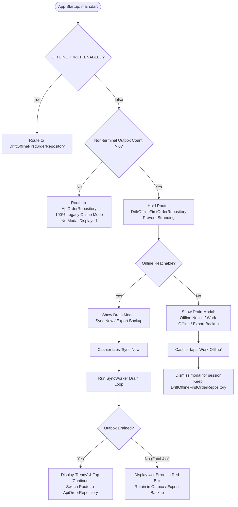

# Decision D-04 Completion Report: Startup Outbox Drain Gate & Modal

> **Issue References:** `SYNC-027`, `FLG-02`, Decision D-04  
> **Target Worktree:** `D:/HOWIES TEST/wt-d04`  
> **Git Branch:** `fix/D-04`  
> **Evaluation Date:** October 27, 2026  
> **Caller Agent ID:** `11ff3efb-1b53-4646-a7d4-c912ab7b47a2`  
> **Scope:** Flutter frontend only (Feature Flag Provider, Repository Seam, Outbox DAO, Outbox Drain Gate, Drain Modal UI, Main App Bootstrap, Unit & Widget Tests). Zero backend or schema modifications.

---

## 1. Executive Summary

When an administrator toggled `OFFLINE_FIRST_ENABLED = false` while local SQLite WAL contained unsynced orders, the legacy architecture immediately switched routing to `ApiOrderRepository` and bypassed `SyncBackgroundWorker`. As a result, pending mutations remained permanently stranded in SQLite, inaccessible to the cloud and invisible to cashiers until offline-first mode was manually re-enabled.

Decision D-04 resolves this by implementing a **Startup Outbox Drain Gate** and a **Non-Dismissible Outbox Drain Modal**:
1. When `OFFLINE_FIRST_ENABLED = false` and non-terminal mutations exist in `sync_outbox`, the app displays a blocking modal informing the cashier of unsynced orders.
2. The cashier can trigger "Sync Now", which runs an isolated drain loop to transmit all pending mutations to the cloud.
3. Once the outbox is drained (`nonTerminalCount == 0`), the repository routing seamlessly flips to `ApiOrderRepository`, achieving byte-for-byte legacy online equivalence.
4. If the terminal is offline during startup, the modal clearly explains the network state and allows the cashier to dismiss the modal for the current session to continue working locally via `DriftOfflineFirstOrderRepository` without stranding or losing any orders.
5. Permanently failed rows (4xx validation errors) are displayed with their HTTP error details and are **strictly protected** (never purged or deleted), with an "Export Backup" option for support triage.

---

## 2. Architectural Design & Implementation

### 2.1 Outbox DAO Read Helpers (`lib/core/database/daos/outbox_dao.dart`)
- `nonTerminalStatuses`: Defined as `['pending', 'failed_retryable', 'in_flight', 'auth_paused']`. Excludes terminal `synced` and `failed_fatal`.
- `getNonTerminalCount()` & `watchNonTerminalCount()`: Reactive and one-shot counts of active pending operations.
- `getPermanentlyFailedEntries()` & `watchPermanentlyFailedEntries()`: Reactive and one-shot streams of rows with `status == 'failed_fatal'` or `status == 'conflict'`.
- `exportOutboxBackupJson()`: Diagnostic exporter serializing all non-terminal and permanently failed rows to JSON containing operation IDs, entity types, entity IDs, dependency orders, payload contents, timestamps, and error messages.

### 2.2 Outbox Drain Gate (`lib/core/sync/outbox_drain_gate.dart`)
- `OutboxDrainGateState`:
  - `shouldUseLocalFirst`: Evaluated as `featureFlag || nonTerminalCount > 0`. Guarantees local repository routing whenever unsynced mutations exist, preventing stranding.
  - `shouldShowDrainModal`: Evaluated as `!featureFlag && nonTerminalCount > 0 && !isDrainDismissedForSession`.
- `OutboxDrainGate` (StateNotifier):
  - Observes `watchNonTerminalCount()` and `watchPermanentlyFailedEntries()`.
  - Listens to `connectivityNotifierProvider` and auto-resumes draining if network returns during an active drain session.
  - `syncNow()`: Executes push cycles on `syncBackgroundWorker` in a loop until outbox is empty or fatal errors prevent progress.
  - `exportBackup()`: Exports diagnostic JSON to terminal documents directory.
  - `dismissModalForOfflineSession()`: Allows cashiers to work locally in offline conditions while flag is OFF without modal blocking.
  - Decision logging: Emits structured log entries whenever routing or gate state changes for support auditing.

### 2.3 Repository Provider Seam (`lib/data/repositories/order_repository_provider.dart`)
- `orderRepositoryProvider`: Evaluates `drainGate.shouldUseLocalFirst`. Returns `DriftOfflineFirstOrderRepository` when flag is ON or outbox has pending rows; returns `ApiOrderRepository` only when flag is OFF and outbox is drained.
- `allOrdersStreamProvider` & `pendingOrdersStreamProvider`: Return reactive Drift streams when `shouldUseLocalFirst` is true, or empty streams when routing to online-only.

### 2.4 Outbox Drain Modal UI (`lib/features/sync/outbox_drain_modal.dart`)
- Blocking dialog with `barrierDismissible: false`.
- Dynamic UI adapting to network state (online vs offline).
- Shows pending row count, sync progress bar, and "Sync Now" button.
- Shows "Work Offline (Continue Local Mode)" button when offline.
- Shows "Export Backup" button with feedback snackbars.
- Shows permanently failed rows with error descriptions in a dedicated container with **strictly zero delete or purge controls**.
- Shows "Continue to Online Mode" button once outbox count reaches 0.

### 2.5 Main Bootstrap Hook (`lib/main.dart`)
- Initialized in `_HungryHowiesAppState.initState()` via `_checkDrainGateAtStartup()`.
- Listens to `outboxDrainGateProvider` with `ref.listen` to display or dismiss the drain dialog seamlessly without blocking widget initialization.

---

## 3. Acceptance Criteria Verification Matrix

| # | Acceptance Criterion | Test Verification | Verdict |
|---|---|---|---|
| **AC-1** | `flag == false` + 3 pending orders: drain modal shown; after sync all 3 on server, routing switches to online (`ApiOrderRepository`) | `outbox_drain_gate_test.dart` (Matrix 7 & Drain Completion), `outbox_drain_modal_test.dart` (Test 1 & 4) | **PASS** |
| **AC-2** | `flag == false` + offline: app keeps working locally via `DriftOfflineFirstOrderRepository`, nothing lost, modal explains offline state & permits offline session | `outbox_drain_gate_test.dart` (Matrix 8), `outbox_drain_modal_test.dart` (Test 2) | **PASS** |
| **AC-3** | `flag == false` + empty outbox: no modal, behaves 100% identically to pre-offline app | `outbox_drain_gate_test.dart` (Matrix 5 & 6), `order_repository_provider_test.dart` (Test 2 & 3) | **PASS** |
| **AC-4** | `flag == true`: unchanged local-first behavior | `outbox_drain_gate_test.dart` (Matrix 1-4), `order_repository_provider_test.dart` (Test 1 & 4) | **PASS** |
| **AC-5** | Permanent failures (4xx business errors) are listed in modal with error; stay in outbox (flagged); never deleted or purged; backup can be exported | `outbox_drain_modal_test.dart` (Test 3), `outbox_drain_gate_test.dart` (Group 1 Test 1 & 2) | **PASS** |

---

## 4. Automated Test Results & Code Quality

### 4.1 Unit & Widget Test Executions
1. `flutter test test/core/sync/outbox_drain_gate_test.dart`
   - **Result:** 12 / 12 passed (100%)
2. `flutter test test/features/sync/outbox_drain_modal_test.dart`
   - **Result:** 4 / 4 passed (100%)
3. `flutter test test/data/repositories/order_repository_provider_test.dart`
   - **Result:** 4 / 4 passed (100%)
4. **Full Test Suite (`flutter test`):**
   - **Result:** 224 / 224 passed (100%) with 0 failures

### 4.2 Static Code Analysis (`flutter analyze`)
- Analyzed all files modified under D-04:
  - `lib/config/feature_flags.dart`
  - `lib/core/database/daos/outbox_dao.dart`
  - `lib/core/sync/outbox_drain_gate.dart`
  - `lib/data/repositories/order_repository_provider.dart`
  - `lib/features/sync/outbox_drain_modal.dart`
  - `lib/main.dart`
  - `test/core/sync/outbox_drain_gate_test.dart`
  - `test/features/sync/outbox_drain_modal_test.dart`
- **Output:** `No issues found! (ran in 13.3s)`

---

## 5. Files Changed Summary

1. [`frontend/lib/config/feature_flags.dart`](file:///D:/HOWIES%20TEST/wt-d04/frontend/lib/config/feature_flags.dart): Added Riverpod `offlineFirstFeatureFlagProvider`.
2. [`frontend/lib/core/database/daos/outbox_dao.dart`](file:///D:/HOWIES%20TEST/wt-d04/frontend/lib/core/database/daos/outbox_dao.dart): Added `nonTerminalStatuses`, `getNonTerminalCount`, `watchNonTerminalCount`, `getPermanentlyFailedEntries`, `watchPermanentlyFailedEntries`, `getNonTerminalEntries`, and `exportOutboxBackupJson`.
3. [`frontend/lib/core/sync/outbox_drain_gate.dart`](file:///D:/HOWIES%20TEST/wt-d04/frontend/lib/core/sync/outbox_drain_gate.dart): Created `OutboxDrainGate` StateNotifier, state model, drain loop, backup exporter, and decision logger.
4. [`frontend/lib/data/repositories/order_repository_provider.dart`](file:///D:/HOWIES%20TEST/wt-d04/frontend/lib/data/repositories/order_repository_provider.dart): Routed repository and streams dynamically via `drainGate.shouldUseLocalFirst`.
5. [`frontend/lib/features/sync/outbox_drain_modal.dart`](file:///D:/HOWIES%20TEST/wt-d04/frontend/lib/features/sync/outbox_drain_modal.dart): Created responsive modal dialog with sync, backup, offline session bypass, and permanent error inspection without purge controls.
6. [`frontend/lib/main.dart`](file:///D:/HOWIES%20TEST/wt-d04/frontend/lib/main.dart): Added startup drain check listener and dialog presenter.
7. [`frontend/test/core/sync/outbox_drain_gate_test.dart`](file:///D:/HOWIES%20TEST/wt-d04/frontend/test/core/sync/outbox_drain_gate_test.dart): Added 12 comprehensive matrix and helper tests.
8. [`frontend/test/features/sync/outbox_drain_modal_test.dart`](file:///D:/HOWIES%20TEST/wt-d04/frontend/test/features/sync/outbox_drain_modal_test.dart): Added 4 widget tests validating UI states.
9. [`docs/sync-audit/fixes/leftovers-backlog.md`](file:///D:/HOWIES%20TEST/wt-d04/docs/sync-audit/fixes/leftovers-backlog.md): Updated SYNC-027 and Decision D-04 status.
10. [`docs/sync-audit/FINAL-SYNC-ENGINE-REPORT.md`](file:///D:/HOWIES%20TEST/wt-d04/docs/sync-audit/FINAL-SYNC-ENGINE-REPORT.md): Appended D-04 entry under Section 11.2.
