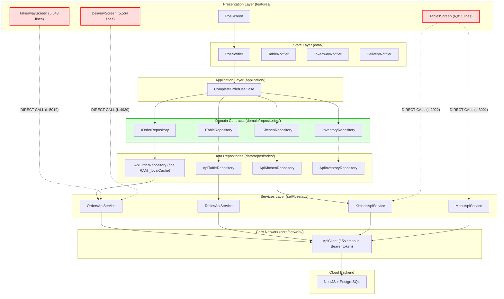

# 01. Flutter Architecture & Technical Baseline Audit

> **Target Output File:** `docs/offline-analysis/01-flutter-architecture.md`  
> **Auditor Role:** `flutter-architecture-auditor (Wave 1)`  
> **Audited Repository:** Hungry Howie's POS (Flutter Desktop Windows POS Frontend + NestJS/Prisma/PostgreSQL Backend)  
> **Mode:** Read-Only Audit & Offline-First Technical Feasibility Analysis  

---

## 1. Executive Summary & Core Platform Specifications

Hungry Howie's POS is an enterprise point-of-sale and restaurant management application specifically tailored for Windows desktop hardware (thermal receipt printing, cash drawer kickers, barcode scanners) alongside web/cloud capabilities. The client architecture is built on Flutter and Riverpod, communicating with a NestJS / PostgreSQL backend via a REST client (`ApiClient`) and Socket.IO real-time channel (`KitchenSocketService`).

### Platform & Toolchain Profile

| Component | Audited Version / Configuration | Evidence Citation |
|---|---|---|
| **Flutter SDK** | `3.44.8` (Channel `stable`, Framework revision `058e0af2c2`) | CLI `flutter --version` |
| **Dart SDK** | `3.12.2` (Constraint in `pubspec.yaml`: `^3.12.2`) | `frontend/pubspec.yaml:22`, `frontend/pubspec.lock:841` |
| **Flutter Constraint** | `>=3.44.0` | `frontend/pubspec.lock:842` |
| **FVM (.fvm / .fvmrc)** | **NOT FOUND** (No `.fvm` folder or `.fvmrc` file in repo) | Repository Root Scan |
| **CI/CD Pipeline** | GitHub Actions (`ubuntu-latest`, `subosito/flutter-action@v2`, channel `stable`, unpinned version) | `.github/workflows/ci.yml:83-87` |
| **Windows Runner** | Windows C++ CMake Runner with manifest & direct Win32 plugins | `frontend/windows/CMakeLists.txt:1-55`, `frontend/windows/runner/main.cpp:1-45` |
| **App Bundle / Package** | `hungry_howies_pos` (`version: 1.0.0+1`) | `frontend/pubspec.yaml:1, 19` |

### Windows-Specific Dependencies & Native Bridges

The application relies on direct Windows Win32 API interactions for hardware-level thermal printing without system print dialogs:

1. **`win32: ^5.15.0`** (`frontend/pubspec.lock:808-815`): Transitive FFI dependency used for native Windows subsystem calls.
2. **`NativeWin32Printer` Engine** (`frontend/lib/services/printer/native_printer_io.dart:8-68`):
   - Injects C# P/Invoke code via PowerShell into memory to call `winspool.Drv` (`OpenPrinterW`, `StartDocPrinterW`, `StartPagePrinter`, `WritePrinter`, `EndPagePrinter`, `ClosePrinter`).
   - Directly transmits raw ESC/POS binary bytes to the hardware spooler queue.
   - Discovers installed Windows printers using PowerShell `Get-Printer` (`native_printer_io.dart:152-172`).
   - Probes USB/COM hardware ports (`USB001`, `COM1`, `COM2`, `LPT1`) (`native_printer_io.dart:175-199`).
   - Contains fallback to a standalone native binary `RawSpooler.exe` located at `frontend/windows/RawSpooler.exe` (`native_printer_io.dart:85-98`).
3. **`file_selector_windows` & `printing`** (`frontend/windows/flutter/generated_plugins.cmake:5-8`): Registered native CMake plugins for Windows.

---

## 2. Real `lib/` Folder Tree (Depth 3)

The actual directory hierarchy of `frontend/lib/` is structured below down to depth 3:

```text
frontend/lib/
  main.dart                                  # Application entrypoint & ProviderScope
  application/                               # Application layer (Use Cases & Orchestration)
    orders/
      complete_order_usecase.dart            # Order completion transaction coordinator
  config/                                    # Application global configuration
    api_config.dart                          # Environment base URLs, ports, timeouts
    app_colors.dart                          # Design system color tokens
    app_theme.dart                           # Light & Dark theme definitions & ThemeNotifier
    router.dart                              # GoRouter definitions, role guards & portal shells
  core/                                      # Cross-cutting infrastructural concerns
    database_helper.dart                     # [Stubbed] Previously removed SQLite helper
    responsive_layout.dart                   # Desktop/POS screen breakpoint utilities
    errors/
      failures.dart                          # Clean Architecture domain failure objects
    money/
      money.dart                             # Immutable Money value object & currency formatting
    network/
      api_client.dart                        # Centralized HTTP Client, Token interceptor & error mapping
      kitchen_socket_service.dart            # Real-time WebSocket / Socket.IO v4 client
    result/
      result.dart                            # Functional Result<T, E> monad
    security/
      password_hasher.dart                   # SHA-256 password hashing & salt generator
      permission_checker.dart                # Role & permission validation rules
      token_storage.dart                     # SharedPreferences JWT & session persistence
  data/                                      # Data layer: StateNotifiers & API Repositories
    auth_repository.dart                     # AuthNotifier, AuthState & credentials store
    customer_repository.dart                 # CustomerNotifier & CustomerState
    daily_calculation_repository.dart        # DailyCalculationNotifier & register closing state
    delivery_repository.dart                 # DeliveryNotifier & dispatch state
    expense_repository.dart                  # ExpenseNotifier & expense management state
    inventory_repository.dart                # InventoryNotifier & raw stock tracking
    kitchen_repository.dart                  # KitchenNotifier, KDS state & WebSocket consumer
    network_speed_provider.dart              # NetworkSpeedNotifier & 15s health-check ping
    online_orders_repository.dart            # OnlineOrdersNotifier & aggregators
    pos_repository.dart                      # PosNotifier, active cart & repository singletons
    role_rights_repository.dart              # RoleRightsNotifier & RBAC matrices
    staff_repository.dart                    # StaffNotifier & employee management
    sync_repository.dart                     # DataSyncNotifier & cloud sync ledger state
    table_repository.dart                    # TableNotifier & dine-in floor layout state
    takeaway_repository.dart                 # TakeawayNotifier & token pickup state
    repositories/                            # Concrete API and In-Memory Repository implementations
      api_inventory_repository.dart
      api_kitchen_repository.dart
      api_menu_repository.dart
      api_order_repository.dart
      api_table_repository.dart
      in_memory_auth_repository.dart
      in_memory_inventory_repository.dart
      in_memory_kitchen_repository.dart
      in_memory_menu_repository.dart
      in_memory_order_repository.dart
      in_memory_table_repository.dart
  domain/                                    # Domain layer: Pure enterprise entities & rules
    models/
      customer_model.dart
      daily_calculation_model.dart
      data_sync_model.dart
      database_schema.dart                   # [Legacy] Draft SQLite DDL definitions
      delivery_model.dart
      expense_model.dart
      inventory_item.dart
      menu_item.dart
      online_order_model.dart
      order_model.dart
      restaurant_table.dart
      role_rights_model.dart
      staff_model.dart
      takeaway_model.dart
      user_model.dart
      user_role.dart
      order_types/                           # Typed order sub-details
        dine_in_order_detail.dart
        online_order_detail.dart
        takeaway_order_detail.dart
    repositories/                            # Domain Repository Interface Contracts
      auth_repository.dart                   # IAuthRepository
      inventory_repository.dart              # IInventoryRepository
      kitchen_repository.dart                # IKitchenRepository
      menu_repository.dart                   # IMenuRepository
      order_repository.dart                  # IOrderRepository
      table_repository.dart                  # ITableRepository
    services/                                # Pure domain calculation engines
      order_number_generator.dart            # POS sequential numbers & unique IDs
      order_validation_service.dart          # Checkout business rules validation
      pricing_engine.dart                    # Pure tax, discount, service fee calculations
      stock_deduction_engine.dart            # Recipe & ingredient deduction calculations
  features/                                  # Presentation layer (feature screens & dialogs)
    auth/                                    # LoginScreen, UnauthorizedScreen
    customers/                               # CustomersScreen
    daily_calculation/                       # DailyCalculationScreen, DailyCalculationAdminScreen
      widgets/                               # StartingCashDialog
    dashboard/                               # DashboardScreen (KPI widgets)
    delivery/                                # DeliveryScreen (Dispatch board)
    expenses/                                # ExpensesScreen
    inventory/                               # InventoryScreen (stub)
    kitchen/                                 # KitchenScreen (KDS order cards)
    menu/                                    # MenuScreen (Catalogue management)
    online_orders/                           # OnlineOrdersScreen
    passwords/                               # PasswordManagementScreen
    pos/                                     # PosScreen (Main register & order cart)
    reports/                                 # ReportsScreen, reports_providers.dart
    rights/                                  # RightsScreen (RBAC configuration)
    settings/                                # SettingsScreen
      widgets/                               # PrinterSettingsDialog
    staff/                                   # StaffScreen
    stock/                                   # StockScreen, StockInOutScreen
    sync/                                    # DataSyncScreen (Sync status ledger)
    tables/                                  # TablesScreen (Floor map & active table orders)
    takeaway/                                # TakeawayScreen (Token queue)
  services/                                  # Infrastructural services
    expense_export_service.dart              # CSV/PDF expense exporter
    mock_api_service.dart                    # Mock data seeding
    receipt_printer_service.dart             # Thermal receipt formatting & spooler integration
    report_export_service.dart               # CSV/PDF analytics exporter
    session_manager.dart                     # [Unused/Dead] Duplicate session persistence
    api/                                     # Typed REST HTTP client endpoints
      api_providers.dart                     # Riverpod service providers
      auth_api_service.dart
      customers_api_service.dart
      daily_calculation_api_service.dart
      delivery_api_service.dart
      expenses_api_service.dart
      inventory_api_service.dart
      kitchen_api_service.dart
      menu_api_service.dart
      orders_api_service.dart
      permissions_api_service.dart
      reports_api_service.dart
      settings_api_service.dart
      staff_api_service.dart
      sync_api_service.dart
      tables_api_service.dart
      users_api_service.dart
    download/                                # Cross-platform download helpers
      download_helper.dart
      download_helper_other.dart
      download_helper_web.dart
    printer/                                 # Low-level ESC/POS binary generators
      escpos_builder.dart
      native_printer_io.dart
      native_printer_web.dart
      native_win32_printer.dart
      network_printer.dart
      network_printer_io.dart
      network_printer_web.dart
    sync/
      global_sync_controller.dart            # F5/Ctrl+R keyboard shortcut & sync orchestrator
  shared/                                    # Reusable UI widgets
    widgets/
      cashier_sidebar_footer.dart
      cashier_top_navigation_bar.dart
      confirm_delete_dialog.dart
      glass_card.dart
      navigation_sidebar.dart
      stat_card.dart
      status_badge.dart
      sync_button.dart
      top_app_bar.dart
```

---

## 3. State Management & Dependency Injection Audit

### Riverpod Usage Style

| Pattern / Class | Frequency | Codegen? | Implementation Notes & Citation |
|---|---|---|---|
| **`StateNotifier<T>`** | **16 classes** | **NO** | Manual Riverpod 2.5.1 `StateNotifier` classes controlling feature states. (`frontend/lib/data/*.dart`) |
| **`StateNotifierProvider`** | **16 providers** | **NO** | Primary mechanism for binding UI screens to state. (`frontend/lib/data/*.dart`) |
| **`Provider<T>`** | **49 providers** | **NO** | Used for Dependency Injection of stateless singletons, API services, and domain contracts. (`frontend/lib/services/api/api_providers.dart:21-96`, `frontend/lib/data/pos_repository.dart:146-174`) |
| **`FutureProvider<T>`** | **3 providers** | **NO** | Used exclusively for reporting queries in `frontend/lib/features/reports/reports_providers.dart:8, 18, 28`. |
| **`StateProvider<T>`** | **2 providers** | **NO** | Used for simple primitive state: `reportFiltersProvider` and `sidebarCollapsedProvider` (`frontend/lib/shared/widgets/navigation_sidebar.dart:14`). |
| **`AsyncNotifier<T>`** | **0** | N/A | Not used anywhere in the codebase. |
| **`ChangeNotifier`** | **1 class** | N/A | Used solely as a bridge `_RiverpodListenable` to hook Riverpod into `GoRouter.refreshListenable` (`frontend/lib/config/router.dart:290-297`). |
| **Riverpod Codegen** | **NONE** | **NO** | Neither `riverpod_generator`, `build_runner`, nor `riverpod_annotation` are declared in `pubspec.yaml`. All providers are hand-written. |

### Complete Inventory of StateNotifier Classes

1. `ThemeNotifier` (`frontend/lib/config/app_theme.dart:6`)
2. `AuthNotifier` (`frontend/lib/data/auth_repository.dart:108`)
3. `CustomerNotifier` (`frontend/lib/data/customer_repository.dart:41`)
4. `DailyCalculationNotifier` (`frontend/lib/data/daily_calculation_repository.dart:85`)
5. `DeliveryNotifier` (`frontend/lib/data/delivery_repository.dart:34`)
6. `ExpenseNotifier` (`frontend/lib/data/expense_repository.dart:30`)
7. `InventoryNotifier` (`frontend/lib/data/inventory_repository.dart:49`)
8. `KitchenNotifier` (`frontend/lib/data/kitchen_repository.dart:50`)
9. `NetworkSpeedNotifier` (`frontend/lib/data/network_speed_provider.dart:46`)
10. `OnlineOrdersNotifier` (`frontend/lib/data/online_orders_repository.dart:60`)
11. `PosNotifier` (`frontend/lib/data/pos_repository.dart:176`)
12. `RoleRightsNotifier` (`frontend/lib/data/role_rights_repository.dart:168`)
13. `StaffNotifier` (`frontend/lib/data/staff_repository.dart:47`)
14. `DataSyncNotifier` (`frontend/lib/data/sync_repository.dart:50`)
15. `TableNotifier` (`frontend/lib/data/table_repository.dart:42`)
16. `TakeawayNotifier` (`frontend/lib/data/takeaway_repository.dart:39`)

### Dependency Injection (DI) Mechanism

There are no secondary DI containers (no GetIt, injectable, kiwi, or provider package). All dependencies are injected via constructor arguments and resolved through Riverpod's `ref.read` and `ref.watch`.

- **API Services wiring** (`frontend/lib/services/api/api_providers.dart:21-96`): Single `apiClientProvider` injected into all typed API services.
- **Repositories wiring** (`frontend/lib/data/pos_repository.dart:145-174`): Domain interfaces (`IOrderRepository`, `ITableRepository`, `IInventoryRepository`, `IKitchenRepository`) bound to `Api*Repository` implementations using `ref.read(...)`.
- **Use Case wiring** (`frontend/lib/data/pos_repository.dart:165-174`): `CompleteOrderUseCase` receives repository interfaces and domain engines via constructor injection.

---

## 4. Navigation & Route Guard Architecture

The routing infrastructure is defined in `frontend/lib/config/router.dart` using `go_router: ^14.2.0`.

### Route Architecture & Scoped Portals

The application implements three isolated role-based portals wrapped inside a shell layout:

1. **Owner Portal (`/owner/...`)**: Unrestricted access to all managerial, configuration, financial, sync, and POS routes (`router.dart:88-114`).
2. **Manager Portal (`/manager/...`)**: Access to operational, stock, menu, staff, and report routes (`router.dart:119-143`).
3. **Cashier / Sales Portal (`/sales/...`)**: Streamlined operational interface optimized for fast touch checkout, dine-in tables, takeaway, and delivery dispatch (`router.dart:148-173`).

### Guards & Redirect Logic (`router.dart:40-74`)

- **Reactive Refresh Listener:** `_RiverpodListenable(ref, authProvider)` triggers `GoRouter.refresh()` whenever `AuthState` changes (`router.dart:39, 290-297`).
- **Unauthenticated Barrier:** Any unauthenticated access to paths other than `/login` redirects to `/login` (`router.dart:47-49`).
- **Default Landing Dispatcher:** Visiting `/login` while authenticated immediately routes to the role default:
  - `UserRole.owner` $\to$ `/owner/tables` (`router.dart:54-55`)
  - `UserRole.manager` $\to$ `/manager/dashboard` (`router.dart:56-57`)
  - `UserRole.cashier` $\to$ `/sales/tables` (`router.dart:58-59`)
- **Strict Role Boundaries:**
  - Non-owners navigating to `/owner/...` redirect to `/unauthorized` (`router.dart:65-67`).
  - Cashiers navigating to `/manager/...` redirect to `/unauthorized` (`router.dart:68-70`).

### Shell Layout & Hardware Lifecycle Interceptors

All portals are wrapped inside `_PortalShellWrapper` (`router.dart:186-288`):
1. **Adaptive Navigation Shell:**
   - Cashiers (`/sales/...`): Rendered with top-mounted `CashierTopNavigationBar` for rapid touch access (`router.dart:247-255`).
   - Managers/Owners: Rendered with collapsible left-rail `NavigationSidebar` (`router.dart:256-263`).
2. **Starting Cash Float Enforcement Gate:**
   - On frame load, `_checkStartingCashGate()` checks if the logged-in cashier has an open register session (`router.dart:225-240`). If no active session exists, a non-dismissible `StartingCashDialog` is displayed.
3. **Hardware Shortcut Keys:**
   - Intercepts physical keypresses `F5` and `Ctrl + R` via `CallbackShortcuts` to invoke `GlobalSyncController.syncAndRefreshAll(...)` (`router.dart:265-281`).

---

## 5. Network Layer & REST API Client Audit

### HTTP Package & Client Structure

- **HTTP Package:** `package:http/http.dart` (`http: ^1.2.0`, `pubspec.yaml:36`). Dio is NOT used.
- **Client Class:** `ApiClient` (`frontend/lib/core/network/api_client.dart:82-344`).

### Network Settings & Timeouts

| Parameter | Value | Evidence Citation |
|---|---|---|
| **Base REST URL** | `http://localhost:3000/api` (Desktop/Web fallback) or `http://10.0.2.2:3000/api` (Android) or `String.fromEnvironment('API_BASE_URL')` | `frontend/lib/config/api_config.dart:6, 12-20` |
| **Request Timeout** | `15 seconds` (`Duration(seconds: 15)`) | `frontend/lib/config/api_config.dart:34`, `api_client.dart:228, 255` |
| **Connect Timeout** | `10 seconds` (`Duration(seconds: 10)`) | `frontend/lib/config/api_config.dart:35` |
| **Retry Policy** | **NOT FOUND / NONE** (Zero retry loops, backoff, or jitter) | `frontend/lib/core/network/api_client.dart:219-343` |

### Interceptors & Pre-flight Header Processing (`api_client.dart:95-112`)

`ApiClient` executes a manual pre-flight check before every HTTP request:
- Adds `'Content-Type': 'application/json'` and `'Accept': 'application/json'`.
- Intercepts auth token via `await TokenStorage.getToken()`.
- **Offline Token Filtering:** Explicitly filters out local fallback tokens:
  ```dart
  if (token != null && token.isNotEmpty && !token.startsWith('local_offline_token_')) {
    headers['Authorization'] = 'Bearer $token';
  }
  ```
  *(Citation: `frontend/lib/core/network/api_client.dart:103`)*

### Exception & Status Code Mapping (`api_client.dart:154-216`)

| HTTP Status | Thrown Exception | Side Effects |
|---|---|---|
| `200..299` | None (Returns parsed JSON body) | Debug logging in debug mode |
| `401 Unauthorized` | `UnauthorizedException` | Clears local session (`TokenStorage.clearSession()`) & invokes `onUnauthorized?.call()` (`api_client.dart:191-194`) |
| `403 Forbidden` | `ForbiddenException` | Throws permission error (`api_client.dart:195-196`) |
| `404 Not Found` | `NotFoundException` | Throws resource missing error (`api_client.dart:197-198`) |
| `409 Conflict` | `ConflictException` | Throws concurrency conflict error (`api_client.dart:199-200`) |
| `400 / 422` | `ValidationException` | Extracts validation message arrays (`api_client.dart:201-206`) |
| `>= 500` | `ApiException` | Server error wrapper (`api_client.dart:207-213`) |
| Network / Socket Fail | `ApiException` / `NetworkException` | On `TimeoutException`, wraps into `NetworkException` (`api_client.dart:230-238`) |

### Inventory of Typed API Services

All services inherit or compose `ApiClient` and are registered in `frontend/lib/services/api/api_providers.dart`:

| Service Class | Base Path | Key Methods | File Citation |
|---|---|---|---|
| `AuthApiService` | `/auth` | `login()`, `getMe()`, `logout()` | `frontend/lib/services/api/auth_api_service.dart:1-55` |
| `UsersApiService` | `/users` | `listUsers()`, `updateUser()`, `resetPassword()` | `frontend/lib/services/api/users_api_service.dart:1-68` |
| `StaffApiService` | `/staff` | `listStaff()`, `clockIn()`, `clockOut()` | `frontend/lib/services/api/staff_api_service.dart:1-118` |
| `PermissionsApiService` | `/permissions` | `getRolePermissions()`, `updatePermissions()` | `frontend/lib/services/api/permissions_api_service.dart:1-45` |
| `MenuApiService` | `/menu` | `listCategories()`, `listItems()`, `listDeals()` | `frontend/lib/services/api/menu_api_service.dart:1-240` |
| `OrdersApiService` | `/orders` | `listOrders()`, `getOrderById()`, `createOrder()`, `updateOrderStatus()` | `frontend/lib/services/api/orders_api_service.dart:1-140` |
| `TablesApiService` | `/tables` | `listTables()`, `updateTableStatus()`, `transferTable()` | `frontend/lib/services/api/tables_api_service.dart:1-142` |
| `KitchenApiService` | `/kitchen` | `listOrders()`, `updateStatus()`, `sendKitchenTicket()` | `frontend/lib/services/api/kitchen_api_service.dart:1-74` |
| `DeliveryApiService` | `/delivery` | `listOrders()`, `assignDriver()`, `updateDeliveryStatus()` | `frontend/lib/services/api/delivery_api_service.dart:1-135` |
| `InventoryApiService` | `/inventory`| `listItems()`, `deductStock()`, `recordStockTransaction()` | `frontend/lib/services/api/inventory_api_service.dart:1-134` |
| `ExpensesApiService` | `/expenses` | `listExpenses()`, `createExpense()`, `deleteExpense()` | `frontend/lib/services/api/expenses_api_service.dart:1-96` |
| `DailyCalculationApiService` | `/daily-calculation` | `getActiveSession()`, `startSession()`, `closeSession()` | `frontend/lib/services/api/daily_calculation_api_service.dart:1-125` |
| `CustomersApiService` | `/customers`| `listCustomers()`, `createCustomer()`, `searchCustomers()` | `frontend/lib/services/api/customers_api_service.dart:1-58` |
| `SettingsApiService` | `/settings` | `getSettings()`, `updateSettings()` | `frontend/lib/services/api/settings_api_service.dart:1-26` |
| `ReportsApiService` | `/reports` | `getSummaryReport()`, `getSalesByProduct()`, `getCancelledOrders()` | `frontend/lib/services/api/reports_api_service.dart:1-138` |
| `SyncApiService` | `/sync` | `getSyncOverview()`, `syncSingleOrder()`, `syncBatchOrders()` | `frontend/lib/services/api/sync_api_service.dart:1-71` |

---

## 6. Real-Time WebSocket & Socket.IO Architecture

### WebSocket Infrastructure

- **Package:** `web_socket_channel: ^3.0.1` (`pubspec.yaml:37`, `pubspec.lock:800-807`).
- **Target Gateway:** NestJS Kitchen Gateway (`backend/src/kitchen/kitchen.gateway.ts:46-52`).
- **Implementation:** `KitchenSocketService` (`frontend/lib/core/network/kitchen_socket_service.dart:10-182`).

### Protocol Implementation (Socket.IO v4 Handshake over WebSocket)

`KitchenSocketService` hand-rolls the Engine.IO / Socket.IO v4 client protocol on top of raw WebSocket frames:

1. **Connection URI:** `ws://<host>:3000/socket.io/?EIO=4&transport=websocket&token=<jwt>` (`kitchen_socket_service.dart:31-39`).
2. **Auth Handshake Frame:** Transmits Engine.IO packet `40{"token":"..."}` upon channel open (`kitchen_socket_service.dart:47-48`).
3. **Heartbeat / Ping:**
   - Active timer every 20 seconds sends Engine.IO ping packet `'2'` (`kitchen_socket_service.dart:61-65`).
   - On incoming ping `'2'`, immediately replies with Engine.IO pong `'3'` (`kitchen_socket_service.dart:74-77`).
4. **Data Event Frames:** Socket.IO event frames `42["event_name", {payload}]` are parsed and routed to registered callbacks (`kitchen_socket_service.dart:83-97`).
5. **Auto-Reconnect:** On disconnect or socket failure, cancels timers and launches a 5-second backoff reconnect timer (`kitchen_socket_service.dart:129-138`).

### Event Handling & Consumers

`KitchenNotifier` (`frontend/lib/data/kitchen_repository.dart:50-140`) is currently the **sole consumer** of `KitchenSocketService`:
- Dispatches room join message `42["join_kitchen",{}]` (`kitchen_socket_service.dart:160`).
- Listens for events:
  - `order.created`, `kitchen.order_created`
  - `order.updated`, `kitchen.order_updated`
  - `order.status_changed`, `kitchen.status_changed`
  - `order.ready`, `kitchen.order_ready`
  - `kitchen.ticket_sent`, `order.cancelled`
- On event receipt, updates in-memory `KitchenState.kitchenOrders` (`kitchen_repository.dart:126-140`).

> [!IMPORTANT]  
> **WebSocket is Strictly Notification-Only:**  
> The WebSocket gateway emits notifications of state changes. It does NOT serve as an offline transaction store or sync transport. If the WebSocket connection drops, the app functions normally over REST.

---

## 7. Background Services, Timers & Isolates Audit

| Mechanism | Status | Details & Citation |
|---|---|---|
| **Background Services (OS Level)** | **NOT FOUND** | No `workmanager`, `flutter_background_service`, or Windows background services configured in Flutter. |
| **Dart Isolates / `compute()`** | **NOT FOUND** | Zero usage of `Isolate.spawn()` or `compute()`. All JSON parsing, cryptography, and printing run directly on the main UI isolate. |
| **Socket Ping Timer** | **Active** | `Timer.periodic(const Duration(seconds: 20))` in `KitchenSocketService` (`kitchen_socket_service.dart:61`). |
| **Socket Reconnect Timer** | **Active** | One-shot `Timer(const Duration(seconds: 5))` in `KitchenSocketService` (`kitchen_socket_service.dart:133`). |
| **Network Speed Polling Timer** | **Active** | `Timer.periodic(const Duration(seconds: 15))` in `NetworkSpeedNotifier` (`network_speed_provider.dart:64`). |
| **UI Delivery / KDS Timers** | **Active** | Timers in `delivery_screen.dart` and `online_orders_screen.dart` for elapsed order counters and driver dispatch animations. |

---

## 8. Connectivity & Network Detection Audit

- **Package:** `connectivity_plus` is **NOT FOUND** in `pubspec.yaml`.
- **Current Approach:** Custom active polling implemented in `NetworkSpeedNotifier` (`frontend/lib/data/network_speed_provider.dart:46-149`).

### Detection Flow & Classification (`network_speed_provider.dart:69-129`)

Every 15 seconds, a `Stopwatch` measures HTTP latency:
1. First probes `GET ${ApiConfig.baseUrl}/health` (3-second timeout).
2. If unreachable, probes `GET https://httpbin.org/status/200` (3-second timeout).
3. If both fail, marks state as `NetworkSpeedLevel.offline` (`latencyMs: 9999`).
4. If reachable, categorizes latency:
   - `< 120 ms` $\to$ `NetworkSpeedLevel.fast` (Green)
   - `< 350 ms` $\to$ `NetworkSpeedLevel.medium` (Orange)
   - `>= 350 ms` $\to$ `NetworkSpeedLevel.slow` (Red)

> [!WARNING]  
> Polling via HTTP GET every 15 seconds introduces constant network chatter. For an offline-first architecture, this should be complemented with OS-level socket/interface state detection, while retaining health pings for backend reachability.

---

## 9. Local Storage, Security & Caching Audit

### Current Storage Matrix

| Storage Mechanism | Purpose / Keys Stored | Encryption / Security | Citation |
|---|---|---|---|
| **`SharedPreferences`** | Session Token (`auth_jwt_token`), User ID, Email, Username, Role | **NONE (Plaintext)** stored in Windows registry / app data JSON | `frontend/lib/core/security/token_storage.dart:6-47` |
| **`SharedPreferences`** | Offline User Hashes & Salts (`_prefHashPrefix*`, `_prefSaltPrefix*`, `_prefCustomUsersKey`) | **SHA-256 Hashes** (Hashes & salts stored in plaintext pref keys) | `frontend/lib/data/repositories/in_memory_auth_repository.dart:80-115` |
| **`SharedPreferences`** | Thermal Printer Preferences (Printer name, port, IP, baud, cut flag) | Plaintext | `frontend/lib/services/receipt_printer_service.dart:706-750` |
| **`DatabaseHelper`** | Formerly SQLite helper | **STUBBED / REMOVED** ("Pure Frontend Mode: Backend / SQLite database helper removed.") | `frontend/lib/core/database_helper.dart:1-6` |
| **`DatabaseSchema`** | Draft table definitions (`users`, `orders`, `inventory`, etc.) | **UNUSED STRING CONSTANTS** | `frontend/lib/domain/models/database_schema.dart:1-74` |
| **`SessionManager`** | Duplicate session persistence (`auth_user_id`, `auth_user_name`, `auth_is_logged_in`) | **DEAD CODE / UNUSED** | `frontend/lib/services/session_manager.dart:1-53` |
| **`secure_storage`** | Secure credential store | **NOT FOUND** (No `flutter_secure_storage` in pubspec) | `frontend/pubspec.yaml:30-51` |

### In-Memory Caching Mechanisms

1. **`TokenStorage._cachedToken`** (`token_storage.dart:13-16`): Static in-memory cache to prevent asynchronous disk reads on every HTTP request.
2. **`ApiOrderRepository._localCache`** (`api_order_repository.dart:7, 17-21, 65`): Ephemeral `List<OrderModel>` cache that holds orders in RAM. When offline, `saveOrder()` pushes to `_localCache`, but **data is permanently lost if the application is closed or crashes before cloud sync**.
3. **`InMemoryAuthRepository._credentials` & `_allUsers`** (`in_memory_auth_repository.dart:28-40`): In-memory user credential maps populated at startup.
4. **Riverpod Feature States** (`PosState`, `TableState`, `KitchenState`, etc.): Hold UI model lists in memory during runtime.

---

## 10. Authentication, Session & Token Lifecycle Audit

### Login Execution Flow (`frontend/lib/data/auth_repository.dart:332-420`)

```text
[User Submits Credentials in LoginScreen]
                  │
                  ▼
         AuthNotifier.login()
                  │
        ┌─────────┴─────────┐
        ▼                   ▼
 [Network Online]     [Network Failure / Offline]
        │                   │
  POST /api/auth/login      │
        │                   │
  Extract JWT & User        │
        │                   ▼
  TokenStorage.saveUserSession()  _loginFallback() (in_memory_auth_repository.dart)
        │                   │
  state = Authenticated     Verify SHA-256 hash & salt against SharedPreferences
        │                   │
  GoRouter redirects        TokenStorage.saveUserSession(token: "local_offline_token_*")
  to Role Home              │
                            state = Authenticated (Local Offline)
```

1. **Online REST Authentication (`auth_repository.dart:350-400`):**
   - Posts `username` and `password` to `POST /api/auth/login`.
   - On success, extracts JWT token, parses role (`owner`, `manager`, `cashier`), fetches staff profile, and persists session to `TokenStorage`.
   - Triggers `loadUsersFromBackend()`.
2. **Offline Fallback Authentication (`auth_repository.dart:422-472`):**
   - Triggered on `NetworkException` or network timeout.
   - Searches local credentials in `_fallbackRepository` (`InMemoryAuthRepository`).
   - Verifies salted SHA-256 password hash using `PasswordHasher.verifyPassword()` (`password_hasher.dart:21-34`).
   - If valid, generates an offline placeholder token: `local_offline_token_${cred.username}`.
   - Stores session via `TokenStorage.saveUserSession(...)`.
   - Allows cashier/manager into the POS with full local privileges.
3. **Session Restoration (`auth_repository.dart:267-325`):**
   - On app startup, `_restoreSession()` reads `TokenStorage.getUserSession()`.
   - Attempts verification against `GET /api/auth/me`.
   - If backend is offline but local session exists, grants authenticated status based on local session data.
4. **Logout Flow (`auth_repository.dart:482-500`):**
   - Calls `_authApiService.logout()`.
   - Clears `TokenStorage.clearSession()`.
   - Resets `AuthState.isAuthenticated = false`, triggering GoRouter redirect to `/login`.

---

## 11. Current Presentation-to-API Layer Diagrams

### Sequence Diagram: POS Order Checkout Flow Today

The diagram below traces how a checkout command travels from the UI screen to the cloud backend under the existing architecture:

```mermaid
sequenceDiagram
    autonumber
    actor Cashier
    participant UI as PosScreen / TablesScreen
    participant Notifier as PosNotifier (pos_repository.dart)
    participant UseCase as CompleteOrderUseCase (complete_order_usecase.dart)
    participant Validation as OrderValidationService
    participant Pricing as PricingEngine
    participant Repo as ApiOrderRepository (api_order_repository.dart)
    participant ApiService as OrdersApiService (orders_api_service.dart)
    participant Client as ApiClient (api_client.dart)
    participant Backend as NestJS API (/api/orders)

    Cashier->>UI: Clicks "Complete Order" / "Pay & Print"
    UI->>Notifier: completeOrder(paymentMethod)
    Notifier->>UseCase: execute(CompleteOrderCommand)
    
    UseCase->>Validation: validateOrderForCheckout()
    Validation-->>UseCase: Validation Success
    
    UseCase->>Pricing: calculateOrderTotals()
    Pricing-->>UseCase: Calculated Order Totals (Tax, Net, Gross)
    
    UseCase->>Repo: saveOrder(completedOrder)
    Repo->>ApiService: createOrder(order.toCreateOrderDto())
    ApiService->>Client: post('orders', body: dto)
    Client->>Client: Inject 'Authorization: Bearer <JWT>'
    
    alt Online (Network Success)
        Client->>Backend: HTTP POST /api/orders
        Backend-->>Client: 201 Created (Order JSON)
        Client-->>ApiService: ApiResponseWrapper.data
        ApiService-->>Repo: Saved Order JSON
        Repo->>Repo: _localCache.insert(0, createdOrder)
        Repo-->>UseCase: Created OrderModel
    else Offline (Network Failure)
        Client-->>ApiService: Throws NetworkException
        ApiService-->>Repo: Throws NetworkException
        Repo->>Repo: CATCH: _localCache.insert(0, order) [RAM ONLY]
        Repo-->>UseCase: Returns original OrderModel (Ephemeral)
    end
    
    opt Has Active Table
        UseCase->>UseCase: tableRepository.freeTable(tableId)
    end
    opt Has Kitchen Ticket
        UseCase->>UseCase: kitchenRepository.addKitchenOrder(savedOrder)
    end
    opt Has Inventory
        UseCase->>UseCase: inventoryRepository.deductStockByItemName()
    end
    
    UseCase-->>Notifier: Result.success(completedOrder)
    Notifier->>UI: Update PosState (clear cart, increment tokens)
    UI-->>Cashier: Print Thermal Receipt via NativeWin32Printer
```



### Architectural Layer Diagram: Screen Reaching API vs Direct Screen Calls



---

## 12. Local DB Insertion Seams & Architectural Feasibility

The application architecture contains several well-defined Clean Architecture seams where a local database (Drift / SQLite) and an Outbox queue can be introduced without disrupting existing online behavior.

### Seam Inventory Table

| Seam Component | Current Location / Citation | Current Binding | Proposed Offline-First Binding (`OFFLINE_FIRST_ENABLED == true`) | Existing Online Binding (`OFFLINE_FIRST_ENABLED == false`) |
|---|---|---|---|---|
| **Order Repository** | `frontend/lib/data/pos_repository.dart:146` | `ApiOrderRepository` | `OfflineFirstOrderRepository` (Drift local DB + Outbox record) | `ApiOrderRepository` (Direct REST) |
| **Table Repository** | `frontend/lib/data/pos_repository.dart:150` | `ApiTableRepository` | `OfflineFirstTableRepository` (Drift local table layout & active table orders) | `ApiTableRepository` (Direct REST) |
| **Inventory Repository** | `frontend/lib/data/pos_repository.dart:154` | `ApiInventoryRepository`| `OfflineFirstInventoryRepository` (Local stock balances & deduction ledger) | `ApiInventoryRepository` (Direct REST) |
| **Kitchen Repository** | `frontend/lib/data/pos_repository.dart:158` | `ApiKitchenRepository` | `OfflineFirstKitchenRepository` (Local KDS orders & ticket tracking) | `ApiKitchenRepository` (Direct REST) |
| **Menu Repository** | `frontend/lib/domain/repositories/menu_repository.dart:1-12` | `in_memory_menu_repository.dart` | `OfflineFirstMenuRepository` (Cached categories, items, modifiers, deals) | `ApiMenuRepository` (Direct REST) |
| **Auth Repository** | `frontend/lib/data/auth_repository.dart:100` | `InMemoryAuthRepository` | `DriftAuthRepository` (SQLite staff credentials, salted PINs, roles) | `InMemoryAuthRepository` (Prefs fallback) |
| **Data Sync Engine** | `frontend/lib/data/sync_repository.dart:142` | `DataSyncNotifier(SyncApiService)` | `OfflineFirstSyncEngine` (Pulls pending records from local Outbox & uploads via REST) | `DataSyncNotifier` (Queries server sync overview) |

### Feature Flag Integration Pattern

To adhere to the core rule—keeping existing online behavior 100% untouched when disabled:

```dart
final orderRepositoryProvider = Provider<IOrderRepository>((ref) {
  const offlineFirstEnabled = bool.fromEnvironment('OFFLINE_FIRST_ENABLED', defaultValue: false);
  if (offlineFirstEnabled) {
    return ref.read(offlineFirstOrderRepositoryProvider);
  }
  return ApiOrderRepository(ordersApiService: ref.read(ordersApiServiceProvider));
});
```

---

## 13. Technical Debt & Obstacles to Offline-First

During this audit, several concrete implementation hurdles were identified that must be factored into the Phase 2 design:

### 1. Direct Screen-to-API Calls (Bypassing Repositories)
Several key screens bypass Riverpod repositories and directly invoke `*ApiService` methods. When offline, these screens immediately throw unhandled `NetworkException`s unless wrapped in a local repository:
- `tables_screen.dart:2022`: `await ref.read(kitchenApiServiceProvider).sendKitchenTicket(table.activeOrderId!);`
- `tables_screen.dart:3001`: `final menuApi = widget.ref.read(menuApiServiceProvider); await Future.wait([...]);`
- `takeaway_screen.dart:5019`: `await widget.ref.read(ordersApiServiceProvider).getOrderById(widget.order.id);`
- `delivery_screen.dart:4939`: `await widget.ref.read(ordersApiServiceProvider).getOrderById(effectiveOrderId);`
- `menu_screen.dart:406, 2065, 2299, 2692, 3526`: Direct CRUD operations against `MenuApiService`.

### 2. Monolithic Screen Files
Several core UI screens are exceedingly large files that combine UI layout, print formatting, dialog builders, and state mutations:
- `tables_screen.dart`: **6,811 lines** (338 KB)
- `takeaway_screen.dart`: **5,643 lines** (264 KB)
- `delivery_screen.dart`: **5,564 lines** (263 KB)
- `menu_screen.dart`: **3,800+ lines** (284 KB)
Refactoring requires surgical care to avoid breaking complex inline state logic.

### 3. Ephemeral In-Memory Fallbacks (`_localCache`)
`ApiOrderRepository` currently implements an in-memory fallback list: `final List<OrderModel> _localCache = [];` (`api_order_repository.dart:7`). If the network fails during `saveOrder()`, the order is kept in RAM. If the application crashes or is closed, **these orders are permanently lost**. Replacing this with SQLite is urgent for data preservation.

### 4. Backend Batch Sync Endpoint is NOT an Upsert
In `backend/src/sync/sync.service.ts:244-260`, `syncBatchOrders()` assumes orders already exist in Cloud PostgreSQL and merely executes:
```typescript
await this.prisma.order.update({
  where: { id: orderId },
  data: { sync_status: 'synced', is_synced: true, synced_at: now }
});
```
It does **not** currently parse and insert full order items, payments, or customer records for orders that were created purely offline. The backend sync API must be upgraded to support idempotent upserts of complete offline payloads.

### 5. Missing Domain Interfaces for Auxiliary Modules
While `Order`, `Table`, `Kitchen`, `Inventory`, and `Menu` have abstract interfaces in `domain/repositories/`, modules such as `Customers`, `Delivery`, `Expenses`, `Staff`, and `DailyCalculation` communicate directly from their `StateNotifier` to their `*ApiService`. Adding local DB capabilities to these modules requires introducing intermediate repository abstractions.

### 6. Missing Dependencies in `pubspec.yaml`
Currently, `drift`, `sqlite3_flutter_libs`, and `path_provider` are not declared in `frontend/pubspec.yaml`. On Windows desktop, Drift requires the native SQLite C-library (`sqlite3.dll`), which `sqlite3_flutter_libs` bundles.

---

## 14. Data State Classification Matrix

To guarantee strict separation of concerns, data states across the application must be classified as follows:

| State Category | Definition | Current Representation in Code | Target Offline-First Representation |
|---|---|---|---|
| **Local State** | UI-only transient state (cursor, dialog visibility, cart selections, active tab) | Flutter widget `setState()` & Riverpod `PosState.currentCart` | Kept in Riverpod / widget state. Never persisted to SQLite or Cloud. |
| **Server State** | Authoritative data living in PostgreSQL Cloud | API responses deserialized into models (`OrderModel.fromBackendJson`) | PostgreSQL remains single source of truth; replicated downward to local Drift DB. |
| **Pending State** | Changes created/modified locally while offline, awaiting sync | Held ephemerally in `ApiOrderRepository._localCache` or tagged `is_synced = false` in DB | Persisted in local Drift SQLite with `sync_status = 'pending'`, queued in `sync_outbox` table. |
| **Synced State** | Records successfully acknowledged by both local SQLite and Cloud PostgreSQL | In backend `order.is_synced == true` and `data_sync_logs` table | Drift record `sync_status = 'synced'`, `synced_at = timestamp`, removed or archived in outbox. |
| **Conflict State** | Same entity modified concurrently on multiple terminals or Cloud | Not handled (last HTTP write wins; throws `409 ConflictException`) | Flagged in Drift as `sync_status = 'conflict'`, conflict resolution rules applied (e.g. server-wins, merge, or manual cashier review). |

---

## 15. Questions for the Developer

*(Only questions that the codebase cannot definitively answer on its own)*

1. **Local Multi-Terminal Coordination:**  
   In a multi-terminal restaurant setup (e.g., 2 Cashier POS terminals + 1 Kitchen Display Terminal), when the internet is down, are the terminals expected to communicate with each other over the Local Area Network (LAN Wi-Fi peer-to-peer / local server), or does each terminal operate independently in local offline mode and sync solely with Cloud PostgreSQL once WAN connectivity returns?
2. **Order Numbering Sequence in Offline Mode:**  
   `OrderNumberGenerator` currently generates sequential daily order numbers formatted as `HH-XXXX`. When multiple POS terminals are offline simultaneously, does management accept terminal-prefixed numbers (e.g. `HH-T1-1001`, `HH-T2-1001`) to avoid order number collisions during offline peak hours, or must numbers be reconciled sequentially upon sync?
3. **Menu & Product Master Edits:**  
   Is Menu management (adding items, changing prices, modifying deals in `MenuScreen`) intended to be restricted to Online Mode only, or must owners be permitted to modify menu prices offline on the local terminal and have those changes sync upstream?
4. **Offline Register Closing & Shift Handover:**  
   If an entire shift begins and ends without internet connectivity, can a cashier perform the final "End of Day" cash count and close their register session offline (`DailyCalculationScreen`), with the ledger syncing to the cloud as a completed closed session upon reconnection?
