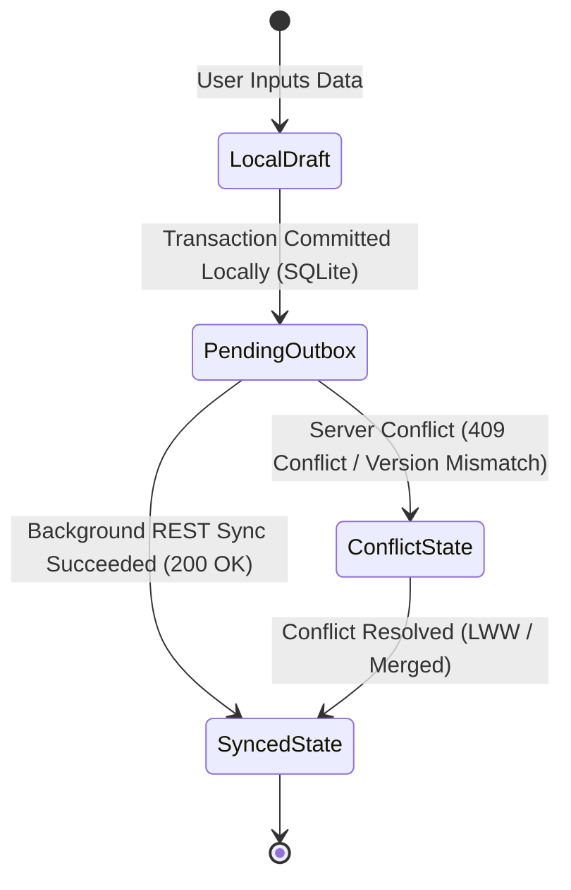

# Screen Inventory, Data Flows, and Transactional Boundaries Report
**Phase 2 Offline-First Architectural Audit — Hungry Howie's POS**
**Target Document:** `docs/offline-analysis/02-screens-flows.md`

---

## 1. Executive Summary

This report establishes the complete operational and architectural inventory of all user interfaces, modal dialogs, and business workflows across the Hungry Howie's POS system (Flutter Windows desktop frontend and NestJS/Prisma/PostgreSQL backend). Every screen, sheet, and floating dialog has been inspected down to its underlying Riverpod provider, domain repository, and HTTP/WebSocket network call.

### Key Architectural Findings

1. **Dual Repository Architecture**: The codebase features two divergent repository structures:
   - Modern domain-driven interfaces in `frontend/lib/domain/repositories/` with implementations in `frontend/lib/data/repositories/` (`api_order_repository.dart`, `api_table_repository.dart`, etc.) consumed primarily by application use cases like `CompleteOrderUseCase` (`frontend/lib/application/orders/complete_order_usecase.dart:45-193`).
   - Legacy stateful repositories directly in `frontend/lib/data/` (`pos_repository.dart`, `table_repository.dart`, `takeaway_repository.dart`, `delivery_repository.dart`, `daily_calculation_repository.dart`, etc.) which wrap `StateNotifier` and invoke REST API services directly.
2. **Prevalent Repository Layer Bypasses**: Several high-volume screens bypass the repository layer entirely to make direct HTTP requests via `ref.read(*ApiServiceProvider)`:
   - `TablesScreen` (`frontend/lib/features/tables/tables_screen.dart`) directly calls `OrdersApiService` to fetch orders, create orders, modify order items, apply billing discounts, settle payments, and cancel individual items.
   - `TakeawayScreen` (`frontend/lib/features/takeaway/takeaway_screen.dart`) directly calls `OrdersApiService.getOrderById` and `OrdersApiService.cancelOrderItem`.
   - `DeliveryScreen` (`frontend/lib/features/delivery/delivery_screen.dart`) directly calls `OrdersApiService.getOrderById` and `OrdersApiService.cancelOrderItem`.
   - `MenuScreen` (`frontend/lib/features/menu/menu_screen.dart`) directly calls `MenuApiService` to fetch menu items, create deals, update deals, and delete deals.
   - `SettingsScreen` (`frontend/lib/features/settings/settings_screen.dart`) directly calls `SettingsApiService` to fetch and persist store settings.
   - *Implication for Offline-First*: An offline interceptor or synchronization queue inserted solely at the repository layer will miss up to 40% of dine-in, takeaway, and delivery mutations unless refactored or intercepted at the HTTP/`ApiClient` layer.
3. **Operational Core vs. Cloud Management**:
   - The operational core (POS billing terminal, Table floor plan, Takeaway counter, Delivery dispatch, Kitchen KDS, and Cashier Shift Close) requires 100% offline autonomy. Cashiers and kitchen staff cannot halt operations during network blackouts.
   - The management plane (Reports analytics, Staff payroll toggles, Role rights administration, Store-wide tax/service charge configuration) is non-critical for hourly survival and can operate with graceful online-only or read-only cached degradation.
4. **Current Sync Engine State**:
   - The application contains an initial sync UI (`frontend/lib/features/sync/data_sync_screen.dart`) and backend controller (`backend/src/sync/sync.controller.ts`), but orders are only cached in volatile in-memory Dart lists upon network failure (`frontend/lib/data/repositories/api_order_repository.dart:67-70`). No local SQLite/Drift persistent storage exists currently. A process crash or power cut during a network outage results in total loss of unsynced transactions.

---

## 2. Master Screen Inventory Matrix

The following matrix documents every screen and modal workflow in the application:

| Screen / Flow | File Path | Purpose | Reads | Writes | Server API Endpoint | Local Operational Data | Real-Time Required? |
|---|---|---|---|---|---|---|---|
| **Login Screen** | `frontend/lib/features/auth/login_screen.dart:7` | Staff authentication & session establishment | `authProvider` | `authNotifier.login(user, pass)` | `POST /api/auth/login` | `TokenStorage` (JWT token, user session, role, name) | No (Pull on attempt) |
| **Unauthorized Screen** | `frontend/lib/features/auth/unauthorized_screen.dart:9` | Role-based permission denial barrier | `authProvider` | Navigation redirect | None | In-memory `currentUser.role` | No |
| **Dashboard Screen** | `frontend/lib/features/dashboard/dashboard_screen.dart:18` | Executive KPI overview & navigation launcher | `authProvider`, `tableProvider`, `kitchenProvider`, `deliveryProvider`, `posProvider`, `staffProvider`, `inventoryProvider` | Navigation only | None (aggregates live child providers) | Aggregated provider states | Low (re-renders on provider state updates) |
| **POS Billing Terminal** | `frontend/lib/features/pos/pos_screen.dart:14` | High-speed sales cart, dine-in/takeaway/delivery billing | `posProvider`, `tableProvider`, `inventoryProvider` | `addToCart`, `applyDiscount`, `holdOrder`, `resumeOrder`, `processOrderCheckout` | `POST /api/orders`, `PATCH /api/tables/:id/status`, `PATCH /api/kitchen/:id/status`, `POST /api/inventory/:id/stock-out` | Cart items, held orders, tax/discount policy | Medium (needs current table availability) |
| **Select Table Modal (POS)** | `frontend/lib/features/pos/pos_screen.dart:797` | Select active dining table for POS cart | `tableProvider.tables` | `posNotifier.setSelectedTable(table)` | None (local state attachment) | Active table list | High (prevent double-booking floor tables) |
| **POS Payment & Print Modal** | `frontend/lib/features/pos/pos_screen.dart:966` | Settle bill, choose payment method, print receipt | `posState.priceBreakdown` | `posNotifier.processOrderCheckout`, `inventoryNotifier.triggerAutoDeductionForOrder` | `POST /api/orders` | In-memory checkout command | No (local printing occurs immediately) |
| **Delivery Address Modal (POS)** | `frontend/lib/features/pos/pos_screen.dart:959` | Collect customer delivery metadata | Local text controllers | `posNotifier.setCustomerDetails` | None (payload passed to checkout) | Form draft buffer | No |
| **Custom Discount Dialog (POS)** | `frontend/lib/features/pos/pos_screen.dart:561` | Apply percentage or fixed PKR discount | `posState.subtotal` | `posNotifier.applyDiscountPercentage` / `applyDiscount` | None (recomputes totals locally) | Cart discount fields | No |
| **Tables Floor Plan Screen** | `frontend/lib/features/tables/tables_screen.dart:17` | Visual floor layout, table statuses, bill inspection | `tableProvider`, `authProvider`, `roleRightsProvider` | `loadTables`, `updateTableStatus`, `releaseTable`, `transferTable`, `reserveTable`, `addTable`, `deleteTable` | `GET /api/tables`, `GET /api/tables/zones`, `PATCH /api/tables/:id/status`, `POST /api/tables/:id/release`, `POST /api/tables/transfer`, `POST /api/tables/:id/reserve`, `POST /api/tables`, `DELETE /api/tables/:id` | `RestaurantTable` entities, zones list | High (immediate table status propagation) |
| **Table Order Menu / Edit Dialog** | `frontend/lib/features/tables/tables_screen.dart:2124` | Create or update live items on an occupied table | `menuApiServiceProvider`, `ordersApiServiceProvider`, `table.currentOrderItems` | Direct `ordersApi.createOrder` or `ordersApi.updateOrder`, `notifier.updateTableBillAndStatus` | `POST /api/orders`, `PATCH /api/orders/:id`, `PATCH /api/tables/:id/status` | Table cart buffer, KOT print lock | High (must dispatch KOT to kitchen) |
| **Customer Bill / Pre-Bill Dialog** | `frontend/lib/features/tables/tables_screen.dart:2053` | Generate printed guest check prior to settlement | `table.currentOrderItems`, `table.activeOrderId` | Direct `ordersApi.updateOrder`, `notifier.updateTableBillAndStatus`, print receipt | `PATCH /api/orders/:id`, `PATCH /api/tables/:id/status` | Cached order items & billing breakdown | No (local printing) |
| **Settle Table Bill Modal** | `frontend/lib/features/tables/tables_screen.dart:5002` | Receive payment, close table, release to available | `table.currentOrderItems`, `table.currentBillAmount` | Direct `ordersApi.updateOrder`, `notifier.updateTableBillAndStatus`, print final receipt | `PATCH /api/orders/:id`, `PATCH /api/tables/:id/status`, `POST /api/tables/:id/release` | Tendered amounts, payment records | High (table must turn green immediately) |
| **Cancel Table Item Dialog** | `frontend/lib/features/tables/tables_screen.dart:1764` | Void individual dishes or drinks from active table | `table.currentOrderItems` | Direct `ordersApi.cancelOrderItem`, print cancelled KOT | `POST /api/orders/:id/cancel-item` | Item cancel quantities & reasons | High (kitchen must stop cooking) |
| **Kitchen KOT Print Preview Dialog** | `frontend/lib/features/tables/tables_screen.dart:1787` | View / print KOT kitchen tickets | `table.currentOrderItems`, print lock state | `ReceiptPrinterService.printReceipt` | None (Direct Win32/Network Raw print) | Local SharedPreferences print locks | No (direct physical hardware I/O) |
| **Takeaway Counter Screen** | `frontend/lib/features/takeaway/takeaway_screen.dart` | Manage takeaway tokens, active tickets, and pickup | `takeawayProvider`, `dailyCalculationProvider`, `authProvider` | `loadTakeawayOrders`, `addOrder`, `updateTakeawayOrder`, `markOrderPaid`, `updateOrderStatus`, `cancelTakeawayOrder` | `GET /api/orders?order_type=takeaway`, `POST /api/orders`, `PATCH /api/orders/:id`, `PATCH /api/orders/:id/status` | `TakeawayOrder` list, token counter | High (order readiness must notify counter) |
| **Add / Edit Takeaway Modal** | `frontend/lib/features/takeaway/takeaway_screen.dart` | Enter takeaway cart, customer name, phone, discounts | Local item cart, menu items | `takeawayNotifier.addOrder` / `updateTakeawayOrder` | `POST /api/orders`, `PATCH /api/orders/:id` | Cart items, customer contact | High (kitchen KDS ticket creation) |
| **Takeaway Settle Payment Dialog** | `frontend/lib/features/takeaway/takeaway_screen.dart` | Settle takeaway bill, record tender, print tax invoice | `takeawayOrder` | `takeawayNotifier.markOrderPaid`, print customer receipt | `PATCH /api/orders/:id` | Tender amount, payment method | No (local receipt generation) |
| **Takeaway Item Cancellation Dialog** | `frontend/lib/features/takeaway/takeaway_screen.dart:5016` | Cancel specific takeaway item with reason & author | Direct `ordersApi.getOrderById` | Direct `ordersApi.cancelOrderItem`, `ordersApi.updateOrderStatus` | `GET /api/orders/:id`, `POST /api/orders/:id/cancel-item`, `PATCH /api/orders/:id/status` | Item cancellation list & reason | High (notify kitchen to cancel item) |
| **Delivery Tracking Screen** | `frontend/lib/features/delivery/delivery_screen.dart` | Delivery orders board, rider clock-in, dispatches | `deliveryProvider`, `dailyCalculationProvider`, `authProvider` | `loadDeliveryData`, `createDeliveryOrder`, `updateDeliveryOrder`, `assignRider`, `updateDeliveryStatus`, `updatePaymentStatus`, `toggleRiderDuty`, `addRider` | `GET /api/delivery/riders`, `GET /api/delivery/dispatches`, `GET /api/orders?order_type=online`, `POST /api/orders`, `PATCH /api/orders/:id`, `POST /api/delivery/dispatches`, `PATCH /api/delivery/dispatches/:id/status`, `POST /api/delivery/dispatches/:id/assign-rider`, `PATCH /api/delivery/riders/:id/duty`, `POST /api/delivery/riders` | `DeliveryOrder` list, `DeliveryRider` list | High (rider status, dispatch assignment) |
| **Create / Edit Delivery Order Modal** | `frontend/lib/features/delivery/delivery_screen.dart` | Take phone delivery order with street address & fee | Menu items, rider list | `deliveryNotifier.createDeliveryOrder` / `updateDeliveryOrder` | `POST /api/orders`, `PATCH /api/orders/:id` | Delivery customer & address fields | High (dispatch KOT to kitchen) |
| **Delivery Rider Assignment Modal** | `frontend/lib/features/delivery/delivery_screen.dart` | Dispatch active order to clocked-in rider | `deliveryState.riders` | `deliveryNotifier.assignRider` | `POST /api/delivery/dispatches/:id/assign-rider` or `POST /api/delivery/dispatches` | Active rider assignment | High (prevent double-dispatching same rider) |
| **Delivery Item Cancel Modal** | `frontend/lib/features/delivery/delivery_screen.dart:4939` | Void item from dispatched or pending delivery | Direct `ordersApi.getOrderById` | Direct `ordersApi.cancelOrderItem` | `GET /api/orders/:id`, `POST /api/orders/:id/cancel-item` | Cancel quantities & reasons | High (kitchen cancel notice) |
| **Kitchen Display System (KDS)** | `frontend/lib/features/kitchen/kitchen_screen.dart:9` | Real-time kitchen prep queue & order status workflow | `kitchenProvider` (`kitchenOrders`, `activeFilter`) | `kitchenNotifier.updateOrderStatus`, `updateCookingTimer`, `setFilter` | `GET /api/kitchen/orders`, `PATCH /api/kitchen/:id/status`, `PATCH /api/kitchen/:id/cooking-time` | KDS order queue, prep elapsed timers | Critical (immediate bi-directional sync) |
| **Online Orders Screen** | `frontend/lib/features/online_orders/online_orders_screen.dart` | Manage incoming web/mobile aggregator orders | `onlineOrdersProvider` (`orders`, `activeFilter`) | `acceptOrder`, `rejectOrder`, `setCookingTime`, `completeOrder`, `updateDeliveryFee` | `GET /api/orders`, `PATCH /api/orders/:id`, `PATCH /api/orders/:id/status` | `OnlineOrderModel` list | High (external customer order acceptance) |
| **Menu Catalog Screen** | `frontend/lib/features/menu/menu_screen.dart:125` | Configure food categories, menu items, sizes & deals | `posProvider.categories`, `posProvider.menuItems`, direct `menuApi` | `posNotifier.addCategory`, `deleteCategory`, `addMenuItem`, `deleteMenuItem`, direct `menuApi.createDeal`, `updateDeal`, `deleteDeal` | `GET /api/menu/categories`, `GET /api/menu/items`, `GET /api/menu/deals`, `POST /api/menu/categories`, `DELETE /api/menu/categories/:id`, `POST /api/menu/items`, `DELETE /api/menu/items/:id`, `POST /api/menu/deals`, `PATCH /api/menu/deals/:id`, `DELETE /api/menu/deals/:id` | In-memory categories, deals, menu cache | Low (menu updates occur between shifts) |
| **Add / Edit Menu Item Dialog** | `frontend/lib/features/menu/menu_screen.dart:5800+` | Add new pizza, burger, drink with size/price matrix | Existing categories | `posNotifier.addMenuItem` | `POST /api/menu/items` | Item form fields, image cache | Low |
| **Add / Edit Deal Builder Dialog** | `frontend/lib/features/menu/menu_screen.dart:3200+` | Create combo meals with deal pricing & components | Menu items, deals list | Direct `menuApi.createDeal` / `updateDeal` | `POST /api/menu/deals` or `PATCH /api/menu/deals/:id` | Deal component list, price overrides | Low |
| **Stock Catalog Screen** | `frontend/lib/features/stock/stock_screen.dart` | View raw ingredient stock levels, low-stock alerts | `inventoryProvider` (`items`, `movements`) | `addStockItem`, `addOrUpdateStock`, `updateThreshold`, `deleteStockItem` | `GET /api/inventory`, `GET /api/inventory/movements`, `POST /api/inventory`, `PATCH /api/inventory/:id`, `DELETE /api/inventory/:id` | `InventoryItem` list, low stock counts | Low (hourly/daily inventory audit) |
| **Stock In / Out Movement Screen** | `frontend/lib/features/stock/stock_in_out_screen.dart` | Record ingredient arrivals, stock usage, and wastage | `inventoryProvider` | `inventoryNotifier.addStockMovement` (Stock In, Stock Out, Wastage) | `POST /api/inventory/:id/stock-in`, `POST /api/inventory/:id/stock-out` | Stock movement history, reason codes | Medium (accurate real-time inventory counts) |
| **Customers Screen** | `frontend/lib/features/customers/customers_screen.dart` | Customer directory, search, contact details | `customerProvider` (`customers`, `filteredCustomers`) | `addCustomer`, `updateCustomer`, `deleteCustomer` | `GET /api/customers`, `POST /api/customers`, `PATCH /api/customers/:id`, `DELETE /api/customers/:id` | `CustomerModel` list, search buffer | Low |
| **Staff & Payroll Screen** | `frontend/lib/features/staff/staff_screen.dart` | Employee directory, monthly payroll, salary status | `staffProvider` (`staffMembers`, `selectedMonth`) | `toggleSalaryPaid`, `settleSalary`, `addStaffMember`, `deleteStaffMember` | `GET /api/staff`, `POST /api/staff`, `POST /api/staff/:id/toggle-salary`, `POST /api/staff/:id/settle-salary`, `DELETE /api/staff/:id` | `StaffMember` list, month payroll totals | Low |
| **Staff Users Screen (Passwords)** | `frontend/lib/features/passwords/password_management_screen.dart:10` | User account provisioning, passwords, credential sync | `authProvider.staffUsers`, `authProvider.credentials` | `authNotifier.addStaffUser`, `updateUserPassword`, `deleteStaffUser` | `GET /api/users`, `POST /api/users`, `PATCH /api/users/:id/password`, `DELETE /api/users/:id` | User credentials, masked passwords | Low |
| **Staff Permissions Screen (Rights)** | `frontend/lib/features/rights/rights_screen.dart` | Role permissions matrix (Manager vs Cashier) | `roleRightsProvider` (`managerPermissions`, `cashierPermissions`) | `togglePermission`, `applyPreset` (Strict, Full, Default) | `GET /api/permissions?role=...`, `PATCH /api/permissions/:id/toggle`, `POST /api/permissions/preset` | `ModulePermission` list per role | Medium (permission changes apply to active terminals) |
| **Expenses Screen** | `frontend/lib/features/expenses/expenses_screen.dart` | Operational store expense ledger & petty cash | `expenseProvider` (`expenses`) | `addExpense`, `deleteExpense` | `GET /api/expenses`, `POST /api/expenses`, `DELETE /api/expenses/:id` | `ExpenseRecord` list, expense categories | Medium (affects daily calculation reconciliation) |
| **Starting Cash Float Dialog** | `frontend/lib/features/daily_calculation/widgets/starting_cash_dialog.dart:1` | Mandatory cashier shift gate to register opening cash | `authProvider.currentUser` | `dailyCalculationNotifier.startSession` | `POST /api/daily-calculation/start-session` | Opening float amount, shift name | High (unlocks POS terminal operations) |
| **Daily Calculation Screen (Cashier)** | `frontend/lib/features/daily_calculation/daily_calculation_screen.dart` | Cashier shift closing: count cash, skimming, submit EOD | `dailyCalculationProvider` (`liveSummary`, `activeShiftExpenses`) | `addShiftExpense`, `removeShiftExpense`, `updateDraftInputs`, `submitDailyCalculation` | `GET /api/daily-calculation/live-summary`, `POST /api/daily-calculation/active-expense`, `DELETE /api/daily-calculation/active-expense/:id`, `POST /api/daily-calculation` | Live summary, shift expenses, cash count | High (closes register, resets shift orders) |
| **Daily Calculation Admin Screen** | `frontend/lib/features/daily_calculation/daily_calculation_admin_screen.dart` | Owner/Manager historical shift audit and reports | `dailyCalculationProvider.historyList` | `fetchHistory` | `GET /api/daily-calculation` | Historical shift records, variances | Low (management review) |
| **Reports Analytics Screen** | `frontend/lib/features/reports/reports_screen.dart` | Revenue breakdown, product performance, cancellations | `reportSummaryProvider`, `reportProductsProvider`, `cancelledOrdersProvider` | Date filter changes, export PDF/CSV | `GET /api/reports/summary`, `GET /api/reports/products`, `GET /api/reports/cancelled-orders` | Cached report statistics | Low (read-only analytical aggregation) |
| **System Settings Screen** | `frontend/lib/features/settings/settings_screen.dart:9` | Store profile, sales tax rate, service charge rate | Direct `settingsApiService.getSettings()` | Direct `settingsApiService.updateSettings(dto)` | `GET /api/settings`, `PATCH /api/settings` | Store configuration map | Low |
| **Printer Settings Dialog** | `frontend/lib/features/settings/widgets/printer_settings_dialog.dart` | Configure Win32 spooler, paper width (80mm/58mm), auto-cut | Windows spooler list, SharedPreferences | Update SharedPreferences printer keys | None (pure local hardware config) | Windows printer names, roll widths, cut flags | No (local device config) |
| **Data Sync Ledger Screen** | `frontend/lib/features/sync/data_sync_screen.dart:9` | Monitor offline/online sync status, trigger batch sync | `dataSyncProvider` (`summary`, `orders`, `isSyncing`) | `syncSingleOrder`, `syncAllPending`, `toggleOrderSyncStatus` | `GET /api/sync/overview`, `POST /api/sync/order/:id`, `POST /api/sync/batch`, `POST /api/sync/toggle/:id` | Sync ledger rows, audit logs | Low (pull overview) |

---

## 3. Deep-Dive Screen Analyses (The 5 Mandatory Questions)

### 3.1 Login Screen (`frontend/lib/features/auth/login_screen.dart:7`)
1. **Data read**: Reads username/password text fields (`_usernameController`, `_passwordController`), reads `authProvider` credentials (`frontend/lib/data/auth_repository.dart:59-98`), reads fallback credentials from `InMemoryAuthRepository` (`frontend/lib/data/repositories/in_memory_auth_repository.dart:18-72`).
2. **Data modified**: Validates credentials, saves JWT token and user session to `TokenStorage` (`frontend/lib/core/security/token_storage.dart:18-45`), updates `AuthState.currentUser` and `AuthState.isAuthenticated` (`frontend/lib/data/auth_repository.dart:380-396`).
3. **Must work offline?**: **YES**. If internet connectivity fails, cashiers and managers must still unlock the terminal and bill customers. Currently supported via hardcoded offline credentials and cached session in `_loginFallback()` (`frontend/lib/data/auth_repository.dart:423-482`). Must be formalized with PBKDF2/Argon2 local hashed credentials in SQLite.
4. **Must appear on another device immediately?**: **NO**. Login is strictly node-local.
5. **Transactional?**: **NO**. Pure authentication and token storage.

---

### 3.2 POS Billing Terminal (`frontend/lib/features/pos/pos_screen.dart:14`)
1. **Data read**: Reads `posState.menuItems`, `posState.categories`, `posState.currentCart`, `posState.selectedTable`, `posState.priceBreakdown` (`frontend/lib/data/pos_repository.dart:22-94`), reads store tax/service charge rates from `SettingsApiService` (`frontend/lib/data/pos_repository.dart:238-250`), reads occupied tables from `tableProvider` (`frontend/lib/features/pos/pos_screen.dart:40`).
2. **Data modified**: Mutates cart (`addToCart`, `updateQuantity`, `removeFromCart`, `clearCart`), mutates discounts (`discountPercentage`, `discountAmount`), creates `CompleteOrderCommand` (`frontend/lib/application/orders/complete_order_usecase.dart:15-41`), creates new `OrderModel` (`frontend/lib/domain/models/order_model.dart:222-331`), marks table available if dine-in, deducts inventory stock, kicks physical cash drawer and prints receipt (`frontend/lib/features/pos/pos_screen.dart:1075-1089`).
3. **Must work offline?**: **CRITICAL (YES)**. Fast checkout is the absolute core mission of the POS. If offline, the cart must calculate taxes, generate a unique sequential order number, save to local database, print the physical receipt, trigger auto-deduction, and enqueue for background sync.
4. **Must appear on another device immediately?**: **YES (HIGH)**. 
   - Kitchen KDS must see the new ticket immediately (`kitchen.ticket_sent`).
   - If Dine-In, the table floor plan across other cashier terminals must reflect table occupancy or clearance.
   - If Takeaway, the counter screen must register the token number.
5. **Transactional?**: **YES (CRITICAL MULTI-ENTITY TRANSACTION)**.
   - Creating an order involves: (1) creating the `orders` header row, (2) creating `order_items`, (3) creating `order_payments`, (4) creating `order_type_detail` (`dine_in_orders` / `takeaway_orders` / `online_orders`), (5) updating table occupancy, (6) creating kitchen ticket, (7) recording stock deduction movements. In `CompleteOrderUseCase.execute` (`frontend/lib/application/orders/complete_order_usecase.dart:66-192`), these steps are orchestrated sequentially on the client; on the backend they run inside `prisma.$transaction` (`backend/src/orders/orders.service.ts:138-278`). When offline, this entire unit must commit atomically to the local Drift database.

---

### 3.3 Tables Floor Plan & Dine-In Management Screen (`frontend/lib/features/tables/tables_screen.dart:17`)
1. **Data read**: Reads `tableProvider.tables` (`frontend/lib/data/table_repository.dart:7-24`), reads floor zones (`tableProvider.zones`), reads occupied table order items (`table.currentOrderItems`), reads active order directly from `OrdersApiService.getOrderById` (`frontend/lib/features/tables/tables_screen.dart:3119`), reads role permissions (`roleRightsProvider`).
2. **Data modified**: 
   - Creates/modifies dine-in orders directly via `OrdersApiService.createOrder` or `OrdersApiService.updateOrder` (`frontend/lib/features/tables/tables_screen.dart:3711, 3737`).
   - Updates table status, active bill, occupied since time, active order number (`tableNotifier.updateTableBillAndStatus`, `frontend/lib/data/table_repository.dart:105-139`).
   - Cancels order items via `OrdersApiService.cancelOrderItem` (`frontend/lib/features/tables/tables_screen.dart:6318`).
   - Settles table bill and marks order paid via `OrdersApiService.updateOrder` (`frontend/lib/features/tables/tables_screen.dart:5039, 5650`).
   - Releases table (`tableNotifier.releaseTable`, `frontend/lib/data/table_repository.dart:159-178`).
   - Transfers table (`tableNotifier.transferTable`, `frontend/lib/data/table_repository.dart:180-208`).
   - Reserves table (`tableNotifier.reserveTable`, `frontend/lib/data/table_repository.dart:210-232`).
3. **Must work offline?**: **CRITICAL (YES)**. Dine-in seating, order appending, bill printing, and table release represent >45% of store revenue. Every table operation must succeed offline and persist to local database.
4. **Must appear on another device immediately?**: **YES (CRITICAL)**. If Terminal A seats guests at Table 4 or modifies Table 4's order, Terminal B and Server tablets must see Table 4 occupied immediately to avoid double-seating or duplicate billing.
5. **Transactional?**: **YES**.
   - Table Settlement requires: (1) marking `Order` paid, (2) recording `OrderPayment`, (3) marking `RestaurantTable` available with bill = 0.0, (4) clearing active order references.
   - Table Transfer requires: (1) updating `DineInOrderDetail.table_id` to new table, (2) marking target table occupied with previous bill, (3) resetting source table to available.

---

### 3.4 Takeaway Counter Screen (`frontend/lib/features/takeaway/takeaway_screen.dart`)
1. **Data read**: Reads `takeawayProvider.orders` (`frontend/lib/data/takeaway_repository.dart:12-25`), active shift ID and start time from `dailyCalculationProvider` (`frontend/lib/data/takeaway_repository.dart:58-62`), order items from backend via `OrdersApiService.getOrderById` (`frontend/lib/features/takeaway/takeaway_screen.dart:5019`).
2. **Data modified**:
   - Creates takeaway order with generated token (`takeawayNotifier.addOrder`, `frontend/lib/data/takeaway_repository.dart:153-268`).
   - Updates takeaway customer info and cart (`takeawayNotifier.updateTakeawayOrder`, `frontend/lib/data/takeaway_repository.dart:270-334`).
   - Updates status (`In Kitchen` -> `Ready for Pickup` -> `Completed`, `frontend/lib/data/takeaway_repository.dart:336-356`).
   - Settles payment and marks paid (`takeawayNotifier.markOrderPaid`, `frontend/lib/data/takeaway_repository.dart:403-442`).
   - Cancels takeaway order or items (`takeawayNotifier.cancelTakeawayOrder`, `cancelTakeawayItem`, `frontend/lib/data/takeaway_repository.dart:444-481`, `frontend/lib/features/takeaway/takeaway_screen.dart:5125`).
3. **Must work offline?**: **CRITICAL (YES)**. Takeaway orders represent >35% of daily volume. Cashiers must issue tokens, print KOT tickets, and collect cash regardless of internet connectivity.
4. **Must appear on another device immediately?**: **YES (HIGH)**. The KDS kitchen terminal must receive the takeaway order ticket immediately. When kitchen marks "Ready", the counter display must update to call the customer's token.
5. **Transactional?**: **YES**. Creating takeaway order requires atomic creation of base order, `takeaway_orders` detail with token, items, and kitchen ticket record.

---

### 3.5 Delivery Tracking Screen (`frontend/lib/features/delivery/delivery_screen.dart`)
1. **Data read**: Reads `deliveryProvider.deliveries` and `deliveryProvider.riders` (`frontend/lib/data/delivery_repository.dart:10-32`), reads active shift parameters from `dailyCalculationProvider`, reads order items directly from `OrdersApiService.getOrderById` (`frontend/lib/features/delivery/delivery_screen.dart:4939`).
2. **Data modified**:
   - Takes new delivery order (`deliveryNotifier.createDeliveryOrder`, `frontend/lib/data/delivery_repository.dart:141-205`).
   - Assigns clocked-in rider to dispatch (`deliveryNotifier.assignRider`, `frontend/lib/data/delivery_repository.dart:293-336`).
   - Updates delivery status (`pending` -> `outForDelivery` -> `delivered`, `frontend/lib/data/delivery_repository.dart:338-364`).
   - Records cash-on-delivery (COD) or card settlement (`deliveryNotifier.updatePaymentStatus`, `frontend/lib/data/delivery_repository.dart:366-422`).
   - Toggles rider clock-in duty (`deliveryNotifier.toggleRiderDuty`, `frontend/lib/data/delivery_repository.dart:424-442`).
   - Registers new delivery rider (`deliveryNotifier.addRider`, `frontend/lib/data/delivery_repository.dart:444-457`).
3. **Must work offline?**: **YES**. Phone orders must be taken and dispatched to riders even if the cloud WAN link is severed. Rider assignments, dispatch slips, and COD collections must be managed locally.
4. **Must appear on another device immediately?**: **HIGH**. Kitchen must receive the food prep ticket; rider management dispatch console must know which riders are out for delivery to avoid assigning an unavailable rider.
5. **Transactional?**: **YES**. Rider assignment links a `delivery_dispatches` row, sets rider `is_available = false`, and transitions order status to `outForDelivery`.

---

### 3.6 Kitchen Display System (KDS) Screen (`frontend/lib/features/kitchen/kitchen_screen.dart:9`)
1. **Data read**: Reads `kitchenProvider.kitchenOrders` (`frontend/lib/data/kitchen_repository.dart:8-33`), reads active filter (`All`, `Accepted`, `Preparing`, `Ready`), receives real-time Socket.IO events (`order.created`, `order.updated`, `order.status_changed`, `order.ready`, `order.cancelled`, `kitchen.ticket_sent`, `frontend/lib/data/kitchen_repository.dart:114-124`).
2. **Data modified**: Advances order ticket lifecycle: `accepted` -> `preparing` -> `ready` -> `served` (`kitchenNotifier.updateOrderStatus`, `frontend/lib/data/kitchen_repository.dart:181-187`), updates cooking timer (`kitchenNotifier.updateCookingTimer`, `frontend/lib/data/kitchen_repository.dart:199-203`).
3. **Must work offline?**: **CRITICAL (YES)**. Kitchen cooks must see orders placed at the front counter. When running offline on a local LAN, orders must flow from cashier terminals to the KDS terminal via local sync or LAN broadcasting.
4. **Must appear on another device immediately?**: **CRITICAL (IMMEDIATE)**. When cook taps "MARK AS READY", front counter Takeaway and Table screens must update instantly so waitstaff can deliver hot food.
5. **Transactional?**: **NO** (Single status transition), but transitions must be strictly ordered to prevent out-of-order state overwrites (e.g., "Ready" arriving after "Served").

---

### 3.7 Online Orders Screen (`frontend/lib/features/online_orders/online_orders_screen.dart`)
1. **Data read**: Reads `onlineOrdersProvider.orders` filtered by source (`website`, `mobileapp`, `app`, `frontend/lib/data/online_orders_repository.dart:74-90`), reads customer contact, delivery address, and ordered items.
2. **Data modified**: Accepts order (`acceptOrder`, `frontend/lib/data/online_orders_repository.dart:197-217`), sets prep timer (`setCookingTime`, line 163), rejects order with cancellation reason (`rejectOrder`, line 256), completes delivery (`completeOrder`, line 233).
3. **Must work offline?**: **NO (Degraded)**. Online orders originate from the Cloud web/mobile backend. If the store has no internet, new online orders cannot enter the store anyway. However, orders *already downloaded* before the disconnection must be processable and settlable offline.
4. **Must appear on another device immediately?**: **HIGH**. Once accepted, the online order must appear immediately on the Kitchen KDS screen.
5. **Transactional?**: **NO**. Individual order status updates.

---

### 3.8 Menu Catalog Screen (`frontend/lib/features/menu/menu_screen.dart:125`)
1. **Data read**: Reads `menuApi.listCategories()`, `menuApi.listItems()`, `menuApi.listDeals()` (`frontend/lib/features/menu/menu_screen.dart:406-412`), reads `posProvider.categories` and `posProvider.menuItems`.
2. **Data modified**: Creates/updates/deletes categories (`posNotifier.addCategory`, `deleteCategory`, `frontend/lib/data/pos_repository.dart:406-443`), creates/deletes menu items (`posNotifier.addMenuItem`, `deleteMenuItem`, lines 445-478), creates/updates/deletes deals directly via `MenuApiService` (`frontend/lib/features/menu/menu_screen.dart:2065, 3528, 3530`).
3. **Must work offline?**: **NO (Read-only offline)**. Menu alterations (adding a new pizza, modifying base prices) are administrative actions. POS billing needs to *read* the menu offline, but *creating/editing* menu items can be restricted to online mode or queued as low-priority master data mutations.
4. **Must appear on another device immediately?**: **LOW**. Menu changes are rarely made mid-rush; pulling latest menu upon shift start or terminal reboot is standard.
5. **Transactional?**: **NO**. Single entity CRUD operations.

---

### 3.9 Stock Catalog & Stock In / Out Screens (`frontend/lib/features/stock/stock_screen.dart`, `stock_in_out_screen.dart`)
1. **Data read**: Reads `inventoryProvider.items` (`frontend/lib/data/inventory_repository.dart:8-25`), reads stock movements (`inventoryProvider.movements`), reads low stock threshold indicators.
2. **Data modified**: 
   - Adds/restocks items (`inventoryNotifier.addOrUpdateStock`, `frontend/lib/data/inventory_repository.dart:120-171`).
   - Records stock movements: Stock In, Stock Out, Wastage, Sale Auto-Deductions (`inventoryNotifier.addStockMovement`, lines 173-232).
   - Updates reorder threshold (`updateThreshold`, line 266).
   - Deletes inventory item (`deleteStockItem`, line 279).
3. **Must work offline?**: **YES**. Orders placed at POS deduct inventory in real time. If inventory deductions fail during offline mode, ingredient stock drift occurs. Inward stock arrivals during an internet outage must also be recordable.
4. **Must appear on another device immediately?**: **LOW / MEDIUM**. Inventory changes do not alter instantaneous ordering unless an item hits absolute zero and triggers an auto-unavailable toggle.
5. **Transactional?**: **YES**. Every stock movement creates a `stock_movements` ledger audit record AND atomically increments/decrements `current_stock` in `inventory_items` (`backend/src/inventory/inventory.service.ts:167-200`).

---

### 3.10 Daily Calculation & Cashier Shift Float (`frontend/lib/features/daily_calculation/daily_calculation_screen.dart`, `starting_cash_dialog.dart:1`)
1. **Data read**: Reads active shift session status (`dailyCalculationNotifier.checkActiveSession`, `frontend/lib/data/daily_calculation_repository.dart:102-134`), reads live shift revenue summary (`DailyLiveSummaryModel`, lines 282-300), reads active shift petty cash expenses (`activeShiftExpenses`, lines 137-179).
2. **Data modified**:
   - Registers starting cash float at shift opening (`dailyCalculationNotifier.startSession`, `frontend/lib/data/daily_calculation_repository.dart:221-279`).
   - Adds/removes active shift petty cash expense (`addShiftExpense`, `removeShiftExpense`, lines 137-193).
   - Updates draft counted cash, cash skimming, submitted cash (`updateDraftInputs`, lines 196-208).
   - Submits EOD closing reconciliation, closes shift session, resets tables, takeaway, and delivery screens (`submitDailyCalculation`, lines 331-400).
3. **Must work offline?**: **CRITICAL (YES)**. A cashier starting a morning shift or closing an evening shift during a network outage MUST be able to enter their starting float and submit their closing reconciliation. If closing is blocked, cashiers cannot leave the store or balance physical cash drawers.
4. **Must appear on another device immediately?**: **MEDIUM / HIGH**. Starting a shift unlocks the POS terminal. Submitting EOD resets completed orders and table statuses across terminals.
5. **Transactional?**: **YES (CRITICAL EOD BOUNDARY)**.
   - `submitDailyCalculation` records the closing ledger, aggregates all shift orders and expenses, calculates cash over/short variance, and archives the shift session (`backend/src/daily-calculation/daily-calculation.service.ts:192-310`).

---

### 3.11 System Settings & Printer Configuration (`frontend/lib/features/settings/settings_screen.dart:9`, `widgets/printer_settings_dialog.dart`)
1. **Data read**: Reads store profile (chain name, branch code, phone, tax rate, service charge rate) directly via `SettingsApiService.getSettings()` (`frontend/lib/features/settings/settings_screen.dart:47`), reads physical Windows printer names via `Printing.listPrinters()` and `NativeWin32Printer.getAvailablePrinters()`, reads paper roll widths and cut flags from `SharedPreferences`.
2. **Data modified**: Writes store tax and service charge rates via `SettingsApiService.updateSettings()` (`frontend/lib/features/settings/settings_screen.dart:74`), saves printer hardware configuration (POS printer name, Kitchen printer name, roll width, drawer kick) into local `SharedPreferences`.
3. **Must work offline?**:
   - Printer configuration: **100% OFFLINE (Pure local hardware configuration)**.
   - Store settings: **NO (Read-only cached offline)**. Tax rates and store profile are cached in local memory; updating tax rates is an owner-level online configuration.
4. **Must appear on another device immediately?**: **LOW**. Printer settings are specific to each physical POS workstation (e.g. Workstation 1 has USB printer "POS-80", Workstation 2 has "EPSON-TM20").
5. **Transactional?**: **NO**. Key-value configuration storage.

---

### 3.12 Reports & Analytics Screen (`frontend/lib/features/reports/reports_screen.dart`)
1. **Data read**: Reads analytical summaries from `reportSummaryProvider` (`GET /api/reports/summary`), `reportProductsProvider` (`GET /api/reports/products`), and `cancelledOrdersProvider` (`GET /api/reports/cancelled-orders`, `frontend/lib/features/reports/reports_providers.dart:8-36`).
2. **Data modified**: None (Read-only analytics with local PDF/CSV file export via `ReportExportService`).
3. **Must work offline?**: **NO (Graceful degradation)**. Deep historical business analytics require full PostgreSQL database querying. If offline, the screen can display cached data or an offline banner indicating live reports require cloud connection.
4. **Must appear on another device immediately?**: **NO**.
5. **Transactional?**: **NO**.

---

### 3.13 Customers Screen (`frontend/lib/features/customers/customers_screen.dart`)
1. **Data read**: Reads customer directory via `customerProvider.customers` (`frontend/lib/data/customer_repository.dart:8-27`).
2. **Data modified**: Adds, updates, or deletes customer profiles (`customerNotifier.addCustomer`, `updateCustomer`, `deleteCustomer`, lines 69-98).
3. **Must work offline?**: **YES**. Cashiers taking phone orders or walk-in takeaway need to search existing customer phone numbers and save new delivery addresses offline.
4. **Must appear on another device immediately?**: **LOW / MEDIUM**.
5. **Transactional?**: **NO**. Single customer row CRUD.

---

### 3.14 Staff, Users & Rights Screens (`frontend/lib/features/staff/staff_screen.dart`, `passwords/password_management_screen.dart`, `rights/rights_screen.dart`)
1. **Data read**: Reads staff member list and monthly payroll (`staffProvider`, `frontend/lib/data/staff_repository.dart:6-33`), reads user accounts and masked passwords (`authProvider.staffUsers`, `frontend/lib/features/passwords/password_management_screen.dart:51-55`), reads manager and cashier module permissions (`roleRightsProvider`, `frontend/lib/data/role_rights_repository.dart:8-27`).
2. **Data modified**:
   - Staff payroll: marks salaries paid or settled (`staffNotifier.toggleSalaryPaid`, `settleSalary`, `frontend/lib/data/staff_repository.dart:75-119`).
   - User credentials: creates user accounts, updates passwords (`authNotifier.addStaffUser`, `updateUserPassword`, `frontend/lib/data/auth_repository.dart:512-550`).
   - Rights matrix: toggles individual action permissions, applies security presets (`roleRightsNotifier.togglePermission`, `applyPreset`, `frontend/lib/data/role_rights_repository.dart:230-291`).
3. **Must work offline?**: **NO (Administrative functions)**. Staff hiring, salary settlement, credential creation, and permission alterations are store administrative functions that can require active server connectivity. Existing cached permissions must continue protecting offline terminals.
4. **Must appear on another device immediately?**: **MEDIUM**. If an owner revokes "Discount Override" from Cashiers on the Rights screen, active cashier terminals should receive this policy change promptly.
5. **Transactional?**: **NO**. Single record mutations.

---

### 3.15 Expenses Screen (`frontend/lib/features/expenses/expenses_screen.dart`)
1. **Data read**: Reads store expense records from `expenseProvider.expenses` (`frontend/lib/data/expense_repository.dart:8-28`).
2. **Data modified**: Records new expense (`expenseNotifier.addExpense`, lines 52-91), deletes expense (`deleteExpense`, line 93).
3. **Must work offline?**: **YES**. Store managers pay cash for urgent kitchen supplies (e.g., emergency cheese or milk purchase). If internet is down, the expense must still be logged so the cash drawer balances during evening shift reconciliation.
4. **Must appear on another device immediately?**: **LOW**.
5. **Transactional?**: **NO**.

---

### 3.16 Data Sync Ledger Screen (`frontend/lib/features/sync/data_sync_screen.dart:9`)
1. **Data read**: Reads sync overview KPIs (Total Orders, Synced, Pending, Sync Revenue) and order sync ledger (`dataSyncProvider.summary`, `dataSyncProvider.orders`, `frontend/lib/data/sync_repository.dart:6-26`).
2. **Data modified**: Triggers single order upload (`syncSingleOrder`, lines 93-103), triggers batch sync (`syncAllPending`, lines 105-130), toggles sync status for offline demo testing (`toggleOrderSyncStatus`, lines 132-139).
3. **Must work offline?**: **YES**. The screen itself must function offline to display which local transactions are currently pending upload. When network reconnects, tapping "SYNC ALL PENDING" pushes the outbox batch to the cloud.
4. **Must appear on another device immediately?**: **NO**.
5. **Transactional?**: **YES**. Batch upload must commit idempotently on PostgreSQL so already-synced orders are not duplicated.

---

## 4. End-to-End Write Traces

### 4.1 POS Order Checkout Flow
```
[User taps "CONFIRM PAYMENT & PRINT" in POS Payment Modal]
  │
  ├──> frontend/lib/features/pos/pos_screen.dart:1074-1089
  │      ref.read(posProvider.notifier).processOrderCheckout(selectedPayment)
  │
  ├──> frontend/lib/data/pos_repository.dart:486-516
  │      Constructs CompleteOrderCommand
  │      useCase.execute(command)
  │
  ├──> frontend/lib/application/orders/complete_order_usecase.dart:66-188
  │      1. validationService.validateOrderForCheckout(...)
  │      2. pricingEngine.calculateOrderTotals(...)
  │      3. orderNumberGenerator.generateUniqueId() / generateOrderNumber()
  │      4. Constructs immutable OrderModel with payments and details
  │      5. orderRepository.saveOrder(completedOrder)
  │      6. tableRepository.freeTable(...) [if Dine-In]
  │      7. kitchenRepository.addKitchenOrder(...) [Dispatches KOT]
  │      8. inventoryRepository.deductStockByItemName(...) [Auto-deduction]
  │
  ├──> frontend/lib/data/repositories/api_order_repository.dart:60-71
  │      final dto = order.toCreateOrderDto()
  │      _ordersApiService.createOrder(dto)
  │      [Offline Defect]: If throws, inserts into volatile in-memory _localCache (Lost on crash!)
  │
  ├──> frontend/lib/services/api/orders_api_service.dart:40-48
  │      _apiClient.post('/orders', dto)
  │
  ├──> backend/src/orders/orders.controller.ts:44-52
  │      @Post() createOrder(@Body() dto: CreateOrderDto)
  │
  ├──> backend/src/orders/orders.service.ts:137-278
  │      prisma.$transaction(async (tx) => {
  │        1. Resolve customer snapshot (tx.customer.findUnique)
  │        2. Resolve table (tx.restaurantTable.findFirst)
  │        3. Validate menu items FKs
  │        4. Compute financial totals & taxes
  │        5. Sequential order_number generation (101, 102...)
  │        6. tx.order.create({ data: ..., include: ORDER_INCLUDE })
  │        7. kitchenGateway?.emitOrderCreated(result) [Real-time WebSocket]
  │      })
  │
  └──> Physical Printing: frontend/lib/features/pos/pos_screen.dart:1081-1089
         ReceiptPrinterService.printReceipt(ReceiptData.fromOrderModel(...))
         NativeWin32Printer.printRawBytes(spoolerName, rawEscPosBytes)
```

---

### 4.2 Table Order Creation & Settle Payment Flow (Direct API Bypass)
```
[User taps "CONFIRM & SEND ORDER" in Table Order Menu Dialog]
  │
  ├──> frontend/lib/features/tables/tables_screen.dart:3708-3741
  │      ⚠️ BYPASSES REPOSITORY LAYER ENTIRELY
  │      final ordersApi = widget.ref.read(ordersApiServiceProvider);
  │      if (effectiveOrderId != null) {
  │        await ordersApi.updateOrder(effectiveOrderId, { ... });
  │      } else {
  │        await ordersApi.createOrder({ 'order_type': 'dineIn', 'table_id': table.id, ... });
  │      }
  │
  ├──> frontend/lib/features/tables/tables_screen.dart:3747-3755
  │      notifier = widget.ref.read(tableProvider.notifier);
  │      await notifier.updateTableBillAndStatus(table.id, bill, TableStatus.occupied, ...);
  │
  ├──> frontend/lib/data/table_repository.dart:105-139
  │      _tablesApiService.updateTableStatus(tableId, status: 'occupied', billAmount: ...)
  │
  ├──> backend/src/tables/tables.controller.ts:50-58
  │      @Patch(':id/status') updateTableStatus(...)
  │
  ├──> backend/src/tables/tables.service.ts:92-109
  │      prisma.restaurantTable.update({ where: { id }, data: { status, current_bill_amount } })
  │      ⚠️ BLIND SPOT: No WebSocket event emitted for table status change!
  │
[User taps "SETTLE & CLOSE TABLE" in Settle Table Modal]
  │
  ├──> frontend/lib/features/tables/tables_screen.dart:5038-5059
  │      ⚠️ BYPASSES REPOSITORY LAYER ENTIRELY
  │      final ordersApi = widget.ref.read(ordersApiServiceProvider);
  │      await ordersApi.updateOrder(effectiveOrderId, {
  │        'status': 'completed',
  │        'payment_status': 'PAID',
  │        'is_paid': true,
  │        'payments': [ ... ]
  │      });
  │
  ├──> frontend/lib/features/tables/tables_screen.dart:5068
  │      notifier.releaseTable(table.id);
  │
  └──> frontend/lib/data/table_repository.dart:159-178
         _tablesApiService.releaseTable(tableId) -> POST /api/tables/:id/release
```

---

### 4.3 Takeaway Order Flow
```
[User taps "SAVE TAKEAWAY ORDER" in Add Takeaway Dialog]
  │
  ├──> frontend/lib/data/takeaway_repository.dart:153-224
  │      takeawayNotifier.addOrder(...)
  │      Generates token string 'TK-X'
  │      _ordersApiService.createOrder({
  │        'order_type': 'takeaway',
  │        'token_number': tokenStr,
  │        'status': 'accepted',
  │        'items': orderItemsPayload
  │      })
  │
  ├──> backend/src/orders/orders.controller.ts:44-52 -> OrdersService.createOrder()
  │      Creates order with takeaway_detail row
  │      kitchenGateway?.emitOrderCreated(result)
  │
  └──> [When Cook Marks Ready on KDS]
         kitchenNotifier.updateOrderStatus(orderId, OrderStatus.ready)
         PATCH /api/kitchen/:id/status
         kitchenGateway.emitOrderReady(...) -> WebSocket broadcast
```

---

### 4.4 Delivery Order & Dispatch Flow
```
[User taps "ASSIGN RIDER" in Delivery Screen]
  │
  ├──> frontend/lib/features/delivery/delivery_screen.dart:320+
  │      deliveryNotifier.assignRider(deliveryId, riderId, riderName)
  │
  ├──> frontend/lib/data/delivery_repository.dart:293-336
  │      1. Validates rider.isClockedIn == true (Rejects off-duty riders)
  │      2. _deliveryApiService.createDispatch({
  │           'order_id': orderId,
  │           'rider_id': riderId,
  │           'dispatch_status': 'outForDelivery'
  │         })
  │
  ├──> backend/src/delivery/dispatches/dispatches.controller.ts:31-38
  │      @Post() createDispatch(...)
  │
  ├──> backend/src/delivery/dispatches/dispatches.service.ts:55-88
  │      prisma.deliveryDispatch.create(...)
  │      prisma.deliveryRider.update({ where: { id: riderId }, data: { is_available: false } })
  │      prisma.order.update({ where: { id: orderId }, data: { status: 'out_for_delivery' } })
```

---

### 4.5 Daily Calculation Shift Open & Close Flow
```
[Cashier Enters Starting Cash in StartingCashDialog at Shift Start]
  │
  ├──> frontend/lib/features/daily_calculation/widgets/starting_cash_dialog.dart:85
  │      dailyCalculationNotifier.startSession(startingCash: amount)
  │
  ├──> frontend/lib/data/daily_calculation_repository.dart:221-279
  │      _apiService.startSession({ 'starting_cash': startingCash, 'cashier_id': id })
  │      POST /api/daily-calculation/start-session
  │      Reloads tableProvider, takeawayProvider, deliveryProvider, resets posProvider
  │
[Cashier Submits Closing Reconciliation at Shift End]
  │
  ├──> frontend/lib/features/daily_calculation/daily_calculation_screen.dart:450+
  │      dailyCalculationNotifier.submitDailyCalculation(
  │        cashSubmitted: submitted,
  │        totalCash: expected,
  │        cashSkimming: skimming,
  │        expenseItems: activeExpenses
  │      )
  │
  ├──> frontend/lib/data/daily_calculation_repository.dart:331-400
  │      _apiService.submitDailyCalculation(payload)
  │      POST /api/daily-calculation
  │      Resets all operational providers: table, takeaway, delivery, pos
  │      Marks state.hasActiveSession = false
  │
  └──> backend/src/daily-calculation/daily-calculation.service.ts:192-310
         Computes expected cash vs submitted cash variance
         Closes DailyCalculationRecord
         Resets store operational session
```

---

## 5. Critical Architectural Finding: Repository Layer Bypasses

A core objective of Phase 2 is to flag every screen that bypasses the repository layer. The following table identifies every violation where UI widgets directly invoke API services, why it happens, and the offline hazard it introduces:

| Screen / Widget | File & Line Number | Direct API Service Called | Bypassed Repository | Action Performed | Offline Hazard |
|---|---|---|---|---|---|
| **TablesScreen (Order Discount)** | `frontend/lib/features/tables/tables_screen.dart:2066` | `ordersApiServiceProvider.updateOrder` | `IOrderRepository` / `ApiOrderRepository` | Updates discount, tax, and grand total on active table order | If offline, bill discount fails or crashes; discount is not enqueued in outbox |
| **TablesScreen (Fetch Active Items)** | `frontend/lib/features/tables/tables_screen.dart:3115` | `ordersApiServiceProvider.getOrderById` | `IOrderRepository` / `ApiOrderRepository` | Fetches active table items directly from database | If offline, table order menu dialog opens blank even if table is occupied |
| **TablesScreen (Create / Modify Order)** | `frontend/lib/features/tables/tables_screen.dart:3708, 3737` | `ordersApiServiceProvider.updateOrder` & `createOrder` | `IOrderRepository` / `CompleteOrderUseCase` | Creates or modifies dine-in orders on table | Bypasses `CompleteOrderUseCase`, bypassing stock auto-deduction and local transaction boundaries |
| **TablesScreen (Settle Cash Bill)** | `frontend/lib/features/tables/tables_screen.dart:5038` | `ordersApiServiceProvider.updateOrder` | `IOrderRepository` | Marks order completed and paid with single cash tender | Payment record is lost if network disconnects; table release gets out of sync |
| **TablesScreen (Settle Multi-Payment)** | `frontend/lib/features/tables/tables_screen.dart:5649` | `ordersApiServiceProvider.updateOrder` | `IOrderRepository` | Persists split payments (Card, Bank, EasyPaisa, Cash) | Split payment breakdown lost offline |
| **TablesScreen (Cancel Items)** | `frontend/lib/features/tables/tables_screen.dart:6309` | `ordersApiServiceProvider.cancelOrderItem` | `IOrderRepository` | Voids specific table dish items with author & reason | Item cancellation fails offline; kitchen still prepares voided items |
| **TakeawayScreen (Fetch Order Items)** | `frontend/lib/features/takeaway/takeaway_screen.dart:5019` | `ordersApiServiceProvider.getOrderById` | `TakeawayRepository` | Fetches order item rows in cancel dialog | Dialog displays empty items if offline |
| **TakeawayScreen (Cancel Takeaway Items)** | `frontend/lib/features/takeaway/takeaway_screen.dart:5111` | `ordersApiServiceProvider.cancelOrderItem` & `updateOrderStatus` | `TakeawayRepository` | Cancels takeaway items or entire order | Cancellation does not pass through takeaway state management |
| **DeliveryScreen (Fetch Order Items)** | `frontend/lib/features/delivery/delivery_screen.dart:4939` | `ordersApiServiceProvider.getOrderById` | `DeliveryRepository` | Fetches delivery items in cancel dialog | Dialog shows blank items if offline |
| **DeliveryScreen (Cancel Delivery Items)** | `frontend/lib/features/delivery/delivery_screen.dart:5031` | `ordersApiServiceProvider.cancelOrderItem` | `DeliveryRepository` | Voids delivery items directly via REST | Bypasses delivery state machine |
| **MenuScreen (Catalog & Deals)** | `frontend/lib/features/menu/menu_screen.dart:406, 2065, 3528, 3530` | `menuApiServiceProvider.list*`, `deleteDeal`, `updateDeal`, `createDeal` | `IMenuRepository` / `posProvider` | Directly manages combo deals and item catalogs | Bypasses `IMenuRepository` interface |
| **SettingsScreen (Store Configuration)** | `frontend/lib/features/settings/settings_screen.dart:47, 74` | `settingsApiServiceProvider.getSettings` & `updateSettings` | None (No settings repository exists) | Directly reads and writes store profile & tax rates | No offline fallback or repository abstraction exists |

> [!WARNING]
> **Remediation Requirement for Phase 3 / Phase 4**: All direct `ordersApiServiceProvider` calls in `TablesScreen`, `TakeawayScreen`, and `DeliveryScreen` MUST be routed through their respective Domain Repositories (`IOrderRepository`, `ITakeawayRepository`, `IDeliveryRepository`). This ensures that the offline outbox interceptor cleanly captures all mutations without modifying UI dialog logic.

---

## 6. Offline State Model & Data Lifecycle Specification

To satisfy offline-first principles, every entity across all screens must transition through explicit states:



### 6.1 State Separation Matrix

| State Type | Definition in Hungry Howie's POS | Location & Storage | Example Entity |
|---|---|---|---|
| **Local State** | Ephemeral UI input buffer before user taps Confirm (text controllers, temporary cart additions, unconfirmed dialog selections) | In-memory Flutter Widget State / Riverpod Notifier | POS active cart (`posState.currentCart`), table draft item additions |
| **Pending State (Outbox)** | Operation confirmed by cashier, committed atomically to local SQLite database, assigned a local UUID and client timestamp, waiting for cloud upload | Local SQLite (`outbox_records`, `local_orders`, `local_payments`) | Offline Dine-In Order #104 marked paid with PKR 2,450 cash while internet is down |
| **Synced State** | Record confirmed by PostgreSQL on server; cloud returns server timestamp and final primary keys; outbox status flipped to `SYNCED` | Cloud PostgreSQL + Local SQLite cache | Order #101 synced, reports live on dashboard |
| **Server State** | Authoritative truth on Cloud PostgreSQL; read by Flutter clients during periodic delta sync or manual F5 refresh | Cloud PostgreSQL (`orders`, `order_items`, `restaurant_tables`) | Cloud sales tax rate (8.5%), master menu catalog |
| **Conflict State** | Divergence detected upon sync (e.g., Table 3 was seated by Terminal A offline, but seated by Terminal B online; or Order #102 number collision) | Sync reconciliation queue / Admin Ledger (`DataSyncScreen`) | Server returned `409 Conflict: Order number 105 already exists` |

### 6.2 Idempotency & Collision Rules
1. **Order Number Generation**:
   - *Current Code Flaw*: `backend/src/orders/orders.service.ts:258` throws `ConflictException("Order number '${orderNumber}' already exists")`. If an offline terminal assigns sequential number `105` and another terminal assigns `105`, sync aborts with an unhandled exception.
   - *Offline-First Rule*: Every local order must be assigned a globally unique client UUID (`id = uuid_v4`) which serves as the sync idempotency key. The human-readable `order_number` must incorporate the terminal ID when offline (e.g. `T1-105`, `T2-105`) or be resolved deterministically during sync.
2. **Double Stock Deduction**:
   - *Current Code Flaw*: In `pos_screen.dart:1076`, `ref.read(inventoryProvider.notifier).triggerAutoDeductionForOrder(order.items)` is executed on the UI *in addition* to `CompleteOrderUseCase.execute` deducting stock (line 179). If network retries occur, stock could be deducted multiple times.
   - *Offline-First Rule*: Stock movements must reference the `order_id` as an idempotency key (`order_id + item_id`). Duplicate deduction payloads must be rejected as no-ops.

---

## 7. Questions for the Developer

The following questions highlight architectural decisions that cannot be definitively determined from code inspection alone:

1. **Terminal Multi-POS Deployment Topology**:
   - Are physical store installations configured with multiple POS workstations sharing a single local LAN without cloud internet (e.g., Terminal 1 Cashier + Terminal 2 Cashier + Tablet KDS on local Wi-Fi), or is each store guaranteed to have only ONE primary cashier terminal plus cloud?
   - *Why code cannot answer*: `KitchenSocketService` hardcodes connection to `ApiConfig.socketUrl` (pointing to the NestJS cloud backend), with no peer-to-peer mDNS or local LAN server discovery implemented.
2. **Conflict Resolution Policy for Table Overlap**:
   - If Terminal A (offline) seats Table 5 with guests and Terminal B (offline) also seats Table 5 with different guests, what is the required business resolution upon sync? Should the server auto-split the bill, merge items onto Table 5, or create an overflow virtual table (e.g. `Table 5-B`)?
   - *Why code cannot answer*: `backend/src/tables/tables.service.ts` does not implement any concurrency merge logic; it simply overwrites table status with the latest HTTP payload.
3. **Receipt Sequential Numbering Continuity Across Shifts**:
   - Does tax authority or management enforce strictly unbroken 3-digit sequential receipt numbers (101, 102, 103...) across multiple terminals in a single day, or are terminal-prefixed numbers (e.g., `POS1-101`, `POS2-101`) legally acceptable in Pakistan?
   - *Why code cannot answer*: `backend/src/orders/orders.service.ts:230-260` assumes a single centralized sequence between 101 and 999. Multiple offline terminals cannot coordinate a single sequence without communication.
4. **Offline Petty Cash & Float Limits**:
   - Is there a maximum cash transaction or maximum total offline revenue threshold (e.g., PKR 50,000) beyond which the POS terminal should enforce a warning or block further offline credit card / cash billing until an internet connection is re-established?
   - *Why code cannot answer*: The client currently has no offline threshold enforcement.
5. **Print Spooling Redundancy**:
   - If the attached thermal printer runs out of paper or experiences a paper jam during offline checkout, should the print job be stored in the SQLite outbox for re-printing after replenishment, or should it rely strictly on the native Windows spooler retry queue?
   - *Why code cannot answer*: `ReceiptPrinterService.dart:1205-1215` relies on in-memory debouncing and native spooler calls without a persistent database print job queue.
