# Hungry Howie's POS — Database Schema & Offline-First Replication Analysis

**Document Path:** `docs/offline-analysis/03-database-schema.md`  
**Phase:** Phase 3 — Database Schema Analysis (Wave 1)  
**Target Systems:** PostgreSQL (Cloud/Server Source of Truth) via Prisma ORM v5+ & Drift/SQLite (Local POS Operational Store)  
**Context:** Hungry Howie's POS Windows Flutter Application (`Hbackend-Hfrontend-main`)  
**Status:** Complete Read-Only Architectural Audit  

---

## 1. Executive Summary & Schema Topology

The database layer of the Hungry Howie's POS backend is defined using Prisma ORM with PostgreSQL as the underlying relational database ([`backend/prisma/schema.prisma:1-625`](file:///D:/HowiePOSUPdated/Hbackend-Hfrontend-main/backend/prisma/schema.prisma#L1-L625)). Initial schema creation was handled by migration [`20260926000000_init/migration.sql`](file:///D:/HowiePOSUPdated/Hbackend-Hfrontend-main/backend/prisma/migrations/20260926000000_init/migration.sql#L1-L377), followed by manual normalization scripts [`manual_normalize_order_types.sql`](file:///D:/HowiePOSUPdated/Hbackend-Hfrontend-main/backend/prisma/migrations/manual_normalize_order_types.sql#L1-L111) and [`drop_unused_detail_fields.sql`](file:///D:/HowiePOSUPdated/Hbackend-Hfrontend-main/backend/prisma/migrations/drop_unused_detail_fields.sql#L1-L12).

### Key Architectural Findings:
1. **Model Count:** The schema contains exactly **28 active Prisma models** across 6 core functional domains: Store Configuration, Staff & RBAC, CRM, Dining Room Layout, Menu & Deals Catalog, Orders & Billing, Fleet Delivery, Inventory, Operational Expenses, Shift Settlement (`DailyCalculation`), and Data Sync Logging. An orphaned table (`delivery_zones`) remains in raw SQL migrations but is abandoned in `schema.prisma`.
2. **Primary Key Strategy:** Primary keys across almost all tables are UUID v4 strings (`@id @default(uuid()) @db.VarChar(36)`), which is highly favorable for offline-first architecture as Flutter clients can generate RFC4122 v4 UUIDs locally without server round-trips. Two exceptions exist: `role_permissions` uses structured string IDs (`@db.VarChar(50)`), and `menu_categories` uses non-defaulted strings (`@db.VarChar(36)`).
3. **Severe Timestamp Deficit:** **26 out of 28 tables completely lack an `updated_at` timestamp column.** Only `store_settings.updated_at` ([`schema.prisma:20`](file:///D:/HowiePOSUPdated/Hbackend-Hfrontend-main/backend/prisma/schema.prisma#L20)) and `staff_users.last_updated` ([`schema.prisma:36`](file:///D:/HowiePOSUPdated/Hbackend-Hfrontend-main/backend/prisma/schema.prisma#L36)) possess modification timestamps. This makes delta-pull synchronization (`WHERE updated_at > :cursor`) fundamentally impossible without schema alterations.
4. **Complete Absence of Indexing for Sync:** The database contains zero non-unique indexes. Outside primary keys and selective `@unique` columns, no index exists on foreign keys, `created_at`, `status`, or `shift_id`. There are zero indexes to support cursor-based sync queries.
5. **Universal Hard Deletes & No Tombstones:** Deletion in all services (`Order`, `OrderItem`, `OrderPayment`, `Customer`, `RestaurantTable`, `MenuItem`, `MenuItemSize`, `MenuItemOption`, `Deal`, `DealComponent`, `Expense`, `InventoryItem`, `DeliveryDispatch`, `DeliveryRider`, `DailyExpenseItem`) performs a raw SQL `DELETE`. Zero soft-delete columns (`deleted_at` or `is_deleted`) and zero tombstone ledgers exist. Offline clients cannot discover deleted entities.
6. **Critical Order Numbering Collision:** Base orders enforce `@unique` on `order_number` ([`schema.prisma:276`](file:///D:/HowiePOSUPdated/Hbackend-Hfrontend-main/backend/prisma/schema.prisma#L276)). The backend implements sequential 3-digit wrapping logic (101 to 999) using a database lock/loop ([`backend/src/orders/orders.service.ts:231-260`](file:///D:/HowiePOSUPdated/Hbackend-Hfrontend-main/backend/src/orders/orders.service.ts#L231-L260)). This represents a catastrophic blocker for concurrent offline terminals, as duplicate `order_number` conflicts will abort sync transactions.
7. **Mock Sync Implementation:** The existing `/sync` module ([`backend/src/sync/sync.service.ts:244-298`](file:///D:/HowiePOSUPdated/Hbackend-Hfrontend-main/backend/src/sync/sync.service.ts#L244-L298)) only executes `prisma.order.update({ where: { id: orderId } })`. It cannot ingest offline-created orders or child records.

---

## 2. Comprehensive Table-by-Table Specification

The following analysis audits all 28 tables defined in `schema.prisma`.

### Domain 1: Store Configuration & RBAC

#### 1. `store_settings` (Model: `StoreSetting`)
* **Source:** [`backend/prisma/schema.prisma:13-23`](file:///D:/HowiePOSUPdated/Hbackend-Hfrontend-main/backend/prisma/schema.prisma#L13-L23) | Migration: [`20260926000000_init/migration.sql:2-13`](file:///D:/HowiePOSUPdated/Hbackend-Hfrontend-main/backend/prisma/migrations/20260926000000_init/migration.sql#L2-L13)
* **PK Type:** `id` UUID string (`@id @default(uuid()) @db.VarChar(36)`).
* **Foreign Keys:** None.
* **Unique Constraints:** None (singleton enforced only at service level).
* **Indexes:** Primary key B-tree index `store_settings_pkey`.
* **Timestamps:** `updated_at DateTime @default(now()) @updatedAt @db.Timestamp()`. NO `created_at`.
* **Status Fields:** None.
* **Version / rowVersion:** None.
* **User Ownership:** None.
* **Branch / Location:** `chain_name`, `branch_code`, `branch_name`, `store_phone`.
* **Soft Delete:** None.
* **Audit Fields:** `updated_at`.
* **Data Classification:** Master / Configuration.
* **Replication Strategy:** Pull-only (Terminals pull store metadata on bootstrap and cache locally).

#### 2. `staff_users` (Model: `StaffUser`)
* **Source:** [`backend/prisma/schema.prisma:28-43`](file:///D:/HowiePOSUPdated/Hbackend-Hfrontend-main/backend/prisma/schema.prisma#L28-L43) | Migration: [`20260926000000_init/migration.sql:16-27`](file:///D:/HowiePOSUPdated/Hbackend-Hfrontend-main/backend/prisma/migrations/20260926000000_init/migration.sql#L16-L27)
* **PK Type:** `id` UUID string (`@id @default(uuid()) @db.VarChar(36)`).
* **Foreign Keys:** None (referenced by `staff_members.user_id`).
* **Unique Constraints:** `username @unique @db.VarChar(50)`.
* **Indexes:** PK `staff_users_pkey`, Unique `staff_users_username_key` ([`migration.sql:313`](file:///D:/HowiePOSUPdated/Hbackend-Hfrontend-main/backend/prisma/migrations/20260926000000_init/migration.sql#L313)).
* **Timestamps:** `last_updated DateTime @default(now()) @updatedAt @db.Timestamp()`. NO `created_at`.
* **Status Fields:** `is_active Boolean @default(true)`, `is_default Boolean @default(false)`.
* **Version / rowVersion:** None.
* **User Ownership:** Self (credential record).
* **Branch / Location:** None (single store context).
* **Soft Delete:** Logical deactivation via `is_active: false` in [`backend/src/users/users.service.ts:318`](file:///D:/HowiePOSUPdated/Hbackend-Hfrontend-main/backend/src/users/users.service.ts#L318), but hard delete permitted if unlinked.
* **Audit Fields:** `last_updated`, `updated_by` (`@db.VarChar(50)`).
* **Data Classification:** Master / Authentication.
* **Replication Strategy:** Pull-only. Password hashes and roles replicated to local SQLite so offline staff authentication/PIN verification succeeds without cloud round-trip.

#### 3. `role_permissions` (Model: `RolePermission`)
* **Source:** [`backend/prisma/schema.prisma:48-58`](file:///D:/HowiePOSUPdated/Hbackend-Hfrontend-main/backend/prisma/schema.prisma#L48-L58) | Migration: [`20260926000000_init/migration.sql:30-40`](file:///D:/HowiePOSUPdated/Hbackend-Hfrontend-main/backend/prisma/migrations/20260926000000_init/migration.sql#L30-L40)
* **PK Type:** `id` String (`@id @db.VarChar(50)`). Client/seed provided composite key (e.g. `Admin_POS_create`).
* **Foreign Keys:** None.
* **Unique Constraints:** PK only. No compound `@unique([role, module_name, action_name])`.
* **Indexes:** PK `role_permissions_pkey`.
* **Timestamps:** **NONE** (No `created_at`, no `updated_at`).
* **Status Fields:** `is_granted Boolean @default(false)`, `is_sensitive Boolean @default(false)`.
* **Version / rowVersion:** None.
* **User Ownership:** Scoped to `role`.
* **Branch / Location:** None.
* **Soft Delete:** None.
* **Audit Fields:** None.
* **Data Classification:** Master / Authorization.
* **Replication Strategy:** Pull-only. Entire RBAC matrix cached locally for offline UI permission gates.

#### 4. `staff_members` (Model: `StaffMember`)
* **Source:** [`backend/prisma/schema.prisma:63-83`](file:///D:/HowiePOSUPdated/Hbackend-Hfrontend-main/backend/prisma/schema.prisma#L63-L83) | Migration: [`20260926000000_init/migration.sql:43-63`](file:///D:/HowiePOSUPdated/Hbackend-Hfrontend-main/backend/prisma/migrations/20260926000000_init/migration.sql#L43-L63)
* **PK Type:** `id` UUID string (`@id @default(uuid()) @db.VarChar(36)`).
* **Foreign Keys:** `user_id` references `staff_users(id)` (`@db.VarChar(36)`).
* **Unique Constraints:** `user_id @unique`.
* **Indexes:** PK `staff_members_pkey`, Unique `staff_members_user_id_key` ([`migration.sql:316`](file:///D:/HowiePOSUPdated/Hbackend-Hfrontend-main/backend/prisma/migrations/20260926000000_init/migration.sql#L316)).
* **Timestamps:** `joining_date Date`, `leaving_date Date?`, `salary_paid_date Timestamp?`. **NO `created_at` or `updated_at`**.
* **Status Fields:** `status VarChar(30) @default("Active")`, `is_salary_paid Boolean @default(false)`.
* **Version / rowVersion:** None.
* **User Ownership:** Tied to `user_id`.
* **Branch / Location:** None.
* **Soft Delete:** Status set to `'Inactive'` and `leaving_date` recorded on deactivation ([`backend/src/staff/staff.service.ts:391`](file:///D:/HowiePOSUPdated/Hbackend-Hfrontend-main/backend/src/staff/staff.service.ts#L391)).
* **Audit Fields:** `joining_date`, `leaving_date`, `salary_paid_date`.
* **Data Classification:** Master / HR.
* **Replication Strategy:** Pull-only. Required locally for cashier/waiter drop-downs and commission attribution.

#### 5. `payslips` (Model: `Payslip`)
* **Source:** [`backend/prisma/schema.prisma:88-102`](file:///D:/HowiePOSUPdated/Hbackend-Hfrontend-main/backend/prisma/schema.prisma#L88-L102) | Migration: [`20260926000000_init/migration.sql:222-233`](file:///D:/HowiePOSUPdated/Hbackend-Hfrontend-main/backend/prisma/migrations/20260926000000_init/migration.sql#L222-L233)
* **PK Type:** `id` UUID string (`@id @default(uuid()) @db.VarChar(36)`).
* **Foreign Keys:** `staff_id` references `staff_members(id)` with `onDelete: Cascade`.
* **Unique Constraints:** PK only.
* **Indexes:** PK `payslips_pkey`.
* **Timestamps:** `created_at DateTime @default(now()) @db.Timestamp()`, `paid_at Timestamp?`. **NO `updated_at`**.
* **Status Fields:** `status VarChar(20) @default("Pending")`.
* **Version / rowVersion:** None.
* **User Ownership:** Linked to `staff_id`.
* **Branch / Location:** None.
* **Soft Delete:** None (cascades on staff member delete).
* **Audit Fields:** `created_at`, `paid_at`.
* **Data Classification:** Derived-reporting / Payroll.
* **Replication Strategy:** **None / Do not replicate.** Cloud-only payroll record. Local POS does not require payslip data.

---

### Domain 2: Customer Relationship Management (CRM)

#### 6. `customers` (Model: `Customer`)
* **Source:** [`backend/prisma/schema.prisma:107-124`](file:///D:/HowiePOSUPdated/Hbackend-Hfrontend-main/backend/prisma/schema.prisma#L107-L124) | Migration: [`20260926000000_init/migration.sql:66-78`](file:///D:/HowiePOSUPdated/Hbackend-Hfrontend-main/backend/prisma/migrations/20260926000000_init/migration.sql#L66-L78)
* **PK Type:** `id` UUID string (`@id @default(uuid()) @db.VarChar(36)`).
* **Foreign Keys:** Referenced by `online_order_details.customer_id` and `takeaway_order_details.customer_id`.
* **Unique Constraints:** `phone @unique @db.VarChar(30)`.
* **Indexes:** PK `customers_pkey`, Unique `customers_phone_key` ([`migration.sql:319`](file:///D:/HowiePOSUPdated/Hbackend-Hfrontend-main/backend/prisma/migrations/20260926000000_init/migration.sql#L319)).
* **Timestamps:** `birth_date Date?`. **NO `created_at`, NO `updated_at`**.
* **Status Fields:** None.
* **Version / rowVersion:** None.
* **User Ownership:** Customer entity.
* **Branch / Location:** None.
* **Soft Delete:** Hard delete if order count is 0 ([`backend/src/customers/customers.service.ts:145`](file:///D:/HowiePOSUPdated/Hbackend-Hfrontend-main/backend/src/customers/customers.service.ts#L145)); blocked if associated orders exist ([`line 139`](file:///D:/HowiePOSUPdated/Hbackend-Hfrontend-main/backend/src/customers/customers.service.ts#L139)).
* **Audit Fields:** None.
* **Data Classification:** Master / CRM.
* **Replication Strategy:** **Push + Pull**. Cashiers create new customers offline while ringing up takeaway/delivery orders. Existing customer directory must be searchable offline by phone/name.

---

### Domain 3: Floor Plan & Tables

#### 7. `floor_zones` (Model: `FloorZone`)
* **Source:** [`backend/prisma/schema.prisma:129-138`](file:///D:/HowiePOSUPdated/Hbackend-Hfrontend-main/backend/prisma/schema.prisma#L129-L138) | Migration: [`20260926000000_init/migration.sql:236-241`](file:///D:/HowiePOSUPdated/Hbackend-Hfrontend-main/backend/prisma/migrations/20260926000000_init/migration.sql#L236-L241)
* **PK Type:** `id` UUID string (`@id @default(uuid()) @db.VarChar(36)`).
* **Foreign Keys:** Referenced by `restaurant_tables.zone_id`.
* **Unique Constraints:** `name @unique @db.VarChar(50)`.
* **Indexes:** PK `floor_zones_pkey`, Unique on `name`.
* **Timestamps:** `created_at DateTime @default(now()) @db.Timestamp()`. **NO `updated_at`**.
* **Status Fields:** None.
* **Version / rowVersion:** None.
* **User Ownership:** None.
* **Branch / Location:** None.
* **Soft Delete:** None.
* **Audit Fields:** `created_at`.
* **Data Classification:** Master / Floor Layout.
* **Replication Strategy:** Pull-only. Read-only on terminal.

#### 8. `restaurant_tables` (Model: `RestaurantTable`)
* **Source:** [`backend/prisma/schema.prisma:140-160`](file:///D:/HowiePOSUPdated/Hbackend-Hfrontend-main/backend/prisma/schema.prisma#L140-L160) | Migration: [`20260926000000_init/migration.sql:82-96`](file:///D:/HowiePOSUPdated/Hbackend-Hfrontend-main/backend/prisma/migrations/20260926000000_init/migration.sql#L82-L96)
* **PK Type:** `id` UUID string (`@id @default(uuid()) @db.VarChar(36)`).
* **Foreign Keys:** `zone_id` references `floor_zones(id)` with `onDelete: SetNull`. Referenced by `dine_in_order_details.table_id`.
* **Unique Constraints:** `table_number @unique @db.VarChar(20)`.
* **Indexes:** PK `restaurant_tables_pkey`, Unique `restaurant_tables_table_number_key` ([`migration.sql:322`](file:///D:/HowiePOSUPdated/Hbackend-Hfrontend-main/backend/prisma/migrations/20260926000000_init/migration.sql#L322)).
* **Timestamps:** `occupied_since Timestamp?`, `reservation_time Timestamp?`. **NO `created_at`, NO `updated_at`**.
* **Status Fields:** `status VarChar(20) @default("available")` (`'available'`, `'occupied'`, `'reserved'`, `'billed'`).
* **Version / rowVersion:** None.
* **User Ownership:** None.
* **Branch / Location:** `section VarChar(50) @default("Hall")`.
* **Soft Delete:** Hard delete blocked if historical orders exist ([`backend/src/tables/tables.service.ts:589`](file:///D:/HowiePOSUPdated/Hbackend-Hfrontend-main/backend/src/tables/tables.service.ts#L589)). Otherwise hard deleted.
* **Audit Fields:** `occupied_since`, `reservation_time`.
* **Data Classification:** Hybrid: Master (Layout/Number/Capacity) + Operational State (`status`, `active_order_id`, `current_bill_amount`, `current_customer_count`).
* **Replication Strategy:** **Push + Pull**. Floor layout configuration is pull-only; table occupancy and active billing state is bidirectionally synchronized.

---

### Domain 4: Menu Catalog, Pricing & Deals

#### 9. `menu_categories` (Model: `MenuCategory`)
* **Source:** [`backend/prisma/schema.prisma:165-177`](file:///D:/HowiePOSUPdated/Hbackend-Hfrontend-main/backend/prisma/schema.prisma#L165-L177) | Migration: [`20260926000000_init/migration.sql:100-109`](file:///D:/HowiePOSUPdated/Hbackend-Hfrontend-main/backend/prisma/migrations/20260926000000_init/migration.sql#L100-L109)
* **PK Type:** `id` String (`@id @db.VarChar(36)`). Note: does **not** have `@default(uuid())`; uses slug/string identifiers in seed (e.g. `pizzas`, `beverages`).
* **Foreign Keys:** Referenced by `menu_items.category_id`.
* **Unique Constraints:** PK only.
* **Indexes:** PK `menu_categories_pkey`.
* **Timestamps:** **NONE** (No `created_at`, no `updated_at`).
* **Status Fields:** None.
* **Version / rowVersion:** None.
* **User Ownership:** None.
* **Branch / Location:** None.
* **Soft Delete:** Hard deleted with cascade on menu items in [`backend/src/menu/categories/categories.service.ts:100-105`](file:///D:/HowiePOSUPdated/Hbackend-Hfrontend-main/backend/src/menu/categories/categories.service.ts#L100-L105).
* **Audit Fields:** None.
* **Data Classification:** Master / Catalog Taxonomy.
* **Replication Strategy:** Pull-only. Replicated to local DB to populate category sidebars and tabs.

#### 10. `menu_items` (Model: `MenuItem`)
* **Source:** [`backend/prisma/schema.prisma:182-200`](file:///D:/HowiePOSUPdated/Hbackend-Hfrontend-main/backend/prisma/schema.prisma#L182-L200) | Migration: [`20260926000000_init/migration.sql:112-126`](file:///D:/HowiePOSUPdated/Hbackend-Hfrontend-main/backend/prisma/migrations/20260926000000_init/migration.sql#L112-L126)
* **PK Type:** `id` UUID string (`@id @default(uuid()) @db.VarChar(36)`).
* **Foreign Keys:** `category_id` references `menu_categories(id)`. Referenced by `menu_item_sizes`, `menu_item_options`, `order_items`.
* **Unique Constraints:** PK only.
* **Indexes:** PK `menu_items_pkey`. No FK index on `category_id`.
* **Timestamps:** **NONE** (No `created_at`, no `updated_at`).
* **Status Fields:** `is_available Boolean @default(true)`, `is_veg Boolean @default(false)`, `is_spicy Boolean @default(false)`.
* **Version / rowVersion:** None.
* **User Ownership:** None.
* **Branch / Location:** None.
* **Soft Delete:** Hard deleted in [`backend/src/menu/items/items.service.ts:299`](file:///D:/HowiePOSUPdated/Hbackend-Hfrontend-main/backend/src/menu/items/items.service.ts#L299) after unlinking historical order items.
* **Audit Fields:** None.
* **Data Classification:** Master / Product Catalog.
* **Replication Strategy:** Pull-only. Replicated to local DB for offline order entry, pricing calculation, and 86-ing/availability toggles.

#### 11. `menu_item_sizes` (Model: `MenuItemSize`)
* **Source:** [`backend/prisma/schema.prisma:205-215`](file:///D:/HowiePOSUPdated/Hbackend-Hfrontend-main/backend/prisma/schema.prisma#L205-L215) | Migration: [`20260926000000_init/migration.sql:129-136`](file:///D:/HowiePOSUPdated/Hbackend-Hfrontend-main/backend/prisma/migrations/20260926000000_init/migration.sql#L129-L136)
* **PK Type:** `id` UUID string (`@id @default(uuid()) @db.VarChar(36)`).
* **Foreign Keys:** `menu_item_id` references `menu_items(id)` with `onDelete: Cascade`.
* **Unique Constraints:** PK only.
* **Indexes:** PK `menu_item_sizes_pkey`.
* **Timestamps:** **NONE**.
* **Status Fields:** None.
* **Version / rowVersion:** None.
* **User Ownership:** None.
* **Branch / Location:** None.
* **Soft Delete:** Cascade hard delete.
* **Audit Fields:** None.
* **Data Classification:** Master / Product Variation.
* **Replication Strategy:** Pull-only.

#### 12. `menu_item_options` (Model: `MenuItemOption`)
* **Source:** [`backend/prisma/schema.prisma:220-231`](file:///D:/HowiePOSUPdated/Hbackend-Hfrontend-main/backend/prisma/schema.prisma#L220-L231) | Migration: [`20260926000000_init/migration.sql:139-147`](file:///D:/HowiePOSUPdated/Hbackend-Hfrontend-main/backend/prisma/migrations/20260926000000_init/migration.sql#L139-L147)
* **PK Type:** `id` UUID string (`@id @default(uuid()) @db.VarChar(36)`).
* **Foreign Keys:** `menu_item_id` references `menu_items(id)` with `onDelete: Cascade`.
* **Unique Constraints:** PK only.
* **Indexes:** PK `menu_item_options_pkey`.
* **Timestamps:** **NONE**.
* **Status Fields:** None.
* **Version / rowVersion:** None.
* **User Ownership:** None.
* **Branch / Location:** None.
* **Soft Delete:** Cascade hard delete.
* **Audit Fields:** None.
* **Data Classification:** Master / Product Modifiers.
* **Replication Strategy:** Pull-only.

#### 13. `deals` (Model: `Deal`)
* **Source:** [`backend/prisma/schema.prisma:236-251`](file:///D:/HowiePOSUPdated/Hbackend-Hfrontend-main/backend/prisma/schema.prisma#L236-L251) | Migration: [`20260926000000_init/migration.sql:150-161`](file:///D:/HowiePOSUPdated/Hbackend-Hfrontend-main/backend/prisma/migrations/20260926000000_init/migration.sql#L150-L161)
* **PK Type:** `id` UUID string (`@id @default(uuid()) @db.VarChar(36)`).
* **Foreign Keys:** Referenced by `deal_components.deal_id`.
* **Unique Constraints:** PK only.
* **Indexes:** PK `deals_pkey`.
* **Timestamps:** **NONE**.
* **Status Fields:** `is_available Boolean @default(true)`.
* **Version / rowVersion:** None.
* **User Ownership:** None.
* **Branch / Location:** None.
* **Soft Delete:** Hard deleted in [`backend/src/menu/deals/deals.service.ts:160`](file:///D:/HowiePOSUPdated/Hbackend-Hfrontend-main/backend/src/menu/deals/deals.service.ts#L160).
* **Audit Fields:** None.
* **Data Classification:** Master / Promotional Bundles.
* **Replication Strategy:** Pull-only.

#### 14. `deal_components` (Model: `DealComponent`)
* **Source:** [`backend/prisma/schema.prisma:256-267`](file:///D:/HowiePOSUPdated/Hbackend-Hfrontend-main/backend/prisma/schema.prisma#L256-L267) | Migration: [`20260926000000_init/migration.sql:164-172`](file:///D:/HowiePOSUPdated/Hbackend-Hfrontend-main/backend/prisma/migrations/20260926000000_init/migration.sql#L164-L172)
* **PK Type:** `id` UUID string (`@id @default(uuid()) @db.VarChar(36)`).
* **Foreign Keys:** `deal_id` references `deals(id)` with `onDelete: Cascade`.
* **Unique Constraints:** PK only.
* **Indexes:** PK `deal_components_pkey`.
* **Timestamps:** **NONE**.
* **Status Fields:** None.
* **Version / rowVersion:** None.
* **User Ownership:** None.
* **Branch / Location:** None.
* **Soft Delete:** Cascade hard delete.
* **Audit Fields:** None.
* **Data Classification:** Master / Promotional Components.
* **Replication Strategy:** Pull-only.

---

### Domain 5: Orders, Billing & Line Items

#### 15. `orders` (Model: `Order`)
* **Source:** [`backend/prisma/schema.prisma:274-312`](file:///D:/HowiePOSUPdated/Hbackend-Hfrontend-main/backend/prisma/schema.prisma#L274-L312) | Migration: [`20260926000000_init/migration.sql:175-199`](file:///D:/HowiePOSUPdated/Hbackend-Hfrontend-main/backend/prisma/migrations/20260926000000_init/migration.sql#L175-L199) & [`manual_normalize_order_types.sql:18-31`](file:///D:/HowiePOSUPdated/Hbackend-Hfrontend-main/backend/prisma/migrations/manual_normalize_order_types.sql#L18-L31)
* **PK Type:** `id` UUID string (`@id @default(uuid()) @db.VarChar(36)`). Client-generatable.
* **Foreign Keys:** `shift_id` references `daily_calculations(id)` with `onDelete: SetNull`. Referenced by `online_order_details`, `takeaway_order_details`, `dine_in_order_details`, `order_items`, `order_payments`.
* **Unique Constraints:** `order_number @unique @db.VarChar(30)` ([`schema.prisma:276`](file:///D:/HowiePOSUPdated/Hbackend-Hfrontend-main/backend/prisma/schema.prisma#L276)).
* **Indexes:** PK `orders_pkey`, Unique `orders_order_number_key` ([`migration.sql:325`](file:///D:/HowiePOSUPdated/Hbackend-Hfrontend-main/backend/prisma/migrations/20260926000000_init/migration.sql#L325)). **NO non-unique index on `created_at`, `status`, `shift_id`, or `sync_status`**.
* **Timestamps:** `created_at DateTime @default(now()) @db.Timestamp()`, `estimated_ready_at Timestamp?`, `synced_at Timestamp?`. **CRITICAL: NO `updated_at` column**.
* **Status Fields:** 
  - `status VarChar(30) @default("newOrder")` (`newOrder`, `preparing`, `ready`, `completed`, `cancelled`)
  - `payment_status VarChar(20) @default("UNPAID")` (`PAID`, `UNPAID`, `PARTIAL`)
  - `is_paid Boolean @default(false)`
  - `is_held Boolean @default(false)`
  - `kitchen_ticket_sent Boolean @default(false)`
  - `sync_status VarChar(20) @default("synced")` (`synced`, `pending`, `failed`)
  - `is_synced Boolean @default(true)`
* **Version / rowVersion:** None.
* **User Ownership:** Implicit via `shift_id` (`DailyCalculation.cashier_id`) or detail `served_by`/`waiter_name`.
* **Branch / Location:** `device_id VarChar(50)? @default("POS-LOCAL-01")`.
* **Soft Delete:** None. Hard delete in [`backend/src/orders/orders.service.ts:899`](file:///D:/HowiePOSUPdated/Hbackend-Hfrontend-main/backend/src/orders/orders.service.ts#L899) (blocked if paid/completed, but executes for new/unpaid orders).
* **Audit Fields:** `created_at`, `synced_at`, `device_id`, `local_sqlite_id`, `rejection_reason`.
* **Data Classification:** Transactional (Core transaction record).
* **Replication Strategy:** **Push + Pull**. Orders created on POS push to PostgreSQL; orders placed via Web/App or peer terminals pull down to POS.

#### 16. `online_order_details` (Model: `OnlineOrderDetail`)
* **Source:** [`backend/prisma/schema.prisma:319-338`](file:///D:/HowiePOSUPdated/Hbackend-Hfrontend-main/backend/prisma/schema.prisma#L319-L338) | Migration: [`manual_normalize_order_types.sql:33-47`](file:///D:/HowiePOSUPdated/Hbackend-Hfrontend-main/backend/prisma/migrations/manual_normalize_order_types.sql#L33-L47)
* **PK Type:** `id` UUID string (`@id @default(uuid()) @db.VarChar(36)`).
* **Foreign Keys:** `order_id` references `orders(id)` with `onDelete: Cascade`. `customer_id` references `customers(id)`. Referenced by `delivery_dispatches`.
* **Unique Constraints:** `order_id @unique`.
* **Indexes:** PK `online_order_details_pkey`, Unique `online_order_details_order_id_key`.
* **Timestamps:** **NONE**.
* **Status Fields:** None (order status on base `Order`).
* **Version / rowVersion:** None.
* **User Ownership:** Linked to `customer_id`.
* **Branch / Location:** None (`delivery_address Text`).
* **Soft Delete:** Cascade hard delete from `Order`.
* **Audit Fields:** Denormalized snapshot `customer_name`, `customer_phone`.
* **Data Classification:** Transactional (1:1 subtype child).
* **Replication Strategy:** Push + Pull.

#### 17. `takeaway_order_details` (Model: `TakeawayOrderDetail`)
* **Source:** [`backend/prisma/schema.prisma:345-362`](file:///D:/HowiePOSUPdated/Hbackend-Hfrontend-main/backend/prisma/schema.prisma#L345-L362) | Migration: [`manual_normalize_order_types.sql:50-61`](file:///D:/HowiePOSUPdated/Hbackend-Hfrontend-main/backend/prisma/migrations/manual_normalize_order_types.sql#L50-L61)
* **PK Type:** `id` UUID string (`@id @default(uuid()) @db.VarChar(36)`).
* **Foreign Keys:** `order_id` references `orders(id)` with `onDelete: Cascade`. `customer_id` references `customers(id)`.
* **Unique Constraints:** `order_id @unique`, `token_number @unique @db.VarChar(20)`.
* **Indexes:** PK `takeaway_order_details_pkey`, Unique on `order_id`, Unique on `token_number`.
* **Timestamps:** **NONE**.
* **Status Fields:** None.
* **Version / rowVersion:** None.
* **User Ownership:** Staff username recorded in `served_by VarChar(50) @default("Cashier")`.
* **Branch / Location:** None.
* **Soft Delete:** Cascade hard delete from `Order`.
* **Audit Fields:** `served_by`.
* **Data Classification:** Transactional (1:1 subtype child).
* **Replication Strategy:** Push + Pull.

#### 18. `dine_in_order_details` (Model: `DineInOrderDetail`)
* **Source:** [`backend/prisma/schema.prisma:369-385`](file:///D:/HowiePOSUPdated/Hbackend-Hfrontend-main/backend/prisma/schema.prisma#L369-L385) | Migration: [`manual_normalize_order_types.sql:64-73`](file:///D:/HowiePOSUPdated/Hbackend-Hfrontend-main/backend/prisma/migrations/manual_normalize_order_types.sql#L64-L73)
* **PK Type:** `id` UUID string (`@id @default(uuid()) @db.VarChar(36)`).
* **Foreign Keys:** `order_id` references `orders(id)` with `onDelete: Cascade`. `table_id` references `restaurant_tables(id)`.
* **Unique Constraints:** `order_id @unique`.
* **Indexes:** PK `dine_in_order_details_pkey`, Unique on `order_id`. No index on `table_id`.
* **Timestamps:** **NONE**.
* **Status Fields:** None.
* **Version / rowVersion:** None.
* **User Ownership:** Staff username recorded in `waiter_name VarChar(50) @default("Cashier")`.
* **Branch / Location:** None (`table_id` references dining room table).
* **Soft Delete:** Cascade hard delete from `Order`.
* **Audit Fields:** `waiter_name`.
* **Data Classification:** Transactional (1:1 subtype child).
* **Replication Strategy:** Push + Pull.

#### 19. `order_items` (Model: `OrderItem`)
* **Source:** [`backend/prisma/schema.prisma:390-412`](file:///D:/HowiePOSUPdated/Hbackend-Hfrontend-main/backend/prisma/schema.prisma#L390-L412) | Migration: [`20260926000000_init/migration.sql:202-219`](file:///D:/HowiePOSUPdated/Hbackend-Hfrontend-main/backend/prisma/migrations/20260926000000_init/migration.sql#L202-L219)
* **PK Type:** `id` UUID string (`@id @default(uuid()) @db.VarChar(36)`).
* **Foreign Keys:** `order_id` references `orders(id)` with `onDelete: Cascade`. `menu_item_id` references `menu_items(id)` (`onDelete: SetNull` implied in backend).
* **Unique Constraints:** PK only.
* **Indexes:** PK `order_items_pkey`. **No index on `order_id` or `menu_item_id`**.
* **Timestamps:** `cancelled_at Timestamp?`. **NO `created_at`, NO `updated_at`**.
* **Status Fields:** `is_cancelled Boolean @default(false)`.
* **Version / rowVersion:** None.
* **User Ownership:** `cancelled_by VarChar(50)?`.
* **Branch / Location:** None.
* **Soft Delete:** Partial/Hybrid: Cancelled items are preserved with `is_cancelled = true` for strikethrough printing and audit ([`backend/src/orders/orders.service.ts:561`](file:///D:/HowiePOSUPdated/Hbackend-Hfrontend-main/backend/src/orders/orders.service.ts#L561)). However, active items removed during an update before cancellation are hard-deleted ([`line 565`](file:///D:/HowiePOSUPdated/Hbackend-Hfrontend-main/backend/src/orders/orders.service.ts#L565)).
* **Audit Fields:** `cancelled_at`, `cancel_reason`, `cancelled_by`.
* **Data Classification:** Transactional (1:N line item child).
* **Replication Strategy:** Push + Pull.

#### 20. `order_payments` (Model: `OrderPayment`)
* **Source:** [`backend/prisma/schema.prisma:417-436`](file:///D:/HowiePOSUPdated/Hbackend-Hfrontend-main/backend/prisma/schema.prisma#L417-L436) | Migration: [`20260926000000_init/migration.sql:303-310`](file:///D:/HowiePOSUPdated/Hbackend-Hfrontend-main/backend/prisma/migrations/20260926000000_init/migration.sql#L303-L310)
* **PK Type:** `id` UUID string (`@id @default(uuid()) @db.VarChar(36)`).
* **Foreign Keys:** `order_id` references `orders(id)` with `onDelete: Cascade`.
* **Unique Constraints:** PK only.
* **Indexes:** PK `order_payments_pkey`. **No index on `order_id`**.
* **Timestamps:** `created_at DateTime @default(now()) @db.Timestamp()`. **NO `updated_at`**.
* **Status Fields:** `payment_status VarChar(20) @default("COMPLETED")`.
* **Version / rowVersion:** None.
* **User Ownership:** Cashier who received payment in `received_by VarChar(50)?`.
* **Branch / Location:** None.
* **Soft Delete:** None. Hard deleted via `deleteMany` on payment re-tender ([`backend/src/orders/orders.service.ts:774`](file:///D:/HowiePOSUPdated/Hbackend-Hfrontend-main/backend/src/orders/orders.service.ts#L774)).
* **Audit Fields:** `created_at`, `received_by`, `transaction_reference`, `card_last_four`, `bank_name`.
* **Data Classification:** Transactional / Financial Payment Ledger.
* **Replication Strategy:** Push + Pull.

---

### Domain 6: Delivery Fleet Management

#### 21. `delivery_riders` (Model: `DeliveryRider`)
* **Source:** [`backend/prisma/schema.prisma:441-456`](file:///D:/HowiePOSUPdated/Hbackend-Hfrontend-main/backend/prisma/schema.prisma#L441-L456) | Migration: [`20260926000000_init/migration.sql:252-263`](file:///D:/HowiePOSUPdated/Hbackend-Hfrontend-main/backend/prisma/migrations/20260926000000_init/migration.sql#L252-L263)
* **PK Type:** `id` UUID string (`@id @default(uuid()) @db.VarChar(36)`).
* **Foreign Keys:** Referenced by `delivery_dispatches.rider_id`.
* **Unique Constraints:** `phone @unique @db.VarChar(30)`.
* **Indexes:** PK `delivery_riders_pkey`, Unique `delivery_riders_phone_key` ([`migration.sql:328`](file:///D:/HowiePOSUPdated/Hbackend-Hfrontend-main/backend/prisma/migrations/20260926000000_init/migration.sql#L328)).
* **Timestamps:** **NONE**.
* **Status Fields:** `is_available Boolean @default(true)`, `is_clocked_in Boolean @default(true)`.
* **Version / rowVersion:** None.
* **User Ownership:** None.
* **Branch / Location:** None.
* **Soft Delete:** Hard deleted in [`backend/src/delivery/riders/riders.service.ts:173`](file:///D:/HowiePOSUPdated/Hbackend-Hfrontend-main/backend/src/delivery/riders/riders.service.ts#L173) (blocked if active dispatches exist).
* **Audit Fields:** Performance metrics: `active_deliveries_count`, `total_completed_deliveries`, `avg_delivery_time_mins`, `rating`.
* **Data Classification:** Master + Operational State.
* **Replication Strategy:** Pull-only (or Push if POS clocks riders in/out).

#### 22. `delivery_dispatches` (Model: `DeliveryDispatch`)
* **Source:** [`backend/prisma/schema.prisma:461-476`](file:///D:/HowiePOSUPdated/Hbackend-Hfrontend-main/backend/prisma/schema.prisma#L461-L476) | Migration: [`manual_normalize_order_types.sql:88-89, 109`](file:///D:/HowiePOSUPdated/Hbackend-Hfrontend-main/backend/prisma/migrations/manual_normalize_order_types.sql#L88-L89)
* **PK Type:** `id` UUID string (`@id @default(uuid()) @db.VarChar(36)`).
* **Foreign Keys:** `online_order_detail_id` references `online_order_details(id)` with `onDelete: Cascade`. `rider_id` references `delivery_riders(id)`.
* **Unique Constraints:** `online_order_detail_id @unique`.
* **Indexes:** PK `delivery_dispatches_pkey`, Unique on `online_order_detail_id`.
* **Timestamps:** `estimated_delivery_time Timestamp`, `dispatched_at Timestamp?`, `delivered_at Timestamp?`. **NO `created_at`, NO `updated_at`**.
* **Status Fields:** `dispatch_status VarChar(30) @default("pending")` (`pending`, `assigned`, `dispatched`, `delivered`, `cancelled`).
* **Version / rowVersion:** None.
* **User Ownership:** Assigned `rider_id`.
* **Branch / Location:** None.
* **Soft Delete:** Hard deleted in [`backend/src/delivery/dispatches/dispatches.service.ts:435`](file:///D:/HowiePOSUPdated/Hbackend-Hfrontend-main/backend/src/delivery/dispatches/dispatches.service.ts#L435).
* **Audit Fields:** `dispatched_at`, `delivered_at`.
* **Data Classification:** Transactional / Dispatch Lifecycle.
* **Replication Strategy:** Push + Pull.

---

### Domain 7: Inventory & Stock Movements

#### 23. `inventory_items` (Model: `InventoryItem`)
* **Source:** [`backend/prisma/schema.prisma:481-499`](file:///D:/HowiePOSUPdated/Hbackend-Hfrontend-main/backend/prisma/schema.prisma#L481-L499) | Migration: [`20260926000000_init/migration.sql:278-292`](file:///D:/HowiePOSUPdated/Hbackend-Hfrontend-main/backend/prisma/migrations/20260926000000_init/migration.sql#L278-L292)
* **PK Type:** `id` UUID string (`@id @default(uuid()) @db.VarChar(36)`).
* **Foreign Keys:** Referenced by `stock_movements.item_id`.
* **Unique Constraints:** `sku_code @unique @db.VarChar(50)`.
* **Indexes:** PK `inventory_items_pkey`, Unique `inventory_items_sku_code_key` ([`migration.sql:337`](file:///D:/HowiePOSUPdated/Hbackend-Hfrontend-main/backend/prisma/migrations/20260926000000_init/migration.sql#L337)).
* **Timestamps:** `last_restocked_date Timestamp?`. **NO `created_at`, NO `updated_at`**.
* **Status Fields:** None.
* **Version / rowVersion:** None.
* **User Ownership:** None.
* **Branch / Location:** None.
* **Soft Delete:** Hard deleted in [`backend/src/inventory/inventory.service.ts:205`](file:///D:/HowiePOSUPdated/Hbackend-Hfrontend-main/backend/src/inventory/inventory.service.ts#L205) (blocked if movements exist).
* **Audit Fields:** `last_restocked_date`.
* **Data Classification:** Master / Raw Material Inventory.
* **Replication Strategy:** Pull-only (Local POS can view current stock levels; depletes automatically or logs movements).

#### 24. `stock_movements` (Model: `StockMovement`)
* **Source:** [`backend/prisma/schema.prisma:504-519`](file:///D:/HowiePOSUPdated/Hbackend-Hfrontend-main/backend/prisma/schema.prisma#L504-L519) | Migration: [`20260926000000_init/migration.sql:295-300`](file:///D:/HowiePOSUPdated/Hbackend-Hfrontend-main/backend/prisma/migrations/20260926000000_init/migration.sql#L295-L300)
* **PK Type:** `id` UUID string (`@id @default(uuid()) @db.VarChar(36)`).
* **Foreign Keys:** `item_id` references `inventory_items(id)`.
* **Unique Constraints:** PK only.
* **Indexes:** PK `stock_movements_pkey`. **No index on `item_id` or `timestamp`**.
* **Timestamps:** `timestamp DateTime @default(now()) @db.Timestamp()`. **NO `updated_at`**.
* **Status Fields:** None.
* **Version / rowVersion:** None.
* **User Ownership:** None.
* **Branch / Location:** None.
* **Soft Delete:** None (immutable ledger).
* **Audit Fields:** `timestamp`, `movement_type`, `reason`, `cost_impact`.
* **Data Classification:** Transactional / Audit Ledger.
* **Replication Strategy:** Push-only (Offline stock adjustments recorded on POS are pushed to server; not queried bidirectionally).

---

### Domain 8: Store Expenses & Cash Management

#### 25. `honor_expenses` (Model: `Expense`)
* **Source:** [`backend/prisma/schema.prisma:524-533`](file:///D:/HowiePOSUPdated/Hbackend-Hfrontend-main/backend/prisma/schema.prisma#L524-L533) | Migration: [`20260926000000_init/migration.sql:266-275`](file:///D:/HowiePOSUPdated/Hbackend-Hfrontend-main/backend/prisma/migrations/20260926000000_init/migration.sql#L266-L275)
* **PK Type:** `id` UUID string (`@id @default(uuid()) @db.VarChar(36)`).
* **Foreign Keys:** None.
* **Unique Constraints:** PK only.
* **Indexes:** PK `honor_expenses_pkey`.
* **Timestamps:** `date Date`. **NO `created_at`, NO `updated_at`**.
* **Status Fields:** None.
* **Version / rowVersion:** None.
* **User Ownership:** Recorded staff member in `recorded_by VarChar(100) @default("Store Manager")`.
* **Branch / Location:** None.
* **Soft Delete:** Hard deleted in [`backend/src/expenses/expenses.service.ts:120`](file:///D:/HowiePOSUPdated/Hbackend-Hfrontend-main/backend/src/expenses/expenses.service.ts#L120).
* **Audit Fields:** `recorded_by`.
* **Data Classification:** Transactional / Store Expense.
* **Replication Strategy:** Push + Pull (Expenses entered offline on POS push to PostgreSQL; cloud entries replicate down).

---

### Domain 9: Shift Sessions & End-of-Day Settlement

#### 26. `daily_calculations` (Model: `DailyCalculation`)
* **Source:** [`backend/prisma/schema.prisma:538-584`](file:///D:/HowiePOSUPdated/Hbackend-Hfrontend-main/backend/prisma/schema.prisma#L538-L584) | Migration: [`20260926000000_init/migration.sql:278-292`](file:///D:/HowiePOSUPdated/Hbackend-Hfrontend-main/backend/prisma/migrations/20260926000000_init/migration.sql#L278-L292)
* **PK Type:** `id` UUID string (`@id @default(uuid()) @db.VarChar(36)`). Client-generatable.
* **Foreign Keys:** Referenced by `orders.shift_id` and `daily_expense_items.calculation_id`.
* **Unique Constraints:** PK only.
* **Indexes:** PK `daily_calculations_pkey`. **No index on `cashier_id`, `status`, or `date`**.
* **Timestamps:** `created_at DateTime @default(now()) @db.Timestamp()`, `submitted_at Timestamp?`, `date Date`. **NO `updated_at`**.
* **Status Fields:** `status VarChar(20) @default("ACTIVE")` (`ACTIVE`, `SUBMITTED`, `CLOSED`).
* **Version / rowVersion:** None.
* **User Ownership:** `cashier_id VarChar(36)`, `cashier_name VarChar(100)`.
* **Branch / Location:** None.
* **Soft Delete:** None.
* **Audit Fields:** `cashier_name`, `created_at`, `submitted_at`, `closing_notes`.
* **Data Classification:** Transactional + Financial Settlement.
* **Replication Strategy:** **Push + Pull**. Cashier opens shift offline on POS (`status = 'ACTIVE'`); all orders created offline link to this `shift_id`; cashier closes shift offline; the session and totals push to server upon reconnection.

#### 27. `daily_expense_items` (Model: `DailyExpenseItem`)
* **Source:** [`backend/prisma/schema.prisma:589-602`](file:///D:/HowiePOSUPdated/Hbackend-Hfrontend-main/backend/prisma/schema.prisma#L589-L602)
* **PK Type:** `id` UUID string (`@id @default(uuid()) @db.VarChar(36)`).
* **Foreign Keys:** `calculation_id` references `daily_calculations(id)` with `onDelete: Cascade`.
* **Unique Constraints:** PK only.
* **Indexes:** PK `daily_expense_items_pkey`. **No index on `calculation_id`**.
* **Timestamps:** `created_at DateTime @default(now()) @db.Timestamp()`. **NO `updated_at`**.
* **Status Fields:** None.
* **Version / rowVersion:** None.
* **User Ownership:** Implicit via `calculation_id`.
* **Branch / Location:** None.
* **Soft Delete:** Hard deleted via `deleteMany` on shift resubmission ([`backend/src/daily-calculation/daily-calculation.service.ts:460`](file:///D:/HowiePOSUPdated/Hbackend-Hfrontend-main/backend/src/daily-calculation/daily-calculation.service.ts#L460)).
* **Audit Fields:** `created_at`, `receipt_number`.
* **Data Classification:** Transactional (1:N line item child of Shift Session).
* **Replication Strategy:** Push + Pull.

---

### Domain 10: Telemetry & Audit Sync Log

#### 28. `data_sync_logs` (Model: `DataSyncLog`)
* **Source:** [`backend/prisma/schema.prisma:607-623`](file:///D:/HowiePOSUPdated/Hbackend-Hfrontend-main/backend/prisma/schema.prisma#L607-L623)
* **PK Type:** `id` UUID string (`@id @default(uuid()) @db.VarChar(36)`).
* **Foreign Keys:** None (`order_id` is an unconstrained string `@db.VarChar(36)`).
* **Unique Constraints:** PK only.
* **Indexes:** PK `data_sync_logs_pkey`.
* **Timestamps:** `created_at DateTime @default(now()) @db.Timestamp()`, `synced_at Timestamp?`. **NO `updated_at`**.
* **Status Fields:** `sync_status VarChar(20) @default("synced")`, `is_synced Boolean @default(true)`.
* **Version / rowVersion:** None.
* **User Ownership:** None.
* **Branch / Location:** `device_id VarChar(50) @default("POS-TERMINAL-01")`.
* **Soft Delete:** None.
* **Audit Fields:** `source_storage`, `target_storage`, `synced_at`, `created_at`, `error_message`, `payload_json`, `device_id`.
* **Data Classification:** Audit Ledger / Telemetry.
* **Replication Strategy:** **Push-only (or Local-only)**. Used on client to record sync queue history, and on server to log receipt of offline batches.

---

## 3. Entity-Relationship Overview (Mermaid ERD)

```mermaid
erDiagram
    store_settings {
        varchar id PK
        varchar chain_name
        varchar branch_code
        varchar branch_name
        varchar store_phone
        timestamp updated_at
    }

    staff_users {
        varchar id PK
        varchar username UK
        varchar password_hash
        varchar role
        boolean is_active
        timestamp last_updated
        varchar updated_by
    }

    role_permissions {
        varchar id PK
        varchar role
        varchar module_name
        varchar action_name
        boolean is_granted
    }

    staff_members {
        varchar id PK
        varchar user_id FK,UK
        varchar full_name
        varchar phone
        varchar role
        varchar status
        date joining_date
        decimal monthly_salary
    }

    customers {
        varchar id PK
        varchar full_name
        varchar phone UK
        varchar email
        text address
        integer loyalty_points
        decimal total_spent
    }

    floor_zones {
        varchar id PK
        varchar name UK
        timestamp created_at
    }

    restaurant_tables {
        varchar id PK
        varchar table_number UK
        varchar name
        integer capacity
        varchar section
        varchar zone_id FK
        varchar status
        decimal current_bill_amount
        varchar active_order_id
    }

    menu_categories {
        varchar id PK
        varchar name
        varchar badge_text
    }

    menu_items {
        varchar id PK
        varchar category_id FK
        varchar name
        decimal base_price
        boolean is_available
    }

    menu_item_sizes {
        varchar id PK
        varchar menu_item_id FK
        varchar size_name
        decimal price
    }

    menu_item_options {
        varchar id PK
        varchar menu_item_id FK
        varchar option_type
        varchar option_name
        decimal additional_price
    }

    deals {
        varchar id PK
        varchar title
        decimal deal_price
        boolean is_available
    }

    deal_components {
        varchar id PK
        varchar deal_id FK
        varchar item_name
        varchar quantity
    }

    daily_calculations {
        varchar id PK
        date date
        varchar shift_name
        varchar cashier_id
        varchar cashier_name
        decimal total_gross_sales
        decimal starting_cash
        varchar status
        timestamp created_at
    }

    daily_expense_items {
        varchar id PK
        varchar calculation_id FK
        varchar item_name
        decimal amount
        timestamp created_at
    }

    orders {
        varchar id PK
        varchar order_number UK
        varchar order_type
        varchar status
        decimal grand_total
        varchar payment_status
        boolean is_paid
        varchar sync_status
        varchar device_id
        varchar shift_id FK
        timestamp created_at
    }

    online_order_details {
        varchar id PK
        varchar order_id FK,UK
        varchar order_source
        varchar customer_id FK
        varchar customer_name
        text delivery_address
        decimal delivery_fee
    }

    takeaway_order_details {
        varchar id PK
        varchar order_id FK,UK
        varchar token_number UK
        varchar customer_id FK
        varchar customer_name
        varchar served_by
    }

    dine_in_order_details {
        varchar id PK
        varchar order_id FK,UK
        varchar table_id FK
        integer guest_count
        varchar waiter_name
        decimal dine_in_tax
    }

    order_items {
        varchar id PK
        varchar order_id FK
        varchar menu_item_id FK
        varchar item_name
        integer quantity
        decimal unit_price
        decimal total_price
        boolean is_cancelled
    }

    order_payments {
        varchar id PK
        varchar order_id FK
        varchar payment_method
        decimal amount
        varchar payment_status
        timestamp created_at
    }

    delivery_riders {
        varchar id PK
        varchar name
        varchar phone UK
        boolean is_available
        boolean is_clocked_in
    }

    delivery_dispatches {
        varchar id PK
        varchar online_order_detail_id FK,UK
        varchar rider_id FK
        varchar dispatch_status
        timestamp estimated_delivery_time
    }

    inventory_items {
        varchar id PK
        varchar sku_code UK
        varchar name
        decimal current_stock
    }

    stock_movements {
        varchar id PK
        varchar item_id FK
        varchar movement_type
        decimal quantity
        timestamp timestamp
    }

    honor_expenses {
        varchar id PK
        varchar title
        varchar category
        decimal amount
        date date
        varchar recorded_by
    }

    data_sync_logs {
        varchar id PK
        varchar order_number
        varchar sync_type
        varchar sync_status
        boolean is_synced
        varchar device_id
        timestamp created_at
    }

    staff_users ||--o| staff_members : "user_id"
    floor_zones ||--o{ restaurant_tables : "zone_id"
    menu_categories ||--o{ menu_items : "category_id"
    menu_items ||--o{ menu_item_sizes : "menu_item_id"
    menu_items ||--o{ menu_item_options : "menu_item_id"
    deals ||--o{ deal_components : "deal_id"
    daily_calculations ||--o{ orders : "shift_id"
    daily_calculations ||--o{ daily_expense_items : "calculation_id"
    orders ||--|| online_order_details : "order_id"
    orders ||--|| takeaway_order_details : "order_id"
    orders ||--|| dine_in_order_details : "order_id"
    orders ||--o{ order_items : "order_id"
    orders ||--o{ order_payments : "order_id"
    customers ||--o{ online_order_details : "customer_id"
    customers ||--o{ takeaway_order_details : "customer_id"
    restaurant_tables ||--o{ dine_in_order_details : "table_id"
    online_order_details ||--o| delivery_dispatches : "online_order_detail_id"
    delivery_riders ||--o{ delivery_dispatches : "rider_id"
    inventory_items ||--o{ stock_movements : "item_id"
```



---

## 4. Offline-First Blockers & Architectural Incompatibilities

The schema and current backend implementation contain serious architectural impediments that will break offline-first operations unless systematically addressed:

### Blocker 1: Sequential Order Number Generation & Collision
* **Location:** [`backend/src/orders/orders.service.ts:231-260`](file:///D:/HowiePOSUPdated/Hbackend-Hfrontend-main/backend/src/orders/orders.service.ts#L231-L260) & [`backend/prisma/schema.prisma:276`](file:///D:/HowiePOSUPdated/Hbackend-Hfrontend-main/backend/prisma/schema.prisma#L276)
* **Mechanism:**
  ```typescript
  // orders.service.ts:238-254
  let nextNum = 101;
  if (latestOrder?.order_number) {
    const parsed = parseInt(latestOrder.order_number.replace(/\D/g, ''), 10);
    if (!isNaN(parsed) && parsed >= 100 && parsed < 999) {
      nextNum = parsed + 1;
    } else if (!isNaN(parsed) && parsed >= 999) {
      nextNum = 101;
    }
  }
  while (await tx.order.findUnique({ where: { order_number: String(nextNum) } })) {
    nextNum++;
    if (nextNum > 999) nextNum = 101;
  }
  ```
* **Why it breaks Offline-First:**
  1. `order_number` is strictly `@unique` in the database.
  2. If Terminal A is offline and generates orders `101`, `102`, `103`, and Terminal B simultaneously generates `101`, `102`, the first terminal to sync wins; the second terminal will hit `ConflictException("Order number '101' already exists")` ([`orders.service.ts:258`](file:///D:/HowiePOSUPdated/Hbackend-Hfrontend-main/backend/src/orders/orders.service.ts#L258)) and abort transaction processing.
  3. Furthermore, when the database holds orders from 101 to 999 without periodic hard purge, the while-loop wraps around and enters an infinite spin or causes transaction timeout.
* **Resolution Requirement:** Decouple the display receipt number from the database idempotency key, or prefix order numbers with terminal identifiers (e.g. `T1-101`, `T2-101`) or timestamp epochs (e.g. `261017-0101`).

### Blocker 2: Takeaway Token Number Collision
* **Location:** [`backend/src/orders/orders.service.ts:327-335`](file:///D:/HowiePOSUPdated/Hbackend-Hfrontend-main/backend/src/orders/orders.service.ts#L327-L335) & [`backend/prisma/schema.prisma:349`](file:///D:/HowiePOSUPdated/Hbackend-Hfrontend-main/backend/prisma/schema.prisma#L349)
* **Mechanism:**
  `token_number` has a strict `@unique` constraint. The backend generates `TK-${Math.floor(100 + Math.random() * 900)}`.
* **Why it breaks Offline-First:**
  Random 3-digit numbers have a high collision probability (Birthday Paradox: 50% chance of collision within ~36 takeaway orders). If generated offline on multiple terminals or synced out of order, unique constraint violations will abort sync.
* **Resolution Requirement:** Terminal-scoped token generator (e.g. `TK-T1-105`) or day-scoped sequence.

### Blocker 3: Missing `updated_at` Column Across 26/28 Tables
* **Location:** [`backend/prisma/schema.prisma:28-623`](file:///D:/HowiePOSUPdated/Hbackend-Hfrontend-main/backend/prisma/schema.prisma#L28-L623)
* **Fact:** Only `store_settings` and `staff_users` have update timestamps.
  - `orders`: Has `created_at`, **NO `updated_at`**.
  - `restaurant_tables`: **NO `created_at`, NO `updated_at`**.
  - `customers`: **NO `created_at`, NO `updated_at`**.
  - `menu_items`: **NO `created_at`, NO `updated_at`**.
  - `deals`: **NO `created_at`, NO `updated_at`**.
  - `inventory_items`: **NO `created_at`, NO `updated_at`**.
  - `honor_expenses`: **NO `created_at`, NO `updated_at`**.
  - `daily_calculations`: Has `created_at`, **NO `updated_at`**.
* **Why it breaks Offline-First:**
  Delta-pull replication requires querying `SELECT * FROM table WHERE updated_at > :last_pulled_cursor`. Without `updated_at`, the client must either download the entire database on every sync cycle (bandwidth and CPU prohibitive), or changes will never propagate.
* **Resolution Requirement:** Non-breaking Prisma migration adding `updated_at DateTime @default(now()) @updatedAt @db.Timestamp()` across all master and operational tables.

### Blocker 4: Complete Absence of Non-Unique Indexes
* **Location:** [`backend/prisma/migrations/20260926000000_init/migration.sql:313-337`](file:///D:/HowiePOSUPdated/Hbackend-Hfrontend-main/backend/prisma/migrations/20260926000000_init/migration.sql#L313-L337)
* **Fact:** PostgreSQL does not automatically index foreign keys or timestamp columns. The schema only possesses B-tree indexes for primary keys and `@unique` constraints.
* **Impact:** Every query filtering by `order_id` in `order_items`, `orders.shift_id`, `orders.created_at`, or `restaurant_tables.status` performs a full sequential table scan. When thousands of historical orders accumulate, delta-sync queries will cause database lock escalation and server timeouts.
* **Resolution Requirement:** Add composite indexes: `@@index([updated_at])`, `@@index([order_id])`, `@@index([shift_id])`, `@@index([status])`.

### Blocker 5: Universal Hard Deletes & No Tombstones
* **Location:** 
  - Orders: [`orders.service.ts:899`](file:///D:/HowiePOSUPdated/Hbackend-Hfrontend-main/backend/src/orders/orders.service.ts#L899) (`prisma.order.delete`)
  - Order Items: [`orders.service.ts:565`](file:///D:/HowiePOSUPdated/Hbackend-Hfrontend-main/backend/src/orders/orders.service.ts#L565) (`prisma.orderItem.delete`)
  - Payments: [`orders.service.ts:774`](file:///D:/HowiePOSUPdated/Hbackend-Hfrontend-main/backend/src/orders/orders.service.ts#L774) (`prisma.orderPayment.deleteMany`)
  - Tables: [`tables.service.ts:596`](file:///D:/HowiePOSUPdated/Hbackend-Hfrontend-main/backend/src/tables/tables.service.ts#L596) (`prisma.restaurantTable.delete`)
  - Menu Items: [`items.service.ts:299`](file:///D:/HowiePOSUPdated/Hbackend-Hfrontend-main/backend/src/menu/items/items.service.ts#L299) (`prisma.menuItem.delete`)
  - Deals: [`deals.service.ts:160`](file:///D:/HowiePOSUPdated/Hbackend-Hfrontend-main/backend/src/menu/deals/deals.service.ts#L160) (`prisma.deal.delete`)
  - Expenses: [`expenses.service.ts:120`](file:///D:/HowiePOSUPdated/Hbackend-Hfrontend-main/backend/src/expenses/expenses.service.ts#L120) (`prisma.expense.delete`)
* **Why it breaks Offline-First:**
  When a row is hard-deleted from PostgreSQL, it vanishes without a trace. A client performing delta-sync (`updated_at > cursor`) has no mechanism to know that an entity was removed. The deleted item will remain as a "zombie" record in the local SQLite database forever.
* **Resolution Requirement:** Add `deleted_at DateTime?` / `is_deleted Boolean @default(false)` soft delete columns, or a centralized `sync_tombstones(table_name, record_id, deleted_at)` table.

### Blocker 6: Mock Sync Ingestion Pipeline
* **Location:** [`backend/src/sync/sync.service.ts:248-261`](file:///D:/HowiePOSUPdated/Hbackend-Hfrontend-main/backend/src/sync/sync.service.ts#L248-L261)
* **Code:**
  ```typescript
  // sync.service.ts:253
  const updated = await this.prisma.order.update({
    where: { id: orderId },
    data: {
      sync_status: 'synced',
      is_synced: true,
      synced_at: now,
      device_id: dto.device_id || 'POS-TERMINAL-01',
    } as any,
  });
  ```
* **Why it breaks Offline-First:**
  `syncBatchOrders` assumes the order **already exists** in PostgreSQL. When an offline POS generates a brand-new order in SQLite and pushes it to `/sync/batch`, `prisma.order.update` fails with `Record to update not found (P2025)`. The endpoint does not ingest new orders, new line items, new payments, or detail subtypes.
* **Resolution Requirement:** Implement a true upsert/ingestion sync handler that parses the entire composite order structure (`order`, `items`, `payments`, `details`).

### Blocker 7: Shift Session (`DailyCalculation`) Disconnect
* **Location:** [`backend/src/daily-calculation/daily-calculation.service.ts:511-520`](file:///D:/HowiePOSUPdated/Hbackend-Hfrontend-main/backend/src/daily-calculation/daily-calculation.service.ts#L511-L520)
* **Mechanism:**
  When a shift is submitted on the server, the backend runs an `updateMany` stamping `shift_id` on all orders created in the server date window.
* **Impact on Offline:**
  If orders were created offline, their `shift_id` might be generated locally or left null. If the cashier submits their shift on the terminal while offline, but orders sync to the server later, the server's historical shift settlement will miscalculate total sales, cash in hand, and cash skimming.
* **Resolution Requirement:** Shifts must be treated as first-class offline-creatable entities. The client creates the `DailyCalculation` row with a client UUID, tags orders with `shift_id` locally, and pushes the entire bundle atomically.

---

## 5. Five-Tier State Separation Model

To maintain strict data integrity without corrupting the server source of truth, every record in the local SQLite database must be tagged with explicit synchronization state:

```
┌─────────────────────────────────────────────────────────────────────────────┐
│                           LOCAL STORAGE STATES                              │
├─────────────────┬───────────────────────────────────────────────────────────┤
│ State           │ Description & Operational Meaning                         │
├─────────────────┼───────────────────────────────────────────────────────────┤
│ 1. Local State  │ Ephemeral UI state: Cart items before order submission,   │
│                 │ table drag-and-drop draft positions, unsubmitted inputs. │
│                 │ Not in Outbox; never sent to server until confirmed.      │
├─────────────────┼───────────────────────────────────────────────────────────┤
│ 2. Pending State│ Outbox Queue record: Order placed, payment taken, or shift│
│                 │ expense logged while offline. Immutable local entity with │
│                 │ `sync_status = 'pending'`, awaiting network push.         │
├─────────────────┼───────────────────────────────────────────────────────────┤
│ 3. Synced State │ Confirmed by PostgreSQL: The server responded with HTTP   │
│                 │ 200/201 and accepted the payload. `sync_status = 'synced',│
│                 │ `synced_at = server_time`. Entity is clean.               │
├─────────────────┼───────────────────────────────────────────────────────────┤
│ 4. Server State │ Downstream cache: Master menu items, floor zones, tables, │
│                 │ and pricing pulled from server. Local DB is read-only for │
│                 │ these records unless acting as administrative editor.     │
├─────────────────┼───────────────────────────────────────────────────────────┤
│ 5. Conflict     │ Divergence detected: Server rejected mutation due to      │
│    State        │ business rule violation (e.g. table already occupied,     │
│                 │ customer phone collision). Quarantined in error queue for │
│                 │ cashier/manager resolution.                               │
└─────────────────┴───────────────────────────────────────────────────────────┘
```

---

## 6. Data Replication & Synchronization Matrix

| Entity / Table | Model Name | Data Classification | Local DB (Drift) | Replication Direction | Sync Trigger / Frequency | Conflict Resolution Strategy |
|---|---|---|---|---|---|---|
| `store_settings` | `StoreSetting` | Master Config | Yes (Singleton) | **Pull-only** | On app boot / WebSocket notification | Server Wins |
| `staff_users` | `StaffUser` | Master Auth | Yes | **Pull-only** | On app boot / Daily / Staff change WS | Server Wins (Local PIN validation) |
| `role_permissions`| `RolePermission` | Master RBAC | Yes | **Pull-only** | On app boot / Role change WS | Server Wins |
| `staff_members` | `StaffMember` | Master HR | Yes | **Pull-only** | Daily / Staff update WS | Server Wins |
| `payslips` | `Payslip` | Derived Payroll | **No** | **None** | Cloud-only (POS does not need) | N/A |
| `customers` | `Customer` | Master CRM | Yes | **Push + Pull** | Push on create; Pull delta on boot/query | Client Wins for newly registered; Phone unique collision quarantined |
| `floor_zones` | `FloorZone` | Master Layout | Yes | **Pull-only** | On app boot | Server Wins |
| `restaurant_tables`| `RestaurantTable`| Operational Hybrid | Yes | **Push + Pull** | Immediate WS + REST Pull; Push on table seat/release | Last-Write-Wins with OCC / Table lock check |
| `menu_categories` | `MenuCategory` | Master Catalog | Yes | **Pull-only** | On boot / Catalog update WS | Server Wins |
| `menu_items` | `MenuItem` | Master Catalog | Yes | **Pull-only** | On boot / 86-item WS | Server Wins (Availability toggle allows local override) |
| `menu_item_sizes` | `MenuItemSize` | Master Catalog | Yes | **Pull-only** | On boot | Server Wins |
| `menu_item_options`| `MenuItemOption`| Master Catalog | Yes | **Pull-only** | On boot | Server Wins |
| `deals` | `Deal` | Master Catalog | Yes | **Pull-only** | On boot / Deal change WS | Server Wins |
| `deal_components` | `DealComponent` | Master Catalog | Yes | **Pull-only** | On boot | Server Wins |
| `orders` | `Order` | Transactional | Yes | **Push + Pull** | Push immediately / on reconnect; Pull peer orders | Client Wins for offline creation (Server validates totals) |
| `online_order_details`| `OnlineOrderDetail`| Transactional | Yes | **Push + Pull** | Paired with `Order` | Server Wins for Web/App orders; Client Wins for POS delivery |
| `takeaway_order_details`| `TakeawayOrderDetail`| Transactional | Yes | **Push + Pull** | Paired with `Order` | Client Wins (Token namespaced) |
| `dine_in_order_details`| `DineInOrderDetail`| Transactional | Yes | **Push + Pull** | Paired with `Order` | Client Wins |
| `order_items` | `OrderItem` | Transactional | Yes | **Push + Pull** | Paired with `Order` | Client Wins |
| `order_payments` | `OrderPayment` | Transactional / Financial | Yes | **Push + Pull** | Paired with `Order` | Append-only / Client Wins |
| `delivery_riders` | `DeliveryRider` | Master Fleet | Yes | **Pull-only** (Push if clocking) | On boot / Rider status change | Server Wins |
| `delivery_dispatches`| `DeliveryDispatch`| Transactional | Yes | **Push + Pull** | On dispatch change | Last-Write-Wins |
| `inventory_items` | `InventoryItem` | Master Stock | Yes (Read-only) | **Pull-only** | Daily / Low stock alert | Server recalculates after order sync |
| `stock_movements` | `StockMovement` | Audit Ledger | Yes (Outbox) | **Push-only** | On stock adjustment recorded | Append-only Ledger |
| `honor_expenses` | `Expense` | Transactional | Yes | **Push + Pull** | Push on creation / Pull daily list | Client Wins for local POS expenses |
| `daily_calculations`| `DailyCalculation`| Financial Settlement | Yes | **Push + Pull** | Push shift open/close; Pull history | Client owns terminal shift |
| `daily_expense_items`| `DailyExpenseItem`| Financial Settlement | Yes | **Push + Pull** | Paired with `DailyCalculation` | Client Wins |
| `data_sync_logs` | `DataSyncLog` | Telemetry / Audit | Yes (Local) | **Push-only / Local** | On sync event | Append-only |

---

## 7. Target Drift / Local SQLite Considerations

1. **Decimal Precision:**
   - PostgreSQL uses arbitrary precision `DECIMAL(10, 2)`, `DECIMAL(12, 2)`, and `DECIMAL(14, 2)`.
   - SQLite lacks an arbitrary-precision decimal type (stores as `REAL` / IEEE 754 float or `INTEGER` or `TEXT`).
   - Floating-point `REAL` introduces rounding errors (e.g. `19.99 + 0.01 = 20.000000000000004`).
   - **Architectural Mandate:** In Drift, all financial fields (`subtotal`, `grand_total`, `tax_amount`, `discount_amount`, `current_bill_amount`, `amount`, `monthly_salary`, `starting_cash`) MUST be stored either as **integer cents/paisa** (`BigInt`/`int`) or as **Strings with a Dart `Decimal` type converter**. Integer cents (`amount_in_cents = (val * 100).round()`) is strongly recommended for arithmetic speed and exact reconciliation.
2. **UUID Storage:**
   - In SQLite, UUIDs should be stored as `TEXT` (`VARCHAR(36)` equivalent) to avoid byte-ordering endianness discrepancies between Dart `uuid` v4 strings and SQLite BLOBs.
3. **Date / Timestamp Serialization:**
   - PostgreSQL uses ISO 8601 timestamps without timezone or with UTC timestamp.
   - In Drift, store all timestamps as integer milliseconds since Unix epoch (`INTEGER`) or ISO 8601 strings (`TEXT`). Unix epoch milliseconds integer allows fast B-tree range queries (`WHERE updated_at > :cursor`).

---

## 8. Recommended Non-Breaking Schema Enhancements (Prisma Diff)

To support reliable delta synchronization without modifying existing online behavior, the following backward-compatible schema changes should be applied to `backend/prisma/schema.prisma` in Phase 4:

```diff
--- schema.prisma.orig
+++ schema.prisma.modified
@@ -107,6 +107,8 @@
 model Customer {
   id                 String    @id @default(uuid()) @db.VarChar(36)
   full_name          String    @map("full_name") @db.VarChar(100)
   phone              String    @unique @db.VarChar(30)
   email              String    @default("") @db.VarChar(100)
   address            String    @default("") @db.Text
   birth_date         DateTime? @map("birth_date") @db.Date
   loyalty_points     Int       @default(0) @map("loyalty_points")
   total_orders_count Int       @default(0) @map("total_orders_count")
   total_spent        Decimal   @default(0.00) @map("total_spent") @db.Decimal(10, 2)
   special_notes      String    @default("") @map("special_notes") @db.Text
+  created_at         DateTime  @default(now()) @map("created_at") @db.Timestamp()
+  updated_at         DateTime  @default(now()) @updatedAt @map("updated_at") @db.Timestamp()
+  is_deleted         Boolean   @default(false) @map("is_deleted")
+
+  @@index([updated_at])
   @@map("customers")
 }

@@ -140,6 +142,8 @@
 model RestaurantTable {
   id                     String            @id @default(uuid()) @db.VarChar(36)
   table_number           String            @unique @map("table_number") @db.VarChar(20)
   name                   String            @db.VarChar(50)
   capacity               Int               @default(4)
   section                String            @default("Hall") @db.VarChar(50)
   zone_id                String?           @map("zone_id") @db.VarChar(36)
   status                 String            @default("available") @db.VarChar(20)
   current_customer_count Int               @default(0) @map("current_customer_count")
   current_bill_amount    Decimal           @default(0.00) @map("current_bill_amount") @db.Decimal(10, 2)
   occupied_since         DateTime?         @map("occupied_since") @db.Timestamp()
   active_order_id        String?           @map("active_order_id") @db.VarChar(36)
   reserved_customer_name String?           @map("reserved_customer_name") @db.VarChar(100)
   reservation_time       DateTime?         @map("reservation_time") @db.Timestamp()
+  updated_at             DateTime          @default(now()) @updatedAt @map("updated_at") @db.Timestamp()
+  is_deleted             Boolean           @default(false) @map("is_deleted")
+
+  @@index([updated_at])
+  @@index([status])
   @@map("restaurant_tables")
 }

@@ -182,6 +186,8 @@
 model MenuItem {
   id           String           @id @default(uuid()) @db.VarChar(36)
   category_id  String           @map("category_id") @db.VarChar(36)
   name         String           @db.VarChar(100)
   description  String           @default("") @db.Text
   base_price   Decimal          @map("base_price") @db.Decimal(10, 2)
   image_url    String           @default("") @map("image_url") @db.Text
   is_veg       Boolean          @default(false) @map("is_veg")
   is_spicy     Boolean          @default(false) @map("is_spicy")
   is_available Boolean          @default(true) @map("is_available")
+  updated_at   DateTime         @default(now()) @updatedAt @map("updated_at") @db.Timestamp()
+  is_deleted   Boolean          @default(false) @map("is_deleted")
+
+  @@index([updated_at])
+  @@index([category_id])
   @@map("menu_items")
 }

@@ -274,6 +280,10 @@
 model Order {
   id                   String   @id @default(uuid()) @db.VarChar(36)
   order_number         String   @unique @map("order_number") @db.VarChar(30)
   order_type           String   @map("order_type") @db.VarChar(20)
   status               String   @default("newOrder") @db.VarChar(30)
+  updated_at           DateTime @default(now()) @updatedAt @map("updated_at") @db.Timestamp()
+  is_deleted           Boolean  @default(false) @map("is_deleted")
+  client_mutation_id   String?  @unique @map("client_mutation_id") @db.VarChar(64)
+
+  @@index([updated_at])
+  @@index([created_at])
+  @@index([shift_id])
+  @@index([status])
   @@map("orders")
 }
```

---

## 9. Questions for the Developer

These technical questions arise from code and architectural constraints where code inspection alone cannot definitively determine business intent:

1. **Order Number Scoping Policy:** The current implementation formats `order_number` as a sequential integer (`101` through `999`) and recycles numbers. In a multi-terminal offline deployment, how should order numbers be visible to customers on physical receipts? Would a prefixed format (e.g. `P1-101`, `P2-101`) or a daily reset format (`261017-0101`) be acceptable to kitchen staff and customers?
2. **Orphaned `delivery_zones` Table:** Migration [`20260926000000_init/migration.sql:243`](file:///D:/HowiePOSUPdated/Hbackend-Hfrontend-main/backend/prisma/migrations/20260926000000_init/migration.sql#L243) created `delivery_zones`, but it is completely omitted from [`schema.prisma`](file:///D:/HowiePOSUPdated/Hbackend-Hfrontend-main/backend/prisma/schema.prisma). Is delivery zone fee calculation intended to be added in the future, or was it permanently deprecated in favor of `online_order_details.delivery_fee`?
3. **Table Concurrency Policy for Dine-In:** If Terminal A seats guests at "Table 4" while offline, and Terminal B seats guests at "Table 4" while online, what is the desired operational policy when Terminal A reconnects? (Options: Merge order items under a single tab, flag Terminal A's order for manager reassignment, or split table into Table 4A/4B).
4. **Offline Loyalty Points Policy:** When a customer places an order while the POS is offline, should loyalty points (`Customer.loyalty_points`) be redeemable offline, or only accrued and synchronized upon cloud reconnection to prevent double-spending across multiple terminals?
5. **Inventory Consumption Mode:** Is raw material stock depletion (`InventoryItem.current_stock`) required to be recalculated locally on the terminal during offline sales, or is inventory management strictly a cloud-side asynchronous ledger triggered upon order sync?
