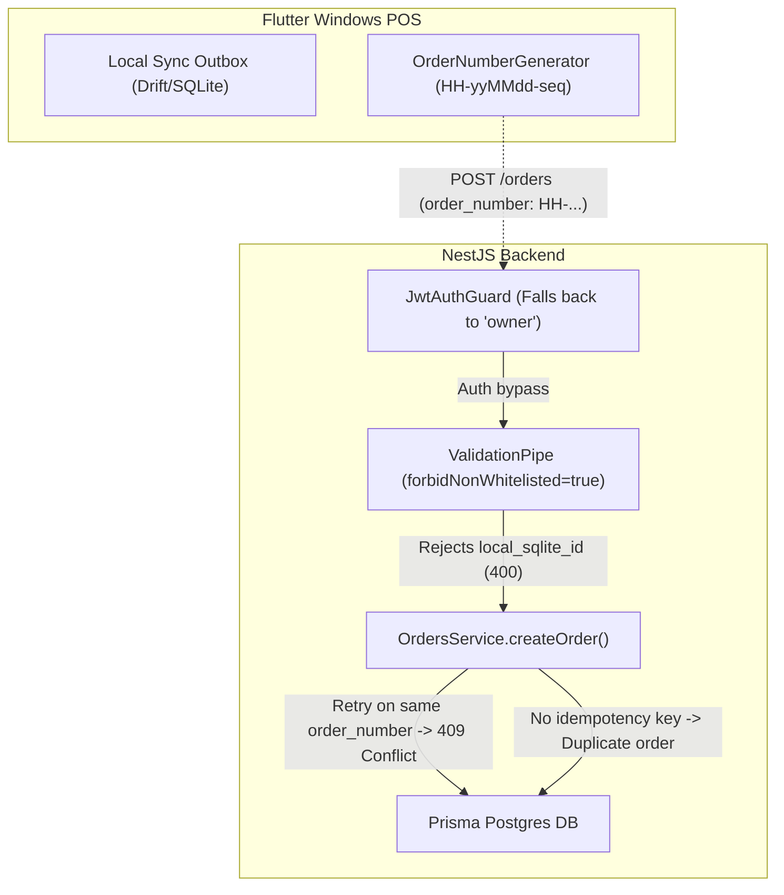

# 04 - Backend API Audit & Concurrency Analysis

**Audit Date:** October 17, 2026  
**Auditor:** `backend-api-auditor` (Wave 1)  
**Scope:** Phase 4 (NestJS Backend Architecture, Auth, Validation, Transactions, Idempotency, Concurrency) + Phase 11 Current-State (Sync Endpoints & Ledger)  
**Target Repository:** `backend/` (NestJS + Prisma + PostgreSQL) & `frontend/` (Flutter Windows POS)

---

## 1. Runtime & Technology Specifications

| Component | Version / Specification | File Reference |
|---|---|---|
| **Node.js Runtime** | Node 20 LTS (`node:20-alpine`) | [`backend/Dockerfile:6`](file:///D:/HowiePOSUPdated/Hbackend-Hfrontend-main/backend/Dockerfile#L6) |
| **Node Types** | `^22.10.5` | [`backend/package.json:53`](file:///D:/HowiePOSUPdated/Hbackend-Hfrontend-main/backend/package.json#L53) |
| **NestJS Framework** | `@nestjs/core: ^10.4.15`, `@nestjs/common: ^10.4.15` | [`backend/package.json:23-25`](file:///D:/HowiePOSUPdated/Hbackend-Hfrontend-main/backend/package.json#L23-L25) |
| **Prisma ORM** | `@prisma/client: ^5.22.0`, `prisma: ^5.22.0` | [`backend/package.json:33, 63`](file:///D:/HowiePOSUPdated/Hbackend-Hfrontend-main/backend/package.json#L33) |
| **Database Engine** | PostgreSQL (`provider = "postgresql"`) | [`backend/prisma/schema.prisma:6`](file:///D:/HowiePOSUPdated/Hbackend-Hfrontend-main/backend/prisma/schema.prisma#L6) |
| **WebSocket Engine** | `@nestjs/websockets: ^10.4.22`, `socket.io: ^4.8.4` | [`backend/package.json:32, 44`](file:///D:/HowiePOSUPdated/Hbackend-Hfrontend-main/backend/package.json#L32) |
| **Redis / Queue** | `ioredis: ^5.11.1`, `bullmq: ^5.81.5` | [`backend/package.json:35, 39`](file:///D:/HowiePOSUPdated/Hbackend-Hfrontend-main/backend/package.json#L35) |
| **Security Headers** | `helmet: ^7.2.0` | [`backend/src/main.ts:23-28`](file:///D:/HowiePOSUPdated/Hbackend-Hfrontend-main/backend/src/main.ts#L23-L28) |
| **Password Hashing** | `argon2: ^0.45.1` | [`backend/package.json:34`](file:///D:/HowiePOSUPdated/Hbackend-Hfrontend-main/backend/package.json#L34) |
| **Swagger / OpenAPI** | `@nestjs/swagger: ^7.4.2` mounted at `/api/docs` | [`backend/src/main.ts:69-117`](file:///D:/HowiePOSUPdated/Hbackend-Hfrontend-main/backend/src/main.ts#L69-L117) |

---

## 2. Module Layout & Architecture Overview

The backend is structured into 22 cohesive modules registered in `AppModule` ([`backend/src/app.module.ts:27-57`](file:///D:/HowiePOSUPdated/Hbackend-Hfrontend-main/backend/src/app.module.ts#L27-L57)):

```
backend/src/
├── app.module.ts                         # Root application module registering all domain & infra modules
├── main.ts                               # Bootstrap: Helmet, ValidationPipe, AllExceptionsFilter, CORS, Swagger
├── auth/                                 # Authentication, Argon2 hashing, JWT issuance & Passport strategy
├── common/                               # Cross-cutting decorators, filters, guards, and RBAC matrix
│   ├── decorators/current-user.decorator.ts
│   ├── filters/all-exceptions.filter.ts
│   ├── guards/jwt-auth.guard.ts
│   └── rbac/                             # Roles & Permissions decorators and guard
├── config/                               # Typed environment configuration loader
├── customers/                            # Customer CRM directory, phone lookup, loyalty points
├── daily-calculation/                    # Shift management, drawer opening float, live summary, closing settlement
├── delivery/                             # Fleet management: delivery riders & delivery dispatches
│   ├── dispatches/
│   └── riders/
├── expenses/                             # Operating expenses ledger and financial outflows
├── health/                               # Database & Redis connectivity health check probes
├── infrastructure/                       # I/O infrastructure
│   ├── queues/                           # BullMQ background system worker (currently idle)
│   └── redis/                            # Redis client abstraction
├── inventory/                            # Stock catalog, stock movements ledger, manual stock-in / stock-out
├── kitchen/                              # Kitchen Display System (KDS), ticket printing status, WebSockets
├── menu/                                 # Food & beverage catalog (categories, items, sizes, options, deals)
│   ├── categories/
│   ├── deals/
│   ├── items/
│   ├── options/
│   └── sizes/
├── orders/                               # Universal billing, order items, split payments, dine-in/takeaway/online
├── permissions/                          # Dynamic RBAC role permission rules and presets
├── printer/                              # ESC/POS thermal printing spooler integration (Windows winspool)
├── prisma/                               # PrismaService database lifecycle management
├── reports/                              # Analytics, product performance, daily sales trends, cancellations
├── settings/                             # Store branding, tax rates, branch code metadata
├── staff/                                # HR staff directory, monthly salary records, payslips
├── sync/                                 # Offline synchronization ledger (current mock/status toggler)
└── users/                                # Store user management, role assignment, password updates
```

---

## 3. Cross-Cutting Concerns Audit

### 3.1 Guards & Roles (RBAC)

#### Security Vulnerability in `JwtAuthGuard`
In [`backend/src/common/guards/jwt-auth.guard.ts:6-18`](file:///D:/HowiePOSUPdated/Hbackend-Hfrontend-main/backend/src/common/guards/jwt-auth.guard.ts#L6-L18):
```typescript
export class JwtAuthGuard extends AuthGuard('jwt') {
  handleRequest<TUser = unknown>(err: unknown, user: TUser): TUser {
    if (user && !err) {
      return user;
    }
    // Local POS terminal fallback to default owner so store management operations succeed
    return {
      id: '4cec453b-0ce2-4f0a-a335-d014883bb0a8',
      userId: '4cec453b-0ce2-4f0a-a335-d014883bb0a8',
      username: 'Noman',
      role: 'owner',
      is_default: true,
    } as unknown as TUser;
  }
}
```
- **Finding:** If an incoming HTTP request contains no `Authorization` header, an invalid JWT, or an expired JWT, `JwtAuthGuard` **does NOT reject the request with HTTP 401 Unauthorized**. Instead, it synthesizes a mock user object representing the default store owner `"Noman"` with `role: 'owner'`.
- **RBAC Bypass:** In [`backend/src/common/rbac/guards/permissions.guard.ts:33-41`](file:///D:/HowiePOSUPdated/Hbackend-Hfrontend-main/backend/src/common/rbac/guards/permissions.guard.ts#L33-L41):
  ```typescript
  const normalizedRole = user.role.toLowerCase().trim();
  if (
    normalizedRole === 'owner' ||
    normalizedRole === 'superadmin' ||
    normalizedRole === 'super admin' ||
    normalizedRole === 'admin'
  ) {
    return true;
  }
  ```
  Because the synthesized fallback user has `role: 'owner'`, **all RBAC permission checks are automatically bypassed**. Unauthenticated network requests to protected routes (e.g. `POST /daily-calculation/submit`, `DELETE /orders/:id`) succeed as superuser/owner.
- **Offline Implication:** This was implemented as an online-to-local fallback convenience for local desktop POS testing. In an offline-first architecture with network synchronization, unauthenticated requests hitting the cloud endpoint will execute as owner unless this fallback is strictly scoped to local dev or replaced with token-based client certificate / offline JWT verification.

### 3.2 DTO Validation

Configured globally in [`backend/src/main.ts:38-47`](file:///D:/HowiePOSUPdated/Hbackend-Hfrontend-main/backend/src/main.ts#L38-L47):
- `whitelist: true` (strips undeclared properties from incoming request bodies).
- `forbidNonWhitelisted: true` (throws `400 Bad Request` if unexpected fields are supplied).
- `transform: true` + `transformOptions: { enableImplicitConversion: true }` (coerces primitive query and route params).
- **Critical DTO Gap for Offline Sync:** `CreateOrderDto` ([`backend/src/orders/dto/create-order.dto.ts:83-242`](file:///D:/HowiePOSUPdated/Hbackend-Hfrontend-main/backend/src/orders/dto/create-order.dto.ts#L83-L242)) does **not** declare `local_sqlite_id`, `device_id`, or `idempotency_key`. Because `forbidNonWhitelisted: true` is enabled, any client sending `{ local_sqlite_id: "...", ... }` will be rejected by NestJS with `400 Bad Request: property local_sqlite_id should not exist`!

### 3.3 Exception Filters

Global filter `AllExceptionsFilter` mounted in [`backend/src/main.ts:50`](file:///D:/HowiePOSUPdated/Hbackend-Hfrontend-main/backend/src/main.ts#L50), implemented in [`backend/src/common/filters/all-exceptions.filter.ts:12-55`](file:///D:/HowiePOSUPdated/Hbackend-Hfrontend-main/backend/src/common/filters/all-exceptions.filter.ts#L12-L55):
- Formats standard errors into `ApiErrorResponse` (`{ success: false, statusCode, message, error, timestamp, path }`).
- Translates `HttpException` status and message accurately.
- For unhandled exceptions (`Error`), logs the stack trace internally (`this.logger.error(...)`) and emits generic HTTP 500 `{ success: false, statusCode: 500, message: "Internal server error" }`.
- **Gap:** Prisma error codes (e.g., `P2002` Unique Constraint Violation, `P2025` Record Not Found, `P2003` Foreign Key Violation) are not explicitly caught or mapped to 409/404/400. They fall through to generic 500 errors unless caught in service layer.

### 3.4 Logging

- Uses NestJS standard `Logger` instance per service class.
- Console-only output; no structured JSON logger (such as Pino or Winston).
- No correlation ID (`X-Request-ID` or `X-Correlation-ID`) across incoming requests, transactional boundaries, or asynchronous background tasks.

### 3.5 Throttling & Rate Limiting

- **Status:** **NOT FOUND** ([`backend/package.json`](file:///D:/HowiePOSUPdated/Hbackend-Hfrontend-main/backend/package.json)).
- Neither `@nestjs/throttler` nor `express-rate-limit` is installed.
- No endpoint rate limits exist on brute-force sensitive routes (`POST /api/auth/login`, `POST /api/orders`, `POST /api/sync/batch`).

### 3.6 Global Interceptors

- **Status:** **NOT FOUND**.
- No global interceptor is registered in `main.ts` or via `APP_INTERCEPTOR`. Controllers manually structure response payloads as `{ success: true, message?: string, data?: T }`.

---

## 4. Comprehensive Endpoint Inventory

The following table details every operational route across the 12 core functional domains.

| Method + Path | Request (DTO / Params) | Response Data | DB Ops (Prisma) | $transaction? | Safe to retry? (Idempotent) | Needs Idempotency Key? | Emits Real-Time Event? | Code Reference |
|---|---|---|---|---|---|---|---|---|
| **POST /api/orders** | `CreateOrderDto` (order_type, items, payments, etc.) | `OrderWithDetails` | `findFirst` (order_number), `order.create`, `detail.create`, `orderItem.createMany`, `orderPayment.createMany`, `dataSyncLog.create` | **YES** (`orders.service.ts:138`) | **NO** (Creates duplicate order or throws 409) | **CRITICAL** | **YES** (`kitchen.order_created`, `order.created`) | [`orders.controller.ts:44`](file:///D:/HowiePOSUPdated/Hbackend-Hfrontend-main/backend/src/orders/orders.controller.ts#L44), [`orders.service.ts:137`](file:///D:/HowiePOSUPdated/Hbackend-Hfrontend-main/backend/src/orders/orders.service.ts#L137) |
| **GET /api/orders** | `QueryOrderDto` (shift_id, status, type, etc.) | `OrderWithDetails[]` | `order.findMany` | No | **YES** | No | No | [`orders.controller.ts:26`](file:///D:/HowiePOSUPdated/Hbackend-Hfrontend-main/backend/src/orders/orders.controller.ts#L26) |
| **GET /api/orders/:id** | `id: string` (UUID) | `OrderWithDetails` | `order.findUnique` | No | **YES** | No | No | [`orders.controller.ts:35`](file:///D:/HowiePOSUPdated/Hbackend-Hfrontend-main/backend/src/orders/orders.controller.ts#L35) |
| **PATCH /api/orders/:id** | `UpdateOrderDto` (items, grand_total, payments, etc.) | `OrderWithDetails` | `order.findUnique`, `order.update`, `orderItem.deleteMany`, `orderItem.createMany`, `orderPayment.deleteMany`, `orderPayment.createMany` | **YES** (`orders.service.ts:486`) | **NO** (If paid/completed, retry throws 400 Bad Request) | **HIGH** | No | [`orders.controller.ts:54`](file:///D:/HowiePOSUPdated/Hbackend-Hfrontend-main/backend/src/orders/orders.controller.ts#L54), [`orders.service.ts:468`](file:///D:/HowiePOSUPdated/Hbackend-Hfrontend-main/backend/src/orders/orders.service.ts#L468) |
| **PATCH /api/orders/:id/status** | `UpdateOrderStatusDto` (status, reason) | `OrderWithDetails` | `order.findUnique`, `order.update` | No | **YES** (state overwrite) | Medium | No (unless via kitchen gateway) | [`orders.controller.ts:67`](file:///D:/HowiePOSUPdated/Hbackend-Hfrontend-main/backend/src/orders/orders.controller.ts#L67), [`orders.service.ts:820`](file:///D:/HowiePOSUPdated/Hbackend-Hfrontend-main/backend/src/orders/orders.service.ts#L820) |
| **POST /api/orders/:id/cancel-item** | `{ item_id, reason, cancelled_by }` | `OrderWithDetails` | `order.findUnique`, `orderItem.update`, `order.update` | **YES** (`orders.service.ts:896`) | **YES** (Sets `is_cancelled = true`, recalculates totals) | Medium | No | [`orders.controller.ts:80`](file:///D:/HowiePOSUPdated/Hbackend-Hfrontend-main/backend/src/orders/orders.controller.ts#L80), [`orders.service.ts:887`](file:///D:/HowiePOSUPdated/Hbackend-Hfrontend-main/backend/src/orders/orders.service.ts#L887) |
| **DELETE /api/orders/:id** | `id: string` | `{ message }` | `order.findUnique`, `order.delete` | No | **NO** (Second delete throws 404) | Low | No | [`orders.controller.ts:93`](file:///D:/HowiePOSUPdated/Hbackend-Hfrontend-main/backend/src/orders/orders.controller.ts#L93) |
| **GET /api/kitchen/orders** | `QueryKitchenDto` | `Order[]` | `order.findMany` | No | **YES** | No | No | [`kitchen.controller.ts:25`](file:///D:/HowiePOSUPdated/Hbackend-Hfrontend-main/backend/src/kitchen/kitchen.controller.ts#L25) |
| **GET /api/kitchen/orders/:id** | `id: string` | `Order` | `order.findUnique` | No | **YES** | No | No | [`kitchen.controller.ts:35`](file:///D:/HowiePOSUPdated/Hbackend-Hfrontend-main/backend/src/kitchen/kitchen.controller.ts#L35) |
| **PATCH /api/kitchen/orders/:id/status** | `UpdateKitchenStatusDto` (status) | `Order` | `order.findUnique`, `order.update` | No | **YES** (Overwrites status) | Low | **YES** (`order.status_changed`, `kitchen.status_changed`, `order.ready`, `order.cancelled`) | [`kitchen.controller.ts:44`](file:///D:/HowiePOSUPdated/Hbackend-Hfrontend-main/backend/src/kitchen/kitchen.controller.ts#L44), [`kitchen.service.ts:141`](file:///D:/HowiePOSUPdated/Hbackend-Hfrontend-main/backend/src/kitchen/kitchen.service.ts#L141) |
| **PATCH /api/kitchen/orders/:id/cooking** | `UpdateCookingTimeDto` (minutes) | `Order` | `order.findUnique`, `order.update` | No | **NO** (If `estimated_ready_at` omitted, recalculated from `Date.now()`) | Medium | **YES** (`order.updated`, `kitchen.order_updated`) | [`kitchen.controller.ts:54`](file:///D:/HowiePOSUPdated/Hbackend-Hfrontend-main/backend/src/kitchen/kitchen.controller.ts#L54), [`kitchen.service.ts:171`](file:///D:/HowiePOSUPdated/Hbackend-Hfrontend-main/backend/src/kitchen/kitchen.service.ts#L171) |
| **POST /api/kitchen/orders/:id/send-ticket** | `id: string` | `Order` | `order.findUnique`, `order.update` | No | **YES** (Sets `kitchen_ticket_sent = true`) | Low | **YES** (`kitchen.ticket_sent`) | [`kitchen.controller.ts:64`](file:///D:/HowiePOSUPdated/Hbackend-Hfrontend-main/backend/src/kitchen/kitchen.controller.ts#L64), [`kitchen.service.ts:203`](file:///D:/HowiePOSUPdated/Hbackend-Hfrontend-main/backend/src/kitchen/kitchen.service.ts#L203) |
| **GET /api/tables** | `QueryTableDto` | `RestaurantTable[]` | `restaurantTable.findMany` | No | **YES** | No | No | [`tables.controller.ts:30`](file:///D:/HowiePOSUPdated/Hbackend-Hfrontend-main/backend/src/tables/tables.controller.ts#L30) |
| **GET /api/tables/:id** | `id: string` | `RestaurantTable` | `restaurantTable.findUnique` | No | **YES** | No | No | [`tables.controller.ts:71`](file:///D:/HowiePOSUPdated/Hbackend-Hfrontend-main/backend/src/tables/tables.controller.ts#L71) |
| **POST /api/tables** | `CreateTableDto` (table_number, name, capacity) | `RestaurantTable` | `restaurantTable.findUnique`, `restaurantTable.create` | No | **NO** (Duplicate table_number throws 409) | Medium | No | [`tables.controller.ts:81`](file:///D:/HowiePOSUPdated/Hbackend-Hfrontend-main/backend/src/tables/tables.controller.ts#L81) |
| **PATCH /api/tables/:id** | `UpdateTableDto` | `RestaurantTable` | `restaurantTable.findUnique`, `restaurantTable.update` | No | **YES** | Low | No | [`tables.controller.ts:92`](file:///D:/HowiePOSUPdated/Hbackend-Hfrontend-main/backend/src/tables/tables.controller.ts#L92) |
| **PATCH /api/tables/:id/status** | `UpdateTableStatusDto` (status, bill, order_id) | `RestaurantTable` | `restaurantTable.findUnique`, `restaurantTable.update` | No | **YES** | Low | No | [`tables.controller.ts:106`](file:///D:/HowiePOSUPdated/Hbackend-Hfrontend-main/backend/src/tables/tables.controller.ts#L106) |
| **POST /api/tables/:id/release** | `id: string` | `RestaurantTable` | `restaurantTable.findUnique`, `restaurantTable.update` | No | **YES** (Overwrites status='available') | Low | No | [`tables.controller.ts:120`](file:///D:/HowiePOSUPdated/Hbackend-Hfrontend-main/backend/src/tables/tables.controller.ts#L120) |
| **POST /api/tables/transfer** | `TransferTableDto` (from_table_id, to_table_id) | `{ fromTable, toTable }` | `from.findUnique`, `to.findUnique`, `dineInOrderDetail.updateMany`, `to.update`, `from.update` | **YES** (`tables.service.ts:424`) | **NO** (After transfer, fromTable is no longer occupied -> throws 400) | **HIGH** | No | [`tables.controller.ts:131`](file:///D:/HowiePOSUPdated/Hbackend-Hfrontend-main/backend/src/tables/tables.controller.ts#L131), [`tables.service.ts:417`](file:///D:/HowiePOSUPdated/Hbackend-Hfrontend-main/backend/src/tables/tables.service.ts#L417) |
| **PATCH /api/tables/:id/reservation** | `TableReservationDto` (name, time) | `RestaurantTable` | `restaurantTable.findUnique`, `restaurantTable.update` | No | **YES** | Low | No | [`tables.controller.ts:144`](file:///D:/HowiePOSUPdated/Hbackend-Hfrontend-main/backend/src/tables/tables.controller.ts#L144) |
| **DELETE /api/tables/:id** | `id: string` | `{ message }` | `restaurantTable.findUnique`, `restaurantTable.delete` | No | **NO** (Second delete throws 404) | Low | No | [`tables.controller.ts:158`](file:///D:/HowiePOSUPdated/Hbackend-Hfrontend-main/backend/src/tables/tables.controller.ts#L158) |
| **GET /api/inventory/items** | `QueryInventoryDto` | `InventoryItem[]` | `inventoryItem.findMany` | No | **YES** | No | No | [`inventory.controller.ts:31`](file:///D:/HowiePOSUPdated/Hbackend-Hfrontend-main/backend/src/inventory/inventory.controller.ts#L31) |
| **POST /api/inventory/items** | `CreateInventoryItemDto` (sku, name, etc.) | `InventoryItem` | `inventoryItem.findUnique`, `inventoryItem.create` | No | **NO** (Duplicate sku_code throws 409) | Medium | No | [`inventory.controller.ts:58`](file:///D:/HowiePOSUPdated/Hbackend-Hfrontend-main/backend/src/inventory/inventory.controller.ts#L58) |
| **POST /api/inventory/stock-in** | `CreateStockInDto` (item_id, quantity, cost) | `{ item, movement }` | `inventoryItem.findUnique`, `inventoryItem.update`, `stockMovement.create` | **YES** (`inventory.service.ts:215`) | **NO** (Increments stock again, creates duplicate movement) | **CRITICAL** | No | [`inventory.controller.ts:90`](file:///D:/HowiePOSUPdated/Hbackend-Hfrontend-main/backend/src/inventory/inventory.controller.ts#L90), [`inventory.service.ts:214`](file:///D:/HowiePOSUPdated/Hbackend-Hfrontend-main/backend/src/inventory/inventory.service.ts#L214) |
| **POST /api/inventory/stock-out** | `CreateStockOutDto` (item_id, quantity, reason) | `{ item, movement }` | `inventoryItem.findUnique`, `inventoryItem.update`, `stockMovement.create` | **YES** (`inventory.service.ts:274`) | **NO** (Decrements stock again, creates duplicate movement) | **CRITICAL** | No | [`inventory.controller.ts:102`](file:///D:/HowiePOSUPdated/Hbackend-Hfrontend-main/backend/src/inventory/inventory.controller.ts#L102), [`inventory.service.ts:271`](file:///D:/HowiePOSUPdated/Hbackend-Hfrontend-main/backend/src/inventory/inventory.service.ts#L271) |
| **GET /api/daily-calculation/active-session** | `cashier_id?: string` | `{ has_active_session, session, ... }` | `dailyCalculation.findFirst` | No | **YES** | No | No | [`daily-calculation.controller.ts:27`](file:///D:/HowiePOSUPdated/Hbackend-Hfrontend-main/backend/src/daily-calculation/daily-calculation.controller.ts#L27) |
| **POST /api/daily-calculation/start-session** | `StartSessionDto` (starting_cash, adjustment_type) | `{ has_active_session, session }` | `findFirst` (history), `findFirst` (active), `update` OR `create` | **NO** (Plain queries) | **PARTIALLY** (SET is pseudo-safe; ADD duplicates amount) | **HIGH** | No | [`daily-calculation.controller.ts:63`](file:///D:/HowiePOSUPdated/Hbackend-Hfrontend-main/backend/src/daily-calculation/daily-calculation.controller.ts#L63), [`daily-calculation.service.ts:77`](file:///D:/HowiePOSUPdated/Hbackend-Hfrontend-main/backend/src/daily-calculation/daily-calculation.service.ts#L77) |
| **GET /api/daily-calculation/live-summary** | `date?: string, cashier_id?: string` | `LiveDailyCalculationSummary` | `dailyCalculation.findFirst`, `order.findMany`, `orderPayment.findMany` | No | **YES** | No | No | [`daily-calculation.controller.ts:74`](file:///D:/HowiePOSUPdated/Hbackend-Hfrontend-main/backend/src/daily-calculation/daily-calculation.controller.ts#L74) |
| **POST /api/daily-calculation/active-session/expense** | `{ item_name, amount, category, notes }` | `DailyExpenseItem` | `dailyCalculation.findFirst`, `dailyExpenseItem.create` | No | **NO** (Creates duplicate shift expense record) | **HIGH** | No | [`daily-calculation.controller.ts:37`](file:///D:/HowiePOSUPdated/Hbackend-Hfrontend-main/backend/src/daily-calculation/daily-calculation.controller.ts#L37) |
| **DELETE /api/daily-calculation/active-session/expense/:id** | `id: string` | `{ message }` | `dailyExpenseItem.findUnique`, `dailyExpenseItem.delete` | No | **NO** (Throws 404 on retry) | Low | No | [`daily-calculation.controller.ts:54`](file:///D:/HowiePOSUPdated/Hbackend-Hfrontend-main/backend/src/daily-calculation/daily-calculation.controller.ts#L54) |
| **POST /api/daily-calculation/submit** | `SubmitDailyCalculationDto` (cash_submitted, etc.) | `DailyCalculation` | `order.findMany` (unresolved guard), `dispatch.findMany` (guard), `liveSummary`, `update` / `create`, `dailyExpenseItem.createMany`, `expense.createMany`, `order.updateMany`, `restaurantTable.updateMany` | **YES** (`daily-calculation.service.ts:447`) | **NO** (Throws 400 Bad Request or duplicates expenses/shift) | **CRITICAL** | No | [`daily-calculation.controller.ts:84`](file:///D:/HowiePOSUPdated/Hbackend-Hfrontend-main/backend/src/daily-calculation/daily-calculation.controller.ts#L84), [`daily-calculation.service.ts:331`](file:///D:/HowiePOSUPdated/Hbackend-Hfrontend-main/backend/src/daily-calculation/daily-calculation.service.ts#L331) |
| **GET /api/customers** | `QueryCustomerDto` | `Customer[]` | `customer.findMany` | No | **YES** | No | No | [`customers.controller.ts:26`](file:///D:/HowiePOSUPdated/Hbackend-Hfrontend-main/backend/src/customers/customers.controller.ts#L26) |
| **POST /api/customers** | `CreateCustomerDto` (phone, name, email) | `Customer` | `customer.findUnique`, `customer.create` | No | **NO** (Duplicate phone throws 409) | Medium | No | [`customers.controller.ts:44`](file:///D:/HowiePOSUPdated/Hbackend-Hfrontend-main/backend/src/customers/customers.controller.ts#L44) |
| **PATCH /api/customers/:id** | `UpdateCustomerDto` | `Customer` | `customer.findUnique`, `customer.update` | No | **YES** | Low | No | [`customers.controller.ts:54`](file:///D:/HowiePOSUPdated/Hbackend-Hfrontend-main/backend/src/customers/customers.controller.ts#L54) |
| **POST /api/auth/login** | `LoginDto` (username, password) | `{ accessToken, user }` | `staffUser.findUnique` | No | **YES** | No | No | [`auth.controller.ts:13`](file:///D:/HowiePOSUPdated/Hbackend-Hfrontend-main/backend/src/auth/auth.controller.ts#L13) |
| **GET /api/auth/me** | None (JWT / Fallback User) | `AuthenticatedUser` | In-memory token parse | No | **YES** | No | No | [`auth.controller.ts:24`](file:///D:/HowiePOSUPdated/Hbackend-Hfrontend-main/backend/src/auth/auth.controller.ts#L24) |
| **GET /api/users** | None | `SafeUser[]` | `staffUser.findMany` | No | **YES** | No | No | [`users.controller.ts:29`](file:///D:/HowiePOSUPdated/Hbackend-Hfrontend-main/backend/src/users/users.controller.ts#L29) |
| **POST /api/users** | `CreateUserDto` (username, password, role) | `SafeUser` | `staffUser.findUnique`, `staffUser.create` | No | **NO** (Duplicate username throws 409) | Low | No | [`users.controller.ts:49`](file:///D:/HowiePOSUPdated/Hbackend-Hfrontend-main/backend/src/users/users.controller.ts#L49) |
| **PATCH /api/users/:id** | `UpdateUserDto` | `SafeUser` | `staffUser.findUnique`, `staffUser.update` | No | **YES** | Low | No | [`users.controller.ts:63`](file:///D:/HowiePOSUPdated/Hbackend-Hfrontend-main/backend/src/users/users.controller.ts#L63) |
| **PATCH /api/users/:id/password** | `UpdatePasswordDto` (new_password) | `{ message }` | `staffUser.findUnique`, `staffUser.update` | No | **YES** | Low | No | [`users.controller.ts:78`](file:///D:/HowiePOSUPdated/Hbackend-Hfrontend-main/backend/src/users/users.controller.ts#L78) |
| **GET /api/staff** | `QueryStaffDto` | `StaffMemberWithUser[]` | `staffMember.findMany` | No | **YES** | No | No | [`staff.controller.ts:30`](file:///D:/HowiePOSUPdated/Hbackend-Hfrontend-main/backend/src/staff/staff.controller.ts#L30) |
| **POST /api/staff** | `CreateStaffDto` (full_name, phone, role) | `StaffMemberWithUser` | `staffMember.create`, `payslip.create` | **YES** (`staff.service.ts:178`) | **NO** (Duplicate phone/user link errors) | Low | No | [`staff.controller.ts:60`](file:///D:/HowiePOSUPdated/Hbackend-Hfrontend-main/backend/src/staff/staff.controller.ts#L60) |
| **POST /api/staff/:id/salary-settle** | `id: string`, `month_year?: string` | `StaffMemberWithUser` | `staffMember.findUnique`, `payslip.updateMany`, `staffMember.update` | **YES** (`staff.service.ts:275`) | **YES** (Sets `status = 'Paid'`) | Low | No | [`staff.controller.ts:98`](file:///D:/HowiePOSUPdated/Hbackend-Hfrontend-main/backend/src/staff/staff.controller.ts#L98) |
| **GET /api/menu/categories** | None | `MenuCategory[]` | `menuCategory.findMany` | No | **YES** | No | No | [`categories.controller.ts:15`](file:///D:/HowiePOSUPdated/Hbackend-Hfrontend-main/backend/src/menu/categories/categories.controller.ts#L15) |
| **GET /api/menu/items** | `QueryMenuItemDto` | `FullMenuItem[]` | `menuItem.findMany` | No | **YES** | No | No | [`items.controller.ts:25`](file:///D:/HowiePOSUPdated/Hbackend-Hfrontend-main/backend/src/menu/items/items.controller.ts#L25) |
| **POST /api/menu/items** | `CreateMenuItemDto` | `FullMenuItem` | `menuItem.create`, `sizes.createMany`, `options.createMany` | **YES** (`items.service.ts:100`) | **NO** (Creates duplicate item) | Low | No | [`items.controller.ts:43`](file:///D:/HowiePOSUPdated/Hbackend-Hfrontend-main/backend/src/menu/items/items.controller.ts#L43) |
| **PATCH /api/menu/items/:id/availability** | `UpdateAvailabilityDto` (is_available) | `FullMenuItem` | `menuItem.findUnique`, `menuItem.update` | No | **YES** | Low | No | [`items.controller.ts:68`](file:///D:/HowiePOSUPdated/Hbackend-Hfrontend-main/backend/src/menu/items/items.controller.ts#L68) |
| **GET /api/menu/deals** | `QueryDealDto` | `DealWithComponents[]` | `deal.findMany` | No | **YES** | No | No | [`deals.controller.ts:28`](file:///D:/HowiePOSUPdated/Hbackend-Hfrontend-main/backend/src/menu/deals/deals.controller.ts#L28) |
| **GET /api/delivery/riders** | `QueryRiderDto` | `DeliveryRider[]` | `deliveryRider.findMany` | No | **YES** | No | No | [`riders.controller.ts:25`](file:///D:/HowiePOSUPdated/Hbackend-Hfrontend-main/backend/src/delivery/riders/riders.controller.ts#L25) |
| **POST /api/delivery/riders** | `CreateRiderDto` (name, phone) | `DeliveryRider` | `deliveryRider.findUnique`, `deliveryRider.create` | No | **NO** (Duplicate phone throws 409) | Low | No | [`riders.controller.ts:43`](file:///D:/HowiePOSUPdated/Hbackend-Hfrontend-main/backend/src/delivery/riders/riders.controller.ts#L43) |
| **PATCH /api/delivery/riders/:id/duty** | `ToggleRiderDutyDto` (is_clocked_in) | `DeliveryRider` | `deliveryRider.findUnique`, `deliveryRider.update` | No | **YES** | Low | No | [`riders.controller.ts:66`](file:///D:/HowiePOSUPdated/Hbackend-Hfrontend-main/backend/src/delivery/riders/riders.controller.ts#L66) |
| **GET /api/delivery/dispatches** | `QueryDispatchDto` | `DeliveryDispatch[]` | `deliveryDispatch.findMany` | No | **YES** | No | No | [`dispatches.controller.ts:24`](file:///D:/HowiePOSUPdated/Hbackend-Hfrontend-main/backend/src/delivery/dispatches/dispatches.controller.ts#L24) |
| **POST /api/delivery/dispatches/:id/assign** | `AssignRiderDto` (rider_id) | `DeliveryDispatch` | `dispatch.findUnique`, `rider.findUnique`, `dispatch.update`, `rider.update` | **YES** (`dispatches.service.ts:200`) | **YES** (Overwrites assigned rider) | Medium | No | [`dispatches.controller.ts:69`](file:///D:/HowiePOSUPdated/Hbackend-Hfrontend-main/backend/src/delivery/dispatches/dispatches.controller.ts#L69) |
| **PATCH /api/delivery/dispatches/:id/status** | `UpdateDispatchStatusDto` (status) | `DeliveryDispatch` | `dispatch.findUnique`, `dispatch.update`, `rider.update` (counter adjust) | **YES** (`dispatches.service.ts:247`) | **NO** (Counter increments/decrements in rider can drift on retry) | **HIGH** | No | [`dispatches.controller.ts:82`](file:///D:/HowiePOSUPdated/Hbackend-Hfrontend-main/backend/src/delivery/dispatches/dispatches.controller.ts#L82) |
| **GET /api/expenses** | `QueryExpenseDto` | `Expense[]` | `expense.findMany` | No | **YES** | No | No | [`expenses.controller.ts:27`](file:///D:/HowiePOSUPdated/Hbackend-Hfrontend-main/backend/src/expenses/expenses.controller.ts#L27) |
| **POST /api/expenses** | `CreateExpenseDto` (title, amount, category) | `Expense` | `expense.create` | No | **NO** (Creates duplicate expense entry) | **HIGH** | No | [`expenses.controller.ts:54`](file:///D:/HowiePOSUPdated/Hbackend-Hfrontend-main/backend/src/expenses/expenses.controller.ts#L54) |
| **GET /api/reports/summary** | `QueryReportDto` | Report summary KPIs | `order.findMany`, `expense.findMany` | No | **YES** | No | No | [`reports.controller.ts:12`](file:///D:/HowiePOSUPdated/Hbackend-Hfrontend-main/backend/src/reports/reports.controller.ts#L12) |
| **GET /api/reports/products** | `QueryReportDto` | Product performance array | `orderItem.findMany` | No | **YES** | No | No | [`reports.controller.ts:21`](file:///D:/HowiePOSUPdated/Hbackend-Hfrontend-main/backend/src/reports/reports.controller.ts#L21) |
| **GET /api/reports/daily-sales** | `QueryReportDto` | Trend array | `order.findMany` | No | **YES** | No | No | [`reports.controller.ts:41`](file:///D:/HowiePOSUPdated/Hbackend-Hfrontend-main/backend/src/reports/reports.controller.ts#L41) |
| **GET /api/reports/cancelled-orders** | `QueryReportDto` | Cancelled orders list | `order.findMany` | No | **YES** | No | No | [`reports.controller.ts:51`](file:///D:/HowiePOSUPdated/Hbackend-Hfrontend-main/backend/src/reports/reports.controller.ts#L51) |
| **GET /api/sync/overview** | `sync_status?, order_type?, search?` | Overview KPIs + mapped orders | `order.findMany`, `dataSyncLog.count`, `dataSyncLog.create` (initial seed) | No | **YES** | No | No | [`sync.controller.ts:13`](file:///D:/HowiePOSUPdated/Hbackend-Hfrontend-main/backend/src/sync/sync.controller.ts#L13), [`sync.service.ts:14`](file:///D:/HowiePOSUPdated/Hbackend-Hfrontend-main/backend/src/sync/sync.service.ts#L14) |
| **POST /api/sync/order/:id** | `id: string` | `{ success, order }` | `order.findUnique`, `order.update`, `dataSyncLog.create` | No | **YES** (Overwrites `sync_status='synced'`) | Low | No | [`sync.controller.ts:34`](file:///D:/HowiePOSUPdated/Hbackend-Hfrontend-main/backend/src/sync/sync.controller.ts#L34), [`sync.service.ts:187`](file:///D:/HowiePOSUPdated/Hbackend-Hfrontend-main/backend/src/sync/sync.service.ts#L187) |
| **POST /api/sync/batch** | `BatchSyncOrdersDto` (`orders: [{ id/order_id }]`) | `{ synced_count, failed_count, results }` | Loop: `order.update`, `dataSyncLog.create` | **NO** (Loop of independent updates) | **YES** (Only updates existing status flags) | Low (Current mock) / **CRITICAL** (Future full sync) | No | [`sync.controller.ts:47`](file:///D:/HowiePOSUPdated/Hbackend-Hfrontend-main/backend/src/sync/sync.controller.ts#L47), [`sync.service.ts:244`](file:///D:/HowiePOSUPdated/Hbackend-Hfrontend-main/backend/src/sync/sync.service.ts#L244) |
| **POST /api/sync/toggle/:id** | `id: string`, `ToggleSyncStatusDto` | `{ success, order }` | `order.findUnique`, `order.update`, `dataSyncLog.create` | No | **NO** (Toggles back and forth) | Low (Test route) | No | [`sync.controller.ts:60`](file:///D:/HowiePOSUPdated/Hbackend-Hfrontend-main/backend/src/sync/sync.controller.ts#L60), [`sync.service.ts:304`](file:///D:/HowiePOSUPdated/Hbackend-Hfrontend-main/backend/src/sync/sync.service.ts#L304) |
| **POST /api/sync/log** | `CreateSyncLogDto` | `DataSyncLog` | `dataSyncLog.create` | No | **NO** (Creates duplicate log) | Low | No | [`sync.controller.ts:76`](file:///D:/HowiePOSUPdated/Hbackend-Hfrontend-main/backend/src/sync/sync.controller.ts#L76) |
| **GET /api/sync/logs** | None | `DataSyncLog[]` | `dataSyncLog.findMany` | No | **YES** | No | No | [`sync.controller.ts:89`](file:///D:/HowiePOSUPdated/Hbackend-Hfrontend-main/backend/src/sync/sync.controller.ts#L89) |
| **POST /api/printer/print** | `PrintRequestDto` (printerName, base64Data) | `{ success, message }` | Raw Winspool syscall | No | **NO** (Spools double physical receipt printout) | **HIGH** | No | [`printer.controller.ts:39`](file:///D:/HowiePOSUPdated/Hbackend-Hfrontend-main/backend/src/printer/printer.controller.ts#L39) |
| **GET /api/settings** | None | `StoreSetting` | `storeSetting.findFirst` | No | **YES** | No | No | [`settings.controller.ts:14`](file:///D:/HowiePOSUPdated/Hbackend-Hfrontend-main/backend/src/settings/settings.controller.ts#L14) |
| **PATCH /api/settings** | `UpdateSettingsDto` | `StoreSetting` | `storeSetting.findFirst`, `storeSetting.update` | No | **YES** | Low | No | [`settings.controller.ts:23`](file:///D:/HowiePOSUPdated/Hbackend-Hfrontend-main/backend/src/settings/settings.controller.ts#L23) |
| **GET /api/health** | None | `HealthCheckResult` | `prisma.$queryRaw('SELECT 1')`, `redis.ping()` | No | **YES** | No | No | [`health.controller.ts:8`](file:///D:/HowiePOSUPdated/Hbackend-Hfrontend-main/backend/src/health/health.controller.ts#L8) |

---

## 5. Explicit Retry & Idempotency Analysis (Code-Level Proofs)

### 5.1 POST /orders: Duplicate Creation Analysis

> **Question:** *POST /orders succeeds, response lost, client retries — does a duplicate order get created?*

**Answer:** **YES, a duplicate order is created if `order_number` is omitted; or if `order_number` is supplied, the retry crashes with HTTP 409 Conflict rather than returning the existing order.**

#### Scenario A: Client submits order without `order_number`
*Proof from code:*
1. Request 1 arrives at [`backend/src/orders/orders.service.ts:232-254`](file:///D:/HowiePOSUPdated/Hbackend-Hfrontend-main/backend/src/orders/orders.service.ts#L232-L254):
   ```typescript
   let orderNumber = dto.order_number;
   if (!orderNumber) {
     const latestOrder = await tx.order.findFirst({
       orderBy: { created_at: 'desc' },
       select: { order_number: true },
     });
     let nextNum = 101;
     if (latestOrder?.order_number) {
       const parsed = parseInt(latestOrder.order_number.replace(/\D/g, ''), 10);
       if (!isNaN(parsed) && parsed >= 100 && parsed < 999) {
         nextNum = parsed + 1;
       }
     ...
     orderNumber = String(nextNum);
   ```
2. In Request 1, `latestOrder` is `104`. `nextNum` is calculated as `105`. `tx.order.create` successfully inserts Order `A` with `order_number = "105"` and UUID `uuid-1` ([`backend/src/orders/orders.service.ts:280-300`](file:///D:/HowiePOSUPdated/Hbackend-Hfrontend-main/backend/src/orders/orders.service.ts#L280-L300)).
3. Response is lost over the network.
4. Client retries `POST /orders` with the identical body.
5. In Request 2, `dto.order_number` is still `undefined`.
6. The service queries `latestOrder`: this time it finds Order `A` with `order_number = "105"`.
7. `nextNum` is calculated as `106`.
8. The service creates **Order `B` with `order_number = "106"` and UUID `uuid-2`**!
9. **Result:** Two distinct orders exist in the database with different order numbers, double billing the customer and sending two separate tickets to the kitchen gateway.

#### Scenario B: Client provides client-generated `order_number` (e.g. Flutter POS `HH-261017-1001`)
*Proof from code:*
1. In Flutter, `OrderModel.toCreateOrderDto()` ([`frontend/lib/domain/models/order_model.dart:401`](file:///D:/HowiePOSUPdated/Hbackend-Hfrontend-main/frontend/lib/domain/models/order_model.dart#L401)) includes `'order_number': orderNumber` generated by `OrderNumberGenerator` ([`frontend/lib/domain/services/order_number_generator.dart:26`](file:///D:/HowiePOSUPdated/Hbackend-Hfrontend-main/frontend/lib/domain/services/order_number_generator.dart#L26)).
2. Request 1 creates the order with `order_number = "HH-261017-1001"`.
3. Response drops. Client retries with the same `dto.order_number = "HH-261017-1001"`.
4. In [`backend/src/orders/orders.service.ts:256-260`](file:///D:/HowiePOSUPdated/Hbackend-Hfrontend-main/backend/src/orders/orders.service.ts#L256-L260):
   ```typescript
   } else {
     const existingOrderNum = await tx.order.findUnique({ where: { order_number: orderNumber } });
     if (existingOrderNum) {
       throw new ConflictException(`Order number '${orderNumber}' already exists`);
     }
   }
   ```
5. The backend finds `existingOrderNum` and immediately aborts the transaction, throwing **`ConflictException` (HTTP 409 Conflict)**.
6. In `ApiOrderRepository.saveOrder` ([`frontend/lib/data/repositories/api_order_repository.dart:67-70`](file:///D:/HowiePOSUPdated/Hbackend-Hfrontend-main/frontend/lib/data/repositories/api_order_repository.dart#L67-L70)), the 409 error is caught by `catch (_)`, which falls back to storing the unconfirmed order in local memory without reconciling it with the backend record.
7. **Conclusion:** There is **NO server-side idempotency mechanism** returning the existing order upon retry.

#### Scenario C: What about `local_sqlite_id`?
1. In `schema.prisma` ([`backend/prisma/schema.prisma:297`](file:///D:/HowiePOSUPdated/Hbackend-Hfrontend-main/backend/prisma/schema.prisma#L297)), `local_sqlite_id` exists on `Order` as `String? @map("local_sqlite_id") @db.VarChar(100)`.
2. However, `local_sqlite_id` has **no `@unique` index** and **no index at all**.
3. In `CreateOrderDto` ([`backend/src/orders/dto/create-order.dto.ts`](file:///D:/HowiePOSUPdated/Hbackend-Hfrontend-main/backend/src/orders/dto/create-order.dto.ts)), `local_sqlite_id` is completely missing.
4. If sent by the client, `ValidationPipe` with `forbidNonWhitelisted: true` ([`backend/src/main.ts:41`](file:///D:/HowiePOSUPdated/Hbackend-Hfrontend-main/backend/src/main.ts#L41)) rejects the request with HTTP 400.
5. In `orders.service.ts:280-300`, `local_sqlite_id` is never mapped or queried during creation.

---

### 5.2 Payments: Duplicate Payment Ledger Analysis

> **Question:** *Payment recorded / updated, response lost, client retries — what happens?*

**Answer:** **Payments embedded in `POST /orders` are duplicated; payments submitted via `PATCH /orders/:id` fail with HTTP 400 on retry.**

*Proof from code:*
1. **Creation flow:** In [`backend/src/orders/orders.service.ts:389-417`](file:///D:/HowiePOSUPdated/Hbackend-Hfrontend-main/backend/src/orders/orders.service.ts#L389-L417), payments are inserted via `tx.orderPayment.createMany` or `tx.orderPayment.create`. If `POST /orders` retries without an idempotency key and generates a duplicate order (as proven in Section 5.1), a duplicate `OrderPayment` record is created, duplicating store cash/card reconciliation in `DailyCalculation`.
2. **Update flow (`PATCH /orders/:id`):** When settling payment on an existing order, the client sends `{ is_paid: true, payments: [...] }`.
   - First request succeeds: sets `order.is_paid = true`, inserts `OrderPayment` rows ([`backend/src/orders/orders.service.ts:773-805`](file:///D:/HowiePOSUPdated/Hbackend-Hfrontend-main/backend/src/orders/orders.service.ts#L773-L805)).
   - Response is lost.
   - Client retries `PATCH /orders/:id`.
   - At [`backend/src/orders/orders.service.ts:480-484`](file:///D:/HowiePOSUPdated/Hbackend-Hfrontend-main/backend/src/orders/orders.service.ts#L480-L484):
     ```typescript
     if (existing.is_paid || existing.status === 'completed' || existing.status === 'cancelled') {
       throw new BadRequestException(
         `Order '${existing.order_number}' is already ${existing.is_paid ? 'paid' : existing.status} and cannot be modified.`,
       );
     }
     ```
   - Because `existing.is_paid` is now `true`, the guard triggers and throws **`BadRequestException` (HTTP 400)**.
   - The client receives an error stating the order cannot be modified, rather than an idempotent 200 OK returning the paid order.

---

### 5.3 Refunds: Code Status & Retry Behavior

> **Question:** *Refunds: How are they handled? Safe to retry?*

**Answer:** **REFUNDS DO NOT EXIST IN THE BACKEND (`NOT FOUND`).**

*Proof from code:*
1. Full search across all backend source files for `refund` yielded **0 matches**.
2. The `schema.prisma` contains no `Refund` model, no `refund_amount` column on `OrderPayment` or `Order`, and no negative payment ledger handling.
3. When an order is cancelled via `PATCH /orders/:id/status` with `{ status: 'cancelled' }` ([`backend/src/orders/orders.service.ts:820-850`](file:///D:/HowiePOSUPdated/Hbackend-Hfrontend-main/backend/src/orders/orders.service.ts#L820-L850)):
   - The status is updated to `cancelled`.
   - Any payments already recorded in `order_payments` **remain untouched in `COMPLETED` status**.
   - No payment reversal, credit note, or cash refund record is generated.

---

### 5.4 Inventory Deduction (`POST /inventory/stock-out`)

> **Question:** *Stock deduction succeeds, response lost, client retries — what happens?*

**Answer:** **INVENTORY IS DEDUCTED TWICE (DOUBLE DEDUCTION); DUPLICATE AUDIT MOVEMENTS CREATED.**

*Proof from code:*
1. `POST /api/inventory/stock-out` invokes `InventoryService.stockOut(dto)` ([`backend/src/inventory/inventory.service.ts:271-330`](file:///D:/HowiePOSUPdated/Hbackend-Hfrontend-main/backend/src/inventory/inventory.service.ts#L271-L330)).
2. `CreateStockOutDto` ([`backend/src/inventory/dto/stock-movement.dto.ts`](file:///D:/HowiePOSUPdated/Hbackend-Hfrontend-main/backend/src/inventory/dto/stock-movement.dto.ts)) accepts `{ item_id, quantity, reason, movement_type }`. There is **no `idempotency_key` or `client_transaction_id`**.
3. First request:
   - Reads `current_stock` = 20 ([`line 275`](file:///D:/HowiePOSUPdated/Hbackend-Hfrontend-main/backend/src/inventory/inventory.service.ts#L275)).
   - Executes decrement by 5: `current_stock` becomes 15, `used_stock` increments by 5 ([`lines 309-315`](file:///D:/HowiePOSUPdated/Hbackend-Hfrontend-main/backend/src/inventory/inventory.service.ts#L309-L315)).
   - Inserts row into `stock_movements` ([`lines 317-325`](file:///D:/HowiePOSUPdated/Hbackend-Hfrontend-main/backend/src/inventory/inventory.service.ts#L317-L325)).
4. Response drops. Client retries `POST /api/inventory/stock-out` with `{ item_id, quantity: 5 }`.
5. Second request:
   - Reads `current_stock` = 15.
   - Validation `15 >= 5` passes ([`line 284`](file:///D:/HowiePOSUPdated/Hbackend-Hfrontend-main/backend/src/inventory/inventory.service.ts#L284)).
   - Decrements stock again: `current_stock` becomes 10, `used_stock` becomes 10.
   - Inserts a **second identical row into `stock_movements`**.
6. **Result:** Total deduction is 10 units instead of 5.
7. *Note on Order Auto-Deduction:* `OrdersService` and `KitchenService` have **no connection to `InventoryService`**. Creating or completing orders does not deduct inventory recipes automatically; inventory deductions are purely manual API calls.

---

### 5.5 Shifts: Open & Close (`daily-calculation`)

> **Question:** *Shift open / close succeeds, response lost, client retries — what happens?*

#### Shift Open: `POST /api/daily-calculation/start-session`
*Proof from code:*
1. Handled in [`backend/src/daily-calculation/daily-calculation.service.ts:77-160`](file:///D:/HowiePOSUPdated/Hbackend-Hfrontend-main/backend/src/daily-calculation/daily-calculation.service.ts#L77-L160).
2. The method searches for an existing `ACTIVE` session for `cashier_id` ([`lines 111-117`](file:///D:/HowiePOSUPdated/Hbackend-Hfrontend-main/backend/src/daily-calculation/daily-calculation.service.ts#L111-L117)).
3. **If `adjustment_type: 'SET'`:**
   - First request creates the session with `starting_cash = 5000`.
   - Retry finds the active session and executes `update` setting `starting_cash = 5000` ([`lines 120-128`](file:///D:/HowiePOSUPdated/Hbackend-Hfrontend-main/backend/src/daily-calculation/daily-calculation.service.ts#L120-L128)). This branch is pseudo-idempotent.
4. **If `adjustment_type: 'ADD'`:**
   - `effectiveStartingCash = baselineFloat + Math.abs(inputAmount)` ([`line 96`](file:///D:/HowiePOSUPdated/Hbackend-Hfrontend-main/backend/src/daily-calculation/daily-calculation.service.ts#L96)).
   - If `baselineFloat` is recalculated or updated from history, retry will increment the cash float a second time.
5. **Concurrency Flaw:** `startSession` has **NO `$transaction`**! Lines 111–140 run as un-bracketed queries. If two requests fire in parallel, both find `existing = null` and both execute `dailyCalculation.create(...)`, resulting in **two simultaneous active sessions for the same cashier** (violating store settlement logic).

#### Shift Close: `POST /api/daily-calculation/submit`
*Proof from code:*
1. Handled in [`backend/src/daily-calculation/daily-calculation.service.ts:331-580`](file:///D:/HowiePOSUPdated/Hbackend-Hfrontend-main/backend/src/daily-calculation/daily-calculation.service.ts#L331-L580).
2. Request 1 executes within `$transaction` ([`line 447`](file:///D:/HowiePOSUPdated/Hbackend-Hfrontend-main/backend/src/daily-calculation/daily-calculation.service.ts#L447)):
   - Finds active session ([`lines 449-455`](file:///D:/HowiePOSUPdated/Hbackend-Hfrontend-main/backend/src/daily-calculation/daily-calculation.service.ts#L449-L455)).
   - Updates `status = 'SUBMITTED'` ([`line 503`](file:///D:/HowiePOSUPdated/Hbackend-Hfrontend-main/backend/src/daily-calculation/daily-calculation.service.ts#L503)).
   - Closes / releases dining tables.
   - Creates mirrors in `expense` table: `await tx.expense.create(...)` for each shift expense ([`lines 573-581`](file:///D:/HowiePOSUPdated/Hbackend-Hfrontend-main/backend/src/daily-calculation/daily-calculation.service.ts#L573-L581)).
3. Response is dropped. Client retries `POST /api/daily-calculation/submit`.
4. In Request 2:
   - Before the transaction, `getLiveSummary(dto.date, cashierId)` runs ([`line 397`](file:///D:/HowiePOSUPdated/Hbackend-Hfrontend-main/backend/src/daily-calculation/daily-calculation.service.ts#L397)).
   - In `resolveShiftTimeWindow`: `activeSessionInfo.has_active_session` is now **`false`** (since status is `SUBMITTED`, not `ACTIVE`).
   - `getLiveSummary` returns `total_cash_sales = 0` ([`lines 214-220`](file:///D:/HowiePOSUPdated/Hbackend-Hfrontend-main/backend/src/daily-calculation/daily-calculation.service.ts#L214-L220)).
   - Validation check at [`lines 420-428`](file:///D:/HowiePOSUPdated/Hbackend-Hfrontend-main/backend/src/daily-calculation/daily-calculation.service.ts#L420-L428):
     `expectedSubmitted = Math.max(0, live.total_cash_sales - totalExpenses) = Math.max(0, 0 - totalExpenses) = 0`.
     `Math.abs(dto.total_cash - 0) > 1.0` -> **Throws `BadRequestException: Validation Failed: Cash Submitted must equal System Cash Revenue - Total Expenses`**!
5. **Worst-Case Fallback (if submitted cash was 0):**
   - The transaction enters `else` ([`lines 528-570`](file:///D:/HowiePOSUPdated/Hbackend-Hfrontend-main/backend/src/daily-calculation/daily-calculation.service.ts#L528-L570)) because `activeSession` is null!
   - It inserts a **BRAND NEW `DailyCalculation` record with status `SUBMITTED`**, and lines 573–581 **insert duplicate entries into the global `expense` table**!
6. **Result:** Retrying shift submission is unsafe; it either fails with validation errors or corrupts the general expense ledger.

---

## 6. Concurrency Handling Today & Critical Gaps

### 6.1 Row Locks (Pessimistic Locking)
- **Status:** **NONE** in entire codebase.
- Prisma does not inject `SELECT ... FOR UPDATE` by default. No raw SQL `$queryRaw` statements with row locks exist.
- Multiple workers or concurrent POS terminals modifying the same table, shift, or inventory item read dirty/stale values concurrently.

### 6.2 Version Checks (Optimistic Locking)
- **Status:** **NONE** in entire codebase.
- No table in `schema.prisma` has a `@version` or `version Int @default(0)` column.
- Last write unconditionally overwrites preceding writes (Lost Update Anomaly).

### 6.3 Unique Constraints (Database-Level)
Only the following unique constraints exist in [`backend/prisma/schema.prisma`](file:///D:/HowiePOSUPdated/Hbackend-Hfrontend-main/backend/prisma/schema.prisma):
- `orders(order_number)`
- `takeaway_order_details(token_number)`
- `restaurant_tables(table_number)`
- `floor_zones(name)`
- `customers(phone)`
- `delivery_riders(phone)`
- `inventory_items(sku_code)`
- `staff_users(username)`
- `staff_members(user_id)`
- 1:1 relation unique keys (`online_order_details(order_id)`, `takeaway_order_details(order_id)`, `dine_in_order_details(order_id)`, `delivery_dispatches(online_order_detail_id)`).

**Notable Missing Unique Constraints:**
- `orders(local_sqlite_id)`: Not unique.
- `daily_calculations(cashier_id, status)`: Not unique (allows multiple active shifts).
- `menu_item_sizes(menu_item_id, size_name)`: Not unique.
- `data_sync_logs(order_id, device_id)`: Not unique.

### 6.4 Isolation Levels
- All calls to `this.prisma.$transaction(...)` use default options.
- Under PostgreSQL, the default transaction isolation level is **`Read Committed`**.
- Phantom reads and non-repeatable reads occur when generating order numbers and validating shift balances.

### 6.5 Race-Safety of Order Numbers & Receipt Numbers

#### Critical Flaw: Order Number Generation
In [`backend/src/orders/orders.service.ts:233-254`](file:///D:/HowiePOSUPdated/Hbackend-Hfrontend-main/backend/src/orders/orders.service.ts#L233-L254):
```typescript
const latestOrder = await tx.order.findFirst({
  orderBy: { created_at: 'desc' },
  select: { order_number: true },
});

let nextNum = 101;
if (latestOrder?.order_number) {
  const parsed = parseInt(latestOrder.order_number.replace(/\D/g, ''), 10);
  if (!isNaN(parsed) && parsed >= 100 && parsed < 999) {
    nextNum = parsed + 1;
  } else if (!isNaN(parsed) && parsed >= 999) {
    nextNum = 101;
  }
}

while (await tx.order.findUnique({ where: { order_number: String(nextNum) } })) {
  nextNum++;
  if (nextNum > 999) {
    nextNum = 101;
  }
}
orderNumber = String(nextNum);
```
1. **Race Condition Collision:** Under concurrent load from multiple cashiers, two transactions query `findFirst` at the same instant. Both obtain `nextNum = 105`. Both check `findUnique({ where: { order_number: '105' } })` — which returns `null` for both because neither has committed yet. Both attempt `tx.order.create({ order_number: '105' })`. One commits; the other crashes with Prisma error `P2002 Unique constraint failed on the fields: (order_number)`.
2. **Infinite Loop / Process Hang Hazard:** If the database contains orders for every sequential number between `101` and `999` (common after 900 orders), `await tx.order.findUnique(...)` returns an order for every value. The loop wraps from `999` back to `101` indefinitely, **hanging the Node.js event loop and exhausting database connections**.
3. **No PostgreSQL Sequence:** No native `CREATE SEQUENCE` or atomic counter table is used.

#### Takeaway Token Number Flaw
In [`backend/src/orders/orders.service.ts:327-336`](file:///D:/HowiePOSUPdated/Hbackend-Hfrontend-main/backend/src/orders/orders.service.ts#L327-L336):
```typescript
let tokenNumber = dto.token_number ?? `TK-${Math.floor(100 + Math.random() * 900)}`;
const existingToken = await tx.takeawayOrderDetail.findUnique({
  where: { token_number: tokenNumber },
});
if (existingToken) {
  tokenNumber = `${tokenNumber}-${Date.now().toString().slice(-4)}`;
}
```
- Relies on pseudo-random `Math.random()`.
- Under concurrent counter traffic, two threads generate the same random number, pass the non-blocking check, and collide on the unique index `takeaway_order_details_token_number_key`.

---

## 7. Phase 11 Current-State Audit: Sync Architecture

The backend includes a `SyncModule` ([`backend/src/sync/sync.module.ts`](file:///D:/HowiePOSUPdated/Hbackend-Hfrontend-main/backend/src/sync/sync.module.ts)), exposed via `SyncController` ([`backend/src/sync/sync.controller.ts`](file:///D:/HowiePOSUPdated/Hbackend-Hfrontend-main/backend/src/sync/sync.controller.ts)) and `SyncService` ([`backend/src/sync/sync.service.ts`](file:///D:/HowiePOSUPdated/Hbackend-Hfrontend-main/backend/src/sync/sync.service.ts)).

### Current Capabilities vs Reality:
1. **`POST /api/sync/batch` is a status toggler, NOT an ingestion pipeline:**
   In [`backend/src/sync/sync.service.ts:244-290`](file:///D:/HowiePOSUPdated/Hbackend-Hfrontend-main/backend/src/sync/sync.service.ts#L244-L290):
   ```typescript
   async syncBatchOrders(dto: BatchSyncOrdersDto) {
     for (const ord of dto.orders) {
       const orderId = ord.id || ord.order_id;
       if (!orderId) continue;
       const updated = await this.prisma.order.update({
         where: { id: orderId },
         data: { sync_status: 'synced', is_synced: true, synced_at: now },
       });
   ```
   - It executes `prisma.order.update({ where: { id: orderId } })`.
   - **It assumes the orders ALREADY exist in PostgreSQL!**
   - It cannot receive orders created locally while offline in SQLite and insert them along with items, customer snapshots, payments, and dispatch entries.
2. **`DataSyncLog` table (`data_sync_logs`):**
   - Implemented in `schema.prisma:607-623` and utilized in `sync.service.ts:210-233` and `orders.service.ts:421-445`.
   - Records an audit log row for sync actions (`action: 'ORDER_CREATED'`, `'MANUAL_SYNC'`, `'BATCH_SYNC'`).
   - Does not maintain vector clocks, revisions, or conflict resolutions.

---

## 8. Summary of Architectural Gaps for Offline-First POS



1. **Absence of Idempotency Keys:** Neither HTTP header (`Idempotency-Key`) nor body attribute (`client_uuid`, `local_sqlite_id`) is recognized by `CreateOrderDto`, `stockOut`, or `submitDailyCalculation`.
2. **Order Number Race Condition:** The current 3-digit generation algorithm is subject to concurrency race collisions and infinite loop deadlocks.
3. **Authentication Default Bypass:** Unauthenticated requests resolve to `owner` and bypass all RBAC guards.
4. **No Rate Limiting:** Cloud endpoints are vulnerable to DoS and brute force.
5. **Sync Pipeline is Incomplete:** `POST /api/sync/batch` cannot ingest offline orders; it only updates status on pre-existing cloud records.

---

## Questions for the Developer

1. **Receipt / Order Numbering Protocol:** Does the store require a 3-digit rolling receipt number (101–999) for customer display receipts, or should order numbers follow a globally unique, terminal-prefixed format (e.g. `POS1-261017-0001` or `HH-261017-1001`) to eliminate multi-terminal offline collisions?
2. **Auth Fallback in Production:** Is the hardcoded fallback user in `JwtAuthGuard` ([`backend/src/common/guards/jwt-auth.guard.ts:11-17`](file:///D:/HowiePOSUPdated/Hbackend-Hfrontend-main/backend/src/common/guards/jwt-auth.guard.ts#L11-L17)) intended solely for single-machine local kiosk operation, or should cloud API deployments strictly enforce authentic signed JWT verification?
3. **Refund Business Policy:** How should refunds be ledgered? Does the business require explicit credit notes/refund records linked to original `order_payments`, or is order cancellation sufficient for current accounting?
4. **Offline Table Transfers:** If Terminal A moves Table 4 to Table 7 while offline, and Terminal B seats a guest on Table 7 simultaneously while offline, what is the business rule for conflict resolution when both sync to PostgreSQL?
5. **Shift Cash Discrepancies:** When a cashier submits daily closing calculation with a discrepancy, the server currently enforces strict balance validations (e.g., skimming must equal expenses, cash submitted must match expected within PKR 1.0). In an offline scenario where transactions may sync out of order, should shift closing allow an explicit overage/shortage variance with supervisory approval?
