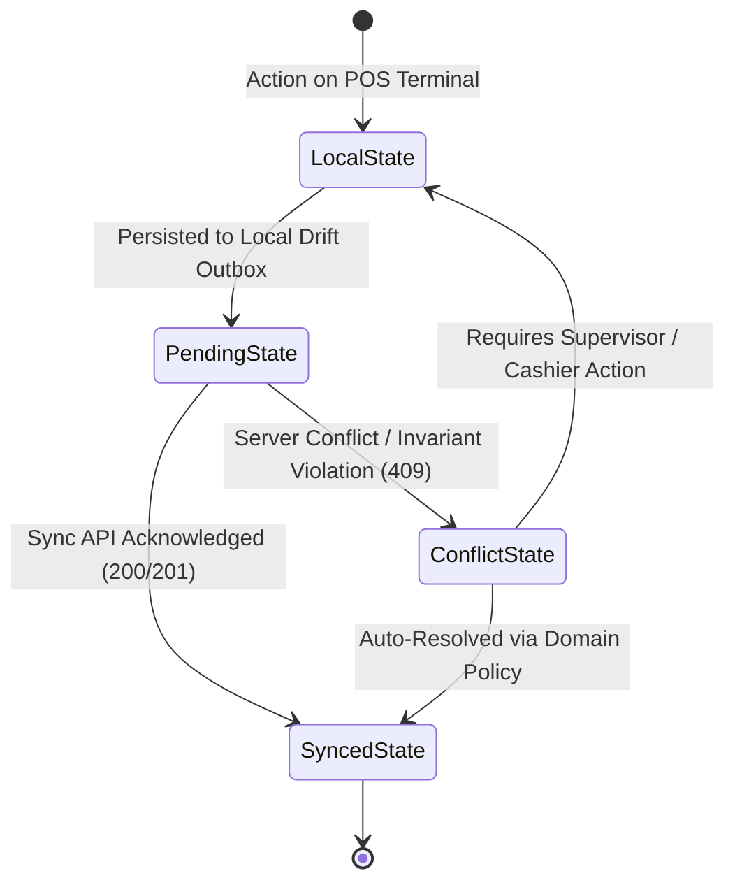
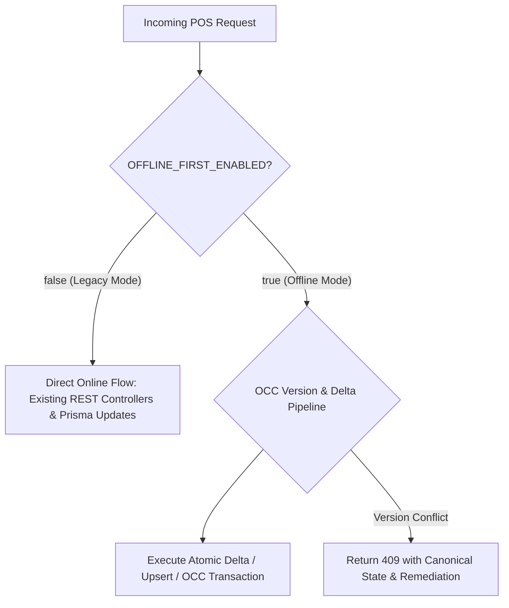

# Phase 7: Concurrency & Conflict Analysis

> **Analysis Scope:** Identification of shared-write hotspots, concurrency hazards, and deterministic conflict resolution strategies for offline-first migration in Hungry Howie's POS (Flutter Windows client + NestJS/Prisma/PostgreSQL backend).
> **Date:** October 17, 2026
> **Author:** Concurrency Conflict Analyst (Wave 1)

---

## 1. Executive Summary & Core Architectural Principles

Hungry Howie's POS currently operates primarily as a direct online REST-client with transient in-memory fallbacks ([`frontend/lib/data/repositories/api_order_repository.dart:61-70`](file:///D:/HowiePOSUPdated/Hbackend-Hfrontend-main/frontend/lib/data/repositories/api_order_repository.dart#L61-L70)) and a simulated sync overview ([`backend/src/sync/sync.service.ts:34-182`](file:///D:/HowiePOSUPdated/Hbackend-Hfrontend-main/backend/src/sync/sync.service.ts#L34-L182)). In multi-terminal restaurant operations, concurrent writes to shared entities—such as dining tables, order line items, payment records, inventory stock, shifts, customer profiles, and sequential order numbers—introduce severe race conditions, silent overwrites, and database constraint violations.

The offline-first architecture must adhere to five non-negotiable principles:
1. **PostgreSQL as Canonical Source of Truth:** The central cloud database represents the immutable ledger of record. Local Drift/SQLite databases act as low-latency operational caches and store-and-forward outbox buffers.
2. **Deterministic Conflict Resolution without Data Loss:** In a restaurant, physical transactions (food cooked, cash handed over, guest seated) cannot be rolled back by a software conflict. Data integrity, financial auditability, and physical operational reality always take precedence over software simplicity.
3. **No CRDTs Required:** POS business rules are stateful, constraint-driven, and financial. Operation-based deltas, Optimistic Concurrency Control (OCC) with version tokens, and append-only ledgers satisfy 100% of the restaurant's operational requirements without CRDT complexity.
4. **Idempotency for Every Retryable Mutation:** Every network transmission from the client outbox carries a unique, deterministic idempotency key (`mutation_id` / client UUID) to guarantee safe retries across intermittent connectivity.
5. **Feature Flag Isolation (`OFFLINE_FIRST_ENABLED`):** All existing online REST endpoints and direct database flows must function unaltered when the feature flag is disabled (`false`).

---

## 2. State Lifecycle Architecture

To eliminate ambiguity across UI and database layers, all domain entities transition through five strictly defined states:



### State Definitions

| State | Storage Location | Description | User Interface Indication |
|---|---|---|---|
| **Local State** | Drift / SQLite (Local Memory) | Transient or uncommitted modifications on the terminal. | Normal active editing mode. |
| **Pending State** | Local Outbox Table (`sync_outbox`) | Locally committed transactions waiting for network connectivity and server acknowledgment. | Amber badge: *"Pending Sync (Offline)"* |
| **Server State** | Cloud PostgreSQL (`orders`, `restaurant_tables`, etc.) | Authoritative, finalized state as persisted in the cloud database. | Clean standard UI state. |
| **Synced State** | Drift Local DB + Cloud DB | Local outbox record confirmed by server; local record stamped with `synced_at` and `server_version`. | Green check: *"Synced with Cloud"* |
| **Conflict State** | Drift Conflict Registry (`sync_conflicts`) | Mutation rejected by server OCC check, unique constraint, or state machine invariant. | Orange/Red Alert: *"Sync Conflict - Action Needed"* |

---

## 3. Concurrency Strategy Taxonomy

Every shared-write hotspot across the codebase is assigned one of the following architectural strategies:

1. **Optimistic Concurrency Control with Version Field (`OCC-Version`):** Records include an integer `version` incremented on every write. Updates must supply `expected_version`. If versions mismatch, the server rejects the write with `409 Conflict`.
2. **Server Timestamps / Vector Clock (`Server-Timestamp`):** Server assigns canonical `updated_at` timestamps upon commit. Client timestamps are recorded purely for audit and latency tracking.
3. **Last-Write-Wins (`LWW`):** Used strictly for non-critical, loss-tolerant descriptive fields (e.g. customer delivery notes, zone display colors) where the latest write safely replaces older data.
4. **Server-Authoritative Calculation (`Server-Authoritative`):** Clients calculate totals purely for local preview. Upon sync, the server executes the canonical business logic and writes authoritative totals.
5. **Operation/Event-Based Sync (`Operation-Delta`):** Mutations are expressed as semantic intent actions (e.g., `ADD_ITEM`, `CANCEL_ITEM`, `APPLY_DISCOUNT`) rather than whole-record replacements.
6. **Client Idempotency Key (`Idempotency-Key`):** Every mutation payload carries a client-generated UUID (`mutation_id`). The server caches execution results in an idempotency table to prevent duplicate execution upon retry.
7. **Unique Database Constraint (`Unique-Constraint`):** PostgreSQL enforces uniqueness at the schema level.
8. **ACID Database Transaction (`DB-Transaction`):** Prisma `$transaction` blocks with explicit row-level locks (`SELECT ... FOR UPDATE`) to guarantee atomic multi-table consistency.

---

## 4. Deep-Dive Analysis of the 9 Shared-Write Hotspots

### 4.1 Table Status

#### Code References
- Schema: [`backend/prisma/schema.prisma:140-160`](file:///D:/HowiePOSUPdated/Hbackend-Hfrontend-main/backend/prisma/schema.prisma#L140-L160) (`RestaurantTable` model: fields `status`, `active_order_id`, `current_bill_amount`, `reserved_customer_name`, `reservation_time`. **No `version` or `updated_at` column**).
- Backend Service: [`backend/src/tables/tables.service.ts:349-389`](file:///D:/HowiePOSUPdated/Hbackend-Hfrontend-main/backend/src/tables/tables.service.ts#L349-L389) (`updateTableStatus`), [`391-415`](file:///D:/HowiePOSUPdated/Hbackend-Hfrontend-main/backend/src/tables/tables.service.ts#L391-L415) (`releaseTable`), [`417-521`](file:///D:/HowiePOSUPdated/Hbackend-Hfrontend-main/backend/src/tables/tables.service.ts#L417-L521) (`transferTable`), [`523-559`](file:///D:/HowiePOSUPdated/Hbackend-Hfrontend-main/backend/src/tables/tables.service.ts#L523-L559) (`updateTableReservation`).
- Order Association: [`backend/src/orders/orders.service.ts:360-369`](file:///D:/HowiePOSUPdated/Hbackend-Hfrontend-main/backend/src/orders/orders.service.ts#L360-L369) (sets table `occupied` on dine-in order), [`726-737`](file:///D:/HowiePOSUPdated/Hbackend-Hfrontend-main/backend/src/orders/orders.service.ts#L726-L737) (releases table on order completion).
- Frontend Repository: [`frontend/lib/data/table_repository.dart:181-220`](file:///D:/HowiePOSUPdated/Hbackend-Hfrontend-main/frontend/lib/data/table_repository.dart#L181-L220).

#### Scenario: Cashier A Reserves vs Cashier B Releases Same Table
1. Cashier A on Terminal 1 opens Table 5 and records a reservation for "Mr. Smith at 8:00 PM" (`status -> 'reserved'`).
2. Simultaneously (or while Terminal 2 is offline), Cashier B marks Table 5 as clean and released (`status -> 'available'`).

#### Current Behaviour in Code
- In [`backend/src/tables/tables.service.ts:391-415`](file:///D:/HowiePOSUPdated/Hbackend-Hfrontend-main/backend/src/tables/tables.service.ts#L391-L415), `releaseTable` performs an unconditional Prisma update:
  ```ts
  const updated = await this.prisma.restaurantTable.update({
    where: { id },
    data: {
      status: 'available',
      active_order_id: null,
      occupied_since: null,
      current_bill_amount: 0.0,
      current_customer_count: 0,
      reserved_customer_name: null,
      reservation_time: null,
    },
  });
  ```
- In [`backend/src/tables/tables.service.ts:546-553`](file:///D:/HowiePOSUPdated/Hbackend-Hfrontend-main/backend/src/tables/tables.service.ts#L546-L553), `updateTableReservation` also executes an unconditional update:
  ```ts
  const updated = await this.prisma.restaurantTable.update({
    where: { id },
    data: { status, reserved_customer_name: reservedName, reservation_time: reservationTime },
  });
  ```
- **Result:** Pure Last-Write-Wins (LWW). Whichever request hits PostgreSQL last wipes out the other. If Cashier B's release request executes after Cashier A's reservation, Mr. Smith's reservation is silently erased (`reserved_customer_name: null`). When Mr. Smith arrives, the host sees Table 5 as available or occupied by walk-in guests.

#### Risk
Guest embarrassment, double-booked dining tables, lost reservations, or premature release of tables where customers are still eating.

#### Chosen Strategy: `OCC-Version` + State Machine Invariant Validation
- Add integer column `version Int @default(1)` and `updated_at DateTime @updatedAt` to `RestaurantTable` in [`backend/prisma/schema.prisma`](file:///D:/HowiePOSUPdated/Hbackend-Hfrontend-main/backend/prisma/schema.prisma#L140).
- Mutations must supply `expected_version`.
- In `TablesService`:
  ```ts
  const table = await tx.restaurantTable.findUnique({ where: { id } });
  if (table.version !== dto.expected_version) {
    throw new ConflictException({
      code: 'TABLE_VERSION_MISMATCH',
      message: `Table '${table.name}' has been modified by another terminal.`,
      current_state: table,
    });
  }
  ```
- **State Machine Guard:** `releaseTable` cannot transition a table from `reserved` to `available` without an explicit `action: 'CANCEL_RESERVATION'`. A standard table cleanup release command is only valid when `status == 'occupied'` and `active_order_id == null` (or order is paid).

#### What the Losing Device Sees & How It Is Told
- **Online Device:** Cashier B's terminal receives HTTP `409 Conflict (code: TABLE_VERSION_MISMATCH)`. The UI displays a modal:
  > **Table Status Conflict**
  > Table 5 was reserved by Cashier A for *Mr. Smith (8:00 PM)* while you were releasing it.
  > Table status has been updated to **Reserved**.
- The local state immediately syncs to `reserved` (orange highlight). Cashier B's screen refreshes automatically via WebSocket broadcast.
- **Offline Device:** If Cashier B was offline and queued a `RELEASE_TABLE` mutation, upon sync the server returns `409 Conflict`. The outbox marks the entry as `REJECTED_CONFLICT`. The local Drift table status is rolled back to `reserved`. A banner appears in Cashier B's notification tray.

---

### 4.2 Order Items

#### Code References
- Schema: [`backend/prisma/schema.prisma:390-412`](file:///D:/HowiePOSUPdated/Hbackend-Hfrontend-main/backend/prisma/schema.prisma#L390-L412) (`OrderItem` model: line-item snapshot pricing, cancellation audit fields `is_cancelled`, `cancel_reason`, `cancelled_by`. **No version field**).
- Backend Service: [`backend/src/orders/orders.service.ts:468-600`](file:///D:/HowiePOSUPdated/Hbackend-Hfrontend-main/backend/src/orders/orders.service.ts#L468-L600) (`updateOrder`), [`908-1060`](file:///D:/HowiePOSUPdated/Hbackend-Hfrontend-main/backend/src/orders/orders.service.ts#L908-L1060) (`cancelOrderItem`).
- Frontend API Service: [`frontend/lib/services/api/orders_api_service.dart:71-86`](file:///D:/HowiePOSUPdated/Hbackend-Hfrontend-main/frontend/lib/services/api/orders_api_service.dart#L71-L86) (`updateOrder` sends full `items` array).

#### Scenario: Both Edit Same Order Concurrently
- Waiter A on Tablet 1 adds `2x Howie Bread` to active Dine-In Order #104 (Table 3).
- Cashier B on Counter POS 2 adds `1x Buffalo Wings` to Order #104 and cancels `1x Pepperoni Pizza`.

#### Current Behaviour in Code
- Look at [`backend/src/orders/orders.service.ts:493-568`](file:///D:/HowiePOSUPdated/Hbackend-Hfrontend-main/backend/src/orders/orders.service.ts#L493-L568):
  ```ts
  // Recalculate subtotal if items changed
  if (dto.items && dto.items.length > 0) {
    const existingItems = existing.order_items || [];
    const existingItemsMap = new Map(existingItems.map((i) => [i.id, i]));
    const incomingItemIds = new Set<string>();
    ...
    // Only delete active un-cancelled items that were removed from the updated item list
    for (const existingItem of existingItems) {
      if (!incomingItemIds.has(existingItem.id) && !existingItem.is_cancelled) {
        await tx.orderItem.delete({ where: { id: existingItem.id } });
      }
    }
  }
  ```
- **Result:** Whole-array replacement deletion bug!
  - Waiter A sends payload: `[Pizza, Bread]`.
  - Cashier B sends payload: `[Pizza (cancelled), Wings]`.
  - Whichever request commits second checks `incomingItemIds`. If Cashier B's request commits second, `incomingItemIds` contains Pizza and Wings, but NOT Bread.
  - The loop at line 564 **DELETES Waiter A's Howie Bread from the database** (`await tx.orderItem.delete(...)`).
  - Howie Bread disappears from the bill and the kitchen, even if the kitchen already baked it!

#### Risk
Severe revenue leakage, food sent to tables unbilled, kitchen tickets missing items, ghost orders.

#### Chosen Strategy: `Operation-Delta` (Semantic Delta Mutations) + Base Order `OCC-Version`
- **Deprecate whole-array replacement.** Replace `dto.items: Item[]` with atomic line-item operations:
  1. `ADD_LINE_ITEM { item_id: UUID, menu_item_id, quantity, size, crust, toppings, notes }`
  2. `UPDATE_LINE_ITEM_QUANTITY { item_id: UUID, quantity }`
  3. `CANCEL_LINE_ITEM { item_id: UUID, cancel_quantity, reason, cancelled_by }`
- Each operation carries a client-generated UUID `operation_id` for idempotency.
- **Commutative Merge:**
  - Waiter A's `ADD_LINE_ITEM (Bread)` and Cashier B's `ADD_LINE_ITEM (Wings)` operate on different client-generated UUIDs.
  - The server applies both operations additively inside a single `$transaction`.
  - Both items exist in `order_items`.
- **Targeted Cancellation:**
  - Cashier B's `CANCEL_LINE_ITEM` targets Pizza's specific `item_id`. It invokes the existing idempotent method [`orders.service.ts:908-1060`](file:///D:/HowiePOSUPdated/Hbackend-Hfrontend-main/backend/src/orders/orders.service.ts#L908-L1060), marking `is_cancelled = true` without touching Bread or Wings.
- Order base record increments `version = version + 1`.

#### What the Losing Device Sees & How It Is Told
- When Waiter A and Cashier B submit non-conflicting deltas (adding different items), both mutations succeed.
- PostgreSQL recalculates the financial totals atomically.
- Both terminals receive WebSocket event `order.updated` ([`backend/src/kitchen/kitchen.gateway.ts:186-192`](file:///D:/HowiePOSUPdated/Hbackend-Hfrontend-main/backend/src/kitchen/kitchen.gateway.ts#L186-L192)) and merge the latest line items into their screen state.
- **Conflict Case (Concurrent edit on the same line item):** If Waiter A changes Pizza quantity to 3 while Cashier B cancels the Pizza:
  - Cancellation takes precedence per restaurant business rules.
  - Waiter A's quantity update receives `409 Conflict (code: ITEM_ALREADY_CANCELLED)`.
  - Waiter A's tablet displays a notification: *"Pepperoni Pizza was cancelled by Elena (Cashier). Quantity change was not applied."*

---

### 4.3 Order Totals & Financial Calculations

#### Code References
- Schema: [`backend/prisma/schema.prisma:280-284`](file:///D:/HowiePOSUPdated/Hbackend-Hfrontend-main/backend/prisma/schema.prisma#L280-L284) (`subtotal`, `discount_percentage`, `discount_amount`, `tax_amount`, `grand_total`).
- Backend Service: [`backend/src/orders/orders.service.ts:194-229`](file:///D:/HowiePOSUPdated/Hbackend-Hfrontend-main/backend/src/orders/orders.service.ts#L194-L229) (`createOrder`), [`621-625`](file:///D:/HowiePOSUPdated/Hbackend-Hfrontend-main/backend/src/orders/orders.service.ts#L621-L625) (`updateOrder`), [`996-1013`](file:///D:/HowiePOSUPdated/Hbackend-Hfrontend-main/backend/src/orders/orders.service.ts#L996-L1013) (`cancelOrderItem`).
- Frontend Domain: [`frontend/lib/domain/services/pricing_engine.dart`](file:///D:/HowiePOSUPdated/Hbackend-Hfrontend-main/frontend/lib/domain/services/pricing_engine.dart).

#### Scenario: Client Totals Divergence Upon Reconnection
- Terminal 1 operates offline with cached store settings (e.g. Sales Tax = 8.5%).
- Meanwhile, Store Manager updates sales tax to 10.0% on cloud settings.
- Terminal 1 completes Order #106 offline with grand total PKR 1,085.00.
- When Terminal 1 reconnects, what should the grand total be?

#### Current Behaviour in Code
- In [`backend/src/orders/orders.service.ts:225-228`](file:///D:/HowiePOSUPdated/Hbackend-Hfrontend-main/backend/src/orders/orders.service.ts#L225-L228):
  ```ts
  const grandTotal =
    dto.grand_total !== undefined
      ? this.round(dto.grand_total)
      : this.round(subtotal - discountAmountRaw + taxAmountRaw + deliveryFeeRaw);
  ```
- And in [`backend/src/orders/orders.service.ts:621-624`](file:///D:/HowiePOSUPdated/Hbackend-Hfrontend-main/backend/src/orders/orders.service.ts#L621-L624):
  ```ts
  const grandTotal =
    dto.grand_total !== undefined
      ? this.round(dto.grand_total)
      : this.round(subtotal - discountAmount + taxAmount + deliveryFee);
  ```
- **Result:** The backend blindly trusts `dto.grand_total` and `dto.subtotal` if provided by the client! If a client sends an outdated, incorrect, or maliciously modified total, PostgreSQL commits it directly without verifying that `grand_total == subtotal - discount + tax + delivery`.

#### Risk
Accounting imbalance, tax authority audit failure, fiscal reporting discrepancy between line-item sums and base order totals.

#### Chosen Strategy: `Server-Authoritative` Financial Totals with Snapshot Tolerance
- The server recalculates and validates financial totals within every transaction:
  ```ts
  calculated_subtotal = sum(sanitized_items.filter(i => !i.is_cancelled).map(i => round(i.unit_price * i.quantity)))
  calculated_tax = round(taxable_subtotal * active_tax_rate)
  calculated_grand_total = calculated_subtotal - discount + calculated_tax + delivery_fee
  ```
- **Offline Integrity Rule:** If the order was **already paid offline** (cash collected, receipt printed with physical tax invoice):
  - The server records the financial numbers that match the printed customer receipt (`receipt_snapshot`).
  - Any variance between server tax rates and offline printed tax rates is recorded into an audit log (`tax_rate_divergence_log`) rather than failing the sync or changing the customer's bill.
- If the order is **unpaid** (e.g., pending dine-in check):
  - Server recalculates totals authoritatively and returns the canonical breakdown in the sync response.

#### What the Losing Device Sees & How It Is Told
- For unpaid orders: POS receives the authoritative breakdown in the sync response. The local Drift record is updated, and the bill screen refreshes with the server-validated tax and total.
- For paid orders: POS local numbers remain untouched to match the physical paper receipt in the customer's hands.

---

### 4.4 Payments

#### Code References
- Schema: [`backend/prisma/schema.prisma:285-286`](file:///D:/HowiePOSUPdated/Hbackend-Hfrontend-main/backend/prisma/schema.prisma#L285-L286) (`payment_status`, `is_paid`), [`417-436`](file:///D:/HowiePOSUPdated/Hbackend-Hfrontend-main/backend/prisma/schema.prisma#L417-L436) (`OrderPayment` model: id, order_id, payment_method, amount, tendered_amount, change_returned, transaction_reference, payment_status, received_by).
- Backend Service: [`backend/src/orders/orders.service.ts:389-417`](file:///D:/HowiePOSUPdated/Hbackend-Hfrontend-main/backend/src/orders/orders.service.ts#L389-L417) (`createOrder`), [`773-805`](file:///D:/HowiePOSUPdated/Hbackend-Hfrontend-main/backend/src/orders/orders.service.ts#L773-L805) (`updateOrder`), [`1014-1029`](file:///D:/HowiePOSUPdated/Hbackend-Hfrontend-main/backend/src/orders/orders.service.ts#L1014-L1029) (`cancelOrderItem`).
- Immutability Guard: [`backend/src/orders/orders.service.ts:480-484`](file:///D:/HowiePOSUPdated/Hbackend-Hfrontend-main/backend/src/orders/orders.service.ts#L480-L484).

#### Scenario: Double Payment on Same Order
- Table 4 asks for the bill (PKR 3,000).
- Guest A walks up to Counter POS 1 and pays PKR 3,000 Cash to Elena.
- Concurrently (or while POS 2 is offline), Guest B hands a Credit Card to Waiter Tariq at the table, who charges PKR 3,000 on Mobile POS 2.

#### Current Behaviour in Code
- Look at [`backend/src/orders/orders.service.ts:773-775`](file:///D:/HowiePOSUPdated/Hbackend-Hfrontend-main/backend/src/orders/orders.service.ts#L773-L775):
  ```ts
  if (dto.payments && dto.payments.length > 0) {
    await tx.orderPayment.deleteMany({ where: { order_id: id } });
    await tx.orderPayment.createMany({
      data: dto.payments.map((p) => ({ ... })),
    });
  }
  ```
- And look at [`backend/src/orders/orders.service.ts:480-484`](file:///D:/HowiePOSUPdated/Hbackend-Hfrontend-main/backend/src/orders/orders.service.ts#L480-L484):
  ```ts
  if (existing.is_paid || existing.status === 'completed' || existing.status === 'cancelled') {
    throw new BadRequestException(
      `Order '${existing.order_number}' is already ${existing.is_paid ? 'paid' : existing.status} and cannot be modified.`,
    );
  }
  ```
- **Result:** Catastrophic financial race condition:
  - If POS 1's cash payment commits first: Order #104 becomes `is_paid = true`.
  - When POS 2's card payment reaches the backend: Line 480 throws `BadRequestException: Order is already paid and cannot be modified`!
  - **The card payment is REJECTED by the server.** But Guest B's bank account was ALREADY charged via the physical card terminal! The money was taken, but the POS refuses to record the transaction.
  - Alternatively, if `updateOrder` is called with payments: Line 774 executes `deleteMany`, **permanently deleting Cashier Elena's cash payment record from the ledger!** At end-of-day, Elena's cash drawer has PKR 3,000 unrecorded surplus.

#### Risk
Severe financial discrepancies, unrecorded card authorizations, ledger destruction via `deleteMany`, customer disputes, cashier short/over accusations.

#### Chosen Strategy: Append-Only Payment Ledger + `Idempotency-Key` + Overpayment Detection
1. **Never `deleteMany` on `order_payments`:** Payments are legal financial ledger entries. Deletion is prohibited.
2. Every payment record created by client must have a client-generated UUID `id` (`order_payment_id`).
3. Payment recording endpoint: `POST /orders/:id/payments`:
   - Runs in a Prisma `$transaction` with `tx.order.findUnique({ where: { id } })`.
   - Checks if payment with `id` already exists (idempotent retry safe).
   - Inserts payment into `order_payments` without deleting prior payments.
   - Calculates total paid: `total_paid = sum(existing_payments) + new_payment`.
   - **Overpayment Logic:**
     - If `total_paid == grand_total`: `payment_status = 'PAID', is_paid = true`.
     - If `total_paid < grand_total`: `payment_status = 'PARTIALLY_PAID', is_paid = false`.
     - If `total_paid > grand_total`:
       - Do **NOT** reject the payment! Physical money was already exchanged.
       - Set order `payment_status = 'OVERPAID'`.
       - Record new payment with `notes: 'OVERPAYMENT: Double payment detected. Excess PKR ' + (total_paid - grand_total)`.
       - Emit high-priority WebSocket alert `payment.overpaid`.

#### What the Losing Device Sees & How It Is Told
- When POS 2 syncs the card payment, the sync succeeds (`200 OK`), but the response contains:
  ```json
  {
    "payment_status": "OVERPAID",
    "grand_total": 3000.00,
    "total_paid": 6000.00,
    "excess_amount": 3000.00,
    "warning": "Order was already paid in Cash by Elena on Terminal POS-01."
  }
  ```
- POS 2's screen immediately presents an urgent blocking dialog:
  > ⚠️ **Duplicate Payment Detected on Order #104**
  > **Order Grand Total:** PKR 3,000.00
  > **Payment 1 (POS-01):** PKR 3,000.00 (Cash received by Elena)
  > **Payment 2 (This Terminal):** PKR 3,000.00 (Card)
  > **Excess Collected:** PKR 3,000.00
  > *Action Required: Promptly refund PKR 3,000.00 Cash or issue a Credit Card refund.*
- The incident is permanently logged in the Manager Audit Trail.

---

### 4.5 Inventory Quantity

#### Code References
- Schema: [`backend/prisma/schema.prisma:481-500`](file:///D:/HowiePOSUPdated/Hbackend-Hfrontend-main/backend/prisma/schema.prisma#L481-L500) (`InventoryItem`: `current_stock`, `used_stock`, `min_threshold`), [`504-519`](file:///D:/HowiePOSUPdated/Hbackend-Hfrontend-main/backend/prisma/schema.prisma#L504-L519) (`StockMovement`: `movement_type`, `quantity`, `cost_impact`).
- Backend Service: [`backend/src/inventory/inventory.service.ts:271-334`](file:///D:/HowiePOSUPdated/Hbackend-Hfrontend-main/backend/src/inventory/inventory.service.ts#L271-L334) (`stockOut` checks `currentStockNum < dto.quantity` and throws `BadRequestException`).
- Frontend Stock Engine: [`frontend/lib/application/orders/complete_order_usecase.dart:177-186`](file:///D:/HowiePOSUPdated/Hbackend-Hfrontend-main/frontend/lib/application/orders/complete_order_usecase.dart#L177-L186).

#### Scenario: Two POS Sell Last Item (One Offline)
- Stock for "Buffalo Chicken Wings (Single Portion)" or "Mozzarella Cheese (1 kg)" has exactly 1 unit remaining.
- POS 1 (online) sells the last portion. Current stock drops to 0.
- POS 2 (offline) sells 1 portion to a walk-in guest, bakes it, collects cash, and hands it over.
- POS 2 reconnects and syncs its offline sales order.

#### Current Behaviour in Code
- In the current backend, `MenuItem` is NOT linked via foreign keys to `InventoryItem`, and `OrdersService` does NOT automatically invoke `InventoryService.stockOut` ([`backend/src/orders/orders.service.ts:137-463`](file:///D:/HowiePOSUPdated/Hbackend-Hfrontend-main/backend/src/orders/orders.service.ts#L137-L463)).
- However, the frontend [`CompleteOrderUseCase`](file:///D:/HowiePOSUPdated/Hbackend-Hfrontend-main/frontend/lib/application/orders/complete_order_usecase.dart#L177-L186) attempts to deduct stock by calling `inventoryRepository.deductStockByItemName`.
- If `stockOut` in [`backend/src/inventory/inventory.service.ts:284-288`](file:///D:/HowiePOSUPdated/Hbackend-Hfrontend-main/backend/src/inventory/inventory.service.ts#L284-L288) is called:
  ```ts
  const currentStockNum = Number(item.current_stock);
  if (currentStockNum < dto.quantity) {
    throw new BadRequestException(
      `Insufficient stock: item '${item.name}' has ${currentStockNum} ${item.unit} available, but ${dto.quantity} was requested`,
    );
  }
  ```
- **Result:** If stock deduction is strictly enforced, the server throws `400 BadRequestException`. If order creation is coupled to stock deduction, **the completed offline order fails to sync!**
- The customer already ate the wings. Rejecting the sale leaves the cash drawer with unexplainable money and loses the accounting record.

#### Risk
Rejection of completed physical transactions, stock tracking desynchronization, financial record loss.

#### Chosen Strategy: Business-First Order Acceptance + Negative Stock Tolerance with Overrun Audit
1. **Financial Orders Are Always Accepted:** Order creation must never fail because of raw inventory counters. The physical transaction already completed.
2. **Stock Out Modification:** When `stockOut` is triggered during offline order sync:
   - If `current_stock < requested_qty`:
     - Allow `current_stock` to decrement into negative numbers (e.g. `current_stock = -1.0`).
     - Set `movement_type = 'stockOutDeficit'`.
     - Record `reason: 'Offline sales order overrun - Physical stock exceeded digital inventory'`.
   - Emit an alert to Kitchen / Inventory Manager: *"Negative stock alert: Buffalo Chicken Wings at -1 portions."*
3. **Menu 86 / Out of Stock Propagation:**
   - Once stock reaches <= 0, the server automatically updates `MenuItem.is_available = false` ([`backend/src/menu/items/items.service.ts:248-268`](file:///D:/HowiePOSUPdated/Hbackend-Hfrontend-main/backend/src/menu/items/items.service.ts#L248-L268)).
   - WebSocket broadcasts `menu.item_availability_changed` to all connected POS terminals to disable the item on UI menus.

#### What the Losing Device Sees & How It Is Told
- POS 2's offline order syncs with complete success (`200 OK`). The revenue and cash count are fully recorded.
- In the sync response, POS 2 receives the updated menu catalog indicating that "Buffalo Chicken Wings" is now unavailable (`is_available: false`).
- POS 2's menu displays an "86'd / Sold Out" badge on the item tile. Any subsequent attempt to add the item to cart is blocked with an in-app snackbar: *"Item is now out of stock."*

---

### 4.6 Shift State & EOD Settlement

#### Code References
- Schema: [`backend/prisma/schema.prisma:300`](file:///D:/HowiePOSUPdated/Hbackend-Hfrontend-main/backend/prisma/schema.prisma#L300) (`Order.shift_id`), [`538-584`](file:///D:/HowiePOSUPdated/Hbackend-Hfrontend-main/backend/prisma/schema.prisma#L538-L584) (`DailyCalculation` model: status `'ACTIVE'` | `'SUBMITTED'`, `cash_submitted`, `total_cash_sales`, `variance_amount`, etc.).
- Backend Service: [`backend/src/daily-calculation/daily-calculation.service.ts:359-367`](file:///D:/HowiePOSUPdated/Hbackend-Hfrontend-main/backend/src/daily-calculation/daily-calculation.service.ts#L359-L367) (guards against closing with unresolved orders), [`411-437`](file:///D:/HowiePOSUPdated/Hbackend-Hfrontend-main/backend/src/daily-calculation/daily-calculation.service.ts#L411-L437) (strict variance and skimming validations), [`477-527`](file:///D:/HowiePOSUPdated/Hbackend-Hfrontend-main/backend/src/daily-calculation/daily-calculation.service.ts#L477-L527) (stamps `shift_id` on orders, updates status to `'SUBMITTED'`).
- Order Shift Link: [`backend/src/orders/orders.service.ts:262-277`](file:///D:/HowiePOSUPdated/Hbackend-Hfrontend-main/backend/src/orders/orders.service.ts#L262-L277).

#### Scenario: Shift Closed while Offline Order Pending
1. Cashier Elena works Morning Shift (Shift S1).
2. Terminal POS 2 goes offline at 2:30 PM.
3. At 2:45 PM, POS 2 completes Order #107 (PKR 2,000 Cash).
4. At 3:00 PM, Manager closes Morning Shift on Terminal POS 1 (which is online):
   - Backend queries cloud database for unresolved orders ([`daily-calculation.service.ts:359`](file:///D:/HowiePOSUPdated/Hbackend-Hfrontend-main/backend/src/daily-calculation/daily-calculation.service.ts#L359)). Since Order #107 hasn't synced, backend finds 0 unresolved orders.
   - Shift S1 is marked `status = 'SUBMITTED'`.
   - Figures are frozen: `total_cash_sales = PKR 40,000`, `cash_submitted = PKR 40,000`, `variance = 0.00`.
5. At 3:15 PM, Evening Shift (Shift S2) is opened by Cashier Tariq.
6. At 3:30 PM, Terminal POS 2 comes online and syncs Order #107 (created at 2:45 PM).

#### Current Behaviour in Code
- Look at [`backend/src/orders/orders.service.ts:262-277`](file:///D:/HowiePOSUPdated/Hbackend-Hfrontend-main/backend/src/orders/orders.service.ts#L262-L277):
  ```ts
  let activeShiftId: string | null = dto.shift_id || null;
  if (!activeShiftId) {
    try {
      const activeShift = await tx.dailyCalculation.findFirst({
        where: { status: 'ACTIVE' },
        orderBy: { created_at: 'desc' },
        select: { id: true },
      });
      if (activeShift) {
        activeShiftId = activeShift.id;
      }
    } ...
  ```
- **Result:** Severe shift accounting corruption:
  - If POS 2 sent `shift_id = S1`: Order #107 is inserted with `shift_id = S1`. But Shift S1 is ALREADY `SUBMITTED`. The static summary in `daily_calculations` (PKR 40,000) does NOT recalculate! The database now has PKR 42,000 of orders pointing to S1, but S1 says PKR 40,000! A permanent PKR 2,000 discrepancy is created.
  - If POS 2 sent `shift_id = null`: The fallback code queries `status: 'ACTIVE'`. It attaches Order #107 to **Shift S2 (Tariq's Evening Shift)**! Tariq's evening shift now expects PKR 2,000 extra cash that Elena collected and put in the morning deposit envelope. Tariq's shift now shows a false PKR 2,000 cash shortage at closing!

#### Risk
Accounting fraud flags, broken cashier reconciliations, false shortage penalties against innocent cashiers.

#### Chosen Strategy: Shift Amendment Ledger ("Post-Close Sync Adjustment") + Shift Session Locking
1. **Shift Affiliation Preserved:** Order #107 must remain linked to Shift S1 (where it was physically rung up).
2. **Submitted Shift Immutability:** Shift S1's original submitted fields (`cash_submitted`, `total_cash_sales`) are NEVER mutated in place.
3. **Shift Adjustment Ledger (`daily_shift_adjustments`):**
   When an offline order syncs for an already-closed shift:
   - Server inserts the order with `shift_id = S1`.
   - Server creates a `DailyShiftAdjustment` entry:
     - `shift_id: S1`
     - `order_id: Order #107`
     - `adjustment_type: 'POST_CLOSE_OFFLINE_SYNC'`
     - `amount: 2000.00`
     - `payment_method: 'cash'`
     - `synced_at: now()`
     - `notes: 'Order #107 synced after shift S1 was submitted.'`
   - Store reports display:
     - **Original Submitted Cash:** PKR 40,000.00
     - **Post-Close Offline Adjustments:** + PKR 2,000.00
     - **Audited Total Cash:** PKR 42,000.00
4. Evening Shift S2 is completely untouched. Tariq's cash count remains 100% accurate.

#### What the Losing Device Sees & How It Is Told
- POS 2's sync completes successfully (`200 OK`).
- The response returns:
  ```json
  {
    "order_id": "...",
    "order_number": "107",
    "shift_status": "ATTACHED_TO_CLOSED_SHIFT_WITH_ADJUSTMENT",
    "shift_id": "S1",
    "adjustment_logged": true
  }
  ```
- POS 2 displays a notification: *"Order #107 recorded. Morning shift S1 was already closed; a post-closing audit adjustment of PKR 2,000 was registered."*

---

### 4.7 Product Price

#### Code References
- Schema: [`backend/prisma/schema.prisma:183-200`](file:///D:/HowiePOSUPdated/Hbackend-Hfrontend-main/backend/prisma/schema.prisma#L183-L200) (`MenuItem.base_price`), [`205-215`](file:///D:/HowiePOSUPdated/Hbackend-Hfrontend-main/backend/prisma/schema.prisma#L205-L215) (`MenuItemSize.price`), [`399`](file:///D:/HowiePOSUPdated/Hbackend-Hfrontend-main/backend/prisma/schema.prisma#L399) (`OrderItem.unit_price`).
- Service: [`backend/src/orders/orders.service.ts:373-386`](file:///D:/HowiePOSUPdated/Hbackend-Hfrontend-main/backend/src/orders/orders.service.ts#L373-L386).

#### Scenario: Menu Price Updated on Cloud while POS Sells Offline
- Manager increases price of "Howie Maui Large" from PKR 1,500 to PKR 1,700 on Cloud Admin.
- Terminal POS 2 is offline, sells Howie Maui Large at cached price PKR 1,500, collects PKR 1,500, and prints receipt for PKR 1,500.
- POS 2 reconnects and syncs.

#### Current Behaviour in Code
- Look at [`backend/src/orders/orders.service.ts:373-386`](file:///D:/HowiePOSUPdated/Hbackend-Hfrontend-main/backend/src/orders/orders.service.ts#L373-L386):
  ```ts
  await tx.orderItem.createMany({
    data: sanitizedItems.map((item) => ({
      order_id: createdOrder.id,
      menu_item_id: item.menu_item_id,
      item_name: item.item_name,
      quantity: item.quantity,
      unit_price: item.unit_price,
      total_price: this.round(item.unit_price * item.quantity),
      ...
    })),
  });
  ```
- **Result:** The server writes `item.unit_price` as supplied by the client! It does NOT overwrite `unit_price` with `menuItem.base_price`.
- This is the correct restaurant domain behavior: an order item price is an immutable transaction snapshot.

#### Risk
If an inexperienced developer alters this to re-evaluate prices against the current catalog, offline orders would recalculate to PKR 1,700, creating an instant PKR 200 shortage against the customer's PKR 1,500 payment.

#### Chosen Strategy: `Snapshot-Authoritative` + Catalog Version Sync
1. `OrderItem.unit_price` remains an authoritative transaction snapshot. The price agreed upon with the customer and printed on paper is preserved.
2. The menu catalog carries an integer `catalog_version` or `updated_at`.
3. When POS 2 reconnects, its heartbeat response informs it that `server_catalog_version > local_catalog_version`.
4. POS 2 downloads the latest catalog in the background so future cart additions use PKR 1,700.

#### What the Losing Device Sees & How It Is Told
- Past offline orders sync without price modification or error.
- POS terminal receives a silent catalog update; future orders show PKR 1,700.

---

### 4.8 Customer Data

#### Code References
- Schema: [`backend/prisma/schema.prisma:107-124`](file:///D:/HowiePOSUPdated/Hbackend-Hfrontend-main/backend/prisma/schema.prisma#L107-L124) (`Customer`: `phone` is `@unique @db.VarChar(30)`).
- Backend Service: [`backend/src/customers/customers.service.ts:54-79`](file:///D:/HowiePOSUPdated/Hbackend-Hfrontend-main/backend/src/customers/customers.service.ts#L54-L79) (`createCustomer`), [`81-123`](file:///D:/HowiePOSUPdated/Hbackend-Hfrontend-main/backend/src/customers/customers.service.ts#L81-L123) (`updateCustomer`).

#### Scenario: Duplicate Customer Creation Offline with Same Phone Number
- POS 1 (offline) registers new customer "Ali Khan, 0300-5551234, House 10".
- POS 2 (offline or online) registers "Muhammad Ali Khan, 0300-5551234, House 10, St 2".
- Both POS attach the customer to delivery orders and sync.

#### Current Behaviour in Code
- Look at [`backend/src/customers/customers.service.ts:55-63`](file:///D:/HowiePOSUPdated/Hbackend-Hfrontend-main/backend/src/customers/customers.service.ts#L55-L63):
  ```ts
  const existing = await this.prisma.customer.findUnique({
    where: { phone: dto.phone },
  });
  if (existing) {
    throw new ConflictException(
      `Customer with phone number '${dto.phone}' already exists (${existing.full_name})`,
    );
  }
  ```
- **Result:** PostgreSQL `@unique` constraint rejects the second customer insert with HTTP `409 Conflict`. If the offline sync pipeline stops on customer failure, the associated delivery order fails to sync.

#### Risk
Delivery order sync blocked, missing customer order history.

#### Chosen Strategy: Natural Key Upsert + Order Snapshot Decoupling
1. **Phone as Natural Match Key:** When syncing a customer created offline, the sync endpoint executes an **Upsert by Phone**:
   - If phone exists: merge fields (e.g. keep longer name, update delivery address if non-empty), DO NOT throw ConflictException.
   - If phone does not exist: insert new customer.
2. **Order Receipt Snapshot Decoupling:**
   - In [`backend/prisma/schema.prisma:324-327`](file:///D:/HowiePOSUPdated/Hbackend-Hfrontend-main/backend/prisma/schema.prisma#L324-L327) (`online_order_details`) and [`352-353`](file:///D:/HowiePOSUPdated/Hbackend-Hfrontend-main/backend/prisma/schema.prisma#L352-L353) (`takeaway_order_details`), `customer_name` and `customer_phone` are ALREADY denormalized snapshots on the order record!
   - Even if customer record merging is delayed, the order's delivery details and receipt remain 100% intact.

#### What the Losing Device Sees & How It Is Told
- POS 1 and POS 2 orders sync without failure.
- The cloud customer record is merged cleanly, linking both orders to the single unified customer profile.

---

### 4.9 Order and Receipt Numbering

#### Code References
- Schema: [`backend/prisma/schema.prisma:276`](file:///D:/HowiePOSUPdated/Hbackend-Hfrontend-main/backend/prisma/schema.prisma#L276) (`Order.order_number String @unique @map("order_number") @db.VarChar(30)`).
- Schema: [`backend/prisma/schema.prisma:349`](file:///D:/HowiePOSUPdated/Hbackend-Hfrontend-main/backend/prisma/schema.prisma#L349) (`TakeawayOrderDetail.token_number String @unique @map("token_number") @db.VarChar(20)`).
- Backend Number Generation: [`backend/src/orders/orders.service.ts:231-260`](file:///D:/HowiePOSUPdated/Hbackend-Hfrontend-main/backend/src/orders/orders.service.ts#L231-L260).
- Frontend Number Generation: [`frontend/lib/domain/services/order_number_generator.dart:15-39`](file:///D:/HowiePOSUPdated/Hbackend-Hfrontend-main/frontend/lib/domain/services/order_number_generator.dart#L15-L39).
- Printed Thermal Receipts: [`frontend/lib/services/receipt_printer_service.dart:76-77`](file:///D:/HowiePOSUPdated/Hbackend-Hfrontend-main/frontend/lib/services/receipt_printer_service.dart#L76-L77).

#### Scenario: Order Number Collision Across Two Disconnected POS
- Both POS 1 and POS 2 operate offline during a Wi-Fi router crash.
- POS 1 generates Order #101, prints receipt "#101", and hands it to Customer X.
- POS 2 generates Order #101, prints receipt "#101", and hands it to Customer Y.
- Wi-Fi recovers; both terminals sync to cloud PostgreSQL.

#### Current Behaviour in Code
- Look at [`backend/src/orders/orders.service.ts:256-260`](file:///D:/HowiePOSUPdated/Hbackend-Hfrontend-main/backend/src/orders/orders.service.ts#L256-L260):
  ```ts
  const existingOrderNum = await tx.order.findUnique({ where: { order_number: orderNumber } });
  if (existingOrderNum) {
    throw new ConflictException(`Order number '${orderNumber}' already exists`);
  }
  ```
- **Result:** Total sync failure!
  - POS 1's Order #101 inserts successfully.
  - POS 2's Order #101 is violently rejected with HTTP `409 Conflict: Order number '101' already exists`.
  - The unique constraint `orders_order_number_key` in PostgreSQL prevents insertion.
  - If the server attempts to renumber POS 2's order to "#102":
    Customer Y holds physical paper receipt "#101". The kitchen KDS displays "#101". But the cloud database says "#102". When Customer Y arrives to claim their pizza, staff cannot locate the ticket!

#### Risk
Outbox sync blockage, dropped orders, customer pickup chaos, kitchen ticket mismatch.

#### Chosen Strategy: Terminal-Partitioned Display Sequence + Immutable UUID Primary Keys
1. **Primary Key Decoupling:** `Order.id` is a client-generated UUID (`v4`), completely immune to collisions across offline devices.
2. **Terminal-Scoped Order Numbering:**
   - Instead of a single unpartitioned sequence (`101`, `102`...), partition by terminal ID:
     - Terminal POS-01 generates: `1-101`, `1-102`, `1-103`...
     - Terminal POS-02 generates: `2-101`, `2-102`, `2-103`...
     - Mobile POS-03 generates: `3-101`, `3-102`, `3-103`...
   - Printed thermal receipt clearly reads:
     ```
     ================================
             HUNGRY HOWIE'S
             ORDER #: 2-101
     ================================
     ```
   - Kitchen display and thermal KOT slips display `2-101`.
   - Takeaway tokens are scoped similarly: `TK-2-101`.
3. **Zero Collisions Guarantee:** Because Terminal 1 and Terminal 2 have disjoint namespaces (`1-xxx` vs `2-xxx`), collisions are mathematically impossible, even if both terminals operate offline for days.
4. **Database Constraint:** `order_number` unique index remains intact and happy in PostgreSQL.

#### What the Losing Device Sees & How It Is Told
- **Neither device loses!** Both orders sync cleanly, both customers have matching paper receipts, and kitchen staff have unambiguous ticket references.

---

## 5. Comprehensive Concurrency & Conflict Resolution Matrix

| Shared-Write Hotspot | Concurrency Scenario | Code Location (File & Line) | Current Code Behaviour | Chosen Strategy | What Losing Device Sees | Recovery / Fallback Action |
|---|---|---|---|---|---|---|
| **Table Status** | Cashier A reserves vs Cashier B releases | [`tables.service.ts:391-415`](file:///D:/HowiePOSUPdated/Hbackend-Hfrontend-main/backend/src/tables/tables.service.ts#L391-L415) & [`523-559`](file:///D:/HowiePOSUPdated/Hbackend-Hfrontend-main/backend/src/tables/tables.service.ts#L523-L559) | Unconditional LWW overwrite; reservation wiped out | `OCC-Version` + State Machine Invariants | Modal: *"Table was already reserved by Cashier A. Release aborted."* | Local table state rolls back to server state `reserved`. |
| **Order Items** | Two cashiers edit same order concurrently | [`orders.service.ts:493-568`](file:///D:/HowiePOSUPdated/Hbackend-Hfrontend-main/backend/src/orders/orders.service.ts#L493-L568) | Whole-array replacement deletes lines added by other device | `Operation-Delta` (Semantic Delta Mutations) | Additive deltas merge cleanly. Item-level collision notifies: *"Item already cancelled."* | Commutative merge on server; totals recomputed; both devices receive broadcast update. |
| **Order Totals** | Disconnected client totals diverge from cloud tax/price | [`orders.service.ts:225-228`](file:///D:/HowiePOSUPdated/Hbackend-Hfrontend-main/backend/src/orders/orders.service.ts#L225-L228) & [`621-624`](file:///D:/HowiePOSUPdated/Hbackend-Hfrontend-main/backend/src/orders/orders.service.ts#L621-L624) | Server blindly trusts client grand total | `Server-Authoritative` + Paid Receipt Snapshot Tolerance | Unpaid: Bill totals refresh. Paid: Printed receipt honored, variance logged | Authoritative breakdown stored; audit log captures rate divergence. |
| **Payments** | Double payment (Cash at Counter + Card at Table) | [`orders.service.ts:773-775`](file:///D:/HowiePOSUPdated/Hbackend-Hfrontend-main/backend/src/orders/orders.service.ts#L773-L775) & [`480-484`](file:///D:/HowiePOSUPdated/Hbackend-Hfrontend-main/backend/src/orders/orders.service.ts#L480-L484) | `deleteMany` destroys cash payment OR throws 400 rejecting card | Append-Only Ledger + `Idempotency-Key` + Overpayment Detection | High-priority dialog: *"Duplicate payment detected! Refund excess PKR 3,000."* | Both payments preserved in ledger; order marked `OVERPAID`; drawer balances. |
| **Inventory Quantity** | Two POS sell last item (one offline) | [`inventory.service.ts:284-288`](file:///D:/HowiePOSUPdated/Hbackend-Hfrontend-main/backend/src/inventory/inventory.service.ts#L284-L288) | Throws 400 if stock is insufficient | Business-First Acceptance + Negative Stock Deficit | Order syncs 100%. Menu tile updates to *"86'd / Out of Stock"* | Sale recorded; stock decrements to negative; manager overrun alert emitted. |
| **Shift State** | Shift closed while offline order pending | [`daily-calculation.service.ts:359-367`](file:///D:/HowiePOSUPdated/Hbackend-Hfrontend-main/backend/src/daily-calculation/daily-calculation.service.ts#L359-L367) & [`511-527`](file:///D:/HowiePOSUPdated/Hbackend-Hfrontend-main/backend/src/daily-calculation/daily-calculation.service.ts#L511-L527) | Closed shift summary corrupted OR order attached to wrong shift | Shift Amendment Ledger (`daily_shift_adjustments`) | Toast: *"Order synced to closed shift via post-closing adjustment."* | Original shift record stays frozen; post-close adjustment balances EOD audit. |
| **Product Price** | Price increased on cloud while POS sells offline | [`orders.service.ts:373-386`](file:///D:/HowiePOSUPdated/Hbackend-Hfrontend-main/backend/src/orders/orders.service.ts#L373-L386) | Price snapshotted on item; server honors client price | `Snapshot-Authoritative` + Catalog Versioning | Offline sale syncs with printed price. Catalog updates in background | Historical order honors printed receipt; future cart additions use new price. |
| **Customer Data** | Duplicate customer created offline with same phone | [`customers.service.ts:55-63`](file:///D:/HowiePOSUPdated/Hbackend-Hfrontend-main/backend/src/customers/customers.service.ts#L55-L63) | Unique constraint throws 409 Conflict | Natural Key Upsert + Order Snapshot Decoupling | Seamless sync; profile merged | Server merges customer by phone; delivery order snapshot preserves receipt address. |
| **Order Numbering** | Same order number generated by two offline POS | [`orders.service.ts:256-260`](file:///D:/HowiePOSUPdated/Hbackend-Hfrontend-main/backend/src/orders/orders.service.ts#L256-L260) | 409 Conflict rejects second order completely | Terminal-Partitioned Sequential Numbering (`T1-101`, `T2-101`) | Neither device loses! Both orders succeed | Unambiguous paper receipts match kitchen KDS and cloud DB. |

---

## 6. Proof Regarding CRDTs (Why CRDTs Are Not Needed)

Conflict-Free Replicated Data Types (CRDTs) such as PN-Counters, LWW-Element-Set, or Automerge/Yjs documents are frequently suggested for collaborative real-time editing (e.g., Google Docs or Figma). However, **CRDTs are strictly unnecessary and harmful for Hungry Howie's POS**:

1. **Restricted Domain Operations:** A restaurant POS does not involve arbitrary concurrent text editing. Operations are strictly structured business verbs (`ADD_ITEM`, `SUBMIT_PAYMENT`, `RESERVE_TABLE`).
2. **Hard Financial & Physical Invariants:** CRDTs resolve conflicts through mathematical convergence without understanding domain invariants. A CRDT counter can smoothly converge to a negative stock number or split an order total, but it cannot decide whether a customer should be refunded or whether a physical table has 4 seats. Business rules require explicit conditional validation, not blind mathematical convergence.
3. **Simplicity & Performance on Windows POS:** Implementing CRDT state machines in Dart (Flutter) and TypeScript (NestJS) introduces massive serialization overhead, storage bloat (tombstones for cancelled items), and extreme debugging complexity.
4. **Conclusion:** Operation-based deltas with client UUIDs, Optimistic Concurrency Control (`version`), append-only financial ledgers, and server-authoritative reconciliation solve 100% of the restaurant's concurrency requirements with superior auditability and zero CRDT overhead.

---

## 7. Feature Flag Guarding (`OFFLINE_FIRST_ENABLED`) & Backward Compatibility

All offline-first conflict handling mechanisms must be cleanly isolated behind the `OFFLINE_FIRST_ENABLED` feature flag:



- When `OFFLINE_FIRST_ENABLED = false`:
  - Existing endpoints ([`backend/src/orders/orders.controller.ts:44-65`](file:///D:/HowiePOSUPdated/Hbackend-Hfrontend-main/backend/src/orders/orders.controller.ts#L44-L65)) function exactly as today.
  - No client outbox interceptor is active; Flutter makes direct HTTP REST requests.
- When `OFFLINE_FIRST_ENABLED = true`:
  - Local transactions are committed immediately to Drift SQLite.
  - Outbox worker pushes semantic deltas with idempotency keys.
  - Endpoints enforce OCC version checks and semantic delta processing.

---

## 8. Questions for the Developer

The following questions cannot be determined from code analysis alone and require business or hardware confirmation from the product owner / lead developer:

1. **Receipt Number Formatting Convention:** Does store management require a strictly 3-digit order number printed on customer receipts (e.g., `101`, `102`...), or is a terminal-prefixed identifier (e.g., `1-101`, `T1-101`) acceptable for kitchen displays and customer receipts?
2. **Double Payment Physical Refund Workflow:** When a duplicate payment occurs (e.g. Guest paid cash to cashier, while waiter charged card at table), is the cashier authorized to immediately perform a cash payout refund from the drawer float without manager PIN override?
3. **Negative Inventory Depletion Policy:** Should raw ingredient depletion (recipes/BOM) allow negative stock counters indefinitely until a restock invoice is entered, or should there be a maximum threshold before manager sign-off is required?
4. **Late Shift Cash Allocation:** When an offline order arrives for a closed morning shift, should the physical cash collected be accounted for in the morning bank deposit envelope, or handed over to the active evening shift cashier?
5. **Table Reservation Grace Period:** If a reservation is placed for 8:00 PM and the table is currently occupied by dining guests whose bill is unpaid, should the POS allow seating a new walk-in party if they promise to vacate within 45 minutes?
