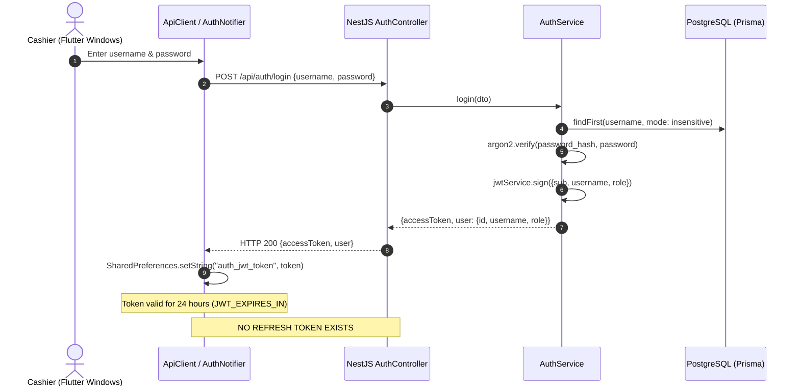
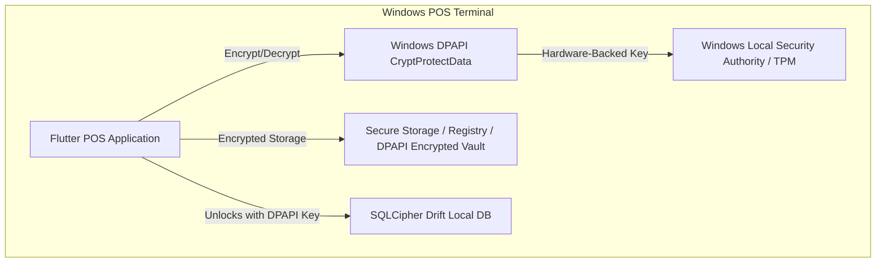
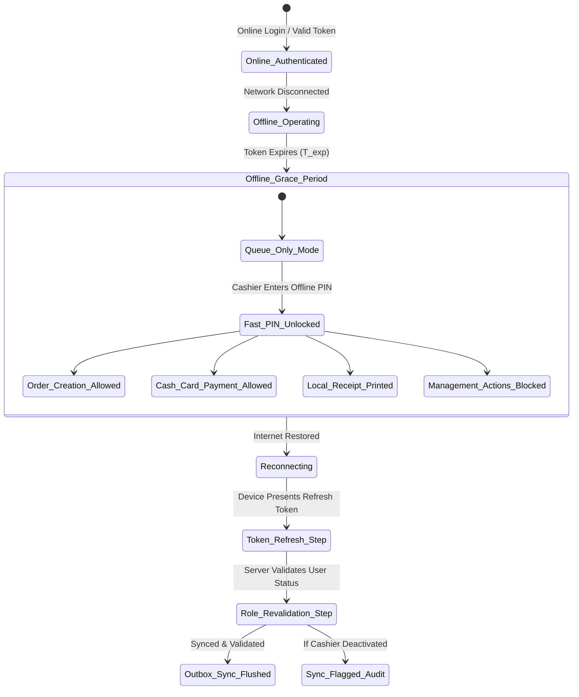
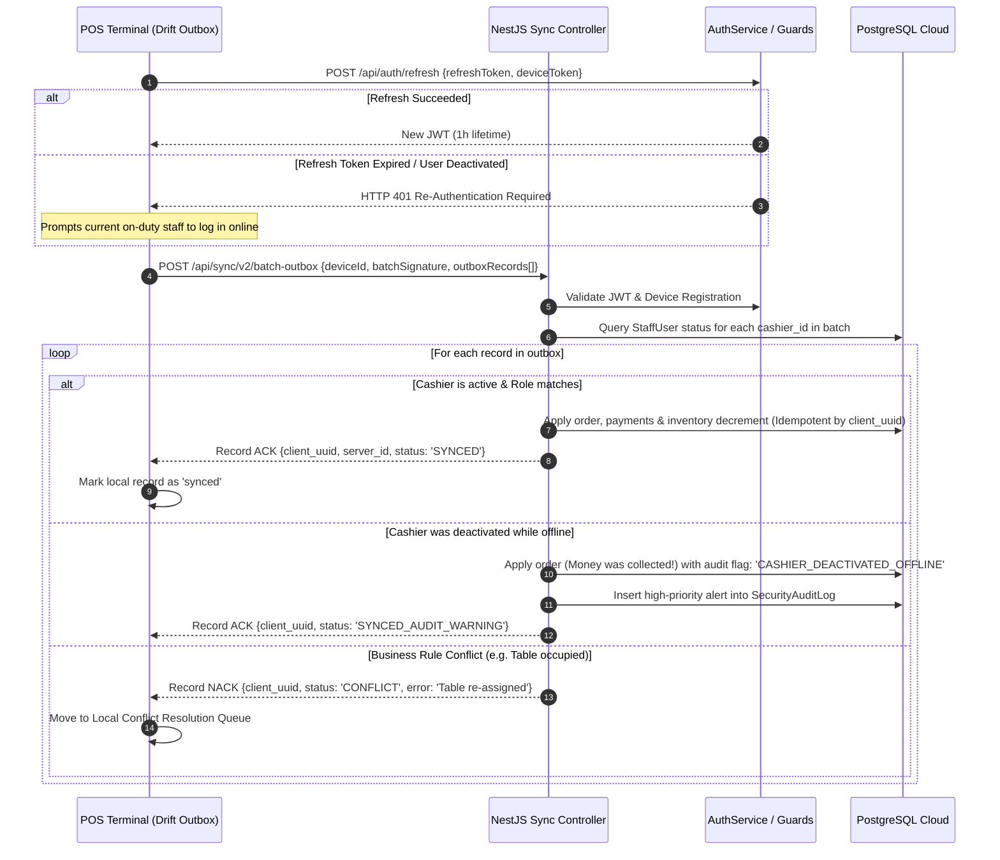
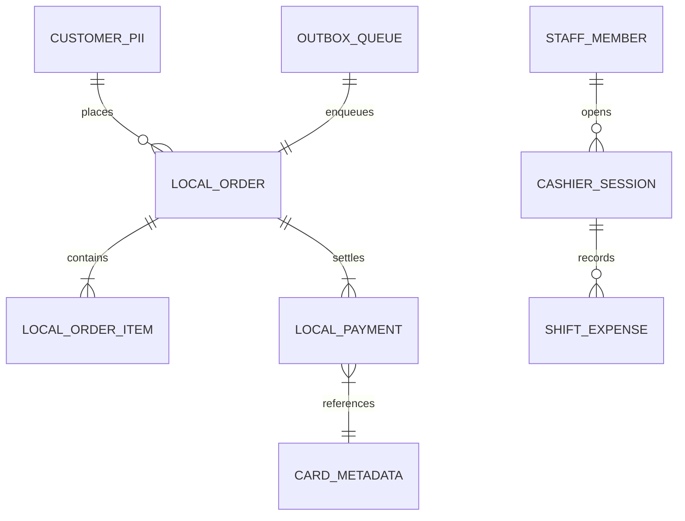
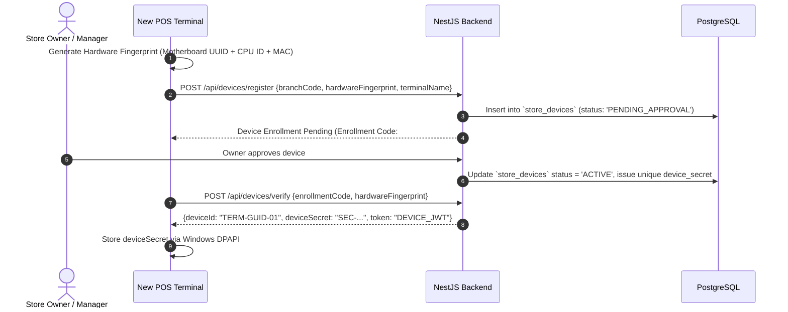

# Phase 15: Security & Offline Authorization Audit

**Target File:** `docs/offline-analysis/08-security.md`  
**System Under Review:** Hungry Howie's POS (Flutter Desktop Windows client + NestJS / Prisma / PostgreSQL backend)  
**Analysis Date:** October 2026  
**Auditor:** Security Auditor (Wave 1)

---

## Executive Summary

A comprehensive architectural and code-level security analysis was conducted on both the Flutter Windows frontend (`frontend/`) and the NestJS/Prisma backend (`backend/`). The audit evaluated the current state of authentication, session management, token storage, role-based access control (RBAC), offline capabilities, data security, and peripheral integration.

The assessment revealed **critical security vulnerabilities** in the current code that undermine confidentiality, integrity, and access control:
1. **Universal Authentication Bypass:** A deliberate development fallback in `backend/src/common/guards/jwt-auth.guard.ts:11-17` automatically assigns every unauthenticated or malformed request the identity of user `'Noman'` with role `'owner'`.
2. **Plaintext Password Storage & API Leakage:** Plaintext passwords are stored in the PostgreSQL database (`backend/prisma/schema.prisma:32`) and returned via public user listing endpoints (`backend/src/users/users.service.ts:36`), which the Flutter client ingests into UI state (`frontend/lib/data/auth_repository.dart:205-212`).
3. **Remote Command Injection via Raw Spooler:** The printing controller (`backend/src/printer/printer.controller.ts:42-51`) has no authentication guards and passes unvalidated printer and document strings directly into native execution and PowerShell scripts (`backend/src/printer/printer.service.ts:204, 220, 227`).
4. **Unauthenticated Sync Endpoints:** The sync controller (`backend/src/sync/sync.controller.ts:1-98`) has no authentication guards, allowing arbitrary callers to batch alter order states.
5. **Missing Route Permissions:** Almost all controllers (Orders, Customers, Inventory, Expenses, Reports, Settings, Dispatches, Riders) lack granular `@RequirePermission` decorators, allowing any caller to perform privileged mutations.
6. **Insecure Local Credential Storage:** Tokens and user metadata are stored unencrypted in Windows `SharedPreferences` (`%APPDATA%` JSON files) without DPAPI encryption (`frontend/lib/core/security/token_storage.dart:20-46`).

This document details all current vulnerabilities, defines the target offline security model (handling expired tokens, offline PINs, queue authorization on reconnect, and server re-validation), and outlines cryptographic protection strategies using SQLCipher and Windows DPAPI.

---

## 1. Current State Vulnerability Register

Every vulnerability listed below is verified against actual codebase files and line numbers.

| ID | Severity | Category | Vulnerability Description | Affected File & Line |
|---|---|---|---|---|
| **VULN-01** | **CRITICAL** | Broken Authentication | **Global Auth Bypass:** `JwtAuthGuard` returns fallback `'Noman'` with role `'owner'` on missing/invalid JWT. | [jwt-auth.guard.ts:11-17](file:///D:/HowiePOSUPdated/Hbackend-Hfrontend-main/backend/src/common/guards/jwt-auth.guard.ts#L11-L17) |
| **VULN-02** | **CRITICAL** | Authorization Bypass | **Owner Super-Privilege:** `PermissionsGuard` unconditionally permits any request from role `'owner'`, compounding VULN-01. | [permissions.guard.ts:34-41](file:///D:/HowiePOSUPdated/Hbackend-Hfrontend-main/backend/src/common/rbac/guards/permissions.guard.ts#L34-L41) |
| **VULN-03** | **CRITICAL** | Cryptographic Failure | **Plaintext Passwords in Database:** Staff credentials include `plain_password` column in PostgreSQL schema. | [schema.prisma:32](file:///D:/HowiePOSUPdated/Hbackend-Hfrontend-main/backend/prisma/schema.prisma#L32) |
| **VULN-04** | **CRITICAL** | Information Disclosure | **Password Leakage in REST API:** `listUsers()` and `getUserById()` select and expose `plain_password`. | [users.service.ts:36, 60, 106, 198, 264](file:///D:/HowiePOSUPdated/Hbackend-Hfrontend-main/backend/src/users/users.service.ts#L36) |
| **VULN-05** | **CRITICAL** | Insecure Data Ingestion | **Client Storing Plaintext Passwords:** Flutter `AuthNotifier` reads `plain_password` into UI state memory. | [auth_repository.dart:205-212](file:///D:/HowiePOSUPdated/Hbackend-Hfrontend-main/frontend/lib/data/auth_repository.dart#L205-L212) |
| **VULN-06** | **CRITICAL** | Injection / RCE | **PowerShell / Command Injection in Spooler:** Unsanitized arguments executed via `execAsync` and PowerShell bypass. | [printer.service.ts:204, 220, 227](file:///D:/HowiePOSUPdated/Hbackend-Hfrontend-main/backend/src/printer/printer.service.ts#L204) |
| **VULN-07** | **HIGH** | Broken Authentication | **Unauthenticated Printer Controller:** `PrinterController` exposes print execution with zero auth guards. | [printer.controller.ts:25-63](file:///D:/HowiePOSUPdated/Hbackend-Hfrontend-main/backend/src/printer/printer.controller.ts#L25-L63) |
| **VULN-08** | **HIGH** | Broken Authentication | **Unauthenticated Sync Controller:** `SyncController` exposes sync overview and batch order updates with zero auth. | [sync.controller.ts:5-97](file:///D:/HowiePOSUPdated/Hbackend-Hfrontend-main/backend/src/sync/sync.controller.ts#L5-L97) |
| **VULN-09** | **HIGH** | Broken Access Control | **Missing Route Permissions on Orders:** Delete, cancel-item, update order endpoints lack `@RequirePermission`. | [orders.controller.ts:21-101](file:///D:/HowiePOSUPdated/Hbackend-Hfrontend-main/backend/src/orders/orders.controller.ts#L21-L101) |
| **VULN-10** | **HIGH** | Broken Access Control | **Missing Route Permissions on Customers:** PII lookup, create, update, delete lack `@RequirePermission`. | [customers.controller.ts:21-75](file:///D:/HowiePOSUPdated/Hbackend-Hfrontend-main/backend/src/customers/customers.controller.ts#L21-L75) |
| **VULN-11** | **HIGH** | Broken Access Control | **Missing Route Permissions on Inventory:** Stock-in, stock-out, catalog item deletion lack `@RequirePermission`. | [inventory.controller.ts:26-133](file:///D:/HowiePOSUPdated/Hbackend-Hfrontend-main/backend/src/inventory/inventory.controller.ts#L26-L133) |
| **VULN-12** | **HIGH** | Broken Access Control | **Missing Route Permissions on Expenses:** Create, edit, delete expenses lack `@RequirePermission`. | [expenses.controller.ts:22-88](file:///D:/HowiePOSUPdated/Hbackend-Hfrontend-main/backend/src/expenses/expenses.controller.ts#L22-L88) |
| **VULN-13** | **HIGH** | Privilege Escalation | **Unprotected Permissions Modification:** `updatePermission` and `applyPreset` lack `@RequirePermission`. | [permissions.controller.ts:46, 59](file:///D:/HowiePOSUPdated/Hbackend-Hfrontend-main/backend/src/permissions/permissions.controller.ts#L46) |
| **VULN-14** | **MEDIUM** | Session Revocation Failure | **Deactivated Users Maintain Active JWT:** `JwtStrategy.validate` queries user but fails to check `is_active`. | [jwt.strategy.ts:26-38](file:///D:/HowiePOSUPdated/Hbackend-Hfrontend-main/backend/src/auth/strategies/jwt.strategy.ts#L26-L38) |
| **VULN-15** | **MEDIUM** | Insecure Token Storage | **Plaintext Token Storage on Windows:** Windows `SharedPreferences` writes tokens to cleartext JSON in `%APPDATA%`. | [token_storage.dart:20, 41-46](file:///D:/HowiePOSUPdated/Hbackend-Hfrontend-main/frontend/lib/core/security/token_storage.dart#L20) |
| **VULN-16** | **MEDIUM** | Weak Cryptography | **Single-Round SHA-256 Offline Hasher:** Frontend uses single SHA-256 for passwords instead of Argon2id/PBKDF2. | [password_hasher.dart:15-17](file:///D:/HowiePOSUPdated/Hbackend-Hfrontend-main/frontend/lib/core/security/password_hasher.dart#L15-L17) |
| **VULN-17** | **MEDIUM** | Hardcoded Secret Fallback | **Hardcoded Gateway Secret:** WebSocket gateway falls back to `'hungry-howies-pos-dev-secret-key-2026'`. | [kitchen.gateway.ts:80](file:///D:/HowiePOSUPdated/Hbackend-Hfrontend-main/backend/src/kitchen/kitchen.gateway.ts#L80) |
| **VULN-18** | **MEDIUM** | Information Disclosure | **Unrestricted WebSocket PII Broadcast:** Customer name, phone, address broadcast to all socket clients. | [kitchen.gateway.ts:85, 156-158](file:///D:/HowiePOSUPdated/Hbackend-Hfrontend-main/backend/src/kitchen/kitchen.gateway.ts#L85) |
| **VULN-19** | **MEDIUM** | Client Authorization Defect | **Router Bypasses Granular Permissions:** `appRouterProvider` only evaluates `/owner` and `/manager` path prefixes. | [router.dart:63-71](file:///D:/HowiePOSUPdated/Hbackend-Hfrontend-main/frontend/lib/config/router.dart#L63-L71) |
| **VULN-20** | **LOW** | Identity & Auditing Defect | **Hardcoded Device Identity:** `'POS-TERMINAL-01'` hardcoded across services; no device registration or mTLS. | [orders.service.ts:431](file:///D:/HowiePOSUPdated/Hbackend-Hfrontend-main/backend/src/orders/orders.service.ts#L431), [sync.service.ts:100](file:///D:/HowiePOSUPdated/Hbackend-Hfrontend-main/backend/src/sync/sync.service.ts#L100) |

---

## 2. Authentication, JWT Handling & Lifecycle

### 2.1 Current Implementation



#### Token Configuration
- **Access Token Lifetime:** Set to `configService.get<string>('JWT_EXPIRES_IN') || '1d'` in [auth.module.ts:23](file:///D:/HowiePOSUPdated/Hbackend-Hfrontend-main/backend/src/auth/auth.module.ts#L23). A 24-hour expiration for an access token without revocation capability is excessively long.
- **Claims Issued:**
  ```json
  {
    "sub": "user-uuid",
    "username": "poscashier",
    "role": "cashier",
    "iat": 1729160000,
    "exp": 1729246400
  }
  ```
  [jwt-payload.interface.ts:1-5](file:///D:/HowiePOSUPdated/Hbackend-Hfrontend-main/backend/src/auth/interfaces/jwt-payload.interface.ts#L1-L5)
- **Missing Claims:**
  - `device_id` (terminal binding)
  - `store_id` (multi-store scoping)
  - `token_version` or `jti` (for instant token invalidation upon password reset or role change)
  - `permissions_hash` (detecting revoked privileges)

#### Refresh Flow Analysis
- **Current Refresh Mechanism:** **`NOT FOUND`**.
- There is no `/api/auth/refresh` endpoint, no refresh token table in Prisma, and no rotation logic.
- When the JWT expires, every API call fails with HTTP 401.

#### Client Behavior on HTTP 401
- In [api_client.dart:191-194](file:///D:/HowiePOSUPdated/Hbackend-Hfrontend-main/frontend/lib/core/network/api_client.dart#L191-L194):
  ```dart
  if (statusCode == 401) {
    await TokenStorage.clearSession();
    onUnauthorized?.call();
    throw UnauthorizedException('Session expired. Please log in again.');
  }
  ```
- **Consequence:** If the network drops or a token expires during operational hours, the client clears all tokens from disk, kicks the cashier to the `/login` screen, and prevents any further POS access.

---

## 3. Token Storage on Windows Desktop

### 3.1 Current Storage Assessment
The Flutter client utilizes `shared_preferences: ^2.2.3` in [token_storage.dart:1-98](file:///D:/HowiePOSUPdated/Hbackend-Hfrontend-main/frontend/lib/core/security/token_storage.dart#L1-L98) and [in_memory_auth_repository.dart:80-168](file:///D:/HowiePOSUPdated/Hbackend-Hfrontend-main/frontend/lib/data/repositories/in_memory_auth_repository.dart#L80-L168).

On Windows, `shared_preferences` writes to an unencrypted JSON file located at:
`%APPDATA%\<organization>\<app_name>\shared_preferences.json`

Stored fields in cleartext:
- `auth_jwt_token` (bearer token)
- `auth_user_id`
- `auth_user_name`
- `auth_user_email`
- `auth_user_role`
- `pos_custom_staff_users` (pipe-delimited string containing salts and SHA-256 hashes)

### 3.2 Target Windows Security Model: DPAPI Integration
Windows provides the Data Protection API (`CryptProtectData` / `CryptUnprotectData`), which ties encryption to the current OS user's logon credentials using hardware-backed master keys.



#### Proposed Implementation Architecture
1. **Package:** Integrate `flutter_secure_storage` (which uses Windows Credential Manager and DPAPI under the hood) or call native Win32 `CryptProtectData` via `dart:ffi`.
2. **Local Session Key:**
   - On terminal initialization, generate a random 256-bit AES master key.
   - Encrypt the master key using `CryptProtectData(pDataIn, szDataDescr, pOptionalEntropy, NULL, NULL, CRYPTPROTECT_UI_FORBIDDEN, pDataOut)`.
   - Store the encrypted cipher block in `%LOCALAPPDATA%\HungryHowies\vault.bin`.
3. **Drift / SQLCipher Integration:**
   - Use the decrypted 256-bit key in memory to open the Drift SQLite database:
     `PRAGMA key = "x'HEX_ENCODED_KEY'";`

---

## 4. Password Handling & The Incompatibility Root Cause

### 4.1 Backend vs Frontend Hashing Incompatibility
The backend uses **Argon2** ([auth.service.ts:3, 38, 65](file:///D:/HowiePOSUPdated/Hbackend-Hfrontend-main/backend/src/auth/auth.service.ts#L3)):
```typescript
import * as argon2 from 'argon2';
// ...
const isPasswordValid = await argon2.verify(user.password_hash, loginDto.password);
```

The Flutter client uses a home-grown **single-round SHA-256** hasher ([password_hasher.dart:13-18](file:///D:/HowiePOSUPdated/Hbackend-Hfrontend-main/frontend/lib/core/security/password_hasher.dart#L13-L18)):
```dart
static String hashPassword(String password, {String? salt}) {
  final effectiveSalt = salt ?? _defaultPepper;
  final bytes = utf8.encode('$effectiveSalt:$password');
  final digest = sha256.convert(bytes);
  return digest.toString();
}
```

### 4.2 Why `plain_password` Exists (Root Cause Analysis)
Because SHA-256 cannot verify an Argon2 hash, the developer faced an issue: **how to verify user credentials when the terminal is offline?**

Instead of adding Argon2 / PBKDF2 hashing to the Flutter app or implementing a local PIN architecture, the developer took a dangerous shortcut:
1. Added `plain_password String?` to the PostgreSQL database ([schema.prisma:32](file:///D:/HowiePOSUPdated/Hbackend-Hfrontend-main/backend/prisma/schema.prisma#L32)).
2. Saved the cleartext password on every user creation and update ([users.service.ts:98, 191, 264](file:///D:/HowiePOSUPdated/Hbackend-Hfrontend-main/backend/src/users/users.service.ts#L98)).
3. Exposed `plain_password` in the public `SafeUser` DTO returned by `GET /api/users` ([users.service.ts:36, 60](file:///D:/HowiePOSUPdated/Hbackend-Hfrontend-main/backend/src/users/users.service.ts#L36)).
4. Frontend fetched the plain passwords over HTTP and cached them in memory and fallback structures ([auth_repository.dart:205-212](file:///D:/HowiePOSUPdated/Hbackend-Hfrontend-main/frontend/lib/data/auth_repository.dart#L205-L212)).

### 4.3 Remediation Strategy
1. **Drop `plain_password` column** from Prisma schema immediately.
2. Never send user passwords (hashed or plain) from the backend to the POS terminal.
3. For offline authentication, implement **Staff Offline Quick-Switch PINs**:
   - Each staff member sets a 4-to-6 digit numeric PIN.
   - The PIN is hashed using PBKDF2-HMAC-SHA256 (100,000 iterations) or Argon2id with a unique per-terminal salt.
   - Only the PIN hash is stored in the encrypted local Drift database.
   - Master account passwords (owner/manager) are never stored or verified offline; master changes require online backend authorization.

---

## 5. Role & Permission Enforcement Analysis

### 5.1 Server-Side Enforcement (NestJS RBAC)

#### A. Global Auth Bypass in `JwtAuthGuard`
In [jwt-auth.guard.ts:6-18](file:///D:/HowiePOSUPdated/Hbackend-Hfrontend-main/backend/src/common/guards/jwt-auth.guard.ts#L6-L18):
```typescript
@Injectable()
export class JwtAuthGuard extends AuthGuard('jwt') {
  handleRequest<TUser = unknown>(err: unknown, user: TUser): TUser {
    if (user && !err) {
      return user;
    }
    // Local POS terminal fallback to default owner so store management operations succeed
    return {
      id: '4cec453b-0ce2-4f0a-a335-d014883bb0a8',
      userId: '4cec453b-0ce2-4f0a-a335-d014883bb0a8',
      username: 'Noman',
      role: 'owner',
      is_default: true,
    } as unknown as TUser;
  }
}
```
**Impact:** Any request with no `Authorization` header, an invalid token, or an expired token is automatically authenticated as `'Noman'` with role `'owner'`.

#### B. Permissions Guard Logic
In [permissions.guard.ts:21-41](file:///D:/HowiePOSUPdated/Hbackend-Hfrontend-main/backend/src/common/rbac/guards/permissions.guard.ts#L21-L41):
1. If no `@RequirePermission` decorator is found on the endpoint or controller:
   ```typescript
   if (!requiredPermission) {
     return true; // Unrestricted access
   }
   ```
2. If role is `'owner'`, `'superadmin'`, `'super admin'`, or `'admin'`:
   ```typescript
   if (normalizedRole === 'owner' || ...) {
     return true; // Bypasses all module and action checks
   }
   ```

Because `JwtAuthGuard` gives every unauthenticated caller `role: 'owner'`, **every protected endpoint on the backend is completely open to the public internet**.

#### C. Audit of Controller Permission Coverage
The table below documents which controllers enforce permissions:

| Controller | Auth Guard Present? | Permissions Guard Present? | Granular `@RequirePermission` on Endpoints? | Actual Protection Level |
|---|---|---|---|---|
| `AuthController` | Partial (`/me` only) | No | No | Public endpoints |
| `UsersController` | Yes | Yes | Yes (list, get, add, edit, delete) | Open due to VULN-01/02 |
| `StaffController` | Yes | Yes | Yes (list, get, add, edit, delete, salary) | Open due to VULN-01/02 |
| `PermissionsController` | Yes | Yes | Partial (`toggle` has it; `update` & `presets` **MISSING**) | **Privilege Escalation Risk** |
| `OrdersController` | Yes | Yes | **NONE (0 of 7 endpoints)** | Open to all roles / public |
| `CustomersController` | Yes | Yes | **NONE (0 of 5 endpoints)** | Open to all roles / public |
| `InventoryController` | Yes | Yes | **NONE (0 of 10 endpoints)** | Open to all roles / public |
| `ExpensesController` | Yes | Yes | **NONE (0 of 6 endpoints)** | Open to all roles / public |
| `KitchenController` | Yes | Yes | **NONE (0 of 4 endpoints)** | Open to all roles / public |
| `ReportsController` | Yes | Yes | **NONE (0 of 5 endpoints)** | Open to all roles / public |
| `SettingsController` | Yes | Yes | **NONE (0 of 3 endpoints)** | Open to all roles / public |
| `TablesController` | Yes | Yes | Yes (list, add, edit, delete, transfer) | Open due to VULN-01/02 |
| `DispatchesController` | Yes | Yes | **NONE (0 of 6 endpoints)** | Open to all roles / public |
| `RidersController` | Yes | Yes | **NONE (0 of 6 endpoints)** | Open to all roles / public |
| `SyncController` | **NO** | **NO** | **NONE** | **Completely Unauthenticated** |
| `PrinterController` | **NO** | **NO** | **NONE** | **Completely Unauthenticated** |
| `HealthController` | No | No | None | Public (intended) |

---

### 5.2 Client-Side Enforcement (Flutter)

#### A. Router Guard Flaws
In [router.dart:63-71](file:///D:/HowiePOSUPdated/Hbackend-Hfrontend-main/frontend/lib/config/router.dart#L63-L71):
```dart
if (isLoggedIn) {
  if (location.startsWith('/owner') && role != UserRole.owner) {
    return '/unauthorized';
  }
  if (location.startsWith('/manager') && role != UserRole.owner && role != UserRole.manager) {
    return '/unauthorized';
  }
}
```
**Defects:**
1. Only checks coarse URL path prefixes (`/owner` and `/manager`).
2. Does not check granular permissions (e.g. Can cashier view reports? Can manager disburse payroll? Can cashier apply custom discounts?).
3. All routes under `/sales/...` are accessible to any logged-in role without check.
4. Custom permissions configured in the backend database or in the Rights Management screen are never evaluated by `GoRouter`.
5. The `PermissionChecker.isRouteAllowed()` method ([permission_checker.dart:79-84](file:///D:/HowiePOSUPdated/Hbackend-Hfrontend-main/frontend/lib/core/security/permission_checker.dart#L79-L84)) exists but is **never invoked anywhere in the codebase**.

---

## 6. Offline Expiration, Allowed Actions, and Reconnection Matrix

This section explicitly answers the core architectural question:
> **When a cashier is offline and their token expires:**
> 1. What should be allowed?
> 2. What must be blocked?
> 3. How are queued operations authorized on reconnect?



### 6.1 State Separation Model

| State | Definition | Storage Location | Authority |
|---|---|---|---|
| **Local State** | Active operational cache (menu catalog, floor layout, tables) | Drift SQLite (local disk) | Terminal Read-Only |
| **Server State** | Authoritative system record | PostgreSQL Cloud | Server Authoritative |
| **Pending State** | Orders, payments, voids created offline awaiting sync | Drift Outbox Table | Terminal Unsigned Outbox |
| **Synced State** | Records successfully accepted and acknowledged by Cloud | Drift local DB (`is_synced = true`) | Cloud Sync Receipt |
| **Conflict State** | Mutations rejected by Cloud (e.g., table double-booked, cashier deactivated) | Drift Conflict Ledger | Manager Resolution Queue |

---

### 6.2 Explicit Matrix: Allowed vs Blocked Operations While Offline

| Action Category | Specific POS Operation | Token Valid (Offline) | Token Expired (Offline Grace) | Justification & Safeguards |
|---|---|:---:|:---:|---|
| **POS Sales** | Create Dine-In / Takeaway Order | **ALLOWED** | **ALLOWED** | Core store operations cannot halt during lunch/dinner rush. |
| **POS Sales** | Modify un-submitted order items | **ALLOWED** | **ALLOWED** | Operates solely on local in-memory cart. |
| **POS Sales** | Print Kitchen Ticket / Receipt | **ALLOWED** | **ALLOWED** | Local ESC/POS spooler connection to physical printer. |
| **Discounts** | Standard preset discount (≤ 15%) | **ALLOWED** | **ALLOWED** | Pre-configured in store settings. |
| **Discounts** | Sensitive discount (> 15% or Custom) | **MANAGER PIN** | **MANAGER PIN** | Requires offline Manager PIN prompt; logged to audit. |
| **Payments** | Accept Cash Payment | **ALLOWED** | **ALLOWED** | Recorded in local Drift payment ledger; cash in drawer. |
| **Payments** | Accept Card Payment (External EMV) | **ALLOWED** | **ALLOWED** | Standalone EMV reader handles authorization independently. |
| **Payments** | Integrated Cloud Gateway Card Charge | **BLOCKED** | **BLOCKED** | Requires real-time internet connectivity to card processor. |
| **Order Voids** | Void order before kitchen print | **ALLOWED** | **ALLOWED** | Low risk; no food prepared. |
| **Order Voids** | Void order after kitchen print | **MANAGER PIN** | **MANAGER PIN** | Food wasted; requires Manager PIN; queued in outbox audit. |
| **Refunds** | Issue Cash Refund | **BLOCKED** | **BLOCKED** | High financial fraud risk; strictly requires online check or Store Owner PIN. |
| **Shift Mgmt** | Cash Float Opening / Shift Count | **ALLOWED** | **ALLOWED** | Local shift reconciliation recorded to Drift. |
| **Shift Mgmt** | Mid-shift cash drop / expense | **ALLOWED** | **ALLOWED** | Recorded in local shift ledger. |
| **Management** | Change Menu Prices or Items | **BLOCKED** | **BLOCKED** | Menu catalog is read-only when offline. |
| **Management** | Create / Edit Staff or Change Rights | **BLOCKED** | **BLOCKED** | Privilege modification must never occur offline. |
| **Management** | Mark Salaries Paid / Payroll | **BLOCKED** | **BLOCKED** | Financial ledger must synchronize with cloud. |
| **Management** | View Historical Reports (Past Months)| **BLOCKED** | **BLOCKED** | Only current active shift summary available locally. |
| **Settings** | Update Store Tax or Branch Info | **BLOCKED** | **BLOCKED** | Store settings are cloud-authoritative. |

---

### 6.3 Offline Grace Window & Security Ceilings
To prevent runaway fraud or malicious prolonged offline operation:
1. **Time Grace Window:** Maximum **24 hours** (or one complete business shift cycle) from the last verified online JWT.
2. **Offline Transaction Limit:** Maximum **250 offline transactions** or **$5,000 gross revenue** per terminal before the terminal prompts:
   *"Offline safety limit reached. Connect terminal to network or enter Store Owner Emergency Bypass PIN."*
3. **Clock Skew Protection:** If system clock on Windows is moved backwards by more than 5 minutes (detected via monotonic uptime `GetTickCount64`), lock offline writes until clock is reconciled.

---

### 6.4 How Queued Operations Are Authorized on Reconnect

When network connectivity is restored, queued operations in the Drift outbox are synchronized according to this 4-step authorization sequence:



#### Detailed Reconnection Safeguards
1. **Device Identity Verification:**
   - Every sync payload must include the `device_id` and a HMAC-SHA256 signature generated using a device secret issued during terminal enrollment.
2. **Server Role Re-Validation:**
   - The server does NOT blindly trust the role claimed in the offline payload.
   - The server checks the historical user record at the time the order was created:
     `SELECT role, is_active FROM staff_users WHERE id = :cashier_id;`
3. **Idempotency Guarantee:**
   - Every offline order has a client-generated UUID `client_order_id` assigned before writing to SQLite.
   - The server enforces a `UNIQUE(client_order_id)` constraint in PostgreSQL. Duplicate transmissions due to network hiccups return HTTP 200 with the existing order ID, preventing duplicate charges or double inventory decrements.

---

## 7. Sensitive Data Landing in Local Database

When transitioning to an offline-first Drift/SQLite architecture, the following sensitive data categories will reside on the Windows terminal disk:



### 7.1 Sensitive Data Breakdown & Compliance Requirements

| Data Category | Specific Local Fields | Sensitivity Level | Regulatory / Standard | Local Storage Rule |
|---|---|---|---|---|
| **Customer PII** | Full name, phone number, delivery address, order notes | **HIGH** | GDPR / CCPA / Privacy Acts | Must be encrypted at rest in local SQLite via SQLCipher. Phone numbers masked in UI logs. |
| **Card Payment Data** | `card_last_four`, `transaction_reference`, `bank_name` | **CRITICAL** | PCI-DSS SAQ-P2PE | **NEVER store Full PAN (16 digits), PIN block, or CVV/CVC.** Only last 4 digits and gateway auth token permitted. |
| **Cash & Financials**| Opening float, cash tendered, change returned, daily drawer total | **HIGH** | Internal Fraud Control | Stored in encrypted DB; accessible only to Manager/Owner. |
| **Staff Data** | Staff full name, phone number, shift assignment, role | **MEDIUM** | Privacy / HR | Stored in encrypted DB. |
| **Staff Credentials** | Staff PIN hashes, session refresh tokens | **CRITICAL** | NIST SP 800-63B | Salted PBKDF2/Argon2 hashes only. **Plain passwords strictly prohibited.** |
| **Store Expenses** | Expense descriptions, vendor receipts, amounts | **MEDIUM** | Financial Accounting | Stored in encrypted DB. |
| **Outbox Payloads** | Full JSON representations of queued order mutations | **HIGH** | Operational Integrity | Resides in encrypted DB; purged after confirmed Cloud ACK. |

---

## 8. Local Encryption Options: SQLCipher vs DPAPI

To meet data protection and PCI compliance standards, the Windows terminal must encrypt all locally persisted data.

### 8.1 Comparison of Encryption Approaches

| Feature | Option A: Standard SQLite + OS File Encryption (EFS) | Option B: Drift + SQLCipher (AES-256) + DPAPI-backed Key | Option C: Unencrypted SQLite with Application Field Encryption |
|---|---|---|---|
| **Encryption Standard** | Windows NTFS EFS | **Page-level AES-256-CBC (SQLCipher)** | Custom AES-GCM on individual JSON fields |
| **Key Custody** | Windows User Certificate | **DPAPI-protected 256-bit Terminal Key** | In-app hardcoded or prefs key |
| **Performance Impact** | Negligible | **< 3% overhead on modern SSDs (< 5ms per query)** | High (serialization & encryption per field) |
| **Schema Searchability**| Full | **Full (transparent indexing on encrypted pages)** | Broken (cannot index encrypted fields) |
| **Cold Disk Extraction**| Protected if OS locked; vulnerable if logged in | **Protected even if attacker extracts `.db` file** | Unencrypted schema, leaks table structure |
| **Suitability** | Insufficient | **RECOMMENDED (Industry Best Practice)** | Inflexible and error-prone |

---

### 8.2 Recommended Encryption Architecture

```mermaid
flowchart TD
    subgraph Boot Sequence on Windows POS
        A[POS App Starts] --> B[Check for %LOCALAPPDATA%/HungryHowies/terminal.key]
        B -->|Exists| C[Call Windows DPAPI CryptUnprotectData]
        B -->|Does Not Exist| D[Generate CryptoRandom 256-bit AES Key]
        D --> E[Call Windows DPAPI CryptProtectData]
        E --> F[Persist Encrypted Key to terminal.key]
        F --> C
        C --> G[Obtain 32-Byte Raw Key in RAM]
        G --> H[Open Drift with sqlcipher_flutter_libs]
        H --> I[Execute PRAGMA key = 'HEX_KEY']
        I --> J[Execute PRAGMA cipher_page_size = 4096]
        J --> K[DB Ready for Secure Offline CRUD]
    end
```



#### Drift + SQLCipher Implementation Blueprint
1. Add Flutter dependencies:
   ```yaml
   dependencies:
     drift: ^2.18.0
     sqlite3: ^2.4.0
     sqlcipher_flutter_libs: ^0.5.4
   ```
2. When initializing the Drift `NativeDatabase`:
   ```dart
   LazyDatabase(() async {
     final dbFolder = await getApplicationSupportDirectory();
     final file = File(p.join(dbFolder.path, 'pos_secure.db'));
     final rawKey = await KeyVault.getOrGenerateMasterKey(); // DPAPI-backed

     return NativeDatabase.createInBackground(
       file,
       setup: (rawDb) {
         rawDb.execute("PRAGMA key = \"x'${hex.encode(rawKey)}'\";");
         rawDb.execute("PRAGMA cipher_memory_security = ON;");
       },
     );
   });
   ```

---

## 9. Device Identity & Registration

### 9.1 Current State
- **Current Status:** **`NOT FOUND`**.
- The string literal `'POS-TERMINAL-01'` is hardcoded across 9 different backend files ([orders.service.ts:431](file:///D:/HowiePOSUPdated/Hbackend-Hfrontend-main/backend/src/orders/orders.service.ts#L431), [sync.service.ts:100, 152, 220, 259, 276, 339, 377](file:///D:/HowiePOSUPdated/Hbackend-Hfrontend-main/backend/src/sync/sync.service.ts#L100)) and frontend sync services ([data_sync_model.dart:71, 96](file:///D:/HowiePOSUPdated/Hbackend-Hfrontend-main/frontend/lib/domain/models/data_sync_model.dart#L71), [sync_api_service.dart:53](file:///D:/HowiePOSUPdated/Hbackend-Hfrontend-main/frontend/lib/services/api/sync_api_service.dart#L53)).
- Any rogue device or script on the store Wi-Fi can send requests claiming to be `'POS-TERMINAL-01'` with no cryptographic verification.

### 9.2 Target Device Identity Architecture
Each physical Windows POS machine must be enrolled as a distinct cryptographic entity:



#### Proposed Database Model
```prisma
model StoreDevice {
  id               String    @id @default(uuid()) @db.VarChar(36)
  branch_code      String    @map("branch_code") @db.VarChar(50)
  device_name      String    @map("device_name") @db.VarChar(100)
  device_type      String    @default("POS") @map("device_type") @db.VarChar(30) // 'POS', 'KDS', 'DISPATCH'
  hardware_uuid    String    @unique @map("hardware_uuid") @db.VarChar(100)
  device_secret    String    @map("device_secret") @db.VarChar(255)
  status           String    @default("PENDING") @db.VarChar(20) // 'PENDING', 'ACTIVE', 'REVOKED'
  last_sync_at     DateTime? @map("last_sync_at") @db.Timestamp()
  created_at       DateTime  @default(now()) @map("created_at") @db.Timestamp()

  @@map("store_devices")
}
```

---

## 10. API & WebSocket Authentication Architecture

### 10.1 WebSockets (KDS & Real-time Dispatch)

#### Current Defects in `KitchenGateway`
1. **Hardcoded Fallback Secret:** [kitchen.gateway.ts:80](file:///D:/HowiePOSUPdated/Hbackend-Hfrontend-main/backend/src/kitchen/kitchen.gateway.ts#L80)
   ```typescript
   const secret = this.configService.get<string>('JWT_SECRET') || 'hungry-howies-pos-dev-secret-key-2026';
   ```
2. **Wildcard CORS:** Configured with `origin: '*'` ([kitchen.gateway.ts:48](file:///D:/HowiePOSUPdated/Hbackend-Hfrontend-main/backend/src/kitchen/kitchen.gateway.ts#L48)), permitting cross-site WebSocket hijacking from any browser running on the same network.
3. **No Room Authorization:** Any valid token (cashier, driver, manager) automatically joins the `'kitchen'` room ([kitchen.gateway.ts:85](file:///D:/HowiePOSUPdated/Hbackend-Hfrontend-main/backend/src/kitchen/kitchen.gateway.ts#L85)).
4. **Broadcast of Customer PII:** Full customer names, phone numbers, and delivery addresses are broadcast to all clients ([kitchen.gateway.ts:156-158](file:///D:/HowiePOSUPdated/Hbackend-Hfrontend-main/backend/src/kitchen/kitchen.gateway.ts#L156-L158)).

#### Hardening Plan for WebSockets
1. Remove all hardcoded JWT fallback strings. Throw a startup error if `JWT_SECRET` is unset.
2. Restrict CORS origins to known store hostnames/IPs or Flutter desktop user-agents.
3. Separate socket namespaces and rooms:
   - `/kitchen` (KDS screens only — strip customer phone & delivery address from payloads; kitchen staff only need items, table, token, cooking timers).
   - `/dispatch` (Driver tracking screens — includes customer address; restricted to manager/driver roles).
4. Implement per-message token heartbeat and disconnect socket if user is revoked.

---

## 11. Security Audit Logging

### 11.1 Current State
- The queue worker [system.worker.ts:65](file:///D:/HowiePOSUPdated/Hbackend-Hfrontend-main/backend/src/infrastructure/queues/workers/system.worker.ts#L65) contains a stub for `AUDIT_LOG` that simply returns a success string without recording anything.
- The only logging tables are `data_sync_logs` ([schema.prisma:607-623](file:///D:/HowiePOSUPdated/Hbackend-Hfrontend-main/backend/prisma/schema.prisma#L607-L623)) and `stock_movements`.
- High-risk operations currently have **zero audit trail**:
  - Failed and successful authentication attempts.
  - Password updates or role modifications.
  - Granular permission grants or revocations.
  - Item cancellation after kitchen printing.
  - Order deletions and manual price overrides.
  - Cash drawer "No-Sale" openings.

### 11.2 Target Audit Architecture
Implement an append-only `security_audit_logs` table on the PostgreSQL Cloud backend, mirrored by an offline audit outbox table in local Drift SQLite.

```prisma
model SecurityAuditLog {
  id           String   @id @default(uuid()) @db.VarChar(36)
  event_type   String   @map("event_type") @db.VarChar(50) // 'LOGIN_SUCCESS', 'LOGIN_FAIL', 'DISCOUNT_OVERRIDE', 'VOID_ORDER', 'PERMISSION_CHANGE'
  actor_id     String   @map("actor_id") @db.VarChar(36)
  actor_name   String   @map("actor_name") @db.VarChar(100)
  actor_role   String   @map("actor_role") @db.VarChar(30)
  device_id    String   @map("device_id") @db.VarChar(50)
  entity_type  String?  @map("entity_type") @db.VarChar(50) // 'ORDER', 'USER', 'ROLE_PERMISSION'
  entity_id    String?  @map("entity_id") @db.VarChar(50)
  action_data  Json?    @map("action_data")
  ip_address   String?  @map("ip_address") @db.VarChar(50)
  created_at   DateTime @default(now()) @map("created_at") @db.Timestamp()

  @@index([event_type, created_at])
  @@index([actor_id])
  @@map("security_audit_logs")
}
```

---

## 12. Command Injection Vulnerability Deep Dive (Printer Module)

### 12.1 Detailed Exploit Vector
In [printer.service.ts:204](file:///D:/HowiePOSUPdated/Hbackend-Hfrontend-main/backend/src/printer/printer.service.ts#L204):
```typescript
const { stdout } = await execAsync(`"${exePath}" "${targetSpooler}" "${tempBinPath}" "${docName}"`);
```
And in [printer.service.ts:218-227](file:///D:/HowiePOSUPdated/Hbackend-Hfrontend-main/backend/src/printer/printer.service.ts#L218-L227):
```typescript
const scriptContent = `
${this.psRawPrinterHelper}
$bytes = [System.IO.File]::ReadAllBytes('${escapedBinPath}')
$res = [RawSpoolerHelper]::SendRawBytes('${targetSpooler}', $bytes, '${docName}')
if ($res) { "OK" } else { "FAIL" }
`;
fs.writeFileSync(tempScriptPath, scriptContent, 'utf-8');
const { stdout } = await execAsync(
  `powershell -NoProfile -NonInteractive -ExecutionPolicy Bypass -File "${tempScriptPath}"`,
);
```

#### Why This is Critical
1. `PrinterController` ([printer.controller.ts:42-51](file:///D:/HowiePOSUPdated/Hbackend-Hfrontend-main/backend/src/printer/printer.controller.ts#L42-L51)) exposes `POST /api/printer/print` without authentication.
2. An attacker can craft a payload:
   ```json
   {
     "printerName": "POS Receipt Printer",
     "base64Data": "AA==",
     "docName": "Receipt'); Start-Process calc.exe; #"
   }
   ```
3. The unescaped `docName` breaks out of the PowerShell string literal in line 221 and executes arbitrary commands under the privileges of the running Node.js server.

#### Immediate Defensive Fix
- Restrict `PrinterController` with `UseGuards(JwtAuthGuard, PermissionsGuard)`.
- Replace string interpolation in child process spawning with parameter arrays:
  `execFile(exePath, [targetSpooler, tempBinPath, sanitizedDocName])`.
- Validate that `printerName` matches a known regex `^[a-zA-Z0-9_\- ]+$` and sanitize `docName`.

---

## 13. Summary of Architectural Recommendations

1. **Remove Development Bypass:** Delete the fallback object in `JwtAuthGuard.handleRequest()` ([jwt-auth.guard.ts:10-18](file:///D:/HowiePOSUPdated/Hbackend-Hfrontend-main/backend/src/common/guards/jwt-auth.guard.ts#L10-L18)) and return `super.handleRequest(err, user, info)`.
2. **Purge Plaintext Passwords:** Drop `plain_password` from `schema.prisma:32` and `users.service.ts`.
3. **Implement Refresh Token Flow:** Add `POST /api/auth/refresh` with rotation, storing hashed refresh tokens in PostgreSQL and storing the client token securely using Windows DPAPI.
4. **Check User Active Status:** In `JwtStrategy.validate()` ([jwt.strategy.ts:26-38](file:///D:/HowiePOSUPdated/Hbackend-Hfrontend-main/backend/src/auth/strategies/jwt.strategy.ts#L26-L38)), verify `if (!user || !user.is_active) throw new UnauthorizedException()`.
5. **Enforce Route Permissions:** Add `@RequirePermission` decorators across Orders, Customers, Inventory, Expenses, Reports, and Settings controllers.
6. **Deploy SQLCipher for Drift:** Protect the local database on Windows using 256-bit AES encryption with the key stored in Windows DPAPI (`CryptProtectData`).
7. **Offline Quick-Switch PIN:** Introduce a 4-to-6 digit staff PIN hashed locally with PBKDF2/Argon2 for fast cashier unlocking during network outages.
8. **Reconnection Authorization Pipeline:** Validate device identity, refresh user tokens, re-check staff active status, and guarantee idempotent writes during outbox synchronization.
9. **Sanitize Print Execution:** Eliminate shell interpolation in `PrinterService.printRaw()` and secure the endpoint behind authentication guards.
10. **Establish Unified Audit Logging:** Implement `SecurityAuditLog` across backend and local Drift outbox.

---

## Questions for the Developer

The following questions cannot be determined from code and require domain clarification from the business or lead developer:

1. **Physical Card Terminal Integration:** During offline mode, how are credit card transactions processed? Does the store utilize standalone, bank-provided EMV smart terminals (e.g., Verifone / Pax) that print their own merchant confirmation receipts independently, or does the POS integrate with a USB/network card reader that requires an online API gateway?
2. **Multi-Terminal Store Architecture:** In a multi-terminal branch (e.g. 2 cashiers, 1 dispatch station, 2 KDS monitors), when internet connectivity drops, should terminals communicate locally over the LAN (with one primary Windows terminal hosting a local server instance), or does each terminal operate in a completely isolated silo syncing only to the Cloud?
3. **Manager Override Clearance Mechanism:** When a sensitive operation (such as voiding an order after cooking or applying a 50% discount) occurs while offline, should manager approval be granted by checking a locally stored manager PIN hash, or should an offline Time-Based One-Time Password (TOTP) from the manager's mobile device be used?
4. **Offline Financial Risk Policy:** What is the maximum permitted offline operating window (e.g., 8 hours, 24 hours, or single shift) and the maximum cumulative offline transaction dollar limit before the system halts offline sales and demands network reconnection?
5. **Hardware Security Requirements:** Will the physical Windows POS machines be equipped with TPM 2.0 chips to enable hardware-bound DPAPI key protection, or must the encryption support older Windows environments without TPM?
