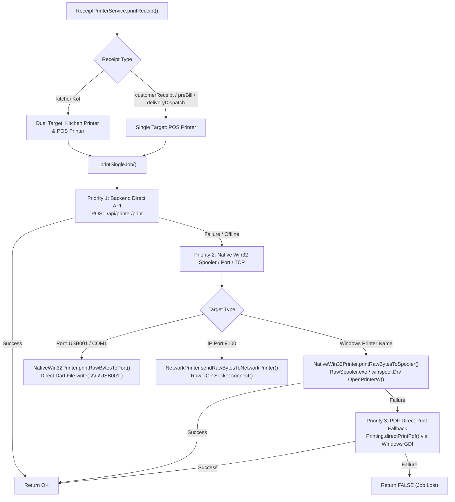
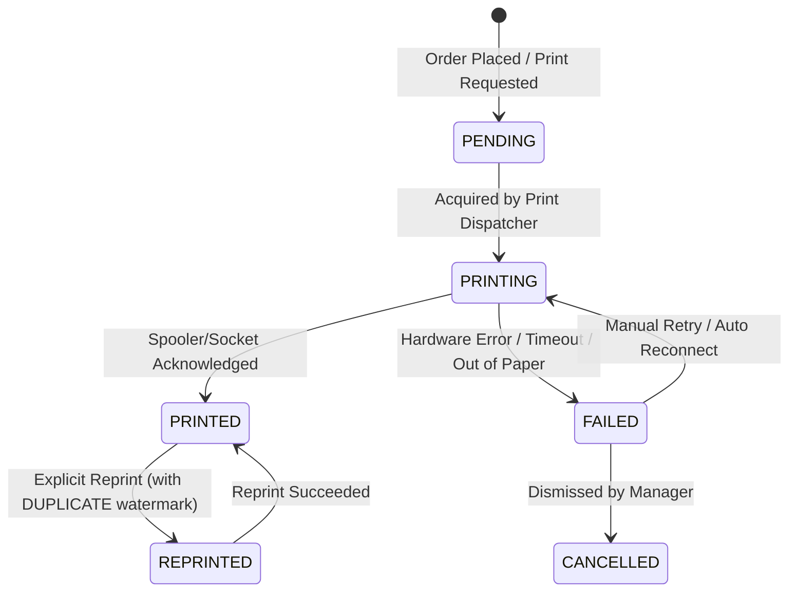

# Phase 16: Thermal Printing Architecture & Offline-First Requirements Audit
**Hungry Howie's POS Codebase Audit & Offline Printing Design**

---

## Executive Summary

This report delivers a comprehensive audit of thermal printing mechanisms (ESC/POS bytecode generation, Windows Spooler integration, USB/raw port access, network printing, and receipt workflows) across the Hungry Howie's POS client (Flutter/Windows) and backend (NestJS/Prisma/PostgreSQL).

### Key Audit Findings:
1. **Zero External ESC/POS Dependencies**: The codebase does not use `esc_pos_printer` or `flutter_pos_printer_platform`. Instead, it utilizes a custom in-house Dart bytecode builder ([`EscPosBuilder`](file:///D:/HowiePOSUPdated/Hbackend-Hfrontend-main/frontend/lib/services/printer/escpos_builder.dart#L32-L767)), pub packages `printing: ^5.15.1` and `pdf: ^3.13.1` ([`pubspec.yaml:48-49`](file:///D:/HowiePOSUPdated/Hbackend-Hfrontend-main/frontend/pubspec.yaml#L48-L49)), and native Windows Win32 spooler drivers ([`NativeWin32Printer`](file:///D:/HowiePOSUPdated/Hbackend-Hfrontend-main/frontend/lib/services/printer/native_printer_io.dart#L8-L232)).
2. **Dual-Path Spooler Architecture**: Printing occurs via a 3-tier fallback ladder: (1) Local NestJS backend HTTP endpoint (`/api/printer/print`), (2) Direct Native Win32 Spooler / USB raw port writing via C# `winspool.Drv` APIs or `RawSpooler.exe`, and (3) Raster PDF printing via `Printing.directPrintPdf()`.
3. **Fragile Client-Only KOT Print Tracking**: KOT deduplication is tracked exclusively on the local client using Flutter `SharedPreferences` keys `pos_printed_kitchen_kot_set` and `pos_printed_kot_signatures_map` ([`receipt_printer_service.dart:696-699`](file:///D:/HowiePOSUPdated/Hbackend-Hfrontend-main/frontend/lib/services/receipt_printer_service.dart#L696-L699)). 
4. **No Print Job Queue or Error Persistence**: Print jobs are fire-and-forget. There is **no database table, no SQLite queue, and no persistent state** for pending, failed, or retrying print jobs. If a printer is offline, out of paper, or unplugged, the failure is discarded after showing an ephemeral SnackBar.
5. **Multi-Device Blindness**: The server database `Order` table contains a single boolean `kitchen_ticket_sent` ([`schema.prisma:289`](file:///D:/HowiePOSUPdated/Hbackend-Hfrontend-main/backend/prisma/schema.prisma#L289)) which is **never updated** for Takeaway or Online orders. If Device A prints a kitchen ticket, Device B has no knowledge of it and will allow duplicate printing upon sync.
6. **Reprint Compliance Deficit**: Customer bills completely lack any "*** DUPLICATE ***" or "*** REPRINT ***" watermark or banner when reprinted ([`escpos_builder.dart:277-385`](file:///D:/HowiePOSUPdated/Hbackend-Hfrontend-main/frontend/lib/services/printer/escpos_builder.dart#L277-L385)), creating severe tax compliance and financial fraud risks.

---

## 1. Inventory of Printer Code & Hardware Integrations

### 1.1 Package Dependencies

Inspection of [`frontend/pubspec.yaml`](file:///D:/HowiePOSUPdated/Hbackend-Hfrontend-main/frontend/pubspec.yaml#L48-L51) and [`backend/package.json`](file:///D:/HowiePOSUPdated/Hbackend-Hfrontend-main/backend/package.json#L22-L46) reveals the installed printing dependencies:

| Component | Package / Module | Version | Purpose in Codebase | Citation |
|---|---|---|---|---|
| Flutter Frontend | `pdf` | `^3.13.1` | Document layout engine for receipts, invoices, and KOT rasterization | [`pubspec.yaml:48`](file:///D:/HowiePOSUPdated/Hbackend-Hfrontend-main/frontend/pubspec.yaml#L48) |
| Flutter Frontend | `printing` | `^5.15.1` | Windows spooler printer discovery, PDF direct printing, and raster pixel extraction | [`pubspec.yaml:49`](file:///D:/HowiePOSUPdated/Hbackend-Hfrontend-main/frontend/pubspec.yaml#L49) |
| Flutter Frontend | Custom ESC/POS Engine | In-house | Pure Dart binary bytecode generator for ESC/POS thermal printers | [`escpos_builder.dart:32`](file:///D:/HowiePOSUPdated/Hbackend-Hfrontend-main/frontend/lib/services/printer/escpos_builder.dart#L32) |
| Flutter Frontend | Win32 Spooler Integration | In-house | Direct P/Invoke to `winspool.Drv` via in-line PowerShell C# or native `RawSpooler.exe` | [`native_printer_io.dart:8`](file:///D:/HowiePOSUPdated/Hbackend-Hfrontend-main/frontend/lib/services/printer/native_printer_io.dart#L8) |
| Backend NestJS | `PrinterModule` | In-house | NestJS controller & service bridging Node.js child processes to Windows Spooler | [`backend/src/printer/printer.module.ts:1`](file:///D:/HowiePOSUPdated/Hbackend-Hfrontend-main/backend/src/printer/printer.module.ts#L1) |
| Third-Party POS | `esc_pos_printer` / `esc_pos_utils` | **NOT FOUND** | Not used; full custom generator implemented | `NOT FOUND` |
| Low-level USB | `flutter_pos_printer_platform` / `quick_usb` | **NOT FOUND** | Not used; raw Windows port streaming used instead | `NOT FOUND` |

---

### 1.2 Low-Level Hardware Integration Layers

The system supports four distinct hardware transmission mechanisms:



#### Detailed Breakdown of Layers:

1. **Custom ESC/POS Bytecode Generator ([`escpos_builder.dart`](file:///D:/HowiePOSUPdated/Hbackend-Hfrontend-main/frontend/lib/services/printer/escpos_builder.dart#L32-L767))**:
   - Implements standard Epson ESC/POS commands:
     - Initialization: `ESC @` (`[0x1B, 0x40]`) ([`line 38`](file:///D:/HowiePOSUPdated/Hbackend-Hfrontend-main/frontend/lib/services/printer/escpos_builder.dart#L38)).
     - Character Code Table: `ESC t 0` CP437 (`[0x1B, 0x74, 0x00]`) ([`line 39`](file:///D:/HowiePOSUPdated/Hbackend-Hfrontend-main/frontend/lib/services/printer/escpos_builder.dart#L39)).
     - Font Selection: `ESC M 0` (Font A 12x24 Sans-Serif) ([`line 40`](file:///D:/HowiePOSUPdated/Hbackend-Hfrontend-main/frontend/lib/services/printer/escpos_builder.dart#L40)).
     - Paper Cut: `GS V 0` (Full Cut `[0x1D, 0x56, 0x00]`) and `GS V B 0` (Partial Cut `[0x1D, 0x56, 0x42, 0x00]`) ([`lines 41-42`](file:///D:/HowiePOSUPdated/Hbackend-Hfrontend-main/frontend/lib/services/printer/escpos_builder.dart#L41-L42)).
     - Cash Drawer Kick: `ESC p 0 25 250` (`[0x1B, 0x70, 0x00, 0x19, 0xFA]`) ([`line 43`](file:///D:/HowiePOSUPdated/Hbackend-Hfrontend-main/frontend/lib/services/printer/escpos_builder.dart#L43)).
     - Margins: Left margin `GS L nL nH` ([`line 93`](file:///D:/HowiePOSUPdated/Hbackend-Hfrontend-main/frontend/lib/services/printer/escpos_builder.dart#L93)) and printable area width `GS W nL nH` ([`line 99`](file:///D:/HowiePOSUPdated/Hbackend-Hfrontend-main/frontend/lib/services/printer/escpos_builder.dart#L99)).
     - Raster Graphics: Standard ESC/POS `GS v 0` bit image mode (`[0x1D, 0x76, 0x30, 0x00, xL, xH, yL, yH]`) used for printing high-resolution logos and strikethrough cancelled items at 203 DPI ([`lines 628-709`](file:///D:/HowiePOSUPdated/Hbackend-Hfrontend-main/frontend/lib/services/printer/escpos_builder.dart#L628-L709)).
   - Supports 80mm roll (42-48 characters width) and 58mm roll (30-32 characters width) ([`lines 265, 454`](file:///D:/HowiePOSUPdated/Hbackend-Hfrontend-main/frontend/lib/services/printer/escpos_builder.dart#L265)).

2. **Native Win32 Spooler Integration ([`native_printer_io.dart`](file:///D:/HowiePOSUPdated/Hbackend-Hfrontend-main/frontend/lib/services/printer/native_printer_io.dart#L8-L232))**:
   - Bypasses Windows GDI print dialogues by directly injecting RAW data into the print spooler queue (`winspool.Drv`).
   - Uses C# P/Invoke bindings: `OpenPrinterW()`, `StartDocPrinterW()`, `StartPagePrinter()`, `WritePrinter()`, `EndPagePrinter()`, `EndDocPrinter()`, and `ClosePrinter()` ([`lines 14-66`](file:///D:/HowiePOSUPdated/Hbackend-Hfrontend-main/frontend/lib/services/printer/native_printer_io.dart#L14-L66)).
   - Execution path:
     - Primary fast path: Executes precompiled native executable `RawSpooler.exe` ([`lines 84-98`](file:///D:/HowiePOSUPdated/Hbackend-Hfrontend-main/frontend/lib/services/printer/native_printer_io.dart#L84-L98); located at [`frontend/windows/RawSpooler.exe`](file:///D:/HowiePOSUPdated/Hbackend-Hfrontend-main/frontend/windows/RawSpooler.exe) and [`backend/src/printer/RawSpooler.exe`](file:///D:/HowiePOSUPdated/Hbackend-Hfrontend-main/backend/src/printer/RawSpooler.exe)).
     - Secondary fallback path: Spools raw bytes via PowerShell by compiling the in-line C# type dynamically in memory ([`lines 109-130`](file:///D:/HowiePOSUPdated/Hbackend-Hfrontend-main/frontend/lib/services/printer/native_printer_io.dart#L109-L130)).

3. **Direct USB/Serial Port Communication ([`native_printer_io.dart`](file:///D:/HowiePOSUPdated/Hbackend-Hfrontend-main/frontend/lib/services/printer/native_printer_io.dart#L135-L149))**:
   - Discovers Windows USB/COM printer ports (`Get-PrinterPort | Where-Object { $_.Name -match 'USB|COM|LPT' }`) ([`lines 175-199`](file:///D:/HowiePOSUPdated/Hbackend-Hfrontend-main/frontend/lib/services/printer/native_printer_io.dart#L175-L199)).
   - Streams raw bytes directly to the hardware device handle (e.g. `\\.\USB001` or `\\.\COM1`) using Dart's asynchronous `File.open(mode: FileMode.writeOnly)` and `RandomAccessFile.writeFrom()` ([`lines 135-149`](file:///D:/HowiePOSUPdated/Hbackend-Hfrontend-main/frontend/lib/services/printer/native_printer_io.dart#L135-L149)).

4. **Network TCP Socket Printing ([`network_printer_io.dart`](file:///D:/HowiePOSUPdated/Hbackend-Hfrontend-main/frontend/lib/services/printer/network_printer_io.dart#L6-L41))**:
   - For LAN and Wi-Fi thermal printers.
   - Connects directly to printer IP on raw ESC/POS port 9100 using `Socket.connect(host, port, timeout: 4s)`.
   - Flushes raw bytes and closes the socket immediately after transmission ([`lines 13-24`](file:///D:/HowiePOSUPdated/Hbackend-Hfrontend-main/frontend/lib/services/printer/network_printer_io.dart#L13-L24)).

5. **Backend Spooler Service ([`backend/src/printer/printer.service.ts`](file:///D:/HowiePOSUPdated/Hbackend-Hfrontend-main/backend/src/printer/printer.service.ts#L1-L248))**:
   - Exposes REST endpoints for Web clients and networked POS terminals:
     - `GET /api/printer/list`: Returns physical printers detected on the server host via PowerShell `Get-Printer` ([`printer.controller.ts:28-37`](file:///D:/HowiePOSUPdated/Hbackend-Hfrontend-main/backend/src/printer/printer.controller.ts#L28-L37)).
     - `POST /api/printer/print`: Receives base64-encoded ESC/POS bytes, writes to a temporary binary file (`pos_raw_<timestamp>.bin`), and writes to spooler via `RawSpooler.exe` or PowerShell C# helper ([`printer.service.ts:175-247`](file:///D:/HowiePOSUPdated/Hbackend-Hfrontend-main/backend/src/printer/printer.service.ts#L175-L247)).
     - `POST /api/printer/ensure-pos`: Creates a "Generic / Text Only" spooler queue on port `USB001` if not present ([`printer.service.ts:147-168`](file:///D:/HowiePOSUPdated/Hbackend-Hfrontend-main/backend/src/printer/printer.service.ts#L147-L168)).

---

## 2. Comprehensive Trigger Inventory & Receipt Types

Printing is invoked across the client screens. The table below catalogs every trigger point, the receipt type, target printer, and operational guards:

| Flow / Screen | Citation | Receipt Type | Target Printer | User Action / Event | Execution Guards & Behavior |
|---|---|---|---|---|---|
| **Dine-In KOT** | [`tables_screen.dart:2003`](file:///D:/HowiePOSUPdated/Hbackend-Hfrontend-main/frontend/lib/features/tables/tables_screen.dart#L2003) | `ReceiptType.kitchenKot` | Kitchen + POS (Dual) | Cashier taps "PRINT KITCHEN RECEIPT" or "PRINT UPDATED KITCHEN RECEIPT" | Guarded by `isKitchenReceiptPrinted()`. If printed and items unmodified, button is disabled with label `ALREADY PRINTED (BLOCKED)`. If cancelled items exist, allows updated print. |
| **Dine-In Backend Ticket** | [`tables_screen.dart:2022`](file:///D:/HowiePOSUPdated/Hbackend-Hfrontend-main/frontend/lib/features/tables/tables_screen.dart#L2022) | Backend sync | Backend DB | Triggered after physical KOT print success | Calls `kitchenApiService.sendKitchenTicket(orderId)` to set `kitchen_ticket_sent = true` in PostgreSQL. |
| **Dine-In Pre-Bill** | [`tables_screen.dart:2090`](file:///D:/HowiePOSUPdated/Hbackend-Hfrontend-main/frontend/lib/features/tables/tables_screen.dart#L2090) | `ReceiptType.preBill` | POS Counter | Cashier taps "PRINT PRE-BILL" | Prints customer table check without completing payment. |
| **Dine-In Settle Bill** | [`tables_screen.dart:5426`](file:///D:/HowiePOSUPdated/Hbackend-Hfrontend-main/frontend/lib/features/tables/tables_screen.dart#L5426) | `ReceiptType.customerReceipt` | POS Counter | Cashier settles table payment | Prints final customer tax invoice and triggers cash drawer kick. |
| **Takeaway KOT** | [`takeaway_screen.dart:2003`](file:///D:/HowiePOSUPdated/Hbackend-Hfrontend-main/frontend/lib/features/takeaway/takeaway_screen.dart#L2003) | `ReceiptType.kitchenKot` | Kitchen + POS (Dual) | Cashier taps "PRINT KITCHEN TICKET (KOT)" | Guarded by `isKitchenReceiptPrinted()`. **BUG**: Does NOT call backend `sendKitchenTicket()`. |
| **Takeaway Pre-Bill** | [`takeaway_screen.dart:2522`](file:///D:/HowiePOSUPdated/Hbackend-Hfrontend-main/frontend/lib/features/takeaway/takeaway_screen.dart#L2522) | `ReceiptType.preBill` | POS Counter | Cashier applies discount in order modal | Prints updated takeaway check showing discount calculation. |
| **Takeaway Settlement** | [`takeaway_screen.dart:4074`](file:///D:/HowiePOSUPdated/Hbackend-Hfrontend-main/frontend/lib/features/takeaway/takeaway_screen.dart#L4074) | `ReceiptType.customerReceipt` | POS Counter | Cashier clicks "PRINT RECEIPT & FINISH" | Final customer receipt printed upon payment confirmation. |
| **Delivery KOT** | [`delivery_screen.dart:1772`](file:///D:/HowiePOSUPdated/Hbackend-Hfrontend-main/frontend/lib/features/delivery/delivery_screen.dart#L1772) | `ReceiptType.kitchenKot` | Kitchen + POS (Dual) | Cashier sets cooking time / taps "PRINT KITCHEN RECEIPT" | Guarded by `isKitchenReceiptPrinted()`. **BUG**: Does NOT call backend `sendKitchenTicket()`. |
| **Delivery Dispatch Bill** | [`delivery_screen.dart:2139`](file:///D:/HowiePOSUPdated/Hbackend-Hfrontend-main/frontend/lib/features/delivery/delivery_screen.dart#L2139) | `ReceiptType.deliveryDispatch` | POS Counter | Cashier taps "PRINT DISPATCH BILL" | **Enforces rider assignment guard** ([`lines 1834-1845`](file:///D:/HowiePOSUPdated/Hbackend-Hfrontend-main/frontend/lib/features/delivery/delivery_screen.dart#L1834-L1845)). Prints customer address, phone, rider name, and COD total. Marks client state `isBillPrinted = true`. |
| **Delivery Settlement** | [`delivery_screen.dart:4843`](file:///D:/HowiePOSUPdated/Hbackend-Hfrontend-main/frontend/lib/features/delivery/delivery_screen.dart#L4843) | `ReceiptType.customerReceipt` | POS Counter | Cashier closes delivered order with payment | Prints final customer receipt. |
| **Online Orders KOT** | [`online_orders_screen.dart:1060`](file:///D:/HowiePOSUPdated/Hbackend-Hfrontend-main/frontend/lib/features/online_orders/online_orders_screen.dart#L1060) | `ReceiptType.kitchenKot` | Kitchen + POS (Dual) | Cashier accepts online order & sets cooking time | Guarded by `isKitchenReceiptPrinted()`. **BUG**: Does NOT call backend `sendKitchenTicket()`. |
| **Online Customer Bill** | [`online_orders_screen.dart:1534`](file:///D:/HowiePOSUPdated/Hbackend-Hfrontend-main/frontend/lib/features/online_orders/online_orders_screen.dart#L1534) | `ReceiptType.customerReceipt` | POS Counter | Cashier taps "PRINT CUSTOMER BILL" | Customer delivery slip printed. |
| **Online Settlement** | [`online_orders_screen.dart:3823`](file:///D:/HowiePOSUPdated/Hbackend-Hfrontend-main/frontend/lib/features/online_orders/online_orders_screen.dart#L3823) | `ReceiptType.customerReceipt` | POS Counter | Cashier finishes online order | Final settlement receipt printed. |
| **Fast-Food POS Checkout** | [`pos_screen.dart:1081`](file:///D:/HowiePOSUPdated/Hbackend-Hfrontend-main/frontend/lib/features/pos/pos_screen.dart#L1081) | `ReceiptType.customerReceipt` | POS Counter | Cashier taps "CONFIRM PAYMENT & PRINT" | Checks out order, triggers auto-deduction of inventory, and prints customer invoice. |
| **POS Test Print** | [`printer_settings_dialog.dart:165`](file:///D:/HowiePOSUPdated/Hbackend-Hfrontend-main/frontend/lib/features/settings/widgets/printer_settings_dialog.dart#L165) | `ReceiptType.customerReceipt` | POS Counter | Cashier taps "Run POS Test Print" | Generates mock invoice #101 to verify spooler/cutter. |
| **Kitchen Test Print** | [`printer_settings_dialog.dart:227`](file:///D:/HowiePOSUPdated/Hbackend-Hfrontend-main/frontend/lib/features/settings/widgets/printer_settings_dialog.dart#L227) | `ReceiptType.kitchenKot` | Kitchen Printer | Cashier taps "Run Kitchen Test Print" | Generates mock KOT #KOT-101. Never locked by deduplication. |

---

## 3. Current State Architecture: What is Stored About Printed / Not Printed

The audit revealed a severe disconnect between what the frontend tracks and what the backend persists:

```
+---------------------------------------------------------------------------------------------------+
|                                CURRENT PRINTING STATE INVENTORY                                   |
+----------------------------------------------------+----------------------------------------------+
| Local Client State (Flutter Windows)               | Server State (NestJS / PostgreSQL)           |
+----------------------------------------------------+----------------------------------------------+
| 1. SharedPreferences:                              | 1. Prisma Model: Order                       |
|    - 'pos_printed_kitchen_kot_set' (Set<String>)   |    - kitchen_ticket_sent: Boolean            |
|      Max 3000 order/token numbers.                 |      Default: false                          |
|      Cleared on manual reset.                      |      Updated ONLY via Dine-In KOT API call.  |
|                                                    |      Ignored on Takeaway and Online orders!  |
| 2. SharedPreferences:                              |                                              |
|    - 'pos_printed_kot_signatures_map' (Map)        | 2. Print Jobs Entity:                        |
|      Order key -> itemsSignature string.           |    - NOT FOUND (No print queue, logs, or     |
|      Format: 'act:[items]_cnc:[items]_sub:total'   |      status in database schema).             |
|                                                    |                                              |
| 3. In-Memory State:                                | 3. Timestamps & Audit:                       |
|    - DeliveryOrder.isBillPrinted (bool)            |    - NOT FOUND (No printed_at timestamp,     |
|    - TakeawayOrder.isBillPrinted (bool)            |      no device_id, no printer_name stored). |
|    - _recentPrintLocks (Map, 1500ms debounce)      |                                              |
|                                                    | 4. Customer Bills:                           |
| 4. Customer Receipts:                              |    - NOT FOUND (Zero persistence of whether  |
|    - ZERO state stored. If print fails, it's lost. |      customer bill was ever printed).        |
+----------------------------------------------------+----------------------------------------------+
```

### 3.1 Detailed Evaluation of Existing State

#### A. Kitchen KOT Print State ([`receipt_printer_service.dart:696-760`](file:///D:/HowiePOSUPdated/Hbackend-Hfrontend-main/frontend/lib/services/receipt_printer_service.dart#L696-L760))
- **Storage**: Client-side `SharedPreferences` string list and JSON map.
- **Deduplication Logic**:
  - `isKitchenReceiptPrinted(idOrOrderNumber)` inspects the local Set.
  - If found in the Set, it compares the current `ReceiptData.itemsSignature` with the stored signature ([`lines 828-852`](file:///D:/HowiePOSUPdated/Hbackend-Hfrontend-main/frontend/lib/services/receipt_printer_service.dart#L828-L852)).
  - If the signature differs (i.e. items were added or cancelled), it returns `false`, allowing the updated KOT to print.
  - If the signature is identical, it returns `true` and blocks printing with a red banner ([`lines 1241-1262`](file:///D:/HowiePOSUPdated/Hbackend-Hfrontend-main/frontend/lib/services/receipt_printer_service.dart#L1241-L1262)).
- **Unmarking Mechanism**:
  - When orders are updated or items are cancelled via [`orders_api_service.dart`](file:///D:/HowiePOSUPdated/Hbackend-Hfrontend-main/frontend/lib/services/api/orders_api_service.dart#L60-L127) or local repositories ([`takeaway_repository.dart:309`](file:///D:/HowiePOSUPdated/Hbackend-Hfrontend-main/frontend/lib/data/takeaway_repository.dart#L309), [`delivery_repository.dart:239`](file:///D:/HowiePOSUPdated/Hbackend-Hfrontend-main/frontend/lib/data/delivery_repository.dart#L239)), `unmarkOrderKitchenReceiptPrinted()` removes the order key and its variations (`<key>_cancel`, numeric formats) from SharedPreferences.

#### B. Customer Receipt Print State
- **Storage**: **NONE**.
- Neither PostgreSQL nor SQLite nor SharedPreferences records whether a customer tax invoice was printed.
- In `pos_screen.dart` and `takeaway_screen.dart`, when payment is taken, `printReceipt()` is called. If the physical printer fails, the order remains checked out and marked PAID in memory and backend, but the receipt failure is discarded.

#### C. Backend Server State ([`backend/prisma/schema.prisma:289`](file:///D:/HowiePOSUPdated/Hbackend-Hfrontend-main/backend/prisma/schema.prisma#L289))
- The `Order` model contains only:
  ```prisma
  kitchen_ticket_sent Boolean @default(false) @map("kitchen_ticket_sent")
  ```
- **Major Finding**: This column is only set to `true` when [`tables_screen.dart:2022`](file:///D:/HowiePOSUPdated/Hbackend-Hfrontend-main/frontend/lib/features/tables/tables_screen.dart#L2022) calls `sendKitchenTicket(id)` or [`api_kitchen_repository.dart:30`](file:///D:/HowiePOSUPdated/Hbackend-Hfrontend-main/frontend/lib/data/repositories/api_kitchen_repository.dart#L30) executes.
- **Takeaway orders** ([`takeaway_screen.dart:2003`](file:///D:/HowiePOSUPdated/Hbackend-Hfrontend-main/frontend/lib/features/takeaway/takeaway_screen.dart#L2003)) and **Online orders** ([`online_orders_screen.dart:1060`](file:///D:/HowiePOSUPdated/Hbackend-Hfrontend-main/frontend/lib/features/online_orders/online_orders_screen.dart#L1060)) **never call `sendKitchenTicket()`**. In PostgreSQL, their `kitchen_ticket_sent` remains `false` forever.

---

## 4. Deep Analysis: Order Saved Locally but Printer Fails

### 4.1 What Happens Today in the Codebase?

When an order is created and saved locally (in memory or pending sync) and the physical printer fails:

```
[Cashier clicks "Print KOT"]
          │
          ▼
[EscPosBuilder builds binary bytes]
          │
          ▼
[_printSingleJob() attempts transmission]
          │
          ├─► Priority 1 (Backend API): Timeout / Conn Refused
          ├─► Priority 2 (Win32 Spooler): Returns false OR spooler hangs
          └─► Priority 3 (PDF Direct Print): Throws exception
          │
          ▼
[_printSingleJob() catches error and returns false]
          │
          ▼
[ReceiptPrinterService.printReceipt() returns false]
          │
          ├─► markKitchenReceiptPrinted() is NOT called.
          ├─► SnackBar shown: "Unable to print receipt. Please check printer connection."
          └─► Execution terminates.
```

### 4.2 System Flaws & Failure Modes

1. **Job Disappearance (No Print Queue)**:
   - Because no print job record is persisted, the failed print job ceases to exist in the application state.
   - Once the SnackBar disappears, the POS interface gives no indication that a ticket failed to print. If the cashier is busy, the kitchen never receives the order, and the food is never cooked.
2. **False Positives in Windows Spooler**:
   - `winspool.Drv`'s `WritePrinter()` returns `true` as long as Windows accepted the raw bytes into the spooler queue (`C:\Windows\System32\spool\PRINTERS`).
   - If the thermal printer is **out of paper**, **paper jammed**, or **unplugged from USB**, Windows accepts the spool file and `NativeWin32Printer` reports `success = true`!
   - As a result, [`ReceiptPrinterService.printReceipt:1402`](file:///D:/HowiePOSUPdated/Hbackend-Hfrontend-main/frontend/lib/services/receipt_printer_service.dart#L1402) executes `markKitchenReceiptPrinted()`, locking the ticket. The UI permanently blocks the cashier from reprinting because it believes the ticket was printed!
3. **Multi-Device Ignorance**:
   - Device B does not share SharedPreferences with Device A. If Device A fails or succeeds, Device B has no mechanism to know the print status upon SQLite/REST synchronization.
4. **Customer Bill Lost at Checkout**:
   - At POS checkout ([`pos_screen.dart:1074-1093`](file:///D:/HowiePOSUPdated/Hbackend-Hfrontend-main/frontend/lib/features/pos/pos_screen.dart#L1074-L1093)), `processOrderCheckout()` completes, inventory is deducted, and the dialog is popped before `printReceipt()` completes. If the printer fails, the customer leaves without a tax invoice, and there is no "Reprint Failed Bill" button on the screen.

---

## 5. Architectural Requirements for Offline & Multi-Device Printing

To satisfy the offline-first mandate (`OFFLINE_FIRST_ENABLED`), thermal printing must be elevated from an unmanaged, fire-and-forget UI side-effect into a **first-class, durable local operational entity**.

### 5.1 Requirement 1: Durable Local Print-Job Entity (`print_jobs`)

The local operational SQLite database (Drift) must introduce a `print_jobs` table. Every print attempt (auto or manual) must be registered here prior to hardware transmission.



#### Detailed Schema Requirements for `print_jobs` (Drift SQLite):

| Column Name | Data Type | Nullable | Description & Constraints |
|---|---|---|---|
| `id` | `TEXT` (UUID) | NO | Primary Key. |
| `order_id` | `TEXT` | NO | Foreign Key linking to `orders.id`. |
| `order_number` | `TEXT` | NO | Clean display number (e.g. `101`, `102`). |
| `job_type` | `TEXT` | NO | Enum: `KITCHEN_KOT`, `CUSTOMER_RECEIPT`, `PRE_BILL`, `DISPATCH_BILL`, `CANCEL_TICKET`. |
| `target_printer` | `TEXT` | NO | Configured target role: `KITCHEN`, `POS_COUNTER`, `BAR`. |
| `printer_name` | `TEXT` | YES | Actual physical printer name (e.g. `POS Receipt Printer` or `192.168.1.200:9100`). |
| `status` | `TEXT` | NO | Enum: `PENDING`, `PRINTING`, `PRINTED`, `FAILED`, `CANCELLED`, `REPRINTED`. |
| `payload_signature` | `TEXT` | NO | SHA-256 or item signature string representing line items at print time. |
| `dedupe_key` | `TEXT` | NO | Unique constraint index: Prevents identical job creation. |
| `is_reprint` | `BOOLEAN` | NO | Default `false`. If `true`, printer driver injects `*** DUPLICATE ***`. |
| `reprint_count` | `INTEGER` | NO | Default `0`. Incremented on every reprint. |
| `attempts` | `INTEGER` | NO | Default `0`. Number of physical transmission attempts. |
| `last_error` | `TEXT` | YES | Description of failure (e.g. `COMM_TIMEOUT`, `SPOOLER_OFFLINE`). |
| `device_id` | `TEXT` | NO | ID of terminal creating/printing the job (e.g. `POS-01`). |
| `created_at` | `DATETIME` | NO | Timestamp of job generation. |
| `printed_at` | `DATETIME` | YES | Timestamp of successful transmission. |
| `failed_at` | `DATETIME` | YES | Timestamp of last failure. |

---

### 5.2 Requirement 2: Deduplication Key Design

To prevent duplicate physical printing while allowing legitimate updates and reprints, deterministic composite dedupe keys must be used:

#### A. Kitchen Order Ticket (KOT) Dedupe Key
```
KOT:{order_id}:v{order_version}:{signature_hash}:{target_printer}
```
- **Example**: `KOT:d3b07384-d113:v1:a8f9c2:KITCHEN`
- **Behavior**:
  - If a cashier double-taps the print button within seconds, the second request computes the exact same dedupe key and is discarded.
  - If the order is modified (e.g. item added or size changed), `order_version` increments and `signature_hash` changes -> A new unique key is generated -> The updated ticket prints.

#### B. Customer Receipt Dedupe Key
```
BILL:{order_id}:{payment_id_or_seq}:{target_printer}
```
- **Example**: `BILL:d3b07384-d113:pay_1:POS_COUNTER`
- **Behavior**:
  - Guarantees an original tax invoice is generated exactly once per payment event.
  - Any subsequent attempt for the same payment ID must fail the uniqueness check and force the user down the explicit `is_reprint = true` flow.

#### C. Cancellation Ticket Dedupe Key
```
CANCEL:{order_id}:{item_id}:{cancel_seq}:{target_printer}
```
- **Example**: `CANCEL:d3b07384-d113:item_99:1:KITCHEN`
- **Behavior**:
  - Generates a dedicated slip for the kitchen cook station immediately upon item voiding.

---

### 5.3 Requirement 3: Cancelled-Item Tickets & Modification Deltas

The codebase already contains a raster strikethrough generator in [`ReceiptPrinterService.generateRasterEscPosBytes`](file:///D:/HowiePOSUPdated/Hbackend-Hfrontend-main/frontend/lib/services/receipt_printer_service.dart#L1643-L1673) and item cancellation support in [`escpos_builder.dart:543`](file:///D:/HowiePOSUPdated/Hbackend-Hfrontend-main/frontend/lib/services/printer/escpos_builder.dart#L543). However, the workflow requirements must be formalized:

1. **Immediate Cancellation Ticket (Kitchen Alert Slip)**:
   - When an item is cancelled from an active order in the POS, a high-priority print job of type `CANCEL_TICKET` must be generated immediately.
   - Must print on the **Kitchen Printer** with:
     - Header: `*** ITEM CANCELLED - DO NOT PREPARE ***` (Double-height, inverted black-on-white).
     - Table / Token number in bold large font.
     - Quantity cancelled prefixed with minus (e.g. `-2x LARGE FAJITA PIZZA`).
     - Reason for cancellation (`cancel_reason`) and Staff Name (`cancelled_by`).
     - Timestamp of cancellation.
2. **Updated Master KOT (Delta Mode)**:
   - When an order has items added or cancelled, the updated master KOT must clearly distinguish between unchanged items, newly added items, and cancelled items.
   - Header must state: `*** ORDER MODIFIED / REVISED ***`.
   - Cancelled items must be printed with strikethrough and negative quantity.
   - Newly added items must be highlighted with `[NEW]` or inverted text.

---

### 5.4 Requirement 4: Reprint Compliance & Marking "DUPLICATE"

#### Tax Compliance & Fraud Prevention Finding:
In the current code:
- [`EscPosBuilder.buildKitchenKotBytes:505-510`](file:///D:/HowiePOSUPdated/Hbackend-Hfrontend-main/frontend/lib/services/printer/escpos_builder.dart#L505-L510) prints `*** REPRINT ***` for KOTs.
- **CRITICAL GAP**: In [`EscPosBuilder.buildReceiptBytes:277-385`](file:///D:/HowiePOSUPdated/Hbackend-Hfrontend-main/frontend/lib/services/printer/escpos_builder.dart#L277-L385) (Customer Bill), **`receipt.isReprint` is completely ignored**!
- If a customer bill is reprinted, it produces an identical original invoice with no "DUPLICATE" marking. This is a violation of tax authority requirements and allows staff to pocket cash by reprinting bills.

#### Mandatory Requirements:
1. **Customer Bill Reprint**:
   - Header watermark: Centered, double-width, double-height text:
     ```
     ================================================
     ***            DUPLICATE RECEIPT             ***
     ***       NOT AN ORIGINAL TAX INVOICE        ***
     ================================================
     ```
   - Audit trail metadata:
     - `Original Printed: [Original DateTime]`
     - `Reprinted At: [Current DateTime] by Cashier: [Staff Name]`
     - `Reprint Count: [N] (Audit Log #)`
2. **Kitchen KOT Reprint**:
   - Header banner:
     ```
     ================================================
     ***           DUPLICATE KOT TICKET           ***
     ***        CHECK IF ALREADY PREPARED         ***
     ================================================
     ```

---

### 5.5 Requirement 5: Multi-Device Printing Architecture (Who Prints When Two Devices Sync?)

In a multi-terminal restaurant environment (e.g. Counter POS Terminal 1, Handheld Order Tablet 2, Online Dispatch Tablet 3), two devices must never print duplicate kitchen tickets or customer bills upon syncing.

```
                          ┌─────────────────────────┐
                          │   PostgreSQL / NestJS   │
                          │   (Central Order Hub)   │
                          └────────────┬────────────┘
                                       │
                      WebSocket / REST │ Sync API
                                       │
            ┌──────────────────────────┴──────────────────────────┐
            ▼                                                     ▼
┌───────────────────────────────┐             ┌───────────────────────────────┐
│       Counter POS 01          │             │       Handheld Tablet 02      │
│  (USB Kitchen & POS Printer)  │             │     (No Hardware Attached)    │
│  Role: Print Host / Station   │             │     Role: Order Placement     │
└──────────────┬────────────────┘             └──────────────┬────────────────┘
               │                                             │
               │ [Checks Job Target]                         │ [Generates Order]
               ▼                                             │
        ┌─────────────┐                                      │ Creates Print Job
        │ Print Job:  │◄─────────────────────────────────────┘ with Target:
        │  PENDING    │ (Dispatched to POS-01 via Local Sync / Server Queue)
        └──────┬──────┘
               │
               ▼
   [POS-01 Prints to Spooler]
   [Marks Status: PRINTED]
```

#### Multi-Device Printing Rules:

1. **Hardware Role Designation in Local Settings**:
   - Every client device must configure its printing capabilities:
     - `is_print_server: true/false` (Does this device have attached USB/spooler hardware?)
     - `assigned_printers: ['KITCHEN', 'POS_COUNTER']`
2. **Originating Device Printing Rule**:
   - If Device A creates an order and **has** a direct connection to the target printer (e.g. via direct USB, Windows Spooler, or direct Network TCP socket `192.168.1.200:9100`):
     - Device A prints immediately.
     - Device A marks `print_jobs.status = PRINTED`, records `printed_by_device_id = 'POS-01'`, and syncs this state to the local database and backend.
3. **Remote Order Placement (Print Spooling via Sync)**:
   - If Tablet B creates an order and **does not have** a printer attached:
     - Tablet B creates the `print_job` with `status = PENDING` and `target_device_id = 'POS-01'` (or target role `KITCHEN`).
     - Upon sync or WebSocket notification (`order.created`), Counter POS-01 receives the pending job.
     - POS-01 evaluates: `target_device_id == my_device_id && status == 'PENDING'`.
     - POS-01 acquires a local lock, transmits the bytes to the physical printer, and updates `status = PRINTED`.
4. **Sync Ingestion Guard (Preventing Duplicate Burns)**:
   - When any device receives an order update via Sync API or WebSocket:
     - **Rule**: A device MUST NEVER auto-print an incoming synced order if `print_jobs` already records `status == PRINTED` or if `order.kitchen_ticket_sent == true`.
     - Auto-printing on sync is strictly permitted ONLY if this device is the designated Print Host for that printer role AND no record of a completed print exists for that `dedupe_key`.

---

### 5.6 Requirement 6: Printer Offline & Hardware Error Handling

Physical thermal printers frequently encounter hardware errors (out of paper, cover open, USB disconnect, network drop). The system must handle these without data loss or UI blocking.

#### Hardware Failure Policy:

1. **Non-Blocking Asynchronous Execution**:
   - Physical printing must run in an isolated asynchronous worker/isolate.
   - It must **never** block database commits, UI state transitions, or dialog closures. Order checkout succeeds regardless of printer readiness.
2. **Fast-Fail Hardware Timeouts**:
   - Win32 Spooler calls must be protected with a 3.0-second timeout.
   - Network TCP sockets must fail after 2.5 seconds (`Socket.connect` timeout) instead of hanging the thread.
3. **Detailed Failure Reason Capture**:
   - When a job fails, the `print_jobs` record must transition to `FAILED` with specific error codes:
     - `ERR_OUT_OF_PAPER`: Sensed via spooler status / ESC/POS status byte query (`DLE EOT 1`).
     - `ERR_PRINTER_OFFLINE`: Port unreachable or printer powered down.
     - `ERR_NETWORK_UNREACHABLE`: LAN socket connection refused or timed out.
     - `ERR_SPOOLER_LOCKED`: Windows print spooler service hung.
4. **Global UI Print Queue Monitor**:
   - A persistent, non-intrusive status pill/indicator in the POS AppBar:
     - Normal: Green icon ("🖨️ Ready").
     - Degraded: Red pulsing badge ("⚠️ 2 Print Jobs Failed").
   - Tapping the badge opens the **Print Queue Manager**:
     - Displays failed jobs with order number, receipt type, target printer, and error description.
     - Provides one-tap actions:
       - **Retry**: Re-attempts transmission once paper roll is replaced.
       - **Reroute**: Redirects a failed Kitchen KOT to the POS Counter Printer (e.g. if the kitchen printer is broken).
       - **Mark Handled**: Discards the queue entry if the kitchen manually acknowledged the order.

---

## 6. Summary Comparison: Current State vs. Target Offline Architecture

| Dimension | Current Implementation (As Audited) | Target Offline-First Architecture (Requirements) |
|---|---|---|
| **KOT Print Tracking** | Ephemeral `SharedPreferences` string list (`pos_printed_kitchen_kot_set`). Lost on app wipe. | Persistent `print_jobs` SQLite (Drift) table synced reliably across terminals. |
| **Customer Bill Tracking** | None. Completely unpersisted. | Durable `print_jobs` records with `job_type = CUSTOMER_RECEIPT`. |
| **Failed Print Handling** | Fire-and-forget. SnackBar shown, print job lost permanently. | Queued in `FAILED` state with automatic retry and visual UI Queue Manager. |
| **Duplicate Prevention** | Debounce map (1.5s) + basic client string matching. Multi-user blind. | Deterministic `dedupe_key` matching order ID, version, item hash, and printer role. |
| **Cancelled Items** | Strikethrough rendered on updated KOT if manual print clicked. | Immediate automatic `CANCEL_TICKET` burned to kitchen printer upon item voiding. |
| **Reprint Compliance** | Customer bill reprints have **no duplicate watermark**. Tax risk. | Mandatory `*** DUPLICATE RECEIPT ***` watermark + audit timestamps on all reprints. |
| **Multi-Device Coordination** | None. Any device can print duplicates of another device's orders. | Designated Print Host role + dedupe key checking across sync queue. |
| **Backend DB State** | Single boolean `kitchen_ticket_sent`. Untouched for Takeaway/Online. | Full print audit metadata (`printed_at`, `printed_by_device_id`, `print_status`). |

---

## Questions for the Developer

1. **Physical Hardware Deployment**:
   - In production, what is the exact hardware setup in each store?
     - Are Kitchen Printers connected via **USB** to a local terminal, or are they **Network (Ethernet/Wi-Fi)** printers with dedicated static IP addresses (e.g. `192.168.1.200:9100`)?
     - If network printers are used, can handheld tablets print directly to port 9100, or must all print jobs route through a designated Windows counter terminal?
2. **Auto-Print Policy on Online / Delivery Orders**:
   - When a new Online Order or Website delivery arrives via WebSocket, should the Kitchen KOT and Customer Bill **print automatically without cashier intervention**, or is manual cashier acceptance and review strictly required before burning tickets?
3. **Dual Kitchen Printing Requirement**:
   - In [`ReceiptPrinterService.printReceipt:1197`](file:///D:/HowiePOSUPdated/Hbackend-Hfrontend-main/frontend/lib/services/receipt_printer_service.dart#L1197), KOT prints to **both** the Kitchen Printer ("Kitchen Receipt") and the POS Printer ("Food Picker - Dine In"). Is this dual-ticket behavior required for all stores, or should it be configurable per branch (e.g., small stores with only one printer)?
4. **Fiscal / Cash Drawer Policies**:
   - Does store policy require the cash drawer to kick open on **Pre-Bills** or **Reprinted Bills**, or strictly on the **first successful settlement** of a cash payment?
