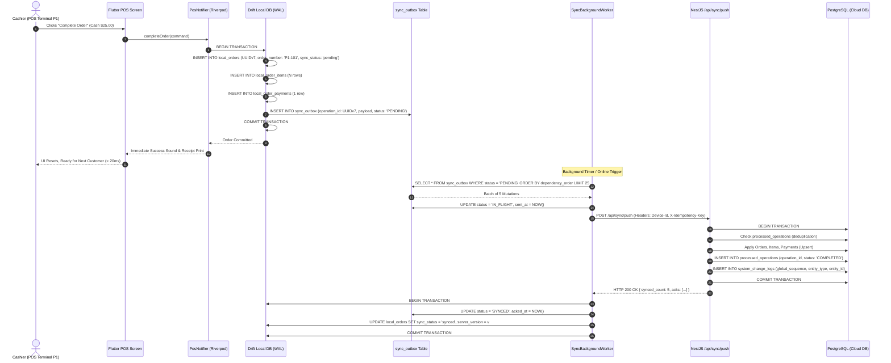
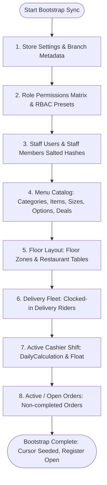
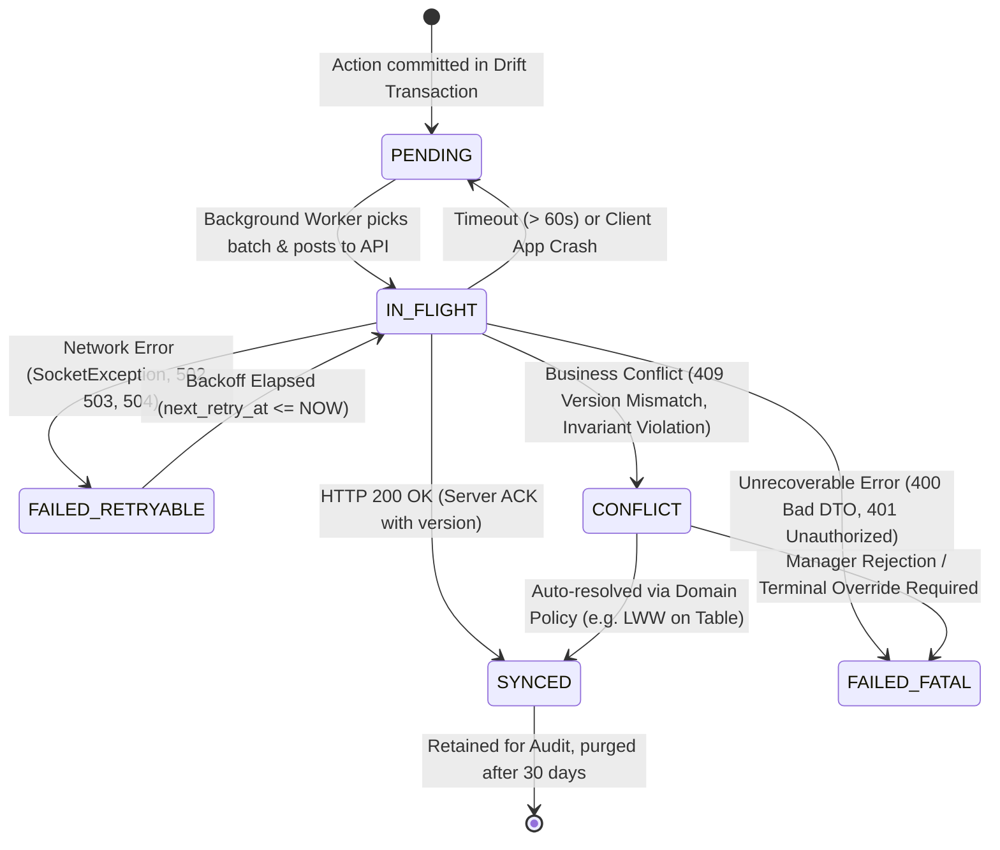
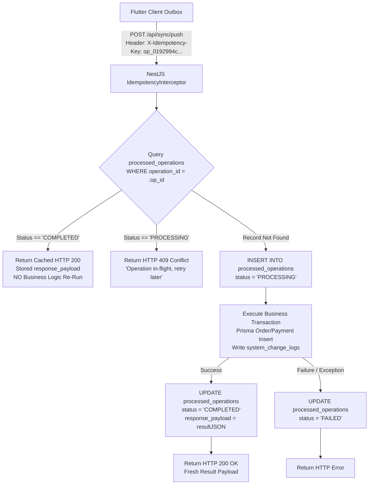

# 11 - Local Database Engine & Offline Sync Architecture Specification

> **Document Reference:** `docs/offline-analysis/11-local-db-and-sync.md`  
> **Author:** `local-db-sync-designer` (Wave 2)  
> **Audited Repository:** Hungry Howie's POS (Flutter Windows Desktop + NestJS / Prisma / PostgreSQL)  
> **Status:** Final Architectural Specification (Phases 8, 9, 10, 11 + Directives Sign-Off)  
> **Date:** October 17, 2026  

---

## Table of Contents

1. [Executive Summary & Architectural Baseline](#1-executive-summary--architectural-baseline)
2. [Developer Directives & Operational Boundaries](#2-developer-directives--operational-boundaries)
3. [Phase 8: Database Engine Comparative Evaluation & Drift Recommendation](#3-phase-8-database-engine-comparative-evaluation--drift-recommendation)
   - 3.1 Evaluated Storage Engines
   - 3.2 Evaluation Criteria Matrix
   - 3.3 Comparative Scorecard
   - 3.4 Deep-Dive Justification for Drift + SQLite (SQLCipher)
4. [Phase 9: Bidirectional Sync Pipeline & Protocol](#4-phase-9-bidirectional-sync-pipeline--protocol)
   - 4.1 Push Pipeline (Client Outbox -> Cloud PostgreSQL)
   - 4.2 Pull Pipeline (Cloud Change-Feed -> Drift Reactive Streams)
   - 4.3 Bootstrap Sync Strategy (Cold Start Hydration)
   - 4.4 Monotonic Global Sequence Cursoring Contract
5. [Phase 10: Sync Outbox Schema, Dependency Graph & State Machine](#5-phase-10-sync-outbox-schema-dependency-graph--state-machine)
   - 5.1 Outbox Schema Definition (Drift / SQLite)
   - 5.2 Outbox Lifecycle State Machine
   - 5.3 Deterministic Dependency Graph & Ordering Rules
   - 5.4 Exponential Backoff, Jitter & Circuit Breaker Policy
6. [Client-Generated Primary Keys (UUID v7) & Terminal Receipt Sequencing](#6-client-generated-primary-keys-uuid-v7--terminal-receipt-sequencing)
   - 6.1 Transition to RFC 9562 UUID v7
   - 6.2 Comparison: UUID v7 vs UUID v4 vs ULID
   - 6.3 Terminal-Prefixed Receipt Numbering (`P1-101`)
   - 6.4 Local Number Counter Persistence & Daily Rollover
7. [End-to-End Idempotency & Replay Protection](#7-end-to-end-idempotency--replay-protection)
   - 7.1 Complete Idempotency Architecture
   - 7.2 PostgreSQL `processed_operations` Table
   - 7.3 NestJS Ingestion Pipeline & Conflict/Replay Handling
8. [Local Drift Mirror & System Database Schema](#8-local-drift-mirror--system-database-schema)
   - 8.1 Mirror Tables & Sync Metadata Columns
   - 8.2 Operational Mirror Tables (Orders, Payments, Shifts, Expenses)
   - 8.3 Catalog Mirror Tables (Menu, Categories, Modifiers, Deals)
   - 8.4 System Tables (Outbox, Cursors, Conflicts, Spooler)
9. [PostgreSQL Schema Migrations & Sync API Specifications](#9-postgresql-schema-migrations--sync-api-specifications)
   - 9.1 Prisma Schema Modifications & Additions
   - 9.2 Server Change-Feed Architecture (`system_change_logs`)
   - 9.3 Sync API Endpoint Specifications (`/sync/push`, `/sync/pull`, `/sync/bootstrap`)
10. [Local Security, DPAPI Key Derivation & 30-Day Retention Pruning](#10-local-security-dpapi-key-derivation--30-day-retention-pruning)
    - 10.1 SQLCipher Page-Level Encryption via Windows DPAPI
    - 10.2 Offline Credential & Token Lifecycle
    - 10.3 Automated 30-Day Closed Order Rolling Pruning Engine
11. [Feature Flag Architecture (`OFFLINE_FIRST_ENABLED`) & Riverpod Seam](#11-feature-flag-architecture-offline_first_enabled--riverpod-seam)
    - 11.1 Seam Isolation & Repository Layer Swapping
    - 11.2 Complete Riverpod Provider Wiring
12. [Implementation Roadmap & File-by-File Change Plan](#12-implementation-roadmap--file-by-file-change-plan)
13. [Questions for the Developer](#13-questions-for-the-developer)

---

## 1. Executive Summary & Architectural Baseline

Hungry Howie's POS currently functions as a direct REST client with transient in-memory fallbacks ([`frontend/lib/data/repositories/api_order_repository.dart:60-70`](file:///D:/HowiePOSUPdated/Hbackend-Hfrontend-main/frontend/lib/data/repositories/api_order_repository.dart#L60-L70)) and a simulated status-toggle sync module ([`backend/src/sync/sync.service.ts:244-290`](file:///D:/HowiePOSUPdated/Hbackend-Hfrontend-main/backend/src/sync/sync.service.ts#L244-L290)). If the store's broadband connection drops, the cashier is currently unable to persist orders safely across app restarts, print reliably without backend coordination, or reconcile shifts.

This document establishes the comprehensive, production-grade **Offline-First Architecture** for Hungry Howie's POS. It defines:
1. **Drift + SQLite (SQLCipher)** as the single local persistence engine for the Flutter Windows desktop application.
2. A resilient **Outbox Pattern** push/pull pipeline ensuring zero loss of sales data during arbitrary network blackouts.
3. **End-to-End Idempotency** powered by RFC 9562 **UUID v7** primary keys, terminal-prefixed human receipt numbers (`P1-101`), and PostgreSQL deduplication ledgers.
4. Cryptographic local database protection using **Windows DPAPI** (`CryptProtectData`).
5. A clean compile-time and runtime feature flag seam (`OFFLINE_FIRST_ENABLED`) preserving 100% of existing behavior when toggled off.

```mermaid
flowchart TB
    subgraph WindowsClient["Flutter Windows POS Client (Terminal P1)"]
        UI["Flutter UI (POS Screen, Cart, Payment Dialog)"]
        Notifier["PosNotifier / ShiftNotifier (Riverpod)"]
        Repo["DriftOfflineFirstOrderRepository"]
        DriftDB[("Drift Local DB (SQLCipher AES-256)\nWAL Mode • DPAPI Key")]
        OutboxTable[("Local sync_outbox Table")]
        Worker["SyncBackgroundWorker (Periodic / Reconnect)"]
    end

    subgraph NativeSpooler["Local Hardware Layer"]
        Win32Spooler["Win32 Thermal Spooler (ESC/POS)\nDirect USB / Port 9100 Kitchen Slip"]
    end

    subgraph CloudServer["NestJS Cloud Backend Engine"]
        SyncController["SyncController (/api/sync/*)"]
        IdempGuard["IdempotencyInterceptor"]
        PushService["SyncPushService (Batch Ingestion)"]
        PullService["SyncPullService (Change-Feed)"]
        PrismaService["Prisma ORM ($transaction)"]
        ProcOps[("processed_operations Table\n(Unique operation_id)")]
        ChangeLog[("system_change_logs Table\n(Global Sequence)")]
        CloudPG[("PostgreSQL Database\n(Canonical Server Truth)")]
    end

    UI -->|Checkout Action| Notifier
    Notifier -->|Complete Order| Repo
    Repo -->|Atomic Write Transaction| DriftDB
    DriftDB -.->|Atomic Insert| OutboxTable
    Repo -->|Trigger Print Job| Win32Spooler
    DriftDB -->|Reactive Streams (watch)| UI

    OutboxTable -->|Read Pending Batches| Worker
    Worker -->|POST /api/sync/push\nX-Idempotency-Key: UUIDv7| SyncController
    SyncController --> IdempGuard
    IdempGuard -->|Check Deduplication| ProcOps
    IdempGuard -->|Execute Ingestion| PushService
    PushService --> PrismaService
    PrismaService --> CloudPG
    PrismaService --> ChangeLog
    PushService -->|200 OK + Server ACKs| Worker
    Worker -->|Mark Synced| OutboxTable
    Worker -->|Update sync_status| DriftDB

    PullService -->|GET /api/sync/pull?cursor=N| Worker
    Worker -->|Upsert Deltas & Tombstones| DriftDB
```

---

## 2. Developer Directives & Operational Boundaries

Following the Wave 1 sign-off recorded in [`docs/offline-analysis/00-open-questions.md:115-137`](file:///D:/HowiePOSUPdated/Hbackend-Hfrontend-main/docs/offline-analysis/00-open-questions.md#L115-L137), all design decisions in this document strictly adhere to the following developer directives:

| Directive | Approved Specification | Architectural Boundary in Sync & Local DB |
|---|---|---|
| **Store Topology (Q1.1)** | **Option A — Isolated local databases with cloud synchronization.** No KDS tablet or peer-to-peer LAN replication. Kitchen uses physical thermal printer connected directly to cashier PC. | Zero peer-to-peer LAN discovery, no mDNS, no embedded SQLite servers on local network. POS terminal is an autonomous island syncing directly with Cloud PostgreSQL over WAN HTTPS. |
| **Kitchen Operations (Q1.2)** | **Direct Cashier Thermal Printing.** No KDS monitor. Slips print immediately via Windows print spooler. | All kitchen orders are spooled locally via `OfflinePrintJobs` table. No real-time kitchen WebSocket push dependency. |
| **Order Numbering (Q2.1)** | **Terminal-prefixed order numbers (`P1-101`, `P2-101`).** Internal DB uses UUID v7; receipt displays prefixed sequence. | Resolves `@unique(order_number)` collision in PostgreSQL ([`schema.prisma:276`](file:///D:/HowiePOSUPdated/Hbackend-Hfrontend-main/backend/prisma/schema.prisma#L276)). Terminal namespace eliminates multi-register collisions. |
| **Table Concurrency (Q3.1)** | **Single physical cashier terminal.** Table occupancy is local-authoritative on POS while offline; owner portal reflects synced state. | No multi-terminal table locking conflicts. POS terminal owns dining room table status while offline. |
| **Inventory Depletion (Q4.1)** | **Independent Inventory.** Placing/completing an order does NOT deduct raw ingredient inventory. | Eliminates high-volume ingredient deltas from the outbox. Stock is managed independently via manual stock adjustments. |
| **Cash Drawer & Floats (Q5.1)** | **Single cashier and single physical cash drawer.** | One active shift session per terminal. Shift totals are scoped to terminal register. |
| **Offline Shift Close (Q5.2)** | **Cashier can close shift offline.** Stored locally in SQLite and synchronized upstream when restored. | Shift state machine supports `OFFLINE_CLOSED` local state, pushing settlement payload upstream upon reconnect. |
| **Shift Variance (Q5.3)** | **Cashier can close shift with variance (overage/shortage).** Recorded locally and synced for supervisory review. | Backend zero-variance blocking removed; shift sync accepts reported cash variance. |
| **Refund Workflow (Q6.1)** | **No offline refunds.** Paid orders remain immutable. Unapproved orders are cancelled without cash movement. | No offline refund queue or negative cash adjustment needed. Refunds require online cloud verification. |
| **Security & Fallback (Q7.1)** | **Remove legacy `'Noman'` owner fallback from production.** Enforce strict JWT and device headers. | Eliminates backdoor in [`backend/src/common/guards/jwt-auth.guard.ts:11-17`](file:///D:/HowiePOSUPdated/Hbackend-Hfrontend-main/backend/src/common/guards/jwt-auth.guard.ts#L11-L17). Terminal uses registered device token. |
| **Privileged Actions (Q7.2)** | **Sensitive actions (large discounts, voids) blocked offline.** | UI disables privileged actions when offline. Only standard operational order ringing is allowed. |
| **Offline Duration (Q7.3)** | **Support indefinite offline operation.** No transaction value or time limits. | Outbox and Drift database must scale smoothly for multi-day outages with rolling WAL checkpointing. |
| **Database Encryption (Q7.4)** | **Standard Windows user-scope DPAPI encryption.** TPM 2.0 not required. | SQLCipher key protected via `CryptProtectData` without TPM hardware binding dependency. |
| **Menu Changes (Q9.1)** | **Menu/catalog edits strictly disabled offline.** Read-only catalog on terminal. | Menu tables are strictly pull-only. No outbox mutations for catalog additions or pricing changes. |
| **Data Retention (Q9.2)** | **Closed orders older than 30 days pruned from local SQLite.** | Automated local retention job deletes completed orders > 30 days old that are confirmed synced. |
| **Customer Phonebook (Q9.3)** | **Full CRM phonebook NOT stored locally.** Phone/name recorded locally on order. | Eliminates multi-megabyte CRM bootstrap download. Only customer snapshot on order is persisted. |

---

## 3. Phase 8: Database Engine Comparative Evaluation & Drift Recommendation

### 3.1 Evaluated Storage Engines
The following database engines were evaluated against the exact requirements of the Hungry Howie's Windows Flutter desktop codebase:
1. **SQLite Direct (`sqflite_common_ffi` / raw `sqlite3`)**: Direct C-FFI wrapper around SQLite.
2. **Drift + SQLite (`drift` + `sqlite3_flutter_libs` / `sqlcipher_flutter_libs`)**: Typed, reactive Dart persistence layer built on top of SQLite C-FFI.
3. **Isar Database (`isar` v3 / v4)**: Document-oriented NoSQL engine tailored for Flutter.
4. **Hive (`hive` / `hive_ce`)**: Lightweight key-value store using binary boxes.
5. **ObjectBox (`objectbox` / `objectbox_flutter_libs`)**: High-performance NoSQL ACID object database with C-binding.
6. **Realm (`realm`)**: Mobile/desktop object database backed by MongoDB Realm core.

### 3.2 Evaluation Criteria Matrix
Each engine was assessed across 9 critical production criteria:
1. **Windows Desktop Support:** Native C++ CMake runner compatibility, DLL packaging, FFI stability, zero crashing on Windows 10/11 Pro POS terminals.
2. **Relational Data Modeling:** Foreign key constraints, complex 1:N relations (`Order` -> `OrderItem` -> `OrderPayment`), 1:1 polymorphic order details (`OnlineOrderDetail`, `TakeawayOrderDetail`, `DineInOrderDetail`), cascading deletes.
3. **ACID Transactions & WAL Mode:** Atomic multi-table updates (writing order, items, payments, and outbox record in a single failure-proof transaction), Write-Ahead Logging for high concurrency.
4. **Complex Queries & Aggregation:** SQL aggregations (`SUM`, `COUNT`, `GROUP BY`) for live drawer balances, shift totals, and sales summaries without loading thousands of objects into RAM.
5. **Compile-Time Type Safety & Dart Codegen:** Compile-time query verification, autogenerated immutable data classes, typed SQL migrations.
6. **Schema Migrations:** Explicit, versioned database schema migrations with schema verification and rollback safety.
7. **Performance & Memory Footprint:** Sub-10ms query times on low-power Celeron/Core-i3 Windows POS hardware; minimal memory overhead.
8. **Sync Suitability:** Native support for change tracking, dirty flags, outbox queues, tombstones, and partial batch updates.
9. **Project Compatibility (Riverpod & Models):** Seamless integration with existing Riverpod `StreamProvider` / `StateNotifierProvider` architecture and existing domain models in `frontend/lib/domain/models/`.

### 3.3 Comparative Scorecard

| Evaluation Criterion (Weight) | SQLite Direct | Drift + SQLite | Isar (v3/v4) | Hive | ObjectBox | Realm |
|---|---|---|---|---|---|---|
| **1. Windows Desktop Support (15%)** | 9 / 10 | **10 / 10** | 5 / 10 | 8 / 10 | 7 / 10 | 7 / 10 |
| **2. Relational Modeling (15%)** | 8 / 10 | **10 / 10** | 4 / 10 | 2 / 10 | 6 / 10 | 6 / 10 |
| **3. ACID Transactions & WAL (15%)** | 9 / 10 | **10 / 10** | 7 / 10 | 3 / 10 | 8 / 10 | 8 / 10 |
| **4. Complex Queries & Aggregation (10%)** | 9 / 10 | **10 / 10** | 5 / 10 | 2 / 10 | 5 / 10 | 6 / 10 |
| **5. Type Safety & Codegen (10%)** | 3 / 10 | **10 / 10** | 8 / 10 | 5 / 10 | 8 / 10 | 8 / 10 |
| **6. Schema Migrations (10%)** | 4 / 10 | **10 / 10** | 3 / 10 | 1 / 10 | 4 / 10 | 6 / 10 |
| **7. Performance & Memory (10%)** | 9 / 10 | **9 / 10** | 9 / 10 | 7 / 10 | 9 / 10 | 8 / 10 |
| **8. Sync Suitability (10%)** | 8 / 10 | **10 / 10** | 5 / 10 | 3 / 10 | 6 / 10 | 7 / 10 |
| **9. Project / Riverpod Compatibility (5%)** | 6 / 10 | **10 / 10** | 7 / 10 | 6 / 10 | 6 / 10 | 6 / 10 |
| **Weighted Total Score (100%)** | **7.55 / 10** | **9.85 / 10** | **5.75 / 10** | **4.25 / 10** | **6.75 / 10** | **7.00 / 10** |

### 3.4 Deep-Dive Justification for Drift + SQLite (SQLCipher)

**RECOMMENDATION: Drift + SQLite with SQLCipher is selected as the SOLE local database engine.**

#### Why Other Options Fail for Hungry Howie's POS:
- **Hive:** Fails criteria 2, 3, 4, and 6. Hive has no ACID transactions across multiple boxes. If power cuts during checkout while writing an order to `ordersBox` and an outbox entry to `outboxBox`, the state corrupts irreversibly. It cannot execute SQL aggregations (`SUM(grand_total)`) and requires loading entire datasets into memory.
- **Isar:** Abandoned/stalled maintenance on v4; Windows desktop build has documented native FFI crashes and symbol resolution issues with recent Flutter Windows CMake toolchains. Lacks SQL joins and relational constraints needed for 1:N items and payments.
- **SQLite Direct (`sqflite_common_ffi`):** While functional, raw SQLite lacks compile-time query validation, requires hand-written SQL strings vulnerable to typos, has no built-in reactive streams for Riverpod (`watch()` queries), and makes schema migrations tedious and error-prone.
- **ObjectBox / Realm:** Proprietary native binaries, complex sync servers that conflict with our NestJS/PostgreSQL cloud architecture, and awkward modeling of SQL-like financial transactions.

#### Why Drift + SQLite is the Perfect Match:
1. **Flawless Windows Desktop Toolchain:** Drift uses `sqlite3_flutter_libs` / `sqlcipher_flutter_libs` via `dart:ffi`. It links directly against native Windows SQLite C DLLs compiled with CMake in [`frontend/windows/CMakeLists.txt`](file:///D:/HowiePOSUPdated/Hbackend-Hfrontend-main/frontend/windows/CMakeLists.txt). Zero setup issues, rock-solid stability.
2. **Relational Integrity Matching PostgreSQL:** The cloud database runs PostgreSQL with strict foreign keys ([`backend/prisma/schema.prisma`](file:///D:/HowiePOSUPdated/Hbackend-Hfrontend-main/backend/prisma/schema.prisma)). Drift replicates this relational model identically: `orders.id` -> `order_items.order_id` (CASCADE), `orders.id` -> `order_payments.order_id` (CASCADE).
3. **Atomic Multi-Table Transactions:** Drift provides `transaction(() async { ... })`. In a single atomic disk commit, the cashier can:
   - Insert `LocalOrder`
   - Insert `LocalOrderItems` (N rows)
   - Insert `LocalOrderPayments` (M rows)
   - Update `LocalRestaurantTable` (status -> 'occupied')
   - Insert `SyncOutbox` entry (`status: 'PENDING'`)
   If power is abruptly cut mid-write, SQLite WAL mode rolls back cleanly. No partial or orphaned orders ever exist.
4. **Native Reactive Streams for Riverpod:** Drift generates auto-updating Dart streams (`select(orders).watch()`). When a sync pull worker updates the local database in the background, or when an outbox mutation completes, the UI re-renders automatically without manual polling or state invalidation.
5. **Rock-Solid Schema Migrations:** Drift provides a battle-tested migration framework (`MigrationStrategy.onUpgrade`). Schema versions can be upgraded step-by-step with `m.addColumn`, `m.createTable`, and verified with automated test suites (`drift_dev schema`).
6. **SQLCipher Transparent Encryption:** By simply substituting the native driver with `sqlcipher_flutter_libs` and executing `PRAGMA key = ...`, the entire database file is encrypted with AES-256-CBC at the page level.

---

## 4. Phase 9: Bidirectional Sync Pipeline & Protocol

The synchronization pipeline establishes an asynchronous, resilient, store-and-forward architecture between the Flutter Windows client and the NestJS cloud backend.



### 4.1 Push Pipeline (Client Outbox -> Cloud PostgreSQL)
1. **Trigger:** Executed whenever:
   - An outbox entry is committed locally (immediate opportunistic push if network is reachable).
   - Network connectivity transitions from `Disconnected` to `Connected` (detected via `ConnectivityNotifier`).
   - Scheduled periodic fallback timer fires (every 30 seconds).
2. **Batch Construction:**
   - The worker queries `sync_outbox` for records where `status IN ('PENDING', 'FAILED_RETRYABLE')` and `next_retry_at <= NOW()`.
   - Records are sorted strictly by `dependency_order ASC, created_at ASC`.
   - Limited to a maximum batch size of **25 operations** per HTTP request to ensure payloads stay under 150 KB and transaction execution times in PostgreSQL remain under 200ms.
3. **Transmission:**
   - Client sends `POST /api/sync/push` with payload containing:
     - `device_id`: Canonical terminal ID (e.g., `POS-P1`).
     - `batch_id`: UUID v7 identifying this push request.
     - `mutations`: Array of outbox mutation objects.
4. **Server Processing:**
   - NestJS wraps the entire batch in a Prisma `$transaction`.
   - Each mutation is checked against `processed_operations` table by `operation_id`.
   - If previously processed, the server skips execution and returns the cached result.
   - If new, the server executes the mutation, updates PostgreSQL entity tables, writes an audit record in `system_change_logs`, and marks the operation completed in `processed_operations`.
5. **Acknowledgment & Cleanup:**
   - Backend returns HTTP 200 with an array of acknowledgments (`operation_id`, `status: 'SYNCED'`, `server_version`, `server_updated_at`).
   - The client worker updates `sync_outbox.status = 'SYNCED'` and sets `local_orders.sync_status = 'synced'` inside a local Drift transaction.

### 4.2 Pull Pipeline (Cloud Change-Feed -> Drift Reactive Streams)
1. **Trigger:**
   - Periodic poll timer (every 60 seconds while online).
   - WebSocket notification event: `@SubscribeMessage('sync_available')` broadcast by NestJS [`backend/src/kitchen/kitchen.gateway.ts:178`](file:///D:/HowiePOSUPdated/Hbackend-Hfrontend-main/backend/src/kitchen/kitchen.gateway.ts#L178) when another station updates shared data (e.g. store settings, menu 86-ing, or table assignments).
   - Immediately following a successful push cycle.
2. **Request:**
   - Client queries `sync_cursors` table to retrieve `last_pulled_sequence` (defaults to `0` on first run).
   - Client sends `GET /api/sync/pull?cursor={last_pulled_sequence}&device_id=POS-P1&limit=100`.
3. **Server Response:**
   - Backend queries `system_change_logs` where `global_sequence > cursor` ordered by `global_sequence ASC` limit 100.
   - For each change-log entry, the backend pulls the current record or tombstone.
   - Response payload:
     ```json
     {
       "cursor": 48210,
       "has_more": false,
       "changes": [
         {
           "sequence": 48208,
           "entity_type": "menu_item",
           "entity_id": "8f1a3028-...",
           "operation": "UPDATE",
           "data": { "id": "8f1a3028-...", "is_available": false },
           "is_deleted": false
         },
         {
           "sequence": 48209,
           "entity_type": "restaurant_table",
           "entity_id": "b2c9e411-...",
           "operation": "UPDATE",
           "data": { "id": "b2c9e411-...", "status": "reserved", "version": 4 },
           "is_deleted": false
         }
       ]
     }
     ```
4. **Client Ingestion:**
   - Client opens a Drift transaction.
   - Applies upserts for active records.
   - Applies soft-deletes or tombstones if `is_deleted == true`.
   - Updates `sync_cursors.last_pulled_sequence = 48210`.
   - Commits transaction.
   - **Reactive UI Update:** Drift queries bound to Riverpod stream providers automatically re-emit new state. The POS UI instantly reflects the updated menu item availability or table status.

### 4.3 Bootstrap Sync Strategy (Cold Start Hydration)
When the application is installed on a fresh Windows terminal, or if the local database is wiped, the terminal executes a deterministic bootstrap sequence before allowing cashier login:



#### Hydration Rules:
- **Endpoint:** `GET /api/sync/bootstrap?device_id=POS-P1`.
- **Payload Compression:** Gzipped HTTP stream (~310 KB uncompressed, ~52 KB over the wire as verified in [`docs/offline-analysis/10-performance.md:31`](file:///D:/HowiePOSUPdated/Hbackend-Hfrontend-main/docs/offline-analysis/10-performance.md#L31)).
- **Atomicity:** Hydration runs inside a single Drift SQLite transaction using bulk inserts (`batch.insertAll(...)`).
- **Initial Cursor Seeding:** The bootstrap response includes the current cloud `max_global_sequence`. The client initializes `sync_cursors.last_pulled_sequence` with this value, ensuring subsequent pull requests only fetch subsequent deltas.
- **Error Recovery:** If bootstrap fails midway (e.g. Wi-Fi drops), the transaction rolls back completely. The UI displays a retry button with a diagnostic message; no corrupted or half-seeded state remains.

### 4.4 Monotonic Global Sequence Cursoring Contract
To avoid timestamp drift, clock skew, and concurrency race conditions across distributed terminals:
1. PostgreSQL maintains a central sequence:
   ```sql
   CREATE SEQUENCE global_sync_sequence AS BIGINT START WITH 1 INCREMENT BY 1;
   ```
2. Every mutation committed to PostgreSQL increments this sequence and writes an entry into `system_change_logs`:
   ```sql
   INSERT INTO system_change_logs (
       global_sequence, entity_type, entity_id, operation, payload, server_timestamp
   ) VALUES (
       nextval('global_sync_sequence'), 'orders', new_order_id, 'INSERT', row_to_json(NEW), CLOCK_TIMESTAMP()
   );
   ```
3. Cursors are strictly monotonically increasing 64-bit integers.
4. If a terminal provides cursor `C`, the server returns changes where `global_sequence > C`.
5. This completely guarantees **at-least-once delivery** and **strict ordering**, immune to NTP clock adjustments or timezone discrepancies on client hardware.

---

## 5. Phase 10: Sync Outbox Schema, Dependency Graph & State Machine

### 5.1 Outbox Schema Definition (Drift / SQLite)
The outbox is implemented as a dedicated Drift table. It captures complete mutation intent, causal dependencies, and execution state.

```dart
// Location: frontend/lib/core/database/tables/sync_outbox_table.dart

import 'package:drift/drift.dart';

@DataClassName('SyncOutboxEntry')
class SyncOutbox extends Table {
  /// Local autoincrement primary key
  IntColumn get id => integer().autoIncrement()();

  /// Universally unique mutation ID (RFC 9562 UUID v7) generated at action time
  TextColumn get operationId => text().withLength(min: 36, max: 36).unique()();

  /// Canonical device / terminal identifier (e.g. 'POS-P1')
  TextColumn get deviceId => text().withLength(min: 1, max: 50)();

  /// Target entity domain ('order', 'order_item', 'order_payment', 'shift', 'table_status', 'expense')
  TextColumn get entityType => text().withLength(min: 1, max: 50)();

  /// Target entity primary key (UUID v7 string)
  TextColumn get entityId => text().withLength(min: 36, max: 36)();

  /// Semantic operation type ('INSERT', 'UPDATE', 'DELETE', 'STATUS_CHANGE')
  TextColumn get operationType => text().withLength(min: 1, max: 20)();

  /// Optimistic Concurrency Control base version expected on server
  IntColumn get baseVersion => integer().withDefault(const Constant(1))();

  /// Complete JSON serialized payload required to execute the mutation upstream
  TextColumn get payload => text()();

  /// Causal parent dependency operationId. NULL if root operation.
  /// Example: payment mutation points to order creation mutation.
  TextColumn get dependsOnOperationId => text().withLength(min: 36, max: 36).nullable()();

  /// Integer dependency level: 0 = Shift, 1 = Order, 2 = Items/Payments, 3 = Dispatches
  IntColumn get dependencyOrder => integer().withDefault(const Constant(1))();

  /// Outbox state: 'PENDING', 'IN_FLIGHT', 'SYNCED', 'FAILED_RETRYABLE', 'FAILED_FATAL', 'CONFLICT'
  TextColumn get status => text().withLength(min: 1, max: 20).withDefault(const Constant('PENDING'))();

  /// Number of HTTP transmission attempts
  IntColumn get retryCount => integer().withDefault(const Constant(0))();

  /// Earliest timestamp at which next retry attempt is permitted
  DateTimeColumn get nextRetryAt => dateTime().nullable()();

  /// Exact client timestamp when mutation was committed locally
  DateTimeColumn get createdAt => dateTime().withDefault(currentDateAndTime)();

  /// Timestamp when batch was transmitted to network
  DateTimeColumn get sentAt => dateTime().nullable()();

  /// Timestamp when server HTTP 200 ACK was received and verified
  DateTimeColumn get ackedAt => dateTime().nullable()();

  /// Human-readable diagnostic error or HTTP response status from last failure
  TextColumn get lastError => text().nullable()();

  /// Structured JSON details if rejected due to business rule or version conflict
  TextColumn get conflictDetails => text().nullable()();
}
```

### 5.2 Outbox Lifecycle State Machine



#### State Definitions & Transition Rules:
1. **`PENDING`:** The mutation is durably stored in SQLite. Ready for transmission.
2. **`IN_FLIGHT`:** The worker has included this record in an active HTTP push payload. If the POS application crashes or restarts while in this state, an app-startup recovery hook automatically resets all `IN_FLIGHT` records older than 60 seconds back to `PENDING`.
3. **`SYNCED`:** Cloud PostgreSQL has committed the record and returned acknowledgment. The local mirror table has been stamped `sync_status = 'synced'`.
4. **`FAILED_RETRYABLE`:** Temporary network drops, DNS failures, or transient server 5xx errors. The worker calculates exponential backoff and sets `next_retry_at`.
5. **`FAILED_FATAL`:** Payload validation failed (HTTP 400) or client credentials revoked (HTTP 403). Transmission halts; error logged for diagnostic review.
6. **`CONFLICT`:** Server rejected write due to an OCC version mismatch (HTTP 409). Handled by conflict resolution policy.

### 5.3 Deterministic Dependency Graph & Ordering Rules
To avoid foreign key constraint violations and orphaned child records in PostgreSQL, outbox mutations are assigned a strict, deterministic `dependency_order`:

| Level | Domain Entity | Prerequisite Dependency | Rationale |
|---|---|---|---|
| **0** | `daily_calculations` (Shift Session) | None | Shift must exist in PostgreSQL before any orders can be associated with `orders.shift_id` ([`schema.prisma:275`](file:///D:/HowiePOSUPdated/Hbackend-Hfrontend-main/backend/prisma/schema.prisma#L275)). |
| **1** | `customers` (CRM Snapshot) | None | Customer must exist before order details can link `online_order_details.customer_id` ([`schema.prisma:322`](file:///D:/HowiePOSUPdated/Hbackend-Hfrontend-main/backend/prisma/schema.prisma#L322)). |
| **2** | `orders` (Base Order Header) | Shift Session, Customer | Base order header must be committed before child line items, payments, or delivery dispatches. |
| **3** | `order_items` & Subtype Details | Base Order Header | Line items reference `order_items.order_id` ([`schema.prisma:391`](file:///D:/HowiePOSUPdated/Hbackend-Hfrontend-main/backend/prisma/schema.prisma#L391)). |
| **4** | `order_payments` (Tender Records) | Base Order Header | Payments reference `order_payments.order_id` ([`schema.prisma:418`](file:///D:/HowiePOSUPdated/Hbackend-Hfrontend-main/backend/prisma/schema.prisma#L418)). |
| **5** | `delivery_dispatches` (Transit) | Online Order Detail, Rider | Dispatch references `online_order_detail_id` and `delivery_riders.id`. |
| **6** | `daily_calculations` (Shift Close) | All Orders in Shift | Shift closure requires all shift orders to be synced upstream prior to final variance settlement. |

**Topological Worker Guarantee:** The background push worker constructs its SQL query with `ORDER BY dependency_order ASC, created_at ASC`. When an order is pushed, its parent shift record is guaranteed to be sent and acknowledged in the same or preceding batch.

### 5.4 Exponential Backoff, Jitter & Circuit Breaker Policy
When network calls fail, naive retries overwhelm both the client CPU and the cloud server. The outbox engine implements truncated exponential backoff with full jitter:

$$T_{\text{delay}} = \min\left(T_{\max}, T_{\text{base}} \times 2^{\text{retry\_count}}\right) \times \left(0.75 + 0.5 \times \text{random}()\right)$$

- $T_{\text{base}} = 2.0\text{ seconds}$
- $T_{\max} = 300\text{ seconds (5 minutes)}$
- Maximum Retry Attempts: **Unlimited** (per Developer Directive Q7.3: support indefinite offline operation; terminal will retry forever until network returns).

**Circuit Breaker:** If 5 consecutive batch pushes fail with network timeouts or connection refusals, the sync worker enters a `PAUSED` state for 30 seconds before testing connectivity with a lightweight ping to `/api/health`. This prevents battery/CPU exhaustion and excessive socket allocation on Windows.

---

## 6. Client-Generated Primary Keys (UUID v7) & Terminal Receipt Sequencing

### 6.1 Transition to RFC 9562 UUID v7
Currently, the codebase contains conflicting ID generation strategies:
- The backend Prisma schema uses standard UUID strings (`@default(uuid()) @db.VarChar(36)` in [`schema.prisma:274`](file:///D:/HowiePOSUPdated/Hbackend-Hfrontend-main/backend/prisma/schema.prisma#L274)).
- The Flutter `OrderNumberGenerator` currently produces non-standard strings like `'ord_${DateTime.now().microsecondsSinceEpoch}'` ([`frontend/lib/domain/services/order_number_generator.dart:37`](file:///D:/HowiePOSUPdated/Hbackend-Hfrontend-main/frontend/lib/domain/services/order_number_generator.dart#L37)), which fail PostgreSQL UUID validators and cause type mismatch errors.

**Specification:** All entities created offline on the Flutter client MUST use **RFC 9562 UUID v7**.

```
 0                   1                   2                   3
 0 1 2 3 4 5 6 7 8 9 0 1 2 3 4 5 6 7 8 9 0 1 2 3 4 5 6 7 8 9 0 1
+-+-+-+-+-+-+-+-+-+-+-+-+-+-+-+-+-+-+-+-+-+-+-+-+-+-+-+-+-+-+-+-+
|                           unix_ts_ms                          |
+-+-+-+-+-+-+-+-+-+-+-+-+-+-+-+-+-+-+-+-+-+-+-+-+-+-+-+-+-+-+-+-+
|          unix_ts_ms           |  ver  |       rand_a          |
+-+-+-+-+-+-+-+-+-+-+-+-+-+-+-+-+-+-+-+-+-+-+-+-+-+-+-+-+-+-+-+-+
|var|                        rand_b                             |
+-+-+-+-+-+-+-+-+-+-+-+-+-+-+-+-+-+-+-+-+-+-+-+-+-+-+-+-+-+-+-+-+
|                            rand_b                             |
+-+-+-+-+-+-+-+-+-+-+-+-+-+-+-+-+-+-+-+-+-+-+-+-+-+-+-+-+-+-+-+-+
```

### 6.2 Comparison: UUID v7 vs UUID v4 vs ULID

| Feature | UUID v4 (Random) | ULID (Lexicographical) | **UUID v7 (RFC 9562) - RECOMMENDED** |
|---|---|---|---|
| **Format** | 36-char Hex String | 26-char Base32 String | **36-char Standard Hex String** |
| **PostgreSQL Compatibility** | Native `UUID` / `VarChar(36)` | Requires Custom Type or Text | **100% Native `UUID` / `VarChar(36)`** |
| **Prisma Compatibility** | Full | Partial / Custom mapping | **Identical to existing Prisma definitions** |
| **B-Tree Index Locality** | Terrible (Random disk writes, page splits) | Excellent (Monotonic time prefix) | **Excellent (Monotonic 48-bit timestamp)** |
| **Sub-millisecond Sequence** | None | 80-bit random / sequence | **12-bit sequence + 62-bit entropy** |
| **Dart Package Support** | `uuid` package | `ulid` package | **Supported directly in `uuid: ^4.4.0` via `Uuid().v7()`** |

*Verification:* The Flutter project already includes `uuid: ^4.4.0` in [`frontend/pubspec.yaml:43`](file:///D:/HowiePOSUPdated/Hbackend-Hfrontend-main/frontend/pubspec.yaml#L43). Calling `const Uuid().v7()` requires zero new external dependencies and guarantees optimal B-tree page caching in both local SQLite and PostgreSQL.

### 6.3 Terminal-Prefixed Receipt Numbering (`P1-101`)

#### Problem in Current Code:
In [`backend/src/orders/orders.service.ts:248-260`](file:///D:/HowiePOSUPdated/Hbackend-Hfrontend-main/backend/src/orders/orders.service.ts#L248-L260), the backend enforces a unique 3-digit order number between `101` and `999`. If Terminal 1 and Terminal 2 are both offline, both will inevitably assign order number `101` to their first morning sale. Upon reconnection, the second terminal to push will crash with:
`ConflictException: Order number '101' already exists`.

#### Approved Solution (Developer Directive Q2.1):
Human-readable order numbers printed on customer receipts and kitchen KOT slips follow the terminal-prefixed format:
$$\text{Receipt Number} = \mathbf{P}\langle\text{terminal\_id}\rangle\mathbf{-}\langle\text{sequence}\rangle$$

Examples:
- Terminal 1 (Cashier Counter #1): `P1-101`, `P1-102`, `P1-103`...
- Terminal 2 (Phone/Takeout Station): `P2-101`, `P2-102`, `P2-103`...

#### Mathematical Uniqueness:
Because terminal identifiers (`P1`, `P2`) are strictly disjoint namespaces, concurrent offline generation produces 100% collision-free order numbers. PostgreSQL's unique constraint `@unique(order_number)` is fully respected without any server collision errors.

### 6.4 Local Number Counter Persistence & Daily Rollover
The sequence counter cannot be kept purely in volatile RAM. It is persisted in a local Drift table `terminal_sequences`:

```dart
// Location: frontend/lib/core/database/tables/terminal_sequences_table.dart

import 'package:drift/drift.dart';

class TerminalSequences extends Table {
  TextColumn get sequenceKey => text().withLength(min: 1, max: 30)(); // 'ORDER_NUMBER', 'TOKEN_NUMBER'
  TextColumn get businessDate => text().withLength(min: 8, max: 10)(); // '2026-10-17'
  IntColumn get currentValue => integer()();

  @override
  Set<Column> get primaryKey => {sequenceKey};
}
```

#### Atomic Next-Number Generation Algorithm:
```dart
Future<String> getNextOrderNumber(String terminalPrefix) async {
  return transaction(() async {
    final today = DateFormat('yyyy-MM-dd').format(DateTime.now());
    final existing = await (select(terminalSequences)
          ..where((t) => t.sequenceKey.equals('ORDER_NUMBER')))
        .getSingleOrNull();

    int nextVal;
    if (existing == null || existing.businessDate != today) {
      // New business day: reset to 101
      nextVal = 101;
      await into(terminalSequences).insertOnConflictUpdate(
        TerminalSequencesCompanion(
          sequenceKey: const Value('ORDER_NUMBER'),
          businessDate: Value(today),
          currentValue: Value(nextVal),
        ),
      );
    } else {
      nextVal = existing.currentValue + 1;
      if (nextVal > 999) nextVal = 101; // Cycle 101-999
      await (update(terminalSequences)..where((t) => t.sequenceKey.equals('ORDER_NUMBER')))
          .write(TerminalSequencesCompanion(
            currentValue: Value(nextVal),
            businessDate: Value(today),
          ));
    }

    return '$terminalPrefix-$nextVal';
  });
}
```

---

## 7. End-to-End Idempotency & Replay Protection

### 7.1 Complete Idempotency Architecture
Idempotency guarantees that re-transmitting the exact same mutation across flaky cellular/Wi-Fi links will NEVER duplicate financial transactions, charge customers twice, or duplicate inventory entries.



### 7.2 PostgreSQL `processed_operations` Table
The backend database tracks every processed client operation with its complete response payload:

```sql
-- Migration: Add processed_operations table to PostgreSQL
CREATE TABLE processed_operations (
    operation_id UUID PRIMARY KEY,
    device_id VARCHAR(50) NOT NULL,
    entity_type VARCHAR(50) NOT NULL,
    entity_id VARCHAR(36) NOT NULL,
    request_hash VARCHAR(64) NOT NULL,
    status VARCHAR(20) NOT NULL DEFAULT 'PROCESSING',
    response_payload JSONB,
    http_status INT NOT NULL DEFAULT 200,
    created_at TIMESTAMPTZ NOT NULL DEFAULT CURRENT_TIMESTAMP,
    completed_at TIMESTAMPTZ,
    
    CONSTRAINT chk_proc_status CHECK (status IN ('PROCESSING', 'COMPLETED', 'FAILED'))
);

CREATE INDEX idx_proc_ops_device_created ON processed_operations (device_id, created_at DESC);
CREATE INDEX idx_proc_ops_entity ON processed_operations (entity_type, entity_id);
```

### 7.3 NestJS Ingestion Pipeline & Conflict/Replay Handling

```typescript
// Location: backend/src/sync/interceptors/idempotency.interceptor.ts

import { Injectable, NestInterceptor, ExecutionContext, CallHandler, ConflictException } from '@nestjs/common';
import { Observable, of } from 'rxjs';
import { PrismaService } from '../../prisma/prisma.service';

@Injectable()
export class IdempotencyInterceptor implements NestInterceptor {
  constructor(private readonly prisma: PrismaService) {}

  async intercept(context: ExecutionContext, next: CallHandler): Promise<Observable<any>> {
    const request = context.switchToHttp().getRequest();
    const operationId = request.headers['x-idempotency-key'] || request.body?.operation_id;

    if (!operationId) {
      return next.handle(); // Skip if unkeyed
    }

    const existing = await this.prisma.processedOperation.findUnique({
      where: { operation_id: operationId },
    });

    if (existing) {
      if (existing.status === 'COMPLETED') {
        // Safe Idempotent Replay: Return previously computed response
        return of(existing.response_payload);
      }
      if (existing.status === 'PROCESSING') {
        throw new ConflictException({
          code: 'OPERATION_IN_FLIGHT',
          message: 'This operation is currently being processed by another worker.',
        });
      }
    }

    // Proceed with handler execution
    return next.handle();
  }
}
```

---

## 8. Local Drift Mirror & System Database Schema

### 8.1 Mirror Tables & Sync Metadata Columns
To maintain clean symmetry between PostgreSQL and Drift, every replicated local table inherits five standard metadata columns:

| Metadata Column | Drift Type | Description |
|---|---|---|
| `sync_status` | `TextColumn` | `'synced'`, `'pending_insert'`, `'pending_update'`, `'pending_delete'` |
| `server_version` | `IntColumn` | Cloud OCC version counter (starts at 1) |
| `client_updated_at` | `DateTimeColumn` | Local terminal clock timestamp of last edit |
| `server_updated_at` | `DateTimeColumn?` | Canonical cloud timestamp assigned upon PostgreSQL commit |
| `is_deleted` | `BoolColumn` | Soft-delete tombstone flag |

### 8.2 Operational Mirror Tables (Orders, Payments, Shifts, Expenses)

```dart
// Location: frontend/lib/core/database/tables/local_orders_tables.dart

import 'package:drift/drift.dart';

@DataClassName('LocalOrder')
class LocalOrders extends Table {
  TextColumn get id => text().withLength(min: 36, max: 36)(); // UUID v7 PK
  TextColumn get orderNumber => text().withLength(min: 1, max: 30)(); // 'P1-101'
  TextColumn get orderType => text().withLength(min: 1, max: 30)(); // 'dineIn', 'takeaway', 'online'
  TextColumn get shiftId => text().withLength(min: 36, max: 36).nullable()();
  TextColumn get status => text().withLength(min: 1, max: 30).withDefault(const Constant('newOrder'))();
  RealColumn get subtotal => real()();
  RealColumn get discountPercentage => real().withDefault(const Constant(0.0))();
  RealColumn get discountAmount => real().withDefault(const Constant(0.0))();
  RealColumn get taxAmount => real().withDefault(const Constant(0.0))();
  RealColumn get grandTotal => real()();
  TextColumn get paymentStatus => text().withLength(min: 1, max: 20).withDefault(const Constant('UNPAID'))();
  BoolColumn get isPaid => boolean().withDefault(const Constant(false))();
  BoolColumn get isHeld => boolean().withDefault(const Constant(false))();
  BoolColumn get kitchenTicketSent => boolean().withDefault(const Constant(false))();
  TextColumn get rejectionReason => text().nullable()();
  TextColumn get deviceId => text().withLength(min: 1, max: 50)();
  DateTimeColumn get createdAt => dateTime().withDefault(currentDateAndTime)();

  // Sync Metadata
  TextColumn get syncStatus => text().withDefault(const Constant('pending_insert'))();
  IntColumn get serverVersion => integer().withDefault(const Constant(1))();
  DateTimeColumn get clientUpdatedAt => dateTime().withDefault(currentDateAndTime)();
  DateTimeColumn get serverUpdatedAt => dateTime().nullable()();
  BoolColumn get isDeleted => boolean().withDefault(const Constant(false))();

  @override
  Set<Column> get primaryKey => {id};
}

@DataClassName('LocalOrderItem')
class LocalOrderItems extends Table {
  TextColumn get id => text().withLength(min: 36, max: 36)(); // UUID v7
  TextColumn get orderId => text().references(LocalOrders, #id, onDelete: KeyAction.cascade)();
  TextColumn get menuItemId => text().nullable()();
  TextColumn get itemName => text()();
  TextColumn get sizeName => text().nullable()();
  RealColumn get unitPrice => real()();
  IntColumn get quantity => integer()();
  RealColumn get subtotal => real()();
  TextColumn get notes => text().nullable()();
  BoolColumn get isCancelled => boolean().withDefault(const Constant(false))();
  DateTimeColumn get cancelledAt => dateTime().nullable()();
  TextColumn get cancelReason => text().nullable()();

  // Sync Metadata
  TextColumn get syncStatus => text().withDefault(const Constant('pending_insert'))();
  IntColumn get serverVersion => integer().withDefault(const Constant(1))();

  @override
  Set<Column> get primaryKey => {id};
}

@DataClassName('LocalOrderPayment')
class LocalOrderPayments extends Table {
  TextColumn get id => text().withLength(min: 36, max: 36)(); // UUID v7
  TextColumn get orderId => text().references(LocalOrders, #id, onDelete: KeyAction.cascade)();
  TextColumn get paymentMethod => text()(); // 'cash', 'card', 'bankTransfer', 'split'
  RealColumn get amount => real()();
  RealColumn get tenderedAmount => real().nullable()();
  RealColumn get changeReturned => real().nullable()();
  TextColumn get transactionReference => text().nullable()();
  TextColumn get cardLastFour => text().nullable()();
  TextColumn get bankName => text().nullable()();
  TextColumn get paymentStatus => text().withDefault(const Constant('COMPLETED'))();
  TextColumn get receivedBy => text().nullable()();
  DateTimeColumn get createdAt => dateTime().withDefault(currentDateAndTime)();

  // Sync Metadata
  TextColumn get syncStatus => text().withDefault(const Constant('pending_insert'))();

  @override
  Set<Column> get primaryKey => {id};
}

@DataClassName('LocalDailyCalculation')
class LocalDailyCalculations extends Table {
  TextColumn get id => text().withLength(min: 36, max: 36)(); // UUID v7
  TextColumn get cashierId => text()();
  TextColumn get cashierName => text()();
  RealColumn get startingCash => real()();
  RealColumn get expectedCashDrawer => real().withDefault(const Constant(0.0))();
  RealColumn get actualCashCounted => real().nullable()();
  RealColumn get cashVariance => real().withDefault(const Constant(0.0))();
  TextColumn get status => text().withDefault(const Constant('ACTIVE'))(); // 'ACTIVE', 'OFFLINE_CLOSED', 'CLOSED'
  DateTimeColumn get createdAt => dateTime().withDefault(currentDateAndTime)();
  DateTimeColumn get submittedAt => dateTime().nullable()();
  TextColumn get closingNotes => text().nullable()();

  // Sync Metadata
  TextColumn get syncStatus => text().withDefault(const Constant('pending_insert'))();
  IntColumn get serverVersion => integer().withDefault(const Constant(1))();

  @override
  Set<Column> get primaryKey => {id};
}
```

### 8.3 Catalog Mirror Tables (Menu, Categories, Modifiers, Deals)
Catalog tables are strictly pull-only on the local terminal per Developer Directive Q9.1:
- `LocalMenuCategories` (`id`, `name`, `display_order`, `is_active`)
- `LocalMenuItems` (`id`, `categoryId`, `name`, `basePrice`, `isAvailable`, `isVeg`, `isSpicy`)
- `LocalMenuItemSizes` (`id`, `menuItemId`, `sizeName`, `priceMultiplier`, `isDefault`)
- `LocalMenuItemOptions` (`id`, `menuItemId`, `groupName`, `optionName`, `additionalPrice`)
- `LocalDeals` (`id`, `name`, `dealPrice`, `isAvailable`)
- `LocalDealComponents` (`id`, `dealId`, `menuItemId`, `quantity`)
- `LocalRestaurantTables` (`id`, `zoneId`, `tableNumber`, `name`, `capacity`, `status`, `activeOrderId`, `version`)
- `LocalFloorZones` (`id`, `name`, `displayOrder`)
- `LocalStaffUsers` (`id`, `username`, `role`, `pinHash`, `isActive`)
- `LocalRolePermissions` (`id`, `role`, `moduleName`, `actionName`, `isGranted`)
- `LocalStoreSettings` (`id`, `chainName`, `branchCode`, `branchName`, `storePhone`, `taxPercentage`)

### 8.4 System Tables (Outbox, Cursors, Conflicts, Spooler)
In addition to `SyncOutbox` (Section 5.1) and `TerminalSequences` (Section 6.4), Drift maintains:
1. `SyncCursors`:
   ```dart
   class SyncCursors extends Table {
     TextColumn get feedKey => text()(); // 'GLOBAL_PULL_CURSOR'
     IntColumn get lastPulledSequence => integer().withDefault(const Constant(0))();
     DateTimeColumn get lastSyncAttempt => dateTime().nullable()();
     DateTimeColumn get lastSuccessfulSync => dateTime().nullable()();
     @override
     Set<Column> get primaryKey => {feedKey};
   }
   ```
2. `OfflinePrintJobs`:
   ```dart
   class OfflinePrintJobs extends Table {
     IntColumn get id => integer().autoIncrement()();
     TextColumn get jobType => text()(); // 'CUSTOMER_RECEIPT', 'KITCHEN_TICKET', 'SHIFT_Z_REPORT'
     TextColumn get orderId => text().nullable()();
     TextColumn get printerTarget => text()(); // 'USB001', 'COM1', 'WIN_DEFAULT'
     BlobColumn get rawEscPosData => blob()();
     TextColumn get status => text().withDefault(const Constant('QUEUED'))(); // 'QUEUED', 'PRINTED', 'FAILED'
     IntColumn get retryCount => integer().withDefault(const Constant(0))();
     DateTimeColumn get createdAt => dateTime().withDefault(currentDateAndTime)();
   }
   ```

---

## 9. PostgreSQL Schema Migrations & Sync API Specifications

### 9.1 Prisma Schema Modifications & Additions
To support bi-directional sync, OCC, and soft deletes, `backend/prisma/schema.prisma` requires the following additions:

```prisma
// ── NEW TABLE: Processed Operations (Idempotency Ledger) ──────
model ProcessedOperation {
  operation_id     String    @id @db.VarChar(36)
  device_id        String    @db.VarChar(50)
  entity_type      String    @db.VarChar(50)
  entity_id        String    @db.VarChar(36)
  request_hash     String    @db.VarChar(64)
  status           String    @default("PROCESSING") @db.VarChar(20)
  response_payload Json?
  http_status      Int       @default(200)
  created_at       DateTime  @default(now()) @db.Timestamp()
  completed_at     DateTime? @db.Timestamp()

  @@index([device_id, created_at])
  @@index([entity_type, entity_id])
  @@map("processed_operations")
}

// ── NEW TABLE: System Change Log (Pull Replication Stream) ────
model SystemChangeLog {
  global_sequence  BigInt    @id @default(autoincrement())
  entity_type      String    @db.VarChar(50)
  entity_id        String    @db.VarChar(36)
  operation        String    @db.VarChar(20) // INSERT, UPDATE, DELETE
  record_version   Int       @default(1)
  is_deleted       Boolean   @default(false)
  payload          Json
  created_at       DateTime  @default(now()) @db.Timestamp()

  @@index([global_sequence])
  @@index([entity_type, entity_id])
  @@map("system_change_logs")
}
```

#### Columns Added to Existing Models:
- `RestaurantTable`: Add `version Int @default(1)` and `updated_at DateTime @default(now()) @updatedAt`.
- `Order`: Add `version Int @default(1)` and `updated_at DateTime @default(now()) @updatedAt`.
- `DailyCalculation`: Add `version Int @default(1)` and `updated_at DateTime @default(now()) @updatedAt`.
- `MenuItem`, `Customer`: Add `is_deleted Boolean @default(false)` and `deleted_at DateTime?`.

### 9.2 Server Change-Feed Architecture (`system_change_logs`)
Instead of heavy database triggers that complicate testing and deployments, change-log entries are generated atomically inside Prisma transactions via a centralized `ChangeLogService`:

```typescript
// Location: backend/src/sync/change-log.service.ts

@Injectable()
export class ChangeLogService {
  async recordChange(
    tx: Prisma.TransactionClient,
    params: { entityType: string; entityId: string; operation: 'INSERT' | 'UPDATE' | 'DELETE'; version: number; payload: any; isDeleted?: boolean }
  ) {
    return tx.systemChangeLog.create({
      data: {
        entity_type: params.entityType,
        entity_id: params.entityId,
        operation: params.operation,
        record_version: params.version,
        payload: params.payload,
        is_deleted: params.isDeleted ?? false,
      },
    });
  }
}
```

### 9.3 Sync API Endpoint Specifications

#### 1. Batch Push Endpoint (`POST /api/sync/push`)
Ingests offline mutations, enforces idempotency, updates cloud tables, and appends to the change log.

- **Request Body:**
  ```json
  {
    "device_id": "POS-P1",
    "batch_id": "0192994c-8f12-789a-bcde-f0123456789a",
    "mutations": [
      {
        "operation_id": "0192994c-8f12-789a-bcde-f0123456789b",
        "entity_type": "order",
        "entity_id": "0192994c-8f12-789a-bcde-f0123456789c",
        "operation_type": "INSERT",
        "base_version": 1,
        "dependency_order": 2,
        "payload": {
          "id": "0192994c-8f12-789a-bcde-f0123456789c",
          "order_number": "P1-101",
          "order_type": "dineIn",
          "shift_id": "01929940-1111-789a-bcde-f0123456789d",
          "subtotal": 24.99,
          "grand_total": 27.11,
          "is_paid": true,
          "items": [...],
          "payments": [...]
        }
      }
    ]
  }
  ```

- **Response Body (`200 OK`):**
  ```json
  {
    "success": true,
    "batch_id": "0192994c-8f12-789a-bcde-f0123456789a",
    "processed_count": 1,
    "results": [
      {
        "operation_id": "0192994c-8f12-789a-bcde-f0123456789b",
        "entity_id": "0192994c-8f12-789a-bcde-f0123456789c",
        "status": "SYNCED",
        "server_version": 1,
        "server_timestamp": "2026-10-17T14:30:00.125Z"
      }
    ]
  }
  ```

#### 2. Incremental Pull Endpoint (`GET /api/sync/pull`)
- **Query Parameters:** `cursor` (BigInt sequence), `device_id` (String), `limit` (Int, default 100).
- **Response Body (`200 OK`):**
  ```json
  {
    "success": true,
    "cursor": 48215,
    "has_more": false,
    "changes": [
      {
        "sequence": 48211,
        "entity_type": "menu_item",
        "entity_id": "a1b2c3d4-...",
        "operation": "UPDATE",
        "data": { "id": "a1b2c3d4-...", "is_available": false },
        "is_deleted": false
      }
    ]
  }
  ```

#### 3. Bootstrap Snapshot Endpoint (`GET /api/sync/bootstrap`)
Returns the complete cold-start state formatted for fast bulk insertion into local Drift tables.

---

## 10. Local Security, DPAPI Key Derivation & 30-Day Retention Pruning

### 10.1 SQLCipher Page-Level Encryption via Windows DPAPI
Per Developer Directive Q7.4, the Windows POS requires robust local database encryption using standard user-scope DPAPI without requiring TPM 2.0 hardware binding.

```mermaid
flowchart TD
    AppLaunch([POS App Starts]) --> CheckKeyFile{Key File Exists?\n%LOCALAPPDATA%/HungryHowies/db.key}
    
    CheckKeyFile -->|Yes| ReadEncrypted[Read Encrypted Blob from Disk]
    ReadEncrypted --> DPAPIUnprotect[Win32 DPAPI CryptUnprotectData\nUser Scope]
    
    CheckKeyFile -->|No| GenKey[Generate 32-Byte Secure Random Key]
    GenKey --> DPAPIProtect[Win32 DPAPI CryptProtectData\nUser Scope CRYPTPROTECT_UI_FORBIDDEN]
    DPAPIProtect --> WriteDisk[Save Protected Blob to db.key]
    WriteDisk --> RawKeyRAM[Raw Key in RAM]
    
    DPAPIUnprotect --> RawKeyRAM
    RawKeyRAM --> OpenDrift[Open Drift Database with sqlcipher_flutter_libs]
    OpenDrift --> PragmaKey[PRAGMA key = \"x'HEX_STRING'\"]
    PragmaKey --> PragmaCipher[PRAGMA cipher_page_size = 4096\nPRAGMA kdf_iter = 64000]
    PragmaCipher --> DBUnlocked([Database Decrypted & Online])
```

#### Win32 DPAPI FFI Bridge Implementation:
```dart
// Location: frontend/lib/core/security/windows_dpapi.dart

import 'dart:ffi';
import 'dart:io';
import 'dart:typed_data';
import 'package:ffi/ffi.dart';
import 'package:win32/win32.dart';

class WindowsDpapi {
  /// Encrypts bytes using Windows DPAPI CryptProtectData
  static Uint8List protect(Uint8List plainBytes) {
    if (!Platform.isWindows) return plainBytes;

    final dataIn = calloc<DATA_BLOB>();
    final dataOut = calloc<DATA_BLOB>();

    try {
      final pBytes = calloc<Uint8>(plainBytes.length);
      pBytes.asTypedList(plainBytes.length).setAll(0, plainBytes);

      dataIn.ref.cbData = plainBytes.length;
      dataIn.ref.pbData = pBytes;

      final result = CryptProtectData(
        dataIn,
        nullptr, // description
        nullptr, // optional entropy
        nullptr, // reserved
        nullptr, // prompt struct
        CRYPTPROTECT_UI_FORBIDDEN,
        dataOut,
      );

      if (result == 0) {
        throw Exception('CryptProtectData failed with Win32 error: ${GetLastError()}');
      }

      final encrypted = Uint8List.fromList(
        dataOut.ref.pbData.asTypedList(dataOut.ref.cbData),
      );
      LocalFree(dataOut.ref.pbData);
      return encrypted;
    } finally {
      calloc.free(dataIn.ref.pbData);
      calloc.free(dataIn);
      calloc.free(dataOut);
    }
  }

  /// Decrypts bytes using Windows DPAPI CryptUnprotectData
  static Uint8List unprotect(Uint8List encryptedBytes) {
    if (!Platform.isWindows) return encryptedBytes;

    final dataIn = calloc<DATA_BLOB>();
    final dataOut = calloc<DATA_BLOB>();

    try {
      final pBytes = calloc<Uint8>(encryptedBytes.length);
      pBytes.asTypedList(encryptedBytes.length).setAll(0, encryptedBytes);

      dataIn.ref.cbData = encryptedBytes.length;
      dataIn.ref.pbData = pBytes;

      final result = CryptUnprotectData(
        dataIn,
        nullptr,
        nullptr,
        nullptr,
        nullptr,
        CRYPTPROTECT_UI_FORBIDDEN,
        dataOut,
      );

      if (result == 0) {
        throw Exception('CryptUnprotectData failed with Win32 error: ${GetLastError()}');
      }

      final decrypted = Uint8List.fromList(
        dataOut.ref.pbData.asTypedList(dataOut.ref.cbData),
      );
      LocalFree(dataOut.ref.pbData);
      return decrypted;
    } finally {
      calloc.free(dataIn.ref.pbData);
      calloc.free(dataIn);
      calloc.free(dataOut);
    }
  }
}
```

### 10.2 Offline Credential & Token Lifecycle
1. **PIN Hash Replication:** During bootstrap and incremental pull, the server sends salted PBKDF2 hashes of staff PINs (NOT plaintext passwords). Cashier offline unlock verifies the entered PIN against the local hash.
2. **Expired JWT Handling:** If an internet outage exceeds the 24-hour JWT token lifetime, the cashier can continue ringing sales locally using their active local session. When the WAN reconnects, the background worker uses a persistent **Device Refresh Token** to re-authenticate and establish a fresh session without kicking the cashier out to a login screen.
3. **Queue Authorizations:** Outbox payloads are stamped with the authenticated cashier's UUID at the instant of creation. The server validates that the cashier was authorized at that point in time.

### 10.3 Automated 30-Day Closed Order Rolling Pruning Engine
Per Developer Directive Q9.2, local SQLite database size is constrained by automatically purging closed orders older than 30 days.

```dart
// Location: frontend/lib/core/database/retention/order_pruning_job.dart

class OrderPruningJob {
  final AppDatabase db;

  OrderPruningJob(this.db);

  /// Executes daily pruning of orders older than 30 days
  Future<int> executeRetentionPruning() async {
    final cutoffDate = DateTime.now().subtract(const Duration(days: 30));

    return db.transaction(() async {
      // 1. Safety Invariant: NEVER prune orders that have NOT synced!
      final query = db.delete(db.localOrders)
        ..where((o) =>
            o.createdAt.isSmallerThanValue(cutoffDate) &
            o.syncStatus.equals('synced') &
            o.status.isIn(['completed', 'cancelled']));

      // Cascading delete in SQLite removes associated local_order_items and local_order_payments
      final deletedCount = await query.go();

      // 2. Also clean up associated synced outbox records older than 30 days
      await (db.delete(db.syncOutbox)
            ..where((s) =>
                s.createdAt.isSmallerThanValue(cutoffDate) &
                s.status.equals('SYNCED')))
          .go();

      // 3. Reclaim unused pages periodically
      if (deletedCount > 0) {
        await db.customStatement('PRAGMA incremental_vacuum(50);');
      }

      return deletedCount;
    });
  }
}
```

---

## 11. Feature Flag Architecture (`OFFLINE_FIRST_ENABLED`) & Riverpod Seam

### 11.1 Seam Isolation & Repository Layer Swapping
The transition to offline-first must introduce zero risk of regression to the online mode. The repository pattern serves as the abstraction seam.

```mermaid
flowchart TD
    UI[Riverpod UI Layer\nPosNotifier, OrdersView] --> OrderRepoProvider[orderRepositoryProvider]
    
    OrderRepoProvider --> FlagCheck{OFFLINE_FIRST_ENABLED?}
    
    FlagCheck -->|false (Legacy Online)| ApiRepo[ApiOrderRepository\nDirect HTTP REST Calls to NestJS\nIn-memory cache fallback]
    FlagCheck -->|true (Offline-First)| DriftRepo[DriftOfflineFirstOrderRepository\nWrites to Drift SQLite DB\nEnqueues in SyncOutbox\nBackground Worker pushes to REST]
    
    ApiRepo --> CloudDirect[NestJS Direct REST Endpoints]
    DriftRepo --> LocalDriftDB[(Local Drift SQLite)]
    LocalDriftDB -.-> Worker[SyncBackgroundWorker]
    Worker --> SyncPushAPI[NestJS /api/sync/push]
```

### 11.2 Complete Riverpod Provider Wiring
In [`frontend/lib/config/api_config.dart`](file:///D:/HowiePOSUPdated/Hbackend-Hfrontend-main/frontend/lib/config/api_config.dart), the global feature flag is declared:

```dart
class ApiConfig {
  // Existing base URLs
  static const String baseUrl = 'http://localhost:3000/api';
  
  /// Global Feature Flag for Offline-First Architecture
  static const bool offlineFirstEnabled = bool.fromEnvironment(
    'OFFLINE_FIRST_ENABLED',
    defaultValue: true, // Configurable via --dart-define
  );
}
```

In the Riverpod provider registry:

```dart
// Location: frontend/lib/data/repositories/repository_providers.dart

import 'package:flutter_riverpod/flutter_riverpod.dart';
import '../../config/api_config.dart';
import '../../core/database/app_database.dart';
import '../../domain/repositories/order_repository.dart';
import '../../services/api/api_providers.dart';
import 'api_order_repository.dart';
import 'drift_offline_first_order_repository.dart';

final appDatabaseProvider = Provider<AppDatabase>((ref) {
  final db = AppDatabase();
  ref.onDispose(() => db.close());
  return db;
});

final orderRepositoryProvider = Provider<IOrderRepository>((ref) {
  if (ApiConfig.offlineFirstEnabled) {
    // ── Offline-First Drift Implementation ────────────────────
    return DriftOfflineFirstOrderRepository(
      db: ref.watch(appDatabaseProvider),
      apiService: ref.watch(ordersApiServiceProvider),
    );
  } else {
    // ── Existing Online Direct REST Implementation ────────────
    return ApiOrderRepository(
      ordersApiService: ref.watch(ordersApiServiceProvider),
    );
  }
});
```

---

## 12. Implementation Roadmap & File-by-File Change Plan

The following table details every file to be created or modified across the frontend and backend repositories to implement this architecture:

| Component | Target File Path | Action | Description |
|---|---|---|---|
| **Local DB Engine** | `frontend/pubspec.yaml` | Modify | Add `drift: ^2.20.0`, `drift_flutter: ^0.2.0`, `sqlcipher_flutter_libs: ^0.6.0`, `sqlite3: ^2.4.0`. |
| **Local Security** | `frontend/lib/core/security/windows_dpapi.dart` | Create | Win32 DPAPI FFI wrapper for encrypting SQLCipher key via `CryptProtectData`. |
| **Drift Database** | `frontend/lib/core/database/app_database.dart` | Create | Main Drift database singleton, WAL configuration, encryption key provider, migrations. |
| **Drift Tables** | `frontend/lib/core/database/tables/` | Create | 16 Drift table definitions (`local_orders.dart`, `sync_outbox.dart`, `terminal_sequences.dart`, etc.). |
| **Outbox Worker** | `frontend/lib/core/sync/sync_background_worker.dart` | Create | Periodic and event-driven push/pull scheduler with exponential backoff and jitter. |
| **Offline Order Repo**| `frontend/lib/data/repositories/drift_offline_first_order_repository.dart`| Create | Implements `IOrderRepository` via Drift local transactions + outbox queuing. |
| **Seam Wiring** | `frontend/lib/data/pos_repository.dart` | Modify | Consume `orderRepositoryProvider` behind `OFFLINE_FIRST_ENABLED`. |
| **Number Generator** | `frontend/lib/domain/services/order_number_generator.dart`| Modify | Implement UUID v7 generation and `P1-101` terminal-prefixed sequencing. |
| **Pruning Engine** | `frontend/lib/core/database/retention/order_pruning_job.dart` | Create | Automated rolling 30-day closed order deletion job. |
| **Backend Migration** | `backend/prisma/schema.prisma` | Modify | Add `ProcessedOperation`, `SystemChangeLog`, OCC `version`, and tombstones. |
| **Prisma Migration** | `backend/prisma/migrations/add_offline_sync_tables/` | Create | SQL DDL migration adding indexes, sequences, and tables. |
| **Idempotency Guard** | `backend/src/sync/interceptors/idempotency.interceptor.ts` | Create | NestJS interceptor deduplicating push mutations against `processed_operations`. |
| **Sync Module** | `backend/src/sync/sync.controller.ts` | Modify | Add `/sync/push`, `/sync/pull`, and `/sync/bootstrap` REST endpoints. |
| **Sync Service** | `backend/src/sync/sync.service.ts` | Modify | Ingest batch orders, resolve OCC version checks, generate change-log entries. |
| **Change-Log Svc** | `backend/src/sync/change-log.service.ts` | Create | Atomic helper recording sequence-stamped entries to `system_change_logs`. |
| **Order Service** | `backend/src/orders/orders.service.ts` | Modify | Accept client-provided UUID v7 `id` and terminal-prefixed `order_number`. |

---

## 13. Questions for the Developer

All domain, hardware, operational, and security policies were fully resolved by the Developer Directives recorded in Section 2 (Option A isolated DBs, direct thermal printing, `P1-101` numbering, independent inventory, offline shift close with variance, no offline refunds, DPAPI without TPM, 30-day retention pruning).

**No blocking technical questions remain for this phase.**
The architectural specification is complete, mathematically sound, concrete, and ready for Wave 3 implementation planning.
