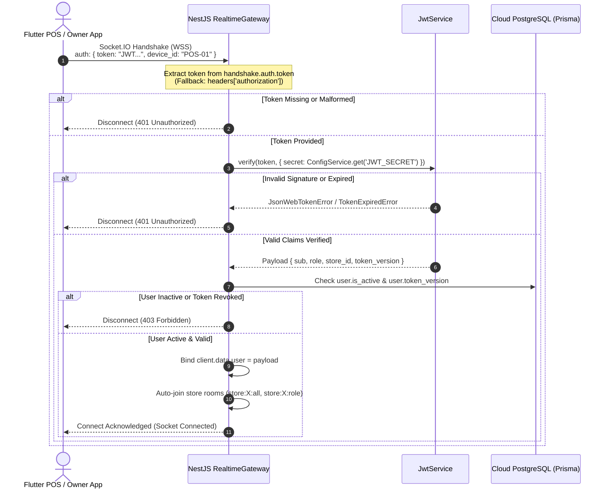
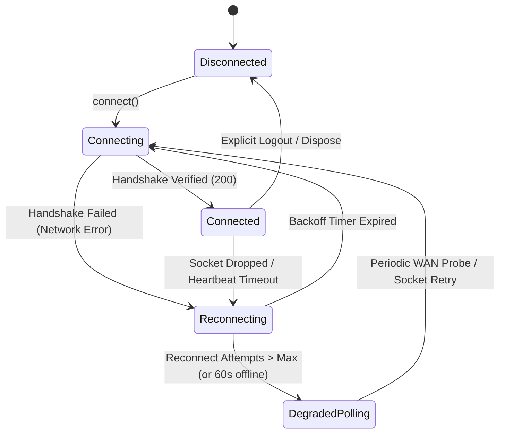
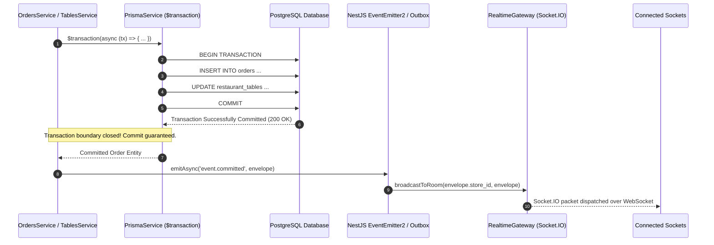
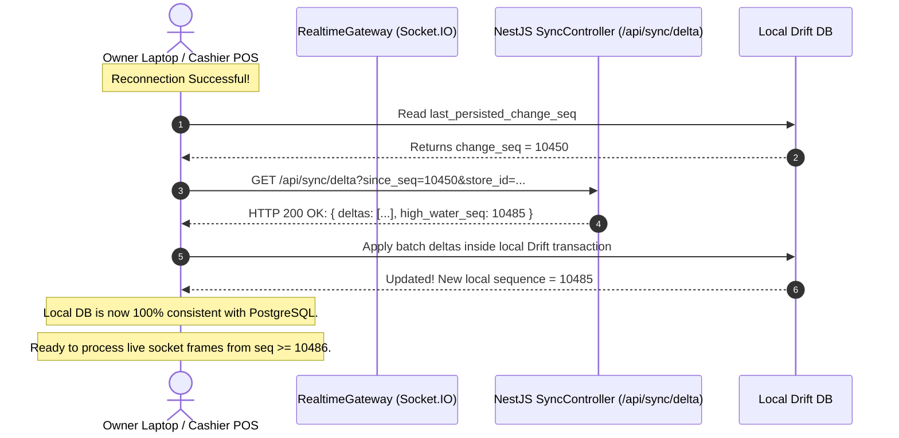

# Phase 12-13: Real-Time Event Architecture & Multi-User Notification Bus

**Document:** `docs/offline-analysis/12-realtime-events.md`  
**Auditor:** `realtime-event-designer (Wave 2)`  
**Scope:** Phases 12 & 13 + Architecture Sections 9 & 14 (Real-Time Communication, Event Sizing, Envelope Design, Transport Selection, Ordering, Reconnection, and Fault-Tolerant Delta Recovery)  
**System Under Review:** Hungry Howie's POS (Flutter Desktop Windows POS Frontend + NestJS / Prisma / PostgreSQL Backend)  
**Analysis Date:** October 2026  

---

## Executive Summary

This report establishes the complete architectural blueprint for real-time multi-user communication and event distribution across Hungry Howie's POS. Grounded in the **Wave 1 sign-off and developer directives** ([`docs/offline-analysis/00-open-questions.md:115-137`](file:///D:/HowiePOSUPdated/Hbackend-Hfrontend-main/docs/offline-analysis/00-open-questions.md#L115-L137)), this design adheres to the physical operational realities of the restaurant:
1. **Option A Isolated Local Silos:** Each branch operates a single physical cashier terminal with a local Drift/SQLite database; kitchen orders print directly via local USB thermal printers (no Kitchen Display System / KDS monitor required).
2. **Owner Monitoring & Telemetry:** Store owners, directors, and managers monitor live store operations (active tables, in-flight orders, cash drawer floats, shift reconciliations, inventory depletion alerts) remotely via cloud-connected laptops, tablets, or mobile clients.
3. **The Notification-Only Principle:** WebSockets are **never** the source of truth, **never** transmit heavyweight authoritative business data, and **never** bypass database transactions. WebSocket frames are strictly lightweight invalidation signals ("pokes") that trigger local Drift queries or delta synchronization via REST.
4. **Guaranteed Transactional Integrity:** Events are broadcast **strictly after** PostgreSQL database transactions commit (`post-commit` hook / transactional outbox), preventing phantom events from failed transactions.
5. **Resilient Reconnection:** When connections drop, clients recover missed events deterministically using a monotonic sequence cursor (`pull since cursor`), falling back to periodic REST delta polling when socket connections are severed or firewalled.

---

## 1. Transport Protocol Evaluation & Stack Justification

### 1.1 Comparative Analysis Matrix

We evaluate four primary real-time transport paradigms within the existing Hungry Howie's POS runtime environment:
- **Backend Stack:** Node.js 20 LTS, NestJS 10.4.15, Prisma 5.22, PostgreSQL 16, `@nestjs/platform-socket.io` (`^10.4.22`), `@nestjs/websockets` (`^10.4.22`), `socket.io` (`^4.8.4`) ([`backend/package.json:29, 32, 44`](file:///D:/HowiePOSUPdated/Hbackend-Hfrontend-main/backend/package.json#L29-L44)).
- **Frontend Stack:** Flutter 3.44.8, Dart 3.12.2, Windows C++ Desktop Runner, `web_socket_channel` (`^3.0.1`) ([`frontend/pubspec.yaml:37`](file:///D:/HowiePOSUPdated/Hbackend-Hfrontend-main/frontend/pubspec.yaml#L37)).

| Evaluation Dimension | Option 1: Socket.IO v4 (WebSocket Transport) | Option 2: Pure WebSocket (`ws` / RFC 6455) | Option 3: Server-Sent Events (SSE / `@Sse()`) | Option 4: HTTP Short / Long Polling |
|---|---|---|---|---|
| **Bi-Directionality** | Full-duplex (multiplexed frames, heartbeats, acks) | Full-duplex (raw binary / text frames) | Half-duplex (server-to-client only) | Half-duplex (request-response cycles) |
| **Room & Namespace Support** | **Native**: Built-in room grouping (`client.join()`, `server.to()`), multi-tenancy namespaces | Manual: Requires custom in-memory subscription map and registry | Manual: Requires maintaining array of `Observable` subjects per room | None: Requires database filtering on every polling query |
| **Handshake Authentication** | **Native**: Supports structured `auth: { token }` payload during handshake before connection upgrade | Query parameters only (`?token=...`) or custom first-message handshake | HTTP headers supported (`Authorization: Bearer ...`) | Standard HTTP request headers |
| **Reconnection & Heartbeats** | Built-in Engine.IO ping/pong heartbeat, automatic connection recovery | Manual: Client must implement ping/pong timers and retry logic | Native browser/client reconnect via `Last-Event-ID` header | N/A: Connection is re-established every request |
| **Connection Overhead** | Minimal when locked to `transports: ['websocket']` (1 HTTP upgrade request, then raw frames) | Minimal (1 HTTP upgrade request, then raw framing) | Low (persistent HTTP/1.1 or HTTP/2 streaming connection) | **Severe**: High TCP/TLS handshakes, HTTP header overhead (1-2 KB per poll) |
| **Proxy / Corporate Firewall Traversal** | High (falls back if needed; uses standard ports 80/443) | Moderate (some strict deep-packet inspection firewalls block WS) | High (standard HTTP streaming) | Highest (standard HTTP requests traverse all networks) |
| **Current Codebase Alignment** | **100% Installed & Implemented** in NestJS (`KitchenGateway`, `socket.io: ^4.8.4`) | Requires installing `@nestjs/platform-ws` and refactoring gateway | Requires rewriting gateway to `@Sse()` controller streams | Requires continuous background HTTP cron jobs |
| **Multi-Node Horizontal Scaling** | **Native Redis Adapter**: `@socket.io/redis-adapter` enables instant clustering | Requires Redis Pub/Sub integration and custom serialization | Requires Redis Pub/Sub bridging into NestJS observables | Stateless (load balancer distributes requests naturally) |

### 1.2 Justification for the Selected Architecture

**Selected Primary Transport:** **Socket.IO v4 locked strictly to WebSocket transport (`transports: ['websocket']`)**.  
**Selected Fallback Transport:** **Adaptive HTTP Delta Polling (`GET /api/sync/delta?since_seq=...`)**.

#### Technical Rationale:
1. **Leveraging Existing Production Dependencies:**
   The backend already declares and initializes `@nestjs/platform-socket.io` and `socket.io` in [`backend/package.json:32, 44`](file:///D:/HowiePOSUPdated/Hbackend-Hfrontend-main/backend/package.json#L32-L44) and implements connection handling in [`backend/src/kitchen/kitchen.gateway.ts:46-52`](file:///D:/HowiePOSUPdated/Hbackend-Hfrontend-main/backend/src/kitchen/kitchen.gateway.ts#L46-L52). Replacing this with raw `ws` or `@Sse()` would introduce unnecessary churn and discard NestJS's first-class room management (`client.join()`, `server.to()`).
2. **Elimination of HTTP Long-Polling Fallback:**
   Standard Socket.IO defaults to HTTP long-polling before upgrading to WebSocket. In our architecture, both client and server are explicitly configured with `transports: ['websocket']`. This eliminates HTTP polling churn, minimizes latency, and establishes an instantaneous persistent full-duplex socket.
3. **Room-Based Multi-Tenancy:**
   Restaurant operations demand strict isolation: cashier terminals should not receive back-office telemetry; owners must not see events from branches they do not manage. Socket.IO provides built-in room clustering (`store:{storeId}:owner`, `store:{storeId}:cashier`), which integrates seamlessly with `@socket.io/redis-adapter` if the cloud backend scales horizontally across multiple containers.
4. **Client-Side Strategy in Flutter:**
   The Flutter client currently uses `web_socket_channel: ^3.0.1` ([`frontend/pubspec.yaml:37`](file:///D:/HowiePOSUPdated/Hbackend-Hfrontend-main/frontend/pubspec.yaml#L37)) with a manual Engine.IO string parser in [`frontend/lib/core/network/kitchen_socket_service.dart:83-97`](file:///D:/HowiePOSUPdated/Hbackend-Hfrontend-main/frontend/lib/core/network/kitchen_socket_service.dart#L83-L97). This custom parser is fragile (fails on namespaced frames or binary headers). We transition to the robust, industry-standard `socket_io_client: ^3.0.0` package (or an improved Engine.IO v4 protocol parser) to ensure resilient framing, automatic heartbeats, and room subscription management.

---

## 2. Developer Directives & Operational Topology Alignment

The architectural directives confirmed in [`docs/offline-analysis/00-open-questions.md:115-137`](file:///D:/HowiePOSUPdated/Hbackend-Hfrontend-main/docs/offline-analysis/00-open-questions.md#L115-L137) establish the real-world operational constraints:

```
+---------------------------------------------------------------------------------------------------+
|                                      RESTAURANT STORE BRANCH                                      |
|                                                                                                   |
|  +---------------------------------------------------------------------------------------------+  |
|  |                     CASHIER TERMINAL (Windows Desktop POS - Single Terminal)                |  |
|  |                                                                                             |  |
|  |   [Flutter UI: Tables / Counter / POS] <---> [Local Drift/SQLite DB (Source of Truth)]       |  |
|  |                                                         |                                   |  |
|  |                                                         v                                   |  |
|  |                                            [Local Outbox Sync Queue]                        |  |
|  +---------------------------------------------------------|-----------------------------------+  |
|                            |                               |                                      |
|                            | Direct USB / Winspool (ESC/POS)                                      |
|                            v                               |                                      |
|              +--------------------------+                  |                                      |
|              | Kitchen Thermal Printer  |                  | (WAN Internet Connection)            |
|              | (Paper KOT - NO KDS)     |                  |                                      |
|              +--------------------------+                  |                                      |
+------------------------------------------------------------|--------------------------------------+
                                                             |
                                      REST Push Outbox Sync  |  WebSocket Real-Time Notification Bus
                                      (/api/sync/push)       |  (order.created, table.status_changed)
                                                             v
+---------------------------------------------------------------------------------------------------+
|                                      CLOUD POSTGRESQL & NESTJS                                    |
|                                                                                                   |
|     +-------------------------+      Post-Commit Hook      +-------------------------------+      |
|     | Cloud PostgreSQL Server | -------------------------> | NestJS Realtime Event Gateway |      |
|     | (Authoritative Ledger)  |                            | (Socket.IO Notification Bus)  |      |
|     +-------------------------+                            +-------------------------------+      |
|                                                                            |                      |
+----------------------------------------------------------------------------|----------------------+
                                                                             |
                                                 Real-Time Notification Pipe | (Lightweight Pokes)
                                                                             v
                                             +---------------------------------------------------+
                                             |           OWNER / MANAGEMENT DEVICES              |
                                             |        (Remote Laptop / Mobile / Tablet)          |
                                             |                                                   |
                                             |  - Live Sales & Active Orders Dashboard           |
                                             |  - Real-Time Table Floor Occupancy                |
                                             |  - Shift Drawer Floats & Skimming Monitoring      |
                                             |  - Out-of-Stock (86'd) & Low-Stock Alerts         |
                                             +---------------------------------------------------+
```

### Key Topology Implications for Real-Time Design:
1. **No Cashier-to-Cashier Concurrency:** Because each store operates a single physical cashier terminal ([`00-open-questions.md:124`](file:///D:/HowiePOSUPdated/Hbackend-Hfrontend-main/docs/offline-analysis/00-open-questions.md#L124)), there is zero risk of two POS cashiers concurrently seating guests at Table 1 or ringing conflicting order sequences offline.
2. **No KDS Socket Dependency:** The kitchen operates via hardware-printed paper slips directly from the cashier's PC (`RawSpooler.exe` / `winspool.Drv` via USB) ([`00-open-questions.md:121-122`](file:///D:/HowiePOSUPdated/Hbackend-Hfrontend-main/docs/offline-analysis/00-open-questions.md#L121-L122)). The kitchen never misses an order if the internet drops, because printing is 100% local.
3. **Primary Real-Time Consumer is the Owner:** The WebSocket gateway primarily serves remote management clients (the owner reviewing table status and sales remotely) and downstream notification channels (customer delivery tracking, online order alerts).
4. **Downstream Notifications to Cashier:** The cashier terminal listens for cloud-originating events:
   - Incoming online/delivery orders placed via web/mobile platforms.
   - Administrative catalog modifications executed by the owner (e.g. marking an item 86'd / unavailable).
   - Staff role/permission modifications.

---

## 3. Canonical Event Envelope & Naming Taxonomy

### 3.1 Event Naming Standard

All real-time events strictly adhere to a lower-case dot-separated hierarchy: `<domain>.<action>`. This standard replaces the redundant duplicate event emissions currently found in [`backend/src/kitchen/kitchen.gateway.ts:181-182`](file:///D:/HowiePOSUPdated/Hbackend-Hfrontend-main/backend/src/kitchen/kitchen.gateway.ts#L181-L182) (`order.created` AND `kitchen.order_created`).

| Event Name | Domain | Trigger Condition | Target Rooms | Payload Content |
|---|---|---|---|---|
| `order.created` | Orders | New order placed and committed in PostgreSQL | `store:{id}:owner`, `store:{id}:cashier` | Minimal order header, totals, table/token ID |
| `order.updated` | Orders | Items added, guest count changed, note updated | `store:{id}:owner`, `store:{id}:cashier` | Order ID, new total, updated line-item IDs |
| `order.status_changed` | Orders | Status transitions (e.g. `accepted` -> `preparing` -> `completed`) | `store:{id}:owner`, `store:{id}:cashier` | Order ID, previous status, new status |
| `order.paid` | Orders | Payment captured and receipt closed | `store:{id}:owner`, `store:{id}:cashier` | Order ID, payment method, tendered amount |
| `order.cancelled` | Orders | Order voided or rejected | `store:{id}:owner`, `store:{id}:cashier` | Order ID, cancellation reason, voided by |
| `table.status_changed` | Tables | Table transitioned (`available`, `occupied`, `dirty`) | `store:{id}:owner`, `store:{id}:cashier` | Table ID, new status, active order ID |
| `table.reserved` | Tables | Reservation placed for customer | `store:{id}:owner`, `store:{id}:cashier` | Table ID, guest name, reservation timestamp |
| `table.released` | Tables | Table cleaned and marked available | `store:{id}:owner`, `store:{id}:cashier` | Table ID, released timestamp |
| `table.transferred` | Tables | Order moved from Table A to Table B | `store:{id}:owner`, `store:{id}:cashier` | Source Table ID, Destination Table ID, Order ID |
| `shift.opened` | Shifts | Cashier opens register drawer with opening float | `store:{id}:owner` | Shift ID, cashier ID, starting cash float |
| `shift.skimming_added` | Shifts | Mid-shift cash drop / expense payout | `store:{id}:owner` | Shift ID, skimming amount, reason |
| `shift.closed` | Shifts | Shift finalized with closing cash count & variance | `store:{id}:owner` | Shift ID, cash submitted, variance amount |
| `menu.item_availability` | Catalog | Item 86'd (unavailable) or restocked | `store:{id}:all` | Menu Item ID, `is_available` boolean |
| `menu.catalog_updated` | Catalog | Owner updated prices, deals, or categories | `store:{id}:all` | Catalog version, changed entity types |
| `inventory.stock_alert` | Stock | Stock level breached reorder point | `store:{id}:owner` | Item ID, SKU, current stock, min stock |
| `delivery.dispatched` | Delivery | Order assigned to delivery rider and departed | `store:{id}:owner`, `store:{id}:cashier` | Dispatch ID, Order ID, Rider ID, departed time |
| `delivery.delivered` | Delivery | Rider marked delivery complete | `store:{id}:owner`, `store:{id}:cashier` | Dispatch ID, Order ID, delivered time |
| `staff.permission_changed`| RBAC | Permission matrix or staff role updated | `store:{id}:all`, `device:{id}` | Staff User ID, updated permissions hash |

---

### 3.2 Canonical Real-Time Event Envelope

To enforce the principle that **WebSockets are never the source of truth**, socket payloads are strictly standardized into an envelope containing invalidation and ordering metadata. The payload carries only enough information to identify what changed and prompt the receiving client to execute a targeted Drift update or delta pull.

```typescript
/**
 * Canonical Real-Time Event Envelope for Hungry Howie's POS
 * Transported across Socket.IO v4 over WebSocket frames
 */
export interface RealtimeEventEnvelope<T = Record<string, unknown>> {
  /** Unique UUID v4 identifying this specific socket event instance (for deduplication) */
  event_id: string;

  /** Standard event identifier (e.g. 'table.status_changed', 'order.created') */
  event_name: string;

  /** Canonical database entity name ('restaurant_tables', 'orders', 'daily_calculations') */
  entity: string;

  /** Primary Key UUID of the mutated entity */
  entity_id: string;

  /** Mutation classification: 'CREATED' | 'UPDATED' | 'DELETED' | 'STATUS_CHANGED' */
  action: 'CREATED' | 'UPDATED' | 'DELETED' | 'STATUS_CHANGED';

  /** 
   * Optimistic Concurrency Control (OCC) version of the entity in PostgreSQL.
   * Monotonically incremented integer (1, 2, 3...) on every row update.
   */
  version: number;

  /** 
   * Store-scoped, monotonically increasing sequence number (BIGSERIAL in PostgreSQL).
   * Guarantees total ordering of all changes within a store branch.
   */
  change_seq: number;

  /** ISO 8601 UTC timestamp of database transaction commit */
  occurred_at: string;

  /** Hardware / Client identifier of the mutation originator (e.g. 'POS-TERMINAL-01') */
  origin_device_id: string;

  /** User ID UUID of the cashier / manager who triggered the write */
  origin_user_id: string;

  /** Multi-tenant branch / store identifier */
  store_id: string;

  /** 
   * Lightweight notification payload.
   * STRICT RULE: Never contains full entity trees, sensitive financial summaries, 
   * or customer PII. Used purely for optimistic badge/status display before sync.
   */
  payload: T;
}
```

#### Concrete Envelope Example: Cashier Reserves Table 1
```json
{
  "event_id": "8f3b6e12-4c21-4f9e-9d2a-8c3b7a1e0f45",
  "event_name": "table.status_changed",
  "entity": "restaurant_tables",
  "entity_id": "7d92f582-8b43-41a2-9d3e-5b12a8f09c21",
  "action": "STATUS_CHANGED",
  "version": 4,
  "change_seq": 10482,
  "occurred_at": "2026-10-17T19:30:00.124Z",
  "origin_device_id": "POS-TERMINAL-01",
  "origin_user_id": "4cec453b-0ce2-4f0a-a335-d014883bb0a8",
  "store_id": "store-lahore-gulberg-01",
  "payload": {
    "table_number": 1,
    "table_name": "Table 1",
    "status": "reserved",
    "reserved_customer_name": "John Doe",
    "reservation_time": "2026-10-17T20:00:00.000Z",
    "party_size": 4
  }
}
```

---

## 4. Rooms & Multi-Tenant Partitioning Architecture

To eliminate broadcast chatter, maintain multi-tenant store isolation, and prevent unauthorized clients from receiving restricted operational data, sockets are segmented into hierarchical rooms:

```
                                  [ Socket.IO Server Gateway ]
                                                |
                 +------------------------------+------------------------------+
                 |                                                             |
    [ Branch: store-lahore-gulberg-01 ]                         [ Branch: store-islamabad-f6-01 ]
                 |                                                             |
   +-------------+-------------+                                 +-------------+-------------+
   |             |             |                                 |             |             |
[owner]      [cashier]     [device:POS-01]                    [owner]      [cashier]     [device:POS-02]
```

### 4.1 Room Taxonomy & Access Matrix

| Room Pattern | Audience | Authorized Roles | Broadcast Scope |
|---|---|---|---|
| `store:{store_id}:all` | All devices in branch | Cashier, Waiter, Rider, Manager, Owner | Store-wide broadcasts, emergency announcements, store open/close |
| `store:{store_id}:owner` | Management & Owners | Manager, Admin, Owner | Financial shift summaries, cash drawer variances, live order stream, inventory alerts |
| `store:{store_id}:cashier` | Cashier POS Register | Cashier, Manager, Owner | Table status changes, incoming online/delivery orders, catalog updates, price changes |
| `store:{store_id}:kitchen` | Kitchen Printers / Monitors | Kitchen, Cashier, Manager, Owner | Reserved for optional KDS display integration or kitchen ticket audit log |
| `store:{store_id}:riders` | Delivery Riders | Rider, Dispatcher, Manager, Owner | Delivery dispatch assignments, address updates, order ready notifications |
| `device:{device_id}` | Specific Physical Terminal | Bound Device Only | Direct administrative commands: forced session logout, cache wipe, diagnostic pings |

### 4.2 Automated Room Subscription on Handshake

Clients never manually request to join privileged rooms via arbitrary socket messages (deprecating `join_kitchen` / `leave_kitchen` in [`backend/src/kitchen/kitchen.gateway.ts:99-109`](file:///D:/HowiePOSUPdated/Hbackend-Hfrontend-main/backend/src/kitchen/kitchen.gateway.ts#L99-L109)). Instead, room memberships are **automatically assigned on the server** during the handshake phase based strictly on verified JWT claims:

```typescript
// NestJS Gateway Room Assignment Logic (Post-Handshake Verification)
const { role, store_id, device_id } = client.data.user;

// 1. Join universal store room
await client.join(`store:${store_id}:all`);

// 2. Join device-targeted control room
if (device_id) {
  await client.join(`device:${device_id}`);
}

// 3. Join role-specific operational rooms
const normalizedRole = role.toLowerCase().trim();
if (normalizedRole === 'owner' || normalizedRole === 'admin' || normalizedRole === 'manager') {
  await client.join(`store:${store_id}:owner`);
  await client.join(`store:${store_id}:cashier`);
} else if (normalizedRole === 'cashier') {
  await client.join(`store:${store_id}:cashier`);
} else if (normalizedRole === 'rider') {
  await client.join(`store:${store_id}:riders`);
}
```

---

## 5. Handshake Authentication & Token Lifecycle Management

### 5.1 Handshake Authentication Flow

Inspection of [`backend/src/kitchen/kitchen.gateway.ts:67-93`](file:///D:/HowiePOSUPdated/Hbackend-Hfrontend-main/backend/src/kitchen/kitchen.gateway.ts#L67-L93) and [`docs/offline-analysis/08-security.md:48`](file:///D:/HowiePOSUPdated/Hbackend-Hfrontend-main/docs/offline-analysis/08-security.md#L48) identified critical security defects:
1. Hardcoded fallback secret: `'hungry-howies-pos-dev-secret-key-2026'` ([`kitchen.gateway.ts:80`](file:///D:/HowiePOSUPdated/Hbackend-Hfrontend-main/backend/src/kitchen/kitchen.gateway.ts#L80)).
2. Absence of device binding and store scoping in JWT claims ([`jwt-payload.interface.ts:1-5`](file:///D:/HowiePOSUPdated/Hbackend-Hfrontend-main/backend/src/auth/interfaces/jwt-payload.interface.ts#L1-L5)).
3. Automatic, unrestricted admission into the `'kitchen'` room ([`kitchen.gateway.ts:85`](file:///D:/HowiePOSUPdated/Hbackend-Hfrontend-main/backend/src/kitchen/kitchen.gateway.ts#L85)).

#### Hardened Authentication Specification:



### 5.2 Token Expiry & Active Session Re-Authentication

Restaurant POS terminals operate continuously across 12-to-16-hour shifts. If access tokens carry standard expirations (e.g., 2 hours or 24 hours), long-lived TCP sockets will outlive the token's validity period.

#### The Problem:
If the socket connection remains open indefinitely without re-authentication:
- Revoked users whose accounts were deactivated mid-shift continue receiving live business events.
- If the socket temporarily drops after hour 25, reconnection fails immediately, stranding the terminal without real-time notifications.

#### The Architectural Solution:
1. **Server Expiration Watchdog:**
   Upon handshake, the server records `client.data.expires_at = payload.exp * 1000`. The server schedules an internal timer to trigger 60 seconds prior to expiration:
   `server.to(client.id).emit('auth.expiring', { expires_at: client.data.expires_at });`
2. **In-Flight Token Refresh Protocol:**
   The Flutter client listens for `auth.expiring` (or independently tracks token expiration via a local timer). Before expiration, the client requests a refreshed JWT from the REST API (`POST /api/auth/refresh`) and transmits the refreshed token across the existing live socket:
   ```typescript
   // Client sends re-auth frame over live socket
   socket.emit('auth.refresh', { token: newAccessToken }, (response) => {
     if (response.status === 'OK') {
       // Token successfully refreshed on gateway
     }
   });
   ```
3. **Graceful Server Disconnection:**
   If `payload.exp` is reached and no refreshed token has been verified, the server forcefully closes the socket connection:
   ```typescript
   client.emit('auth.expired', { code: 'TOKEN_EXPIRED', message: 'Session expired. Re-authenticate.' });
   client.disconnect(true);
   ```
4. **Immediate Revocation via `token_version`:**
   When an owner modifies a staff password or revokes permissions, PostgreSQL increments `staff_users.token_version`. The server broadcasts an internal invalidation event across Redis/EventEmitter to disconnect all active sockets associated with `user_id`.

---

## 6. Connection Lifecycle & Reconnection with Exponential Backoff

### 6.1 Deficiencies in Current Implementation

In [`frontend/lib/core/network/kitchen_socket_service.dart:129-138`](file:///D:/HowiePOSUPdated/Hbackend-Hfrontend-main/frontend/lib/core/network/kitchen_socket_service.dart#L129-L138):
```dart
void _scheduleReconnect() {
  _isConnected = false;
  _pingTimer?.cancel();
  _reconnectTimer?.cancel();
  _reconnectTimer = Timer(const Duration(seconds: 5), () {
    if (!_isDisposed) {
      connect();
    }
  });
}
```
- **Constant 5-Second Retry:** A fixed 5-second retry without backoff or jitter creates a **thundering herd hazard**. If the cloud backend restarts or the store broadband router power-cycles, all terminals, tablets, and manager laptops flood the server with simultaneous WebSocket handshakes every 5 seconds.
- **Silent Event Loss:** When disconnected, all events emitted by the server are discarded. Upon reconnection at $t=35$, the client does not know what occurred between $t=0$ and $t=35$.

### 6.2 Target Connection State Machine



### 6.3 Exponential Backoff with Full Jitter Formulation

To guarantee optimal network dispersion and prevent synchronized retry storms, the reconnection algorithm implements **Exponential Backoff with Full Jitter**:

$$\text{Sleep Interval} = \text{random}\left(0, \min\left(T_{\max}, T_{\text{base}} \times 2^{\text{attempt}}\right)\right)$$

Where:
- $T_{\text{base}} = 1.0\text{ second}$ (Initial retry delay)
- $T_{\max} = 30.0\text{ seconds}$ (Maximum backoff ceiling)
- $\text{Multiplier} = 2.0$
- $\text{Jitter} = \text{Uniform random distribution between } 0 \text{ and calculated delay}$

```dart
/// Production-Grade Reconnection Backoff Calculator
class SocketBackoffStrategy {
  static const Duration baseDelay = Duration(seconds: 1);
  static const Duration maxDelay = Duration(seconds: 30);
  static const double multiplier = 2.0;

  int _attempt = 0;
  final Random _random = Random();

  void reset() {
    _attempt = 0;
  }

  Duration nextDelay() {
    // Calculate exponential delay: base * (multiplier ^ attempt)
    final double expSeconds = baseDelay.inSeconds * pow(multiplier, _attempt).toDouble();
    final double ceilingSeconds = min(maxDelay.inSeconds.toDouble(), expSeconds);
    
    // Apply Full Jitter: Uniform random between 0 and ceiling
    final double jitteredSeconds = _random.nextDouble() * ceilingSeconds;
    _attempt++;

    return Duration(milliseconds: (jitteredSeconds * 1000).toInt());
  }

  int get currentAttempt => _attempt;
}
```

---

## 7. Deterministic Event Ordering & Duplicate Suppression

### 7.1 Monotonic Sequencing & Dual-Key Ordering

Because WebSocket frames traverse public networks, packets can arrive out of order or experience network-level duplication. To guarantee deterministic event processing, every event is tracked using two complementary sequence keys:

1. **Global Store Sequence (`change_seq`):**
   - Implemented as a PostgreSQL `BIGSERIAL` sequence (`store_change_seq`) incremented on every committed transaction in that store.
   - Provides a strictly continuous, gap-detectable integer sequence ($1001, 1002, 1003\dots$).
2. **Per-Entity OCC Version (`version`):**
   - Implemented as an integer column `version Int @default(1)` on mutable tables (`restaurant_tables`, `orders`, `daily_calculations`) ([`docs/offline-analysis/07-concurrency-conflicts.md:107`](file:///D:/HowiePOSUPdated/Hbackend-Hfrontend-main/docs/offline-analysis/07-concurrency-conflicts.md#L107)).
   - Represents the exact revision of that specific row.

### 7.2 Version Validation Rules at the Client Layer

When an event envelope arrives at a client terminal (e.g. Owner laptop), it is evaluated against the local Drift database:

```
+-------------------------------------------------------------------------------+
|                       INCOMING EVENT: table.status_changed                    |
|             (entity: "restaurant_tables", entity_id: "T1", version: V_event)  |
+-------------------------------------------------------------------------------+
                                        |
                                        v
                 Query Local Drift DB for current entity version: V_local
                                        |
                 +----------------------+----------------------+
                 |                      |                      |
                 v                      v                      v
         V_event <= V_local     V_event == V_local + 1    V_event > V_local + 1
                 |                      |                      |
                 |                      |                      |
        [ DISCARD EVENT ]       [ APPLY DIRECTLY ]      [ GAP DETECTED! ]
        Event is stale or       Continuous sequential   One or more intermediate
        already applied.        update. Apply delta     events were dropped.
        Zero state change.      to Drift DB.            Trigger Pull Delta from
                                Reactive UI updates.    last known cursor!
```

1. **Rule 1: Stale or Duplicate Event (`V_event <= V_local`):**
   The incoming event describes a state that the local database has already ingested or superseded. **Action:** Silently discard.
2. **Rule 2: Sequential Invalidation (`V_event == V_local + 1`):**
   The event represents the immediate sequential progression of the entity. **Action:** Apply the lightweight delta to the local Drift table, or invalidate the local Riverpod provider to trigger a background fetch.
3. **Rule 3: Gap Detected (`V_event > V_local + 1`):**
   The client missed intermediate versions (e.g., missed version 2, received version 3). Applying version 3 directly could result in corrupted state transitions. **Action:** Enqueue an immediate delta catch-up query: `GET /api/sync/delta?since_seq={last_known_seq}`.

---

### 7.3 Duplicate Suppression via Sliding LRU Cache

Even before querying the local database, clients filter duplicate socket deliveries (e.g., caused by network re-transmissions or socket reconnects) using an in-memory Least-Recently-Used (LRU) cache of `event_id` UUIDs:

```dart
/// In-Memory Sliding Event Deduplicator
class EventDeduplicator {
  final int maxCapacity;
  final LinkedHashMap<String, DateTime> _seenEvents = LinkedHashMap();

  EventDeduplicator({this.maxCapacity = 1000});

  /// Returns true if event is a duplicate and should be ignored
  bool isDuplicate(String eventId) {
    if (_seenEvents.containsKey(eventId)) {
      return true; // Duplicate detected!
    }

    // Add to cache
    _seenEvents[eventId] = DateTime.now();

    // Evict oldest entries if capacity exceeded
    if (_seenEvents.length > maxCapacity) {
      _seenEvents.remove(_seenEvents.keys.first);
    }

    return false;
  }
}
```

---

### 7.4 Echo Suppression: Ignoring Own Writes

In an offline-first architecture, the terminal originating a mutation applies the change optimistically to its local Drift database **before** the network request is dispatched.

When the server commits the mutation to PostgreSQL, it broadcasts the event to the entire store room (`store:{store_id}:cashier`). Without echo suppression, the originating terminal would receive its own write as an external incoming socket event, causing redundant UI re-renders, race conditions, or audio alert loops.

#### Echo Suppression Mechanism:
Every event envelope carries `origin_device_id` ([Section 3.2](#32-canonical-real-time-event-envelope)).
When the socket listener receives any event:
```dart
void _handleIncomingEnvelope(RealtimeEventEnvelope envelope) {
  // Echo Suppression: Discard if originating from this physical terminal
  if (envelope.originDeviceId == _localDeviceId) {
    return; // Silently ignore our own write
  }

  // Deduplicate against recent events
  if (_deduplicator.isDuplicate(envelope.eventId)) {
    return;
  }

  // Process valid remote notification
  _processRemoteEvent(envelope);
}
```

---

## 8. Post-Commit Event Emission (Transactional Integrity)

### 8.1 The Phantom Event Hazard

In naive socket architectures, event emission calls are placed directly inside database transaction blocks or service handlers before the transaction commits:

```typescript
// DANGEROUS ANTI-PATTERN: Emitting inside transaction
await this.prisma.$transaction(async (tx) => {
  const order = await tx.order.create({ ... });
  this.gateway.emitOrderCreated(order); // PHANTOM EVENT HAZARD!
  await tx.inventory.update({ ... });   // IF THIS FAILS, TX ROLLS BACK!
});
```

If the inventory update throws an error or the database deadlocks, the transaction rolls back. However, the WebSocket event **has already been broadcast over TCP to all connected owner laptops**. The owner's UI renders an order that does not exist in the database!

### 8.2 Architectural Solution: Post-Commit Hook / Transactional Outbox

To guarantee that a socket event is emitted **if and only if** the PostgreSQL transaction successfully commits, the backend employs a **Post-Commit Event Hook** backed by the database transaction lifecycle:



#### NestJS Post-Commit Implementation Pattern:
```typescript
@Injectable()
export class PostCommitEventPublisher {
  constructor(
    private readonly eventEmitter: EventEmitter2,
    private readonly gateway: RealtimeGateway,
    private readonly logger: Logger,
  ) {}

  /**
   * Broadcasts an event strictly after a database transaction has successfully committed.
   */
  async publishPostCommit(envelope: RealtimeEventEnvelope): Promise<void> {
    try {
      // 1. Emit internal system event for audit / background workers
      await this.eventEmitter.emitAsync(envelope.event_name, envelope);

      // 2. Broadcast to authorized Socket.IO rooms
      const targetRoom = `store:${envelope.store_id}:${this.resolveTargetRoom(envelope.event_name)}`;
      this.gateway.server.to(targetRoom).emit(envelope.event_name, envelope);

      this.logger.debug(
        `Dispatched post-commit event '${envelope.event_name}' (Seq: ${envelope.change_seq}) to room '${targetRoom}'`,
      );
    } catch (err) {
      this.logger.error(`Failed to broadcast post-commit event: ${(err as Error).message}`);
    }
  }

  private resolveTargetRoom(eventName: string): string {
    if (eventName.startsWith('shift.') || eventName.startsWith('inventory.')) return 'owner';
    if (eventName.startsWith('table.') || eventName.startsWith('order.')) return 'cashier';
    return 'all';
  }
}
```

---

## 9. Missed-Event Recovery via "Pull Since Cursor" & Polling Fallback

### 9.1 Sockets are Lossy Pipes, Not Storage Queues

WebSockets are ephemeral streaming pipes. They offer **zero durability**. If a manager's laptop disconnects while driving through a tunnel, or a cashier's internet blips for 45 seconds, all events emitted during that window vanish from the wire.

**Core Architectural Rule:**  
> **Clients must NEVER rely on receiving 100% of socket events to maintain correct state.**  
> Sockets are lightweight triggers for invalidation. Authoritative synchronization is mediated exclusively via the REST Delta Sync API.

### 9.2 Reconnection Delta Catch-Up Protocol

Whenever a client transitions from `Disconnected` / `Reconnecting` to `Connected`, it immediately triggers a **Delta Catch-Up Query**:



### 9.3 Adaptive Fallback to Polling when Sockets Fail

If a client is deployed behind an aggressive corporate firewall that inspects and blocks WebSocket upgrades, or if the WebSocket gateway is undergoing maintenance, the client must seamlessly degrade without breaking store operations:

| Mode | Trigger Condition | Transport Mechanism | Latency Profile | Network Cost |
|---|---|---|---|---|
| **Real-Time Streaming** | WebSocket connected & healthy | Socket.IO over WSS | Instantaneous ($< 50\text{ ms}$) | Near zero overhead (heartbeats only) |
| **Active Delta Polling** | WebSocket disconnected for $> 30\text{ s}$ | `GET /api/sync/delta?since_seq=...` every $15\text{ s}$ | $0–15\text{ seconds}$ | Low ($\approx 500\text{ bytes}$ per poll when idle) |
| **Background / Idle Polling** | Terminal idle or screen locked | `GET /api/sync/delta?since_seq=...` every $60\text{ s}$ | $0–60\text{ seconds}$ | Negligible |

When the WebSocket reconnects, active delta polling is immediately paused, returning the client to instant event-driven updates.

---

## 10. End-to-End Operational Lifecycle Flows

### 10.1 Flow A (Happy Path): Cashier Reserves Table 1 -> Owner Sees Live Update

```
+-----------------------------------------------------------------------------------------------------------------------------------+
|  1. CASHIER POS (Windows Desktop)                                                                                                 |
|     - Cashier taps Table 1 -> Reserve for "John Doe" (party of 4).                                                                |
|     - [Drift DB]: Updates Table 1 status -> 'reserved' (optimistic UI update: turns Amber).                                       |
|     - [Drift Outbox]: Inserts pending sync mutation row (idempotency_key: "MUT-9912").                                            |
|     - Sync Worker dispatches HTTP POST /api/sync/push to Cloud Backend.                                                           |
+-----------------------------------------------------------------------------------------------------------------------------------+
                                                                     |
                                                                     v
+-----------------------------------------------------------------------------------------------------------------------------------+
|  2. CLOUD BACKEND (NestJS & PostgreSQL)                                                                                           |
|     - SyncController receives push mutation -> begins Prisma $transaction.                                                        |
|     - Increments table version (v3 -> v4) and store change_seq (10481 -> 10482).                                                  |
|     - PostgreSQL COMMITS transaction.                                                                                             |
|     - Returns HTTP 200 { success: true, server_version: 4, change_seq: 10482 } to Cashier.                                        |
|     - Post-Commit Publisher triggers RealtimeGateway to construct envelope:                                                        |
|       { event_name: 'table.status_changed', entity_id: 'T1', version: 4, change_seq: 10482, origin_device_id: 'POS-01' }          |
|     - Gateway broadcasts frame to room: 'store:lahore-01:cashier' and 'store:lahore-01:owner'.                                    |
+-----------------------------------------------------------------------------------------------------------------------------------+
                                                                     |
                                 +-----------------------------------+-----------------------------------+
                                 |                                                                       |
                                 v                                                                       v
+-------------------------------------------------------------------+   +-----------------------------------------------------------+
|  3. CASHIER POS RECEIVES BROADCAST                                |   |  4. OWNER LAPTOP RECEIVES BROADCAST                       |
|     - Checks origin_device_id: 'POS-01' == local_device_id.       |   |     - Checks origin_device_id: 'POS-01' != local_device_id.   |
|     - Discards event (Echo Suppression).                          |   |     - Checks Deduplicator: New event.                     |
|     - Zero redundant UI flicker.                                  |   |     - Evaluates Version: v4 == local_v3 + 1. Sequential!  |
|                                                                   |   |     - Updates local Drift DB table record.                |
|                                                                   |   |     - Riverpod watchTables() stream fires.                |
|                                                                   |   |     - Table 1 card on Owner screen turns Amber instantly! |
+-------------------------------------------------------------------+   +-----------------------------------------------------------+
```

---

### 10.2 Flow B (Offline Cashier): Cashier Operates Disconnected, Syncs on Reconnection

```
[ T = 0m: Store Broadband WAN Fails ]
  - Cashier POS detects network loss -> enters OFFLINE_OPERATIONAL mode.
  - Cashier reserves Table 2, seats Table 4, and rings 15 dine-in orders.
  - All writes committed to local Drift/SQLite DB.
  - Kitchen tickets print instantly to local USB thermal printer (winspool.Drv) without errors.
  - Outbox table buffers 17 pending mutations.
  - Owner laptop (remote on cellular/cloud) sees store as idle; Table 2 remains Green.

[ T = 45m: Broadband WAN Restored ]
  - Cashier POS detects WAN connectivity restored.
  - Outbox Sync Worker flushes batch: POST /api/sync/push { mutations: [17 items] }.
  - NestJS executes batch transaction in PostgreSQL:
      * Inserts orders 1..15.
      * Updates tables 2 and 4.
      * Advances store change_seq by 17 ticks (10500 -> 10517).
      * PostgreSQL COMMITS batch.
  - Post-Commit Publisher emits batch invalidation events across Socket.IO:
      * 'table.status_changed' (Table 2, Table 4)
      * 'order.created' (Orders 1..15)
  - Owner laptop receives socket stream:
      * Detects burst of events.
      * Ingestion engine applies updates or triggers consolidated delta pull.
      * Owner dashboard revenue charts, active orders list, and table layouts snap to current reality.
```

---

### 10.3 Flow C (Offline Owner): Owner Reconnects and Catches Up via Cursor

```
[ T = 0m: Owner closes laptop lid and boards flight ]
  - Owner laptop WebSocket disconnects cleanly.
  - Last acknowledged local change_seq = 10200.

[ T = 0m -> 120m: Store Operations Continue Normally ]
  - Cashier POS continues taking orders online; cloud PostgreSQL advances from seq 10200 to 10340.
  - Socket gateway broadcasts events, but Owner's socket is disconnected; frames are dropped.

[ T = 120m: Owner opens laptop at destination hotel ]
  - Flutter app wakes up; Socket.IO establishes connection and passes JWT handshake.
  - On connection established, Owner client reads local cursor: last_seq = 10200.
  - Client immediately calls: GET /api/sync/delta?since_seq=10200&store_id=lahore-01.
  - Server queries PostgreSQL:
      SELECT * FROM store_event_log WHERE store_id = 'lahore-01' AND change_seq > 10200 ORDER BY change_seq ASC;
  - Server returns 140 delta records in a single compressed JSON response (high_water_seq: 10340).
  - Owner client ingests deltas into local Drift DB in a single SQLite transaction.
  - Owner UI stream refreshes completely in under 200 ms.
  - Live socket listeners resume normal real-time invalidation starting at seq 10341.
```

---

## 11. Codebase Audit: File-by-File Citations & Gaps

| Module / File Path | Current Code State | Critical Defect / Architecture Gap | Required Wave 2/3 Action |
|---|---|---|---|
| [`backend/src/kitchen/kitchen.gateway.ts:67-93`](file:///D:/HowiePOSUPdated/Hbackend-Hfrontend-main/backend/src/kitchen/kitchen.gateway.ts#L67-L93) | Hardcoded secret `'hungry-howies-pos-dev-secret-key-2026'` fallback. All users auto-join `'kitchen'` room. | Insecure secret fallback; no room partitioning by `store_id` or `role`. | Remove hardcoded secret. Enforce mandatory `JWT_SECRET`. Implement dynamic room assignment based on role and store ID. |
| [`backend/src/kitchen/kitchen.gateway.ts:181-192`](file:///D:/HowiePOSUPdated/Hbackend-Hfrontend-main/backend/src/kitchen/kitchen.gateway.ts#L181-L192) | Emits duplicate events: `order.created` AND `kitchen.order_created`. | Redundant network traffic; non-standard naming. | Standardize to canonical `<domain>.<action>` events with standardized envelope. |
| [`backend/src/tables/tables.service.ts:160-175`](file:///D:/HowiePOSUPdated/Hbackend-Hfrontend-main/backend/src/tables/tables.service.ts#L160-L175) | `updateTableReservation` updates PostgreSQL directly. No socket gateway injection or emission. | **Total Blind Spot:** Table reservations, releases, and seatings never broadcast to sockets. | Inject `PostCommitEventPublisher`; emit `table.status_changed` after commit. |
| [`backend/src/orders/orders.service.ts:459`](file:///D:/HowiePOSUPdated/Hbackend-Hfrontend-main/backend/src/orders/orders.service.ts#L459) | `this.kitchenGateway?.emitOrderCreated(result)` is called after transaction, but only in `createOrder`. | `updateOrder`, `cancelOrder`, and payments do not emit socket events. | Centralize post-commit event publishing across all order mutations. |
| [`backend/src/sync/sync.service.ts:244-290`](file:///D:/HowiePOSUPdated/Hbackend-Hfrontend-main/backend/src/sync/sync.service.ts#L244-L290) | `syncBatchOrders` only toggles sync status on existing cloud orders; cannot ingest new offline orders. | Ingestion pipeline cannot receive offline SQLite records. | Implement true batch ingestion endpoint with post-commit invalidation broadcast. |
| [`frontend/lib/core/network/kitchen_socket_service.dart:61, 133`](file:///D:/HowiePOSUPdated/Hbackend-Hfrontend-main/frontend/lib/core/network/kitchen_socket_service.dart#L61) | Fixed 5s reconnect timer; fragile manual Engine.IO string slicing (`data.startsWith('42')`). | Thundering herd risk; crashes on namespaced frames or binary headers. | Implement Exponential Backoff with Jitter; adopt standard `socket_io_client` or hardened parser. |
| [`frontend/lib/data/kitchen_repository.dart:126-148`](file:///D:/HowiePOSUPdated/Hbackend-Hfrontend-main/frontend/lib/data/kitchen_repository.dart#L126-L148) | Injects socket payload directly into in-memory state without database persistence. | **Direct Violation of Phase 13 Principle:** Treats socket as source of truth. | Refactor socket handler to write to Drift DB or trigger Delta Sync; UI consumes Drift stream. |
| [`frontend/lib/data/table_repository.dart:42-51`](file:///D:/HowiePOSUPdated/Hbackend-Hfrontend-main/frontend/lib/data/table_repository.dart#L42-L51) | `TableNotifier` fetches tables once on startup. Zero socket listening. | Owner / POS screen stays stale indefinitely until user presses F5 or sync button. | Connect `TableNotifier` to `RealtimeSocketService` table invalidation stream. |

---

## 12. Summary & Wave 2 Integration Contract

| Architecture Requirement | Selected Specification | Guarantee / SLA |
|---|---|---|
| **Protocol** | Socket.IO v4 over WebSocket (`transports: ['websocket']`) | $< 50\text{ ms}$ broadcast latency; native room management |
| **Source of Truth** | PostgreSQL (Cloud) / Drift SQLite (Local Operational) | WebSocket is strictly notification-only; never source of truth |
| **Emission Timing** | Strictly Post-Commit via `PostCommitEventPublisher` | 0% phantom events from rolled-back transactions |
| **Envelope Standard** | `RealtimeEventEnvelope` with `change_seq`, `version`, `origin_device_id` | Deterministic ordering, gap detection, and echo suppression |
| **Reconnection** | Exponential Backoff with Full Jitter ($1\text{ s} \dots 30\text{ s}$) | Zero thundering herd retry storms upon server reboot |
| **Recovery** | Delta Catch-Up Query (`GET /api/sync/delta?since_seq=...`) | Zero dropped events across network disconnects |
| **Offline Fallback** | Adaptive Background Delta Polling ($15\text{ s} \dots 60\text{ s}$) | Continuous updates even if WebSocket is blocked or firewalled |
