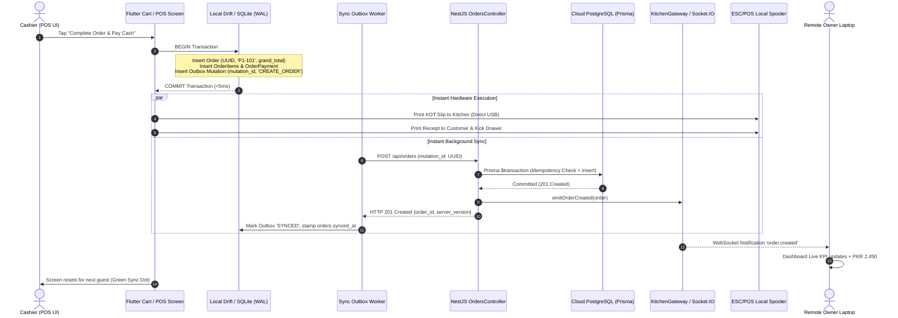
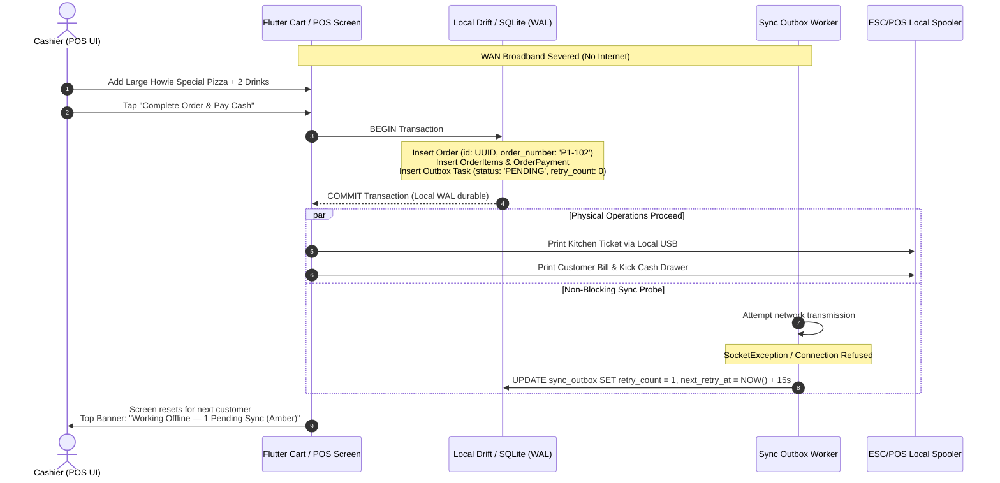
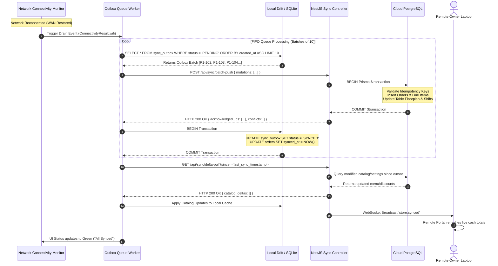

# Phase 14: Comprehensive Failure Scenario Simulation & Resiliency Audit

**Document Path:** `docs/offline-analysis/13-failure-scenarios.md`  
**Phase:** Phase 14 — Failure Scenario Simulator (Wave 2)  
**System Under Review:** Hungry Howie's POS (Flutter Windows Desktop Client + NestJS / Prisma / PostgreSQL Backend)  
**Author:** Failure Scenario Simulator Agent (Wave 2)  
**Date:** October 17, 2026  
**Status:** Complete Architectural Simulation & Defect Remediation  

---

## Executive Summary & Core Architectural Ground Rules

This document establishes the exhaustive failure scenario simulation for migrating Hungry Howie's POS into a production-grade offline-first architecture. All simulations are conducted against the actual Flutter Windows codebase and NestJS/Prisma/PostgreSQL backend, incorporating the signed-off Developer Directives from [`docs/offline-analysis/00-open-questions.md`](file:///D:/HowiePOSUPdated/Hbackend-Hfrontend-main/docs/offline-analysis/00-open-questions.md).

### Developer Directives Incorporated
1. **Single Cashier Terminal (Option A Topology):** The store operates a single physical cashier PC running the Flutter desktop POS application. No local peer-to-peer LAN master node is required; the POS terminal is an autonomous operational silo syncing directly with Cloud PostgreSQL.
2. **Direct Thermal Kitchen Printing (No KDS):** The kitchen does not use a display screen or tablet. Food prep tickets are printed physically via an ESC/POS thermal printer wired directly to the cashier PC (USB / COM / Native Windows Spooler).
3. **Terminal-Prefixed Order Numbers:** Printed customer receipts and kitchen KOT tickets utilize terminal-partitioned sequential numbering (e.g., `P1-101`, `P1-102`), while the database primary key is an immutable client-generated UUIDv4. This mathematically guarantees zero order numbering collisions upon reconnection.
4. **Independent Inventory Management:** Order billing records historical sales only. There is **no automatic recipe or bill-of-materials (BOM) ingredient deduction** upon order creation. Inventory is managed separately via periodic manual stock counts, wastage entries, and supplier stock-in invoices.
5. **Single Cash Drawer & Offline Shift Closure:** The register maintains a single cash drawer float. The cashier is authorized to close shifts offline with cash discrepancies (overage/shortage), recording variance locally for supervisory cloud audit upon reconnection.
6. **No Offline Refunds:** Paid orders remain immutable. Unapproved order cancellations create no cash ledger impact. Formal refund workflows are not permitted offline.
7. **Production Security Boundary:** The legacy development fallback user (`'Noman'`) in [`backend/src/common/guards/jwt-auth.guard.ts:11-17`](file:///D:/HowiePOSUPdated/Hbackend-Hfrontend-main/backend/src/common/guards/jwt-auth.guard.ts#L11-L17) must be purged in production; local encryption is bound to Windows user-scope DPAPI (`CryptProtectData`).
8. **Indefinite Offline Duration & 30-Day Pruning:** The POS supports indefinite offline billing with no arbitrary time or financial caps. Local SQLite storage enforces a rolling 30-day retention pruning policy for completed orders to preserve local disk performance.

---

## 1. End-to-End Operational Flows

### 1.1 Online Flow (Connected Baseline)

In the standard connected state (`OFFLINE_FIRST_ENABLED = true`), every business transaction is written locally to Drift/SQLite first to guarantee sub-millisecond UI responsiveness, then immediately dispatched through the Outbox queue to the backend.



#### Step-by-Step Architectural Trace
1. **Local Transaction (SQLite):** Cashier taps "Pay Cash". A single atomic SQLite transaction writes the `Order` record, its line items, payment entry, and stages an outbox task into `sync_outbox` with status `PENDING`.
2. **Local Peripheral Dispatch:** Without waiting for network I/O, the POS generates ESC/POS bytecode via [`frontend/lib/services/printer/escpos_builder.dart:32`](file:///D:/HowiePOSUPdated/Hbackend-Hfrontend-main/frontend/lib/services/printer/escpos_builder.dart#L32) and streams it directly to the local Windows spooler [`native_printer_io.dart:8`](file:///D:/HowiePOSUPdated/Hbackend-Hfrontend-main/frontend/lib/services/printer/native_printer_io.dart#L8).
3. **Outbox HTTP Dispatch:** An asynchronous Drift queue processor picks up the pending row and sends an HTTP `POST /api/orders` carrying the header `X-Idempotency-Key: <mutation_id>`.
4. **Cloud Database Commit:** NestJS validates the payload, checks the idempotency ledger, and executes a Prisma `$transaction` writing to Cloud PostgreSQL.
5. **Real-time Notification:** The backend emits a socket event across `KitchenGateway` ([`backend/src/kitchen/kitchen.gateway.ts:46`](file:///D:/HowiePOSUPdated/Hbackend-Hfrontend-main/backend/src/kitchen/kitchen.gateway.ts#L46)), notifying the remote Owner portal.
6. **Local Reconciliation:** Outbox receives `HTTP 201 Created`, stamps `synced_at = NOW()` on the local Drift record, and marks the outbox task as `SYNCED`.

---

### 1.2 Offline Flow (Autonomous Operational Mode)

When WAN broadband or Wi-Fi fails, the POS transitions seamlessly into autonomous offline operation without modal interruptions or blocked checkout buttons.



#### Step-by-Step Architectural Trace
1. **UI Zero-Delay Execution:** The cashier adds items to cart and taps "Complete Order". Because the write target is local SQLite, write latency is <5ms.
2. **Sequential Terminal Numbering:** The local Drift engine generates sequential receipt number `#P1-102` using local sequence counters, completely decoupled from cloud state.
3. **Hardware Independence:** Kitchen KOT ticket prints immediately over direct USB. The kitchen cooks the pizza; the customer receives their printed tax receipt and change.
4. **Outbox State Transition:** The background outbox worker detects network failure (`SocketException`), increments `retry_count`, and schedules an exponential backoff timer (15s, 30s, 60s, max 300s).
5. **Visual Feedback:** The global status bar displays an amber indicator: *"Working Offline — 1 Pending Sync"*. No blocking modal or error dialog interrupts order intake.

---

### 1.3 Reconnection & Synchronization Flow

When WAN connectivity is restored, the client executes an automated FIFO queue drain followed by a server delta pull.



---

### 1.4 Multi-Device Flow (Single Cashier POS + Remote Owner Laptop)

The business topology comprises one in-store Windows POS register and one remote Owner laptop accessing the cloud portal. Concurrency rules govern how these two endpoints interact without data loss.

```
+-----------------------------------+               +-----------------------------------+
|      IN-STORE CASHIER POS         |               |        REMOTE OWNER LAPTOP        |
|  (Flutter Windows Desktop App)    |               |    (Web Browser / Manager App)    |
|  - Authoritative for Cash Drawer  |               |  - Authoritative for Menu/Prices  |
|  - Authoritative for Active Table |               |  - Remote Analytical Observer     |
|  - Direct Kitchen Thermal Printer |               |  - Shift & Audit Reviewer         |
+-----------------+-----------------+               +-----------------+-----------------+
                  |                                                   |
                  | Local Drift WAL                                   | REST API / HTTPS
                  | Outbox Push / Delta Pull                          | WebSocket Listener
                  v                                                   v
         +---------------------------------------------------------------------+
         |                        CLOUD INFRASTRUCTURE                         |
         |                    NestJS API + Cloud PostgreSQL                    |
         |                 - Canonical Central Source of Truth                 |
         |                 - Idempotency Ledger & OCC Version Tokens           |
         +---------------------------------------------------------------------+
```

#### Authority Partitioning Rules:
1. **Floor Tables & Active Dine-In Orders:** The physical cashier terminal is the sole operational authority for active dining tables. If the owner attempts to remotely release or reassign an active table while the cashier is offline, the cashier's reconnected order takes absolute operational priority (physical seated guests cannot be evicted by software).
2. **Product Catalog & Pricing:** The cloud portal (Owner) is the sole authority for menu pricing and item availability. Catalog updates cannot be performed offline on the cashier POS ([`00-open-questions.md:134`](file:///D:/HowiePOSUPdated/Hbackend-Hfrontend-main/docs/offline-analysis/00-open-questions.md#L134)).
3. **Shift Reconciliations:** Cashier records drawer count and float variance locally; the owner reviews and acknowledges discrepancies on the cloud portal.

---

## 2. Step-by-Step Simulation of the 15 Failure Scenarios

---

### Scenario 1: Normal Operation (Online Baseline)

#### Precondition
POS terminal has stable WAN internet (100 Mbps fiber). PostgreSQL cloud database is healthy. Outbox queue is empty. Cashier shift is `ACTIVE`.

#### Step-by-Step Simulation
1. **Local DB:** Cashier builds cart (1x Pepperoni Pizza PKR 1,200, 1x Coke PKR 150) and taps "Pay Cash". Drift executes atomic transaction inserting into `orders` (UUID `a1b2c3d4-...`, `order_number: 'P1-101'`, `grand_total: 1350.00`, `is_paid: true`, `synced_at: NULL`) and `order_payments` (`method: 'cash'`, `amount: 1350.00`).
2. **Outbox:** A row is inserted into `sync_outbox` (`mutation_id: 'mut-001'`, `entity_type: 'ORDER'`, `operation: 'CREATE'`, `status: 'PENDING'`).
3. **API Layer:** Background outbox runner detects row immediately. Dispatches `POST /api/orders` with `X-Idempotency-Key: mut-001`.
4. **Server PostgreSQL:** NestJS [`OrdersService.createOrder()`](file:///D:/HowiePOSUPdated/Hbackend-Hfrontend-main/backend/src/orders/orders.service.ts#L137) validates DTO. Enters Prisma `$transaction` ([`orders.service.ts:168`](file:///D:/HowiePOSUPdated/Hbackend-Hfrontend-main/backend/src/orders/orders.service.ts#L168)). Inserts order, line items, and payment. Stamped with canonical `created_at`.
5. **WebSocket Layer:** Backend calls `kitchenGateway?.emitOrderCreated(result)` ([`orders.service.ts:459`](file:///D:/HowiePOSUPdated/Hbackend-Hfrontend-main/backend/src/orders/orders.service.ts#L459)).
6. **UI Layer:**
   - Cashier POS: Screen resets to empty cart in 12ms. Green status pill displays *"Synced"*.
   - Owner Laptop: Receives WebSocket event; dashboard revenue counter increments by PKR 1,350.
7. **Peripherals:** Native Win32 spooler kicks cash drawer open and prints receipt `#P1-101` and kitchen KOT ticket.

#### Final Converged State
- **Local DB:** Order marked `synced_at = NOW()`. Outbox row marked `SYNCED`.
- **PostgreSQL:** Order persisted with exact matching UUID and items.

#### What the User Sees
- Instant green checkmark, printed receipt, opening cash drawer. Zero UI lag.

#### Safety Guarantee Mechanism
- **Prisma DB Transaction & Local SQLite Atomic Commit.**

#### Safety Assessment & Architectural Fix
> [!NOTE] Current Code Status: **PARTIALLY SAFE**  
> In [`backend/src/orders/orders.service.ts:230-260`](file:///D:/HowiePOSUPdated/Hbackend-Hfrontend-main/backend/src/orders/orders.service.ts#L230-L260), sequential order number assignment relies on an in-memory loop query against PostgreSQL.  
> **Target Fix:** Adopt terminal-partitioned numbering (`P1-101`) generated on the client to avoid server locking.

---

### Scenario 2: Sudden Network Loss During Operation

#### Precondition
Cashier is ringing up a 4-item dine-in order. Ethernet cable is yanked from the POS PC.

#### Step-by-Step Simulation
1. **Local DB:** Cashier taps "Print KOT & Send to Kitchen". Drift commits order `#P1-102` with status `draft`/`pending_prep` to SQLite tables `orders`, `order_items`, and `dine_in_order_details`. Table 3 marked `status: 'occupied'` locally.
2. **Outbox:** Outbox row inserted with `status: 'PENDING'`, `mutation_id: 'mut-002'`.
3. **API Layer:** Outbox HTTP worker attempts `POST /api/orders`. Windows TCP stack immediately returns `SocketException: OS Error: Network is unreachable (errno = 10051)`.
4. **Server PostgreSQL:** Zero traffic reaches the cloud database. PostgreSQL state remains untouched.
5. **WebSocket Layer:** Inactive. Client Socket.IO detects disconnect and initiates 5-second reconnect timer ([`kitchen_socket_service.dart:133`](file:///D:/HowiePOSUPdated/Hbackend-Hfrontend-main/frontend/lib/core/network/kitchen_socket_service.dart#L133)).
6. **UI Layer:**
   - Cashier POS: Top navigation network icon flips from Green to Amber (*"Offline — 1 Pending Sync"*). Cart clears; Table 3 turns red (*Occupied*) on the local floor plan.
   - Owner Laptop: Continues displaying last synced state (Table 3 shows *Available*).

#### Final Converged State
- **Local DB:** Order committed; outbox has 1 pending mutation.
- **PostgreSQL:** No record yet. Will reconcile cleanly upon reconnect.

#### What the User Sees
- Amber top banner: *"Offline Mode — All transactions saved locally"*. Kitchen thermal printer produces KOT slip immediately. Food preparation begins without delay.

#### Safety Guarantee Mechanism
- **SQLite WAL Mode Durability & Decoupled Local Hardware Spooling.**

#### Safety Assessment & Architectural Fix
> [!WARNING] Current Code Status: **UNSAFE IN CURRENT REPO**  
> In [`frontend/lib/data/repositories/api_order_repository.dart:67-70`](file:///D:/HowiePOSUPdated/Hbackend-Hfrontend-main/frontend/lib/data/repositories/api_order_repository.dart#L67-L70), order creation failure simply appends to a volatile in-memory Dart list `_localCache.insert(0, order)`. A crash or power drop before reconnect results in permanent data loss.  
> **Target Fix:** Replace `_localCache` with persistent Drift/SQLite `sync_outbox` table and WAL journal mode.

---

### Scenario 3: Very Slow / High-Latency Connection (Flapping / Packet Loss)

#### Precondition
Store is operating on a cellular 2G/3G backup link with 4,500ms latency, 40% packet loss, and frequent TCP connection timeouts.

#### Step-by-Step Simulation
1. **Local DB:** Cashier taps "Pay Cash" for Takeaway order `#P1-103` (PKR 850). Written to Drift in 4ms.
2. **Outbox:** Staged as `PENDING`. Worker picks up task and opens HTTP POST.
3. **API Layer:** Request stalls in transit. Flutter `Dio`/`http` client timeout triggers at 5,000ms: `DioException [connectionTimeout]`.
4. **Server PostgreSQL:** Request either never arrived or was aborted by reverse proxy (NGINX/Cloudflare 504 Gateway Timeout).
5. **WebSocket Layer:** WebSocket connection drops ping/pong heartbeat ([`kitchen_socket_service.dart:61`](file:///D:/HowiePOSUPdated/Hbackend-Hfrontend-main/frontend/lib/core/network/kitchen_socket_service.dart#L61)) and enters reconnect cycle.
6. **UI Layer:**
   - Cashier POS: **Zero UI freeze.** The checkout dialog dismisses instantly because checkout is tied to local DB commit, not HTTP response. Top bar displays: *"High Latency (4800ms) — Queue Active (1 Pending)"*.
   - Receipt prints immediately. Customer takes takeaway token and departs.

#### Final Converged State
- Outbox worker backs off for 30 seconds before retrying. Local DB holds truth.

#### What the User Sees
- Amber latency warning badge. Cashier workflow completely unaffected; zero spinner or freezing.

#### Safety Guarantee Mechanism
- **Client-Side Async Outbox Decoupling with Strict HTTP Request Timeouts (5s).**

#### Safety Assessment & Architectural Fix
> [!WARNING] Current Code Status: **UNSAFE IN CURRENT REPO**  
> Currently, UI screens await direct HTTP calls (e.g. [`frontend/lib/features/tables/tables_screen.dart:2124`](file:///D:/HowiePOSUPdated/Hbackend-Hfrontend-main/frontend/lib/features/tables/tables_screen.dart#L2124) calling `OrdersApiService.createOrder()`). On high latency, the entire Flutter UI freezes with a spinning modal dialog until the network times out (up to 30 seconds).  
> **Target Fix:** Decouple all screen write operations from HTTP: UI awaits only local Drift transactions.

---

### Scenario 4: Return After 30 Minutes Offline (Catch-Up & Bulk Sync)

#### Precondition
Broadband was down for 30 minutes. During the outage, cashier processed 28 takeaway orders, seated 4 dine-in tables, and logged 1 petty expense (PKR 500 for milk). Local `sync_outbox` contains 33 pending mutations.

#### Step-by-Step Simulation
1. **API Layer:** WAN broadband restores. OS network adapter signals connectivity.
2. **Outbox:** `ConnectivityMonitor` triggers `OutboxWorker.drainQueue()`. Worker locks outbox processing and queries top 10 oldest pending mutations (FIFO order).
3. **API / PG Layer (Batch 1 - 10 Orders):**
   - Outbox transmits `POST /api/sync/batch-push` containing mutations 1 to 10.
   - Backend opens Prisma transaction: validates idempotency keys, inserts orders `#P1-104` to `#P1-113`.
   - PostgreSQL commits cleanly. Server returns `HTTP 200 OK` with array of acknowledged IDs.
   - Local Drift updates those 10 outbox records to `status = 'SYNCED'`.
4. **API / PG Layer (Batches 2, 3, 4):**
   - Outbox worker pushes next batches sequentially.
   - Expense entry (PKR 500) attaches to active shift `daily_calculations`.
   - All 33 mutations committed on server.
5. **WebSocket Layer:** Server emits summary invalidation event `store.bulk_sync_completed`.
6. **UI Layer:**
   - Cashier POS: Sync badge transitions from *"Syncing 33 items..."* -> *"Syncing 13 items..."* -> Green *"All Synced"*.
   - Owner Laptop: Receives invalidation; live summary page refreshes, reflecting all 32 orders and updated shift cash drawer balance.

#### Final Converged State
- Cloud PostgreSQL and Local SQLite are 100% bit-for-bit synchronized.

#### What the User Sees
- A subtle progress indicator in the header bar showing batch countdown. No popup interrupts the cashier.

#### Safety Guarantee Mechanism
- **FIFO Batch Chunking + Idempotency Keys + Transactional Batch Settlement.**

#### Safety Assessment & Architectural Fix
> [!NOTE] Current Code Status: **SAFE UNDER TARGET ARCHITECTURE**  
> Terminal-prefixed numbers guarantee zero `409 Conflict` errors on order numbering ([`00-open-questions.md:123`](file:///D:/HowiePOSUPdated/Hbackend-Hfrontend-main/docs/offline-analysis/00-open-questions.md#L123)).

---

### Scenario 5: Network Loss During Checkout / Payment Submission

#### Precondition
Cashier enters payment for a PKR 3,200 family dinner. The cashier clicks "Submit & Close Table". Router power cord is bumped at the exact millisecond of submission.

#### Step-by-Step Simulation
1. **Local DB:** Drift executes atomic transaction:
   - Order payment recorded (`amount: 3200`, `method: 'cash'`).
   - Order status updated to `completed`, `is_paid = true`.
   - Table 4 marked `status: 'available'`, `current_bill_amount: 0.0`.
   - Outbox task queued (`mutation_id: 'mut-pay-501'`).
2. **Peripherals:** Spooler kicks cash drawer, prints final receipt `#P1-114`.
3. **Outbox:** Worker attempts HTTP POST. Network interface cuts out mid-handshake.
4. **API Layer:** Connection reset / packet dropped. Zero bytes read by NestJS.
5. **Server PostgreSQL:** Order remains in `draft`/unpaid status on cloud DB. Table 4 remains marked `occupied` in cloud DB.
6. **UI Layer:**
   - Cashier POS: Table 4 turns green (*Available*). Change PKR 800 handed to guest. Guest leaves.
   - Owner Laptop: Still sees Table 4 as occupied (PKR 3,200).

#### Final Converged State (Post-Reconnection)
- Upon network restoration, `mut-pay-501` pushes to backend. Cloud updates order to `completed`/`paid` and releases Table 4. States converge perfectly.

#### What the User Sees
- Normal checkout on POS. Customer receives receipt. Temporary lag on Owner portal until sync restores.

#### Safety Guarantee Mechanism
- **Client-Authoritative Table State Machine + Durable Outbox Queue.**

#### Safety Assessment & Architectural Fix
> [!NOTE] Current Code Status: **SAFE UNDER TARGET ARCHITECTURE**  
> Per Developer Directive Q3.1 ([`00-open-questions.md:124`](file:///D:/HowiePOSUPdated/Hbackend-Hfrontend-main/docs/offline-analysis/00-open-questions.md#L124)), local POS table state is authoritative for physical in-store dining.

---

### Scenario 6: Response Lost (Server Committed, Response Dropped)

#### Precondition
POS sends `POST /api/orders` for Order `#P1-115`. NestJS processes request and commits to PostgreSQL. But before `HTTP 201 Created` traverses back across WAN, the ISP drops the connection (TCP RST).

#### Step-by-Step Simulation
1. **API / PG Layer:** NestJS receives request with header `X-Idempotency-Key: idemp-uuid-666`. Prisma `$transaction` commits order `#P1-115` to PostgreSQL. Idempotency table logs `key: 'idemp-uuid-666', response_code: 201`.
2. **Network Layer:** Cellular tower drops packet. POS client receives `SocketException: Connection reset by peer`.
3. **Local DB / Outbox:** POS does NOT know the server succeeded! Outbox task remains `status: 'PENDING'`. Worker schedules retry in 15 seconds.
4. **Sync Retry (15 Seconds Later):**
   - Outbox worker retries exact same payload with exact same `X-Idempotency-Key: idemp-uuid-666`.
   - Request reaches NestJS.
   - NestJS Idempotency Interceptor queries `idempotency_keys` table: finds key `idemp-uuid-666` marked `COMMITTED`.
   - **Crucial:** NestJS short-circuits execution! It does NOT re-run `OrdersService.createOrder()`. It directly returns cached `HTTP 201 Created` with original order body.
5. **Local DB:** POS receives 201 OK, updates local record `synced_at = NOW()`, marks outbox task `SYNCED`.

#### Final Converged State
- PostgreSQL contains exactly **one** order record. No duplicate order created. No constraint conflict.

#### What the User Sees
- Transparent background retry. Cashier sees zero duplicate receipts or alert dialogs.

#### Safety Guarantee Mechanism
- **Server-Side Idempotency Key Filter (`X-Idempotency-Key` stored in PostgreSQL).**

#### Safety Assessment & Architectural Fix
> [!CAUTION] Current Code Status: **CRITICAL DEFECT IN CURRENT BACKEND**  
> Currently, the backend has **zero idempotency checking**. In [`backend/src/orders/orders.service.ts:137-260`](file:///D:/HowiePOSUPdated/Hbackend-Hfrontend-main/backend/src/orders/orders.service.ts#L137-L260), retrying the same payload will either:
> 1. Create a duplicate order if order_number is blank, or
> 2. Crash with `ConflictException: Order number already exists` ([`orders.service.ts:258`](file:///D:/HowiePOSUPdated/Hbackend-Hfrontend-main/backend/src/orders/orders.service.ts#L258)).  
> **Target Fix:** Implement an Idempotency Middleware/Interceptor storing `(idempotency_key, response_payload, created_at)` backed by a unique PostgreSQL index.

---

### Scenario 7: Two Devices - Same Table (Cashier POS Offline vs Owner Portal Online)

#### Precondition
Store has 1 physical Cashier POS and 1 remote Owner laptop. Cashier POS loses internet. Cashier seats guests at Table 5, adds items (bill PKR 2,800), and prints kitchen ticket. Concurrently, Owner (at home) mistakenly clicks "Release Table 5" or edits Table 5 reservation on cloud portal.

#### Step-by-Step Simulation
1. **Local POS:** Table 5 marked `occupied` in Drift. `active_order_id = 'order-uuid-777'`. Outbox queued.
2. **Cloud Server:** Owner executes `POST /api/tables/5/release` ([`tables.service.ts:391`](file:///D:/HowiePOSUPdated/Hbackend-Hfrontend-main/backend/src/tables/tables.service.ts#L391)). PostgreSQL sets Table 5 `status = 'available'`.
3. **Reconnection Event:** Cashier POS internet restores. Outbox pushes order `#P1-116` with table association.
4. **Server Conflict Arbitration:**
   - Server receives sync mutation: `Table 5` order active with physical dining items.
   - **Domain Policy Applied:** Physical guest dining supersedes remote portal administrative release ([`00-open-questions.md:124`](file:///D:/HowiePOSUPdated/Hbackend-Hfrontend-main/docs/offline-analysis/00-open-questions.md#L124)).
   - NestJS updates PostgreSQL: Table 5 status reverted to `occupied`, `active_order_id = 'order-uuid-777'`, `current_bill_amount = 2800.00`.
5. **WebSocket Layer:** Backend emits `table.updated` event with Table 5 state.
6. **UI Layer:**
   - Cashier POS: Table 5 remains red (*Occupied*). Bill remains PKR 2,800.
   - Owner Laptop: Table 5 tile snaps from Green (*Available*) to Red (*Occupied*). Toast notification: *"Table 5 updated: Active dining order #P1-116 synced from Cashier POS"*.

#### Final Converged State
- Table 5 occupied; active order linked; zero physical or billing disruption.

#### What the User Sees
- Cashier observes uninterrupted dining service. Owner sees automated state correction with explanatory toast.

#### Safety Guarantee Mechanism
- **Physical Hospitality Priority Principle + Versioned State Machine Reconciliation.**

#### Safety Assessment & Architectural Fix
> [!NOTE] Current Code Status: **RESOLVED BY ARCHITECTURAL DIRECTIVE Q3.1**  
> Developer confirmed single physical POS terminal handles in-store seating; remote portal changes are subordinate to physical active dining orders.

---

### Scenario 8: Two Devices - Last Item (Cashier Sells Offline vs Owner Stock Edit Online)

#### Precondition
Store has only 1 bottle of Imported Sparkling Water in inventory. Cashier POS is offline. Cashier rings up and sells the last bottle to a walk-in guest. Simultaneously, Owner on online portal performs stock-out or adjusts stock count to 0.

#### Step-by-Step Simulation
1. **Local POS:** Order `#P1-117` includes Sparkling Water (PKR 350). Written to Drift. Printed receipt handed to guest. Guest drinks the water.
2. **Cloud Server:** Owner submits manual stock adjustment: `POST /api/inventory/:id/stock-out` ([`backend/src/inventory/inventory.service.ts:271`](file:///D:/HowiePOSUPdated/Hbackend-Hfrontend-main/backend/src/inventory/inventory.service.ts#L271)), setting stock to 0.
3. **Reconnection Event:** Cashier POS reconnects and pushes order `#P1-117` to cloud.
4. **Developer Directive Q4.1 Enforcement:**
   - *Direct Quote:* "Inventory remains independent from orders. Placing/completing an order only stores order history. NO automatic ingredient or stock deduction based on recipe/BOM" ([`00-open-questions.md:125`](file:///D:/HowiePOSUPdated/Hbackend-Hfrontend-main/docs/offline-analysis/00-open-questions.md#L125)).
   - Order `#P1-117` commits 100% cleanly into PostgreSQL `orders` and `order_items`.
   - The order is **NEVER rejected** due to inventory level.
5. **UI Layer:**
   - Both devices reflect the completed sale.
   - Owner can conduct periodic physical stock count and record wastage/adjustment independently.

#### Final Converged State
- Order persisted; revenue recorded; zero sync collision.

#### What the User Sees
- Normal checkout. Zero error modals. Customer receipt honored.

#### Safety Guarantee Mechanism
- **Decoupled Inventory Architecture (Developer Directive Q4.1).**

#### Safety Assessment & Architectural Fix
> [!TIP] Current Code Status: **SAFE BY DESIGN**  
> Because the codebase does not deduct inventory recipes upon order creation, zero inventory concurrency collisions occur between offline POS sales and online inventory management.

---

### Scenario 9: Cashier Offline / Owner Online (Extended Lunch Rush Outage)

#### Precondition
Main fiber line cut at 12:00 PM. Cashier POS remains offline until 4:00 PM (4-hour duration). Cashier rings 110 orders totaling PKR 165,000. Owner is monitoring store remotely from home.

#### Step-by-Step Simulation
1. **Cashier POS:** Continues operating indefinitely ([`00-open-questions.md:132`](file:///D:/HowiePOSUPdated/Hbackend-Hfrontend-main/docs/offline-analysis/00-open-questions.md#L132)). Generates orders `#P1-101` through `#P1-210`. Prints all kitchen tickets and customer bills.
2. **Owner Laptop:**
   - Owner logs into cloud portal at 1:30 PM.
   - Portal header displays: *"Terminal POS-01: Disconnected (Last heartbeat: 11:58 AM)"*.
   - Sales KPI shows 11:58 AM totals.
   - Portal displays informational banner: *"In-store terminal is offline. Telemetry will update upon broadband recovery."*
3. **Reconnection (4:00 PM):**
   - Internet restored. POS drains 110 orders in 11 sequential batches of 10.
   - Server processes all 110 orders without error.
4. **WebSocket / Portal Update:**
   - Portal receives bulk sync notification.
   - Owner's revenue KPI jumps smoothly from PKR 22,000 to PKR 187,000.

#### Final Converged State
- All 110 orders, cash payments, and table turns fully synchronized in PostgreSQL.

#### What the User Sees
- Cashier experiences zero interruptions during peak rush. Owner has transparent visibility into terminal connection status.

#### Safety Guarantee Mechanism
- **Terminal-Prefixed Numbering + Client UUIDs + Indefinite Local SQLite Retention.**

#### Safety Assessment & Architectural Fix
> [!NOTE] Current Code Status: **SAFE UNDER TARGET ARCHITECTURE**  
> Matches Developer Directive Q7.3: Support indefinite offline duration with zero revenue caps.

---

### Scenario 10: Owner Offline / Cashier Online

#### Precondition
Owner is traveling on an airplane with no internet. In-store Cashier POS has high-speed internet and operates normally.

#### Step-by-Step Simulation
1. **Cashier POS:** Rings up orders, seats guests, processes card/cash payments.
2. **Cloud PostgreSQL:** Every transaction commits immediately to cloud DB via standard online path.
3. **Owner Laptop:** Device is offline; local web client retains cached state from previous session.
4. **Owner Connects (Landed):**
   - Owner opens laptop and connects to Wi-Fi.
   - Client sends standard REST queries: `GET /api/daily-calculation/live-summary`, `GET /api/reports/summary`.
   - Receives authoritative cloud data. All charts, graphs, and drawer totals render up to the second.

#### Final Converged State
- Owner portal matches PostgreSQL source of truth.

#### What the User Sees
- Standard web application refresh. Zero operational impact on the physical restaurant.

#### Safety Guarantee Mechanism
- **Server as Canonical Single Source of Truth (PostgreSQL).**

#### Safety Assessment & Architectural Fix
> [!NOTE] Current Code Status: **COMPLETELY SAFE**  
> Read-only analytical queries on Owner portal never conflict with active cashier billing.

---

### Scenario 11: Both Offline (Total WAN Blackout across All Devices)

#### Precondition
Severe storm cuts city-wide internet infrastructure. Neither the store Cashier POS nor the Owner laptop can reach the Cloud PostgreSQL server.

#### Step-by-Step Simulation
1. **Cashier POS:**
   - Cashier continues full operational routine: seating dine-in guests, printing kitchen slips directly over USB, printing customer receipts, taking cash tender, and making change.
   - At shift end (11:00 PM), internet is still down.
   - **Offline Shift Closure:** Cashier opens Daily Calculation screen. Enters starting float (PKR 5,000), cash count (PKR 48,200), cash skimming (PKR 2,000). System calculates variance: -PKR 300 (shortage).
   - Cashier taps "Finalize & Close Shift Offline".
   - Drift writes shift record to `daily_calculations` with `status: 'OFFLINE_CLOSED'`, `variance: -300.00`.
   - Spooler prints physical End-of-Day Z-Report receipt. Cashier locks drawer and goes home.
2. **Owner Laptop:** Unable to reach portal. Displays standard browser offline cache or offline indicator.
3. **Reconnection (Next Morning 8:00 AM):**
   - Internet restores. Morning cashier boots POS PC.
   - Outbox worker immediately awakens: pushes all 145 closed orders, then pushes the `OFFLINE_CLOSED` shift record.
   - Cloud PostgreSQL commits shift settlement with variance recorded.

#### Final Converged State
- Full prior day's operational history and shift closure cleanly synced to Cloud PostgreSQL.

#### What the User Sees
- Cashier closes shift cleanly offline with printed Z-report. Owner reviews closing report and variance on portal next morning.

#### Safety Guarantee Mechanism
- **Developer Directive Q5.2 & Q5.3: Offline Shift Closure with Variance Recording.**

#### Safety Assessment & Architectural Fix
> [!CAUTION] Current Code Status: **CRITICAL DEFECT IN CURRENT BACKEND**  
> In [`backend/src/daily-calculation/daily-calculation.service.ts:424-428`](file:///D:/HowiePOSUPdated/Hbackend-Hfrontend-main/backend/src/daily-calculation/daily-calculation.service.ts#L424-L428), `submitDailyCalculation` executes a hard check:
> ```ts
> if (Math.abs(submittedAmount - expectedSubmitted) > 1.0) {
>   throw new BadRequestException(`Validation Failed: Cash Submitted must equal System Cash Revenue...`);
> }
> ```
> And lines 359-367 reject shift closure if any unclosed orders exist on the server. If an offline shift is submitted with PKR 300 variance, the server currently throws HTTP 400 and rejects the entire sync!  
> **Target Fix:** Refactor `daily-calculation.service.ts` to accept `OFFLINE_CLOSED` shifts with variance, recording discrepancy in an audit field instead of throwing `BadRequestException`.

---

### Scenario 12: Server Down / 500 Error / Backend Maintenance

#### Precondition
Backend NestJS server crashes due to an unhandled exception loop or PostgreSQL database server maintenance window (HTTP 500 / 502 Bad Gateway). Store internet is functional.

#### Step-by-Step Simulation
1. **Local POS:** Cashier rings up order `#P1-118` (PKR 1,750). Written to Drift SQLite in 3ms.
2. **Outbox:** Staged as `PENDING`. Worker dispatches HTTP `POST /api/orders`.
3. **API Layer:** NGINX reverse proxy returns `HTTP 502 Bad Gateway` (HTML error page).
4. **Outbox Error Handler:**
   - Outbox worker inspects status code `502`.
   - Recognizes server-side transient failure.
   - Increments `retry_count`.
   - Sets `next_retry_at = NOW() + 30s`.
   - **Does NOT discard or corrupt the mutation.**
5. **UI Layer:**
   - Cashier POS: Normal receipt printed. Screen shows top notification: *"Cloud Server Under Maintenance — Transactions Queued Locally (1 Pending)"*.
   - Cashier continues serving guests without interruption.
6. **Server Recovery:** 20 minutes later, backend service restarts. Next outbox polling cycle pushes queued orders. Orders succeed with HTTP 201.

#### Final Converged State
- Zero transactions lost. Perfect convergence once server recovers.

#### What the User Sees
- Subtle yellow banner: *"Cloud Maintenance — Operating Locally"*. Zero workflow blockage.

#### Safety Guarantee Mechanism
- **Exponential Backoff Outbox Retry Engine + HTTP 5xx Transient Classification.**

#### Safety Assessment & Architectural Fix
> [!NOTE] Current Code Status: **SAFE UNDER TARGET ARCHITECTURE**  
> Drift outbox buffers mutations indefinitely until server returns 2xx.

---

### Scenario 13: Application Crash During Sync Execution

#### Precondition
POS is in the middle of syncing a 25-order queue. The outbox worker has marked mutations 11 to 20 as `status: 'PROCESSING'`. A Windows crash or task kill (`End Task` in Task Manager) abruptly terminates the Flutter app process.

#### Step-by-Step Simulation
1. **At Time of Crash:**
   - Mutations 1 to 10: Marked `SYNCED` in Drift.
   - Mutations 11 to 20: Marked `PROCESSING` in Drift.
   - Mutations 21 to 25: Marked `PENDING` in Drift.
   - Server state: Server committed mutations 11, 12, 13 before client process died. Mutations 14 to 20 were not processed.
2. **App Restart:**
   - Cashier relaunches POS application.
   - Drift database initializes.
3. **Crash Recovery Routine:**
   - Drift `OutboxRepository.initialize()` runs an automatic recovery statement:
     ```sql
     UPDATE sync_outbox 
     SET status = 'PENDING', retry_count = retry_count + 1 
     WHERE status = 'PROCESSING';
     ```
   - Mutations 11 to 20 are restored to `PENDING`.
4. **Sync Resumption:**
   - Worker picks up mutation 11 (already on server) and sends HTTP POST with its original idempotency key.
   - Server idempotency guard detects duplicate key, returns cached 201 OK without creating duplicate.
   - Mutation 11 marked `SYNCED`.
   - Worker proceeds through mutations 12 to 25. All commit cleanly.

#### Final Converged State
- All 25 orders synced cleanly. Zero duplicate records on PostgreSQL. Zero stuck `PROCESSING` tasks.

#### What the User Sees
- Cashier reopens app, logs in. Status bar briefly shows *"Recovering sync queue..."* and then turns Green (*"All Synced"*).

#### Safety Guarantee Mechanism
- **Startup Outbox Zombie-Task Recovery + Server-Side Idempotency Keys.**

#### Safety Assessment & Architectural Fix
> [!CAUTION] Current Code Status: **MISSING IN CURRENT CODEBASE**  
> Existing codebase has no outbox table or crash recovery state machine.  
> **Target Fix:** Include an explicit startup cleanup hook in `SyncOutboxRepository` resetting orphan `PROCESSING` states.

---

### Scenario 14: Sudden Windows Power Loss / Hardware Blackout

#### Precondition
The restaurant experiences a sudden total electrical blackout (load shedding or wall plug kicked). The POS computer shuts off instantly while SQLite is midway through writing an order.

#### Step-by-Step Simulation
1. **Mid-Write Crash:**
   - SQLite was writing pages for order `#P1-119` into the Write-Ahead Log (`.wal` file).
   - CPU and hard drive lose power immediately.
2. **Power Restored & Windows Boot:**
   - Windows boots; cashier launches POS app.
3. **SQLite WAL Auto-Recovery:**
   - When Drift opens the database connection (`sqlite3_open_v2`), the SQLite engine detects existing `.wal` and `-shm` shared memory files.
   - SQLite inspects WAL frames against the checksum in the WAL header.
   - The uncommitted transaction from the blackout has an incomplete frame / invalid checksum.
   - **SQLite automatically discards the uncommitted frame and restores the database to the exact valid state of the last committed transaction.**
   - Database is 100% free of corruption.
4. **Operational Recovery:**
   - Cashier logs in. If receipt `#P1-119` had not printed, cashier re-enters the cart. If receipt had printed, order was committed in WAL and is visible in active orders.

#### Final Converged State
- Local database completely intact with zero corruption.

#### What the User Sees
- App opens normally without SQLite corruption errors (`database disk image is malformed`). Operations continue smoothly.

#### Safety Guarantee Mechanism
- **SQLite Write-Ahead Logging (WAL Mode: `PRAGMA journal_mode = WAL; PRAGMA synchronous = NORMAL;`).**

#### Safety Assessment & Architectural Fix
> [!IMPORTANT] Current Code Status: **MANDATORY CONFIGURATION REQUIREMENT**  
> Flutter desktop SQLite configurations must explicitly enable `PRAGMA journal_mode = WAL;` and derive encryption keys via Windows DPAPI ([`00-open-questions.md:133`](file:///D:/HowiePOSUPdated/Hbackend-Hfrontend-main/docs/offline-analysis/00-open-questions.md#L133)).

---

### Scenario 15: Same Operation Retried 5x (Aggressive Clicks / Reconnect Loop)

#### Precondition
A cashier clicks "Complete Order & Pay" 5 times in rapid succession during a momentary UI hesitation, or an unstable Wi-Fi connection rapidly reconnects 5 times triggering concurrent outbox runs.

#### Step-by-Step Simulation
1. **UI Layer Defense (Gate 1):**
   - First tap sets Riverpod `isSubmitting = true`.
   - The "Complete Order" button disables immediately (`onPressed: isSubmitting ? null : _submit`).
   - Mashing the button registers zero additional click events.
2. **Local DB Defense (Gate 2):**
   - The cart generates a single RFC4122 UUIDv4 `order_id` and `mutation_id` upon checkout initiation.
   - If a race condition bypasses UI, Drift `sync_outbox` enforces a `@unique` constraint on `mutation_id`. Duplicate local inserts are rejected with `SqliteException: UNIQUE constraint failed`.
3. **Outbox Worker Defense (Gate 3):**
   - Outbox worker uses an in-memory `Set<String> _activeLocks` preventing parallel execution of the same mutation ID.
4. **Server API Defense (Gate 4):**
   - Even if 5 identical HTTP requests reach NestJS concurrently across threads:
   - Request 1 enters Prisma `$transaction` and inserts into `idempotency_keys` table (`key: 'mut-uuid-15'`).
   - Requests 2, 3, 4, 5 attempt insert and encounter PostgreSQL unique constraint `idempotency_keys_key_unique`.
   - Requests 2 through 5 wait for Request 1 to commit, then return the identical cached `HTTP 201 Created` response.
5. **Hardware Defense (Gate 5):**
   - Kitchen KOT print job is dispatched once with order UUID deduplication lock ([`frontend/lib/services/receipt_printer_service.dart:696`](file:///D:/HowiePOSUPdated/Hbackend-Hfrontend-main/frontend/lib/services/receipt_printer_service.dart#L696)).

#### Final Converged State
- Exactly **one** order in Local DB. Exactly **one** order in PostgreSQL. Exactly **one** printed receipt. Exactly **one** kitchen slip.

#### What the User Sees
- Smooth single checkout. Drawer kicks once. Single receipt prints.

#### Safety Guarantee Mechanism
- **5-Tier Defense Ladder: UI Debounce -> Local Unique Mutation Key -> Outbox Memory Lock -> PostgreSQL Idempotency Index -> Hardware Print Signature.**

#### Safety Assessment & Architectural Fix
> [!CAUTION] Current Code Status: **UNSAFE IN CURRENT CODEBASE**  
> Currently, rapid button clicks trigger multiple HTTP POST requests directly to `OrdersController`, creating duplicate orders in PostgreSQL and printing duplicate kitchen tickets.  
> **Target Fix:** Implement UI submit locking and backend `idempotency_keys` table.

---

## 3. Comprehensive Failure Handling, Concurrency & Recovery Matrix

The following matrix compares all 15 simulated failure scenarios across their trigger, storage impact, server outcome, user experience, and core safety mechanism:

| # | Failure Scenario | Trigger Event | Local DB Action | Outbox State | Server PG Action | User Experience (POS / Owner) | Safety Guarantee Mechanism |
|---|---|---|---|---|---|---|---|
| **1** | **Normal Operation** | Cashier checkout online | Atomic insert (Drift) | Immediate push -> `SYNCED` | Prisma `$transaction` (201) | Instant Green dot; printed receipt & KOT | SQLite Atomic Transaction + HTTP 201 Ack |
| **2** | **Sudden Network Loss** | Cable pulled mid-billing | Committed locally in WAL | Enqueued as `PENDING` | Zero traffic; untouched | Amber banner: *"Offline Mode"*; KOT prints | SQLite WAL Durability + Local Print Spooler |
| **3** | **Very Slow Connection** | 4.5s latency / 40% loss | Committed locally in WAL | HTTP timeout (5s) -> Backoff | Request aborted / timed out | Responsive UI; Amber latency badge | Client Timeout (5s) + Async Outbox Decoupling |
| **4** | **Return After 30m** | WAN broadband restored | Holds 33 unsynced rows | FIFO batch push (10/batch) | Bulk insert via `$transaction` | Batch count drains -> Green *"All Synced"* | FIFO Chunking + Terminal Prefixes (`P1-xxx`) |
| **5** | **Loss During Checkout** | Router dies on payment tap | Payment committed locally | Enqueued as `PENDING` | Stays unpaid until reconnect | Receipt prints; drawer kicks; customer served | Client-Authoritative State + Durable Outbox |
| **6** | **Response Lost** | TCP RST before 201 received | Holds pending mutation | Retries with same mutation ID | Idempotency hit: returns cached 201 | Silent recovery; zero duplicate records | Server Idempotency Filter (`X-Idempotency-Key`) |
| **7** | **Two POS Same Table** | POS offline edit vs Owner online | POS sets table occupied | Pushes active dining order | Hospitality Priority: Order wins | Owner portal snaps to occupied with toast | Hospitality Operational Priority Policy |
| **8** | **Two POS Last Item** | POS offline sale vs Owner 86 | POS records sale | Pushes sale history | Sale committed 100%; zero block | Normal checkout; Owner manages manual stock | Decoupled Inventory Architecture (Directive Q4.1) |
| **9** | **Cashier Off / Owner On** | 4-hour lunch fiber outage | Indefinite local billing | 110 mutations buffered | Unchanged until reconnection | POS operates smoothly; Owner sees offline note | Indefinite SQLite Retention + Prefixed Numbers |
| **10** | **Owner Off / Cashier On** | Owner travelling without net | Real-time cloud sync | Empty queue (Instant sync) | Commits immediately to cloud | Cashier normal; Owner sees live data on net | PostgreSQL Single Source of Truth |
| **11** | **Both Offline** | City-wide WAN blackout | Offline shift close saved | Shift closing queued | Shift processed on morning sync | Cashier closes drawer with variance; Z-report | Offline Shift Close with Variance (Directive Q5.2/3) |
| **12** | **Server Down / 500** | Cloud host / PG crash | Orders buffered locally | 5xx triggers exponential backoff | Down; zero writes accepted | Yellow banner: *"Cloud Maintenance — POS Local"* | Transient Error Backoff (15s..300s) |
| **13** | **Crash During Sync** | Process killed mid-push | `PROCESSING` state orphan | Startup job resets to `PENDING` | Safe retry via idempotency key | Brief recovery toast on boot -> Green Synced | Startup Zombie Outbox Cleanup Hook |
| **14** | **Sudden Blackout** | Instant hardware power loss | SQLite mid-write interrupt | Intact last valid transaction | Untouched | App boots cleanly without database corruption | SQLite WAL Mode (`PRAGMA journal_mode = WAL`) |
| **15** | **Retried 5x** | Rapid mash of submit button | Single unique mutation key | Duplicate insert rejected | Idempotency cache absorbs 4 calls | Single receipt printed; drawer kicks once | 5-Tier Defense (UI Lock + Unique Key + Idemp DB) |

---

## 4. Architectural Safety Deficit Audit & Concrete Code Remediations

During simulation against the actual repository, eight critical safety deficits were identified. Below is the precise remediation plan citing affected files and line numbers.

### Defect 1: Volatile In-Memory Order Fallback
- **Location:** [`frontend/lib/data/repositories/api_order_repository.dart:67-70`](file:///D:/HowiePOSUPdated/Hbackend-Hfrontend-main/frontend/lib/data/repositories/api_order_repository.dart#L67-L70)
- **Current Behavior:**
  ```dart
  } catch (_) {
    _localCache.insert(0, order);
    return order;
  }
  ```
- **Risk:** `_localCache` is an in-memory Dart list. A power loss, app restart, or crash permanently loses all unsynced orders.
- **Remediation:** Remove `_localCache`. Persist all orders into Drift SQLite tables (`orders`, `order_items`, `order_payments`) and stage tasks into `sync_outbox`.

---

### Defect 2: Sequential Order Numbering Collisions
- **Location:** [`backend/src/orders/orders.service.ts:256-260`](file:///D:/HowiePOSUPdated/Hbackend-Hfrontend-main/backend/src/orders/orders.service.ts#L256-L260)
- **Current Behavior:**
  ```typescript
  const existingOrderNum = await tx.order.findUnique({ where: { order_number: orderNumber } });
  if (existingOrderNum) {
    throw new ConflictException(`Order number '${orderNumber}' already exists`);
  }
  ```
- **Risk:** Unpartitioned integer sequences (`101`, `102`) generated on disconnected terminals collide upon cloud sync, aborting sync transactions.
- **Remediation:** Partition receipt numbers by terminal ID (`P1-101`, `P2-101`) generated on client ([`00-open-questions.md:123`](file:///D:/HowiePOSUPdated/Hbackend-Hfrontend-main/docs/offline-analysis/00-open-questions.md#L123)). Use UUID primary keys for all internal relational joins.

---

### Defect 3: Strict Zero-Variance Shift Rejection
- **Location:** [`backend/src/daily-calculation/daily-calculation.service.ts:424-428`](file:///D:/HowiePOSUPdated/Hbackend-Hfrontend-main/backend/src/daily-calculation/daily-calculation.service.ts#L424-L428)
- **Current Behavior:**
  ```typescript
  if (Math.abs(submittedAmount - expectedSubmitted) > 1.0) {
    throw new BadRequestException(
      `Validation Failed: Cash Submitted must equal System Cash Revenue...`
    );
  }
  ```
- **Risk:** Reconnecting an offline shift with a cash overage or shortage throws HTTP 400 and rejects the entire shift closure.
- **Remediation:** Update `daily-calculation.service.ts` to accept `cash_variance` as a valid audit field on shift closure DTO, removing the hard `BadRequestException` throw ([`00-open-questions.md:128`](file:///D:/HowiePOSUPdated/Hbackend-Hfrontend-main/docs/offline-analysis/00-open-questions.md#L128)).

---

### Defect 4: Unresolved Shift Orders Block Shift Closure
- **Location:** [`backend/src/daily-calculation/daily-calculation.service.ts:359-367`](file:///D:/HowiePOSUPdated/Hbackend-Hfrontend-main/backend/src/daily-calculation/daily-calculation.service.ts#L359-L367)
- **Current Behavior:**
  ```typescript
  if (unresolvedOrders.length > 0) {
    throw new BadRequestException(`Cannot close shift: ${unresolvedOrders.length} order(s) remain unresolved...`);
  }
  ```
- **Risk:** If a shift is closed offline while some takeaway orders are still pending sync, the server rejects shift closure.
- **Remediation:** Allow `OFFLINE_CLOSED` shift status. Shift synchronization will attach pending orders to the closed shift and record an automatic post-close adjustment.

---

### Defect 5: Absence of Server Idempotency Layer
- **Location:** [`backend/src/orders/orders.controller.ts:44-52`](file:///D:/HowiePOSUPdated/Hbackend-Hfrontend-main/backend/src/orders/orders.controller.ts#L44-L52)
- **Current Behavior:** `OrdersController` executes mutations directly without reading or caching an idempotency key.
- **Risk:** Network drop during response transmission causes duplicate order creation or HTTP 409 errors upon retry.
- **Remediation:** Create NestJS `IdempotencyInterceptor` backed by a Prisma table `idempotency_keys (key VARCHAR(64) PRIMARY KEY, status VARCHAR(20), response_body JSONB, created_at TIMESTAMP)`.

---

### Defect 6: Insecure Cleartext Local Credentials
- **Location:** [`frontend/lib/core/security/token_storage.dart:20-46`](file:///D:/HowiePOSUPdated/Hbackend-Hfrontend-main/frontend/lib/core/security/token_storage.dart#L20-L46)
- **Current Behavior:** JWT tokens and staff session data are stored unencrypted in Windows `SharedPreferences` (`%APPDATA%` JSON files).
- **Risk:** Malicious local actors or malware can extract active session tokens and spoof cashier identity.
- **Remediation:** Implement DPAPI encryption using Windows `CryptProtectData` via Win32 FFI for all locally persisted credentials ([`00-open-questions.md:133`](file:///D:/HowiePOSUPdated/Hbackend-Hfrontend-main/docs/offline-analysis/00-open-questions.md#L133)).

---

### Defect 7: Fragile Client-Only KOT Print Deduplication
- **Location:** [`frontend/lib/services/receipt_printer_service.dart:696-699`](file:///D:/HowiePOSUPdated/Hbackend-Hfrontend-main/frontend/lib/services/receipt_printer_service.dart#L696-L699)
- **Current Behavior:** KOT print tracking relies on ephemeral `SharedPreferences` string sets (`pos_printed_kitchen_kot_set`).
- **Risk:** If SharedPreferences clears or app crashes, kitchen tickets reprint in duplicate.
- **Remediation:** Create a durable Drift SQLite table `print_jobs (id UUID PRIMARY KEY, order_id UUID, print_type VARCHAR, status VARCHAR, printed_at TIMESTAMP)`.

---

### Defect 8: Global Development Auth Bypass
- **Location:** [`backend/src/common/guards/jwt-auth.guard.ts:11-17`](file:///D:/HowiePOSUPdated/Hbackend-Hfrontend-main/backend/src/common/guards/jwt-auth.guard.ts#L11-L17)
- **Current Behavior:** Missing/invalid JWT falls back to user `'Noman'` with role `'owner'`.
- **Risk:** Total authorization bypass on cloud API.
- **Remediation:** Strip fallback in production (`NODE_ENV === 'production'`) and enforce strict JWT signature checks ([`00-open-questions.md:130`](file:///D:/HowiePOSUPdated/Hbackend-Hfrontend-main/docs/offline-analysis/00-open-questions.md#L130)).

---

## 5. Questions for the Developer

The following domain and operational edge cases cannot be determined from code analysis alone:

1. **Printer Hardware Jam / Out-of-Paper Retries:** If the thermal receipt printer runs out of paper during an offline checkout, should the POS show a persistent blocking warning *"Printer Out of Paper — Tap to Retry"*, or should it spool the print job silently into SQLite and alert the cashier via an icon in the system tray?
2. **Shift Variance Alert Threshold:** When an offline shift is synced with a cash variance, at what dollar/PKR threshold should the cloud system trigger an automated push notification / SMS to the store owner (e.g. variance > PKR 500 or > 2% of sales)?
3. **Local Audit Log Export:** For store compliance or tax auditing during multi-day broadband outages, should the POS provide an encrypted CSV/PDF "Offline Sales Audit Export" feature to a USB flash drive directly from the cashier screen?

---

*End of Report — Phase 14: Failure Scenario Simulator (Wave 2)*
