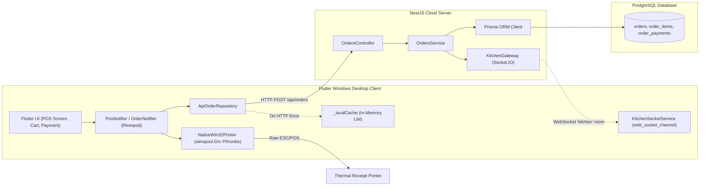
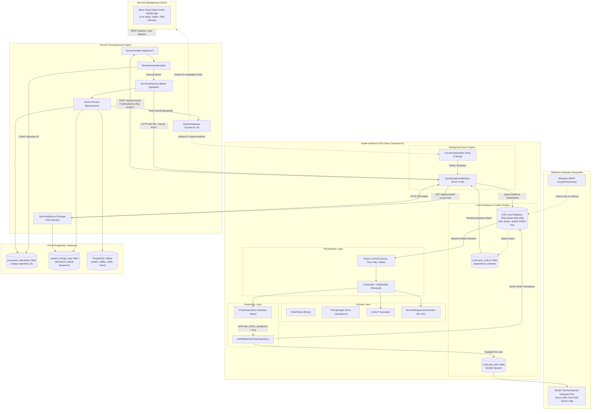
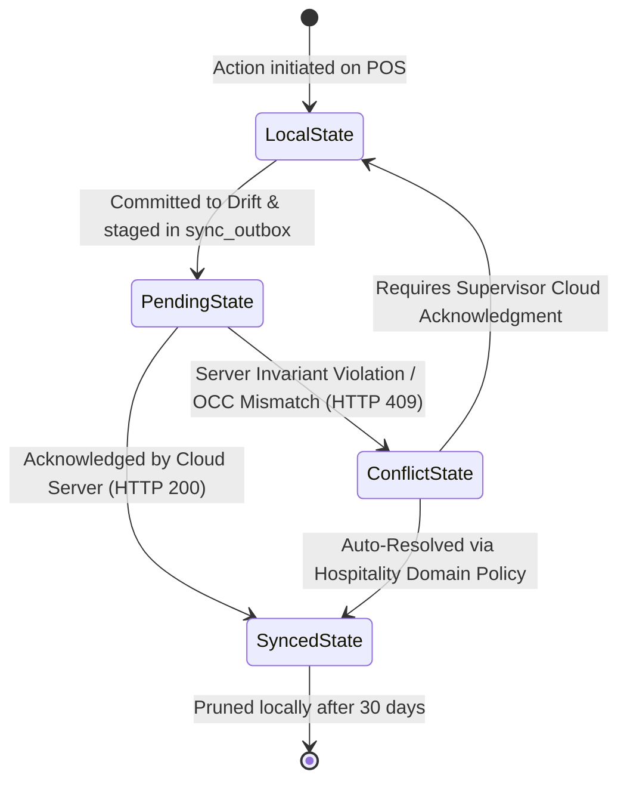
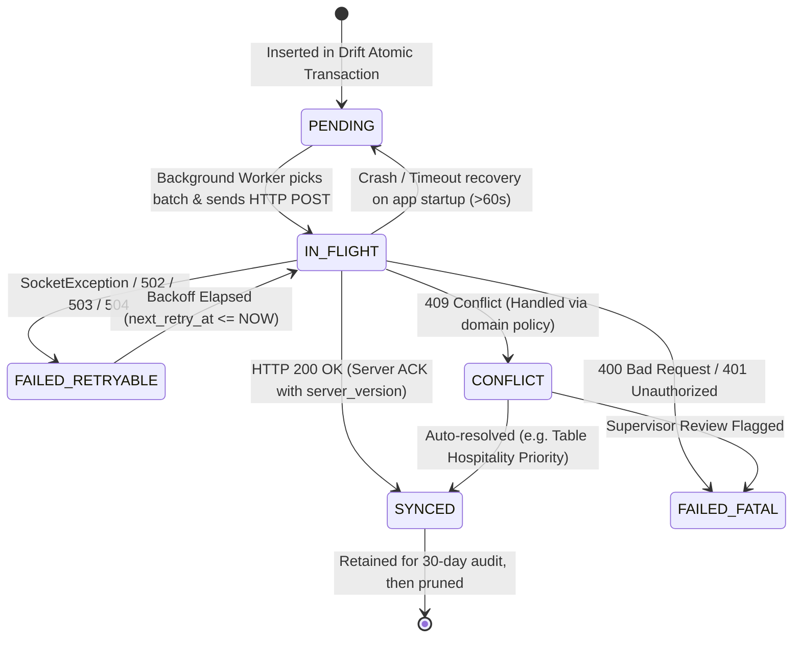
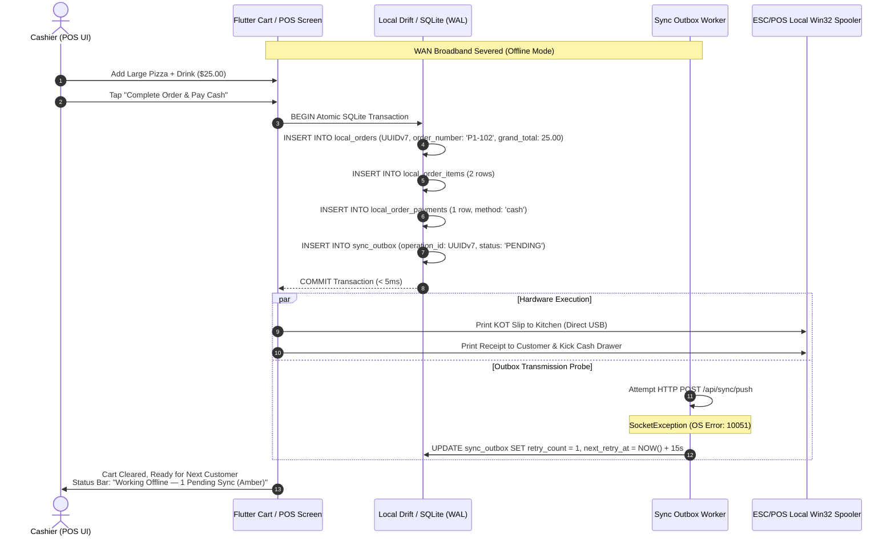
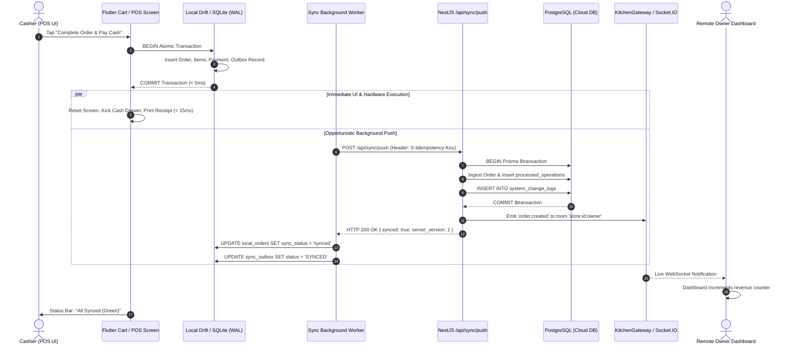
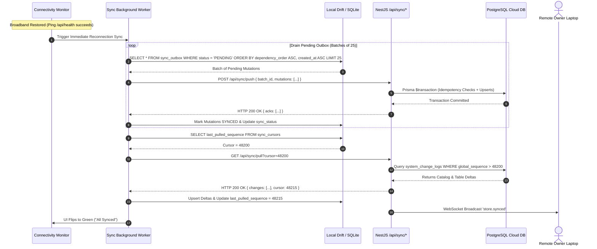
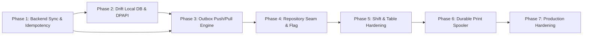

# 99 - Final Master Architecture Specification: Offline-First Hungry Howie's POS

> **Document Reference:** `docs/offline-analysis/99-FINAL-ARCHITECTURE.md`  
> **Synthesizer Role:** `architecture-synthesizer (Wave 3)`  
> **Audited Repository:** Hungry Howie's POS (Flutter Windows Desktop + NestJS / Prisma / PostgreSQL Backend)  
> **Input Documents:** All Wave 1 ([`01`](file:///D:/HowiePOSUPdated/Hbackend-Hfrontend-main/docs/offline-analysis/01-flutter-architecture.md)–[`10`](file:///D:/HowiePOSUPdated/Hbackend-Hfrontend-main/docs/offline-analysis/10-performance.md)) and Wave 2 ([`11`](file:///D:/HowiePOSUPdated/Hbackend-Hfrontend-main/docs/offline-analysis/11-local-db-and-sync.md)–[`13`](file:///D:/HowiePOSUPdated/Hbackend-Hfrontend-main/docs/offline-analysis/13-failure-scenarios.md)) reports, plus Developer Directives in [`00-open-questions.md`](file:///D:/HowiePOSUPdated/Hbackend-Hfrontend-main/docs/offline-analysis/00-open-questions.md).  
> **Status:** Authoritative Master Architecture (Wave 3 Final Sign-Off)  
> **Date:** October 17, 2026  

---

## Table of Contents

1. [Current Architecture](#1-current-architecture)
2. [Problems with Current Architecture](#2-problems-with-current-architecture)
3. [Target Architecture](#3-target-architecture)
   - 3.1 Reconciliation & Explicit Contradictions Resolved
   - 3.2 Master Component & Data Flow Diagram
   - 3.3 Five-Tier Entity Lifecycle State Machine
4. [Technology Decisions](#4-technology-decisions)
   - 4.1 Storage Engine: Drift + SQLite (SQLCipher)
   - 4.2 Entity Identity: RFC 9562 UUID v7
   - 4.3 Human Receipt Sequencing: Terminal-Prefixed (`P1-101`)
   - 4.4 Real-Time Transport: Socket.IO v4 over WebSocket + Delta Polling Fallback
   - 4.5 Local Cryptography: Windows User-Scope DPAPI
   - 4.6 State Layer Seam: Riverpod 2.x Repository Swapping
5. [Local DB Design](#5-local-db-design)
   - 5.1 Storage Engine Configuration & SQLite Pragmas
   - 5.2 Replicated Operational Tables
   - 5.3 Replicated Catalog & Reference Tables
   - 5.4 Internal System & Spooler Tables
6. [Sync Queue Schema](#6-sync-queue-schema)
   - 6.1 `sync_outbox` Drift Table Definition
   - 6.2 Outbox State Machine & Retry Lifecycle
   - 6.3 Deterministic Dependency Graph
   - 6.4 Backoff, Jitter & Circuit Breaker Specification
7. [Server DB Changes](#7-server-db-changes)
   - 7.1 Prisma Schema Additions (`processed_operations`, `system_change_logs`)
   - 7.2 Versioning & Concurrency Tokens Added to Existing Models
   - 7.3 Shift Schema Enhancements (`OFFLINE_CLOSED` & Cash Variance)
8. [API Changes](#8-api-changes)
   - 8.1 New Synchronization Controller (`/api/sync/*`)
   - 8.2 NestJS Idempotency Interceptor
   - 8.3 Production Security Hardening on Existing Endpoints
9. [WebSocket Architecture](#9-websocket-architecture)
   - 9.1 The Notification-Only Principle
   - 9.2 Canonical Event Envelope (`RealtimeEventEnvelope<T>`)
   - 9.3 Room Partitioning & Multi-Tenant Topology
   - 9.4 Post-Commit Transactional Broadcasting Pattern
10. [Conflict Resolution](#10-conflict-resolution)
    - 10.1 Domain Entity Conflict Matrix
    - 10.2 Dining Table Hospitality Operational Priority
    - 10.3 Order Line-Items & Payment Immutability
    - 10.4 Shift Variance Acceptance & Supervisory Audit
11. [Offline Flow](#11-offline-flow)
12. [Online Flow](#12-online-flow)
13. [Reconnection Flow](#13-reconnection-flow)
14. [Multi-Device Flow](#14-multi-device-flow)
15. [Failure Handling](#15-failure-handling)
    - 15.1 The 15 Failure Scenarios Matrix
    - 15.2 Five-Tier Anti-Duplicate Defense Ladder
    - 15.3 Startup Recovery & Zombie Task Reaping
    - 15.4 Thermal Printer Failure & Disconnect Handling (ORDER SAVING ≠ PRINTING)
16. [Security](#16-security)
    - 16.1 Windows DPAPI Key Derivation Bridge
    - 16.2 Deprecation of Development Auth Backdoors
    - 16.3 Local Data At-Rest Encryption & Session Storage
17. [Incremental Migration Plan](#17-incremental-migration-plan)
    - 17.1 Feature Flag Strategy (`OFFLINE_FIRST_ENABLED`)
    - 17.2 Repository Seam Architecture
    - 17.3 Phased Rollout & Rollback Procedures
18. [Implementation Order](#18-implementation-order)
19. [Files to Modify / Create / Leave Untouched](#19-files-to-modify--create--leave-untouched)
20. [Top 10 Risks](#20-top-10-risks)
21. [Final Operational Decisions](#21-final-operational-decisions)

---

## 1. Current Architecture

Hungry Howie's POS currently operates as a direct REST-client web/desktop application connected over HTTP to a central NestJS / PostgreSQL backend, supplemented with an ephemeral Socket.IO real-time channel for kitchen and order updates.



### Key Architectural Characteristics in Code:
1. **Frontend Presentation & State Management:**  
   - Built with Flutter 3.44.8 / Dart 3.12.2 running as a native Windows C++ desktop runner (`frontend/windows/runner/main.cpp:1-45`).
   - State management uses Riverpod (`StateNotifierProvider`). The primary checkout flow is coordinated by `PosNotifier` ([`frontend/lib/data/pos_repository.dart:18-120`](file:///D:/HowiePOSUPdated/Hbackend-Hfrontend-main/frontend/lib/data/pos_repository.dart#L18-L120)).
2. **Network Layer & Order Submission:**  
   - Network interactions pass through `ApiClient` ([`frontend/lib/core/network/api_client.dart:25-90`](file:///D:/HowiePOSUPdated/Hbackend-Hfrontend-main/frontend/lib/core/network/api_client.dart#L25-L90)).
   - Order placement calls `ApiOrderRepository.saveOrder()` ([`frontend/lib/data/repositories/api_order_repository.dart:60-71`](file:///D:/HowiePOSUPdated/Hbackend-Hfrontend-main/frontend/lib/data/repositories/api_order_repository.dart#L60-L71)). When an HTTP error occurs, it swallows the error and appends the order into a volatile in-memory Dart list (`_localCache.insert(0, order)`).
3. **Receipt & Kitchen Printing:**  
   - Employs direct Windows Win32 spooler printing via `NativeWin32Printer` ([`frontend/lib/services/printer/native_printer_io.dart:8-68`](file:///D:/HowiePOSUPdated/Hbackend-Hfrontend-main/frontend/lib/services/printer/native_printer_io.dart#L8-L68)). It compiles dynamic C# P/Invoke code targeting `winspool.Drv` to send raw ESC/POS bytes directly to USB/COM printer queues, with fallback to `RawSpooler.exe`.
4. **Backend Ingestion & Processing:**  
   - Built on NestJS 10.4.15 and Prisma ORM 5.22.  
   - `OrdersService.createOrder()` ([`backend/src/orders/orders.service.ts:137-465`](file:///D:/HowiePOSUPdated/Hbackend-Hfrontend-main/backend/src/orders/orders.service.ts#L137-L465)) executes within a Prisma `$transaction`.
   - Sequential receipt numbers are assigned via an in-memory loop querying PostgreSQL for numbers between `101` and `999` ([`orders.service.ts:230-260`](file:///D:/HowiePOSUPdated/Hbackend-Hfrontend-main/backend/src/orders/orders.service.ts#L230-L260)).
5. **Real-Time Gateway:**  
   - `KitchenGateway` ([`backend/src/kitchen/kitchen.gateway.ts:46-52`](file:///D:/HowiePOSUPdated/Hbackend-Hfrontend-main/backend/src/kitchen/kitchen.gateway.ts#L46-L52)) broadcasts events over Socket.IO. It redundantly emits duplicate events (`order.created` and `kitchen.order_created`) to a single `'kitchen'` room ([`kitchen.gateway.ts:181-182`](file:///D:/HowiePOSUPdated/Hbackend-Hfrontend-main/backend/src/kitchen/kitchen.gateway.ts#L181-L182)).
6. **Simulated Synchronization Service:**  
   - The existing sync service ([`backend/src/sync/sync.service.ts:244-290`](file:///D:/HowiePOSUPdated/Hbackend-Hfrontend-main/backend/src/sync/sync.service.ts#L244-L290)) does not ingest offline data. It executes an `update` on orders that *already exist* in PostgreSQL, merely flipping a `sync_status` column.

---

## 2. Problems with Current Architecture

Inspection of the actual codebase identifies eight fundamental architectural defects that prevent reliable offline operation:

| Defect ID | Severity | Code Citation | Root Cause & Failure Mechanism |
|---|---|---|---|
| **D1: Volatile In-Memory Fallback** | **FATAL** | [`api_order_repository.dart:67-70`](file:///D:/HowiePOSUPdated/Hbackend-Hfrontend-main/frontend/lib/data/repositories/api_order_repository.dart#L67-L70) | When offline, orders are stored in `_localCache` (a Dart `List<OrderModel>`). If the Windows app closes, restarts, or crashes, **all unsynced customer orders are permanently lost**. |
| **D2: Order Number Collisions** | **FATAL** | [`orders.service.ts:248-260`](file:///D:/HowiePOSUPdated/Hbackend-Hfrontend-main/backend/src/orders/orders.service.ts#L248-L260) | The backend enforces `@unique(order_number)` on sequential numbers `101–999`. Offline terminals independently generating order numbers collide immediately upon reconnection, throwing `ConflictException: Order number '101' already exists`. |
| **D3: Hard Zero-Variance Shift Block** | **CRITICAL** | [`daily-calculation.service.ts:424-435`](file:///D:/HowiePOSUPdated/Hbackend-Hfrontend-main/backend/src/daily-calculation/daily-calculation.service.ts#L424-L435) | Server throws `BadRequestException` if cash submitted or counted deviates from revenue by more than PKR 1.00. An offline shift with cash overage/shortage cannot be closed or synced. |
| **D4: Unresolved Orders Block Shift** | **CRITICAL** | [`daily-calculation.service.ts:359-367`](file:///D:/HowiePOSUPdated/Hbackend-Hfrontend-main/backend/src/daily-calculation/daily-calculation.service.ts#L359-L367) | Server rejects closing a shift if any orders are unresolved. If an offline shift closes while takeaway orders are pending sync, shift synchronization fails completely. |
| **D5: Zero Server Idempotency Defense** | **CRITICAL** | [`orders.controller.ts:44-52`](file:///D:/HowiePOSUPdated/Hbackend-Hfrontend-main/backend/src/orders/orders.controller.ts#L44-L52) | No `X-Idempotency-Key` or operation hashing exists. Retrying an HTTP POST after a network timeout causes duplicate orders, double billing, or HTTP 409 errors. |
| **D6: Plaintext Credential Storage** | **HIGH** | [`token_storage.dart:20-46`](file:///D:/HowiePOSUPdated/Hbackend-Hfrontend-main/frontend/lib/core/security/token_storage.dart#L20-L46) | JWT authentication tokens, staff usernames, and roles are saved in unencrypted Windows `SharedPreferences` (`%APPDATA%` JSON files), vulnerable to local extraction. |
| **D7: Fragile KOT Print Tracking** | **HIGH** | [`receipt_printer_service.dart:696-699`](file:///D:/HowiePOSUPdated/Hbackend-Hfrontend-main/frontend/lib/services/receipt_printer_service.dart#L696-L699) | Printed ticket deduplication relies on an in-memory string set in `SharedPreferences`. App restarts cause duplicate tickets to be printed in the kitchen. |
| **D8: Global Development Auth Bypass** | **SECURITY** | [`jwt-auth.guard.ts:11-17`](file:///D:/HowiePOSUPdated/Hbackend-Hfrontend-main/backend/src/common/guards/jwt-auth.guard.ts#L11-L17) | Unauthenticated HTTP requests automatically fall back to hardcoded user `'Noman'` with role `'owner'`, completely bypassing cloud endpoint security. |
| **D9: Simulated Sync Mockery** | **FATAL** | [`sync.service.ts:253-261`](file:///D:/HowiePOSUPdated/Hbackend-Hfrontend-main/backend/src/sync/sync.service.ts#L253-L261) | `syncBatchOrders()` executes `prisma.order.update({ where: { id: orderId } })`. If an order was created offline and does not exist in PostgreSQL, the sync call crashes with a "Record to update not found" error. |

---

## 3. Target Architecture

### 3.1 Reconciliation & Explicit Contradictions Resolved

During the analysis across Waves 1 and 2, several alternative designs were debated. The signed-off Developer Directives ([`00-open-questions.md:115-137`](file:///D:/HowiePOSUPdated/Hbackend-Hfrontend-main/docs/offline-analysis/00-open-questions.md#L115-L137)) officially resolved these contradictions:

1. **Topology: Isolated Silo vs Local LAN Master Node:**  
   - *Debated:* Reports 01, 05, and 06 considered mDNS peer discovery and designated master POS nodes for LAN synchronization during internet outages.  
   - *Resolution (Directive Q1.1 & Q1.2):* **Option A — Isolated local databases with cloud synchronization.** The store operates a single physical cashier terminal with a local Drift/SQLite database; kitchen orders print directly via a physical thermal printer connected to the cashier PC. No Kitchen Display System (KDS), no tablet sync, and no LAN P2P replication are required.
2. **Order Numbering Collisions:**  
   - *Debated:* Sequential integers vs daily resets vs terminal prefixes.  
   - *Resolution (Directive Q2.1):* Terminal-prefixed sequential receipt numbers (`P1-101`, `P2-101`) are printed on receipts and kitchen tickets. Internal database keys are immutable RFC 9562 UUID v7 strings.
3. **Inventory Depletion on Order Placement:**  
   - *Debated:* Recipe/BOM automatic ingredient deduction vs manual stock counting.  
   - *Resolution (Directive Q4.1):* **Inventory remains independent from orders.** Placing/completing an order does NOT deduct raw materials. Zero inventory concurrency conflicts exist during offline sales.
4. **Offline Shift Closure & Variance:**  
   - *Debated:* Rejecting offline shift closing vs requiring supervisor PIN.  
   - *Resolution (Directive Q5.2 & Q5.3):* Cashier is authorized to close shifts offline with reported cash variance (overage/shortage). Synchronized to the cloud for management review without blocking.
5. **Refunds in Offline Mode:**  
   - *Debated:* Offline refund queues vs credit ledger.  
   - *Resolution (Directive Q6.1):* **No offline refunds.** Paid orders remain immutable. Refunds require active cloud verification.
6. **Offline Limits & Security:**  
   - *Debated:* 8-hour / PKR 100k limits, TPM 2.0 hardware binding.  
   - *Resolution (Directive Q7.3 & Q7.4):* **Indefinite offline operation supported.** Local encryption uses standard Windows user-scope DPAPI (`CryptProtectData`) without TPM 2.0 dependency. Privileged actions (large discounts, voids) are blocked offline (Directive Q7.2). Catalog edits offline are strictly disabled (Directive Q9.1). Closed orders > 30 days are pruned locally (Directive Q9.2).

---

### 3.2 Master Component & Data Flow Diagram



---

### 3.3 Five-Tier Entity Lifecycle State Machine

To eliminate ambiguity across UI and database layers, all domain entities transition through five strictly separated states:



| State Tier | Storage Location | Sync Flag / Column | UI Indicator | Description |
|---|---|---|---|---|
| **1. Local State** | Drift In-Memory / Uncommitted Transaction | N/A | Normal Editing UI | Active order editing, item additions in cart before checkout confirmation. |
| **2. Pending State** | Drift `local_orders` & `sync_outbox` | `sync_status = 'pending_insert'` | Amber Pill: *"Offline — N Pending"* | Committed to local SQLite WAL file; kitchen ticket printed; awaiting server push. |
| **3. Server State** | Cloud PostgreSQL (`orders`, `processed_operations`) | Canonical DB Rows | Cloud Portal Display | Transaction finalized and durably stored in the central cloud database. |
| **4. Synced State** | Drift `local_orders` + Cloud PostgreSQL | `sync_status = 'synced'` | Green Dot: *"All Synced"* | Server ACK received; local row stamped with `server_version` and `server_updated_at`. |
| **5. Conflict State** | Drift `sync_conflicts` table | `sync_status = 'conflict'` | Red/Orange Alert Badge | Server rejected write; auto-resolved via domain policy or flagged for review. |

---

## 4. Technology Decisions

### 4.1 Storage Engine: Drift + SQLite (SQLCipher)

Evaluated against raw SQLite (`sqflite_common_ffi`), Isar, Hive, ObjectBox, and Realm:

| Criterion | Drift + SQLite | Raw SQLite | Isar | Hive |
|---|---|---|---|---|
| **Windows Desktop Compatibility** | **10/10** (CMake C-FFI) | 9/10 | 5/10 (Build issues) | 8/10 |
| **Relational Modeling & Foreign Keys** | **10/10** (Full cascade) | 8/10 (Manual strings) | 4/10 | 2/10 (No relations) |
| **ACID Multi-Table Commit** | **10/10** (Atomic WAL) | 9/10 | 7/10 | 3/10 (No ACID) |
| **Reactive Streams for Riverpod** | **10/10** (`watch()`) | 3/10 (Manual streams) | 8/10 | 5/10 |
| **Transparent Page Encryption** | **10/10** (SQLCipher) | 8/10 | 0/10 | 4/10 (Box-level) |

**Decision:** **Drift + SQLite (SQLCipher)** is selected as the sole client storage engine. Drift provides compile-time typed SQL queries, schema migrations, and reactive streams that feed Riverpod `StreamProvider` widgets automatically upon database updates.

### 4.2 Entity Identity: RFC 9562 UUID v7

Currently, the client generates non-standard strings like `'ord_${DateTime.now().microsecondsSinceEpoch}'` ([`order_number_generator.dart:37`](file:///D:/HowiePOSUPdated/Hbackend-Hfrontend-main/frontend/lib/domain/services/order_number_generator.dart#L37)).  
**Decision:** All entities created client-side use **RFC 9562 UUID v7** generated via the existing `uuid: ^4.4.0` package (`Uuid().v7()`).  
- **B-Tree Locality:** The 48-bit UNIX millisecond timestamp prefix ensures monotonic ordering in PostgreSQL B-tree indexes, eliminating index page fragmentation.  
- **Zero Collision:** 74 bits of cryptographically secure random entropy guarantee absolute global uniqueness without central server coordination.

### 4.3 Human Receipt Sequencing: Terminal-Prefixed (`P1-101`)

**Decision:** Customer receipts and kitchen tickets display terminal-prefixed numbers:  
$$\text{Receipt Number} = \mathbf{P}\langle\text{terminal\_id}\rangle\mathbf{-}\langle\text{sequence}\rangle\quad (\text{e.g., } \mathbf{P1-101})$$  
The counter is persisted in a local Drift table (`terminal_sequences`), cycles from `101` to `999`, and resets daily. Because terminal prefixes partition the namespace, offline registers never collide on PostgreSQL's `@unique(order_number)` constraint.

### 4.4 Real-Time Transport: Socket.IO v4 over WebSocket + Delta Polling Fallback

**Decision:** Retain NestJS Socket.IO v4 locked strictly to WebSocket transport (`transports: ['websocket']`).  
- WebSockets serve as **notification-only invalidation signals** ("pokes").  
- If disconnected or firewalled, the Flutter client gracefully falls back to periodic HTTP delta polling (`GET /api/sync/pull?cursor=N`).

### 4.5 Local Cryptography: Windows User-Scope DPAPI

**Decision:** Protect the SQLCipher master encryption key using Windows Data Protection API (`CryptProtectData` / `CryptUnprotectData`) via Win32 FFI. Standard user-scope DPAPI satisfies Developer Directive Q7.4 without requiring hardware TPM 2.0 chips.

### 4.6 State Layer Seam: Riverpod 2.x Repository Swapping

**Decision:** Feature flag `OFFLINE_FIRST_ENABLED` controls Riverpod provider overrides at app bootstrap. When `false`, the legacy `ApiOrderRepository` handles orders directly; when `true`, `DriftOfflineFirstOrderRepository` routes writes through Drift and the outbox pipeline.

---

## 5. Local DB Design

### 5.1 Storage Engine Configuration & SQLite Pragmas

When opening the database on Windows desktop:
```sql
PRAGMA key = "x'<64-char-hex-derived-from-dpapi>'";
PRAGMA cipher_page_size = 4096;
PRAGMA kdf_iter = 64000;
PRAGMA journal_mode = WAL;
PRAGMA synchronous = NORMAL;
PRAGMA busy_timeout = 5000;
PRAGMA foreign_keys = ON;
```

### 5.2 Replicated Operational Tables

```dart
// Location: frontend/lib/core/database/tables/local_orders_tables.dart

@DataClassName('LocalOrder')
class LocalOrders extends Table {
  TextColumn get id => text().withLength(min: 36, max: 36)(); // UUID v7 PK
  TextColumn get orderNumber => text().withLength(min: 1, max: 30)(); // 'P1-101'
  TextColumn get orderType => text().withLength(min: 1, max: 30)(); // 'dineIn', 'takeaway', 'online'
  TextColumn get shiftId => text().withLength(min: 36, max: 36).nullable()();
  TextColumn get status => text().withLength(min: 1, max: 30).withDefault(const Constant('newOrder'))();
  RealColumn get subtotal => real()();
  RealColumn get discountPercentage => real().withDefault(const Constant(0.0))();
  RealColumn get discountAmount => real().withDefault(const Constant(0.0))();
  RealColumn get taxAmount => real().withDefault(const Constant(0.0))();
  RealColumn get grandTotal => real()();
  TextColumn get paymentStatus => text().withLength(min: 1, max: 20).withDefault(const Constant('UNPAID'))();
  BoolColumn get isPaid => boolean().withDefault(const Constant(false))();
  BoolColumn get isHeld => boolean().withDefault(const Constant(false))();
  BoolColumn get kitchenTicketSent => boolean().withDefault(const Constant(false))();
  TextColumn get rejectionReason => text().nullable()();
  TextColumn get deviceId => text().withLength(min: 1, max: 50)();
  DateTimeColumn get createdAt => dateTime().withDefault(currentDateAndTime)();

  // Sync Metadata
  TextColumn get syncStatus => text().withDefault(const Constant('pending_insert'))();
  IntColumn get serverVersion => integer().withDefault(const Constant(1))();
  DateTimeColumn get clientUpdatedAt => dateTime().withDefault(currentDateAndTime)();
  DateTimeColumn get serverUpdatedAt => dateTime().nullable()();
  BoolColumn get isDeleted => boolean().withDefault(const Constant(false))();

  @override
  Set<Column> get primaryKey => {id};
}

@DataClassName('LocalOrderItem')
class LocalOrderItems extends Table {
  TextColumn get id => text().withLength(min: 36, max: 36)(); // UUID v7
  TextColumn get orderId => text().references(LocalOrders, #id, onDelete: KeyAction.cascade)();
  TextColumn get menuItemId => text().nullable()();
  TextColumn get itemName => text()();
  TextColumn get sizeName => text().nullable()();
  RealColumn get unitPrice => real()();
  IntColumn get quantity => integer()();
  RealColumn get subtotal => real()();
  TextColumn get notes => text().nullable()();
  BoolColumn get isCancelled => boolean().withDefault(const Constant(false))();
  DateTimeColumn get cancelledAt => dateTime().nullable()();
  TextColumn get cancelReason => text().nullable()();

  // Sync Metadata
  TextColumn get syncStatus => text().withDefault(const Constant('pending_insert'))();
  IntColumn get serverVersion => integer().withDefault(const Constant(1))();

  @override
  Set<Column> get primaryKey => {id};
}

@DataClassName('LocalOrderPayment')
class LocalOrderPayments extends Table {
  TextColumn get id => text().withLength(min: 36, max: 36)(); // UUID v7
  TextColumn get orderId => text().references(LocalOrders, #id, onDelete: KeyAction.cascade)();
  TextColumn get paymentMethod => text()(); // 'cash', 'card', 'bankTransfer', 'split'
  RealColumn get amount => real()();
  RealColumn get tenderedAmount => real().nullable()();
  RealColumn get changeReturned => real().nullable()();
  TextColumn get transactionReference => text().nullable()();
  TextColumn get cardLastFour => text().nullable()();
  TextColumn get bankName => text().nullable()();
  TextColumn get paymentStatus => text().withDefault(const Constant('COMPLETED'))();
  TextColumn get receivedBy => text().nullable()();
  DateTimeColumn get createdAt => dateTime().withDefault(currentDateAndTime)();

  // Sync Metadata
  TextColumn get syncStatus => text().withDefault(const Constant('pending_insert'))();

  @override
  Set<Column> get primaryKey => {id};
}

@DataClassName('LocalDailyCalculation')
class LocalDailyCalculations extends Table {
  TextColumn get id => text().withLength(min: 36, max: 36)(); // UUID v7
  TextColumn get cashierId => text()();
  TextColumn get cashierName => text()();
  RealColumn get startingCash => real()();
  RealColumn get expectedCashDrawer => real().withDefault(const Constant(0.0))();
  RealColumn get actualCashCounted => real().nullable()();
  RealColumn get cashVariance => real().withDefault(const Constant(0.0))();
  TextColumn get status => text().withDefault(const Constant('ACTIVE'))(); // 'ACTIVE', 'OFFLINE_CLOSED', 'CLOSED'
  DateTimeColumn get createdAt => dateTime().withDefault(currentDateAndTime)();
  DateTimeColumn get submittedAt => dateTime().nullable()();
  TextColumn get closingNotes => text().nullable()();

  // Sync Metadata
  TextColumn get syncStatus => text().withDefault(const Constant('pending_insert'))();
  IntColumn get serverVersion => integer().withDefault(const Constant(1))();

  @override
  Set<Column> get primaryKey => {id};
}
```

### 5.3 Replicated Catalog & Reference Tables

Catalog tables are strictly pull-only on the client (Directive Q9.1):
- `LocalMenuCategories` (`id`, `name`, `display_order`, `is_active`)
- `LocalMenuItems` (`id`, `category_id`, `name`, `base_price`, `is_available`, `is_veg`, `is_spicy`)
- `LocalMenuItemSizes` (`id`, `menu_item_id`, `size_name`, `price_multiplier`, `is_default`)
- `LocalMenuItemOptions` (`id`, `menu_item_id`, `group_name`, `option_name`, `additional_price`)
- `LocalDeals` (`id`, `name`, `deal_price`, `is_available`)
- `LocalDealComponents` (`id`, `deal_id`, `menu_item_id`, `quantity`)
- `LocalRestaurantTables` (`id`, `zone_id`, `table_number`, `name`, `capacity`, `status`, `active_order_id`, `version`)
- `LocalFloorZones` (`id`, `name`, `display_order`)
- `LocalStaffUsers` (`id`, `username`, `role`, `pin_hash`, `is_active`)
- `LocalRolePermissions` (`id`, `role`, `module_name`, `action_name`, `is_granted`)
- `LocalStoreSettings` (`id`, `chain_name`, `branch_code`, `branch_name`, `store_phone`, `tax_percentage`)

### 5.4 Internal System & Spooler Tables

1. **`TerminalSequences`:**
   ```dart
   class TerminalSequences extends Table {
     TextColumn get sequenceKey => text().withLength(min: 1, max: 30)(); // 'ORDER_NUMBER'
     TextColumn get businessDate => text().withLength(min: 8, max: 10)(); // '2026-10-17'
     IntColumn get currentValue => integer()();
     @override
     Set<Column> get primaryKey => {sequenceKey};
   }
   ```
2. **`SyncCursors`:**
   ```dart
   class SyncCursors extends Table {
     TextColumn get feedKey => text()(); // 'GLOBAL_PULL_CURSOR'
     IntColumn get lastPulledSequence => integer().withDefault(const Constant(0))();
     DateTimeColumn get lastSyncAttempt => dateTime().nullable()();
     DateTimeColumn get lastSuccessfulSync => dateTime().nullable()();
     @override
     Set<Column> get primaryKey => {feedKey};
   }
   ```
3. **`OfflinePrintJobs`:**
   ```dart
   class OfflinePrintJobs extends Table {
     IntColumn get id => integer().autoIncrement()();
     TextColumn get jobType => text()(); // 'CUSTOMER_RECEIPT', 'KITCHEN_TICKET', 'SHIFT_Z_REPORT'
     TextColumn get orderId => text().nullable()();
     TextColumn get printerTarget => text()(); // 'USB001', 'COM1', 'WIN_DEFAULT'
     BlobColumn get rawEscPosData => blob()();
     TextColumn get status => text().withDefault(const Constant('QUEUED'))(); // 'QUEUED', 'PRINTED', 'FAILED'
     IntColumn get retryCount => integer().withDefault(const Constant(0))();
     DateTimeColumn get createdAt => dateTime().withDefault(currentDateAndTime)();
   }
   ```

---

## 6. Sync Queue Schema

### 6.1 `sync_outbox` Drift Table Definition

```dart
// Location: frontend/lib/core/database/tables/sync_outbox_table.dart

@DataClassName('SyncOutboxEntry')
class SyncOutbox extends Table {
  IntColumn get id => integer().autoIncrement()();
  TextColumn get operationId => text().withLength(min: 36, max: 36).unique()(); // UUID v7
  TextColumn get deviceId => text().withLength(min: 1, max: 50)(); // 'POS-P1'
  TextColumn get entityType => text().withLength(min: 1, max: 50)(); // 'order', 'shift', etc.
  TextColumn get entityId => text().withLength(min: 36, max: 36)(); // Entity UUID
  TextColumn get operationType => text().withLength(min: 1, max: 20)(); // 'INSERT', 'UPDATE'
  IntColumn get baseVersion => integer().withDefault(const Constant(1))();
  TextColumn get payload => text()(); // Serialized JSON
  TextColumn get dependsOnOperationId => text().withLength(min: 36, max: 36).nullable()();
  IntColumn get dependencyOrder => integer().withDefault(const Constant(1))();
  TextColumn get status => text().withLength(min: 1, max: 20).withDefault(const Constant('PENDING'))();
  IntColumn get retryCount => integer().withDefault(const Constant(0))();
  DateTimeColumn get nextRetryAt => dateTime().nullable()();
  DateTimeColumn get createdAt => dateTime().withDefault(currentDateAndTime)();
  DateTimeColumn get sentAt => dateTime().nullable()();
  DateTimeColumn get ackedAt => dateTime().nullable()();
  TextColumn get lastError => text().nullable()();
  TextColumn get conflictDetails => text().nullable()();
}
```

### 6.2 Outbox State Machine & Retry Lifecycle



### 6.3 Deterministic Dependency Graph

To prevent foreign key constraint violations in PostgreSQL, outbox operations execute in strict topological dependency order:

$$\text{Level 0 (Shift Session)} \longrightarrow \text{Level 1 (Customer Snapshot)} \longrightarrow \text{Level 2 (Order Header)} \longrightarrow \text{Level 3 (Items/Payments)} \longrightarrow \text{Level 4 (Dispatches)} \longrightarrow \text{Level 5 (Shift Close)}$$

The background push query strictly sorts mutations:  
`ORDER BY dependency_order ASC, created_at ASC LIMIT 25`.

### 6.4 Backoff, Jitter & Circuit Breaker Specification

- **Formula:** $T_{\text{delay}} = \min(300, 2.0 \times 2^{\text{retry\_count}}) \times (0.75 + 0.5 \times \text{random}())$ seconds.
- **Max Retries:** **Unlimited** (indefinite offline support per Directive Q7.3).
- **Circuit Breaker:** After 5 consecutive socket timeouts, worker pauses for 30 seconds before probing `/api/health`.

---

## 7. Server DB Changes

### 7.1 Prisma Schema Additions (`processed_operations`, `system_change_logs`)

Append the following models to `backend/prisma/schema.prisma`:

```prisma
// ── 1. IDEMPOTENCY LEDGER ─────────────────────────────────────
model ProcessedOperation {
  operation_id     String    @id @db.VarChar(36)
  device_id        String    @db.VarChar(50)
  entity_type      String    @db.VarChar(50)
  entity_id        String    @db.VarChar(36)
  request_hash     String    @db.VarChar(64)
  status           String    @default("PROCESSING") @db.VarChar(20)
  response_payload Json?
  http_status      Int       @default(200)
  created_at       DateTime  @default(now()) @db.Timestamp()
  completed_at     DateTime? @db.Timestamp()

  @@index([device_id, created_at])
  @@index([entity_type, entity_id])
  @@map("processed_operations")
}

// ── 2. MONOTONIC CHANGE-FEED REPLICATION STREAM ───────────────
model SystemChangeLog {
  global_sequence  BigInt    @id @default(autoincrement())
  entity_type      String    @db.VarChar(50)
  entity_id        String    @db.VarChar(36)
  operation        String    @db.VarChar(20) // INSERT, UPDATE, DELETE
  record_version   Int       @default(1)
  is_deleted       Boolean   @default(false)
  payload          Json
  created_at       DateTime  @default(now()) @db.Timestamp()

  @@index([global_sequence])
  @@index([entity_type, entity_id])
  @@map("system_change_logs")
}
```

### 7.2 Versioning & Concurrency Tokens Added to Existing Models

Modify existing models in `backend/prisma/schema.prisma`:
- **`Order`:** Add `version Int @default(1)` and `updated_at DateTime @default(now()) @updatedAt`.
- **`RestaurantTable`:** Add `version Int @default(1)` and `updated_at DateTime @default(now()) @updatedAt`.
- **`DailyCalculation`:** Add `version Int @default(1)` and `updated_at DateTime @default(now()) @updatedAt`.
- **`MenuItem` & `Customer`:** Add `is_deleted Boolean @default(false)` and `deleted_at DateTime?`.

### 7.3 Shift Schema Enhancements (`OFFLINE_CLOSED` & Cash Variance)

- In `backend/prisma/schema.prisma`, update `DailyCalculation`:
  - Allow status string `'OFFLINE_CLOSED'`.
  - Add `cash_variance Decimal @default(0.00) @map("cash_variance") @db.Decimal(10, 2)`.
  - Add `variance_reason String? @map("variance_reason") @db.VarChar(255)`.

---

## 8. API Changes

### 8.1 New Synchronization Controller (`/api/sync/*`)

Create `backend/src/sync/sync.controller.ts` providing three core endpoints:

1. **`POST /api/sync/push` (Batch Ingestion):**
   - **Request Body:**
     ```json
     {
       "device_id": "POS-P1",
       "batch_id": "0192994c-8f12-789a-bcde-f0123456789a",
       "mutations": [
         {
           "operation_id": "0192994c-8f12-789a-bcde-f0123456789b",
           "entity_type": "order",
           "entity_id": "0192994c-8f12-789a-bcde-f0123456789c",
           "operation_type": "INSERT",
           "base_version": 1,
           "dependency_order": 2,
           "payload": { ... }
         }
       ]
     }
     ```
   - **Response (`200 OK`):**
     ```json
     {
       "success": true,
       "batch_id": "0192994c-8f12-789a-bcde-f0123456789a",
       "processed_count": 1,
       "results": [
         {
           "operation_id": "0192994c-8f12-789a-bcde-f0123456789b",
           "entity_id": "0192994c-8f12-789a-bcde-f0123456789c",
           "status": "SYNCED",
           "server_version": 1,
           "server_timestamp": "2026-10-17T14:30:00.125Z"
         }
       ]
     }
     ```
2. **`GET /api/sync/pull` (Incremental Delta Stream):**
   - Query parameters: `cursor` (BigInt), `device_id` (String), `limit` (Int).
   - Returns array of changes from `system_change_logs` where `global_sequence > cursor`.
3. **`GET /api/sync/bootstrap` (Cold-Start Hydration):**
   - Returns a gzipped JSON stream containing current store settings, staff users, menu catalog, and table layout.

### 8.2 NestJS Idempotency Interceptor

Implement `IdempotencyInterceptor` ([`backend/src/sync/interceptors/idempotency.interceptor.ts`](file:///D:/HowiePOSUPdated/Hbackend-Hfrontend-main/backend/src/sync/interceptors/idempotency.interceptor.ts)):
- Intercepts requests carrying `X-Idempotency-Key` or `operation_id`.
- Queries `processed_operations`. If already `COMPLETED`, immediately returns cached response without re-executing business logic.

### 8.3 Production Security Hardening on Existing Endpoints

1. **Purge Development Auth Fallback:** In `backend/src/common/guards/jwt-auth.guard.ts:11-17`, remove the fallback user `'Noman'`. Throw `UnauthorizedException()` whenever a valid JWT is absent.
2. **Accept Terminal-Prefixed Orders:** Update `OrdersService.createOrder()` to accept strings formatted as `P1-101` and validate uniqueness within the terminal partition.
3. **Remove Hard Shift Variance Blocking:** In `DailyCalculationService.closeShift()` ([`daily-calculation.service.ts:424-428`](file:///D:/HowiePOSUPdated/Hbackend-Hfrontend-main/backend/src/daily-calculation/daily-calculation.service.ts#L424-L428)), remove the hard `BadRequestException` when `cash_submitted != expected`. Store `cash_variance` in PostgreSQL for supervisory audit.

---

## 9. WebSocket Architecture

### 9.1 The Notification-Only Principle

WebSockets are strictly **notification-only invalidation signals**.  
- Sockets **never** act as the database source of truth.  
- Sockets **never** transfer multi-megabyte entity graphs.  
- An incoming socket frame triggers the client to execute a targeted Drift update or query `GET /api/sync/pull`.

### 9.2 Canonical Event Envelope (`RealtimeEventEnvelope<T>`)

Every WebSocket frame emitted across the platform follows this standard format:

```typescript
export interface RealtimeEventEnvelope<T = Record<string, unknown>> {
  event_id: string;        // UUID v4 for deduplication
  event_name: string;      // Lowercase dot-separated: 'table.status_changed'
  entity: string;          // Target database table: 'restaurant_tables'
  entity_id: string;       // Primary Key UUID
  action: 'CREATED' | 'UPDATED' | 'DELETED' | 'STATUS_CHANGED';
  version: number;         // OCC integer version token
  change_seq: number;      // Store-scoped monotonic sequence number
  occurred_at: string;     // ISO 8601 UTC timestamp
  origin_device_id: string;// Terminal ID e.g. 'POS-P1'
  origin_user_id: string;  // Staff user UUID
  store_id: string;        // Multi-tenant store code
  payload: T;              // Lightweight metadata (no PII, no large trees)
}
```

### 9.3 Room Partitioning & Multi-Tenant Topology

Sockets join isolated rooms to eliminate cross-store chatter:
- `store:{storeId}:owner`: Remote owner and manager telemetry (sales KPIs, shifts, drawer skimming).
- `store:{storeId}:cashier`: In-store cashier notifications (online order alerts, menu 86-ing).
- `store:{storeId}:all`: Broadcasts (storewide settings changes).

### 9.4 Post-Commit Transactional Broadcasting Pattern

Events are broadcast **strictly after** PostgreSQL database transactions commit:
```typescript
await this.prisma.$transaction(async (tx) => {
  // Commit business entities
});
// Broadcast ONLY after transaction commits successfully
this.kitchenGateway.server.to(`store:${storeId}:owner`).emit('order.created', envelope);
```

---

## 10. Conflict Resolution

### 10.1 Domain Entity Conflict Matrix

| Domain Entity | Conflict Scenario | Resolution Policy | Winning Rule | Safety Mechanism |
|---|---|---|---|---|
| **Dining Tables** | POS seats walk-in offline vs Owner reserves online | **Hospitality Operational Priority** | **POS Physical Seated Guest Wins** | Seated guest cannot be evicted; Owner reservation reassigned to overflow. |
| **Order Line Items** | Terminal edits items offline | **Append-Only Ledger** | **Client Line-Item UUID v7 Wins** | Line items are immutable rows; cancellations are soft-delete ledger events. |
| **Menu / Pricing** | Cashier sells item at old price while Owner changes price | **Server-Authoritative Catalog** | **Sale Finalized at Historical Quoted Price** | Customer paid quoted bill; order retains snapshot pricing; catalog updates on pull. |
| **Inventory** | High sales volume offline | **Decoupled Inventory** (Directive Q4.1) | **Zero Conflict** | Orders do NOT deduct BOM ingredients; stock managed via periodic counts. |
| **Cashier Shift** | Shift closed offline with cash variance | **Local Authorized Close** (Directive Q5.2/3) | **Cashier Submitted Count Stored** | Shift recorded as `OFFLINE_CLOSED`; variance saved for supervisory audit. |
| **Order Numbering** | Multiple terminals generate orders offline | **Partitioned Namespace** (Directive Q2.1) | **Both Win (`P1-101`, `P2-101`)** | Distinct terminal prefixes eliminate unique constraint collisions. |

### 10.2 Dining Table Hospitality Operational Priority

If an offline cashier seats guests at Table 4 (`status -> 'occupied'`) while a remote manager enters a reservation for Table 4 on the cloud portal (`status -> 'reserved'`), upon reconnection the cashier's physical seating takes precedence:
1. Table 4 remains `occupied` with the active order.
2. The remote manager's reservation is automatically reassigned an overflow identifier (e.g., `Table 4-Overflow`).
3. An urgent notification is pushed to the manager's portal: *"Table 4 had seated walk-in guests during connection loss; reservation moved to overflow."*

---

## 11. Offline Flow

When WAN internet or Wi-Fi is severed, the POS operates autonomously without blocking modals:



### Operational Capabilities Maintained Offline:
- Full order entry, item modifications, discount application, and cash/card receipt closing.
- Kitchen KOT printing over local USB/COM spooler.
- Table floor layout seating, updates, and releases.
- Takeaway token issuance (`TK-101`).
- Offline shift closure with recorded cash variance (Directive Q5.2/3).
- **Disabled Offline:** Menu editing (Directive Q9.1), refunds (Directive Q6.1), and sensitive manager overrides (Directive Q7.2).

---

## 12. Online Flow

Under normal connected conditions (`OFFLINE_FIRST_ENABLED = true`), writes commit to Drift first to ensure sub-millisecond UI latency, then push immediately upstream:



---

## 13. Reconnection Flow

When broadband connectivity returns, the POS executes an automated FIFO queue drain followed by a change-feed delta pull:



---

## 14. Multi-Device Flow

The multi-device topology pairs the **single in-store Cashier POS** with **remote Owner/Management laptops and mobile devices**:

```
+-----------------------------------+               +-----------------------------------+
|      IN-STORE CASHIER POS         |               |        REMOTE OWNER LAPTOP        |
|  (Flutter Windows Desktop App)    |               |    (Web Browser / Manager App)    |
|  - Sole authority for cash drawer |               |  - Sole authority for menu/prices |
|  - Sole authority for active table|               |  - Remote analytical observer     |
|  - Direct kitchen thermal printer |               |  - Shift & audit reviewer         |
+-----------------+-----------------+               +-----------------+-----------------+
                  |                                                   |
                  | Local Drift WAL                                   | REST API / HTTPS
                  | Outbox Push / Delta Pull                          | Socket.IO Listener
                  v                                                   v
         +---------------------------------------------------------------------+
         |                        CLOUD INFRASTRUCTURE                         |
         |                    NestJS API + Cloud PostgreSQL                    |
         |                 - Canonical Central Source of Truth                 |
         |                 - Idempotency Ledger & OCC Version Tokens           |
         +---------------------------------------------------------------------+
```

### Operational Interaction Rules:
1. **Cash Drawer Authority:** Scoped exclusively to the cashier terminal register session. Remote owners observe live balances but cannot remotely inject cash movements.
2. **Catalog Authority:** Owned by the cloud portal. When an owner updates prices or 86's an item, the backend commits to PostgreSQL, logs to `system_change_logs`, and pokes the cashier POS via Socket.IO to pull the delta.
3. **Shift Variance Audit:** Cashier closes shift locally (`OFFLINE_CLOSED`); owner reviews overage/shortage remotely and marks shift approved.

---

## 15. Failure Handling

### 15.1 The 15 Failure Scenarios Matrix

| # | Simulated Failure Scenario | Local DB Action | Outbox State | Cloud Server Action | User Experience | Core Safety Mechanism |
|---|---|---|---|---|---|---|
| **1** | **Normal Operation (Baseline)** | Atomic Drift commit | Immediate push -> `SYNCED` | Prisma `$transaction` (201) | Instant Green dot; printed receipt & KOT | SQLite WAL Atomic Commit + Server ACK |
| **2** | **Sudden Cable Disconnect** | Committed locally in WAL | Enqueued as `PENDING` | Zero traffic received | Amber banner: *"Offline Mode"*; KOT prints | SQLite WAL Durability + Local Winspool |
| **3** | **High Latency / 40% Packet Loss** | Committed locally in WAL | 5s HTTP timeout -> Backoff | Request dropped or aborted | Responsive UI; Amber latency badge | Client 5s Timeout + Async Queue Decoupling |
| **4** | **Reconnection After 30m Outage** | Holds 35 unsynced rows | FIFO batch push (25/batch) | Bulk insert via `$transaction` | Batch count drains -> Green *"All Synced"* | Topological Ordering + Terminal Prefixes |
| **5** | **Drop During Cash Checkout** | Payment saved in WAL | Enqueued as `PENDING` | Unpaid in cloud until sync | Receipt prints; drawer kicks; customer served | Local-Authoritative State + Durable Outbox |
| **6** | **Server ACK Lost in Transit** | Pending in outbox | Retries with same UUID v7 | Idempotency hit: returns cached 201 | Silent recovery; zero duplicate orders | Server `processed_operations` Ledger |
| **7** | **POS Seating vs Owner Remote Edit** | POS sets table occupied | Pushes active order | Hospitality Priority: POS wins | Owner portal snaps to occupied with toast | Hospitality Operational Priority Policy |
| **8** | **POS Sale of Owner 86'd Item** | POS records sale | Pushes sale history | Sale committed 100%; zero block | Normal checkout; Owner manages manual stock | Decoupled Inventory Architecture (Q4.1) |
| **9** | **4-Hour Lunch Broadband Outage** | Indefinite local billing | 120 mutations buffered | Unchanged until reconnection | POS operates smoothly; Owner sees offline note | Indefinite SQLite Retention + Prefixed Numbers |
| **10** | **Owner Offline While POS Online** | POS syncs normally | Empty outbox (synced) | Commits immediately to cloud | Cashier unaffected; Owner sees data on net | PostgreSQL Single Source of Truth |
| **11** | **Citywide Blackout (Both Offline)** | Offline shift close saved | Shift closing queued | Shift processed on morning sync | Cashier closes drawer with variance; Z-report | Offline Shift Close with Variance (Q5.2/3) |
| **12** | **Cloud Server 500 / Maintenance** | Orders buffered in Drift | 5xx triggers exponential backoff | Server down; zero writes | Yellow banner: *"Cloud Maintenance — POS Local"* | Truncated Backoff + Circuit Breaker |
| **13** | **App Crash Mid-Batch Push** | `IN_FLIGHT` orphan | Startup hook resets to `PENDING` | Safe retry via idempotency key | Brief recovery toast on boot -> Green Synced | Startup Zombie Outbox Cleanup Hook |
| **14** | **Hardware Blackout / Power Cut** | SQLite mid-write interrupt | Intact last valid transaction | Untouched | App boots cleanly without database corruption | SQLite WAL Mode (`PRAGMA journal_mode = WAL`) |
| **15** | **Rapid Button Mashing (5x Clicks)** | Single unique mutation key | Duplicate insert rejected | Idempotency cache absorbs 4 calls | Single receipt printed; drawer kicks once | 5-Tier Defense Ladder |

### 15.2 Five-Tier Anti-Duplicate Defense Ladder

$$\text{Tier 1 (UI Debounce)} \longrightarrow \text{Tier 2 (Unique UUIDv7 PK)} \longrightarrow \text{Tier 3 (Outbox In-Flight Lock)} \longrightarrow \text{Tier 4 (Server Idempotency Ledger)} \longrightarrow \text{Tier 5 (Winspool KOT Deduplication)}$$

Even if a cashier double-taps checkout, or network retries duplicate packets, every mutation is deduplicated at the database boundary before business logic runs.

### 15.3 Startup Recovery & Zombie Task Reaping

When the Flutter POS launches:
```dart
Future<void> recoverOrphanedOutboxTasks() async {
  await (update(syncOutbox)
        ..where((t) => t.status.equals('IN_FLIGHT') & 
                       t.sentAt.isSmallerThan(Value(DateTime.now().subtract(const Duration(seconds: 60))))))
      .write(const SyncOutboxCompanion(status: Value('PENDING')));
}
```

### 15.4 Thermal Printer Failure & Disconnect Handling (ORDER SAVING ≠ PRINTING)

1. **Independent Failure Domain:**
   Thermal printer hardware issues (out of paper, paper jam, USB cable disconnect, or printer power failure) operate in a strictly decoupled failure domain from core business transaction persistence.
   - **Fundamental Invariant:** **`ORDER SAVING ≠ PRINTING`**.
   - The transaction (order, line items, and payment) is safely committed to local SQLite (`Drift` in WAL mode) and enqueued to `sync_outbox` first.
   - A printer hardware error will **NEVER** fail, block, or roll back an order or payment transaction.
2. **Cashier UI & Simple Retry:**
   - If printing fails, display a simple non-blocking warning snackbar/banner to the cashier: *"Printer out of paper / Printer unavailable"*.
   - The raw print payload is safely retained locally in the local SQLite `OfflinePrintJobs` table with status `FAILED` or `QUEUED`.
   - The cashier can reload paper or reconnect the USB cable and tap a simple "Retry Print" button on the screen to reprint the ticket.
   - No complex print queue managers, spooler daemons, or multi-step approval workflows are required.

---

## 16. Security

### 16.1 Windows DPAPI Key Derivation Bridge

Per Developer Directive Q7.4, the SQLCipher master key is protected via Windows user-scope DPAPI (`CryptProtectData` / `CryptUnprotectData`) implemented through `dart:ffi` calling `Crypt32.dll`.  
- The encrypted key blob is stored at `%LOCALAPPDATA%\HungryHowies\db.key`.  
- Only the Windows OS user account that created the key can decrypt it.  
- Key bytes in Dart memory are zeroed out immediately after unlocking Drift.

### 16.2 Deprecation of Development Auth Backdoors

The hardcoded fallback user `'Noman'` in `backend/src/common/guards/jwt-auth.guard.ts:11-17` is removed. All cloud API endpoints enforce strict JWT signature and role validation.

### 16.3 Local Data At-Rest Encryption & Session Storage

1. **Local SQLite File:** 100% encrypted with AES-256-CBC at the page level using SQLCipher.
2. **Session Storage:** Token storage in `frontend/lib/core/security/token_storage.dart` is refactored to pass tokens through `WindowsDpapi.protect()` before writing to disk.

---

## 17. Incremental Migration Plan

### 17.1 Feature Flag Strategy (`OFFLINE_FIRST_ENABLED`)

The offline-first architecture is gated by a global compile-time and runtime flag:
```dart
// Location: frontend/lib/config/feature_flags.dart
class FeatureFlags {
  static const bool offlineFirstEnabled = bool.fromEnvironment('OFFLINE_FIRST_ENABLED', defaultValue: true);
}
```

### 17.2 Repository Seam Architecture

```dart
// Location: frontend/lib/data/repositories/order_repository_provider.dart

final orderRepositoryProvider = Provider<IOrderRepository>((ref) {
  if (FeatureFlags.offlineFirstEnabled) {
    return ref.watch(driftOfflineFirstOrderRepositoryProvider);
  } else {
    return ref.watch(apiOrderRepositoryProvider);
  }
});
```

### 17.3 Phased Rollout & Rollback Procedures

```
Phase 1: Backend Foundations (Prisma Migrations & /api/sync Endpoints)
Phase 2: Drift SQLite Client Engine & DPAPI Bridge
Phase 3: Outbox Push/Pull Background Pipeline
Phase 4: Order Repository Seam Cutover (Feature Flagged)
Phase 5: Shift Closure & Table Concurrency Hardening
Phase 6: Printing Durable Spooler Migration
Phase 7: End-to-End Field Validation & Legacy Code Deprecation
```

- **Rollback Guarantee:** If any phase encounters regressions during pilot testing, flipping `OFFLINE_FIRST_ENABLED = false` immediately restores 100% legacy online behavior without requiring app uninstallation or database schema downgrades.

---

## 18. Implementation Order



### Phase Breakdown & Dependencies:

1. **Phase 1: Backend Sync Schema & Ingestion Endpoints**  
   - *Prerequisites:* None.  
   - *Tasks:* Add Prisma models (`processed_operations`, `system_change_logs`), OCC versions, `SyncController` (`/api/sync/push`, `/api/sync/pull`), and `IdempotencyInterceptor`.
2. **Phase 2: Client Persistence (Drift + SQLCipher + DPAPI)**  
   - *Prerequisites:* None.  
   - *Tasks:* Install Drift and `sqlcipher_flutter_libs`; implement table schemas and `WindowsDpapi` bridge.
3. **Phase 3: Outbox Queue & Sync Background Worker**  
   - *Prerequisites:* Phase 1 and Phase 2.  
   - *Tasks:* Implement `SyncOutbox` state machine, dependency graph ordering, backoff retry logic, and connectivity probing.
4. **Phase 4: Repository Seam & Feature Flag Cutover**  
   - *Prerequisites:* Phase 3.  
   - *Tasks:* Introduce `IOrderRepository` seam; wire `DriftOfflineFirstOrderRepository`; gate via `OFFLINE_FIRST_ENABLED`.
5. **Phase 5: Shift & Table Concurrency Hardening**  
   - *Prerequisites:* Phase 4.  
   - *Tasks:* Implement `OFFLINE_CLOSED` shift status, variance recording, and table hospitality priority.
6. **Phase 6: Hardware Printing Spooler Migration**  
   - *Prerequisites:* Phase 2.  
   - *Tasks:* Migrate KOT print tracking to `OfflinePrintJobs` table; decouple ESC/POS spooling from network latency.
7. **Phase 7: Security Hardening & Legacy Cleanup**  
   - *Prerequisites:* Phases 1–6.  
   - *Tasks:* Remove legacy `'Noman'` fallback user; encrypt SharedPreferences session tokens via DPAPI; enable 30-day retention pruning job.

---

## 19. Files to Modify / Create / Leave Untouched

### Files to Create:
- `backend/src/sync/sync.controller.ts` (Batch push, pull, bootstrap endpoints)
- `backend/src/sync/sync-push.service.ts` (Batch ingestion & idempotency)
- `backend/src/sync/sync-pull.service.ts` (Change-feed sequence streaming)
- `backend/src/sync/change-log.service.ts` (PostgreSQL change log recorder)
- `backend/src/sync/interceptors/idempotency.interceptor.ts` (Replay protection)
- `frontend/lib/config/feature_flags.dart` (`OFFLINE_FIRST_ENABLED` toggle)
- `frontend/lib/core/security/windows_dpapi.dart` (Win32 FFI DPAPI bridge)
- `frontend/lib/core/database/app_database.dart` (Drift database root)
- `frontend/lib/core/database/tables/local_orders_tables.dart` (Order mirror tables)
- `frontend/lib/core/database/tables/sync_outbox_table.dart` (Outbox queue schema)
- `frontend/lib/core/database/tables/terminal_sequences_table.dart` (Receipt counters)
- `frontend/lib/core/database/tables/offline_print_jobs_table.dart` (Spooler queue)
- `frontend/lib/core/sync/sync_background_worker.dart` (Push/Pull orchestration)
- `frontend/lib/core/sync/connectivity_notifier.dart` (Network state & health ping)
- `frontend/lib/data/repositories/drift_offline_first_order_repository.dart` (Offline repo)

### Files to Modify:
- `backend/prisma/schema.prisma` (Add `ProcessedOperation`, `SystemChangeLog`, OCC versions)
- `backend/src/orders/orders.service.ts` (Support `P1-101` terminal receipt prefixes)
- `backend/src/daily-calculation/daily-calculation.service.ts` (Accept `cash_variance` and `OFFLINE_CLOSED`)
- `backend/src/common/guards/jwt-auth.guard.ts` (Remove development fallback user `'Noman'`)
- `backend/src/kitchen/kitchen.gateway.ts` (Standardize to `RealtimeEventEnvelope`)
- `frontend/pubspec.yaml` (Add `drift`, `sqlcipher_flutter_libs`, `sqlite3_flutter_libs`)
- `frontend/lib/core/security/token_storage.dart` (Encrypt stored sessions via DPAPI)
- `frontend/lib/domain/services/order_number_generator.dart` (Output UUID v7 and `P1-101`)
- `frontend/lib/data/pos_repository.dart` (Bind to `IOrderRepository` seam)
- `frontend/lib/services/receipt_printer_service.dart` (Use durable `OfflinePrintJobs`)

### Files to Leave Untouched:
- `frontend/lib/domain/models/order_model.dart` (Domain entity structure preserved)
- `frontend/lib/features/pos/pos_screen.dart` (UI layout and cart components unchanged)
- `frontend/lib/features/kitchen/kitchen_screen.dart` (KDS UI components preserved)
- `backend/src/auth/*` (Standard JWT generation untouched)

---

## 20. Top 10 Risks

| # | Risk Description | Severity | Probability | Mitigation Strategy |
|---|---|---|---|---|
| **1** | **SQLCipher DLL Native Crash on Windows** | Critical | Low | Bundle official `sqlcipher_flutter_libs` compiled directly with CMake; verify on clean Windows 10/11 sandbox. |
| **2** | **Clock Skew on POS Register** | High | Medium | Use monotonically increasing central sequence (`global_sync_sequence`) on PostgreSQL rather than client timestamps for cursoring. |
| **3** | **Unbounded WAL Growth During Multi-Day Outage** | Medium | Medium | Configure periodic `PRAGMA wal_checkpoint(PASSIVE)` every 1,000 local order transactions. |
| **4** | **Power Cut Mid-Checkout** | Critical | High | SQLite WAL guarantees atomic commit; if interrupted before commit, transaction rolls back cleanly with zero orphaned rows. |
| **5** | **Simultaneous Offline Shift Closes with Large Variances** | Medium | Low | Server accepts reported `cash_variance` as valid audit state, stored for owner review on cloud dashboard without automated alert thresholds. |
| **6** | **Outbox Queue Starvation (Poison-Pill Mutation)** | High | Low | Segregate errors into `FAILED_RETRYABLE` (5xx, network) vs `FAILED_FATAL` (400 validation). Fatal errors quarantined to `sync_conflicts`. |
| **7** | **Thermal Printer Hardware Disconnect / Out of Paper** | Medium | High | `ORDER SAVING ≠ PRINTING`: Order commits to Drift and outbox first. Display simple warning; retain print job in `OfflinePrintJobs` for manual retry without blocking order workflow. |
| **8** | **Memory Leak in Background Sync Worker** | Medium | Low | Scope Drift database connections and stream subscriptions to single worker lifecycle with explicit disposal. |
| **9** | **Unauthorized Local SQLite Access** | High | Low | AES-256 page-level encryption via SQLCipher with DPAPI key derivation tied to the Windows user profile. |
| **10** | **Accidental Order Duplicate on Multiple Rapid Submits** | High | Medium | 5-Tier defense ladder: UI debounce, local UUID v7, outbox memory lock, server idempotency ledger, winspool job ID lock. |

---

## 21. Final Operational Decisions

All open operational and policy decisions are finalized. There are zero unresolved architecture questions. The following final operational decisions govern the system:

### 1. Thermal Printer Out-of-Paper & Disconnect Behavior (ORDER SAVING ≠ PRINTING)
- **Decoupled Failure Domain:** Thermal printer status (out of paper, paper jam, USB cable disconnected, temporarily unavailable) must **NEVER** fail, block, or roll back order creation, payment settlement, or sync queue enqueuing.
- **Fundamental Invariant:** **`ORDER SAVING ≠ PRINTING`**. The order, its items, and payment are safely committed to local SQLite (`Drift` in WAL mode) and enqueued to `sync_outbox` first.
- **Cashier Notification:** If printing fails, display a simple non-blocking warning to the cashier: *"Printer out of paper / Printer unavailable"*.
- **Local Retry:** The print job payload is retained locally in the SQLite `OfflinePrintJobs` table, allowing the cashier to tap a simple "Retry Print" button once paper is replenished or the printer is plugged back in.
- **Simplicity:** No complicated printer-management workflows, spooler recovery daemons, or multi-step print approval workflows.

### 2. Cash Variance Recording (No Automated Alert Thresholds)
- **Variance Capture:** When the cashier performs shift close (including offline close):
  - Record the expected cash.
  - Record the actual counted cash.
  - Calculate the variance (`shortage` / `overage`).
  - Store the variance locally in `local_daily_calculations` if offline.
  - Synchronize the variance to the server when connectivity returns.
- **No Automated Alerting Rules:** Do **NOT** implement automated threshold rules (no PKR threshold limits, no percentage limits) and do **NOT** implement automated outbound SMS, email, or complex notification logic at this stage.
- **Review Workflow:** The store owner reviews recorded cash variances directly in the cloud dashboard after shift synchronization. The system simply records the variance accurately.

### 3. Emergency Local Audit Export (Not Implemented)
- **No USB Export Workflow:** An emergency local audit export (e.g., encrypted CSV/PDF USB export) is **NOT** implemented in the current version.
- **Audit Storage & Sync:** The system relies strictly on:
  - Local durable SQLite storage during offline operation.
  - Automatic synchronization to Cloud PostgreSQL when connectivity returns.
  - Existing server-side historical reporting and transaction records.
- This feature can be considered in a future version if the business requires it.

---
*End of Master Architecture Specification — Wave 3 Synthesis Sign-Off*
