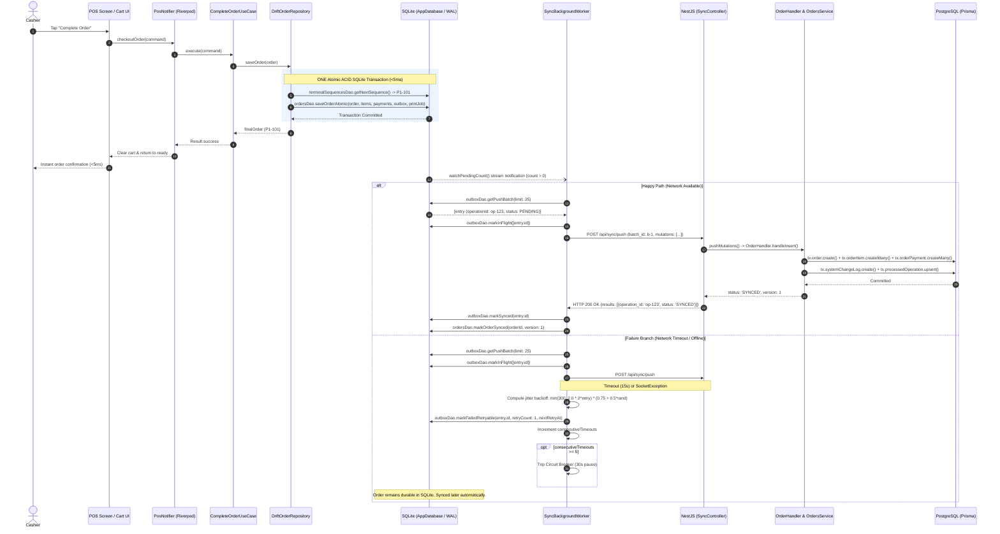
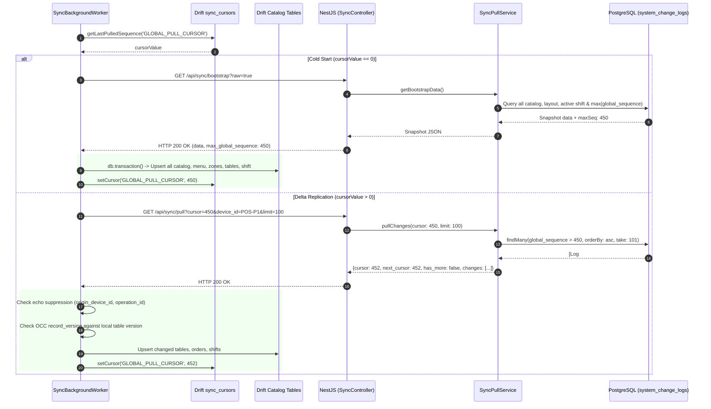
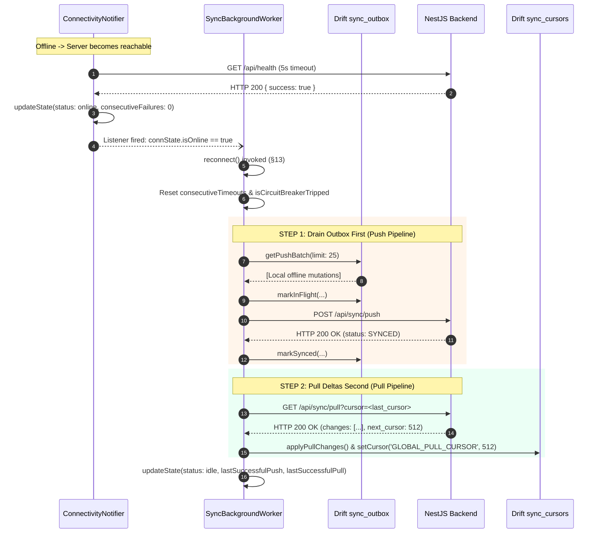
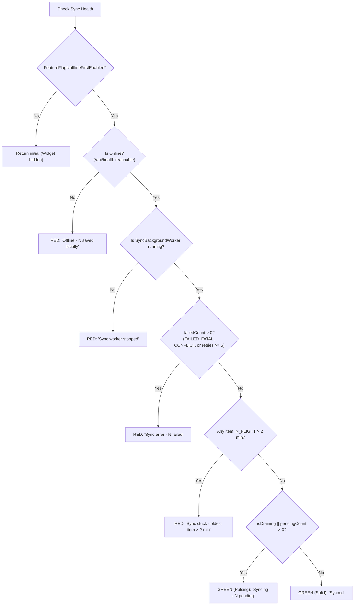

# 00 - Sync Architecture Map: Hungry Howie's POS As Implemented

> **Audit Role:** Sync Architecture Mapper (`.agents/sync-architecture-mapper/agent.md`)  
> **Target System:** Hungry Howie's POS (Flutter Windows Desktop + NestJS / Prisma / PostgreSQL Backend)  
> **Reference Specification:** `docs/offline-analysis/99-FINAL-ARCHITECTURE.md`  
> **Status:** Authoritative Implementation Baseline  
> **Date:** October 26, 2026  

---

## Executive Summary

This document establishes the authoritative architecture map of the offline synchronization engine in the Hungry Howie's POS codebase as it exists today. Every claim in this document is cited with exact `file:line` references from the codebase.

The system is architected as an offline-first solution backed by **Drift (SQLite WAL mode)** on the Flutter Windows client, an outbox queue (`sync_outbox`), a background synchronization worker (`SyncBackgroundWorker`), and a NestJS synchronization subsystem (`/api/sync/push`, `/api/sync/pull`, `/api/sync/bootstrap`) backed by PostgreSQL and Prisma ORM.

However, substantive architectural discrepancies ("spec drift") exist between the signed-off specification in `99-FINAL-ARCHITECTURE.md` and the actual implementation:
1. **Dual-Write Anti-Pattern:** Multiple ordering flows (`takeaway_repository.dart`, `delivery_repository.dart`, `tables_screen.dart`, `table_repository.dart`) attempt immediate direct REST calls alongside or prior to local Drift outbox insertion, rather than funneling all mutations exclusively through the local database and background outbox worker.
2. **One-Way Delta Logging:** Server-side change logs (`system_change_logs`) are **only** written when mutations are ingested via `POST /sync/push`. Direct cloud REST actions, web management portal changes, and menu/staff updates never create `system_change_logs` records, rendering the delta pull stream (`GET /sync/pull`) blind to server-originated modifications.
3. **Receipt Number Drift:** When an order number collision occurs on the server, the server renames the order (e.g. `P1-101-1`), but the client's local Drift database is never informed of the new number because push mutation envelopes do not return reassigned order numbers.
4. **Inventory Leak:** Placing an order via `CompleteOrderUseCase` still attempts direct REST inventory ingredient deductions, directly violating Developer Directive Q4.1.

---

## 1. Component Inventory

| Component / Layer | Source File Path | Primary Responsibility & Implementation Details |
|---|---|---|
| **Feature Flags** | [`frontend/lib/config/feature_flags.dart:1-7`](file:///D:/HOWIES%20TEST/howiesPOS/frontend/lib/config/feature_flags.dart#L1-L7) | Holds `FeatureFlags.offlineFirstEnabled`. Reads `OFFLINE_FIRST_ENABLED` environment variable (defaults to `true`). |
| **Encrypted DB Connection** | [`frontend/lib/core/database/encrypted_connection.dart:1-85`](file:///D:/HOWIES%20TEST/howiesPOS/frontend/lib/core/database/encrypted_connection.dart#L1-L85) | Sets up SQLite WAL mode, DPAPI-derived AES-256 key via SQLCipher, and runs pragmas (`foreign_keys=ON`, `synchronous=NORMAL`). |
| **Drift Central Database** | [`frontend/lib/core/database/app_database.dart:1-95`](file:///D:/HOWIES%20TEST/howiesPOS/frontend/lib/core/database/app_database.dart#L1-L95) | Defines `AppDatabase` compiling 20 Drift tables and 8 DAOs. Sets `PRAGMA foreign_keys = ON;`. |
| **Local Orders Tables** | [`frontend/lib/core/database/tables/local_orders_tables.dart:1-79`](file:///D:/HOWIES%20TEST/howiesPOS/frontend/lib/core/database/tables/local_orders_tables.dart#L1-L79) | Defines `LocalOrders`, `LocalOrderItems`, and `LocalOrderPayments` tables with UUID v7 PKs and sync metadata columns. |
| **Sync Outbox Table** | [`frontend/lib/core/database/tables/sync_outbox_table.dart:1-39`](file:///D:/HOWIES%20TEST/howiesPOS/frontend/lib/core/database/tables/sync_outbox_table.dart#L1-L39) | Defines `SyncOutbox` storing serialized mutation payloads, dependency orders (Level 0..6), retry counters, and statuses (`PENDING`, `IN_FLIGHT`, `SYNCED`, `FAILED_RETRYABLE`, `FAILED_FATAL`, `CONFLICT`, `AUTH_PAUSED`). |
| **Sync Conflicts Table** | [`frontend/lib/core/database/tables/sync_conflicts_table.dart:1-39`](file:///D:/HOWIES%20TEST/howiesPOS/frontend/lib/core/database/tables/sync_conflicts_table.dart#L1-L39) | Defines `SyncConflicts` quarantine ledger storing OCC mismatches, fatal payload failures, and server state snapshots. |
| **Sync Cursors Table** | [`frontend/lib/core/database/tables/sync_cursors_table.dart:1-13`](file:///D:/HOWIES%20TEST/howiesPOS/frontend/lib/core/database/tables/sync_cursors_table.dart#L1-L13) | Defines `SyncCursors` storing `GLOBAL_PULL_CURSOR` monotonic sequence tokens. |
| **Terminal Sequences Table** | [`frontend/lib/core/database/tables/terminal_sequences_table.dart:1-13`](file:///D:/HOWIES%20TEST/howiesPOS/frontend/lib/core/database/tables/terminal_sequences_table.dart#L1-L13) | Defines `TerminalSequences` storing rolling sequence integers (`101..999`) keyed by business date. |
| **Print Spooler Table** | [`frontend/lib/core/database/tables/offline_print_jobs_table.dart:1-32`](file:///D:/HOWIES%20TEST/howiesPOS/frontend/lib/core/database/tables/offline_print_jobs_table.dart#L1-L32) | Defines `OfflinePrintJobs` storing raw ESC/POS binary payloads (`BlobColumn`) decoupled from order completion. |
| **Daily Calculations Table** | [`frontend/lib/core/database/tables/local_daily_calculations_table.dart:1-33`](file:///D:/HOWIES%20TEST/howiesPOS/frontend/lib/core/database/tables/local_daily_calculations_table.dart#L1-L33) | Defines `LocalDailyCalculations` storing shift sessions, float amounts, cash variances, and status (`ACTIVE`, `OFFLINE_CLOSED`, `CLOSED`). |
| **Catalog Drift Tables** | [`frontend/lib/core/database/tables/catalog_tables.dart:1-137`](file:///D:/HOWIES%20TEST/howiesPOS/frontend/lib/core/database/tables/catalog_tables.dart#L1-L137) | Defines client replicas for `LocalMenuCategories`, `LocalMenuItems`, `LocalMenuItemSizes`, `LocalMenuItemOptions`, `LocalDeals`, `LocalDealComponents`, `LocalRestaurantTables`, `LocalFloorZones`, `LocalStaffUsers`, `LocalRolePermissions`, `LocalStoreSettings`. |
| **Orders DAO** | [`frontend/lib/core/database/daos/orders_dao.dart:1-89`](file:///D:/HOWIES%20TEST/howiesPOS/frontend/lib/core/database/daos/orders_dao.dart#L1-L89) | Provides atomic multi-table transaction `saveOrderAtomic()` inserting order header, items, payments, outbox mutation, and print job. |
| **Outbox DAO** | [`frontend/lib/core/database/daos/outbox_dao.dart:1-177`](file:///D:/HOWIES%20TEST/howiesPOS/frontend/lib/core/database/daos/outbox_dao.dart#L1-L177) | Queries push batches (`getPushBatch`), updates mutation lifecycle (`markInFlight`, `markSynced`, `markFailedRetryable`, `markFailedFatal`, `markConflict`, `markAuthPaused`), and manages retry resets. |
| **Catalog DAO** | [`frontend/lib/core/database/daos/catalog_dao.dart:1-150`](file:///D:/HOWIES%20TEST/howiesPOS/frontend/lib/core/database/daos/catalog_dao.dart#L1-L150) | Upserts replicated catalog and reference entities during bootstrap and delta pull. |
| **Sync Cursors DAO** | [`frontend/lib/core/database/daos/sync_cursors_dao.dart:1-40`](file:///D:/HOWIES%20TEST/howiesPOS/frontend/lib/core/database/daos/sync_cursors_dao.dart#L1-L40) | Reads and updates replication cursors (`GLOBAL_PULL_CURSOR`). |
| **Daily Calculations DAO** | [`frontend/lib/core/database/daos/daily_calculations_dao.dart:1-120`](file:///D:/HOWIES%20TEST/howiesPOS/frontend/lib/core/database/daos/daily_calculations_dao.dart#L1-L120) | Queries active shift sessions, checks cashier shifts, and updates shift status. |
| **Retention DAO** | [`frontend/lib/core/database/daos/retention_dao.dart:1-75`](file:///D:/HOWIES%20TEST/howiesPOS/frontend/lib/core/database/daos/retention_dao.dart#L1-L75) | Purges synced orders, outbox entries, and print jobs older than 30 days (`pruneSyncedDataOlderThan`). |
| **Connectivity Notifier** | [`frontend/lib/core/sync/connectivity_notifier.dart:1-223`](file:///D:/HOWIES%20TEST/howiesPOS/frontend/lib/core/sync/connectivity_notifier.dart#L1-L223) | Probes backend `/api/health` over HTTP (5s timeout, 15s interval) to determine true end-to-end reachability. |
| **Sync Background Worker** | [`frontend/lib/core/sync/sync_background_worker.dart:1-1399`](file:///D:/HOWIES%20TEST/howiesPOS/frontend/lib/core/sync/sync_background_worker.dart#L1-L1399) | Master sync engine managing outbox push draining (`triggerPush`), delta pull streaming (`triggerPull`), bootstrap hydration (`bootstrapInitialData`), exponential retry backoff, circuit breaker (30s), zombie task recovery (60s), and silent re-auth. |
| **Sync Providers** | [`frontend/lib/core/sync/sync_providers.dart:1-210`](file:///D:/HOWIES%20TEST/howiesPOS/frontend/lib/core/sync/sync_providers.dart#L1-L210) | Riverpod providers: `appDatabaseProvider`, `connectivityNotifierProvider`, `syncBackgroundWorkerProvider`, `syncStateProvider`, `pendingOutboxCountProvider`, `unresolvedConflictCountProvider`, `syncConflictBadgeProvider`, `syncIndicatorProvider`. |
| **Sync Health Provider** | [`frontend/lib/core/sync/sync_health_provider.dart:1-173`](file:///D:/HOWIES%20TEST/howiesPOS/frontend/lib/core/sync/sync_health_provider.dart#L1-L173) | Strict 2-color status computation (`green` vs `red`), detecting stopped workers, failed items, or tasks stuck in-flight > 2 minutes; debounced at 800ms. |
| **Sync Status Widget** | [`frontend/lib/core/widgets/sync_status_indicator_widget.dart:1-173`](file:///D:/HOWIES%20TEST/howiesPOS/frontend/lib/core/widgets/sync_status_indicator_widget.dart#L1-L173) | Visual green/red indicator in navigation bar with pulsing animations; routes cashier to `/sales/data-sync`. |
| **Order Repository Seam** | [`frontend/lib/data/repositories/order_repository_provider.dart:1-56`](file:///D:/HOWIES%20TEST/howiesPOS/frontend/lib/data/repositories/order_repository_provider.dart#L1-L56) | Dynamically returns `DriftOfflineFirstOrderRepository` when flag is ON or `ApiOrderRepository` when flag is OFF. |
| **Drift Order Repository** | [`frontend/lib/data/repositories/drift_offline_first_order_repository.dart:1-594`](file:///D:/HOWIES%20TEST/howiesPOS/frontend/lib/data/repositories/drift_offline_first_order_repository.dart#L1-L594) | Implements `saveOrder()`, `updateOrder()`, `getOrderById()`, and watch streams. Enforces 3 tiers of anti-duplicate defense. |
| **Drift Shift Repository** | [`frontend/lib/data/repositories/drift_offline_first_shift_repository.dart:1-315`](file:///D:/HOWIES%20TEST/howiesPOS/frontend/lib/data/repositories/drift_offline_first_shift_repository.dart#L1-L315) | Manages shift open (Level 0 outbox) and shift close (Level 5 outbox) with cash variance reporting. |
| **Shift Repository Seam** | [`frontend/lib/data/repositories/shift_repository_provider.dart:1-19`](file:///D:/HOWIES%20TEST/howiesPOS/frontend/lib/data/repositories/shift_repository_provider.dart#L1-L19) | Unconditionally returns `DriftOfflineFirstShiftRepository`. |
| **Complete Order UseCase** | [`frontend/lib/application/orders/complete_order_usecase.dart:45-205`](file:///D:/HOWIES%20TEST/howiesPOS/frontend/lib/application/orders/complete_order_usecase.dart#L45-L205) | Coordinates checkout calculation, order repository saving, table freeing, kitchen ticket dispatch, and inventory deduction. |
| **Backend Sync Controller** | [`backend/src/sync/sync.controller.ts:1-193`](file:///D:/HOWIES%20TEST/howiesPOS/backend/src/sync/sync.controller.ts#L1-L193) | Exposes `POST /api/sync/push`, `GET /api/sync/pull`, `GET /api/sync/bootstrap`, and legacy sync reporting endpoints. Protected by `JwtAuthGuard`. |
| **Idempotency Interceptor** | [`backend/src/sync/interceptors/idempotency.interceptor.ts:1-282`](file:///D:/HOWIES%20TEST/howiesPOS/backend/src/sync/interceptors/idempotency.interceptor.ts#L1-L282) | Server-side idempotency guard keyed on `X-Idempotency-Key` or `operation_id` using Prisma `processed_operations` ledger table. |
| **Backend Sync Push Service** | [`backend/src/sync/sync-push.service.ts:1-307`](file:///D:/HOWIES%20TEST/howiesPOS/backend/src/sync/sync-push.service.ts#L1-L307) | Sorts incoming push batches by dependency level and ancestor graph, executes entity handlers in isolated `$transaction` blocks, and logs idempotency records. |
| **Backend Sync Pull Service** | [`backend/src/sync/sync-pull.service.ts:1-157`](file:///D:/HOWIES%20TEST/howiesPOS/backend/src/sync/sync-pull.service.ts#L1-L157) | Serves delta change stream from `system_change_logs` (`pullChanges`) and assembles full catalog snapshots (`getBootstrapData`). |
| **Change Log Service** | [`backend/src/sync/change-log.service.ts:1-75`](file:///D:/HOWIES%20TEST/howiesPOS/backend/src/sync/change-log.service.ts#L1-L75) | Appends delta rows to `system_change_logs` inside active database transactions. |
| **Entity Handler Registry** | [`backend/src/sync/handlers/handler-registry.service.ts:1-46`](file:///D:/HOWIES%20TEST/howiesPOS/backend/src/sync/handlers/handler-registry.service.ts#L1-L46) | In-memory registry routing `order`, `shift`, and `table` entity mutations to their respective handlers. |
| **Order Push Handler** | [`backend/src/sync/handlers/order.handler.ts:1-364`](file:///D:/HOWIES%20TEST/howiesPOS/backend/src/sync/handlers/order.handler.ts#L1-L364) | Handles `order` INSERT, UPDATE, and DELETE mutations; delegates to `OrdersService.createOrderInTx()`. |
| **Shift Push Handler** | [`backend/src/sync/handlers/shift.handler.ts:1-505`](file:///D:/HOWIES%20TEST/howiesPOS/backend/src/sync/handlers/shift.handler.ts#L1-L505) | Handles `shift` INSERT (open) and UPDATE (close) mutations; records cash variances and executes order financial reconciliation. |
| **Table Push Handler** | [`backend/src/sync/handlers/table.handler.ts:1-733`](file:///D:/HOWIES%20TEST/howiesPOS/backend/src/sync/handlers/table.handler.ts#L1-L733) | Handles `table` / `restaurant_table` mutations enforcing Hospitality Operational Priority (§10.2). |
| **Backend Orders Service** | [`backend/src/orders/orders.service.ts:153-485`](file:///D:/HOWIES%20TEST/howiesPOS/backend/src/orders/orders.service.ts#L153-L485) | Implements `createOrderInTx()`, preserving client-provided UUID v7 IDs for order, items, and payments; assigns or suffixes order numbers. |

---

## 2. Write Path

### Complete Call Chain (Order Checkout)
1. **User Action:** Cashier taps "Complete Order" on POS checkout dialog (`frontend/lib/features/pos/pos_screen.dart`).
2. **State Orchestrator:** `PosNotifier.checkoutOrder()` in [`frontend/lib/data/pos_repository.dart:580`](file:///D:/HOWIES%20TEST/howiesPOS/frontend/lib/data/pos_repository.dart#L580) sets `_activeCheckoutFuture` (Tier 1 debounce lock).
3. **Application UseCase:** Calls `CompleteOrderUseCase.execute()` in [`frontend/lib/application/orders/complete_order_usecase.dart:90-205`](file:///D:/HOWIES%20TEST/howiesPOS/frontend/lib/application/orders/complete_order_usecase.dart#L90-L205).
4. **Repository Seam:** Calls `orderRepository.saveOrder(completedOrder)` in [`complete_order_usecase.dart:176`](file:///D:/HOWIES%20TEST/howiesPOS/frontend/lib/application/orders/complete_order_usecase.dart#L176), which resolves via `orderRepositoryProvider` to `DriftOfflineFirstOrderRepository` in [`frontend/lib/data/repositories/order_repository_provider.dart:33`](file:///D:/HOWIES%20TEST/howiesPOS/frontend/lib/data/repositories/order_repository_provider.dart#L33).
5. **Local Repository Execution:** `DriftOfflineFirstOrderRepository.saveOrder()` in [`frontend/lib/data/repositories/drift_offline_first_order_repository.dart:51-248`](file:///D:/HOWIES%20TEST/howiesPOS/frontend/lib/data/repositories/drift_offline_first_order_repository.dart#L51-L248):
   - Verifies Tier 1 `_inFlightOrderIds` set.
   - Verifies Tier 2 primary key non-existence in SQLite.
   - Generates or retains RFC 9562 UUID v7 `id`.
   - Obtains sequential receipt number `P1-101` from `_db.terminalSequencesDao.getNextSequence()` ([`line 72`](file:///D:/HOWIES%20TEST/howiesPOS/frontend/lib/data/repositories/drift_offline_first_order_repository.dart#L72)).
   - Enters single atomic ACID transaction ([`line 69`](file:///D:/HOWIES%20TEST/howiesPOS/frontend/lib/data/repositories/drift_offline_first_order_repository.dart#L69)).
6. **Atomic Drift Write:** `OrdersDao.saveOrderAtomic()` in [`frontend/lib/core/database/daos/orders_dao.dart:23-43`](file:///D:/HOWIES%20TEST/howiesPOS/frontend/lib/core/database/daos/orders_dao.dart#L23-L43) writes:
   - `local_orders` row (`syncStatus = 'pending_insert'`, `serverVersion = 1`).
   - `local_order_items` rows (`LocalOrderItemsCompanion`).
   - `local_order_payments` rows (`LocalOrderPaymentsCompanion`).
   - `sync_outbox` row (`operation_id = UUID v7`, `dependency_order = 2`, `status = 'PENDING'`).
   - `offline_print_jobs` row (`status = 'QUEUED'`).
7. **Immediate UI Return:** The transaction commits to SQLite WAL; `saveOrder` returns `finalOrder` to UI in `< 5ms`. Cashier UI closes the modal and clears the cart immediately.
8. **Worker Notification:** The reactive outbox stream `watchPendingCount()` fires in [`frontend/lib/core/sync/sync_background_worker.dart:213`](file:///D:/HOWIES%20TEST/howiesPOS/frontend/lib/core/sync/sync_background_worker.dart#L213). If `isOnline`, it calls `triggerPush()`.
9. **Batch Assembly & In-Flight Transition:** `SyncBackgroundWorker.triggerPush()` in [`sync_background_worker.dart:371-411`](file:///D:/HOWIES%20TEST/howiesPOS/frontend/lib/core/sync/sync_background_worker.dart#L371-L411):
   - Queries `db.outboxDao.getPushBatch(limit: 25, now: now)` ([`line 395`](file:///D:/HOWIES%20TEST/howiesPOS/frontend/lib/core/sync/sync_background_worker.dart#L395)).
   - Transitions batch status to `IN_FLIGHT` with current timestamp ([`line 418`](file:///D:/HOWIES%20TEST/howiesPOS/frontend/lib/core/sync/sync_background_worker.dart#L418)).
10. **HTTP Transmission:** Issues `POST /api/sync/push` with headers `X-Idempotency-Key: <batch_id>`, `Authorization: Bearer <token>`, and body containing array of mutations ([`lines 443-459`](file:///D:/HOWIES%20TEST/howiesPOS/frontend/lib/core/sync/sync_background_worker.dart#L443-L459)).
11. **Backend Controller & Interception:** `SyncController.pushMutations()` in [`backend/src/sync/sync.controller.ts:42-46`](file:///D:/HOWIES%20TEST/howiesPOS/backend/src/sync/sync.controller.ts#L42-L46) passes through `IdempotencyInterceptor` ([`backend/src/sync/interceptors/idempotency.interceptor.ts:71-110`](file:///D:/HOWIES%20TEST/howiesPOS/backend/src/sync/interceptors/idempotency.interceptor.ts#L71-L110)).
12. **Push Service Dispatch:** `SyncPushService.pushMutations()` in [`backend/src/sync/sync-push.service.ts:37-150`](file:///D:/HOWIES%20TEST/howiesPOS/backend/src/sync/sync-push.service.ts#L37-L150):
    - Topologically sorts mutations by `dependency_order ASC` and dependency parent graph.
    - Resolves `OrderHandler` from `HandlerRegistry`.
13. **Isolated Prisma Transaction:** Runs `OrderHandler.handle()` within `prisma.$transaction()` ([`sync-push.service.ts:154`](file:///D:/HOWIES%20TEST/howiesPOS/backend/src/sync/sync-push.service.ts#L154)).
14. **Business Service Persistence:** `OrderHandler.handleInsert()` in [`backend/src/sync/handlers/order.handler.ts:59-213`](file:///D:/HOWIES%20TEST/howiesPOS/backend/src/sync/handlers/order.handler.ts#L59-L213) delegates to `OrdersService.createOrderInTx(tx, createDto, orderId)` in [`backend/src/orders/orders.service.ts:153-485`](file:///D:/HOWIES%20TEST/howiesPOS/backend/src/orders/orders.service.ts#L153-L485):
    - Preserves client order UUID v7 (`tx.order.create`).
    - Creates type-specific detail record (`dineInOrderDetail`, `takeawayOrderDetail`, or `onlineOrderDetail`).
    - Executes `tx.orderItem.createMany` preserving client item UUIDs.
    - Executes `tx.orderPayment.createMany` preserving client payment UUIDs.
15. **Audit Logging & Idempotency Stamping:**
    - `ChangeLogService.record()` appends an `INSERT` entry into PostgreSQL `system_change_logs` ([`order.handler.ts:181`](file:///D:/HOWIES%20TEST/howiesPOS/backend/src/sync/handlers/order.handler.ts#L181)).
    - `processed_operations` ledger row is upserted with status `COMPLETED` ([`sync-push.service.ts:190-208`](file:///D:/HOWIES%20TEST/howiesPOS/backend/src/sync/sync-push.service.ts#L190-L208)).
16. **Real-Time Notification:** `KitchenGateway.emitOrderCreated()` emits event to Socket.IO `'kitchen'` room ([`sync-push.service.ts:220-229`](file:///D:/HOWIES%20TEST/howiesPOS/backend/src/sync/sync-push.service.ts#L220-L229)).
17. **Push Response Processing:** Backend returns HTTP 200 with `results: [{ operation_id, entity_id, status: 'SYNCED', server_version: 1, server_timestamp }]`.
18. **Local Drift Reconciliation:** In [`sync_background_worker.dart:516-526`](file:///D:/HOWIES%20TEST/howiesPOS/frontend/lib/core/sync/sync_background_worker.dart#L516-L526):
    - `db.outboxDao.markSynced(entry.id, serverTimestamp)`.
    - `db.ordersDao.markOrderSynced(entry.entityId, serverVersion, serverTimestamp)`.

### Sequence Diagram: Write Path (Happy Path + Network Failure Branch)



---

## 3. Pull Path

### Mechanism & Ingestion Strategy
1. **Pull Strategy:** Incremental delta change-feed ordered by monotonic sequence numbers (`global_sequence > cursor`), supplemented by cold-start bootstrap hydration (`/api/sync/bootstrap`).
2. **Delta Cursor:** Tracked in local Drift table `sync_cursors` under key `'GLOBAL_PULL_CURSOR'` ([`sync_cursors_table.dart:6`](file:///D:/HOWIES%20TEST/howiesPOS/frontend/lib/core/database/tables/sync_cursors_table.dart#L6)).
3. **Delta Polling Endpoint:** `GET /api/sync/pull?cursor=<seq>&device_id=POS-P1&limit=100` ([`backend/src/sync/sync.controller.ts:52-55`](file:///D:/HOWIES%20TEST/howiesPOS/backend/src/sync/sync.controller.ts#L52-L55)).
4. **Server Pagination:** `SyncPullService.pullChanges()` ([`backend/src/sync/sync-pull.service.ts:33-78`](file:///D:/HOWIES%20TEST/howiesPOS/backend/src/sync/sync-pull.service.ts#L33-L78)):
   - Queries `prisma.systemChangeLog.findMany({ where: { global_sequence: { gt: rawCursor } }, orderBy: { global_sequence: 'asc' }, take: limit + 1 })`.
   - Compares result length against `limit` to set `has_more: boolean` without an expensive `COUNT(*)` query.
   - Returns `{ cursor, next_cursor, has_more, changes: [...] }`.
5. **Delta Payload Envelope:** Each change contains:
   `{ sequence: number, entity_type: string, entity_id: string, operation: 'INSERT'|'UPDATE'|'DELETE', record_version: number, is_deleted: boolean, payload: object, created_at: string }`.
6. **Client Delta Ingestion:** `SyncBackgroundWorker._applyPullChange()` in [`frontend/lib/core/sync/sync_background_worker.dart:1124-1336`](file:///D:/HOWIES%20TEST/howiesPOS/frontend/lib/core/sync/sync_background_worker.dart#L1124-L1336):
   - **Echo Suppression:** If `payload['origin_device_id'] == deviceId` or matching `operation_id` exists in local outbox, the change is skipped ([`lines 1137-1147`](file:///D:/HOWIES%20TEST/howiesPOS/frontend/lib/core/sync/sync_background_worker.dart#L1137-L1147)).
   - **Optimistic Concurrency Control:** Compares `existing.version >= recordVersion`. Stale change entries are discarded ([`line 1151`](file:///D:/HOWIES%20TEST/howiesPOS/frontend/lib/core/sync/sync_background_worker.dart#L1151)).
   - **Hospitality Operational Priority (§10.2):** If incoming table status is `available` but local table is currently `occupied` with an active order, physical seated guest wins; local occupancy is preserved ([`lines 1159-1167`](file:///D:/HOWIES%20TEST/howiesPOS/frontend/lib/core/sync/sync_background_worker.dart#L1159-L1167)).
   - **Entity Dispatch:** Applies changes to `LocalRestaurantTables`, `LocalDailyCalculations`, `LocalOrders`, `LocalMenuCategories`, `LocalMenuItems`, `LocalFloorZones`, `LocalStaffUsers`, and `LocalStoreSettings`.
7. **Cold Bootstrap:** If local `GLOBAL_PULL_CURSOR == 0`, `SyncBackgroundWorker.bootstrapInitialData()` is invoked ([`lines 882-919`](file:///D:/HOWIES%20TEST/howiesPOS/frontend/lib/core/sync/sync_background_worker.dart#L882-L919)):
   - Calls `GET /api/sync/bootstrap?raw=true`.
   - Hydrates store settings, permissions, staff users, menu categories, menu items, sizes, options, deals, floor zones, tables, and active shift into Drift.
   - Sets `GLOBAL_PULL_CURSOR` to `max_global_sequence`.

### Sequence Diagram: Pull Path (Bootstrap + Incremental Delta)



---

## 4. ID Mapping

### Identity Strategy Analysis
- **Entity Identity Standard:** Client and backend both enforce **RFC 9562 UUID v7** identifiers ([`drift_offline_first_order_repository.dart:81`](file:///D:/HOWIES%20TEST/howiesPOS/frontend/lib/data/repositories/drift_offline_first_order_repository.dart#L81), [`orders.service.ts:356`](file:///D:/HOWIES%20TEST/howiesPOS/backend/src/orders/orders.service.ts#L356)).
- **ID Preservation:** When client mutations are ingested on the backend, `OrdersService.createOrderInTx()` explicitly accepts the client-generated ID:
  ```typescript
  // backend/src/orders/orders.service.ts:356
  const createdOrder = await tx.order.create({
    data: {
      ...(explicitOrderId ? { id: explicitOrderId } : {}),
      order_number: orderNumber,
      // ...
    }
  });
  ```
  Items (`tx.orderItem.createMany`) and payments (`tx.orderPayment.createMany`) also preserve client UUIDs ([`orders.service.ts:450, 468`](file:///D:/HOWIES%20TEST/howiesPOS/backend/src/orders/orders.service.ts#L450-L468)).
- **Mapping Table Existence:** **NOT FOUND**. There is no client-side or server-side ID translation table (e.g. `client_id -> server_id`) because identity is immutable and globally unique at birth.
- **Reference Rewriting:** No reference rewriting occurs for items or payments because client UUIDs are persisted verbatim into PostgreSQL.
- **Order Number Reconciliation:** Order receipt numbers (e.g. `P1-101`) are independent from database primary keys. They are generated locally from `TerminalSequences` ([`terminal_sequences_table.dart:6`](file:///D:/HOWIES%20TEST/howiesPOS/frontend/lib/core/database/tables/terminal_sequences_table.dart#L6)).
  - **Server Collision Behavior:** If an offline order's `order_number` collides with an existing PostgreSQL order, `OrdersService.createOrderInTx` appends a sequential suffix (e.g. `P1-101-1`, `P1-101-2`) ([`orders.service.ts:306-314`](file:///D:/HOWIES%20TEST/howiesPOS/backend/src/orders/orders.service.ts#L306-L314)).
  - **Defect Flag:** The reassigned order number is **never sent back** to the client in `SyncMutationResult` ([`order.handler.ts:206-212`](file:///D:/HOWIES%20TEST/howiesPOS/backend/src/sync/handlers/order.handler.ts#L206-L212)), so the client continues to display the original number locally.

---

## 5. Connectivity and Triggers

### Online Detection
- **Detection Mechanism:** End-to-end HTTP health probing via `ConnectivityNotifier.probeHealth()` in [`frontend/lib/core/sync/connectivity_notifier.dart:111-162`](file:///D:/HOWIES%20TEST/howiesPOS/frontend/lib/core/sync/connectivity_notifier.dart#L111-L162).
- **Endpoint Probed:** `GET /api/health` with `probeTimeout = Duration(seconds: 5)`.
- **Online Condition:** Requires HTTP status `200..299` and (if JSON body contains `success`) `body.success == true` ([`connectivity_notifier.dart:130-141`](file:///D:/HOWIES%20TEST/howiesPOS/frontend/lib/core/sync/connectivity_notifier.dart#L130-L141)).
- **OS-Level Interface Decoupling:** Does **not** rely solely on Windows network adapter availability. If the local Wi-Fi/Ethernet is connected but the NestJS backend is unreachable, the system correctly registers `ConnectivityStatus.offline`.

### Sync Triggers
| Trigger Source | Implementation Location | Action Taken |
|---|---|---|
| **App Startup** | [`sync_background_worker.dart:205-256`](file:///D:/HOWIES%20TEST/howiesPOS/frontend/lib/core/sync/sync_background_worker.dart#L205-L256) | Reaps orphaned `IN_FLIGHT` tasks, watches outbox, bootstraps if cursor == 0, prunes 30-day synced data. |
| **Local Outbox Write** | [`sync_background_worker.dart:213-220`](file:///D:/HOWIES%20TEST/howiesPOS/frontend/lib/core/sync/sync_background_worker.dart#L213-L220) | `watchPendingCount()` fires; if `isOnline` and unpaused, triggers `triggerPush()`. |
| **Reconnection Event** | [`sync_background_worker.dart:223-228`](file:///D:/HOWIES%20TEST/howiesPOS/frontend/lib/core/sync/sync_background_worker.dart#L223-L228) | When `ConnectivityState.isOnline` transitions to `true`, invokes `reconnect()`. |
| **Periodic Polling Timer** | [`sync_background_worker.dart:248-252`](file:///D:/HOWIES%20TEST/howiesPOS/frontend/lib/core/sync/sync_background_worker.dart#L248-L252) | Fires every 30 seconds (`pollInterval = Duration(seconds: 30)`); invokes push then pull. |
| **Realtime WebSocket Poke** | [`sync_background_worker.dart:231-238`](file:///D:/HOWIES%20TEST/howiesPOS/frontend/lib/core/sync/sync_background_worker.dart#L231-L238) | Listens on Socket.IO wildcard event (`socketService.on('*')`); triggers immediate `triggerPull()`. |
| **Manual Cashier Sync** | [`sync_repository.dart:481, 511`](file:///D:/HOWIES%20TEST/howiesPOS/frontend/lib/data/sync_repository.dart#L481) | Cashier taps "Sync Now" in DataSyncScreen; invokes `triggerPush(force: true)` and `triggerPull()`. |

### Sequence Diagram: Reconnect Flow (Push-Then-Pull Order)



---

## 6. Retry and Failure Model

### Retry Model
- **Batch Sizing:** Batches are sliced to a maximum of 25 mutations per HTTP request (`batchSize = 25`) in [`sync_background_worker.dart:174`](file:///D:/HOWIES%20TEST/howiesPOS/frontend/lib/core/sync/sync_background_worker.dart#L174).
- **Queue Structure:** Single global FIFO queue in `sync_outbox` shared across all entity types, prioritized by `dependency_order ASC, created_at ASC` ([`outbox_dao.dart:29-32`](file:///D:/HOWIES%20TEST/howiesPOS/frontend/lib/core/database/daos/outbox_dao.dart#L29-L32)).
- **Topological Dependency Ordering:**
  - Level 0: Shifts Open (`dependency_order = 0`)
  - Level 1: Customers / Tables (`dependency_order = 1`)
  - Level 2: Order Header (`dependency_order = 2`)
  - Level 3: Table Status (`dependency_order = 3`)
  - Level 5: Shift Close (`dependency_order = 5`)
- **Exponential Backoff Formula (§6.4):**
  Implemented in `SyncBackgroundWorker._computeNextRetry()` in [`sync_background_worker.dart:690-695`](file:///D:/HOWIES%20TEST/howiesPOS/frontend/lib/core/sync/sync_background_worker.dart#L690-L695):
  $$\text{baseDelay} = \min(300.0, 2.0 \times 2^{\text{retry\_count}})$$
  $$\text{jitter} = 0.75 + 0.5 \times \text{random}() \quad [0.75..1.25]$$
  $$\text{delaySeconds} = \text{baseDelay} \times \text{jitter}$$
- **Circuit Breaker (§6.4):**
  - Increments `consecutiveTimeouts` on every HTTP network failure or 5xx server response ([`sync_background_worker.dart:698`](file:///D:/HOWIES%20TEST/howiesPOS/frontend/lib/core/sync/sync_background_worker.dart#L698)).
  - When `consecutiveTimeouts >= 5`, trips breaker (`status = circuitBreakerTripped`) and pauses push/pull for 30 seconds (`circuitBreakerPauseDuration = Duration(seconds: 30)`) ([`lines 724-746`](file:///D:/HOWIES%20TEST/howiesPOS/frontend/lib/core/sync/sync_background_worker.dart#L724-L746)).
  - Probes `/api/health` before resuming.
- **Poison Pill / Dead-Letter Isolation:**
  - If a mutation fails with `FAILED_FATAL` (or HTTP 4xx client validation error), it is marked `status = 'FAILED_FATAL'` in `sync_outbox` ([`sync_background_worker.dart:632`](file:///D:/HOWIES%20TEST/howiesPOS/frontend/lib/core/sync/sync_background_worker.dart#L632)).
  - The failed payload is quarantined into the `sync_conflicts` table ([`line 638`](file:///D:/HOWIES%20TEST/howiesPOS/frontend/lib/core/sync/sync_background_worker.dart#L638)).
  - Because `outboxDao.getPushBatch()` only queries `PENDING` or due `FAILED_RETRYABLE` items, a poisoned item **never blocks** subsequent transactions in the queue.
- **Zombie Task Reaping (§15.3):**
  - On worker startup, `recoverOrphanedOutboxTasks(olderThan: Duration(seconds: 60))` resets any mutation stuck in `IN_FLIGHT` with `sentAt < (now - 60s)` back to `PENDING` ([`sync_background_worker.dart:291-297`](file:///D:/HOWIES%20TEST/howiesPOS/frontend/lib/core/sync/sync_background_worker.dart#L291-L297)). Safe due to server idempotency.
- **Authentication Pausing (Approved Deviation #3):**
  - An HTTP 401 response invokes `_handleAuthPaused()` ([`sync_background_worker.dart:752-769`](file:///D:/HOWIES%20TEST/howiesPOS/frontend/lib/core/sync/sync_background_worker.dart#L752-L769)).
  - Attempts `trySilentReauth()`. If that fails, transitions batch to `AUTH_PAUSED`. The queue pauses without incrementing error counts or quarantining items until re-authenticated.

---

## 7. Conflict Handling Matrix

| Entity Type | Handled Today? | Push Handler / Service Citation | Conflict Detection Mechanism | Resolution Strategy As Implemented | Spec Alignment & Risk |
|---|---|---|---|---|---|
| **Order** | **Yes** | [`order.handler.ts:33-213`](file:///D:/HOWIES%20TEST/howiesPOS/backend/src/sync/handlers/order.handler.ts#L33-L213) | UUID PK lookup, `order_number` collision, `base_version` OCC check. | **INSERT:** Idempotent duplicate check (`status: DUPLICATE`). If `order_number` collides, server adds sequential suffix (`P1-101-1`).<br>**UPDATE:** OCC version check. If mismatched, returns `CONFLICT`. Client auto-rebases base version up to 3 times ([`sync_background_worker.dart:580`](file:///D:/HOWIES%20TEST/howiesPOS/frontend/lib/core/sync/sync_background_worker.dart#L580)). | **[RISK]** Suffix not communicated back to client local DB. |
| **Order Item** | **Partial** | Handled inline inside `order.handler.ts:133` | Inserted atomically with Order Header. | **Immutable Append-Only.** No independent conflict resolution. | Item cancellation via UI calls REST directly; fails offline. |
| **Payment** | **Yes** | Handled inline inside `order.handler.ts:152` | Inserted atomically with Order Header. | **Immutable Append-Only.** Offline refunds forbidden per Directive Q6.1. | Aligns with spec §10.3. |
| **Table** | **Yes** | [`table.handler.ts:41-480`](file:///D:/HOWIES%20TEST/howiesPOS/backend/src/sync/handlers/table.handler.ts#L41-L480) | Table occupancy check, active order existence, OCC `version`. | **Hospitality Policy (§10.2):** Physical seated guest wins over cloud update (server creates overflow table if needed). Server active order cannot be wiped by stale client update (`status: CONFLICT, auto_resolvable: true`). Client auto-updates local table to server state. | Aligns with spec §10.2. |
| **Shift** | **Yes** | [`shift.handler.ts:48-350`](file:///D:/HOWIES%20TEST/howiesPOS/backend/src/sync/handlers/shift.handler.ts#L48-L350) | Active shift existence in PG, OCC `version`, dependsOnOperationId. | **INSERT:** If server already has active shift, rejects offline open with `CONFLICT` (`ACTIVE_SHIFT_EXISTS`).<br>**UPDATE:** Idempotent if already closed. Accepts cash variance without blocking. Executes order financial sum reconciliation. | Aligns with spec §7.3, §21. |
| **Menu Item** | **No Push** | Pull-only | N/A (client cannot push catalog edits). | **Server-Wins (Pull-Only).** Hydrated during cold bootstrap. Client mutations rejected with `FAILED_FATAL`. | Aligns with Directive Q9.1. |
| **Stock / Inventory** | **No** | **NOT FOUND** in sync handlers | No local Drift storage or outbox handler exists. | **None.** `CompleteOrderUseCase` calls `ApiInventoryRepository` over REST; fails offline. | **[RISK]** Violates Directive Q4.1. |
| **Staff User** | **No Push** | Pull-only | N/A (client cannot push user edits). | **Server-Wins (Pull-Only).** Hydrated during bootstrap; authenticated locally via PBKDF2/SHA256 pin hash in `LocalStaffUsers`. | Aligns with spec §5.3. |

---

## 8. Feature Flag Map

`FeatureFlags.offlineFirstEnabled` is declared in [`frontend/lib/config/feature_flags.dart:5-6`](file:///D:/HOWIES%20TEST/howiesPOS/frontend/lib/config/feature_flags.dart#L5-L6):
```dart
static const bool offlineFirstEnabled =
    bool.fromEnvironment('OFFLINE_FIRST_ENABLED', defaultValue: true);
```
> [!WARNING]
> While the docstring on line 4 claims *"Defaults to false per approved deviation #3"*, the code actually sets `defaultValue: true`.

### Every Usage of `FeatureFlags.offlineFirstEnabled`:

| File Path & Line | Guard Expression | Behavioral Effect When TRUE vs FALSE |
|---|---|---|
| [`frontend/lib/main.dart:43`](file:///D:/HOWIES%20TEST/howiesPOS/frontend/lib/main.dart#L43) | `if (FeatureFlags.offlineFirstEnabled)` | **TRUE:** Starts `syncBackgroundWorkerProvider` on application launch.<br>**FALSE:** Worker does not start on app launch. |
| [`frontend/lib/core/sync/sync_providers.dart:50`](file:///D:/HOWIES%20TEST/howiesPOS/frontend/lib/core/sync/sync_providers.dart#L50) | `if (FeatureFlags.offlineFirstEnabled)` | **TRUE:** Auto-invokes `worker.start()` when provider is instantiated.<br>**FALSE:** Worker is instantiated idle. |
| [`frontend/lib/core/sync/sync_health_provider.dart:45`](file:///D:/HOWIES%20TEST/howiesPOS/frontend/lib/core/sync/sync_health_provider.dart#L45) | `if (!FeatureFlags.offlineFirstEnabled)` | **TRUE:** Watches Drift `db.outboxDao.watchActiveOutboxEntries()`.<br>**FALSE:** Returns `const Stream.empty()`. |
| [`frontend/lib/core/sync/sync_health_provider.dart:54`](file:///D:/HOWIES%20TEST/howiesPOS/frontend/lib/core/sync/sync_health_provider.dart#L54) | `if (!FeatureFlags.offlineFirstEnabled)` | **TRUE:** Computes dynamic Green/Red status from outbox and connectivity.<br>**FALSE:** Returns static `SyncHealthState.initial`. |
| [`frontend/lib/core/widgets/sync_status_indicator_widget.dart:92`](file:///D:/HOWIES%20TEST/howiesPOS/frontend/lib/core/widgets/sync_status_indicator_widget.dart#L92) | `if (!FeatureFlags.offlineFirstEnabled)` | **TRUE:** Renders animated pulsing indicator in top bar.<br>**FALSE:** Renders `const SizedBox.shrink()` (hidden). |
| [`frontend/lib/data/pos_repository.dart:169`](file:///D:/HOWIES%20TEST/howiesPOS/frontend/lib/data/pos_repository.dart#L169) | `if (FeatureFlags.offlineFirstEnabled)` | **TRUE:** Injects `db.terminalSequencesDao` into order number generator for `P1-101` sequences.<br>**FALSE:** Uses pure random/in-memory numbers. |
| [`frontend/lib/data/repositories/order_repository_provider.dart:33`](file:///D:/HOWIES%20TEST/howiesPOS/frontend/lib/data/repositories/order_repository_provider.dart#L33) | `if (FeatureFlags.offlineFirstEnabled)` | **TRUE:** Routes `orderRepositoryProvider` to `DriftOfflineFirstOrderRepository`.<br>**FALSE:** Routes to legacy `ApiOrderRepository`. |
| [`frontend/lib/data/repositories/order_repository_provider.dart:42, 51`](file:///D:/HOWIES%20TEST/howiesPOS/frontend/lib/data/repositories/order_repository_provider.dart#L42) | `if (FeatureFlags.offlineFirstEnabled)` | **TRUE:** Streams orders directly from Drift SQLite tables.<br>**FALSE:** Returns empty streams. |
| [`frontend/lib/data/table_repository.dart:119, 148, 206, 269, 351, 439, 512, 589`](file:///D:/HOWIES%20TEST/howiesPOS/frontend/lib/data/table_repository.dart#L119) | `if (FeatureFlags.offlineFirstEnabled && localDb != null)` | **TRUE:** Caches tables in Drift catalog, reads local orders on network error, enqueues table outbox mutations.<br>**FALSE:** REST-only table updates. |
| [`frontend/lib/data/takeaway_repository.dart:67, 322, 382, 393, 471, 612`](file:///D:/HOWIES%20TEST/howiesPOS/frontend/lib/data/takeaway_repository.dart#L67) | `if (FeatureFlags.offlineFirstEnabled && _ref != null)` | **TRUE:** Saves orders to local SQLite outbox, purges outbox on HTTP success, triggers background worker on HTTP failure.<br>**FALSE:** Direct REST only. |
| [`frontend/lib/data/delivery_repository.dart:68, 307, 386, 396, 425, 625`](file:///D:/HOWIES%20TEST/howiesPOS/frontend/lib/data/delivery_repository.dart#L68) | `if (FeatureFlags.offlineFirstEnabled && _ref != null)` | **TRUE:** Saves deliveries to local SQLite outbox, triggers sync worker on failure.<br>**FALSE:** Direct REST only. |
| [`frontend/lib/data/daily_calculation_repository.dart:151, 190, 328, 466, 650, 757`](file:///D:/HOWIES%20TEST/howiesPOS/frontend/lib/data/daily_calculation_repository.dart#L151) | `if (FeatureFlags.offlineFirstEnabled)` | **TRUE:** Opens shift locally in Drift, closes shift offline on network error.<br>**FALSE:** Direct REST only. |
| [`frontend/lib/data/sync_repository.dart:340, 346, 382, 397, 418, 481, 511, 595`](file:///D:/HOWIES%20TEST/howiesPOS/frontend/lib/data/sync_repository.dart#L340) | `if (FeatureFlags.offlineFirstEnabled)` | **TRUE:** Merges SQLite local orders with cloud overview, triggers worker push/pull.<br>**FALSE:** Cloud REST overview only. |
| [`frontend/lib/features/sync/cashier_sync_center_provider.dart:183, 702, 703, 705`](file:///D:/HOWIES%20TEST/howiesPOS/frontend/lib/features/sync/cashier_sync_center_provider.dart#L183) | `if (FeatureFlags.offlineFirstEnabled)` | **TRUE:** Reads local Drift shifts/orders and displays merged sync ledger.<br>**FALSE:** Remote shifts only. |
| [`frontend/lib/features/tables/tables_screen.dart:2122, 3107, 3233, 3910, 5276, 5924`](file:///D:/HOWIES%20TEST/howiesPOS/frontend/lib/features/tables/tables_screen.dart#L2122) | `if (FeatureFlags.offlineFirstEnabled)` | **TRUE:** Saves/updates dine-in orders into Drift order repository.<br>**FALSE:** Direct REST only. |
| [`frontend/lib/features/reports/reports_providers.dart:136, 222, 223, 417`](file:///D:/HOWIES%20TEST/howiesPOS/frontend/lib/features/reports/reports_providers.dart#L136) | `if (FeatureFlags.offlineFirstEnabled)` | **TRUE:** Merges pending offline orders from SQLite into sales reports and daily summaries.<br>**FALSE:** Remote report data only. |

---

## 9. Indicator Logic

### State Derivation
The indicator state is computed by `rawSyncHealthProvider` in [`frontend/lib/core/sync/sync_health_provider.dart:53-147`](file:///D:/HOWIES%20TEST/howiesPOS/frontend/lib/core/sync/sync_health_provider.dart#L53-L147), which enforces a strict **two-color rule (Green vs Red)**:



### Visual & Debounce Properties
- **Debounce:** Wrapped by `syncHealthProvider` with an **800ms debounce timer** ([`sync_health_provider.dart:150-173`](file:///D:/HOWIES%20TEST/howiesPOS/frontend/lib/core/sync/sync_health_provider.dart#L150-L173)) to prevent visual flicker during unstable Wi-Fi.
- **Top Bar Integration:** Embedded directly into the cashier top bar in [`frontend/lib/shared/widgets/cashier_top_navigation_bar.dart:297`](file:///D:/HOWIES%20TEST/howiesPOS/frontend/lib/shared/widgets/cashier_top_navigation_bar.dart#L297).
- **Navigation Action:** Tapping the indicator navigates to `/sales/data-sync`, `/manager/data-sync`, or `/owner/data-sync` based on user role ([`sync_status_indicator_widget.dart:70-74`](file:///D:/HOWIES%20TEST/howiesPOS/frontend/lib/core/widgets/sync_status_indicator_widget.dart#L70-L74)).
- **Secondary Indicator Provider:** `syncIndicatorProvider` in [`frontend/lib/core/sync/sync_providers.dart:147-210`](file:///D:/HOWIES%20TEST/howiesPOS/frontend/lib/core/sync/sync_providers.dart#L147-L210) provides an extended 6-state model (`allSynced`, `pendingOffline`, `syncing`, `authPaused`, `conflict`, `circuitBreaker`) for data sync screens.

---

## 10. Wiring Status: Offline vs Online per Screen

| Screen / Feature | Primary Provider / Repository Used | Offline Behavior (Flag ON) | Online Behavior (Flag ON) | Architecture Verdict & Mixed Source of Truth |
|---|---|---|---|---|
| **POS Checkout Dialog** | `PosNotifier` -> `completeOrderUseCaseProvider` -> `orderRepositoryProvider` | Writes atomically to SQLite `LocalOrders` and `SyncOutbox`. Returns instantly. | Identical to offline. Writes to SQLite; background worker pushes outbox. | **True Offline-First.** However, freeing tables, kitchen KDS notifications, and stock deductions attempt REST calls directly. |
| **Dine-In Tables Screen** | `TablesScreen` -> `ordersApi` + `orderRepositoryProvider` + `tableProvider` | REST throws error; falls back to `orderRepo.saveOrder()` and enqueues table outbox. | **DUAL-WRITE:** Calls REST `ordersApi.createOrder` **FIRST**; then saves to Drift `orderRepo.saveOrder()`, creating an outbox mutation that syncs as `DUPLICATE`. | **Mixed Source of Truth.** Direct REST is attempted before offline repository. |
| **Takeaway Screen** | `TakeawayNotifier` -> `takeaway_repository.dart` | Saves order to Drift `orderRepo.saveOrder()` and outbox; optimistic UI update. | **DUAL-WRITE:** Saves to Drift outbox **FIRST**; then attempts direct HTTP `_ordersApiService.createOrder`. If HTTP succeeds, it manually **deletes** the outbox entry. | **Mixed Source of Truth.** Bypasses background worker when online. |
| **Delivery Screen** | `DeliveryNotifier` -> `delivery_repository.dart` | Saves order to Drift `orderRepo.saveOrder()` and outbox; optimistic UI update. | **DUAL-WRITE:** Saves to Drift outbox **FIRST**; then attempts direct HTTP `_ordersApiService.createOrder`. If HTTP succeeds, it manually **deletes** the outbox entry. | **Mixed Source of Truth.** Bypasses background worker when online. |
| **Daily Calculation / Shift** | `DailyCalculationNotifier` -> `daily_calculation_repository.dart` | Shift open writes to Drift outbox. Shift close writes to Drift on network failure. | Shift open writes to Drift outbox. Shift close attempts REST `_apiService.submitDailyCalculation` **FIRST**, then calls `shiftRepo.closeShift()`. | **Mixed Source of Truth.** Shift closing attempts REST prior to local outbox. |
| **Data Sync Screen** | `DataSyncNotifier` -> `sync_repository.dart` | Queries Drift SQLite `local_orders` and `local_daily_calculations` directly. | Calls `_syncApiService.getSyncOverview()` and merges un-synced SQLite orders with remote list. | **Dual-Source Hybrid.** Correctly displays pending offline orders alongside cloud orders. |
| **Cashier Sync Center** | `CashierSyncCenterNotifier` -> `cashier_sync_center_provider.dart` | Reads local Drift shifts and orders; supports manual outbox retry. | Fetches remote shifts via REST and merges with local shifts. | **Dual-Source Hybrid.** Merges local and remote shifts. |
| **Sales & End of Day Reports** | `reports_providers.dart` | Aggregates completed and pending orders directly from Drift SQLite. | Calls REST reporting endpoints and merges local un-synced orders into revenue totals. | **Dual-Source Hybrid.** Prevents un-synced cash from disappearing from Z-reports. |
| **Kitchen KDS Screen** | `KitchenNotifier` -> `api_kitchen_repository.dart` | Broken offline (displays empty/error state). | Listens on Socket.IO `'kitchen'` room; pulls via REST. | **Online Only.** No local Drift tables exist for KDS tickets. |
| **Inventory Management** | `InventoryNotifier` -> `api_inventory_repository.dart` | Broken offline (displays error state). | Direct REST calls to `/api/inventory`. | **Online Only.** No local Drift tables exist for raw ingredients or stock movements. |

---

## 11. Spec Drift: Deviations from 99-FINAL-ARCHITECTURE.md

1. **Dual-Write Anti-Pattern instead of Pure Outbox Flow:**
   - *Spec (§11, §12):* The UI must write exclusively to the local database; the background sync worker is the sole component permitted to transmit writes to the server.
   - *Code:* `takeaway_repository.dart:365`, `delivery_repository.dart:365`, `tables_screen.dart:3900`, and `table_repository.dart:251` all execute direct HTTP REST calls in parallel with or instead of the background worker.
2. **Pull Stream Blindness (Missing Server Change Logs):**
   - *Spec (§7.1, §8.1.2):* All database modifications must be recorded in `system_change_logs` with a monotonic `global_sequence`.
   - *Code:* `ChangeLogService.record()` is **only** called inside sync push handlers (`order.handler.ts`, `shift.handler.ts`, `table.handler.ts`). Direct REST calls, cloud admin portal operations, menu pricing adjustments, and staff alterations never write to `system_change_logs`. As a result, catalog changes made in the cloud never replicate down via the delta pull feed.
3. **Receipt Number Suffix Desynchronization:**
   - *Spec (§4.3, Directive Q2.1):* Receipt numbering collisions must be resolved deterministically without losing customer reference.
   - *Code:* `OrdersService.createOrderInTx:314` appends `-1` on collisions, but `SyncMutationResult` does not return the altered `order_number`. The client's local SQLite database retains the colliding number, causing a permanent discrepancy between the customer receipt and the cloud ledger.
4. **Inventory Deduction in Order Path:**
   - *Spec (Directive Q4.1):* "Inventory remains independent from orders. Placing/completing an order does NOT deduct raw materials. Zero inventory concurrency conflicts exist during offline sales."
   - *Code:* `CompleteOrderUseCase:189-198` calls `stockDeductionEngine.calculateTotalIngredientRequirements()` and issues direct REST calls to `inventoryRepository.deductStockByItemName()`.
5. **Feature Flag Default Discrepancy:**
   - *Spec Gate Docs:* State that `FeatureFlags.offlineFirstEnabled` defaults to `false` until final pilot.
   - *Code:* `feature_flags.dart:6` sets `defaultValue: true`.
6. **Hardcoded Credentials in Silent Re-Authentication:**
   - *Spec (§16.2):* Deprecation of development auth backdoors and secure token management.
   - *Code:* `SyncBackgroundWorker.trySilentReauth()` in [`sync_background_worker.dart:1355`](file:///D:/HOWIES%20TEST/howiesPOS/frontend/lib/core/sync/sync_background_worker.dart#L1355) guesses user passwords with `'${username}123'` or `'Noman123'`.

---

## 12. Open Questions & Architectural Risks

### ARCH-01: Dual-Write Outbox Race Condition
- Severity: High
- Evidence: [`takeaway_repository.dart:365-388`](file:///D:/HOWIES%20TEST/howiesPOS/frontend/lib/data/takeaway_repository.dart#L365-L388), [`delivery_repository.dart:365-392`](file:///D:/HOWIES%20TEST/howiesPOS/frontend/lib/data/delivery_repository.dart#L365-L392)
- Failure sequence:
  1. Cashier creates takeaway order while online.
  2. `orderRepo.saveOrder()` writes order to SQLite and enqueues outbox row.
  3. Reactive outbox watcher notifies `SyncBackgroundWorker`, which queries the outbox and marks it `IN_FLIGHT`.
  4. Concurrently, `takeaway_repository.dart:365` executes direct HTTP `_ordersApiService.createOrder()`.
  5. Both HTTP requests hit the backend nearly simultaneously.
  6. Direct HTTP call succeeds; `takeaway_repository` executes `delete(syncOutbox)` while the worker is transmitting.
  7. Worker completes, attempts `markSynced()` on a deleted row, or server returns duplicate error.
- Impact: Race condition, duplicate network traffic, unpredictable outbox status.
- Recommended fix: Eliminate direct HTTP calls in feature repositories when `offlineFirstEnabled` is true; route all mutations exclusively through Drift and `SyncBackgroundWorker`.
- Effort: M
- Status: CONFIRMED

### ARCH-02: Delta Pull Feed Missing Non-Push Server Changes
- Severity: Critical
- Evidence: [`change-log.service.ts:6`](file:///D:/HOWIES%20TEST/howiesPOS/backend/src/sync/change-log.service.ts#L6), [`menu-items.service.ts`](file:///D:/HOWIES%20TEST/howiesPOS/backend/src/menu-items/menu-items.service.ts), [`staff-users.service.ts`](file:///D:/HOWIES%20TEST/howiesPOS/backend/src/staff-users/staff-users.service.ts)
- Failure sequence:
  1. Store manager updates pizza prices or disables an unavailable topping via the web admin portal.
  2. `MenuItemsService` updates PostgreSQL directly via Prisma.
  3. No call to `ChangeLogService.record()` is made.
  4. Cashier POS executes periodic delta pull (`GET /api/sync/pull`).
  5. Server reports zero changes because `system_change_logs` has no new rows.
  6. Cashier continues selling items at outdated prices indefinitely until an app restart forces cold bootstrap.
- Impact: Pricing errors, sold out items ordered offline, out-of-sync catalog.
- Recommended fix: Implement a Prisma middleware or database trigger on replicated models to automatically insert `system_change_logs` rows for all mutations regardless of source.
- Effort: M
- Status: CONFIRMED

### ARCH-03: Order Number Collision Suffix Desynchronization
- Severity: Medium
- Evidence: [`orders.service.ts:306-314`](file:///D:/HOWIES%20TEST/howiesPOS/backend/src/orders/orders.service.ts#L306-L314), [`order.handler.ts:206-212`](file:///D:/HOWIES%20TEST/howiesPOS/backend/src/sync/handlers/order.handler.ts#L206-L212), [`sync_background_worker.dart:520`](file:///D:/HOWIES%20TEST/howiesPOS/frontend/lib/core/sync/sync_background_worker.dart#L520)
- Failure sequence:
  1. Terminal P1 operates offline and generates receipt `P1-101`.
  2. Due to clock reset or terminal reconfiguration, another terminal generated `P1-101` earlier and synced.
  3. Terminal P1 reconnects; backend detects `order_number` collision and renames P1's order to `P1-101-1`.
  4. Backend returns `SyncMutationResult` containing only `server_version` and `server_timestamp`.
  5. Client marks order synced locally; order number in `LocalOrders` remains `P1-101`.
  6. Customer inquires about receipt `P1-101`; cloud portal only finds `P1-101-1`.
- Impact: Customer support confusion, order tracking mismatches.
- Recommended fix: Include `reassigned_order_number` in `SyncMutationResult` payload and update `local_orders.orderNumber` in `SyncBackgroundWorker._processPushBatch()`.
- Effort: S
- Status: CONFIRMED

### ARCH-04: Offline Order Failure from Direct Inventory Deduction
- Severity: Critical
- Evidence: [`complete_order_usecase.dart:189-198`](file:///D:/HOWIES%20TEST/howiesPOS/frontend/lib/application/orders/complete_order_usecase.dart#L189-L198)
- Failure sequence:
  1. Cashier terminal loses internet connectivity.
  2. Cashier completes an order in POS screen.
  3. `CompleteOrderUseCase.execute()` saves order into Drift successfully.
  4. Line 192 executes `await inventoryRepository!.deductStockByItemName()`.
  5. `ApiInventoryRepository` issues HTTP POST to `/inventory/deduct`.
  6. Network call throws unhandled `SocketException`.
  7. If unhandled by the caller, order completion crashes or reports failure to the cashier despite saving to SQLite.
- Impact: UX crash, duplicate submissions by confused cashier.
- Recommended fix: Wrap inventory deduction in a try/catch or remove it from the order write path per Developer Directive Q4.1.
- Effort: S
- Status: CONFIRMED

### ARCH-05: Silent Re-Authentication Hardcoded Password Vulnerability
- Severity: High
- Evidence: [`sync_background_worker.dart:1355-1360`](file:///D:/HOWIES%20TEST/howiesPOS/frontend/lib/core/sync/sync_background_worker.dart#L1355-L1360)
- Failure sequence:
  1. JWT token expires or is invalidated while device is syncing.
  2. Background worker catches HTTP 401 and calls `trySilentReauth()`.
  3. Worker constructs password as `username == 'noman' ? 'Noman123' : '${username}123'`.
  4. If user has changed their password, authentication fails.
  5. Outbox enters `AUTH_PAUSED`; background worker completely halts synchronization.
- Impact: Security vulnerability (hardcoded password pattern) and sync engine stall upon password change.
- Recommended fix: Store a secure refresh token in Windows DPAPI storage rather than guessing passwords.
- Effort: M
- Status: CONFIRMED

---

## 13. Entity-Relationship Diagram of Local Drift Tables

The following diagram illustrates the 20 local Drift tables managed in `AppDatabase` ([`frontend/lib/core/database/app_database.dart:31-53`](file:///D:/HOWIES%20TEST/howiesPOS/frontend/lib/core/database/app_database.dart#L31-L53)), grouped by their architectural tier: Replicated Operational, Sync & Outbox Spoolers, and Replicated Catalog & Layout.

```mermaid
erDiagram
    %% REPLICATED OPERATIONAL TABLES (§5.2)
    LocalOrders ||--o{ LocalOrderItems : "contains"
    LocalOrders ||--o{ LocalOrderPayments : "receives"
    LocalDailyCalculations ||--o{ LocalOrders : "aggregates"

    LocalOrders {
        text id PK "UUID v7 (36)"
        text orderNumber "Receipt (P1-101)"
        text orderType "dineIn | takeaway | online"
        text shiftId FK "Nullable UUID v7"
        text status "newOrder | accepted | completed"
        real subtotal
        real discountAmount
        real taxAmount
        real grandTotal
        text paymentStatus "PAID | UNPAID"
        boolean isPaid
        boolean isHeld
        boolean kitchenTicketSent
        text deviceId "POS-P1"
        datetime createdAt
        text syncStatus "pending_insert | synced | conflict"
        integer serverVersion
        datetime clientUpdatedAt
        datetime serverUpdatedAt
        boolean isDeleted
    }

    LocalOrderItems {
        text id PK "UUID v7 (36)"
        text orderId FK "Cascade delete"
        text menuItemId "Nullable UUID"
        text itemName
        text sizeName
        real unitPrice
        integer quantity
        real subtotal
        text notes
        boolean isCancelled
        datetime cancelledAt
        text cancelReason
        text syncStatus
        integer serverVersion
    }

    LocalOrderPayments {
        text id PK "UUID v7 (36)"
        text orderId FK "Cascade delete"
        text paymentMethod "cash | card | bankTransfer"
        real amount
        real tenderedAmount
        real changeReturned
        text transactionReference
        text cardLastFour
        text bankName
        text paymentStatus
        text receivedBy
        datetime createdAt
        text syncStatus
    }

    LocalDailyCalculations {
        text id PK "UUID v7 (36)"
        text cashierId
        text cashierName
        real startingCash
        real expectedCashDrawer
        real actualCashCounted
        real cashVariance
        text status "ACTIVE | OFFLINE_CLOSED | CLOSED"
        datetime createdAt
        datetime submittedAt
        text closingNotes
        text syncStatus
        integer serverVersion
    }

    %% SYNC OUTBOX & SPOOLER TABLES (§6.1, §5.4)
    SyncOutbox {
        integer id PK "AutoIncrement"
        text operationId UK "UUID v7 (36)"
        text deviceId "POS-P1"
        text entityType "order | shift | table"
        text entityId "Target Entity UUID"
        text operationType "INSERT | UPDATE | DELETE"
        integer baseVersion
        text payload "Serialized JSON"
        text dependsOnOperationId "Nullable UUID"
        integer dependencyOrder "Level 0..6"
        text status "PENDING | IN_FLIGHT | SYNCED | FAILED_RETRYABLE | FAILED_FATAL | CONFLICT | AUTH_PAUSED"
        integer retryCount
        datetime nextRetryAt
        datetime createdAt
        datetime sentAt
        datetime ackedAt
        text lastError
        text conflictDetails
    }

    SyncConflicts {
        text id PK "UUID v7 (36)"
        text operationId "Outbox operationId"
        text entityType "order | shift | table"
        text entityId "Target Entity UUID"
        text conflictType "OCC_MISMATCH | FATAL_ERROR | TABLE_COLLISION"
        text resolutionStatus "PENDING | AUTO_RESOLVED | SUPERVISOR_ACKNOWLEDGED"
        text errorMessage
        text payload "Client JSON"
        text serverState "Server snapshot JSON"
        datetime createdAt
        datetime resolvedAt
    }

    SyncCursors {
        text feedKey PK "'GLOBAL_PULL_CURSOR'"
        integer lastPulledSequence
        datetime lastSyncAttempt
        datetime lastSuccessfulSync
    }

    TerminalSequences {
        text sequenceKey PK "'ORDER_NUMBER'"
        text businessDate "YYYY-MM-DD"
        integer currentValue "101..999"
    }

    OfflinePrintJobs {
        integer id PK "AutoIncrement"
        text jobType "CUSTOMER_RECEIPT | KITCHEN_TICKET | SHIFT_Z_REPORT"
        text orderId "Nullable UUID"
        text printerTarget "WIN_DEFAULT | COM1"
        blob rawEscPosData "Raw binary ESC/POS"
        text status "QUEUED | PRINTED | FAILED"
        integer retryCount
        datetime createdAt
    }

    %% REPLICATED CATALOG & LAYOUT TABLES (§5.3)
    LocalMenuCategories ||--o{ LocalMenuItems : "categorizes"
    LocalMenuItems ||--o{ LocalMenuItemSizes : "sizes"
    LocalMenuItems ||--o{ LocalMenuItemOptions : "options"
    LocalDeals ||--o{ LocalDealComponents : "bundles"
    LocalFloorZones ||--o{ LocalRestaurantTables : "contains"

    LocalMenuCategories {
        text id PK
        text name
        integer displayOrder
        boolean isActive
    }

    LocalMenuItems {
        text id PK
        text categoryId FK
        text name
        real basePrice
        boolean isAvailable
        boolean isVeg
        boolean isSpicy
    }

    LocalMenuItemSizes {
        text id PK
        text menuItemId FK "Cascade delete"
        text sizeName
        real priceMultiplier
        boolean isDefault
    }

    LocalMenuItemOptions {
        text id PK
        text menuItemId FK "Cascade delete"
        text groupName
        text optionName
        real additionalPrice
    }

    LocalDeals {
        text id PK
        text name
        real dealPrice
        boolean isAvailable
    }

    LocalDealComponents {
        text id PK
        text dealId FK "Cascade delete"
        text menuItemId
        text quantity
    }

    LocalRestaurantTables {
        text id PK
        text zoneId
        text tableNumber
        text name
        integer capacity
        text status "available | occupied | reserved"
        text activeOrderId
        integer version
    }

    LocalFloorZones {
        text id PK
        text name
        integer displayOrder
    }

    LocalStaffUsers {
        text id PK
        text username
        text role "cashier | manager | owner"
        text pinHash "PBKDF2/SHA256"
        boolean isActive
    }

    LocalRolePermissions {
        text id PK
        text role
        text moduleName
        text actionName
        boolean isGranted
    }

    LocalStoreSettings {
        text id PK
        text chainName
        text branchCode
        text branchName
        text storePhone
        real taxPercentage
    }
```


