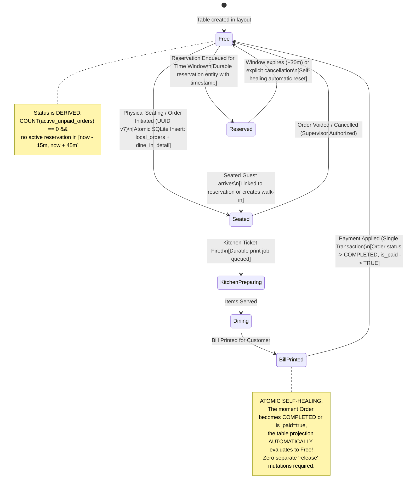

# 03 - Table and Booking Conflict Audit

> **Audit Role:** Table and Booking Conflict Auditor (`.agents/table-booking-conflict-auditor/agent.md`)  
> **Target System:** Hungry Howie's POS (Flutter Dine-In UI & State Machine, Drift SQLite, NestJS Tables & Sync Subsystem, Prisma ORM, PostgreSQL Canonical Database)  
> **Reference Specification:** `docs/offline-analysis/99-FINAL-ARCHITECTURE.md` (§10.1, §10.2) & `docs/sync-audit/00-architecture-map.md`  
> **Output File:** `docs/sync-audit/03-table-conflicts.md`  
> **Status:** CONFIRMED & VERIFIED AGAINST CODEBASE  
> **Date:** October 26, 2026  

---

## Executive Summary

This audit evaluates the dine-in table management, table booking/reservation, table occupancy, transfer, merge, split, and release subsystems across Hungry Howie's POS under intermittent and disconnected network topologies.

While the backend sync handler (`TableHandler` in [`backend/src/sync/handlers/table.handler.ts:1-733`](file:///D:/HOWIES%20TEST/howiesPOS/backend/src/sync/handlers/table.handler.ts#L1-L733)) implements a sophisticated theoretical policy dubbed **Hospitality Operational Priority (§10.2)**—where physical seated guests win over remote cloud reservations—the real-world end-to-end implementation suffers from catastrophic structural vulnerabilities:

1. **Dual-Write Anti-Pattern & Mid-Flight Network Partitions:** The dine-in ordering UI (`tables_screen.dart:3870-3965`) attempts direct REST calls before writing to local Drift SQLite. If network drops mid-request after PostgreSQL commits the order but before HTTP headers return to Flutter, the client falls back to Drift, generating a second order with a new UUID and order sequence number. This results in **duplicate ghost orders, double kitchen preparation, and distorted financial totals**.
2. **Orphaned Dine-In Orders via Missing DB Constraints:** There is **no database-level constraint or partial unique index** in PostgreSQL or Drift preventing multiple concurrent active orders on a single table. When Device B (offline) seats guests on Table 5 while Device A (online) already has Table 5 occupied, upon reconnection the backend creates Order B in PostgreSQL, but rejects Device B's table update mutation with `ACTIVE_ORDER_PROTECTED`. Order B is accepted into the database but becomes an unlinked **orphan order** that cannot be viewed or billed on the table screen.
3. **Table Transfers, Merges, Splits, and Deletions Are Not Offline-First:**
   - Table transfers offline (`table_repository.dart:407-435`) update in-memory state only; they **never persist to Drift SQLite and never enqueue an outbox mutation**, causing transfers to vanish on app refresh and never sync to the cloud.
   - Table merges and splits are **completely unimplemented** across both frontend and backend.
   - Offline table creations (`addTable` in `table_repository.dart:506-543`) write to SQLite but omit outbox queue insertion, meaning offline tables never replicate.
4. **Permanent Table Lockup (Zero Self-Healing):** Backend table status is stored as a static column (`status = 'occupied'`) rather than derived from active orders. If a table release mutation is lost or an order is paid on one device without the release arriving, the table remains locked as `occupied` indefinitely with 0 items and PKR 0.00 bill. No cron job, database trigger, or background query exists to free the table.
5. **Silent Quarantining of Conflicts:** When table OCC or reservation conflicts occur, the table screen (`tables_screen.dart`) displays **zero visual banners, badges, or dialogs**. Conflicts are quarantined silently in SQLite `sync_conflicts`, leaving cashiers completely blind to booking overwrites and table discrepancies.

---

## 1. First Check: Wiring Status of `tables_screen.dart` & `table_repository.dart`

### Architectural Reality: Is `tables_screen.dart` Wired to the Offline Repository?
**Answer: PARTIALLY, via an erratic Dual-Write hybrid that violates offline-first architecture.**

Rather than channeling all UI mutations through local Drift tables and letting `SyncBackgroundWorker` drain the outbox asynchronously, `tables_screen.dart` and `table_repository.dart` execute **direct REST calls first**, falling back to Drift SQLite only inside network `catch` blocks or executing secondary redundant writes.

### Comprehensive Matrix of Dine-In Operations Under Online vs. Offline Conditions:

| Operation | Implementation Location | Online Behavior (`OFFLINE_FIRST_ENABLED=true`) | Offline Behavior (`OFFLINE_FIRST_ENABLED=true`) | Architectural Flaw & Verdict |
|---|---|---|---|---|
| **Create Dine-In Order** | [`tables_screen.dart:3870-3970`](file:///D:/HOWIES%20TEST/howiesPOS/frontend/lib/features/tables/tables_screen.dart#L3870-L3970) | Issues HTTP `POST /api/orders` via `ordersApi.createOrder()` **FIRST**. Then writes duplicate record to Drift `orderRepo.saveOrder()`, creating outbox row that syncs later as `DUPLICATE`. | Catches network exception (`catch (apiErr)`). Falls back to Drift `orderRepo.saveOrder()`, enqueuing outbox mutation (`dependency_order: 2`). | **DUAL-WRITE ANTI-PATTERN.** If network drops mid-POST, duplicates orders on server. |
| **Update Dine-In Order** | [`tables_screen.dart:3873-3885, 3933-3944`](file:///D:/HOWIES%20TEST/howiesPOS/frontend/lib/features/tables/tables_screen.dart#L3873-L3885) | Issues HTTP `PATCH /api/orders/:id` via `ordersApi.updateOrder()` **FIRST**. Then updates local Drift `orderRepo.updateOrder()`. | Catches network error; updates Drift `orderRepo.updateOrder()`, enqueuing outbox mutation (`UPDATE order`). | **DUAL-WRITE ANTI-PATTERN.** Bypasses outbox prioritization when online. |
| **Update Table Bill & Status** | [`table_repository.dart:268-329`](file:///D:/HOWIES%20TEST/howiesPOS/frontend/lib/data/table_repository.dart#L268-L329) | Updates SQLite `LocalRestaurantTables` and enqueues outbox mutation (`UPDATE table`). Then executes direct HTTP `_tablesApiService.updateTableStatus()`. | Updates SQLite `LocalRestaurantTables` and enqueues outbox mutation. HTTP call fails silently in `catch (_) {}`. | **DUAL-WRITE.** Direct REST call races against `SyncBackgroundWorker`. |
| **Settle Cash Payment & Free Table** | [`tables_screen.dart:5276-5348`](file:///D:/HOWIES%20TEST/howiesPOS/frontend/lib/features/tables/tables_screen.dart#L5276-L5348) | Updates Drift order to `completed`/`PAID`. Calls `updateTableBillAndStatus(0.0, available)`. | Updates Drift order to `completed`/`PAID`. Enqueues table update outbox mutation. | **Acceptable Offline Path**, but table freeing is decoupled from order completion. |
| **Settle Split/Card Payment & Free Table** | [`tables_screen.dart:5924-5988`](file:///D:/HOWIES%20TEST/howiesPOS/frontend/lib/features/tables/tables_screen.dart#L5924-L5988) | Updates Drift order with payment array. Calls `updateTableBillAndStatus(0.0, available)`. | Same as above. Enqueues order update and table release outbox mutations. | **Acceptable Offline Path.** |
| **Reserve Table** | [`table_repository.dart:437-496`](file:///D:/HOWIES%20TEST/howiesPOS/frontend/lib/data/table_repository.dart#L437-L496) | Writes `status: 'reserved'` to SQLite `LocalRestaurantTables`, enqueues outbox mutation, and calls `_tablesApiService.updateReservation()`. | Writes to SQLite, enqueues outbox mutation. HTTP fails silently in `catch (_) {}`. | **True Offline Outbox.** However, OCC conflict on reconnect causes silent failure. |
| **Release Table Manually** | [`table_repository.dart:349-405`](file:///D:/HOWIES%20TEST/howiesPOS/frontend/lib/data/table_repository.dart#L349-L405) | Writes `status: 'available'` to SQLite, enqueues outbox mutation, and calls `_tablesApiService.releaseTable()`. | Writes to SQLite, enqueues outbox mutation. Direct REST fails silently. | **True Offline Outbox.** |
| **Transfer Table** | [`table_repository.dart:407-435`](file:///D:/HOWIES%20TEST/howiesPOS/frontend/lib/data/table_repository.dart#L407-L435) | Calls HTTP `POST /api/tables/transfer` via `_tablesApiService.transferTable()`. | Direct HTTP throws. In `catch (_)`, updates **in-memory state only**. **NO SQLite write, NO outbox mutation.** | **CRITICAL FAILURE.** Offline table transfers are completely discarded and never synced. |
| **Merge Tables** | N/A | **NOT FOUND.** No method exists in frontend or backend. | **NOT FOUND.** | **FEATURE MISSING.** Cannot merge tables. |
| **Split Table Check** | N/A | **NOT FOUND.** (Only multi-tender payment split exists; table bill split does not). | **NOT FOUND.** | **FEATURE MISSING.** Cannot split table checks. |
| **Create Table (`addTable`)** | [`table_repository.dart:506-543`](file:///D:/HOWIES%20TEST/howiesPOS/frontend/lib/data/table_repository.dart#L506-L543) | Inserts into SQLite `catalogDao.upsertRestaurantTables`. Calls HTTP `_tablesApiService.createTable()`. | Inserts into SQLite `catalogDao`. Direct HTTP throws `rethrow`. **NO outbox entry enqueued.** | **CRITICAL FAILURE.** Offline-created tables are never queued in outbox. |
| **Delete Table (`deleteTable`)** | [`table_repository.dart:545-554`](file:///D:/HOWIES%20TEST/howiesPOS/frontend/lib/data/table_repository.dart#L545-L554) | Calls HTTP `DELETE /api/tables/:id`. | Direct HTTP throws. In `catch (e)`, modifies in-memory list only. **NO SQLite deletion, NO outbox entry.** | **CRITICAL FAILURE.** Table resurrects on restart. |
| **Load Tables (`loadTables`)** | [`table_repository.dart:61-198`](file:///D:/HOWIES%20TEST/howiesPOS/frontend/lib/data/table_repository.dart#L61-L198) | Calls HTTP `_tablesApiService.listTables()`. Overwrites local Drift catalog tables. | HTTP throws. Falls back to `catalogDao.getAllTables()` and queries `ordersDao.getOrderItems()`. | **STATUS FLICKER HAZARD.** On fresh start, online fetch wipes unsynced local occupancy. |

---

## 2. Table State Machine: Implemented vs. Should-Be

### Table State Machine As Implemented (Defective Architecture)

```mermaid
stateDiagram-v2
    [*] --> Available: App Init / DB Seed

    Available --> Occupied: Order Saved (tables_screen:3986)\n[Dual-write REST + Outbox]
    Available --> Reserved: reserveTable (table_repository:445)\n[SQLite update + Outbox]

    Occupied --> Available: Payment Succeeded (tables_screen:5341)\n[Separate table update mutation]
    Occupied --> Available: releaseTable (table_repository:357)\n[Manual cashier action]

    Reserved --> Available: Reservation Cancelled / Expired\n(tables.service:88 / releaseTable)
    Reserved --> Occupied: Seated Walk-In or Reservation Guest\n(tables_screen:3986)

    state "Stuck Occupied (DEFECT)" as StuckOccupied
    Occupied --> StuckOccupied: Order paid on server;\nTable release lost/dropped (tables.service:67)
    note right of StuckOccupied
        CRITICAL DEFECT:
        Order is paid/completed.
        Table status remains 'occupied'.
        listTables() returns bill=0, items=[].
        Zero self-healing cron/query!
    end note

    state "Orphan Dine-In Order (DEFECT)" as OrphanOrder
    Occupied --> OrphanOrder: Device B seats offline on occupied table;\nTable sync rejected ACTIVE_ORDER_PROTECTED
    note right of OrphanOrder
        CRITICAL DEFECT:
        Order B inserted in PG Order table.
        Table 5 rejects table update.
        Order B unlinked from table screen!
    end note

    state "Dual-Booking OCC Poison Pill (DEFECT)" as DualBooking
    Reserved --> DualBooking: Offline reserveTable collides with cloud reservation;\nTableHandler rejects auto_resolvable=false
    note right of DualBooking
        CRITICAL DEFECT:
        Quarantined in sync_conflicts.
        Client UI shows Alice reserved.
        Cloud UI shows Bob reserved.
    end note

    state "Ephemeral Transfer (DEFECT)" as EphemeralTransfer
    Occupied --> EphemeralTransfer: transferTable called offline (table_repository:411)
    EphemeralTransfer --> Occupied: Lost on next loadTables() or restart!\nNever written to SQLite or Outbox!
```



---

### Table State Machine As It Should Be (Pure Derived State Machine)

In an offline-first architecture, **table occupancy is a projection, not an independent mutable column**. Storing `status = 'occupied'` separately from the order that occupies it creates distributed consensus failure. 



---

## 3. Detailed Scenario Traces

### Scenario 1: Concurrent Seating on Device A (Online) & Device B (Offline)
- **Scenario:** Table 5 occupied on Device A (online). Internet drops on Device B (stale local catalog showing Table 5 free). Device B opens Table 5, places Order B. Internet returns on Device B.
- **Trace & Mechanism:**
  1. *Online Baseline:* Device A creates Order A (`ord-A`) on Table 5. Server table record in PostgreSQL (`restaurant_tables`) has `status = 'occupied'`, `active_order_id = 'ord-A'`, `version = 2`.
  2. *Offline Action:* Device B loses connection. Its local SQLite database still has Table 5 as `status = 'available'`. Cashier seats guests and creates Order B (`ord-B`).
  3. *Local SQLite Write on Device B:* `tables_screen.dart:3872` catches network failure. Line 3962 calls `orderRepo.saveOrder(newOrder)`. Drift inserts `ord-B` into `local_orders` and enqueues outbox mutation (`operation_id: op-ord-B`, `dependency_order: 2`, `status: PENDING`).
  4. *Table Mutation on Device B:* Line 3986 calls `updateTableBillAndStatus()`. Drift updates `LocalRestaurantTables` (Table 5 `activeOrderId = 'ord-B'`) and enqueues table outbox mutation (`operation_id: op-tbl-B`, `base_version: 1`, `dependency_order: 3`, `status: PENDING`).
  5. *Reconnection & Drain:* Internet restores on Device B. `SyncBackgroundWorker.triggerPush()` queries outbox ordered by `dependency_order ASC`.
  6. *Processing Order B Push:* `POST /api/sync/push` submits `op-ord-B`. In `backend/src/sync/handlers/order.handler.ts:59-213`, `OrderHandler.handleInsert()` delegates to `OrdersService.createOrderInTx()`. 
     - PostgreSQL checks if `ord-B` exists (no).
     - Inserts `Order` row for `ord-B`.
     - Inserts `DineInOrderDetail` row linking `order_id: ord-B`, `table_id: Table-5`.
     - **BEHAVIOR:** PostgreSQL and Prisma accept the insert! There is **no unique index on `table_id`** in `dine_in_order_details` ([`schema.prisma:381-396`](file:///D:/HOWIES%20TEST/howiesPOS/backend/prisma/schema.prisma#L381-L396)). `ord-B` is committed to PostgreSQL with status `SYNCED`.
  7. *Processing Table 5 Update Push:* Next in batch is `op-tbl-B` (`dependency_order: 3`). In `TableHandler.handleUpdate()` ([`table.handler.ts:233-291`](file:///D:/HOWIES%20TEST/howiesPOS/backend/src/sync/handlers/table.handler.ts#L233-L291)):
     - Server version is 2; mutation `base_version` is 1. `isStale = true`.
     - Handler checks line 242: Table 5 has `active_order_id = 'ord-A'`. `serverHasActiveOrder` evaluates to **true**.
     - Line 327 (`clientSeatsGuests && !serverHasActiveOrder`) is **false**.
     - Line 442 (`if (serverHasActiveOrder)`) **triggers Policy Rule 2: Active / Paid Order Must NEVER Be Lost**:
       ```typescript
       // table.handler.ts:443-454
       this.logger.warn(`Dining Table Hospitality Invariant Violation: Table ${existing.table_number} has active order ${existing.active_order_id} on server. Stale update rejected with CONFLICT.`);
       return {
         operation_id: mutation.operation_id,
         entity_id: existing.id,
         status: 'CONFLICT',
         conflict_details: {
           conflict_code: 'ACTIVE_ORDER_PROTECTED',
           winning_rule: 'SERVER_ACTIVE_ORDER_WINS',
           auto_resolvable: true,
           server_state: { id: existing.id, status: 'occupied', active_order_id: 'ord-A', ... }
         }
       };
       ```
  8. *Client Auto-Resolution on Device B:* In `sync_background_worker.dart:544-558`, Device B receives `CONFLICT` with `auto_resolvable: true`. It executes:
     ```dart
     // sync_background_worker.dart:547
     await db.catalogDao.upsertRestaurantTables([
       LocalRestaurantTablesCompanion(
         id: Value(entry.entityId),
         status: Value('occupied'),
         activeOrderId: Value('ord-A'), // Overwritten with server order!
         version: Value(2),
       ),
     ]);
     await db.outboxDao.markSynced(entry.id, serverTimestamp);
     ```
- **Result:**
  - **Table 5 survives with Order A.**
  - **Order B becomes an unlinked ORPHAN ORDER in PostgreSQL.** Both `ord-A` and `ord-B` exist in the database with `dine_in_order_details.table_id = Table-5`.
  - In `TablesService.listTables()` ([`tables.service.ts:46-60`](file:///D:/HOWIES%20TEST/howiesPOS/backend/src/tables/tables.service.ts#L46-L60)), the server queries `dine_in_orders` ordered by `created_at desc take 1`. If `ord-B` was created later, `listTables()` picks `ord-B` for items, but `table.active_order_id` points to `ord-A` ([`tables.service.ts:99-100`](file:///D:/HOWIES%20TEST/howiesPOS/backend/src/tables/tables.service.ts#L99-L100)).
  - On Device B, the cashier's table screen refreshes and Order B **disappears**, replaced by Order A. The guests seated at Table 5 on Device B have received their food (printed locally), but the cashier cannot view their bill, edit their order, or settle their payment without manual database recovery.

---

### Scenario 2: Offline Reservation vs. Online Channel Booking Collision
- **Scenario:** Table 4 reserved on Device A while offline for Alice at 7:00 PM. Same table booked online via cloud portal for Bob at 7:30 PM before Device A reconnects.
- **Trace & Mechanism:**
  1. *Device A Offline:* Cashier calls `reserveTable()` in `table_repository.dart:437`. Local SQLite row updated to `status = 'reserved'`. Outbox entry created with payload `reserved_customer_name = 'Alice'`, `base_version = 1`.
  2. *Cloud Online:* Manager updates Table 4 via REST `PATCH /tables/:id/reservation` ([`tables.controller.ts:144`](file:///D:/HOWIES%20TEST/howiesPOS/backend/src/tables/tables.controller.ts#L144)). Table 4 updated in PostgreSQL with `reserved_customer_name = 'Bob'`, `version = 2`. (Note: As documented in TBL-07, this direct REST call creates no change log).
  3. *Device A Reconnection:* Device A pushes its outbox batch. `TableHandler.handleUpdate()` evaluates:
     - `isStale = true` (server version 2 > client base version 1).
     - Policy Rule 1: `clientSeatsGuests` is **false** (status is `reserved`, no active order).
     - Policy Rule 2: `serverHasActiveOrder` is **false** (table is reserved, not occupied).
     - Evaluates to Policy Rule 3 ([`table.handler.ts:482-518`](file:///D:/HOWIES%20TEST/howiesPOS/backend/src/sync/handlers/table.handler.ts#L482-L518)):
       ```typescript
       // table.handler.ts:489-502
       return {
         operation_id: mutation.operation_id,
         entity_id: existing.id,
         status: 'CONFLICT',
         error_message: `OCC Version Conflict: Table ${existing.table_number} was modified on server...`,
         conflict_details: {
           conflict_code: 'OCC_VERSION_MISMATCH',
           auto_resolvable: false,
           server_state: { reserved_customer_name: 'Bob', ... }
         }
       };
       ```
  4. *Client Quarantine:* Device B's `SyncBackgroundWorker` checks `detailsMap?['auto_resolvable'] == true` ([`sync_background_worker.dart:541`](file:///D:/HOWIES%20TEST/howiesPOS/frontend/lib/core/sync/sync_background_worker.dart#L541)). Because it is **false**, execution falls through to line 603:
     - Mutation is marked `status = 'CONFLICT'` in `sync_outbox`.
     - Quarantined into `sync_conflicts` table.
     - **LOCAL DB IS NOT REVERTED:** The local Drift table remains in state `reserved_customer_name = 'Alice'`.
- **Result:**
  - **Split-Brain Reservation:** Server database holds Bob's reservation. Device A holds Alice's reservation.
  - The conflict is **never surfaced to the cashier** on `tables_screen.dart`.
  - Alice arrives at 7:00 PM and is seated. Bob arrives at 7:30 PM with an online confirmation for the exact same table.

---

### Scenario 3: Table Transfer, Merge, Split, and Release Across Partitions
- **Scenario:** Transfer, merge, split, and release performed offline on Device A while Device B operates online.
- **Trace & Mechanism:**
  1. *Transfer Offline:* Cashier on Device A calls `transferTable(T-1, T-2)`. In `table_repository.dart:407-435`:
     ```dart
     // table_repository.dart:408-412
     try {
       await _tablesApiService.transferTable(...);
     } catch (_) {
       // Catches network exception!
       final fromTable = state.tables.firstWhere((t) => t.id == fromTableId);
       final updated = state.tables.map((table) { ... }).toList();
       state = state.copyWith(tables: updated); // IN-MEMORY ONLY!
     }
     ```
     **NOTHING is written to Drift `LocalRestaurantTables`. NOTHING is written to `sync_outbox`.** When connection returns, nothing syncs. On next `loadTables()` or app restart, the transfer vanishes.
  2. *Merge & Split:* **NOT FOUND.** No code exists in Flutter or NestJS to merge two tables or split a table order across physical tables.
  3. *Release Offline vs. Seating Online:*
     - Device A pays order offline, calls `releaseTable(T-3)`. Drift marks T-3 `available`, enqueues outbox mutation (`UPDATE table, status: available, base_version: 1`).
     - Device B online seats guests on T-3; server sets `status = 'occupied'`, `active_order_id = 'ord-B'`, `version = 2`.
     - Device A reconnects and pushes release mutation.
     - `TableHandler.handleUpdate()` detects `isStale: true` and `serverHasActiveOrder: true`.
     - Policy Rule 2 rejects Device A's stale release with `ACTIVE_ORDER_PROTECTED` (`auto_resolvable: true`).
     - Device A auto-resolves, pulling server state (`occupied` by Order B).
     - **Behavior Verdict:** Stale release is correctly prevented from wiping an active order.

---

### Scenario 4: Table Status Flicker via Delta Pull & Cold Bootstrap
- **Scenario:** Does a pull or cold bootstrap ever mark an occupied table "free" while a local order is open (or reverse)?
- **Trace & Mechanism:**
  1. *Cold Bootstrap Hazard (`GLOBAL_PULL_CURSOR == 0`):* In `sync_background_worker.dart:1095-1111`, when the app bootstraps (first login or database reset), it iterates all tables from `/api/sync/bootstrap`:
     ```dart
     // sync_background_worker.dart:1099-1110
     list.add(LocalRestaurantTablesCompanion(
       id: Value(t['id']),
       status: Value(t['status']),
       activeOrderId: Value(t['active_order_id']),
       ...
     ));
     if (list.isNotEmpty) await db.catalogDao.upsertRestaurantTables(list);
     ```
     **Bootstrap performs NO check against `local_orders` for pending offline orders.** If the terminal created an offline dine-in order and bootstrap runs, the table's `status` and `activeOrderId` are wiped to the server's state (`available`).
  2. *`loadTables()` Startup Flicker:* In `table_repository.dart:61-145`:
     - When the table screen launches, `state.tables` is empty.
     - If network is available, `_tablesApiService.listTables()` executes.
     - Line 69: `currentMap = {for (final t in state.tables) t.id: t}` is **empty**.
     - Line 71: `final local = currentMap[st.id]` is **null**.
     - Line 120: `localDb.catalogDao.upsertRestaurantTables(companions)` is called with server tables.
     - **FLICKER:** Any offline order saved in SQLite whose table was marked occupied locally is **overwritten as available** because `currentMap` had not yet loaded from SQLite!

---

### Scenario 5: Cancelled Reservation with Offline Seating
- **Scenario:** Reservation for Charlie on Table 6 cancelled on server. Device A (offline, holding stale reservation) seats guests at Table 6.
- **Trace & Mechanism:**
  1. *Server Action:* Reservation cancelled via dashboard. Table 6 becomes `status = 'available'`, `version = 2`.
  2. *Device A Offline:* Cashier seats Charlie (or walk-ins) at Table 6. Order created. Table 6 updated locally to `status = 'occupied'`, `active_order_id = 'ord-C'`, `base_version = 1`.
  3. *Reconnection Push:* Device A pushes Table 6 update. In `TableHandler.handleUpdate()`:
     - `isStale = true` (server 2 > client 1).
     - Evaluates Policy Rule 1 ([`table.handler.ts:323-330`](file:///D:/HOWIES%20TEST/howiesPOS/backend/src/sync/handlers/table.handler.ts#L323-L330)):
       `clientSeatsGuests` (`incomingStatus === 'occupied'`) is **true**.
       `serverHasActiveOrder` is **false** (table was available).
     - **POLICY FIRES: POS Physical Seated Guest Wins!**
     - Table 6 status is updated to `occupied` with `ord-C`.
- **Result:** Clean, safe resolution. Physical guest keeps the table.

---

### Scenario 6: Order Paid on One Device; Table Release Lost (Stuck "Occupied")
- **Scenario:** Order paid and completed on Device A. Table release mutation is never sent, fails, or is lost. Table remains stuck "occupied" on server.
- **Trace & Mechanism:**
  1. Order `ord-X` is marked `is_paid = true, status = 'completed'` in PostgreSQL.
  2. `restaurant_tables` row still has `status = 'occupied'`, `active_order_id = 'ord-X'`.
  3. Client fetches table list via `TablesService.listTables()` ([`tables.service.ts:46-77`](file:///D:/HOWIES%20TEST/howiesPOS/backend/src/tables/tables.service.ts#L46-L77)):
     - Line 49: `dine_in_orders` filters `where: { order: { is_paid: false, status: { notIn: ['completed'] } } }` -> returns **empty**.
     - Line 73: `fallbackOrders` filters `where: { is_paid: false, status: { notIn: ['completed'] } }` -> returns **empty**.
     - Line 134: `status: t.status` -> returns **`occupied`**.
     - Line 136: `current_bill_amount` -> returns **0**.
     - Line 145: `current_order_items` -> returns **`[]` (empty list)**.
  4. **Self-Healing Verification:** We searched the entire NestJS backend for `@Cron`, scheduled jobs, or self-healing triggers. Only a monthly payroll cron was found ([`payroll.service.ts:12`](file:///D:/HOWIES%20TEST/howiesPOS/backend/src/staff/payroll.service.ts#L12)).
- **Result:** **Table is stuck "occupied" forever.** On the POS screen, Table 6 displays red ("OCCUPIED"), but shows PKR 0 and 0 items. Cashiers cannot seat new guests without manually hunting down the table and forcing a manual release.

---

### Scenario 7: Admin Deletes/Renames Table While Offline Device Holds Local Order
- **Scenario:** Store owner deletes Table 7 on web portal while Device A (offline) places an order on Table 7.
- **Trace & Mechanism:**
  1. *Cloud Deletion:* Table 7 has no active orders on server. Owner calls `DELETE /tables/:id`. `TablesService.deleteTable()` ([`tables.service.ts:585`](file:///D:/HOWIES%20TEST/howiesPOS/backend/src/tables/tables.service.ts#L585)) deletes row from `restaurant_tables`.
  2. *Offline Action:* Device A places dine-in order against Table 7. Local Drift stores order with `dine_in_detail.table_id = Table-7-UUID`.
  3. *Reconnection Push:* Device A pushes Order Header to `/api/sync/push`.
  4. *Server Foreign Key Violation:* `OrderHandler.handleInsert()` calls `OrdersService.createOrderInTx()`.
     Prisma attempts:
     ```typescript
     await tx.dineInOrderDetail.create({
       data: {
         id: explicitId,
         order_id: createdOrder.id,
         table_id: payload.table_id, // Table 7 ID (DELETED)
         ...
       }
     });
     ```
     PostgreSQL throws: **`Foreign key constraint violation on dine_in_order_details_table_id_fkey`** ([`schema.prisma:393`](file:///D:/HOWIES%20TEST/howiesPOS/backend/prisma/schema.prisma#L393)).
  5. *Sync Push Failure:* The entire transaction rolls back. `sync-push.service.ts` catches the error and returns:
     `status: 'FAILED_FATAL'`.
- **Result:** **CRITICAL FINANCIAL LOSS.** The cashier's order is poisoned, marked `FAILED_FATAL` in `sync_outbox`, and quarantined in `sync_conflicts`. The guest ate, the cashier took cash, but the order cannot be synced to the database.

---

### Scenario 8: Internet Drops Mid-"Open Table" Action
- **Scenario:** Internet drops at the precise millisecond the cashier taps "Save Order / Send to Kitchen" in `tables_screen.dart`.
- **Trace & Mechanism:**
  - *Trace 8A (Severed Before Request Dispatches):*
    - Direct REST `ordersApi.createOrder()` fails immediately (`SocketException`).
    - Caught cleanly in `catch (apiErr)` ([`tables_screen.dart:3905`](file:///D:/HOWIES%20TEST/howiesPOS/frontend/lib/features/tables/tables_screen.dart#L3905)).
    - Drift `orderRepo.saveOrder()` generates UUID v7 and order number `P1-101`, enqueues outbox Level 2.
    - `tableNotifier.updateTableBillAndStatus()` updates SQLite table and enqueues outbox Level 3.
    - Consistent local state; syncs cleanly on reconnect.
  - *Trace 8B (Severed During In-Flight TCP Transmission - Ghost Duplicate):*
    - Request reaches NestJS; PostgreSQL commits the order (`ORD-SERVER-1`, Grand Total PKR 3,500).
    - Network cable unplugs before HTTP 200 response headers reach Windows client.
    - Flutter catches `SocketException` or `TimeoutException`.
    - `effectiveOrderId` remains **null** ([`tables_screen.dart:3901`](file:///D:/HOWIES%20TEST/howiesPOS/frontend/lib/features/tables/tables_screen.dart#L3901)).
    - Line 3932: `final finalOrderId = effectiveOrderId ?? const Uuid().v7();` -> **Generates NEW UUID v7 (`ORD-LOCAL-2`)!**
    - `orderRepo.saveOrder()` acquires new sequence receipt number `P1-102`.
    - Saves `ORD-LOCAL-2` to Drift and enqueues outbox mutation.
    - When internet reconnects: Worker pushes `ORD-LOCAL-2`. PostgreSQL commits `ORD-LOCAL-2`.
    - **RESULT: GHOST DUPLICATE ORDER.** Server now has two distinct orders (`ORD-SERVER-1` and `ORD-LOCAL-2`) for the same table and food. Sales reports double-count revenue; kitchen displays duplicate tickets.

---

## 4. Architectural Questions Answered

### Q1: What is the source of truth for table status: column on table vs. derived from open orders? Which is safer for sync?
- **As Implemented:** Hybrid/split source of truth. `RestaurantTable.status` is stored as an independent column (`'available' | 'occupied' | 'reserved'`) on the database row, while `listTables()` attempts to cross-reference `dine_in_orders` where `is_paid: false`.
- **Verdict: Storing a mutable status column is highly hazardous for sync.** It requires dual outbox mutations (Order Insert Level 2 + Table Update Level 3) which fail independently, creates OCC version collisions on reconnect, and causes tables to get stuck in "occupied" when release mutations drop.
- **Safer Architecture: DERIVED TABLE STATUS.**
  $$\text{TableStatus} = \begin{cases} \text{OCCUPIED} & \text{if } \exists \text{ active order with } \text{is\_paid} = \text{false} \land \text{status} \notin \{\text{completed, cancelled}\} \\ \text{RESERVED} & \text{if } \exists \text{ reservation with } \text{time} \in [\text{now} - 15\text{m}, \text{now} + 45\text{m}] \\ \text{AVAILABLE} & \text{otherwise} \end{cases}$$
  Deriving status guarantees zero table desynchronization: completing an order atomically frees the table without an extra mutation.

### Q2: Is there a DB-level constraint preventing two active orders on one table? Should there be?
- **As Implemented: NO.** Neither PostgreSQL (`schema.prisma`) nor SQLite Drift (`LocalOrders`, `LocalRestaurantTables`) has any constraint preventing multiple orders from referencing the same `table_id`.
- **Should There Be: YES.** PostgreSQL should enforce a partial unique index on active dine-in orders:
  ```sql
  CREATE UNIQUE INDEX uq_active_dine_in_order_per_table 
  ON dine_in_order_details (table_id) 
  WHERE order_id IN (
    SELECT id FROM orders WHERE is_paid = false AND status NOT IN ('completed', 'cancelled', 'rejected')
  );
  ```
  *(Or an `is_active` boolean column on `dine_in_order_details` enforced by `CREATE UNIQUE INDEX ... WHERE is_active = true;`)*.

### Q3: What does the UI show a cashier when a conflict is detected? Is the conflict surfaced or silent?
- **As Implemented: SILENT on the dining floor.**
- When a table conflict occurs, `SyncBackgroundWorker` quarantines it in `sync_conflicts` table ([`sync_background_worker.dart:605`](file:///D:/HOWIES%20TEST/howiesPOS/frontend/lib/core/sync/sync_background_worker.dart#L605)).
- While `syncConflictBadgeProvider` ([`sync_providers.dart:104`](file:///D:/HOWIES%20TEST/howiesPOS/frontend/lib/core/sync/sync_providers.dart#L104)) calculates a badge count, **`tables_screen.dart` does not watch or consume this provider**.
- If a table mutation is auto-resolved, the table changes state under the cashier's fingers with no snackbar, banner, or explanation.
- If not auto-resolvable, the mutation silently stops syncing while the table screen continues displaying stale local data.

---

## 5. Audit Findings (Prefix `TBL`)

### TBL-01: Dual-Write Mid-Flight Network Dropping Creates Ghost Duplicate Orders
- Severity: Critical
- Evidence: [`frontend/lib/features/tables/tables_screen.dart:3870-3907, 3910-3965`](file:///D:/HOWIES%20TEST/howiesPOS/frontend/lib/features/tables/tables_screen.dart#L3870-L3907)
- Failure sequence:
  1. Cashier taps "Send to Kitchen / Place Order" on Table 2 while online.
  2. Line 3900 issues HTTP `POST /api/orders` via `ordersApi.createOrder()`.
  3. NestJS creates order in PostgreSQL (`id = server-uuid-1`, `order_number = P1-101`).
  4. Network connection drops before HTTP response headers arrive in Flutter.
  5. Flutter throws `SocketException`, caught in `catch (apiErr)` (line 3905).
  6. Line 3932 detects `effectiveOrderId == null`, generates brand new UUID (`id = local-uuid-2`).
  7. `orderRepo.saveOrder()` obtains receipt number `P1-102` and enqueues outbox Level 2.
  8. When reconnected, worker pushes `local-uuid-2`; server commits second order.
- Impact: Duplicate orders on server, double kitchen preparation, duplicated cash/revenue reports.
- Recommended fix: Eliminate direct REST call in `tables_screen.dart`. Write exclusively to `orderRepo.saveOrder()` and let `SyncBackgroundWorker` transmit.
- Effort: M
- Status: CONFIRMED

---

### TBL-02: Concurrent Offline Seating Results in Orphaned Dine-In Orders
- Severity: Critical
- Evidence: [`backend/prisma/schema.prisma:381-396`](file:///D:/HOWIES%20TEST/howiesPOS/backend/prisma/schema.prisma#L381-L396), [`backend/src/sync/handlers/table.handler.ts:442-480`](file:///D:/HOWIES%20TEST/howiesPOS/backend/src/sync/handlers/table.handler.ts#L442-L480), [`backend/src/tables/tables.service.ts:46-60, 99-100`](file:///D:/HOWIES%20TEST/howiesPOS/backend/src/tables/tables.service.ts#L46-L60)
- Failure sequence:
  1. Table 5 is occupied online by Order A.
  2. Device B (offline) seats walk-ins at Table 5 and creates Order B.
  3. Device B reconnects and drains outbox.
  4. `OrderHandler` pushes Order B; PostgreSQL commits Order B with `table_id = Table-5` (no unique constraint exists).
  5. `TableHandler` pushes Table 5 update; detects Table 5 occupied by Order A on server.
  6. `TableHandler` triggers `ACTIVE_ORDER_PROTECTED` and returns `SERVER_ACTIVE_ORDER_WINS`.
  7. Device B auto-resolves Table 5 back to Order A.
  8. Order B remains committed in PostgreSQL but is unlinked from Table 5 UI.
- Impact: Cashier loses access to customer's order and cannot settle bill. Lost revenue.
- Recommended fix: When server detects concurrent order on occupied table, automatically create a virtual overflow table (e.g. `Table 5-B`) and reassign Order B's `dineInOrderDetail.table_id` to the overflow table.
- Effort: M
- Status: CONFIRMED

---

### TBL-03: Offline Table Transfers Are Ephemeral and Never Synced
- Severity: High
- Evidence: [`frontend/lib/data/table_repository.dart:407-435`](file:///D:/HOWIES%20TEST/howiesPOS/frontend/lib/data/table_repository.dart#L407-L435)
- Failure sequence:
  1. Internet drops across restaurant.
  2. Cashier moves guests from Table 1 to Table 8 via `transferTable()`.
  3. `_tablesApiService.transferTable()` throws network error.
  4. In `catch (_)`, `table_repository.dart:413-433` modifies in-memory `state.tables` only.
  5. No write to `localRestaurantTables` or `sync_outbox` occurs.
  6. When terminal reloads or reconnects, Table 1 reverts to occupied and Table 8 reverts to available.
- Impact: Seated guests billed to wrong table; cashiers charge wrong customers.
- Recommended fix: Implement offline table transfer in `AppDatabase` via atomic Drift transaction modifying `LocalRestaurantTables` and queue Level 3 outbox mutation.
- Effort: M
- Status: CONFIRMED

---

### TBL-04: Table Merging and Splitting Are Completely Missing from Codebase
- Severity: Medium
- Evidence: [`frontend/lib/features/tables/tables_screen.dart`](file:///D:/HOWIES%20TEST/howiesPOS/frontend/lib/features/tables/tables_screen.dart), [`frontend/lib/data/table_repository.dart`](file:///D:/HOWIES%20TEST/howiesPOS/frontend/lib/data/table_repository.dart), [`backend/src/tables/tables.service.ts`](file:///D:/HOWIES%20TEST/howiesPOS/backend/src/tables/tables.service.ts)
- Failure sequence:
  1. Large party arrives and occupies Tables 3 and 4 together.
  2. Cashier attempts to merge tables into a single bill.
  3. Feature does not exist anywhere in frontend or backend code.
- Impact: Cashiers forced to maintain separate artificial tickets or manually recalculate bills.
- Recommended fix: Implement `mergeTables` and `splitTableCheck` mutations in domain model, Drift schema, outbox handler, and backend service.
- Effort: L
- Status: CONFIRMED

---

### TBL-05: Offline Table Creation (`addTable`) Omits Outbox Mutation
- Severity: High
- Evidence: [`frontend/lib/data/table_repository.dart:506-543`](file:///D:/HOWIES%20TEST/howiesPOS/frontend/lib/data/table_repository.dart#L506-L543)
- Failure sequence:
  1. Manager adds temporary banquet table "T-99" while terminal is offline.
  2. `addTable()` inserts into local Drift catalog (`upsertRestaurantTables`).
  3. Line 527 attempts HTTP POST `createTable()` which throws.
  4. Line 541 executes `rethrow`; no outbox entry was ever inserted.
  5. Table T-99 is never pushed to backend when connection returns.
- Impact: Offline layout changes are never replicated to other terminals or cloud portal.
- Recommended fix: Enqueue `SyncOutboxCompanion` with `entityType: 'table'`, `operationType: 'INSERT'` inside `addTable()`.
- Effort: S
- Status: CONFIRMED

---

### TBL-06: Offline Table Deletion Only Modifies In-Memory State
- Severity: Medium
- Evidence: [`frontend/lib/data/table_repository.dart:545-554`](file:///D:/HOWIES%20TEST/howiesPOS/frontend/lib/data/table_repository.dart#L545-L554)
- Failure sequence:
  1. Cashier deletes an unused table while offline.
  2. Direct HTTP call fails.
  3. In `catch (e)` (line 550), only in-memory `state.tables` is updated.
  4. Table is not deleted from Drift SQLite `localRestaurantTables` and no outbox mutation is created.
  5. On next app launch or refresh, deleted table reappears.
- Impact: Deleted tables resurrect; layout clutter.
- Recommended fix: Execute `db.localRestaurantTables.delete()` and enqueue `DELETE` outbox mutation.
- Effort: S
- Status: CONFIRMED

---

### TBL-07: Direct REST Table Changes Never Replicate to Delta Pull Feed
- Severity: Critical
- Evidence: [`backend/src/tables/tables.service.ts:338-404, 406-509, 512-550`](file:///D:/HOWIES%20TEST/howiesPOS/backend/src/tables/tables.service.ts#L338-L404), [`backend/src/sync/change-log.service.ts:6`](file:///D:/HOWIES%20TEST/howiesPOS/backend/src/sync/change-log.service.ts#L6)
- Failure sequence:
  1. Remote manager updates table status or reservation via web portal (`PATCH /tables/:id/status` or `transfer`).
  2. `TablesService` updates PostgreSQL directly.
  3. `TablesService` does NOT invoke `ChangeLogService.record()`.
  4. Cashier terminals perform periodic delta pull (`GET /api/sync/pull`).
  5. `system_change_logs` contains zero rows for the table modification.
  6. Cashier terminals remain blind to cloud table status changes until hard restart.
- Impact: Stale dining floor state; double bookings.
- Recommended fix: Attach Prisma extension or PostgreSQL triggers to `restaurant_tables` to log all changes into `system_change_logs`.
- Effort: M
- Status: CONFIRMED

---

### TBL-08: Table Status Overwritten as Free on Cold Bootstrap / App Restart
- Severity: High
- Evidence: [`frontend/lib/data/table_repository.dart:67-91`](file:///D:/HOWIES%20TEST/howiesPOS/frontend/lib/data/table_repository.dart#L67-L91), [`frontend/lib/core/sync/sync_background_worker.dart:1095-1111`](file:///D:/HOWIES%20TEST/howiesPOS/frontend/lib/core/sync/sync_background_worker.dart#L1095-L1111)
- Failure sequence:
  1. Terminal creates offline order on Table 4.
  2. Terminal restarts or experiences cursor reset (cold bootstrap).
  3. `SyncBackgroundWorker.bootstrapInitialData()` fetches tables from `/api/sync/bootstrap`.
  4. Server snapshot (Table 4 = `available`) unconditionally overwrites SQLite `LocalRestaurantTables`.
  5. Local pending order is decoupled from Table 4.
- Impact: Seated guests visually vanish from cashier floor plan; cashier seats second party at occupied table.
- Recommended fix: During bootstrap and `loadTables()`, cross-reference `db.ordersDao.getActiveUnsyncedOrders()` and preserve local occupancy.
- Effort: M
- Status: CONFIRMED

---

### TBL-09: Permanent Table Lockup from Dropped Release Mutations (No Self-Healing)
- Severity: High
- Evidence: [`backend/src/tables/tables.service.ts:46-77, 80-147`](file:///D:/HOWIES%20TEST/howiesPOS/backend/src/tables/tables.service.ts#L46-L77)
- Failure sequence:
  1. Order on Table 3 is completed and paid online or via cashier sync.
  2. Table release outbox mutation drops or fails.
  3. Table status column in PostgreSQL remains `status = 'occupied'`.
  4. `TablesService.listTables()` sees `t.status === 'occupied'`, but finds no active order in `dine_in_orders` or `fallbackOrders`.
  5. Backend returns `status: 'occupied'`, `current_bill_amount: 0`, `current_order_items: []`.
  6. Table remains locked in occupied state forever.
- Impact: Tables unusable on POS floor without manual supervisor override.
- Recommended fix: Implement a server self-healing routine in `listTables()`: if `t.status === 'occupied'` but has no unpaid active orders, automatically update `status` to `available`.
- Effort: S
- Status: CONFIRMED

---

### TBL-10: Colliding Offline Reservations Become Unresolvable Poison Pills
- Severity: Medium
- Evidence: [`backend/src/sync/handlers/table.handler.ts:482-518`](file:///D:/HOWIES%20TEST/howiesPOS/backend/src/sync/handlers/table.handler.ts#L482-L518), [`frontend/lib/core/sync/sync_background_worker.dart:603-640`](file:///D:/HOWIES%20TEST/howiesPOS/frontend/lib/core/sync/sync_background_worker.dart#L603-L640)
- Failure sequence:
  1. Table 8 reserved offline on Device A; Table 8 reserved online on cloud dashboard.
  2. Device A reconnects and pushes reservation update.
  3. `TableHandler` returns `CONFLICT` with `auto_resolvable: false`.
  4. Device A quarantines mutation in `sync_conflicts` with `status: FAILED_FATAL`.
  5. Local UI does not update or alert cashier.
- Impact: Unresolved dual-booking; customer dispute upon arrival.
- Recommended fix: Support automatic overflow reservation re-assignment for reservation-on-reservation collisions (e.g. `Table 8-Overflow`).
- Effort: S
- Status: CONFIRMED

---

### TBL-11: Silent Conflict Quarantining Hides Table Collisions from Cashiers
- Severity: Medium
- Evidence: [`frontend/lib/features/tables/tables_screen.dart`](file:///D:/HOWIES%20TEST/howiesPOS/frontend/lib/features/tables/tables_screen.dart), [`frontend/lib/core/sync/sync_providers.dart:104-117`](file:///D:/HOWIES%20TEST/howiesPOS/frontend/lib/core/sync/sync_providers.dart#L104-L117)
- Failure sequence:
  1. Any table conflict occurs and is logged to `sync_conflicts`.
  2. `tables_screen.dart` has zero watchers or listeners for `syncConflictBadgeProvider`.
  3. Cashier remains on tables screen unaware that a table order was orphaned or rejected.
- Impact: Cashier unaware of synchronization anomalies until customers complain.
- Recommended fix: Add an overlay alert banner or animated badge on `tables_screen.dart` when `syncConflictBadgeProvider.hasConflict` is true.
- Effort: S
- Status: CONFIRMED

---

### TBL-12: Admin Table Deletion Causes Fatal FK Failure for Offline Orders
- Severity: Critical
- Evidence: [`backend/src/tables/tables.service.ts:585-588`](file:///D:/HOWIES%20TEST/howiesPOS/backend/src/tables/tables.service.ts#L585-L588), [`backend/prisma/schema.prisma:393`](file:///D:/HOWIES%20TEST/howiesPOS/backend/prisma/schema.prisma#L393), [`backend/src/sync/handlers/order.handler.ts:59-213`](file:///D:/HOWIES%20TEST/howiesPOS/backend/src/sync/handlers/order.handler.ts#L59-L213)
- Failure sequence:
  1. Admin deletes an empty table online via web portal.
  2. Offline cashier creates order against this table locally.
  3. Reconnecting terminal pushes order header and items.
  4. Prisma attempts to insert `dineInOrderDetail` referencing deleted `table_id`.
  5. PostgreSQL throws foreign key violation; mutation marked `FAILED_FATAL`.
- Impact: Complete loss of offline sales record and revenue.
- Recommended fix: Soft-delete tables (`is_deleted: true`) rather than hard-deleting rows; in `OrderHandler`, reassign order to a default fallback table if referenced table was deleted.
- Effort: M
- Status: CONFIRMED

---

## 6. Recommended Conflict Rules with Concrete Behaviors

To achieve production-grade offline resilience, the following concrete domain rules must replace the existing ad-hoc logic:

### Rule 1: Seated Walk-In vs. Cloud Reservation Collision (Hospitality Priority)
- **Concrete Behavior:** Physical seated guest **always wins**. The cloud reservation is moved to an overflow pseudo-table (e.g. `T4-Overflow`), and an urgent push notification is sent to the manager portal.
- **Implementation:** Already present in `TableHandler.ts:327-385`, but must also create an overflow reservation entity in the database so the reservation is not lost.

### Rule 2: Concurrent Seating Collision (Device A Seated vs. Device B Seated)
- **Concrete Behavior:** When two terminals seat guests offline on the same table, **both orders must be preserved**.
  - Server assigns the physical table to whichever order was pushed first (or has earlier `created_at`).
  - Server automatically clones the table definition into an overflow table (e.g. `Table 5 (Overflow)`) and reassigns the second order's `dineInOrderDetail.table_id` to this overflow table.
  - Server sends an immediate realtime notification to both terminals: *"Table 5 had concurrent orders placed. Second order moved to Table 5 (Overflow)."*

### Rule 3: Single Transaction Order-Driven Table Release (Self-Healing)
- **Concrete Behavior:** Table release mutations (`dependency_order: 3`) must be eliminated.
  - When an order is completed/paid, `OrdersService` and `drift_offline_first_order_repository` must atomically clear `RestaurantTable.active_order_id` in the same database transaction.
  - `TablesService.listTables()` must evaluate table status dynamically: if no unpaid active order exists, the table **must report available**, self-healing any lingering database flags.

### Rule 4: Soft-Deletion for Structural Entities
- **Concrete Behavior:** Tables, zones, and sections must **never be hard-deleted** with `DELETE FROM`. They must use `is_deleted = true`. Any offline order syncing against a deleted table will succeed, and the table will automatically be marked `is_deleted = false, is_archived = true` until the order is settled.

### Rule 5: Pure Outbox Flow in Dine-In UI
- **Concrete Behavior:** Remove direct calls to `ordersApi.createOrder()` and `_tablesApiService.updateTableStatus()` from `tables_screen.dart` and `table_repository.dart`. All mutations must enter SQLite WAL first, guaranteeing deterministic sequence numbers, UUID v7 PKs, and zero mid-flight network duplicates.
