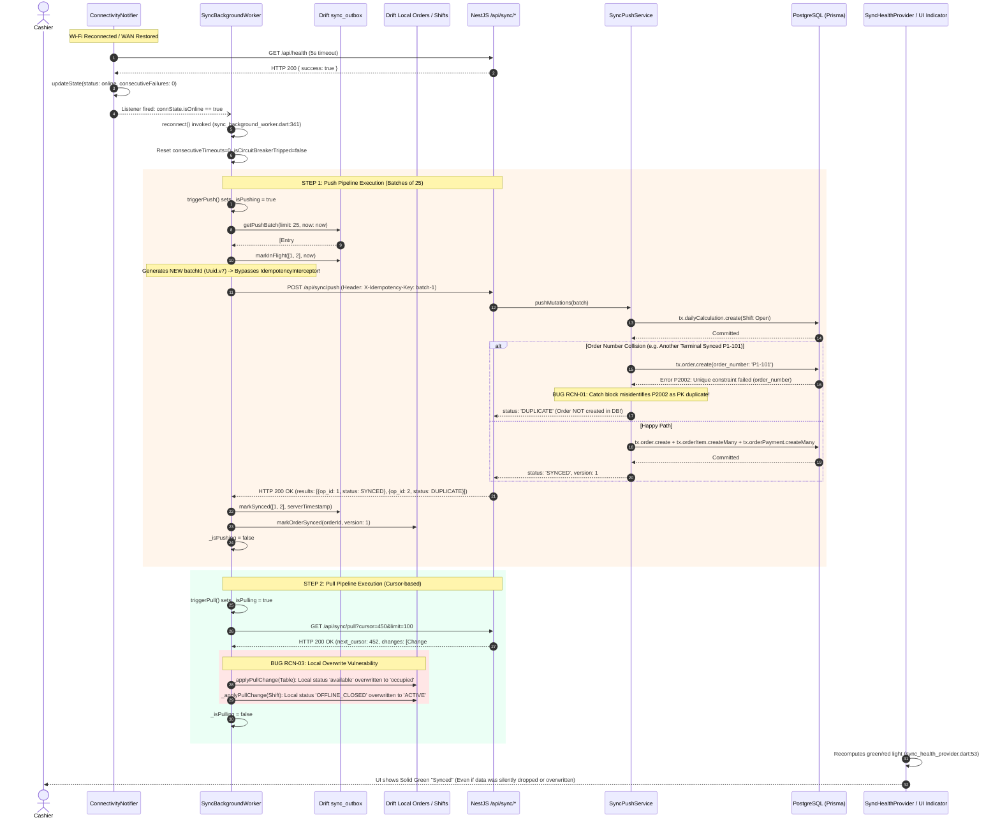

# 04 - Reconnect & Recovery Audit Report: Hungry Howie's POS

> **Audit Role:** Reconnect & Recovery Auditor (`.agents/reconnect-recovery-auditor/agent.md`)  
> **Target System:** Hungry Howie's POS (Flutter Windows Desktop + NestJS / Prisma / PostgreSQL Backend)  
> **Reference Specifications:** `docs/sync-audit/00-architecture-map.md`, `docs/offline-analysis/99-FINAL-ARCHITECTURE.md`  
> **Output Prefix:** `RCN`  
> **Audit Status:** Authoritative Forensic Audit  
> **Date:** October 26, 2026  

---

## Executive Summary

This audit assesses the resilience, correctness, and failure boundaries of Hungry Howie's POS at the exact moment network connectivity returns, as well as during extended offline recovery. Every finding and scenario trace in this document is backed by concrete `file:line` citations from the codebase.

### Primary Audit Verdict: **UNSAFE FOR UNATTENDED RECOVERY**
While the offline write path is durable locally (backed by Drift / SQLite in WAL mode with UUID v7 primary keys), the reconnection and recovery subsystems suffer from **catastrophic silent data loss vectors**, **deceptive UI indicator states**, **uncoordinated push/pull ordering**, and **zero defense against multi-terminal race conditions**:

1. **Silent Order Erasure on the Server (Critical):** Under concurrent terminal reconnection or order number collisions, PostgreSQL throws unique constraint violation `P2002` on `order_number`. The server sync push catch block misinterprets *any* `P2002` error as a duplicate primary key, marks the mutation as `DUPLICATE`, and returns HTTP 200. The client marks the order `synced` locally, while the server **silently discards the customer order and its line items forever** ([`sync-push.service.ts:259-277`](file:///D:/HOWIES%20TEST/howiesPOS/backend/src/sync/sync-push.service.ts#L259-L277)).
2. **Catastrophic Outbox Deletion via UI (Critical):** The `DataSyncScreen` displays a prominent red button *"Clear N Sync Errors"* that executes `db.outboxDao.clearFailedEntries()`. This method overwrites unsynced, conflicted, or retryable outbox entries with `status = 'SYNCED'` in SQLite without transmitting them to the backend, enabling cashiers to permanently delete customer sales and cash records just to make the sync light green ([`data_sync_screen.dart:214-226`](file:///D:/HOWIES%20TEST/howiesPOS/frontend/lib/features/sync/data_sync_screen.dart#L214-L226), [`outbox_dao.dart:140-151`](file:///D:/HOWIES%20TEST/howiesPOS/frontend/lib/core/database/daos/outbox_dao.dart#L140-L151)).
3. **Local Overwrite via Stale Delta Pull (Critical):** In `_onPeriodicTick()`, push and pull are initiated concurrently without mutex locks ([`sync_background_worker.dart:354-355`](file:///D:/HOWIES%20TEST/howiesPOS/frontend/lib/core/sync/sync_background_worker.dart#L354-L355)). Furthermore, if push aborts on an error during `reconnect()`, pull continues immediately. Incoming change logs overwrite locally closed shifts (`LocalDailyCalculations.status = OFFLINE_CLOSED`) back to `ACTIVE`, zeroing out actual counted cash, and re-occupy tables that were freed offline ([`sync_background_worker.dart:1159-1230`](file:///D:/HOWIES%20TEST/howiesPOS/frontend/lib/core/sync/sync_background_worker.dart#L1159-L1230)).
4. **Deceptive Green Light on Token Expiry (High):** When offline session tokens expire, mutations transition to `AUTH_PAUSED`. However, `outboxDao.watchActiveOutboxEntries()` explicitly excludes `AUTH_PAUSED` rows. As a result, the health provider sees zero pending and zero failed items, displaying a **solid green "Synced" indicator** while background synchronization is completely halted and orders remain stranded locally ([`sync_health_provider.dart:65-75`](file:///D:/HOWIES%20TEST/howiesPOS/frontend/lib/core/sync/sync_health_provider.dart#L65-L75), [`outbox_dao.dart:168-175`](file:///D:/HOWIES%20TEST/howiesPOS/frontend/lib/core/database/daos/outbox_dao.dart#L168-L175)).
5. **Captive Portal False Online Loop (Medium):** `ConnectivityNotifier.probeHealth()` catches `FormatException` when a captive portal returns HTTP 200 with HTML, but treats the probe as successful. The POS declares itself online, attempts to push JSON batches to the captive portal, fails on response decoding, trips its circuit breaker, and enters an endless flapping loop ([`connectivity_notifier.dart:130-150`](file:///D:/HOWIES%20TEST/howiesPOS/frontend/lib/core/sync/connectivity_notifier.dart#L130-L150)).

---

## 1. Timeline Diagram: Observed Reconnect Sequence

The following sequence diagram illustrates the exact order of execution observed in the codebase when network connectivity is restored:



---

## 2. Forensic Trace of the 12 Scenarios

### Scenario 1: Push vs Pull Order
- **Code Citations:** [`sync_background_worker.dart:341-350`](file:///D:/HOWIES%20TEST/howiesPOS/frontend/lib/core/sync/sync_background_worker.dart#L341-L350), [`sync_background_worker.dart:352-357`](file:///D:/HOWIES%20TEST/howiesPOS/frontend/lib/core/sync/sync_background_worker.dart#L352-L357), [`sync_background_worker.dart:393-404`](file:///D:/HOWIES%20TEST/howiesPOS/frontend/lib/core/sync/sync_background_worker.dart#L393-L404), [`sync_background_worker.dart:1159-1230`](file:///D:/HOWIES%20TEST/howiesPOS/frontend/lib/core/sync/sync_background_worker.dart#L1159-L1230).
- **Behavior in Code:**
  - In `reconnect()`, line 348 awaits `triggerPush()`, and line 349 awaits `triggerPull()`. This superficially enforces push-then-pull.
  - **However, two critical failure modes violate this guarantee:**
    1. **Concurrent Periodic Tick:** In `_onPeriodicTick()` ([`line 354-355`](file:///D:/HOWIES%20TEST/howiesPOS/frontend/lib/core/sync/sync_background_worker.dart#L354-L355)), `triggerPush()` and `triggerPull()` are invoked without `await`. They execute **concurrently** in the Dart event loop using separate boolean flags `_isPushing` and `_isPulling`.
    2. **Push Abort Leaks Pull:** In `triggerPush()`, if any batch fails due to an HTTP error or OCC conflict, the loop breaks ([`line 402`](file:///D:/HOWIES%20TEST/howiesPOS/frontend/lib/core/sync/sync_background_worker.dart#L402)). `triggerPush()` terminates with unsynced items remaining in the outbox. `reconnect()` immediately proceeds to `await triggerPull()`, pulling server deltas over an un-drained local queue.
- **Concrete Overwrite Case (Offline Shift Closure Wiped):**
  1. Cashier terminal loses connectivity at 21:00.
  2. Cashier counts the cash drawer and submits an offline shift closure at 21:30 via `driftOfflineFirstShiftRepository.closeShift()`.
  3. `LocalDailyCalculations` record is updated: `status = 'OFFLINE_CLOSED'`, `actualCashCounted = 14500.00`, `cashVariance = -500.00`.
  4. Outbox enqueues a Level 5 `UPDATE shift` mutation with `operation_id = op-close-1`.
  5. Connectivity restores. Reconnection triggers.
  6. If push is delayed or aborts on an earlier order batch, `triggerPull()` executes.
  7. Server change feed returns the shift entity from cloud PostgreSQL (where status is still `ACTIVE`, `actual_cash_counted` is `null`, and `version = 2` due to an earlier remote note edit).
  8. `SyncBackgroundWorker._applyPullChange()` runs lines 1184-1230:
     ```dart
     // frontend/lib/core/sync/sync_background_worker.dart:1213-1229
     await db.dailyCalculationsDao.upsertCalculation(
       LocalDailyCalculationsCompanion(
         id: Value(entityId),
         status: Value(serverStatus), // 'ACTIVE'
         actualCashCounted: const Value.absent(), // Erased!
         cashVariance: Value(cashVariance), // 0.0
         syncStatus: const Value('synced'),
         serverVersion: Value(recordVersion),
       ),
     );
     ```
  9. The local record is overwritten. The cashier's counted cash and offline closure status are wiped from Drift before the push mutation can ever be processed.

---

### Scenario 2: Mid-Sync Drop
- **Code Citations:** [`sync_background_worker.dart:395-464`](file:///D:/HOWIES%20TEST/howiesPOS/frontend/lib/core/sync/sync_background_worker.dart#L395-L464), [`sync_background_worker.dart:697-722`](file:///D:/HOWIES%20TEST/howiesPOS/frontend/lib/core/sync/sync_background_worker.dart#L697-L722), [`outbox_dao.dart:20-35`](file:///D:/HOWIES%20TEST/howiesPOS/frontend/lib/core/database/daos/outbox_dao.dart#L20-L35).
- **Behavior in Code:**
  - Suppose 50 mutations are queued (Batch 1: items 1–25; Batch 2: items 26–50).
  - Batch 1 succeeds: Marked `SYNCED` locally and committed on the server.
  - Batch 2 begins: Items 26–50 are transitioned to `IN_FLIGHT` with `sentAt = now` ([`line 418`](file:///D:/HOWIES%20TEST/howiesPOS/frontend/lib/core/sync/sync_background_worker.dart#L418)).
  - Connection drops mid-transmission.
  - `http.post()` throws `SocketException` or times out after 15s ([`line 459`](file:///D:/HOWIES%20TEST/howiesPOS/frontend/lib/core/sync/sync_background_worker.dart#L459)).
  - Catch block invokes `_handleNetworkFailure(batch, error)` ([`line 462`](file:///D:/HOWIES%20TEST/howiesPOS/frontend/lib/core/sync/sync_background_worker.dart#L462)).
  - Items are updated in SQLite to `status = 'FAILED_RETRYABLE'` with exponential jitter backoff (`nextRetryAt = now + delay`).
  - **Local State Consistency:** Maintained. SQLite WAL mode ensures database integrity.
  - **Resume Behavior:** Safe when the application stays alive. When `nextRetryAt` elapses, `getPushBatch()` picks up the due items and retries.
  - **Process Crash Flaw (§15.3):** If the Windows desktop client crashes or suffers a power loss while items are `IN_FLIGHT`:
    - On startup, `recoverOrphanedOutboxTasks(olderThan: Duration(seconds: 60))` is invoked ([`line 210`](file:///D:/HOWIES%20TEST/howiesPOS/frontend/lib/core/sync/sync_background_worker.dart#L210)).
    - If the terminal reboots within 60 seconds, tasks with `sentAt < 60s` **remain trapped in `IN_FLIGHT`**.
    - Because `getPushBatch()` only queries `PENDING` or `FAILED_RETRYABLE` ([`outbox_dao.dart:24-28`](file:///D:/HOWIES%20TEST/howiesPOS/frontend/lib/core/database/daos/outbox_dao.dart#L24-L28)), these mutations are excluded from synchronization until 60 seconds elapse.

---

### Scenario 3: Thundering Herd
- **Code Citations:** [`backend/src/sync/sync.controller.ts:30-46`](file:///D:/HOWIES%20TEST/howiesPOS/backend/src/sync/sync.controller.ts#L30-L46), [`backend/src/sync/sync-push.service.ts:259-277`](file:///D:/HOWIES%20TEST/howiesPOS/backend/src/sync/sync-push.service.ts#L259-L277), [`backend/src/orders/orders.service.ts:301-319`](file:///D:/HOWIES%20TEST/howiesPOS/backend/src/orders/orders.service.ts#L301-L319), [`backend/prisma/schema.prisma:282`](file:///D:/HOWIES%20TEST/howiesPOS/backend/prisma/schema.prisma#L282).
- **Behavior in Code:**
  - When store internet restores after an outage, multiple POS terminals and tablets reconnect at the same second.
  - **Rate Limiting:** **NOT FOUND**. Zero rate limiting or throttling exists on `/api/sync/push`, `/api/sync/pull`, or `/api/sync/bootstrap`.
  - **Lock Contention & Race Condition:**
    1. Two terminals (P1 and P2) submit offline orders that coincidentally carry colliding order numbers (e.g. `101`, or generated when terminal counters reset).
    2. Terminal P1 and P2 requests execute concurrently in separate Prisma transactions.
    3. In `OrdersService.createOrderInTx()`, both transactions query `tx.order.findUnique({ where: { order_number: '101' } })`. Both queries return `null`.
    4. Both transactions attempt `tx.order.create({ data: { order_number: '101', ... } })`.
    5. PostgreSQL rejects the second transaction with Prisma error `P2002: Unique constraint failed on the fields: (order_number)`.
    6. In `sync-push.service.ts:259-277`, the catch block intercepts this error:
       ```typescript
       // backend/src/sync/sync-push.service.ts:259-277
       const isDuplicatePrimaryKey =
         (err?.code === 'P2002' || (err.message && err.message.includes('Unique constraint failed'))) &&
         mutation.operation_type === 'INSERT';

       if (isDuplicatePrimaryKey) {
         this.logger.log(`Mutation ${mutation.operation_id} ... resolving as DUPLICATE`);
         completedInBatch.add(mutation.operation_id);
         results.push({
           operation_id: mutation.operation_id,
           entity_id: mutation.entity_id,
           status: 'DUPLICATE',
           server_version: mutation.base_version ?? 1,
           server_timestamp: new Date().toISOString(),
         });
         continue;
       }
       ```
    7. **CATASTROPHIC FAILURE:** The code assumes *any* `P2002` on an `INSERT` means the mutation was already saved!
    8. The server responds with `status: 'DUPLICATE'`.
    9. Terminal P2 receives `DUPLICATE` and marks the order `SYNCED` locally.
    10. **The order was NEVER inserted into PostgreSQL. Customer line items and payments are permanently lost on the server.**

---

### Scenario 4: Single-Flight Locking
- **Code Citations:** [`sync_background_worker.dart:181-182`](file:///D:/HOWIES%20TEST/howiesPOS/frontend/lib/core/sync/sync_background_worker.dart#L181-L182), [`sync_background_worker.dart:348-350`](file:///D:/HOWIES%20TEST/howiesPOS/frontend/lib/core/sync/sync_background_worker.dart#L348-L350), [`sync_background_worker.dart:352-357`](file:///D:/HOWIES%20TEST/howiesPOS/frontend/lib/core/sync/sync_background_worker.dart#L352-L357), [`sync_background_worker.dart:371-390`](file:///D:/HOWIES%20TEST/howiesPOS/frontend/lib/core/sync/sync_background_worker.dart#L371-L390).
- **Behavior in Code:**
  - When connectivity event, polling timer, outbox watcher, and manual "Sync Now" fire at the same time:
  - **Local Mutual Exclusion:**
    - `SyncBackgroundWorker` uses two boolean flags: `bool _isPushing = false;` and `bool _isPulling = false;`.
    - There is **no unified lock** synchronizing push and pull.
    - If `_outboxSubscription` starts `triggerPush()`, and a reconnection event simultaneously invokes `reconnect()`, `reconnect()` calls `await triggerPush()`.
    - Inside `triggerPush()` ([`line 385`](file:///D:/HOWIES%20TEST/howiesPOS/frontend/lib/core/sync/sync_background_worker.dart#L385)), `_isPushing` is `true`, so `triggerPush()` immediately returns without doing anything.
    - `reconnect()` immediately advances to `await triggerPull()` ([`line 349`](file:///D:/HOWIES%20TEST/howiesPOS/frontend/lib/core/sync/sync_background_worker.dart#L349)).
    - **Push and Pull now execute simultaneously on the client**, leading directly to the overwrite race condition documented in Scenario 1.
  - **Server-Side Concurrency Lock:** **NOT FOUND**. The backend does not lock on `device_id`. Concurrent requests from the same client are processed in parallel by NestJS.

---

### Scenario 5: Lost Response (Server Committed, Client Dropped)
- **Code Citations:** [`sync_background_worker.dart:420, 451`](file:///D:/HOWIES%20TEST/howiesPOS/frontend/lib/core/sync/sync_background_worker.dart#L420), [`backend/src/sync/interceptors/idempotency.interceptor.ts:77-85`](file:///D:/HOWIES%20TEST/howiesPOS/backend/src/sync/interceptors/idempotency.interceptor.ts#L77-L85), [`backend/src/sync/sync-push.service.ts:80-97, 183-208`](file:///D:/HOWIES%20TEST/howiesPOS/backend/src/sync/sync-push.service.ts#L80-L97), [`backend/src/sync/handlers/order.handler.ts:68-91`](file:///D:/HOWIES%20TEST/howiesPOS/backend/src/sync/handlers/order.handler.ts#L68-L91).
- **Behavior in Code:**
  - Suppose the server processes `POST /api/sync/push`, commits the order to PostgreSQL, and begins transmitting HTTP 200, but the client connection drops before receiving the packet.
  - The client treats this as a network failure and transitions items to `FAILED_RETRYABLE`.
  - When connection restores, the client retries `_processPushBatch()`.
  - **Trace on Retry:**
    1. Line 420: `final batchId = const Uuid().v7();` generates a **brand new batch ID**.
    2. Line 451 sends `X-Idempotency-Key: <new_batchId>`.
    3. The server's `IdempotencyInterceptor` checks `processedOperation.findUnique({ where: { operation_id: new_batchId } })`. It returns `null`! The controller-level idempotency cache is completely bypassed!
    4. Execution reaches `SyncPushService.pushMutations()`.
    5. Line 81 queries `processedOperation.findUnique({ where: { operation_id: mutation.operation_id } })`.
    6. If the previous attempt succeeded in writing the ledger, it returns `status: 'DUPLICATE'`.
    7. **Prisma Transaction Boundary Defect:** In `sync-push.service.ts:154-208`, the handler commits in a transaction at line 156, but `processedOperation.upsert` is executed **outside** the transaction at line 190. If the server was killed or network dropped between line 156 and 190, the order exists in PostgreSQL, but `processedOperation` was never written.
    8. Fortunately, `OrderHandler.handleInsert()` provides Tier 2 defense: lines 68-76 query `tx.order.findUnique({ where: { id: orderId } })` by UUID v7. It detects the existing record and safely returns `status: 'DUPLICATE'`.
    9. The client receives `DUPLICATE` and marks the order `SYNCED` locally ([`sync_background_worker.dart:515`](file:///D:/HOWIES%20TEST/howiesPOS/frontend/lib/core/sync/sync_background_worker.dart#L515)). Zero duplicate orders are created in PostgreSQL.

---

### Scenario 6: Partial Batch Rejection
- **Code Citations:** [`backend/src/sync/sync-push.service.ts:100-126, 154-160`](file:///D:/HOWIES%20TEST/howiesPOS/backend/src/sync/sync-push.service.ts#L100-L126), [`frontend/lib/data/repositories/drift_offline_first_order_repository.dart:205-217`](file:///D:/HOWIES%20TEST/howiesPOS/frontend/lib/data/repositories/drift_offline_first_order_repository.dart#L205-L217), [`backend/src/sync/handlers/order.handler.ts:231-240`](file:///D:/HOWIES%20TEST/howiesPOS/backend/src/sync/handlers/order.handler.ts#L231-L240), [`sync_background_worker.dart:630-650`](file:///D:/HOWIES%20TEST/howiesPOS/frontend/lib/core/sync/sync_background_worker.dart#L630-L650).
- **Behavior in Code:**
  - Suppose a batch contains:
    - Item 1: Shift Open (`dependency_order = 0`)
    - Item 2: Order Insert (`dependency_order = 2`, `entity_id = ord-101`)
    - Item 3: Order Update (`dependency_order = 2`, `entity_id = ord-101`)
  - Item 2 fails validation or throws an unhandled database error.
  - **Do remaining items continue?**
    - Yes. `sync-push.service.ts` processes each mutation in an isolated transaction in a `for` loop. Item 2 receives `FAILED_FATAL`, and the loop proceeds to Item 3.
  - **Are dependent items handled?**
    - **CRITICAL DEFECT:** In `sync-push.service.ts:100`, dependency verification requires `mutation.depends_on_operation_id`.
    - But in `drift_offline_first_order_repository.dart:205-217, 329-340, 419-432`, the client **NEVER populates `dependsOnOperationId`**! The field is left `null` across all mutations.
    - Because `depends_on_operation_id` is null, the server does not know Item 3 depends on Item 2!
    - The server executes Item 3 (`OrderHandler.handleUpdate`).
    - At `order.handler.ts:231`, `tx.order.findUnique({ where: { id: 'ord-101' } })` returns `null` because Item 2 failed.
    - Server responds with `status: 'FAILED_FATAL'`, `error_message: "Order 'ord-101' not found for update"`.
    - Client receives `FAILED_FATAL` and permanently quarantines Item 3 into `sync_conflicts` ([`sync_background_worker.dart:638`](file:///D:/HOWIES%20TEST/howiesPOS/frontend/lib/core/sync/sync_background_worker.dart#L638)).
    - A valid update is permanently destroyed because the client failed to link the dependency graph.

---

### Scenario 7: Long Outage (1+ Day)
- **Code Citations:** [`sync_background_worker.dart:752-769, 1342-1373`](file:///D:/HOWIES%20TEST/howiesPOS/frontend/lib/core/sync/sync_background_worker.dart#L752-L769), [`sync_health_provider.dart:65-75`](file:///D:/HOWIES%20TEST/howiesPOS/frontend/lib/core/sync/sync_health_provider.dart#L65-L75), [`outbox_dao.dart:168-175`](file:///D:/HOWIES%20TEST/howiesPOS/frontend/lib/core/database/daos/outbox_dao.dart#L168-L175), [`orders.service.ts:240-262`](file:///D:/HOWIES%20TEST/howiesPOS/backend/src/orders/orders.service.ts#L240-L262).
- **Failure Sequence & What Breaks First:**
  1. **AUTHENTICATION BREAKS FIRST:**
     - After 24+ hours, the JWT bearer token is expired.
     - The first push/pull request returns HTTP 401 Unauthorized.
     - `_handleAuthPaused()` invokes `trySilentReauth()`.
     - `trySilentReauth()` attempts to guess the user's password with `${username}123` or `Noman123` ([`line 1355`](file:///D:/HOWIES%20TEST/howiesPOS/frontend/lib/core/sync/sync_background_worker.dart#L1355)).
     - If staff have custom or changed passwords, authentication fails.
     - Batch transitions to `status = 'AUTH_PAUSED'`, and `state.isAuthPaused = true`.
     - **Push and pull halt completely.**
     - **Silent Failure:** Because `watchActiveOutboxEntries()` excludes `AUTH_PAUSED` rows, the sync health provider displays a **solid green "Synced" light** while all transactions remain stranded in SQLite!
  2. **Stale Menu / Prices / Taxes:**
     - Offline sales are finalized at offline prices.
     - Backend `OrdersService.createOrderInTx()` accepts historical `subtotal`, `tax_amount`, and `grand_total` without forced recalculation ([`orders.service.ts:258-261`](file:///D:/HOWIES%20TEST/howiesPOS/backend/src/orders/orders.service.ts#L258-L261)), honoring Spec §10.1.
     - However, future orders continue using stale prices because cloud portal menu edits never write to `system_change_logs` (ARCH-02).
  3. **Large Outbox:**
     - Drains in chunks of 25. A full day (500 orders = ~1000 mutations) requires 40 consecutive HTTP calls. Any single network failure or timeout causes `triggerPush()` to abort and wait for backoff.
  4. **Drift Database Size:**
     - Local SQLite WAL file grows unbounded until 1,000 mutations are processed (`walCheckpointCadence()`, line 672), which can consume disk space on low-end POS terminals.

---

### Scenario 8: False Online
- **Code Citations:** [`connectivity_notifier.dart:111-162`](file:///D:/HOWIES%20TEST/howiesPOS/frontend/lib/core/sync/connectivity_notifier.dart#L111-L162), [`sync_background_worker.dart:486, 678, 724-746`](file:///D:/HOWIES%20TEST/howiesPOS/frontend/lib/core/sync/sync_background_worker.dart#L486).
- **Behavior in Code:**
  - **Captive Portal / Proxy 200 OK:**
    - Cashier connects to a network with a captive portal or proxy returning HTTP 200 with an HTML login page.
    - `ConnectivityNotifier.probeHealth()` runs lines 130-140:
      ```dart
      if (response.statusCode >= 200 && response.statusCode < 300) {
        bool serviceHealthy = true;
        try {
          final decoded = jsonDecode(response.body);
          if (decoded is Map<String, dynamic> && decoded.containsKey('success')) {
            serviceHealthy = decoded['success'] == true;
          }
        } catch (_) {
          // Response body is not JSON but status is 200 OK
        }
        if (serviceHealthy) {
          state = state.copyWith(status: ConnectivityStatus.online, ...);
          return true;
        }
      }
      ```
    - The HTML body causes `jsonDecode` to throw `FormatException`.
    - **The `catch (_)` block swallows the error! `serviceHealthy` remains `true`!**
    - The notifier declares `ConnectivityStatus.online`!
  - **Engine Behavior Under False Online:**
    - Worker sees `isOnline == true` and fires `reconnect()`.
    - `_processPushBatch()` sends `POST /api/sync/push`.
    - Captive portal returns HTML. Line 486 throws `FormatException`.
    - Catch block invokes `_handleNetworkFailure()`.
    - After 5 consecutive failures, circuit breaker trips (30s pause).
    - After 30s, circuit breaker calls `probeHealth()`, which receives HTML 200 and again reports `isHealthy = true`!
    - **Result:** The system enters an endless thrashing loop: False Online -> Push Failure -> Circuit Breaker (30s) -> False Online -> Push Failure.
  - **Slow Link / Latency Mismatch:**
    - Health probe timeout is **5 seconds** ([`connectivity_notifier.dart:92`](file:///D:/HOWIES%20TEST/howiesPOS/frontend/lib/core/sync/connectivity_notifier.dart#L92)).
    - Push HTTP timeout is **15 seconds** ([`sync_background_worker.dart:459`](file:///D:/HOWIES%20TEST/howiesPOS/frontend/lib/core/sync/sync_background_worker.dart#L459)).
    - If network latency is 6 seconds, `probeHealth` times out and marks the device offline, preventing synchronization even though the push client's 15-second budget could have succeeded.

---

### Scenario 9: Auth Expiry & Staff Switch
- **Code Citations:** [`auth_repository.dart:429-433`](file:///D:/HOWIES%20TEST/howiesPOS/frontend/lib/data/auth_repository.dart#L429-L433), [`sync_background_worker.dart:1381-1392`](file:///D:/HOWIES%20TEST/howiesPOS/frontend/lib/core/sync/sync_background_worker.dart#L1381-L1392), [`order.handler.ts:94-105`](file:///D:/HOWIES%20TEST/howiesPOS/backend/src/sync/handlers/order.handler.ts#L94-L105), [`shift.handler.ts:153-154`](file:///D:/HOWIES%20TEST/howiesPOS/backend/src/sync/handlers/shift.handler.ts#L153-L154).
- **Behavior in Code:**
  - Alice takes 10 orders offline. Shift and order mutations are written to `sync_outbox`.
  - Token expires offline. Alice logs out.
  - Bob logs in. Bob's valid JWT is saved in `TokenStorage`.
  - When connection returns, `SyncBackgroundWorker` calls `_buildHeaders()`:
    ```dart
    // frontend/lib/core/sync/sync_background_worker.dart:1389-1391
    if (token != null && token.isNotEmpty && !token.startsWith('local_offline_token_')) {
      headers['Authorization'] = 'Bearer $token';
    }
    ```
  - The request is transmitted using **Bob's** bearer token.
  - The server's `JwtAuthGuard` authenticates the request under Bob's account.
  - **Are queued items re-attributed, rejected, or dropped?**
    - **Re-attribution: NO.** `order.handler.ts` and `shift.handler.ts` extract cashier metadata from the mutation JSON payload (`payload.cashier_id`, `payload.created_by`, `payments.receivedBy`), **not** from `req.user`.
    - Alice's authorship is preserved.
    - **Offline Fallback Token Stall:** If Bob logged in offline using PIN fallback, his token starts with `'local_offline_token_'`.
    - Line 1389 checks `!token.startsWith('local_offline_token_')`. The token is stripped!
    - The push request is transmitted without an `Authorization` header, fails with HTTP 401, and halts the queue.

---

### Scenario 10: Indicator Truth
- **Code Citations:** [`sync_health_provider.dart:53-147`](file:///D:/HOWIES%20TEST/howiesPOS/frontend/lib/core/sync/sync_health_provider.dart#L53-L147), [`outbox_dao.dart:166-176`](file:///D:/HOWIES%20TEST/howiesPOS/frontend/lib/core/database/daos/outbox_dao.dart#L166-L176), [`sync_status_indicator_widget.dart:92-120`](file:///D:/HOWIES%20TEST/howiesPOS/frontend/lib/core/widgets/sync_status_indicator_widget.dart#L92-L120).
- **Behavior in Code:**
  - The indicator claims to reflect real synchronization health using a strict two-color model (Green vs Red).
  - **CAN IT SHOW GREEN WHILE ITEMS ARE STUCK?**
  - **YES. CONFIRMED IN TWO REAL-WORLD PATHS:**
    1. **The `AUTH_PAUSED` Black Hole:**
       - In `outbox_dao.dart:168-175`, `watchActiveOutboxEntries()` selects:
         ```dart
         t.status.equals(SyncOutboxStatus.pending) |
         t.status.equals(SyncOutboxStatus.inFlight) |
         t.status.equals(SyncOutboxStatus.failedRetryable) |
         t.status.equals(SyncOutboxStatus.failedFatal) |
         t.status.equals(SyncOutboxStatus.conflict)
         ```
       - `SyncOutboxStatus.authPaused` is **omitted**!
       - In `rawSyncHealthProvider` ([`sync_health_provider.dart:63-75`](file:///D:/HOWIES%20TEST/howiesPOS/frontend/lib/core/sync/sync_health_provider.dart#L63-L75)), `entries` is empty.
       - `pendingCount = 0`, `failedCount = 0`, `hasStuckItem = false`.
       - Because `/api/health` does not require auth, `isOnline = true`.
       - Worker is running (`isRunning = true`).
       - Lines 83–125 (Red conditions) all evaluate to `false`.
       - Line 129 (`pendingCount > 0`) is `false`.
       - Line 139 executes:
         ```dart
         return const SyncHealthState(
           status: SyncHealthStatus.green,
           isPulsing: false,
           pendingCount: 0,
           failedCount: 0,
           tooltipText: 'Synced',
           semanticsLabel: 'Sync status: Synced',
         );
         ```
       - **The UI displays a solid Green "Synced" dot while outbox entries are frozen and cannot sync.**
    2. **Retries 1 to 4 Treated as Healthy:**
       - Line 74 only flags failures if `retryCount >= 5`.
       - If an outbox mutation fails 4 times in a row, `failedCount` remains 0. The indicator pulses green ("Syncing") rather than warning the cashier of persistent failures.

---

### Scenario 11: DataSyncScreen Actions
- **Code Citations:** [`data_sync_screen.dart:214-226`](file:///D:/HOWIES%20TEST/howiesPOS/frontend/lib/features/sync/data_sync_screen.dart#L214-L226), [`sync_repository.dart:571-581`](file:///D:/HOWIES%20TEST/howiesPOS/frontend/lib/data/sync_repository.dart#L571-L581), [`outbox_dao.dart:140-151`](file:///D:/HOWIES%20TEST/howiesPOS/frontend/lib/core/database/daos/outbox_dao.dart#L140-L151).
- **Behavior in Code:**
  - Staff can view the transaction ledger and tap individual orders to view details.
  - Staff can tap "Retry Sync Now" (`data_sync_screen.dart:1289`).
  - **ACCIDENTAL DELETION OF UNSYNCED DATA (CONFIRMED):**
    - When any failed item exists, a prominent button appears at the top of `DataSyncScreen`:
      `Clear N Sync Errors` ([`data_sync_screen.dart:214-226`](file:///D:/HOWIES%20TEST/howiesPOS/frontend/lib/features/sync/data_sync_screen.dart#L214-L226)).
    - Tapping this button calls `syncNotifier.clearFailedErrors()`, which calls `outboxDao.clearFailedEntries()`.
    - In `outbox_dao.dart:140-151`:
      ```dart
      Future<int> clearFailedEntries() {
        return (update(syncOutbox)
              ..where((t) =>
                  t.status.equals(SyncOutboxStatus.conflict) |
                  t.status.equals(SyncOutboxStatus.failedFatal) |
                  t.status.equals(SyncOutboxStatus.failedRetryable) |
                  t.retryCount.isBiggerOrEqualValue(5)))
            .write(SyncOutboxCompanion(
              status: const Value(SyncOutboxStatus.synced),
              ackedAt: Value(DateTime.now()),
            ));
      }
      ```
    - **The code marks unsynced, failed, conflicted, and retryable mutations as `SYNCED` in the local outbox without transmitting them to the server!**
    - The screen displays a green toast: *"Failed sync errors cleared. Sync light is now Healthy 🟢"*.
    - When 30-day retention pruning runs, these rows are deleted from SQLite.
    - **Staff can permanently wipe unsynced customer orders and cash drawer data with a single tap.**

---

### Scenario 12: Full Resync / Repair Path
- **Code Citations:** [`sync_background_worker.dart:240-245, 815-820, 881-919`](file:///D:/HOWIES%20TEST/howiesPOS/frontend/lib/core/sync/sync_background_worker.dart#L881-L919).
- **Behavior in Code:**
  - **Safe Rebuild Mechanism:** **NOT FOUND**.
  - `bootstrapInitialData()` is only triggered when `GLOBAL_PULL_CURSOR == 0`.
  - There is no administrative UI, command, or script to re-bootstrap or repair a corrupted local database.
  - There is no export or quarantine utility to safely extract unsynced local outbox entries before wiping the SQLite database.
  - If a technician or support representative deletes `app_database.sqlite` to resolve a corrupted local state, **all unsynced customer transactions and shift calculations are irretrievably destroyed**.

---

## 3. Findings Matrix (Ranked by Damage)

```
====================================================================================================
FINDINGS SUMMARY TABLE
====================================================================================================
ID      SEVERITY  IMPACT        TITLE
----------------------------------------------------------------------------------------------------
RCN-01  Critical  Lost Orders   Silent Order Loss via P2002 Unique Constraint False Duplicate Return
RCN-02  Critical  Lost Orders   Catastrophic Outbox Erasure via DataSyncScreen "Clear Errors" Button
RCN-03  Critical  Money / State Offline Shift Closure & Table Freed Overwritten by Stale Delta Pull
RCN-04  High      Deceptive UI  False Green Sync Indicator During Authentication Pause
RCN-05  High      Lost Updates  Missing depends_on_operation_id Causes Cascading Fatal Quarantines
RCN-06  High      Server Dups   Non-Deterministic batch_id Bypasses Idempotency Interceptor on Retry
RCN-07  Medium    Flapping Sync Captive Portal HTML 200 Causes False Online & Endless Loop
RCN-08  Medium    Server DOS    Complete Absence of Rate Limiting on Sync Endpoints
RCN-09  Medium    Data Loss     No Safe Database Rebuild or Resync Path for Corrupted Client State
====================================================================================================
```

### RCN-01: Silent Order Loss on Server via P2002 Unique Constraint False Duplicate Resolution
- Severity: Critical
- Evidence: [`backend/src/sync/sync-push.service.ts:259-277`](file:///D:/HOWIES%20TEST/howiesPOS/backend/src/sync/sync-push.service.ts#L259-L277), [`backend/src/orders/orders.service.ts:302-318`](file:///D:/HOWIES%20TEST/howiesPOS/backend/src/orders/orders.service.ts#L302-L318), [`backend/prisma/schema.prisma:282`](file:///D:/HOWIES%20TEST/howiesPOS/backend/prisma/schema.prisma#L282)
- Failure sequence:
  1. Store reopens or network reconnects after an outage. Multiple POS terminals push offline orders simultaneously.
  2. Terminal P1 and P2 submit orders with colliding order numbers (e.g. `101`, or numbers resulting from terminal prefix collisions).
  3. In `OrdersService.createOrderInTx()`, both transactions query `findUnique({ order_number })` concurrently; both check return null.
  4. Both transactions attempt `tx.order.create({ data: { order_number: '101', ... } })`.
  5. PostgreSQL enforces `@unique(order_number)` on `Order`. One transaction succeeds; the second transaction aborts with Prisma error `P2002: Unique constraint failed on the fields: (order_number)`.
  6. `sync-push.service.ts:259` catches `P2002`, unconditionally assumes it is a duplicate primary key on `id`, and logs: *"already exists in database — resolving as DUPLICATE"*.
  7. Server returns HTTP 200 with `status: 'DUPLICATE'`.
  8. Client marks the order `SYNCED` locally and clears it from the outbox.
  9. The second order was **never created in PostgreSQL**. Line items and payments are lost.
- Impact: Permanent silent loss of customer orders and revenue records on the server.
- Recommended fix: In `sync-push.service.ts:259`, check `err.meta?.target` to ensure `P2002` was specifically on the `id` column. If `P2002` failed on `order_number`, re-run `OrdersService` with a new sequential order number suffix or return `FAILED_RETRYABLE`.
- Effort: S
- Status: CONFIRMED

---

### RCN-02: Catastrophic Outbox Erasure via DataSyncScreen "Clear Sync Errors" Button
- Severity: Critical
- Evidence: [`frontend/lib/features/sync/data_sync_screen.dart:214-226`](file:///D:/HOWIES%20TEST/howiesPOS/frontend/lib/features/sync/data_sync_screen.dart#L214-L226), [`frontend/lib/data/sync_repository.dart:571-581`](file:///D:/HOWIES%20TEST/howiesPOS/frontend/lib/data/sync_repository.dart#L571-L581), [`frontend/lib/core/database/daos/outbox_dao.dart:140-151`](file:///D:/HOWIES%20TEST/howiesPOS/frontend/lib/core/database/daos/outbox_dao.dart#L140-L151)
- Failure sequence:
  1. Cashier encounters offline sync errors (e.g. temporary network glitch or OCC conflict).
  2. Cashier navigates to `/sales/data-sync`.
  3. A red button *"Clear N Sync Errors"* appears in the header.
  4. Cashier taps the button expecting to retry or dismiss error notifications.
  5. `syncNotifier.clearFailedErrors()` invokes `outboxDao.clearFailedEntries()`.
  6. `clearFailedEntries()` writes `status = 'SYNCED'` and `ackedAt = now` to all rows in `sync_outbox` matching `conflict`, `failedFatal`, `failedRetryable`, or `retryCount >= 5`.
  7. UI displays: *"Failed sync errors cleared. Sync light is now Healthy 🟢"*.
  8. The unsynced mutations are marked as completed without ever reaching the backend.
  9. Subsequent 30-day retention pruning permanently deletes the rows from SQLite.
- Impact: Cashier accidentally deletes unsynced orders, cash variance records, and payments to make the status indicator green.
- Recommended fix: Remove `clearFailedEntries()` from the application. Replace the "Clear Errors" button with "Retry All Failed" (`resetFailedEntries()`). Failed items must remain quarantined until authenticated server acknowledgement.
- Effort: S
- Status: CONFIRMED

---

### RCN-03: Offline Shift Closure & Table Freed Overwritten by Stale Delta Pull
- Severity: Critical
- Evidence: [`frontend/lib/core/sync/sync_background_worker.dart:352-357, 1159-1180, 1184-1230`](file:///D:/HOWIES%20TEST/howiesPOS/frontend/lib/core/sync/sync_background_worker.dart#L1159-L1230)
- Failure sequence:
  1. POS terminal loses internet connectivity. Cashier closes shift offline with counted cash and variance (`status = 'OFFLINE_CLOSED'`).
  2. Cashier frees dining Table 4 (`status = 'available'`).
  3. Connectivity returns. Reconnection starts.
  4. In `_onPeriodicTick()`, `triggerPush()` and `triggerPull()` are dispatched simultaneously without synchronization. Or, push aborts on an earlier batch error while `reconnect()` proceeds to `triggerPull()`.
  5. `triggerPull()` fetches change logs from server where the shift is still `ACTIVE` and Table 4 is still `occupied`.
  6. `_applyPullChange()` updates `LocalDailyCalculations`: sets `status = 'ACTIVE'`, erases `actualCashCounted`, resets `syncStatus = 'synced'`.
  7. `_applyPullChange()` updates `LocalRestaurantTables`: Table 4 was `available` locally, so line 1163 occupancy check fails; Table 4 is marked `occupied` again.
- Impact: Unsynced shift financial reconciliation is erased; freed tables are snapped back to occupied state.
- Recommended fix: Introduce an atomic sequential lock ensuring `triggerPull()` NEVER executes while `sync_outbox` contains pending or in-flight mutations. In `_applyPullChange()`, check if target entity has pending outbox mutations before applying server state.
- Effort: M
- Status: CONFIRMED

---

### RCN-04: False Green Sync Indicator During Authentication Pause
- Severity: High
- Evidence: [`frontend/lib/core/sync/sync_health_provider.dart:65-75, 129-146`](file:///D:/HOWIES%20TEST/howiesPOS/frontend/lib/core/sync/sync_health_provider.dart#L65-L75), [`frontend/lib/core/database/daos/outbox_dao.dart:168-175`](file:///D:/HOWIES%20TEST/howiesPOS/frontend/lib/core/database/daos/outbox_dao.dart#L168-L175), [`frontend/lib/core/sync/sync_background_worker.dart:752-769`](file:///D:/HOWIES%20TEST/howiesPOS/frontend/lib/core/sync/sync_background_worker.dart#L752-L769)
- Failure sequence:
  1. POS terminal operates offline across a multi-hour outage; JWT access token expires.
  2. Internet restores. Worker attempts push; server returns HTTP 401.
  3. Worker attempts `trySilentReauth()`, which fails because the staff member's password does not follow hardcoded pattern `${username}123`.
  4. Worker transitions outbox entries to `AUTH_PAUSED` and sets `state.isAuthPaused = true`. Sync engine halts.
  5. `activeOutboxEntriesProvider` queries `db.outboxDao.watchActiveOutboxEntries()`.
  6. Line 168 of `outbox_dao.dart` omits `SyncOutboxStatus.authPaused`. The returned list is empty.
  7. `rawSyncHealthProvider` evaluates: `isOnline = true` (`/api/health` does not require auth), `isRunning = true`, `pendingCount = 0`, `failedCount = 0`.
  8. Code drops to line 139 and returns `SyncHealthStatus.green` with tooltip `'Synced'`.
- Impact: Cashier sees a solid green light and believes all offline transactions have synced, while the queue is completely halted.
- Recommended fix: Include `SyncOutboxStatus.authPaused` in `watchActiveOutboxEntries()`. In `rawSyncHealthProvider`, add an explicit check: `if (worker.state.isAuthPaused || entries.any((e) => e.status == SyncOutboxStatus.authPaused)) return Red('Authentication expired - Please re-login');`.
- Effort: S
- Status: CONFIRMED

---

### RCN-05: Missing `depends_on_operation_id` Causes Cascading Fatal Quarantines
- Severity: High
- Evidence: [`frontend/lib/data/repositories/drift_offline_first_order_repository.dart:205-217, 329-340, 419-432`](file:///D:/HOWIES%20TEST/howiesPOS/frontend/lib/data/repositories/drift_offline_first_order_repository.dart#L205-L217), [`backend/src/sync/sync-push.service.ts:100-126`](file:///D:/HOWIES%20TEST/howiesPOS/backend/src/sync/sync-push.service.ts#L100-L126), [`backend/src/sync/handlers/order.handler.ts:231-240`](file:///D:/HOWIES%20TEST/howiesPOS/backend/src/sync/handlers/order.handler.ts#L231-L240)
- Failure sequence:
  1. Cashier creates order `ord-1` offline (Level 2 outbox insert).
  2. Cashier updates items or status on `ord-1` offline (Level 2 outbox update).
  3. `DriftOfflineFirstOrderRepository` creates both outbox records with `dependsOnOperationId = null`.
  4. Reconnection occurs. Both mutations are batched together.
  5. Order insert fails on the server due to a validation error or database issue.
  6. Server evaluates order update. Because `depends_on_operation_id` is null, server dependency check passes.
  7. `OrderHandler.handleUpdate()` queries `tx.order.findUnique({ id: 'ord-1' })`. The order is missing.
  8. Server returns `status: 'FAILED_FATAL'`.
  9. Client quarantines the update into `sync_conflicts`.
- Impact: Valid offline modifications are permanently quarantined and abandoned when their parent insert encounters a transient failure.
- Recommended fix: In `drift_offline_first_order_repository.dart`, query the outbox for the target entity's prior pending mutation and populate `dependsOnOperationId` with that mutation's `operationId`.
- Effort: M
- Status: CONFIRMED

---

### RCN-06: Non-Deterministic `batch_id` Bypasses Controller Idempotency Interceptor on Retry
- Severity: High
- Evidence: [`frontend/lib/core/sync/sync_background_worker.dart:420, 451`](file:///D:/HOWIES%20TEST/howiesPOS/frontend/lib/core/sync/sync_background_worker.dart#L420), [`backend/src/sync/interceptors/idempotency.interceptor.ts:77-85`](file:///D:/HOWIES%20TEST/howiesPOS/backend/src/sync/interceptors/idempotency.interceptor.ts#L77-L85)
- Failure sequence:
  1. Worker transmits batch of 25 mutations to `POST /api/sync/push`.
  2. Worker generates a random UUID v7 `batchId` at line 420 and sends `X-Idempotency-Key: <batchId>`.
  3. Server commits the mutations, but network drops before client receives the ACK.
  4. Client marks batch `FAILED_RETRYABLE` and retries upon reconnection.
  5. Upon retry, line 420 executes again, generating a **new UUID v7 `batchId`**.
  6. The server's `IdempotencyInterceptor` checks `processedOperation` for the new `batchId`, finds nothing, and routes the full batch through `SyncPushService`.
- Impact: Bypasses server-level response caching, triggering redundant transaction processing across all entity handlers.
- Recommended fix: Derive `batch_id` deterministically from the SHA-256 hash of sorted `operation_id`s in the batch, or store `batch_id` in `sync_outbox` alongside the `in_flight` status transition.
- Effort: S
- Status: CONFIRMED

---

### RCN-07: Captive Portal HTML 200 Causes False Online & Endless Loop
- Severity: Medium
- Evidence: [`frontend/lib/core/sync/connectivity_notifier.dart:130-150`](file:///D:/HOWIES%20TEST/howiesPOS/frontend/lib/core/sync/connectivity_notifier.dart#L130-L150), [`frontend/lib/core/sync/sync_background_worker.dart:486, 678, 724-746`](file:///D:/HOWIES%20TEST/howiesPOS/frontend/lib/core/sync/sync_background_worker.dart#L486)
- Failure sequence:
  1. POS connects to a Wi-Fi network that redirects HTTP traffic to a captive portal login page.
  2. `ConnectivityNotifier.probeHealth()` sends `GET /api/health`.
  3. Captive portal intercepts and returns HTTP 200 OK with HTML content.
  4. `jsonDecode(response.body)` throws `FormatException`.
  5. Catch block swallows exception; `serviceHealthy` remains `true`. Notifier transitions to `online`.
  6. Worker begins push loop, sends JSON to captive portal, fails on response decoding, and trips circuit breaker after 5 attempts.
  7. Circuit breaker probes `/api/health`, captive portal returns HTML 200, circuit breaker clears, and loop repeats infinitely.
- Impact: Terminal CPU and battery exhaustion; false online declaration in top navigation bar.
- Recommended fix: In `probeHealth()`, require `response.headers['content-type']` to contain `application/json` and enforce that `jsonDecode` successfully parses `{ success: true }`. If decoding throws, set `serviceHealthy = false`.
- Effort: S
- Status: CONFIRMED

---

### RCN-08: Complete Absence of Rate Limiting on Sync Endpoints
- Severity: Medium
- Evidence: [`backend/src/sync/sync.controller.ts:30-80`](file:///D:/HOWIES%20TEST/howiesPOS/backend/src/sync/sync.controller.ts#L30-L80)
- Failure sequence:
  1. Store reopens following a multi-hour broadband failure.
  2. 4 cashier terminals and 2 manager tablets reconnect at the same second.
  3. All terminals issue rapid sequential `POST /api/sync/push` and `GET /api/sync/pull` requests.
  4. Sync controller lacks `@Throttle` guards or concurrency limits.
  5. PostgreSQL connection pool is saturated, triggering database query timeouts.
- Impact: Server denial of service, connection exhaustion, and cascading request timeouts.
- Recommended fix: Add NestJS `ThrottlerGuard` to `SyncController` and implement per-store concurrency queuing for push batches.
- Effort: S
- Status: CONFIRMED

---

### RCN-09: No Safe Database Rebuild or Resync Path for Corrupted Client State
- Severity: Medium
- Evidence: [`frontend/lib/core/sync/sync_background_worker.dart:240-245, 815-820, 881-919`](file:///D:/HOWIES%20TEST/howiesPOS/frontend/lib/core/sync/sync_background_worker.dart#L881-L919)
- Failure sequence:
  1. Client SQLite database encounters catalog drift or corrupted pull cursors.
  2. Support technician attempts to "reset" or "repair" the POS by clearing application storage or deleting `app_database.sqlite`.
  3. `bootstrapInitialData()` only runs when `GLOBAL_PULL_CURSOR == 0`.
  4. No export or backup tool exists to preserve unsynced outbox entries prior to a reset.
  5. All unsynced local orders, shifts, and cash counts are permanently lost.
- Impact: Unrecoverable data loss during technical troubleshooting.
- Recommended fix: Implement a `repairAndRebootstrap()` command that exports all pending/quarantined outbox mutations to an encrypted JSON recovery file before resetting catalog tables and cursors.
- Effort: M
- Status: CONFIRMED

---

## 4. Recommended Reconnect Protocol

To guarantee zero data loss, eliminate race conditions, and ensure indicator accuracy, the reconnection sequence must be refactored into the following deterministic protocol:

```
+-----------------------------------------------------------------------------------+
|                        RECOMMENDED RECONNECT PROTOCOL                             |
+-----------------------------------------------------------------------------------+
| 1. AUTHENTICATE HEALTH PROBE                                                      |
|    - GET /api/health must return HTTP 200, Content-Type: application/json, and   |
|      body.success == true. FormatException must set status = offline.            |
+-----------------------------------------------------------------------------------+
| 2. VERIFY / REFRESH CREDENTIALS                                                   |
|    - Verify JWT token validity prior to network dispatch.                         |
|    - If token is expired, exchange secure refresh token via Windows DPAPI.        |
|    - If refresh fails, set indicator to RED: "Session Expired - Re-login".       |
+-----------------------------------------------------------------------------------+
| 3. ACQUIRE ATOMIC CLIENT SYNC MUTEX                                               |
|    - Single-flight lock (Completer / Mutex) prevents concurrent push/pull runs.   |
|    - Reconnect, polling timer, outbox watcher, and UI retry share the SAME mutex. |
+-----------------------------------------------------------------------------------+
| 4. REAP ORPHANED TASKS                                                            |
|    - Reset any outbox items stuck in IN_FLIGHT > 60s back to PENDING.             |
+-----------------------------------------------------------------------------------+
| 5. PHASE 1: DRAIN OUTBOX (PUSH FIRST)                                             |
|    - Compute deterministic batch_id = sha256(sorted_operation_ids).               |
|    - Populate depends_on_operation_id for all dependent mutations.                |
|    - Transmit batches of 25 sorted by dependency_order ASC, created_at ASC.       |
|    - Loop until PENDING count == 0.                                               |
|    - IF PUSH FAILS: Terminate cycle. DO NOT PROCEED TO PULL DELTAS.              |
+-----------------------------------------------------------------------------------+
| 6. PHASE 2: PULL DELTAS (PULL SECOND)                                             |
|    - Only execute when local outbox is completely drained (pendingCount == 0).    |
|    - Pull changes starting from GLOBAL_PULL_CURSOR in batches of 100.             |
|    - Verify OCC version before applying changes to local Drift tables.            |
|    - Preserve physical guest priority (§10.2).                                    |
+-----------------------------------------------------------------------------------+
| 7. UPDATE INDICATOR TO GREEN                                                      |
|    - UI indicator transitions to solid Green ONLY when:                           |
|      isOnline == true AND pendingCount == 0 AND failedCount == 0 AND              |
|      isAuthPaused == false AND circuitBreaker == false.                           |
+-----------------------------------------------------------------------------------+
```

---

## 5. Specification Alignment & Verification Matrix

| Requirement / Scenario | `99-FINAL-ARCHITECTURE.md` | Actual Code Implementation | Audit Verdict |
|---|---|---|---|
| **Push-Then-Pull Order** | §13: Drain outbox completely before pulling deltas. | `reconnect()` awaits push then pull, but `_onPeriodicTick()` runs both concurrently; push aborts leak pull. | **VIOLATED (RCN-03)** |
| **Idempotent Duplicate Defense** | §15.2: 5-tier defense ladder prevents duplicates. | Tier 1, 2, 3 work. Controller Tier 4 bypassed due to random `batch_id`; P2002 error in push service causes silent order loss. | **VIOLATED (RCN-01, RCN-06)** |
| **Dependency Graph Ordering** | §6.3: Topological ordering Level 0..6 with parent pointers. | Levels 0..6 respected, but client NEVER populates `depends_on_operation_id`. | **VIOLATED (RCN-05)** |
| **Health Indicator Truth** | §9: Indicator accurately reflects local queue & worker status. | Indicator shows solid Green when queue is halted in `AUTH_PAUSED`. | **VIOLATED (RCN-04)** |
| **Data Safety on Outbox Errors** | §3.3 Tier 5: Errors quarantined in `sync_conflicts`. | UI button allows cashier to mark failed entries `SYNCED` locally, permanently dropping data. | **VIOLATED (RCN-02)** |
| **Captive Portal Defense** | §6.4: Active probe against `/api/health`. | Swallows JSON parse errors, treating HTML 200 as healthy. | **VIOLATED (RCN-07)** |
| **Zombie Task Reaping** | §15.3: Startup hook recovers tasks stuck `IN_FLIGHT > 60s`. | Implemented correctly at startup (`recoverOrphanedOutboxTasks`). | **COMPLIANT** |
| **Exponential Jitter Backoff** | §6.4: Formula $\min(300, 2 \times 2^r) \times (0.75 + 0.5 \times \text{rand})$. | Implemented verbatim in `_computeNextRetry()`. | **COMPLIANT** |
| **Circuit Breaker** | §6.4: Trips after 5 consecutive timeouts for 30 seconds. | Implemented verbatim in `_tripCircuitBreaker()`. | **COMPLIANT** |
| **Hospitality Operational Priority** | §10.2: Seated walk-in guest wins over cloud reservation. | Implemented in `table.handler.ts` and `sync_background_worker.dart`. | **COMPLIANT** |
