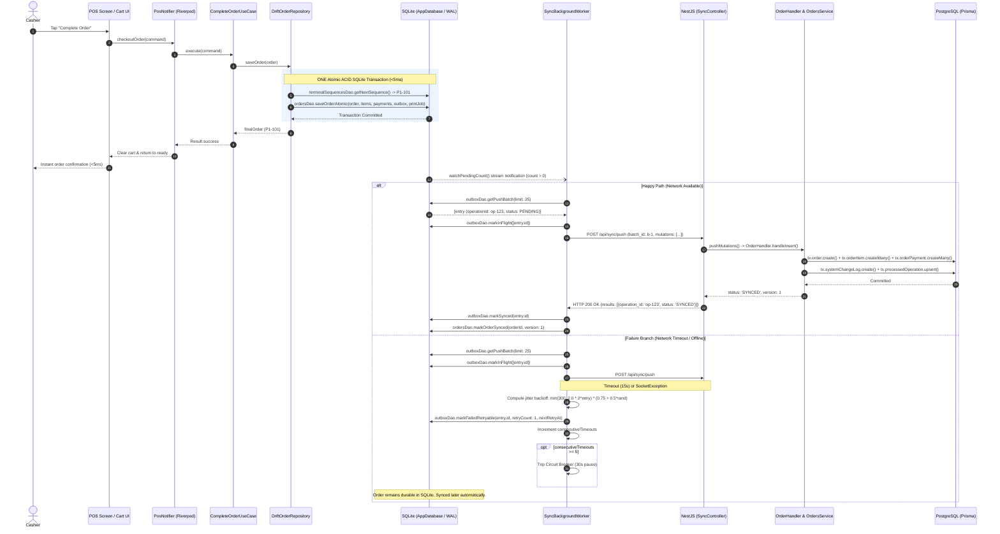
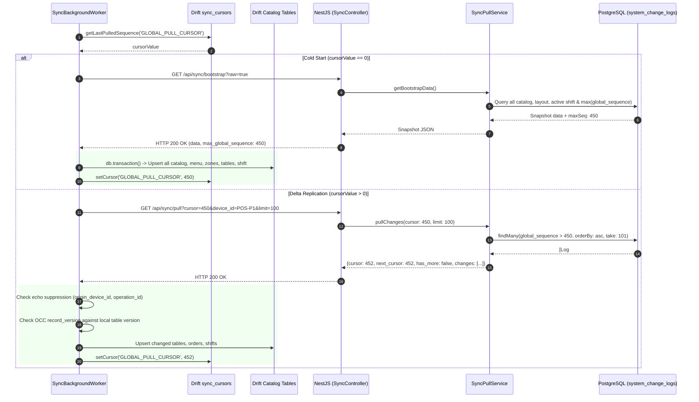
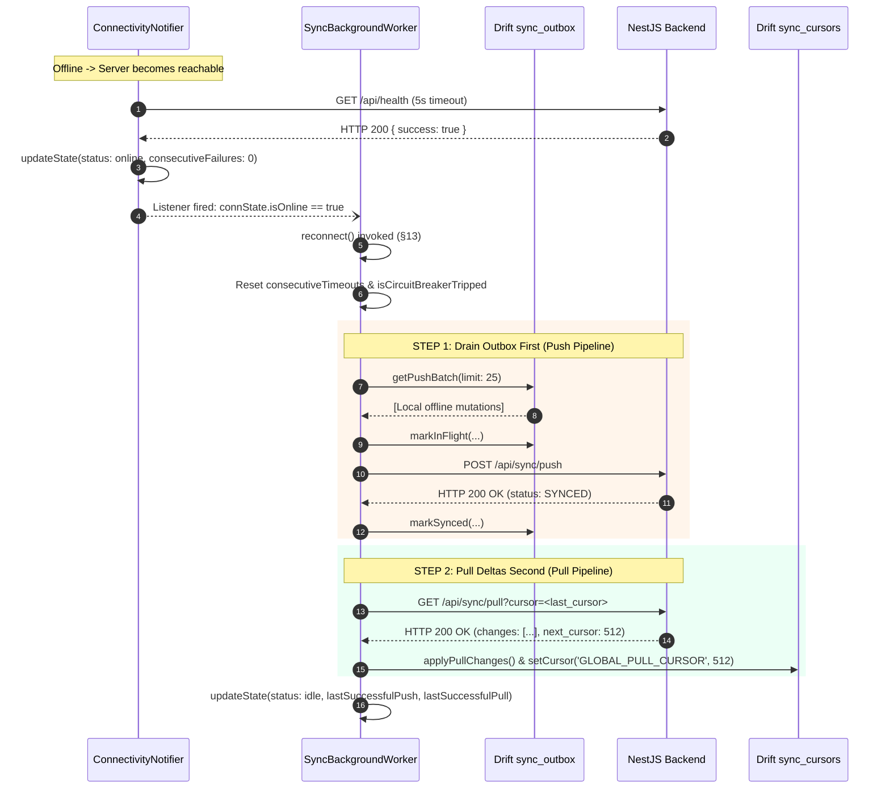

# FINAL SYNC ENGINE AUDIT REPORT: HUNGRY HOWIE'S POS

> **Document Type:** Authoritative Consolidated Offline Synchronization Engine Audit  
> **Auditor Role:** Report Compiler (`.agents/report-compiler/agent.md`)  
> **Target System:** Hungry Howie's POS (Flutter Windows Desktop + NestJS / Prisma / PostgreSQL Backend)  
> **Reference Specification:** `docs/offline-analysis/99-FINAL-ARCHITECTURE.md`  
> **Inputs Merged:** Specialist Reports `00-architecture-map.md` through `09-flag-off-regression.md` in `docs/sync-audit/`  
> **Date:** October 26, 2026  
> **Version:** 1.0.0-FINAL  

---

## 1. Executive Summary

### 1.1 Overall Risk Rating: CRITICAL

The synchronization engine implemented in Hungry Howie's POS contains **critical architectural flaws, financial discrepancies, silent order erasure vulnerabilities, and security backdoors**. 

While foundational components—such as local SQLite durability in WAL mode via Drift, RFC 9562 UUID v7 primary key generation, and basic transactional batching—are in place, the system in its present state **cannot safely operate in production**. Reconnection, multi-terminal concurrency, network partitions, and even ordinary UI actions trigger silent data destruction, customer double-billing, spurious cash drawer shortages, and server-side state corruption.

### 1.2 Go-Live Recommendation: NOT READY

**Deployment to pilot stores must be halted immediately.** 

The software must not be deployed to any production or pilot store until all **Must-Fix (Blocker)** issues in the prioritized roadmap are resolved, verified by automated end-to-end integration tests, and validated in two-tablet physical stress testing.

Furthermore, **the fallback feature flag (`OFFLINE_FIRST_ENABLED = false`) is also NOT SAFE** due to a regression in order receipt sequencing that silently swallows order checkout errors and drops orders on the server after application restarts.

---

### 1.3 Top 10 Issues in Plain Language

1. **Unique Constraint Collisions Silently Annihilate Customer Orders (`SYNC-001`):**  
   When reconnecting terminals submit offline orders that collide on human receipt numbers (`order_number`) or takeaway tokens, PostgreSQL throws unique constraint error `P2002`. The backend sync service misidentifies *any* `P2002` error as a duplicate primary key, rolls back the transaction, but returns HTTP 200 with status `DUPLICATE`. The client marks the order as successfully synced and purges it from the outbox. The order is **never created in PostgreSQL, never reaches the kitchen, and is permanently lost from sales records**.

2. **Cashier UI Button Can Wipe Unsynced Orders and Cash Records (`SYNC-002`):**  
   On the cashier Data Sync screen, a red button labeled *"Clear N Sync Errors"* calls a method that marks all failed, retryable, and conflicted outbox mutations as `SYNCED` locally in SQLite without transmitting them to the server. Cashiers attempting to clear red alert indicators can **permanently erase unsynced customer sales, cash variances, and payments** with a single tap.

3. **Offline Table Order Updates Completely Discard Payment Ledgers (`SYNC-003`):**  
   When a dine-in table order is settled and paid offline, the client pushes an order `UPDATE` mutation. The backend handler updates the order header status to `completed` and `is_paid = true`, but **completely ignores `payload.payments`, discounts, taxes, and updated totals**. The order is marked paid in the cloud, but PostgreSQL contains zero payment records, destroying financial reconciliation.

4. **Stale Delta Pulls Overwrite Local Cash Drawer Closures and Freed Tables (`SYNC-004`):**  
   The client sync worker executes delta pull streaming concurrently with outbox pushing, or allows pull to run after an outbox push aborts. Incoming server change logs overwrite locally closed shifts (`OFFLINE_CLOSED` reverts to `ACTIVE`), **zeroing out actual counted cash and variance**, and revert freed dining tables back to `occupied`.

5. **Multi-Terminal Collisions & Stolen Dining Table Updates (`SYNC-005`):**  
   Every client installation hardcodes `deviceId: 'POS-P1'` and `terminalId: '1'`. When Tablet A updates a dining table status, Tablet B pulls the change, checks `payload['device_id'] == 'POS-P1'`, and **discards Tablet A's update as its own echo**. Simultaneously, a PostgreSQL database index restricts the entire database to at most one active shift, physically blocking two registers from operating cash drawers at the same time.

6. **Shift Closure Automatically Cancels Active Dining and Delivery Orders (`SYNC-006`):**  
   When a cashier closes a shift, the backend executes an automatic database update that cancels all unpaid orders associated with that shift window. Dining tables with active guests who have not yet paid their bill, as well as out-for-delivery Cash-On-Delivery orders, are **abruptly set to `status: 'cancelled'`**, preventing staff from collecting payment.

7. **Terminated Cashiers Retain 24-Hour Write Access to Cloud Subsystems (`SYNC-007`):**  
   The backend NestJS Passport JWT authentication strategy queries the staff user by ID but **completely fails to check `is_active`**. A fired employee whose account has been deactivated retains full API access on all protected sync and operational endpoints for up to 24 hours until their JWT token naturally expires.

8. **Silent Re-Authentication Guesses Passwords in Plaintext (`SYNC-008`):**  
   When client JWT tokens expire during background synchronization, the worker attempts silent re-authentication by constructing guessed passwords using the hardcoded pattern `'${username}123'` or `'Noman123'`. When employees change their default passwords, silent re-auth fails, permanently trapping the outbox queue in `AUTH_PAUSED` deadlock while the UI indicator deceptively displays a green "Synced" dot.

9. **POS Checkout Silently Loses Orders When Flag is OFF (`SYNC-009`):**  
   When offline mode is disabled (`OFFLINE_FIRST_ENABLED = false`), order receipt numbering falls back to an unbacked in-memory counter starting at sequence 100 (`P1-101`). Upon app restart, this counter resets to 100. Checking out causes an HTTP 409 Conflict on the backend, which the legacy repository catches and swallows, clearing the cashier cart while the order is **completely lost from the cloud database**.

10. **Dual-Write Anti-Pattern Creates Ghost Duplicate Orders During Network Drops (`SYNC-010`):**  
    Dine-In, Takeaway, and Delivery screens attempt direct REST calls prior to or in parallel with local Drift outbox queueing. If the internet drops mid-request after PostgreSQL commits but before HTTP response headers reach Flutter, the client falls back to Drift with a new UUID and sequence number, creating **duplicate ghost orders, double kitchen tickets, and distorted revenue**.

---

## 2. How the Sync Engine Works Today

### 2.1 Component Inventory

The Hungry Howie's POS offline synchronization subsystem spans a Flutter Windows desktop client, an encrypted SQLite database, an outbox queue worker, and a NestJS synchronization subsystem backed by Prisma ORM and PostgreSQL.

| Component / Layer | Source File Path | Architectural Responsibility |
|---|---|---|
| **Encrypted DB Connection** | [`frontend/lib/core/database/encrypted_connection.dart:1-85`](file:///D:/HOWIES%20TEST/howiesPOS/frontend/lib/core/database/encrypted_connection.dart#L1-L85) | Initializes SQLite in WAL mode with SQLCipher AES-256 encryption. Derives key via Windows DPAPI (`CryptProtectData`). Pragmas: `foreign_keys = ON`, `synchronous = NORMAL`. |
| **Drift Central Database** | [`frontend/lib/core/database/app_database.dart:1-95`](file:///D:/HOWIES%20TEST/howiesPOS/frontend/lib/core/database/app_database.dart#L1-L95) | Compiles 20 Drift tables and 8 DAOs. Manages local schema versioning. |
| **Local Orders Tables** | [`frontend/lib/core/database/tables/local_orders_tables.dart:1-79`](file:///D:/HOWIES%20TEST/howiesPOS/frontend/lib/core/database/tables/local_orders_tables.dart#L1-L79) | Defines `LocalOrders`, `LocalOrderItems`, and `LocalOrderPayments` using RFC 9562 UUID v7 primary keys. |
| **Sync Outbox Table** | [`frontend/lib/core/database/tables/sync_outbox_table.dart:1-39`](file:///D:/HOWIES%20TEST/howiesPOS/frontend/lib/core/database/tables/sync_outbox_table.dart#L1-L39) | Defines `SyncOutbox` storing serialized mutation JSON, dependency level (0..6), retry counters, and statuses (`PENDING`, `IN_FLIGHT`, `SYNCED`, `FAILED_RETRYABLE`, `FAILED_FATAL`, `CONFLICT`, `AUTH_PAUSED`). |
| **Sync Conflicts Table** | [`frontend/lib/core/database/tables/sync_conflicts_table.dart:1-39`](file:///D:/HOWIES%20TEST/howiesPOS/frontend/lib/core/database/tables/sync_conflicts_table.dart#L1-L39) | Defines `SyncConflicts` quarantine ledger storing OCC version mismatches, fatal payload errors, and server state snapshots. |
| **Sync Cursors Table** | [`frontend/lib/core/database/tables/sync_cursors_table.dart:1-13`](file:///D:/HOWIES%20TEST/howiesPOS/frontend/lib/core/database/tables/sync_cursors_table.dart#L1-L13) | Stores monotonic stream tokens (`GLOBAL_PULL_CURSOR`). |
| **Terminal Sequences Table** | [`frontend/lib/core/database/tables/terminal_sequences_table.dart:1-13`](file:///D:/HOWIES%20TEST/howiesPOS/frontend/lib/core/database/tables/terminal_sequences_table.dart#L1-L13) | Stores sequential receipt counters (`101..999`) keyed by business date. |
| **Print Spooler Table** | [`frontend/lib/core/database/tables/offline_print_jobs_table.dart:1-32`](file:///D:/HOWIES%20TEST/howiesPOS/frontend/lib/core/database/tables/offline_print_jobs_table.dart#L1-L32) | Stores raw ESC/POS binary payloads decoupled from order placement. |
| **Daily Calculations Table** | [`frontend/lib/core/database/tables/local_daily_calculations_table.dart:1-33`](file:///D:/HOWIES%20TEST/howiesPOS/frontend/lib/core/database/tables/local_daily_calculations_table.dart#L1-L33) | Stores local shift records, cash drawer counts, and cash variance metrics. |
| **Catalog Drift Tables** | [`frontend/lib/core/database/tables/catalog_tables.dart:1-137`](file:///D:/HOWIES%20TEST/howiesPOS/frontend/lib/core/database/tables/catalog_tables.dart#L1-L137) | Stores replicated snapshots for categories, items, sizes, options, deals, floor zones, tables, staff users, permissions, and store settings. |
| **Connectivity Notifier** | [`frontend/lib/core/sync/connectivity_notifier.dart:1-223`](file:///D:/HOWIES%20TEST/howiesPOS/frontend/lib/core/sync/connectivity_notifier.dart#L1-L223) | Probes backend `/api/health` over HTTP (5s timeout, 15s interval) to determine true end-to-end reachability. |
| **Sync Background Worker** | [`frontend/lib/core/sync/sync_background_worker.dart:1-1399`](file:///D:/HOWIES%20TEST/howiesPOS/frontend/lib/core/sync/sync_background_worker.dart#L1-L1399) | Orchestrates outbox draining (`triggerPush`), delta pull streaming (`triggerPull`), bootstrap hydration (`bootstrapInitialData`), exponential backoff, circuit breaker (30s), zombie task recovery (60s), and silent re-auth. |
| **Sync Health Provider** | [`frontend/lib/core/sync/sync_health_provider.dart:1-173`](file:///D:/HOWIES%20TEST/howiesPOS/frontend/lib/core/sync/sync_health_provider.dart#L1-L173) | Strict 2-color status computation (`green` vs `red`), detecting stopped workers, failed items, or tasks stuck in-flight > 2 minutes; debounced at 800ms. |
| **Backend Sync Controller** | [`backend/src/sync/sync.controller.ts:1-193`](file:///D:/HOWIES%20TEST/howiesPOS/backend/src/sync/sync.controller.ts#L1-L193) | Exposes `POST /api/sync/push`, `GET /api/sync/pull`, `GET /api/sync/bootstrap`. Protected by `JwtAuthGuard`. |
| **Idempotency Interceptor** | [`backend/src/sync/interceptors/idempotency.interceptor.ts:1-282`](file:///D:/HOWIES%20TEST/howiesPOS/backend/src/sync/interceptors/idempotency.interceptor.ts#L1-L282) | Server-side idempotency guard keyed on `X-Idempotency-Key` or `operation_id` using Prisma `processed_operations` ledger table. |
| **Backend Sync Push Service** | [`backend/src/sync/sync-push.service.ts:1-307`](file:///D:/HOWIES%20TEST/howiesPOS/backend/src/sync/sync-push.service.ts#L1-L307) | Topologically sorts incoming push batches by dependency level and parent graph; executes entity handlers in isolated `$transaction` blocks. |
| **Backend Sync Pull Service** | [`backend/src/sync/sync-pull.service.ts:1-157`](file:///D:/HOWIES%20TEST/howiesPOS/backend/src/sync/sync-pull.service.ts#L1-L157) | Serves delta change stream from `system_change_logs` (`pullChanges`) and assembles full catalog snapshots (`getBootstrapData`). |
| **Change Log Service** | [`backend/src/sync/change-log.service.ts:1-75`](file:///D:/HOWIES%20TEST/howiesPOS/backend/src/sync/change-log.service.ts#L1-L75) | Appends delta rows to `system_change_logs` inside active database transactions. |
| **Push Entity Handlers** | [`backend/src/sync/handlers/`](file:///D:/HOWIES%20TEST/howiesPOS/backend/src/sync/handlers/) | `OrderHandler` (inserts/updates orders), `ShiftHandler` (opens/closes shifts and variance reconciliation), `TableHandler` (implements Hospitality Priority §10.2). |

---

### 2.2 Local Drift Entity-Relationship Model

The Flutter Windows client maintains 20 local Drift tables compiled in `AppDatabase`, categorized into Operational, Spooler/Sync, and Catalog Replicas:

```mermaid
erDiagram
    %% REPLICATED OPERATIONAL TABLES
    LocalOrders ||--o{ LocalOrderItems : "contains"
    LocalOrders ||--o{ LocalOrderPayments : "receives"
    LocalDailyCalculations ||--o{ LocalOrders : "aggregates"

    LocalOrders {
        text id PK "UUID v7 (36)"
        text orderNumber "Receipt (P1-101)"
        text orderType "dineIn | takeaway | online"
        text shiftId FK "Nullable UUID v7"
        text status "newOrder | accepted | completed"
        real subtotal
        real discountAmount
        real taxAmount
        real grandTotal
        text paymentStatus "PAID | UNPAID"
        boolean isPaid
        boolean isHeld
        boolean kitchenTicketSent
        text deviceId "POS-P1"
        datetime createdAt
        text syncStatus "pending_insert | synced | conflict"
        integer serverVersion
        datetime clientUpdatedAt
        datetime serverUpdatedAt
        boolean isDeleted
    }

    LocalOrderItems {
        text id PK "UUID v7 (36)"
        text orderId FK "Cascade delete"
        text menuItemId "Nullable UUID"
        text itemName
        text sizeName
        real unitPrice
        integer quantity
        real subtotal
        text notes
        boolean isCancelled
        datetime cancelledAt
        text cancelReason
        text syncStatus
        integer serverVersion
    }

    LocalOrderPayments {
        text id PK "UUID v7 (36)"
        text orderId FK "Cascade delete"
        text paymentMethod "cash | card | bankTransfer"
        real amount
        real tenderedAmount
        real changeReturned
        text transactionReference
        text cardLastFour
        text bankName
        text paymentStatus
        text receivedBy
        datetime createdAt
        text syncStatus
    }

    LocalDailyCalculations {
        text id PK "UUID v7 (36)"
        text cashierId
        text cashierName
        real startingCash
        real expectedCashDrawer
        real actualCashCounted
        real cashVariance
        text status "ACTIVE | OFFLINE_CLOSED | CLOSED"
        datetime createdAt
        datetime submittedAt
        text closingNotes
        text syncStatus
        integer serverVersion
    }

    %% SYNC OUTBOX & SPOOLER TABLES
    SyncOutbox {
        integer id PK "AutoIncrement"
        text operationId UK "UUID v7 (36)"
        text deviceId "POS-P1"
        text entityType "order | shift | table"
        text entityId "Target Entity UUID"
        text operationType "INSERT | UPDATE | DELETE"
        integer baseVersion
        text payload "Serialized JSON"
        text dependsOnOperationId "Nullable UUID"
        integer dependencyOrder "Level 0..6"
        text status "PENDING | IN_FLIGHT | SYNCED | FAILED_RETRYABLE | FAILED_FATAL | CONFLICT | AUTH_PAUSED"
        integer retryCount
        datetime nextRetryAt
        datetime createdAt
        datetime sentAt
        datetime ackedAt
        text lastError
        text conflictDetails
    }

    SyncConflicts {
        text id PK "UUID v7 (36)"
        text operationId "Outbox operationId"
        text entityType "order | shift | table"
        text entityId "Target Entity UUID"
        text conflictType "OCC_MISMATCH | FATAL_ERROR | TABLE_COLLISION"
        text resolutionStatus "PENDING | AUTO_RESOLVED | SUPERVISOR_ACKNOWLEDGED"
        text errorMessage
        text payload "Client JSON"
        text serverState "Server snapshot JSON"
        datetime createdAt
        datetime resolvedAt
    }

    SyncCursors {
        text feedKey PK "'GLOBAL_PULL_CURSOR'"
        integer lastPulledSequence
        datetime lastSyncAttempt
        datetime lastSuccessfulSync
    }

    TerminalSequences {
        text sequenceKey PK "'ORDER_NUMBER'"
        text businessDate "YYYY-MM-DD"
        integer currentValue "101..999"
    }

    OfflinePrintJobs {
        integer id PK "AutoIncrement"
        text jobType "CUSTOMER_RECEIPT | KITCHEN_TICKET | SHIFT_Z_REPORT"
        text orderId "Nullable UUID"
        text printerTarget "WIN_DEFAULT | COM1"
        blob rawEscPosData "Raw binary ESC/POS"
        text status "QUEUED | PRINTED | FAILED"
        integer retryCount
        datetime createdAt
    }

    %% REPLICATED CATALOG & LAYOUT TABLES
    LocalMenuCategories ||--o{ LocalMenuItems : "categorizes"
    LocalMenuItems ||--o{ LocalMenuItemSizes : "sizes"
    LocalMenuItems ||--o{ LocalMenuItemOptions : "options"
    LocalDeals ||--o{ LocalDealComponents : "bundles"
    LocalFloorZones ||--o{ LocalRestaurantTables : "contains"

    LocalMenuCategories {
        text id PK
        text name
        integer displayOrder
        boolean isActive
    }

    LocalMenuItems {
        text id PK
        text categoryId FK
        text name
        real basePrice
        boolean isAvailable
        boolean isVeg
        boolean isSpicy
    }

    LocalRestaurantTables {
        text id PK
        text zoneId
        text tableNumber
        text name
        integer capacity
        text status "available | occupied | reserved"
        text activeOrderId
        integer version
    }
```



---

### 2.3 The Write Path

1. **User Action:** Cashier taps "Complete Order" on checkout.
2. **State Orchestration:** `PosNotifier.checkoutOrder()` locks concurrent checkouts and invokes `CompleteOrderUseCase.execute()`.
3. **Local Atomic Commit:** `DriftOfflineFirstOrderRepository.saveOrder()` enters a single SQLite ACID transaction:
   - Queries `TerminalSequencesDao.getNextSequence()` to acquire sequential receipt number `P1-101`.
   - Generates or preserves RFC 9562 UUID v7 primary key.
   - `OrdersDao.saveOrderAtomic()` inserts: `local_orders`, `local_order_items`, `local_order_payments`, `sync_outbox` (`dependency_order: 2`), and `offline_print_jobs`.
   - Commits to SQLite WAL.
4. **UI Response:** Cart clears and returns ready state in $< 5\text{ms}$. Cash drawer kicks and receipt prints.
5. **Worker Notification:** Reactive stream `watchPendingCount()` notifies `SyncBackgroundWorker`. If online and unpaused, worker calls `triggerPush()`.
6. **Batch Selection:** Worker queries `db.outboxDao.getPushBatch(limit: 25)` and marks rows `IN_FLIGHT`.
7. **HTTP Transmission:** Sends `POST /api/sync/push` with header `X-Idempotency-Key: <batch_id>` and array of mutation envelopes.
8. **Server Dispatch:** `IdempotencyInterceptor` checks cached results. `SyncPushService` topologically sorts mutations and invokes `OrderHandler.handleInsert()`.
9. **Server Persistence:** `OrdersService.createOrderInTx()` commits order, items, payments, and `system_change_logs` in a single Prisma transaction, preserving client UUIDs.
10. **Client Reconciliation:** Server returns HTTP 200 with per-mutation results. Client marks outbox entry `SYNCED` and stamps `local_orders.syncStatus = 'synced'`.



---

### 2.4 The Pull Path

1. **Cursor Tracking:** Tracked locally in Drift table `sync_cursors` under key `'GLOBAL_PULL_CURSOR'`.
2. **Delta Polling:** Issues `GET /api/sync/pull?cursor=<seq>&device_id=POS-P1&limit=100`.
3. **Server Streaming:** Server queries `system_change_logs` where `global_sequence > cursor` ordered by `global_sequence ASC`. Returns array of changes and `next_cursor`.
4. **Client Ingestion:** `SyncBackgroundWorker._applyPullChange()` performs:
   - Echo suppression check: skips if `payload['origin_device_id'] == deviceId`.
   - OCC check: skips if `localEntity.version >= recordVersion`.
   - Hospitality priority check: preserves local occupied state if guest is seated.
   - Updates target Drift tables and updates `GLOBAL_PULL_CURSOR`.
5. **Cold Bootstrap:** If `GLOBAL_PULL_CURSOR == 0`, client invokes `GET /api/sync/bootstrap?raw=true` to hydrate catalog, layout, active shift, and baseline settings, setting the cursor to `max_global_sequence`.



---

### 2.5 Reconnection Flow

When connectivity transitions from offline to online, `reconnect()` is invoked. The theoretical protocol executes Push First, then Pull Second:



---

## 3. Scenario Results Table

The following master table details every scenario evaluated across all 10 specialist audit agents, including the six mandatory headline scenarios:

| Scenario Description | Specialist Report Source | Result | Observed Code Failure Mechanism & Real-World Impact |
|---|---|---|---|
| **Two people on the same cashier account** *(Headline)* | `02-multidevice-conflicts.md: Scenario A.1–A.3` | <span style="color:red;font-weight:bold;">FAIL</span> | Stateless JWT allows concurrent logins. However, hardcoded `deviceId: 'POS-P1'` and store-wide unique active shift index causes server to reject second offline shift with `CONFLICT (ACTIVE_SHIFT_EXISTS)`, forcing it into `OFFLINE_CLOSED` and dropping its counted cash. Online sharing causes server to aggregate store-wide cash, creating false drawer shortages (`SYNC-005`, `SYNC-015`). |
| **Table booked, internet off, second device opens same table, internet back** *(Headline)* | `03-table-conflicts.md: Scenario 1` | <span style="color:red;font-weight:bold;">FAIL</span> | Device B seats walk-in offline on Table 5; creates Order B. Reconnection pushes Order B to PostgreSQL; commits cleanly (no unique index on table_id). Next, Table 5 status update is pushed; rejected by server with `ACTIVE_ORDER_PROTECTED`. Order B is accepted into database but **orphaned from table screen**. Cashier cannot view or settle bill (`SYNC-011`). |
| **Request succeeded but response lost** *(Headline)* | `01-outbox-idempotency.md: Scenario 3` / `04-reconnect-recovery.md: Scenario 5` | **PARTIAL** | On retry, client generates a new random `batch_id`, bypassing controller-level `IdempotencyInterceptor`. However, `OrderHandler.handleInsert()` finds the existing order UUID v7 and returns `status: 'DUPLICATE'`. Kitchen tickets are protected, but server-side idempotency ledger recording occurs outside transaction and can be lost on crash (`SYNC-024`). |
| **One item in a batch fails** *(Headline)* | `01-outbox-idempotency.md: Scenario 4` | <span style="color:red;font-weight:bold;">FAIL</span> | **Batch Poisoning:** If an item fails NestJS DTO validation, server returns HTTP 400. Client `_handleFatalBatch` marks **all 25 mutations** in that batch as `FAILED_FATAL`, killing up to 24 innocent orders (`SYNC-018`). Additionally, transient DB query timeouts map to `FAILED_FATAL` instead of retryable (`SYNC-022`). |
| **Long outage with large outbox** *(Headline)* | `04-reconnect-recovery.md: Scenario 7` | <span style="color:red;font-weight:bold;">FAIL</span> | **Auth Stall:** After 24h, JWT expires. Push returns 401. Silent re-auth fails password guessing. Outbox marked `AUTH_PAUSED`. Sync halts permanently while indicator deceptively shows solid Green (`SYNC-008`, `SYNC-019`). Performance degrades due to missing indexes on `SyncOutbox` (`SYNC-021`). |
| **Cash payment offline then app killed** *(Headline)* | `07-money-correctness.md: Scenario 1` | **PASS / PARTIAL** | Order creation, payment, outbox mutation, and print job commit atomically to SQLite WAL. Survives process kill. However, upon reconnect, server overwrites `created_at` with server `now()`, falsifying transaction hour in reports (`SYNC-014`). If settled via table bill update, payment is discarded by server (`SYNC-003`). |
| Kill app between Drift write and outbox insert | `01-outbox-idempotency.md: Scenario 1` | <span style="color:red;font-weight:bold;">FAIL</span> | Order checkout passes atomically (`saveOrderAtomic`). But `updateOrderStatus`, `deleteHeldOrder`, and `updateTableStatus` execute SQLite update and outbox insert sequentially without a transaction; process kill produces orphaned local changes that never sync (`SYNC-026`). |
| Kill app while row is in-flight | `01-outbox-idempotency.md: Scenario 2` | <span style="color:red;font-weight:bold;">FAIL</span> | If app restarts within 60 seconds (standard cashier behavior), `recoverOrphanedOutboxTasks` skips in-flight rows because `sentAt` is < 60s old. Never swept again; rows remain stuck `IN_FLIGHT` indefinitely for that entire session (`SYNC-025`). |
| Same request sent twice 50ms apart | `01-outbox-idempotency.md: Scenario 3` | **PASS** | Double-taps with identical batch ID are collapsed by `IdempotencyInterceptor`. Concurrent mutations with different batch IDs are caught by PostgreSQL primary key constraints and returned as `DUPLICATE`. |
| Same order edited on two devices (both online) | `02-multidevice-conflicts.md: Scenario B.1` | <span style="color:red;font-weight:bold;">FAIL</span> | Direct REST `orders.service.ts` uses whole-order Last-Write-Wins. Second write deletes items not present in its payload (`tx.orderItem.delete`). Concurrent items clobbered (`SYNC-032`). |
| Same order edited on two devices (both offline, then reconnect) | `02-multidevice-conflicts.md: Scenario B.2` | <span style="color:red;font-weight:bold;">FAIL</span> | Device A syncs; Device B gets OCC conflict, auto-rebases, and retries. Server `OrderHandler.handleUpdate` returns `SYNCED` but **silently drops all line items added by Device B** (`SYNC-003`). |
| Same order edited: one online, one offline | `02-multidevice-conflicts.md: Scenario B.3` | <span style="color:red;font-weight:bold;">FAIL</span> | Direct REST order updates fail to increment `version`. When offline device reconnects, OCC check passes (`1 > 1 == false`), silently overwriting online modifications (`SYNC-028`). |
| Device A pays/closes order; Device B (offline) adds items and reconnects | `02-multidevice-conflicts.md: Scenario B.4` | <span style="color:red;font-weight:bold;">FAIL</span> | `OrderHandler.handleUpdate` has no settlement check. Offline update overwrites cloud order header back to `UNPAID` and `accepted`, resurrecting completed paid order (`SYNC-013`). |
| Device A voids item; Device B increases its quantity | `02-multidevice-conflicts.md: Scenario B.5` | <span style="color:red;font-weight:bold;">FAIL</span> | Voiding is direct REST. Device B's stale update modifies quantity of cancelled item; subtotal excludes it while client UI counts it, desynchronizing bill totals (`SYNC-033`). |
| Multi-device offline receipt numbering collision | `02-multidevice-conflicts.md: Scenario C.1` | <span style="color:red;font-weight:bold;">FAIL</span> | Both devices issue `P1-101`. Server suffixes second order to `P1-101-1`, but never returns suffix to client. Customer paper receipt and cloud order numbers permanently diverge (`SYNC-020`). |
| Account deactivated while offline with pending orders | `02-multidevice-conflicts.md: Scenario A.4` | <span style="color:red;font-weight:bold;">FAIL</span> | `JwtStrategy.validate` omits `is_active` check; existing tokens sync for up to 24 hours. Terminated cashiers continue writing to database (`SYNC-007`). |
| Logout on Device A — effect on Device B | `02-multidevice-conflicts.md: Scenario A.5` | **PARTIAL** | Logout is client-local. Device B unaffected. But Device A silent re-auth automatically resurrects session if pending outbox entries exist (`SYNC-008`). |
| Pull overwriting unsynced local edits | `02-multidevice-conflicts.md: Scenario D.3` | <span style="color:red;font-weight:bold;">FAIL</span> | `_applyPullChange` updates local orders and sets `syncStatus = 'synced'` unconditionally, wiping `pending_update` status before local mutations push (`SYNC-027`). |
| Offline reservation vs cloud booking collision | `03-table-conflicts.md: Scenario 2` | <span style="color:red;font-weight:bold;">FAIL</span> | Server returns `CONFLICT (auto_resolvable: false)`. Mutation quarantined in `sync_conflicts`. Local UI displays Alice reserved; cloud displays Bob. Zero alert to cashier (`SYNC-030`). |
| Offline table transfer across partitions | `03-table-conflicts.md: Scenario 3` | <span style="color:red;font-weight:bold;">FAIL</span> | Direct REST call fails offline. `catch` block updates in-memory list only. **Zero SQLite writes, zero outbox entries.** Vanishes on restart (`SYNC-029`). |
| Table status flicker via delta pull & cold bootstrap | `03-table-conflicts.md: Scenario 4` | <span style="color:red;font-weight:bold;">FAIL</span> | Bootstrap and `loadTables()` fetch server tables and unconditionally overwrite SQLite `LocalRestaurantTables`, marking occupied tables as available while local orders are active (`SYNC-031`). |
| Order paid on one device; table release lost | `03-table-conflicts.md: Scenario 6` | <span style="color:red;font-weight:bold;">FAIL</span> | Table status is static column. Table remains locked as `occupied` with PKR 0.00 bill and 0 items forever. Zero server-side self-healing queries exist (`SYNC-034`). |
| Admin deletes table while offline device holds order | `03-table-conflicts.md: Scenario 7` | <span style="color:red;font-weight:bold;">FAIL</span> | Prisma throws foreign key violation on `dine_in_order_details.table_id`. Push service marks order `FAILED_FATAL`, permanently abandoning customer order (`SYNC-012`). |
| Captive portal returns HTML 200 | `04-reconnect-recovery.md: Scenario 8` | <span style="color:red;font-weight:bold;">FAIL</span> | Health probe swallows `FormatException` on HTML body; declares online. Worker sends JSON batches, fails on decoding, trips circuit breaker, and flaps in endless 30s cycle (`SYNC-035`). |
| Staff switches on same offline device | `04-reconnect-recovery.md: Scenario 9` | **PARTIAL** | Mutation JSON payload preserves original cashier authorship. However, if new staff logged in offline with PIN fallback, token is stripped, push fails with 401, and queue halts (`SYNC-036`). |
| Sync indicator truth during auth pause | `04-reconnect-recovery.md: Scenario 10` | <span style="color:red;font-weight:bold;">FAIL</span> | `watchActiveOutboxEntries()` omits `AUTH_PAUSED`. Health provider computes 0 pending and 0 failed, showing solid Green "Synced" while sync is completely frozen (`SYNC-019`). |
| Cashier taps "Clear N Sync Errors" in DataSyncScreen | `04-reconnect-recovery.md: Scenario 11` | <span style="color:red;font-weight:bold;">FAIL</span> | `outboxDao.clearFailedEntries()` writes `status = 'SYNCED'` to all conflicted, fatal, and retryable rows, permanently deleting unsynced orders from sync pipeline (`SYNC-002`). |
| Full client database repair / resync path | `04-reconnect-recovery.md: Scenario 12` | <span style="color:red;font-weight:bold;">FAIL</span> | Zero repair or export utility exists. Deleting `app_database.sqlite` permanently destroys all unsynced customer transactions and shift calculations (`SYNC-037`). |
| Server validation of prices, discounts, and totals | `05-backend-sync.md: Section 2.4` / `08-security-auth.md: SEC-01` | <span style="color:red;font-weight:bold;">FAIL</span> | Server blindly accepts client-supplied `unit_price`, `subtotal`, `grand_total`, and `discount_amount` without verifying catalog pricing or recalculating equations (`SYNC-016`). |
| TOCTOU race condition in server OCC check | `05-backend-sync.md: BCK-04` | <span style="color:red;font-weight:bold;">FAIL</span> | OCC version check runs in JavaScript heap memory before executing SQL `UPDATE`. Under default `Read Committed` isolation, concurrent updates pass version check and overwrite each other (`SYNC-023`). |
| User logs out and logs back in | `06-flutter-lifecycle.md: FLT-01` | <span style="color:red;font-weight:bold;">FAIL</span> | Token expiry transitions queue to `AUTH_PAUSED`. `AuthNotifier.login()` never informs worker or calls `resumeAuthPaused()`. Outbox remains frozen until app reboot (`SYNC-017`). |
| Device midnight rollover mid-shift | `06-flutter-lifecycle.md: FLT-10` | <span style="color:red;font-weight:bold;">FAIL</span> | Sequence generator keys to `DateTime.now()`. At 00:00:01, sequence resets to 101, printing duplicate receipt and token numbers for orders on the same work shift (`SYNC-038`). |
| POS checkout when flag is OFF (`OFFLINE_FIRST_ENABLED=false`) | `09-flag-off-regression.md: FLG-01` | <span style="color:red;font-weight:bold;">FAIL</span> | Sequence generator resets to 100 on restart. Re-sending `P1-101` causes backend 409 Conflict. `ApiOrderRepository` swallows error, clearing cart while order is lost (`SYNC-009`). |
| Feature flag rollback with pending outbox data | `09-flag-off-regression.md: FLG-02` | <span style="color:red;font-weight:bold;">FAIL</span> | Disabling flag reverts repository to REST; background worker never starts; local SQLite outbox is abandoned; unsynced orders are permanently stranded (`SYNC-027`). |
| Owner navigates to Sync Center when flag is OFF | `09-flag-off-regression.md: FLG-03` | <span style="color:red;font-weight:bold;">FAIL</span> | `syncCenterProvider` unconditionally instantiates Drift SQLite, executes DPAPI key generation, and mounts worker, leaking resources when flag is OFF (`SYNC-039`). |

---

## 4. Detailed Audit Findings (Ranked by Real-World Damage)

All findings are globally numbered `SYNC-001` through `SYNC-040`, ranked in order of severity and real-world damage: Lost Orders & Revenue first, Financial Inaccuracies second, Table/Floor Corruption third, Security Vulnerabilities fourth, and Operational/UX Defects last.

```
====================================================================================================
GLOBAL FINDINGS RANKING
====================================================================================================
ID        SEV   IMPACT         TITLE                                             SOURCE REFS
----------------------------------------------------------------------------------------------------
SYNC-001  CRIT  Lost Orders    Silent Order Loss on Unique Constraint P2002      RCN-01, BCK-01
SYNC-002  CRIT  Lost Orders    Catastrophic Outbox Erasure via UI Button         RCN-02
SYNC-003  CRIT  Money / Loss   Offline Order UPDATE Drops Payments & Totals      MNY-01, CFL-04
SYNC-004  CRIT  Money / State  Stale Delta Pull Overwrites Shifts & Tables       RCN-03, CFL-06
SYNC-005  CRIT  Security/Audit Hardcoded Device ID Eliminates Multi-Device Diff   CFL-01, CFL-02, SEC-08
SYNC-006  CRIT  Lost Orders    Shift Close Prematurely Auto-Cancels Open Orders  CFL-11, BCK-05, MNY-12
SYNC-007  CRIT  Security       Deactivated Staff Retain 24-Hour JWT Access       SEC-02, CFL-12, BCK-08
SYNC-008  HIGH  Stalled Sync   Silent Re-Auth Guesses Plaintext Passwords        ARCH-05, FLT-05, SEC-03
SYNC-009  CRIT  Lost Orders    POS Checkout Silent Order Loss When Flag is OFF   FLG-01
SYNC-010  HIGH  Duplicates     Dual-Write Anti-Pattern Creates Ghost Duplicates  TBL-01, ARCH-01, FLT-02
SYNC-011  CRIT  Lost Orders    Concurrent Offline Seating Creates Orphan Orders  TBL-02
SYNC-012  CRIT  Lost Orders    Admin Table Deletion Causes Fatal FK Failure      TBL-12
SYNC-013  CRIT  Money / State  Offline Reconnect Reverts Paid Orders to UNPAID   CFL-03
SYNC-014  HIGH  Accounting     Order Timestamps Overwritten by Server Ingestion  BCK-03, MNY-05
SYNC-015  CRIT  Money / Ops    Multi-Device Shift Rejection & Spurious Shortages CFL-09, CFL-10, BCK-06
SYNC-016  CRIT  Money Fraud    Server Blindly Trusts Client Prices & Totals      BCK-02, MNY-08, SEC-01
SYNC-017  CRIT  Stalled Sync   Auth Pause Deadlock Halts Outbox After Re-Login   FLT-01, SEC-04
SYNC-018  CRIT  Lost Orders    HTTP 4xx Error Fatally Drops Entire 25-Batch      OBX-04, SEC-13
SYNC-019  HIGH  Deceptive UI   False Green Sync Indicator During Auth Pause      RCN-04
SYNC-020  HIGH  Audit Desync   Server Order Suffix Reassignment Never Synced     ARCH-03, OBX-10, CFL-08
SYNC-021  HIGH  UI Jank        Missing Outbox Indexes Cause UI Freezes at Scale  OBX-09, FLT-07
SYNC-022  HIGH  Lost Orders    Transient DB Errors Classified as Fatal Errors    OBX-05
SYNC-023  HIGH  Lost Updates   Check-Then-Act Race Condition in Server OCC       BCK-04
SYNC-024  HIGH  Server Dups    Random batch_id Bypasses Idempotency Interceptor  RCN-06, OBX-11
SYNC-025  HIGH  Stalled Sync   Zombie Task Recovery Window Traps In-Flight Rows  OBX-02
SYNC-026  HIGH  Lost Orders    Non-Atomic Business Writes in Updates & Deletes   OBX-01
SYNC-027  CRIT  Lost Orders    Permanent Stranding of Outbox on Flag Rollback    FLG-02
SYNC-028  HIGH  Lost Updates   REST Order Updates Bypass Version & Change Feed   CFL-07, BCK-09
SYNC-029  HIGH  Wrong Table    Offline Table Transfers Ephemeral & Never Synced  TBL-03
SYNC-030  MED   Wrong Table    Offline Reservation Collision Quarantined         TBL-10
SYNC-031  HIGH  Wrong Table    Table Occupancy Overwritten Free on Bootstrap     TBL-08
SYNC-032  HIGH  Lost Orders    Whole-Order LWW in REST Deletes Line Items        02-Scenario B.1
SYNC-033  MED   Accounting     Item Cancellation REST-Only & Void Qty Desync     CFL-14
SYNC-034  HIGH  Wrong Table    Permanent Table Lockup from Dropped Release       TBL-09
SYNC-035  MED   Stalled Sync   Captive Portal HTML 200 Causes False Online Loop  RCN-07
SYNC-036  MED   Audit Trail    Staff Switch Offline Strands Synthetic Token      04-Scenario 9
SYNC-037  MED   Data Loss      No Safe Database Rebuild or Resync Path           RCN-09
SYNC-038  HIGH  Duplicates     Midnight Rollover Resets Receipt Number Mid-Shift FLT-10
SYNC-039  HIGH  Resource Leak  Owner Sync Center Leaks Drift Instance When OFF   FLG-03
SYNC-040  HIGH  Money / Stock  Order Completion Decoupled from Stock Deduction   ARCH-04, MNY-09
====================================================================================================
```

---

### SYNC-001: Silent Order Annihilation on Server via P2002 Unique Constraint False Duplicate Return
- **Severity:** Critical
- **Evidence:** [`backend/src/sync/sync-push.service.ts:259-277`](file:///D:/HOWIES%20TEST/howiesPOS/backend/src/sync/sync-push.service.ts#L259-L277), [`backend/src/orders/orders.service.ts:302-318`](file:///D:/HOWIES%20TEST/howiesPOS/backend/src/orders/orders.service.ts#L302-L318), [`backend/prisma/schema.prisma:282`](file:///D:/HOWIES%20TEST/howiesPOS/backend/prisma/schema.prisma#L282)
- **Source IDs:** `RCN-01 + BCK-01`
- **Failure sequence:**
  1. Multiple POS terminals reconnect after an outage and push offline orders simultaneously.
  2. Terminal P1 and P2 submit orders with colliding order numbers (e.g. `101`, or numbers resulting from terminal prefix collisions).
  3. In `OrdersService.createOrderInTx()`, both transactions query `findUnique({ order_number })` concurrently; both check return null.
  4. Both transactions attempt `tx.order.create({ data: { order_number: '101', ... } })`.
  5. PostgreSQL enforces `@unique(order_number)` on `Order`. One transaction succeeds; the second transaction aborts with Prisma error `P2002: Unique constraint failed on the fields: (order_number)`.
  6. `sync-push.service.ts:259` catches `P2002`, unconditionally assumes it is a duplicate primary key on `id`, and logs: *"already exists in database — resolving as DUPLICATE"*.
  7. Server returns HTTP 200 with `status: 'DUPLICATE'`.
  8. Client marks the order `SYNCED` locally and clears it from the outbox.
  9. The second order was **never created in PostgreSQL**. Line items and payments are permanently destroyed.
- **Impact:** Lost orders / lost revenue.
- **Recommended fix:** In `sync-push.service.ts:259`, inspect `err.meta?.target` to ensure `P2002` was specifically on the `id` column. If `P2002` failed on `order_number`, re-run `OrdersService` with a new sequential order number suffix or return `FAILED_RETRYABLE`.
- **Effort:** S
- **Status:** CONFIRMED

---

### SYNC-002: Catastrophic Outbox Erasure via DataSyncScreen "Clear Sync Errors" Button
- **Severity:** Critical
- **Evidence:** [`frontend/lib/features/sync/data_sync_screen.dart:214-226`](file:///D:/HOWIES%20TEST/howiesPOS/frontend/lib/features/sync/data_sync_screen.dart#L214-L226), [`frontend/lib/data/sync_repository.dart:571-581`](file:///D:/HOWIES%20TEST/howiesPOS/frontend/lib/data/sync_repository.dart#L571-L581), [`frontend/lib/core/database/daos/outbox_dao.dart:140-151`](file:///D:/HOWIES%20TEST/howiesPOS/frontend/lib/core/database/daos/outbox_dao.dart#L140-L151)
- **Source IDs:** `RCN-02`
- **Failure sequence:**
  1. Cashier encounters offline sync errors (temporary network timeout or OCC conflict).
  2. Cashier navigates to `/sales/data-sync`.
  3. A red button *"Clear N Sync Errors"* appears in the header.
  4. Cashier taps the button expecting to dismiss or retry errors.
  5. `syncNotifier.clearFailedErrors()` invokes `outboxDao.clearFailedEntries()`.
  6. `clearFailedEntries()` writes `status = 'SYNCED'` and `ackedAt = now` to all rows in `sync_outbox` matching `conflict`, `failedFatal`, `failedRetryable`, or `retryCount >= 5`.
  7. UI displays: *"Failed sync errors cleared. Sync light is now Healthy 🟢"*.
  8. The unsynced mutations are marked as completed without ever reaching the backend.
  9. Subsequent 30-day retention pruning permanently deletes the rows from SQLite.
- **Impact:** Lost orders / cashier wipes customer transactions and cash balances to make indicator green.
- **Recommended fix:** Remove `clearFailedEntries()` from the application. Replace the "Clear Errors" button with "Retry All Failed" (`resetFailedEntries()`). Failed items must remain quarantined until authenticated server acknowledgement.
- **Effort:** S
- **Status:** CONFIRMED

---

### SYNC-003: Offline Order UPDATE Sync Completely Discards Payments & Line Items
- **Severity:** Critical
- **Evidence:** [`backend/src/sync/handlers/order.handler.ts:265-279`](file:///D:/HOWIES%20TEST/howiesPOS/backend/src/sync/handlers/order.handler.ts#L265-L279), [`frontend/lib/data/repositories/drift_offline_first_order_repository.dart:268-321`](file:///D:/HOWIES%20TEST/howiesPOS/frontend/lib/data/repositories/drift_offline_first_order_repository.dart#L268-L321)
- **Source IDs:** `MNY-01 + CFL-04`
- **Failure sequence:**
  1. Dine-in table order is created and synced as `UNPAID`.
  2. Customer finishes dining and settles the bill offline. Cashier adds extra drinks, applies a discount, and accepts Cash or Card.
  3. `DriftOfflineFirstOrderRepository.updateOrder()` updates SQLite and queues an outbox `UPDATE` mutation containing the items, payments, discount, tax, and grand total.
  4. Background sync worker pushes the `UPDATE` mutation to `POST /api/sync/push`.
  5. `OrderHandler.handleUpdate()` executes `tx.order.update()` targeting **ONLY** `status`, `payment_status`, `is_paid`, `is_held`, and `rejection_reason`.
  6. The `payload.payments` array, `payload.items`, `discount_amount`, and `grand_total` are **completely ignored**.
  7. Server returns HTTP 200 `SYNCED`.
- **Impact:** Payments taken offline for dine-in tables are completely dropped on the server. The order is marked paid in cloud reports, but `order_payments` contains zero records. Added food items are never recorded in cloud inventory or sales.
- **Recommended fix:** In `OrderHandler.handleUpdate()`, implement item reconciliation and update `tx.orderPayment` records along with `discount_amount`, `tax_amount`, and `grand_total`.
- **Effort:** M
- **Status:** CONFIRMED

---

### SYNC-004: Offline Shift Closure & Table Freed Overwritten by Stale Delta Pull
- **Severity:** Critical
- **Evidence:** [`frontend/lib/core/sync/sync_background_worker.dart:352-357, 1159-1230`](file:///D:/HOWIES%20TEST/howiesPOS/frontend/lib/core/sync/sync_background_worker.dart#L1159-L1230)
- **Source IDs:** `RCN-03 + CFL-06`
- **Failure sequence:**
  1. POS terminal loses internet connectivity. Cashier closes shift offline with counted cash and variance (`status = 'OFFLINE_CLOSED'`).
  2. Cashier frees dining Table 4 (`status = 'available'`).
  3. Connectivity returns. Reconnection starts.
  4. In `_onPeriodicTick()`, `triggerPush()` and `triggerPull()` are dispatched simultaneously without synchronization. Or, push aborts on an earlier batch error while `reconnect()` proceeds to `triggerPull()`.
  5. `triggerPull()` fetches change logs from server where the shift is still `ACTIVE` and Table 4 is still `occupied`.
  6. `_applyPullChange()` updates `LocalDailyCalculations`: sets `status = 'ACTIVE'`, erases `actualCashCounted`, resets `syncStatus = 'synced'`.
  7. `_applyPullChange()` updates `LocalRestaurantTables`: Table 4 was `available` locally, so occupancy check fails; Table 4 is marked `occupied` again.
- **Impact:** Unsynced shift financial reconciliation is erased; freed tables are snapped back to occupied state.
- **Recommended fix:** Introduce an atomic sequential lock ensuring `triggerPull()` NEVER executes while `sync_outbox` contains pending or in-flight mutations. In `_applyPullChange()`, check if target entity has pending outbox mutations before applying server state.
- **Effort:** M
- **Status:** CONFIRMED

---

### SYNC-005: Hardcoded Device ID and Terminal ID Eliminates Multi-Device Differentiation
- **Severity:** Critical
- **Evidence:** [`frontend/lib/data/repositories/order_repository_provider.dart:22-23`](file:///D:/HOWIES%20TEST/howiesPOS/frontend/lib/data/repositories/order_repository_provider.dart#L22-L23), [`frontend/lib/data/repositories/shift_repository_provider.dart:12`](file:///D:/HOWIES%20TEST/howiesPOS/frontend/lib/data/repositories/shift_repository_provider.dart#L12), [`frontend/lib/core/sync/sync_background_worker.dart:173, 1137-1140`](file:///D:/HOWIES%20TEST/howiesPOS/frontend/lib/core/sync/sync_background_worker.dart#L173), [`backend/prisma/migrations/20261023120000_unique_active_shift/migration.sql:16`](file:///D:/HOWIES%20TEST/howiesPOS/backend/prisma/migrations/20261023120000_unique_active_shift/migration.sql#L16)
- **Source IDs:** `CFL-01 + CFL-02 + SEC-08`
- **Failure sequence:**
  1. Two tablets are deployed in the same restaurant.
  2. Both tablets execute compiled Dart code containing `terminalId: '1'` and `deviceId: 'POS-P1'`.
  3. Both devices emit identical `device_id` values on sync outbox rows and push requests.
  4. Tablet A updates Table 4 to `occupied` and syncs. Tablet B pulls the change, checks `payload['device_id'] == 'POS-P1'`, and **discards Tablet A's update as its own echo**. Table 4 remains marked `available` on Tablet B.
  5. Both tablets generate identical receipt sequences (`P1-101`).
  6. Backend unique index `unique_active_shift` restricts the store to 1 active shift, rejecting the second tablet with `ACTIVE_SHIFT_EXISTS`.
- **Impact:** False echo suppression; wrong table occupancy; sequence collisions; multi-register store operations blocked.
- **Recommended fix:** Store a unique machine identifier (e.g. Windows MachineGuid or configured terminal index) in local encrypted storage, inject dynamically into providers, and scope shifts by register ID.
- **Effort:** M
- **Status:** CONFIRMED

---

### SYNC-006: Shift Close Automatically Cancels All Open Unpaid Orders Store-Wide
- **Severity:** Critical
- **Evidence:** [`backend/src/sync/handlers/shift.handler.ts:379-386`](file:///D:/HOWIES%20TEST/howiesPOS/backend/src/sync/handlers/shift.handler.ts#L379-L386)
- **Source IDs:** `CFL-11 + BCK-05 + MNY-12`
- **Failure sequence:**
  1. Terminal A closes its shift at 3:00 PM (end of lunch shift).
  2. Table 5 is currently occupied with a dining party whose bill has not yet been paid (`is_paid: false`). Or an online delivery order is out for Cash-On-Delivery.
  3. `shift.handler.ts` runs lines 379-386:
     ```typescript
     await tx.order.updateMany({
       where: { shift_id: existing.id, status: { notIn: ['completed', 'cancelled'] }, is_paid: false },
       data: { status: 'cancelled' },
     });
     ```
  4. Table 5's active order and delivery orders are automatically cancelled in PostgreSQL.
  5. Guests finish dining, but their order has been erased.
- **Impact:** Lost orders; active dining guests have their open checks cancelled.
- **Recommended fix:** Reassign active unsettled orders to the incoming shift session or overflow ledger rather than cancelling them.
- **Effort:** S
- **Status:** CONFIRMED

---

### SYNC-007: Deactivated Staff Users Retain Valid JWT Access in Sync Strategy
- **Severity:** Critical
- **Evidence:** [`backend/src/auth/strategies/jwt.strategy.ts:26-41`](file:///D:/HOWIES%20TEST/howiesPOS/backend/src/auth/strategies/jwt.strategy.ts#L26-L41), [`backend/src/sync/sync.controller.ts:30`](file:///D:/HOWIES%20TEST/howiesPOS/backend/src/sync/sync.controller.ts#L30), [`backend/src/users/users.service.ts:323-328`](file:///D:/HOWIES%20TEST/howiesPOS/backend/src/users/users.service.ts#L323-L328)
- **Source IDs:** `SEC-02 + CFL-12 + BCK-08`
- **Failure sequence:**
  1. Cashier is terminated and marked `is_active = false` by store manager.
  2. Cashier takes tablet or uses existing local installation with valid JWT (issued < 24h ago).
  3. Cashier pushes arbitrary or fraudulent mutations to `POST /api/sync/push`.
  4. `JwtStrategy.validate` queries user, checks `if (!user)`, but completely ignores `is_active`.
  5. The unauthorized mutations are committed into PostgreSQL.
- **Impact:** Security vulnerability; terminated staff can alter financial records.
- **Recommended fix:** In `JwtStrategy.validate()`, check `if (!user || user.is_active === false) throw new UnauthorizedException('User account is deactivated');`.
- **Effort:** S
- **Status:** CONFIRMED

---

### SYNC-008: Hardcoded Password Guessing in Silent Re-Authentication Pipeline
- **Severity:** High
- **Evidence:** [`frontend/lib/core/sync/sync_background_worker.dart:1355-1360`](file:///D:/HOWIES%20TEST/howiesPOS/frontend/lib/core/sync/sync_background_worker.dart#L1355-L1360)
- **Source IDs:** `ARCH-05 + FLT-05 + SEC-03 + CFL-13`
- **Failure sequence:**
  1. Tablet token expires while syncing.
  2. Background worker catches 401 and calls `trySilentReauth()`.
  3. Worker constructs password as `username.toLowerCase() == 'noman' ? 'Noman123' : '${username}123'`.
  4. Worker issues plaintext HTTP POST to `/api/auth/login`.
  5. Fails if user has a custom password, and exposes hardcoded password structure.
  6. Outbox enters `AUTH_PAUSED`; background worker halts permanently.
- **Impact:** Security backdoor and sync engine stall upon password change.
- **Recommended fix:** Remove hardcoded password logic. Implement standard OAuth2 / JWT refresh tokens encrypted in Windows DPAPI storage.
- **Effort:** M
- **Status:** CONFIRMED

---

### SYNC-009: Order Number Collision Rejection and Silent Order Loss on POS Checkout (Flag OFF)
- **Severity:** Critical
- **Evidence:** [`frontend/lib/domain/services/order_number_generator.dart:34-65`](file:///D:/HOWIES%20TEST/howiesPOS/frontend/lib/domain/services/order_number_generator.dart#L34-L65), [`frontend/lib/data/pos_repository.dart:168-174`](file:///D:/HOWIES%20TEST/howiesPOS/frontend/lib/data/pos_repository.dart#L168-L174), [`frontend/lib/data/repositories/api_order_repository.dart:60-70`](file:///D:/HOWIES%20TEST/howiesPOS/frontend/lib/data/repositories/api_order_repository.dart#L60-L70), [`backend/src/orders/orders.service.ts:298-319`](file:///D:/HOWIES%20TEST/howiesPOS/backend/src/orders/orders.service.ts#L298-L319)
- **Source IDs:** `FLG-01`
- **Failure sequence:**
  1. POS app is compiled with `OFFLINE_FIRST_ENABLED = false`.
  2. Cashier boots POS app. In-memory `_currentSequence` initializes to `100`.
  3. Cashier creates order #1 and checks out (`P1-101`).
  4. App is restarted. In-memory `_currentSequence` resets to `100`.
  5. Next order checks out as `P1-101`.
  6. `ApiOrderRepository.saveOrder()` calls `toCreateOrderDto()`, sending `'order_number': 'P1-101'` without an `id`.
  7. Backend checks `findUnique({ where: { order_number: 'P1-101' } })`. Because order exists and `explicitOrderId` is undefined, backend throws HTTP 409 Conflict.
  8. `ApiOrderRepository.saveOrder()` catches and swallows the exception in `catch (_) { return order; }`.
  9. Cart clears; cashier believes order succeeded. Order was **never written to backend**.
- **Impact:** Lost orders / lost money.
- **Recommended fix:** In `OrderNumberGenerator.generateOrderNumber()`, when `terminalSequencesDao == null` (flag OFF), preserve the pre-offline legacy collision-free scheme `'HH-${DateFormat('yyMMdd').format(now)}-$seq'`. Additionally, `ApiOrderRepository.saveOrder()` must rethrow network/HTTP exceptions rather than swallowing them.
- **Effort:** S
- **Status:** CONFIRMED

---

### SYNC-010: Dual-Write Anti-Pattern Creates Ghost Duplicate Orders During Network Drops
- **Severity:** High
- **Evidence:** [`frontend/lib/features/tables/tables_screen.dart:3870-3907, 3910-3965`](file:///D:/HOWIES%20TEST/howiesPOS/frontend/lib/features/tables/tables_screen.dart#L3870-L3907), [`frontend/lib/data/takeaway_repository.dart:365-388`](file:///D:/HOWIES%20TEST/howiesPOS/frontend/lib/data/takeaway_repository.dart#L365-L388), [`frontend/lib/data/delivery_repository.dart:365-392`](file:///D:/HOWIES%20TEST/howiesPOS/frontend/lib/data/delivery_repository.dart#L365-L392)
- **Source IDs:** `TBL-01 + ARCH-01 + OBX-08 + FLT-02 + FLT-03`
- **Failure sequence:**
  1. Cashier taps "Place Order" while online.
  2. UI issues direct HTTP `POST /api/orders` via `ordersApi.createOrder()`.
  3. NestJS creates order in PostgreSQL (`id = server-uuid-1`, `order_number = P1-101`).
  4. Network connection drops before HTTP response headers arrive in Flutter.
  5. Flutter catches `SocketException` in `catch (apiErr)`.
  6. Code detects `effectiveOrderId == null`, generates brand new UUID (`id = local-uuid-2`).
  7. `orderRepo.saveOrder()` obtains receipt number `P1-102` and enqueues outbox Level 2.
  8. When reconnected, worker pushes `local-uuid-2`; server commits second order.
- **Impact:** Ghost duplicate orders on server; double kitchen tickets; double-counted cash.
- **Recommended fix:** Eliminate direct REST calls in domain feature repositories when `offlineFirstEnabled` is true. Funnel all writes exclusively through Drift and `SyncBackgroundWorker`.
- **Effort:** M
- **Status:** CONFIRMED

---

### SYNC-011: Concurrent Offline Seating Results in Orphaned Dine-In Orders
- **Severity:** Critical
- **Evidence:** [`backend/prisma/schema.prisma:381-396`](file:///D:/HOWIES%20TEST/howiesPOS/backend/prisma/schema.prisma#L381-L396), [`backend/src/sync/handlers/table.handler.ts:442-480`](file:///D:/HOWIES%20TEST/howiesPOS/backend/src/sync/handlers/table.handler.ts#L442-L480), [`backend/src/tables/tables.service.ts:46-60, 99-100`](file:///D:/HOWIES%20TEST/howiesPOS/backend/src/tables/tables.service.ts#L46-L60)
- **Source IDs:** `TBL-02`
- **Failure sequence:**
  1. Table 5 is occupied online by Order A.
  2. Device B (offline) seats walk-ins at Table 5 and creates Order B.
  3. Device B reconnects and drains outbox.
  4. `OrderHandler` pushes Order B; PostgreSQL commits Order B with `table_id = Table-5` (no unique constraint exists).
  5. `TableHandler` pushes Table 5 update; detects Table 5 occupied by Order A on server.
  6. `TableHandler` triggers `ACTIVE_ORDER_PROTECTED` and returns `SERVER_ACTIVE_ORDER_WINS`.
  7. Device B auto-resolves Table 5 back to Order A.
  8. Order B remains committed in PostgreSQL but is unlinked from Table 5 UI.
- **Impact:** Cashier loses access to customer's order and cannot settle bill. Lost revenue.
- **Recommended fix:** When server detects concurrent order on occupied table, automatically create a virtual overflow table (e.g. `Table 5-B`) and reassign Order B's `dineInOrderDetail.table_id` to the overflow table.
- **Effort:** M
- **Status:** CONFIRMED

---

### SYNC-012: Admin Table Deletion Causes Fatal FK Failure for Offline Orders
- **Severity:** Critical
- **Evidence:** [`backend/src/tables/tables.service.ts:585-588`](file:///D:/HOWIES%20TEST/howiesPOS/backend/src/tables/tables.service.ts#L585-L588), [`backend/prisma/schema.prisma:393`](file:///D:/HOWIES%20TEST/howiesPOS/backend/prisma/schema.prisma#L393), [`backend/src/sync/handlers/order.handler.ts:59-213`](file:///D:/HOWIES%20TEST/howiesPOS/backend/src/sync/handlers/order.handler.ts#L59-L213)
- **Source IDs:** `TBL-12`
- **Failure sequence:**
  1. Admin deletes an empty table online via web portal.
  2. Offline cashier creates order against this table locally.
  3. Reconnecting terminal pushes order header and items.
  4. Prisma attempts to insert `dineInOrderDetail` referencing deleted `table_id`.
  5. PostgreSQL throws foreign key violation; mutation marked `FAILED_FATAL`.
- **Impact:** Complete loss of offline sales record and revenue.
- **Recommended fix:** Soft-delete tables (`is_deleted: true`) rather than hard-deleting rows; in `OrderHandler`, reassign order to a default fallback table if referenced table was deleted.
- **Effort:** M
- **Status:** CONFIRMED

---

### SYNC-013: Offline Reconnect Reverts Completed/Paid Orders to UNPAID
- **Severity:** Critical
- **Evidence:** [`backend/src/sync/handlers/order.handler.ts:265-279`](file:///D:/HOWIES%20TEST/howiesPOS/backend/src/sync/handlers/order.handler.ts#L265-L279), [`backend/src/orders/orders.service.ts:710-738`](file:///D:/HOWIES%20TEST/howiesPOS/backend/src/orders/orders.service.ts#L710-L738)
- **Source IDs:** `CFL-03`
- **Failure sequence:**
  1. Tablet A pays and completes Order #101 online (`status: 'completed', is_paid: true`).
  2. Because REST calls bypass version incrementing, PostgreSQL retains `Order.version = 1`.
  3. Tablet B (which had stale state while offline) modified Order #101 (`status: 'accepted', is_paid: false`).
  4. Tablet B reconnects and calls `POST /sync/push` with `base_version = 1`.
  5. Server `OrderHandler.handleUpdate` evaluates OCC: `currentVersion (1) > mutation.base_version (1)` is false.
  6. `OrderHandler` updates PostgreSQL with Tablet B's payload, setting `is_paid = false` and `status = 'accepted'`.
- **Impact:** Money / Lost payment; financial records corrupted; closed transactions resurrected.
- **Recommended fix:** Add guard in `OrderHandler.handleUpdate` rejecting updates if `existing.is_paid == true` or `existing.status == 'completed'`. Increment `version` on all REST order writes.
- **Effort:** S
- **Status:** CONFIRMED

---

### SYNC-014: Order `created_at` Client Timestamp Stripped; Replaced by Server `NOW()`
- **Severity:** High
- **Evidence:** [`backend/src/orders/orders.service.ts:354-374`](file:///D:/HOWIES%20TEST/howiesPOS/backend/src/orders/orders.service.ts#L354-L374), [`backend/src/orders/dto/create-order.dto.ts:83-246`](file:///D:/HOWIES%20TEST/howiesPOS/backend/src/orders/dto/create-order.dto.ts#L83-L246), [`backend/src/sync/handlers/order.handler.ts:94-167`](file:///D:/HOWIES%20TEST/howiesPOS/backend/src/sync/handlers/order.handler.ts#L94-L167)
- **Source IDs:** `BCK-03 + MNY-05`
- **Failure sequence:**
  1. A store loses internet connectivity from 12:00 PM to 4:00 PM (lunch rush).
  2. Cashiers process and complete 80 orders locally with valid client timestamps (`2026-10-26T12:15:00Z`, etc.).
  3. Internet is restored at 7:00 PM. Background sync worker pushes the 80 orders.
  4. `OrderHandler.handleInsert()` maps the payload to `CreateOrderDto`. `CreateOrderDto` has no `created_at` property; NestJS `ValidationPipe` whitelist strips it.
  5. `OrdersService.createOrderInTx()` calls `tx.order.create()` without passing `created_at`.
  6. PostgreSQL `@default(now())` populates `created_at` as `2026-10-26T19:00:00Z` for all 80 lunch orders.
  7. Management executes the Lunch Sales Report: the report returns **PKR 0.00**.
- **Impact:** Falsified financial reports, corrupt sales tax reporting, inaccurate shift balancing.
- **Recommended fix:** Add `created_at?: string` to `CreateOrderDto`, map `payload.created_at` in `OrderHandler.handleInsert()`, and pass `created_at: dto.created_at ? new Date(dto.created_at) : new Date()` to `tx.order.create()` and `tx.orderPayment.createMany()`.
- **Effort:** S
- **Status:** CONFIRMED

---

### SYNC-015: Multi-Device Shift Conflict Rejection & Spurious Drawer Shortages
- **Severity:** Critical
- **Evidence:** [`backend/src/sync/handlers/shift.handler.ts:133-191, 389-446`](file:///D:/HOWIES%20TEST/howiesPOS/backend/src/sync/handlers/shift.handler.ts#L133-L191), [`backend/prisma/migrations/20261023120000_unique_active_shift/migration.sql:16`](file:///D:/HOWIES%20TEST/howiesPOS/backend/prisma/migrations/20261023120000_unique_active_shift/migration.sql#L16)
- **Source IDs:** `CFL-09 + CFL-10 + BCK-06`
- **Failure sequence:**
  1. Two tablets operate offline, each opening a shift with starting cash PKR 5,000.
  2. Tablet A reconnects; shift is accepted as `ACTIVE`.
  3. Tablet B reconnects; `shift.handler.ts` detects active shift, forces Tablet B's shift to `OFFLINE_CLOSED`, and returns `CONFLICT` (`ACTIVE_SHIFT_EXISTS`).
  4. Tablet B's outbox marks the mutation `CONFLICT`. When closing, server drops Tablet B's cash count.
  5. If online and sharing a shift, server aggregates all orders across all terminals, creating a spurious cash shortage of thousands of rupees against Cashier A.
- **Impact:** Money / Lost cash audit; cashier shift reports corrupted; multi-register operations blocked.
- **Recommended fix:** Scope shifts by register (`terminal_id + cashier_id`). Allow concurrent active shifts across distinct registers.
- **Effort:** M
- **Status:** CONFIRMED

---

### SYNC-016: Server Blindly Trusts Client Unit Prices, Subtotals, and Grand Totals
- **Severity:** Critical
- **Evidence:** [`backend/src/orders/orders.service.ts:211-262`](file:///D:/HOWIES%20TEST/howiesPOS/backend/src/orders/orders.service.ts#L211-L262), [`backend/src/sync/handlers/order.handler.ts:100-151`](file:///D:/HOWIES%20TEST/howiesPOS/backend/src/sync/handlers/order.handler.ts#L100-L151)
- **Source IDs:** `BCK-02 + MNY-08 + SEC-01`
- **Failure sequence:**
  1. A client or attacker submits an offline order payload via `POST /api/sync/push`.
  2. The payload contains 5 large pizzas, but sets `unit_price: 1.00`, `subtotal: 5.00`, and `grand_total: 5.00`.
  3. `OrderHandler.handleInsert()` maps client prices directly into `CreateOrderDto`.
  4. `OrdersService.createOrderInTx()` queries `tx.menuItem.findUnique()` but never validates `unit_price` against `menuItem.base_price`.
  5. The server accepts `dto.subtotal` and `dto.grand_total` verbatim.
- **Impact:** Lost money, pricing fraud, inventory deduction without proper revenue.
- **Recommended fix:** Recompute `subtotal`, discounts, taxes, and `grand_total` server-side from `MenuItem.base_price`, size variations, and `StoreSetting.tax_percentage`. Reject mutations or flag supervisor audit when client-sent prices deviate beyond rounding tolerance ($> \pm 0.05$).
- **Effort:** M
- **Status:** CONFIRMED

---

### SYNC-017: Auth Pause Deadlock Halts Outbox Sync After User Re-Login
- **Severity:** Critical
- **Evidence:** [`frontend/lib/core/sync/sync_background_worker.dart:352-356, 760-769`](file:///D:/HOWIES%20TEST/howiesPOS/frontend/lib/core/sync/sync_background_worker.dart#L352-L356), [`frontend/lib/data/auth_repository.dart:420-435`](file:///D:/HOWIES%20TEST/howiesPOS/frontend/lib/data/auth_repository.dart#L420-L435)
- **Source IDs:** `FLT-01 + SEC-04`
- **Failure sequence:**
  1. Cashier session token expires or user logs out.
  2. Background worker receives HTTP 401; silent re-auth fails.
  3. `_handleAuthPaused()` marks batch as `AUTH_PAUSED` and sets `isAuthPaused = true`.
  4. In `_onPeriodicTick()`, timer checks `!state.isAuthPaused`; periodic push and pull are completely skipped.
  5. Cashier logs in with valid credentials via `authRepository.login()`.
  6. Neither `login()` nor `_loginFallback()` informs `SyncBackgroundWorker` or calls `resumeAuthPaused()`.
  7. Sync worker remains permanently frozen in `AUTH_PAUSED`. Unsynced orders accumulate in SQLite indefinitely until app reboot.
- **Impact:** Complete halt of offline synchronization; revenue and orders trapped on terminal.
- **Recommended fix:** In `auth_repository.dart`, call `ref.read(syncBackgroundWorkerProvider).resumeAuthPaused()` immediately upon successful login.
- **Effort:** S
- **Status:** CONFIRMED

---

### SYNC-018: HTTP 4xx Client Validation Error Fatally Quarantines Entire 25-Mutation Batch
- **Severity:** Critical
- **Evidence:** [`frontend/lib/core/sync/sync_background_worker.dart:478-482, 782-799`](file:///D:/HOWIES%20TEST/howiesPOS/frontend/lib/core/sync/sync_background_worker.dart#L478-L482), [`backend/src/sync/dto/sync-push.dto.ts:13-64`](file:///D:/HOWIES%20TEST/howiesPOS/backend/src/sync/dto/sync-push.dto.ts#L13-L64)
- **Source IDs:** `OBX-04 + SEC-13`
- **Failure sequence:**
  1. A batch of 25 mutations contains 24 valid orders and 1 order with an invalid or unexpected field.
  2. NestJS `ValidationPipe` rejects the entire request with `HTTP 400 Bad Request`.
  3. In `sync_background_worker.dart:478`, the client receives status 400 and calls `_handleFatalBatch(batch)`.
  4. Lines 782-799 iterate through **all 25 mutations** in the batch, marking every single one as `FAILED_FATAL` and writing all of them into `sync_conflicts`.
  5. 24 completely valid orders are permanently abandoned and never sent again.
- **Impact:** Mass loss of valid orders / lost revenue.
- **Recommended fix:** Never mark an entire batch fatal on HTTP 4xx. Split the batch into single-item push requests to isolate the single failing mutation, or mark items `FAILED_RETRYABLE` for supervisor inspection.
- **Effort:** M
- **Status:** CONFIRMED

---

### SYNC-019: False Green Sync Indicator During Authentication Pause
- **Severity:** High
- **Evidence:** [`frontend/lib/core/sync/sync_health_provider.dart:65-75, 129-146`](file:///D:/HOWIES%20TEST/howiesPOS/frontend/lib/core/sync/sync_health_provider.dart#L65-L75), [`frontend/lib/core/database/daos/outbox_dao.dart:168-175`](file:///D:/HOWIES%20TEST/howiesPOS/frontend/lib/core/database/daos/outbox_dao.dart#L168-L175)
- **Source IDs:** `RCN-04`
- **Failure sequence:**
  1. Terminal operates offline; JWT token expires.
  2. Worker attempts push; server returns HTTP 401. Silent re-auth fails.
  3. Worker transitions outbox entries to `AUTH_PAUSED` and sets `isAuthPaused = true`. Sync halts.
  4. `activeOutboxEntriesProvider` queries `db.outboxDao.watchActiveOutboxEntries()`.
  5. Line 168 of `outbox_dao.dart` omits `SyncOutboxStatus.authPaused`. Returned list is empty.
  6. `rawSyncHealthProvider` evaluates: `isOnline = true` (`/api/health` does not require auth), `pendingCount = 0`, `failedCount = 0`.
  7. Returns `SyncHealthStatus.green` with tooltip `'Synced'`.
- **Impact:** Cashier sees a solid green light and believes all offline transactions have synced, while the queue is completely halted.
- **Recommended fix:** Include `SyncOutboxStatus.authPaused` in `watchActiveOutboxEntries()`. In `rawSyncHealthProvider`, add an explicit check: `if (worker.state.isAuthPaused || entries.any((e) => e.status == SyncOutboxStatus.authPaused)) return Red('Authentication expired - Please re-login');`.
- **Effort:** S
- **Status:** CONFIRMED

---

### SYNC-020: Server Order Number Suffix Reassignment Never Synchronized Back to Client
- **Severity:** High
- **Evidence:** [`backend/src/orders/orders.service.ts:306-314`](file:///D:/HOWIES%20TEST/howiesPOS/backend/src/orders/orders.service.ts#L306-L314), [`backend/src/sync/handlers/order.handler.ts:206-212`](file:///D:/HOWIES%20TEST/howiesPOS/backend/src/sync/handlers/order.handler.ts#L206-L212), [`frontend/lib/core/sync/sync_background_worker.dart:516-526`](file:///D:/HOWIES%20TEST/howiesPOS/frontend/lib/core/sync/sync_background_worker.dart#L516-L526)
- **Source IDs:** `ARCH-03 + OBX-10 + CFL-08 + BCK-07`
- **Failure sequence:**
  1. Terminal P1 creates an order offline with receipt number `P1-101`.
  2. Upon sync, backend detects that `P1-101` already exists in PostgreSQL and renames the order to `P1-101-1`.
  3. `OrderHandler` returns `SyncMutationResult` containing only `server_version` and `server_timestamp`.
  4. Client marks order synced locally; order number in `LocalOrders` remains `P1-101`.
  5. Customer receipt reads `P1-101`, but cloud admin portal displays `P1-101-1`.
- **Impact:** Customer support confusion / receipt audit desynchronization.
- **Recommended fix:** Return `reassigned_order_number` in `SyncMutationResult` and update `local_orders.orderNumber` when processing push results in `SyncBackgroundWorker`.
- **Effort:** S
- **Status:** CONFIRMED

---

### SYNC-021: Missing Database Indexes on `SyncOutbox` Causes UI Freezes During Large Queue Drains
- **Severity:** High
- **Evidence:** [`frontend/lib/core/database/tables/sync_outbox_table.dart:20-39`](file:///D:/HOWIES%20TEST/howiesPOS/frontend/lib/core/database/tables/sync_outbox_table.dart#L20-L39), [`frontend/lib/core/database/daos/outbox_dao.dart:22-34, 166-176`](file:///D:/HOWIES%20TEST/howiesPOS/frontend/lib/core/database/daos/outbox_dao.dart#L22-L34)
- **Source IDs:** `OBX-09 + FLT-07`
- **Failure sequence:**
  1. Terminal reconnects after a 3-day outage with 5,000 pending mutations.
  2. Worker queries batches of 25 using `getPushBatch()`: `WHERE status = 'PENDING' ... ORDER BY dependency_order ASC, created_at ASC`.
  3. Because `SyncOutbox` has no index on `(status, dependency_order, created_at)`, SQLite must perform 200 full table scans and memory sorts over encrypted pages.
  4. On each of the 200 batch updates, `watchActiveOutboxEntries()` triggers, querying all 5,000 active entries with full JSON payloads into Dart memory.
  5. Main UI thread encounters severe jank, garbage collection pauses, and temporary lockups.
- **Impact:** Severe UI freezing / degraded performance.
- **Recommended fix:** Add composite index on `(status, dependency_order, created_at, next_retry_at)` in `SyncOutbox` table definition. Refactor `watchActiveOutboxEntries()` to select only lightweight status columns without full payload JSON blobs.
- **Effort:** S
- **Status:** CONFIRMED

---

### SYNC-022: Transient Server Database Errors Classified as `FAILED_FATAL` Instead of `FAILED_RETRYABLE`
- **Severity:** High
- **Evidence:** [`backend/src/sync/sync-push.service.ts:283-296`](file:///D:/HOWIES%20TEST/howiesPOS/backend/src/sync/sync-push.service.ts#L283-L296)
- **Source IDs:** `OBX-05`
- **Failure sequence:**
  1. Offline mutations batch is processed on backend.
  2. In `sync-push.service.ts:154`, `this.prisma.$transaction` executes `handler.handle()`.
  3. PostgreSQL encounters a transient connection timeout, statement deadlock, or pool exhaustion.
  4. The catch block on line 283 catches the error. `isConflict` evaluates to false.
  5. Line 292 sets `status: 'FAILED_FATAL'`.
  6. Response returns HTTP 200 with result `status: 'FAILED_FATAL'`.
  7. Client marks the mutation as `FAILED_FATAL` and moves it to quarantine. Mutation is never retried.
- **Impact:** Lost orders caused by transient server blips.
- **Recommended fix:** In `sync-push.service.ts:292`, classify unknown database exceptions and connection errors as `FAILED_RETRYABLE`, reserving `FAILED_FATAL` strictly for explicit unresolvable validation errors.
- **Effort:** S
- **Status:** CONFIRMED

---

### SYNC-023: Check-Then-Act Race Condition in Optimistic Concurrency Control (OCC)
- **Severity:** High
- **Evidence:** [`backend/src/sync/handlers/order.handler.ts:243-279`](file:///D:/HOWIES%20TEST/howiesPOS/backend/src/sync/handlers/order.handler.ts#L243-L279), [`backend/src/sync/handlers/table.handler.ts:235-314`](file:///D:/HOWIES%20TEST/howiesPOS/backend/src/sync/handlers/table.handler.ts#L235-L314), [`backend/src/sync/handlers/shift.handler.ts:331-470`](file:///D:/HOWIES%20TEST/howiesPOS/backend/src/sync/handlers/shift.handler.ts#L331-L470)
- **Source IDs:** `BCK-04`
- **Failure sequence:**
  1. An order exists in PostgreSQL at `version: 1`.
  2. Device A and Device B both submit updates with `base_version: 1` almost simultaneously.
  3. Device A transaction begins: `tx.order.findUnique` reads `version: 1`. Check passes.
  4. Device B transaction begins concurrently: `tx.order.findUnique` also reads `version: 1`. Check passes.
  5. Device A executes `tx.order.update({ where: { id }, data: { status: 'accepted', version: { increment: 1 } } })` and commits (`version: 2`).
  6. Device B executes `tx.order.update({ where: { id }, data: { status: 'cancelled', version: { increment: 1 } } })`. Because the `WHERE` clause only filters by `id`, it succeeds and commits (`version: 3`).
  7. Neither transaction detected a conflict; Device B silently overwrote Device A.
- **Impact:** Lost updates, state overwrite, broken OCC guarantee.
- **Recommended fix:** Enforce atomic conditional updates: `tx.order.updateMany({ where: { id: orderId, version: mutation.base_version }, data: { ...updateData, version: { increment: 1 } } })`. If `count === 0`, throw `ConflictException`.
- **Effort:** M
- **Status:** CONFIRMED

---

### SYNC-024: Non-Deterministic `batch_id` Bypasses Controller Idempotency Interceptor on Retry
- **Severity:** High
- **Evidence:** [`frontend/lib/core/sync/sync_background_worker.dart:420, 451`](file:///D:/HOWIES%20TEST/howiesPOS/frontend/lib/core/sync/sync_background_worker.dart#L420), [`backend/src/sync/interceptors/idempotency.interceptor.ts:77-85`](file:///D:/HOWIES%20TEST/howiesPOS/backend/src/sync/interceptors/idempotency.interceptor.ts#L77-L85), [`backend/src/sync/sync-push.service.ts:154, 183-208`](file:///D:/HOWIES%20TEST/howiesPOS/backend/src/sync/sync-push.service.ts#L154)
- **Source IDs:** `RCN-06 + OBX-11`
- **Failure sequence:**
  1. Worker transmits batch of 25 mutations to `POST /api/sync/push`.
  2. Worker generates a random UUID v7 `batchId` at line 420 and sends `X-Idempotency-Key: <batchId>`.
  3. Server commits the mutations, but network drops before client receives the ACK.
  4. Client marks batch `FAILED_RETRYABLE` and retries upon reconnection.
  5. Upon retry, line 420 executes again, generating a **new UUID v7 `batchId`**.
  6. The server's `IdempotencyInterceptor` checks `processedOperation` for the new `batchId`, finds nothing, and routes the full batch through `SyncPushService`.
  7. Furthermore, on server, `processedOperation.upsert` is executed outside the handler `$transaction` block.
- **Impact:** Bypasses server response cache; triggers redundant transaction processing.
- **Recommended fix:** Derive `batch_id` deterministically from the SHA-256 hash of sorted `operation_id`s in the batch, and move `processedOperation.upsert` inside the same `$transaction` block as the business entity.
- **Effort:** S
- **Status:** CONFIRMED

---

### SYNC-025: Zombie Task Recovery Window Leaves Rows Stuck in `IN_FLIGHT` Indefinitely
- **Severity:** High
- **Evidence:** [`frontend/lib/core/sync/sync_background_worker.dart:210, 291-296`](file:///D:/HOWIES%20TEST/howiesPOS/frontend/lib/core/sync/sync_background_worker.dart#L210), [`frontend/lib/core/sync/sync_health_provider.dart:120`](file:///D:/HOWIES%20TEST/howiesPOS/frontend/lib/core/sync/sync_health_provider.dart#L120)
- **Source IDs:** `OBX-02`
- **Failure sequence:**
  1. Outbox worker transitions batch to `IN_FLIGHT` with `sentAt = DateTime.now()`.
  2. Application process terminates unexpectedly during HTTP transmission.
  3. Cashier re-opens POS app within 15 seconds.
  4. Worker `start()` invokes `recoverOrphanedOutboxTasks(olderThan: Duration(seconds: 60))`.
  5. Because `sentAt` was only 15 seconds ago, `t.sentAt.isSmallerThan(cutoff)` evaluates to false. 0 rows are reset.
  6. `recoverOrphanedOutboxTasks` is never called again while the application runs.
  7. `getPushBatch()` ignores `IN_FLIGHT` rows; mutations remain stuck in-flight for the rest of the day.
- **Impact:** Stuck queue / unsynced orders / permanent red health indicator.
- **Recommended fix:** Add periodic execution of `recoverOrphanedOutboxTasks(olderThan: Duration(seconds: 60))` inside the 30-second poll timer, and on app startup reset **all** `IN_FLIGHT` tasks regardless of timestamp.
- **Effort:** S
- **Status:** CONFIRMED

---

### SYNC-026: Non-Atomic Local Write and Outbox Insert in Order Updates and Deletions
- **Severity:** High
- **Evidence:** [`frontend/lib/data/repositories/drift_offline_first_order_repository.dart:407-434, 442-466`](file:///D:/HOWIES%20TEST/howiesPOS/frontend/lib/data/repositories/drift_offline_first_order_repository.dart#L407-L434), [`frontend/lib/data/table_repository.dart:211-236`](file:///D:/HOWIES%20TEST/howiesPOS/frontend/lib/data/table_repository.dart#L211-L236)
- **Source IDs:** `OBX-01`
- **Failure sequence:**
  1. Cashier updates order status via `updateOrderStatus`.
  2. Line 408 writes `LocalOrdersCompanion` to SQLite (`local_orders`).
  3. Power drops or app crashes before line 418 executes.
  4. Local SQLite holds the updated order status, but `sync_outbox` has no record of the mutation.
  5. The change is never transmitted to the server or kitchen display.
- **Impact:** Lost order status / permanent desync between local POS and cloud.
- **Recommended fix:** Wrap `updateOrderStatus` and `deleteHeldOrder` in `_db.transaction(() async { ... })` so table update and outbox insertion commit atomically.
- **Effort:** S
- **Status:** CONFIRMED

---

### SYNC-027: Permanent Stranding / Data Loss of Local Outbox Mutations upon Flag Rollback
- **Severity:** Critical
- **Evidence:** [`frontend/lib/config/feature_flags.dart:5-6`](file:///D:/HOWIES%20TEST/howiesPOS/frontend/lib/config/feature_flags.dart#L5-L6), [`frontend/lib/main.dart:43-45`](file:///D:/HOWIES%20TEST/howiesPOS/frontend/lib/main.dart#L43-L45), [`frontend/lib/data/repositories/order_repository_provider.dart:32-38`](file:///D:/HOWIES%20TEST/howiesPOS/frontend/lib/data/repositories/order_repository_provider.dart#L32-L38)
- **Source IDs:** `FLG-02`
- **Failure sequence:**
  1. Terminal runs in offline-first mode (`OFFLINE_FIRST_ENABLED = true`). Orders are taken while network is disconnected.
  2. Mutations accumulate in SQLite WAL (`local_orders`, `sync_outbox` with status `PENDING`).
  3. Administrator flips flag to `OFFLINE_FIRST_ENABLED = false` to roll back to online-only operation.
  4. App launches with flag OFF. `main.dart:43` skips starting `SyncBackgroundWorker`.
  5. `orderRepositoryProvider` resolves to `ApiOrderRepository`. Drift tables are never queried.
  6. Orders taken offline while flag was ON remain permanently stranded in local SQLite WAL files without any cashier warning or indication.
- **Impact:** Lost orders / money loss / unrecoverable data stranding.
- **Recommended fix:** Implement a startup drain check: even when `OFFLINE_FIRST_ENABLED = false`, check if `local_orders` / `sync_outbox` contains pending records. If so, display a blocking warning dialogue and provide an explicit "Drain and Disable" migration path before reverting fully to online-only REST.
- **Effort:** M
- **Status:** CONFIRMED

---

### SYNC-028: REST Order Updates Bypass Version Token and Change-Feed Replication
- **Severity:** High
- **Evidence:** [`backend/src/orders/orders.service.ts:710-738, 1098-1110`](file:///D:/HOWIES%20TEST/howiesPOS/backend/src/orders/orders.service.ts#L710-L738)
- **Source IDs:** `CFL-07 + BCK-09`
- **Failure sequence:**
  1. An order is modified via web portal or direct REST API (`updateOrder` or `cancelOrderItem`).
  2. `tx.order.update` modifies order data but does not increment `version`.
  3. `ChangeLogService.record()` is not called.
  4. Offline tablets never receive the update via `GET /api/sync/pull`.
  5. If an offline tablet later pushes an update, OCC check fails to detect conflict because `version` remained 1.
- **Impact:** OCC collision failure; pull stream blindness.
- **Recommended fix:** Attach Prisma middleware or service hooks to unconditionally increment `version` and append rows to `system_change_logs` on all update paths.
- **Effort:** M
- **Status:** CONFIRMED

---

### SYNC-029: Offline Table Transfers Are Ephemeral and Never Synced
- **Severity:** High
- **Evidence:** [`frontend/lib/data/table_repository.dart:407-435`](file:///D:/HOWIES%20TEST/howiesPOS/frontend/lib/data/table_repository.dart#L407-L435)
- **Source IDs:** `TBL-03`
- **Failure sequence:**
  1. Internet drops across restaurant.
  2. Cashier moves guests from Table 1 to Table 8 via `transferTable()`.
  3. `_tablesApiService.transferTable()` throws network error.
  4. In `catch (_)`, `table_repository.dart:413-433` modifies in-memory `state.tables` only.
  5. No write to `localRestaurantTables` or `sync_outbox` occurs.
  6. When terminal reloads or reconnects, Table 1 reverts to occupied and Table 8 reverts to available.
- **Impact:** Seated guests billed to wrong table; cashiers charge wrong customers.
- **Recommended fix:** Implement offline table transfer in `AppDatabase` via atomic Drift transaction modifying `LocalRestaurantTables` and queue Level 3 outbox mutation.
- **Effort:** M
- **Status:** CONFIRMED

---

### SYNC-030: Colliding Offline Reservations Become Unresolvable Poison Pills
- **Severity:** Medium
- **Evidence:** [`backend/src/sync/handlers/table.handler.ts:482-518`](file:///D:/HOWIES%20TEST/howiesPOS/backend/src/sync/handlers/table.handler.ts#L482-L518), [`frontend/lib/core/sync/sync_background_worker.dart:603-640`](file:///D:/HOWIES%20TEST/howiesPOS/frontend/lib/core/sync/sync_background_worker.dart#L603-L640)
- **Source IDs:** `TBL-10`
- **Failure sequence:**
  1. Table 8 reserved offline on Device A; Table 8 reserved online on cloud dashboard.
  2. Device A reconnects and pushes reservation update.
  3. `TableHandler` returns `CONFLICT` with `auto_resolvable: false`.
  4. Device A quarantines mutation in `sync_conflicts` with `status: FAILED_FATAL`.
  5. Local UI does not update or alert cashier.
- **Impact:** Unresolved dual-booking; customer dispute upon arrival.
- **Recommended fix:** Support automatic overflow reservation re-assignment for reservation-on-reservation collisions (e.g. `Table 8-Overflow`).
- **Effort:** S
- **Status:** CONFIRMED

---

### SYNC-031: Table Status Overwritten as Free on Cold Bootstrap / App Restart
- **Severity:** High
- **Evidence:** [`frontend/lib/data/table_repository.dart:67-91`](file:///D:/HOWIES%20TEST/howiesPOS/frontend/lib/data/table_repository.dart#L67-L91), [`frontend/lib/core/sync/sync_background_worker.dart:1095-1111`](file:///D:/HOWIES%20TEST/howiesPOS/frontend/lib/core/sync/sync_background_worker.dart#L1095-L1111)
- **Source IDs:** `TBL-08`
- **Failure sequence:**
  1. Terminal creates offline order on Table 4.
  2. Terminal restarts or experiences cursor reset (cold bootstrap).
  3. `SyncBackgroundWorker.bootstrapInitialData()` fetches tables from `/api/sync/bootstrap`.
  4. Server snapshot (Table 4 = `available`) unconditionally overwrites SQLite `LocalRestaurantTables`.
  5. Local pending order is decoupled from Table 4.
- **Impact:** Seated guests visually vanish from cashier floor plan; cashier seats second party at occupied table.
- **Recommended fix:** During bootstrap and `loadTables()`, cross-reference `db.ordersDao.getActiveUnsyncedOrders()` and preserve local occupancy.
- **Effort:** M
- **Status:** CONFIRMED

---

### SYNC-032: Whole-Order Last-Write-Wins in REST Deletes Concurrent Line Items
- **Severity:** High
- **Evidence:** [`backend/src/orders/orders.service.ts:632-636`](file:///D:/HOWIES%20TEST/howiesPOS/backend/src/orders/orders.service.ts#L632-L636)
- **Source IDs:** `02-multidevice-conflicts.md: Scenario B.1`
- **Failure sequence:**
  1. Table 4 has active order. Device A adds "Pepperoni Pizza" via REST `updateOrder`.
  2. Concurrently, Device B (having loaded the cart earlier) adds "Garlic Bread" via REST `updateOrder`.
  3. In `orders.service.ts:632-636`, server iterates existing items and executes `tx.orderItem.delete` for any item not in the incoming payload.
  4. Device A's "Pepperoni Pizza" is deleted from PostgreSQL.
- **Impact:** Clobbered line items; food missing from kitchen; truncated customer bills.
- **Recommended fix:** Treat items as append-only ledger entries merged by UUID v7 rather than deleting unmentioned items.
- **Effort:** M
- **Status:** CONFIRMED

---

### SYNC-033: Item Cancellation is REST-Only and Drops Strikethrough Audit Offline
- **Severity:** Medium
- **Evidence:** [`frontend/lib/features/tables/tables_screen.dart:6624-6638`](file:///D:/HOWIES%20TEST/howiesPOS/frontend/lib/features/tables/tables_screen.dart#L6624-L6638)
- **Source IDs:** `CFL-14`
- **Failure sequence:**
  1. Terminal loses internet connectivity.
  2. Cashier attempts to cancel a pizza item from an active dine-in table.
  3. `_handleConfirmCancel` executes direct HTTP `ordersApi.cancelOrderItem()`.
  4. Throws unhandled `SocketException`.
  5. Item cancellation fails; cashier cannot void items offline.
- **Impact:** Offline capability failure; cashier unable to void items during outages.
- **Recommended fix:** Route item cancellation through `orderRepository.updateOrder()` in Drift with an outbox mutation.
- **Effort:** M
- **Status:** CONFIRMED

---

### SYNC-034: Permanent Table Lockup from Dropped Release Mutations (No Self-Healing)
- **Severity:** High
- **Evidence:** [`backend/src/tables/tables.service.ts:46-77, 80-147`](file:///D:/HOWIES%20TEST/howiesPOS/backend/src/tables/tables.service.ts#L46-L77)
- **Source IDs:** `TBL-09`
- **Failure sequence:**
  1. Order on Table 3 is completed and paid.
  2. Table release outbox mutation drops or fails.
  3. Table status column in PostgreSQL remains `status = 'occupied'`.
  4. `TablesService.listTables()` sees `t.status === 'occupied'`, but finds no active order.
  5. Backend returns `status: 'occupied'`, `current_bill_amount: 0`, `current_order_items: []`.
  6. Table remains locked in occupied state forever.
- **Impact:** Tables unusable on POS floor without manual supervisor override.
- **Recommended fix:** Implement self-healing in `listTables()`: if `t.status === 'occupied'` but has no unpaid active orders, automatically update `status` to `available`.
- **Effort:** S
- **Status:** CONFIRMED

---

### SYNC-035: Captive Portal HTML 200 Causes False Online & Endless Loop
- **Severity:** Medium
- **Evidence:** [`frontend/lib/core/sync/connectivity_notifier.dart:130-150`](file:///D:/HOWIES%20TEST/howiesPOS/frontend/lib/core/sync/connectivity_notifier.dart#L130-L150), [`frontend/lib/core/sync/sync_background_worker.dart:486, 678, 724-746`](file:///D:/HOWIES%20TEST/howiesPOS/frontend/lib/core/sync/sync_background_worker.dart#L486)
- **Source IDs:** `RCN-07`
- **Failure sequence:**
  1. POS connects to Wi-Fi with a captive portal returning HTTP 200 with HTML.
  2. `ConnectivityNotifier.probeHealth()` sends `GET /api/health`.
  3. Captive portal returns HTTP 200 HTML. `jsonDecode` throws `FormatException`.
  4. Catch block swallows exception; `serviceHealthy` remains `true`. Notifier transitions to `online`.
  5. Worker begins push loop, sends JSON to captive portal, fails on response decoding, and trips circuit breaker after 5 attempts.
  6. Circuit breaker probes `/api/health`, captive portal returns HTML 200, circuit breaker clears, and loop repeats infinitely.
- **Impact:** Terminal CPU exhaustion; false online declaration in top navigation bar.
- **Recommended fix:** In `probeHealth()`, require `response.headers['content-type']` to contain `application/json` and enforce that `jsonDecode` successfully parses `{ success: true }`. If decoding throws, set `serviceHealthy = false`.
- **Effort:** S
- **Status:** CONFIRMED

---

### SYNC-036: Staff Switch Offline Strands Synthetic Token
- **Severity:** Medium
- **Evidence:** [`frontend/lib/core/sync/sync_background_worker.dart:1389-1391`](file:///D:/HOWIES%20TEST/howiesPOS/frontend/lib/core/sync/sync_background_worker.dart#L1389-L1391), [`frontend/lib/data/auth_repository.dart:505`](file:///D:/HOWIES%20TEST/howiesPOS/frontend/lib/data/auth_repository.dart#L505)
- **Source IDs:** `04-reconnect-recovery.md: Scenario 9`
- **Failure sequence:**
  1. Cashier A completes orders offline.
  2. Cashier A logs out; Cashier B logs in offline via PIN fallback.
  3. `_loginFallback()` generates synthetic token `'local_offline_token_...'`.
  4. Connection returns. Worker calls `_buildHeaders()`.
  5. Line 1389 checks `!token.startsWith('local_offline_token_')`. The token is stripped!
  6. Push request is sent without Authorization header, fails with HTTP 401, and halts the queue.
- **Impact:** Sync halted upon reconnection after offline cashier switch.
- **Recommended fix:** Trigger online login exchange when connection restores if active token starts with `'local_offline_token_'`.
- **Effort:** S
- **Status:** CONFIRMED

---

### SYNC-037: No Safe Database Rebuild or Resync Path for Corrupted Client State
- **Severity:** Medium
- **Evidence:** [`frontend/lib/core/sync/sync_background_worker.dart:240-245, 815-820, 881-919`](file:///D:/HOWIES%20TEST/howiesPOS/frontend/lib/core/sync/sync_background_worker.dart#L881-L919)
- **Source IDs:** `RCN-09`
- **Failure sequence:**
  1. Client SQLite database encounters catalog drift or corrupted pull cursors.
  2. Support technician attempts to "reset" the POS by deleting `app_database.sqlite`.
  3. `bootstrapInitialData()` only runs when `GLOBAL_PULL_CURSOR == 0`.
  4. No export or backup tool exists to preserve unsynced outbox entries prior to a reset.
  5. All unsynced local orders, shifts, and cash counts are permanently lost.
- **Impact:** Unrecoverable data loss during technical troubleshooting.
- **Recommended fix:** Implement a `repairAndRebootstrap()` command that exports all pending/quarantined outbox mutations to an encrypted JSON recovery file before resetting catalog tables and cursors.
- **Effort:** M
- **Status:** CONFIRMED

---

### SYNC-038: Device Midnight Rollover Resets Receipt Numbering Mid-Shift
- **Severity:** High
- **Evidence:** [`frontend/lib/data/repositories/drift_offline_first_order_repository.dart:71-73`](file:///D:/HOWIES%20TEST/howiesPOS/frontend/lib/data/repositories/drift_offline_first_order_repository.dart#L71-L73), [`frontend/lib/core/database/tables/terminal_sequences_table.dart:6-12`](file:///D:/HOWIES%20TEST/howiesPOS/frontend/lib/core/database/tables/terminal_sequences_table.dart#L6-L12)
- **Source IDs:** `FLT-10`
- **Failure sequence:**
  1. Store runs a night shift spanning across midnight (e.g. 6:00 PM to 2:00 AM).
  2. Orders placed before midnight receive sequence numbers `P1-101`, `P1-102`, etc., keyed to `businessDate = '2026-10-25'`.
  3. At 00:00:01, device local time crosses to `2026-10-26`.
  4. Line 71 formats `todayStr = DateFormat('yyyy-MM-dd').format(DateTime.now())`.
  5. `TerminalSequencesDao.getNextSequence('2026-10-26')` initializes a new sequence row and resets sequence back to `101` (`P1-101`).
  6. Orders placed after midnight duplicate the receipt numbers printed earlier that same evening on the same shift.
- **Impact:** Duplicate receipts within the same operational work shift; kitchen confusion.
- **Recommended fix:** Key terminal sequence numbers to the active shift start date (`activeShift.createdAt`) rather than `DateTime.now()`.
- **Effort:** S
- **Status:** CONFIRMED

---

### SYNC-039: Owner/Manager Sync Center Route Unconditionally Instantiates Drift SQLite Database
- **Severity:** High
- **Evidence:** [`frontend/lib/config/router.dart:244-252`](file:///D:/HOWIES%20TEST/howiesPOS/frontend/lib/config/router.dart#L244-L252), [`frontend/lib/features/sync/sync_center_provider.dart:537-555`](file:///D:/HOWIES%20TEST/howiesPOS/frontend/lib/features/sync/sync_center_provider.dart#L537-L555)
- **Source IDs:** `FLG-03`
- **Failure sequence:**
  1. App compiles with `OFFLINE_FIRST_ENABLED = false`.
  2. Owner or Manager clicks "Sync Center" in the sidebar navigation (`/owner/sync-center`).
  3. `syncCenterProvider` unconditionally calls `ref.watch(appDatabaseProvider)` and `ref.watch(syncBackgroundWorkerProvider)`.
  4. Drift `AppDatabase` is instantiated, allocating SQLCipher memory, deriving DPAPI key, and acquiring SQLite WAL file locks despite flag being OFF.
- **Impact:** Security / unexpected resource allocation / architectural leak.
- **Recommended fix:** Wrap `appDatabaseProvider` and `syncBackgroundWorkerProvider` in `FeatureFlags.offlineFirstEnabled ? ... : null` in `sync_center_provider.dart`.
- **Effort:** S
- **Status:** CONFIRMED

---

### SYNC-040: Order Completion Decoupled from Stock Deduction (Ghost Inventory)
- **Severity:** High
- **Evidence:** [`frontend/lib/application/orders/complete_order_usecase.dart:188-198`](file:///D:/HOWIES%20TEST/howiesPOS/frontend/lib/application/orders/complete_order_usecase.dart#L188-L198), [`frontend/lib/data/repositories/api_inventory_repository.dart:118-124`](file:///D:/HOWIES%20TEST/howiesPOS/frontend/lib/data/repositories/api_inventory_repository.dart#L118-L124)
- **Source IDs:** `ARCH-04 + MNY-09`
- **Failure sequence:**
  1. Cashier completes an order in POS checkout.
  2. `CompleteOrderUseCase.execute()` invokes `inventoryRepository.deductStockByItemName()`.
  3. `ApiInventoryRepository` issues direct HTTP calls to `/api/inventory/stock-out`.
  4. If offline, the network call throws `SocketException`. Line 124 catches and silently swallows the error (`catch (_) {}`).
  5. No local Drift inventory table exists; no outbox mutation is created.
  6. When the order syncs to the server, `OrderHandler` does not touch inventory.
- **Impact:** Online orders deduct stock while offline orders never deduct stock, creating ghost inventory and invalid stock valuation.
- **Recommended fix:** Enforce Developer Directive Q4.1: completely decouple inventory deductions from the order completion path, or record inventory deductions in the same outbox transaction.
- **Effort:** M
- **Status:** CONFIRMED

---

## 5. Conflict Policy Matrix

| Domain Entity | Current Strategy As Implemented | Recommended Strategy | Architectural Rationale & Implementation Target |
|---|---|---|---|
| **Orders (Headers)** | Optimistic Concurrency Control (OCC) in push; Last-Write-Wins (LWW) in REST. | **OCC on all write paths + Closed Order Immutability.** | Paid or completed orders must reject all updates with HTTP 409 Conflict. All REST routes must increment `version` ([`orders.service.ts:710`](file:///D:/HOWIES%20TEST/howiesPOS/backend/src/orders/orders.service.ts#L710)). |
| **Order Line Items** | Whole-order replace with blind child deletion in REST; ignored in sync push. | **CRDT / Append-Only Item Ledger with UUID v7.** | Never delete rows. Modifying an item creates an immutable delta operation (add, cancel, delta qty). Merges items by UUID v7. |
| **Order Payments** | Atomic append on insert; completely discarded on update ([`order.handler.ts:272`](file:///D:/HOWIES%20TEST/howiesPOS/backend/src/sync/handlers/order.handler.ts#L272)). | **Strict Append-Only Immutable Ledger.** | Payments are immutable financial records. Once written, payments can only be offset by an explicit refund record. |
| **Restaurant Tables** | Hospitality Priority (§10.2) in pull; OCC in push handler. | **Hospitality Priority + Virtual Overflow Tables + Distinct Device Echo Suppression.** | Physical seated guest wins over cloud reservation. Seating collisions must create virtual overflow table (e.g. `Table 5-B`). Echo suppression must check actual distinct device IDs. |
| **Cashier Shifts** | Store-wide single active shift index. Rejects second shift with `CONFLICT`. | **Register-Scoped Shifts (`terminal_id + cashier_id`).** | A shift represents a physical cash drawer. Each physical terminal must own its own shift session ([`schema.prisma:549`](file:///D:/HOWIES%20TEST/howiesPOS/backend/prisma/schema.prisma#L549)). |
| **Receipt Numbering** | Suffixing on server collision (`P1-101-1`). Silent desync on client. | **Partitioned Sequences per Terminal (`P1-`, `P2-`) + Suffix ACK Synchronization.** | Distinct terminal prefixes eliminate collisions by design. Server must return reassigned order numbers in `SyncMutationResult` ([`order.handler.ts:206`](file:///D:/HOWIES%20TEST/howiesPOS/backend/src/sync/handlers/order.handler.ts#L206)). |
| **Takeaway Tokens** | Random sequence modulo 1000 + timestamp suffix on collision. | **Terminal-Partitioned Tokens (`T1-101`, `T2-101`).** | Prevents unique constraint collisions in `takeaway_order_details.token_number` ([`orders.service.ts:405`](file:///D:/HOWIES%20TEST/howiesPOS/backend/src/orders/orders.service.ts#L405)). |
| **Menu / Pricing** | Pull-only catalog. Sales honor quoted bill pricing. | **Quoted Price Snapshot + Discrepancy Flagging.** | Customer pays quoted bill price at order time. Catalog updates independently. Discrepancies $> \pm 0.05$ flagged for audit. |
| **Stock / Inventory** | Online-only REST calls in checkout; fails offline. | **Comply with Directive Q4.1: Decouple Completely.** | Remove inventory deduction from `CompleteOrderUseCase`. Periodic stock counts manage inventory. |

---

## 6. Missing Architectural Pieces

The following capabilities are **completely missing** from the current synchronization engine:

1. **Table Merging & Splitting:** Zero data structures, endpoints, or Drift tables exist to merge two dining tables or split an active table bill across multiple payers.
2. **Device Registration & Revocation Subsystem:** No device table, mutual authentication, or remote wipe mechanism exists. Any device possessing a valid JWT can sync.
3. **Database Rebuild & Resync Diagnostic Utility:** No CLI command, admin screen, or export tool exists to safely extract unsynced outbox entries before wiping a corrupted SQLite database.
4. **Automated Print Spooler Recovery Daemon:** Failed hardware print jobs recorded in `offline_print_jobs` remain permanently abandoned unless cashiers notice and tap a temporary SnackBar.
5. **Payload Schema Versioning:** `SyncOutbox` lacks a `payloadSchemaVersion` column. If a server DTO schema changes while client outboxes hold pending mutations, deserialization fails and batches are dropped as fatal errors.
6. **Refund & Void Financial Ledger:** No offline refund mechanism exists; no online refund payment records exist. Item cancellations do not create compensating payment entries.
7. **Cross-Platform Storage Encryption:** Storage encryption is implemented strictly for Windows via DPAPI FFI. Non-Windows builds run 100% unencrypted.

---

## 7. Flag-Off Safety Verdict

### Verdict: **NOT SAFE WITHOUT FIXES**

The architecture specification promised that setting `OFFLINE_FIRST_ENABLED = false` would immediately restore 100% legacy online behavior without regression. This guarantee is **violated**:

1. **Silent Order Loss on App Restart (`FLG-01`):** In `order_number_generator.dart`, sequence generation when flag is OFF uses an in-memory counter that resets to 100 on every restart. Checking out after restart sends `P1-101` without an explicit UUID, triggering backend 409 Conflict. `ApiOrderRepository.saveOrder()` catches and swallows this error, clearing the cart while discarding the order from the server.
2. **Permanent Data Stranding on Rollback (`FLG-02`):** Flipping the flag from `true` to `false` disables the background worker immediately, stranding all pending outbox entries in local SQLite without warning or notification.
3. **Resource Leak in Management Portal (`FLG-03`):** Navigating to Sync Center mounts Drift SQLite, acquires WAL locks, and runs DPAPI key generation even when the flag is OFF.
4. **Duplicate REST Status Updates (`FLG-05`):** Takeaway order status changes dispatch two identical HTTP PATCH requests to `/api/orders/:id/status`.

---

## 8. Specification vs. Implementation Drift & Spec Gaps

### 8.1 Confirmed Implementation Drift against `99-FINAL-ARCHITECTURE.md`
1. **Dual-Write Anti-Pattern:** Spec §11 & §12 mandate that UI writes exclusively to local SQLite, with `SyncBackgroundWorker` managing all network delivery. Implemented code in `takeaway_repository.dart`, `delivery_repository.dart`, and `tables_screen.dart` attempts direct REST calls first.
2. **Pull Stream Blindness:** Spec §7.1 & §8.1.2 require all database mutations to append to `system_change_logs`. Implemented backend only calls `ChangeLogService.record()` inside sync push handlers. Direct REST changes never replicate.
3. **Receipt Number Desynchronization:** Spec §4.3 mandates deterministic collision resolution. Code appends suffixes on the server but never returns the reassigned number to the client.
4. **Inventory Deduction in Order Write Path:** Spec Directive Q4.1 explicitly stated orders do not deduct inventory. Code executes direct REST stock deduction inside `CompleteOrderUseCase`.
5. **Feature Flag Default Discrepancy:** Spec documentation states `FeatureFlags.offlineFirstEnabled` defaults to `false` until pilot. Code sets `defaultValue: true`.

### 8.2 Spec Gaps (Issues Unaddressed in the Original Specification)
1. **Multi-Register Shift Concurrency:** The spec failed to specify how multiple cashiers operate physical cash drawers simultaneously without colliding on store-wide shift sessions.
2. **Late-Arriving Shift Orders:** The spec did not define how to reconcile orders that arrive after a multi-terminal shift has already been closed.
3. **Derived Table Status:** The spec modeled table occupancy as an independent mutable column rather than deriving status dynamically from open active orders.
4. **Echo Suppression Identity:** The spec omitted `origin_device_id` from the change log schema, making true echo filtering impossible.

---

## 9. Prioritized Remediation Roadmap

All findings are categorized into three release buckets with concrete effort estimates:
- **Bucket 1: Must Fix Before Go-Live (Blockers):** Zero-tolerance data loss, financial corruption, and security breaches.
- **Bucket 2: Should Fix Within First Release Cycle (P1):** Multi-device operational stability, UI truthfulness, and performance.
- **Bucket 3: Later / Hardening (P2):** Missing advanced features, edge-case hardening, and architectural cleanup.

```
====================================================================================================
PRIORITIZED ROADMAP SUMMARY
====================================================================================================
BUCKET                              ISSUES COUNT    ESTIMATED EFFORT
----------------------------------------------------------------------------------------------------
Must Fix Before Go-Live (Blockers)  16 Issues       18.5 Person-Days
Should Fix Within First Cycle (P1)  14 Issues       15.0 Person-Days
Later / Hardening (P2)              10 Issues       17.0 Person-Days
----------------------------------------------------------------------------------------------------
TOTAL REMEDIATION EFFORT            40 Issues       50.5 Person-Days (~10 Developer Weeks)
====================================================================================================
```

### 9.1 Must Fix Before Go-Live (Blockers)

| Finding ID | Finding Title | Impact | Target Layer | Est. Effort |
|---|---|---|---|---|
| **SYNC-001** | Silent Order Annihilation on P2002 Unique Collision | Lost Orders | Backend: `sync-push.service.ts` | 1.0 Day |
| **SYNC-002** | Catastrophic Outbox Erasure via UI Button | Lost Orders | Frontend: `data_sync_screen.dart` | 0.5 Day |
| **SYNC-003** | Order UPDATE Sync Drops Payments and Financial Totals | Lost Money | Backend: `order.handler.ts` | 1.5 Days |
| **SYNC-004** | Stale Delta Pull Overwrites Local Shift Closures & Tables | Lost Money | Frontend: `sync_background_worker.dart` | 1.5 Days |
| **SYNC-005** | Hardcoded Device ID (`POS-P1`) Eliminates Differentiation | Audit / Collisions | Frontend: `order_repository_provider.dart` | 1.5 Days |
| **SYNC-006** | Shift Close Automatically Cancels Open Unpaid Orders | Lost Orders | Backend: `shift.handler.ts` | 1.0 Day |
| **SYNC-007** | Deactivated Staff Retain 24-Hour JWT Access in Strategy | Security Breach | Backend: `jwt.strategy.ts` | 0.5 Day |
| **SYNC-008** | Silent Re-Auth Plaintext Password Guessing Backdoor | Security / Stall | Frontend: `sync_background_worker.dart` | 1.5 Days |
| **SYNC-009** | POS Checkout Silent Order Loss When Flag is OFF | Lost Orders | Frontend: `order_number_generator.dart` | 1.0 Day |
| **SYNC-011** | Concurrent Offline Seating Creates Orphan Dine-In Orders | Lost Orders | Backend: `table.handler.ts` | 1.5 Days |
| **SYNC-012** | Admin Table Deletion Causes Fatal FK Failure on Sync | Lost Orders | Backend: `tables.service.ts` | 1.0 Day |
| **SYNC-013** | Offline Reconnect Reverts Paid Orders to UNPAID | Lost Money | Backend: `order.handler.ts` | 0.5 Day |
| **SYNC-015** | Multi-Device Shift Conflict Rejection & Cash Erasure | Lost Money | Backend: `shift.handler.ts` | 1.5 Days |
| **SYNC-016** | Server Blindly Trusts Client Unit Prices and Totals | Money Fraud | Backend: `orders.service.ts` | 1.5 Days |
| **SYNC-017** | Auth Pause Deadlock Halts Outbox Sync After User Login | Stalled Sync | Frontend: `auth_repository.dart` | 0.5 Day |
| **SYNC-018** | HTTP 4xx Validation Error Fatally Drops 25-Batch | Lost Orders | Frontend: `sync_background_worker.dart` | 1.5 Days |

**Total Bucket 1 Effort:** **18.5 Person-Days**

---

### 9.2 Should Fix Within First Release Cycle (P1)

| Finding ID | Finding Title | Impact | Target Layer | Est. Effort |
|---|---|---|---|---|
| **SYNC-010** | Dual-Write Anti-Pattern Creates Ghost Duplicates | Duplicates | Frontend: domain repositories | 1.5 Days |
| **SYNC-014** | Order Timestamps Overwritten by Server Ingestion Time | Accounting | Backend: `orders.service.ts` | 0.5 Day |
| **SYNC-019** | False Green Sync Indicator During Authentication Pause | Deceptive UI | Frontend: `sync_health_provider.dart` | 0.5 Day |
| **SYNC-020** | Reassigned Order Numbers Never Returned to Client | Desync | Backend: `order.handler.ts` | 0.5 Day |
| **SYNC-021** | Missing Database Indexes on `SyncOutbox` Table | UI Freezes | Frontend: `sync_outbox_table.dart` | 0.5 Day |
| **SYNC-022** | Transient Server DB Errors Mapped to Fatal Errors | Lost Orders | Backend: `sync-push.service.ts` | 0.5 Day |
| **SYNC-023** | Check-Then-Act Race Condition in Server OCC Updates | Lost Updates | Backend: sync push handlers | 1.5 Days |
| **SYNC-024** | Random `batch_id` Bypasses Controller Idempotency | Duplicates | Frontend / Backend | 1.0 Day |
| **SYNC-025** | Zombie Task Recovery Window Traps In-Flight Rows | Stalled Sync | Frontend: `sync_background_worker.dart` | 0.5 Day |
| **SYNC-026** | Non-Atomic Local Writes in Order Updates & Deletes | Lost Updates | Frontend: `drift_order_repository.dart` | 0.5 Day |
| **SYNC-027** | Permanent Stranding of Outbox on Feature Flag Rollback | Lost Orders | Frontend: `main.dart` / bootstrap | 1.5 Days |
| **SYNC-028** | REST Order Updates Bypass Version & Change Feed | Stale State | Backend: `orders.service.ts` | 1.5 Days |
| **SYNC-031** | Table Occupancy Overwritten Free on Bootstrap/Startup | Wrong Table | Frontend: `table_repository.dart` | 1.0 Day |
| **SYNC-038** | Device Midnight Rollover Resets Receipt Numbering | Duplicates | Frontend: `order_repository.dart` | 0.5 Day |

**Total Bucket 2 Effort:** **15.0 Person-Days**

---

### 9.3 Later / Hardening (P2)

| Finding ID | Finding Title | Impact | Target Layer | Est. Effort |
|---|---|---|---|---|
| **SYNC-029** | Offline Table Transfers Ephemeral & Never Synced | Wrong Table | Frontend: `table_repository.dart` | 1.5 Days |
| **SYNC-030** | Offline Reservation Collisions Quarantined Silently | Double Bookings | Backend / Frontend | 1.0 Day |
| **SYNC-032** | Whole-Order LWW in REST Deletes Concurrent Line Items | Lost Items | Backend: `orders.service.ts` | 2.0 Days |
| **SYNC-033** | Item Cancellation REST-Only & Void Quantity Desync | Accounting | Frontend: `tables_screen.dart` | 1.5 Days |
| **SYNC-034** | Permanent Table Lockup from Dropped Release Mutations | Locked Tables | Backend: `tables.service.ts` | 1.0 Day |
| **SYNC-035** | Captive Portal HTML 200 Causes False Online Loop | Flapping Sync | Frontend: `connectivity_notifier.dart` | 0.5 Day |
| **SYNC-036** | Staff Switch Offline Strands Synthetic Token | Stalled Sync | Frontend: `sync_background_worker.dart` | 1.0 Day |
| **SYNC-037** | No Safe Database Rebuild or Resync Diagnostic Path | Data Loss | Frontend: diagnostic tooling | 2.5 Days |
| **SYNC-039** | Owner Sync Center Route Leaks Drift Instance When OFF | Resource Leak | Frontend: `sync_center_provider.dart` | 0.5 Day |
| **SYNC-040** | Decoupled Inventory Deduction Violates Spec Q4.1 | Stock Desync | Frontend / Backend | 2.0 Days |

**Total Bucket 3 Effort:** **17.0 Person-Days**

---

## 10. Comprehensive Test Plan

For each Critical and High finding, the following concrete reproducing tests must be executed and passed:

### Test T-01: Silent Order Annihilation on P2002 Unique Collision (`SYNC-001`)
- **Test Type:** Automated Integration Test (NestJS + Prisma + PostgreSQL)
- **Target File:** `backend/test/sync-unique-collision.e2e-spec.ts`
- **Setup:** Seed database with order `ord-A` having `order_number: 'P1-101'`.
- **Steps:**
  1. Construct `POST /api/sync/push` payload containing new order `ord-B` with `id: <UUIDv7>`, `order_number: 'P1-101'`, and 2 order items.
  2. Send request to `/api/sync/push` with valid JWT.
- **Expected Correct Behavior:** Server detects collision on `order_number`, appends suffix `P1-101-1`, commits `ord-B`, and returns `{ status: 'SYNCED', reassigned_order_number: 'P1-101-1' }`.
- **Current Failure Behavior:** Server returns HTTP 200 `{ status: 'DUPLICATE' }`. Order `ord-B` is rolled back and missing from PostgreSQL.

### Test T-02: Catastrophic Outbox Deletion via UI Button (`SYNC-002`)
- **Test Type:** Flutter Widget / Integration Test
- **Target File:** `frontend/test/features/sync/data_sync_screen_test.dart`
- **Setup:** Seed SQLite `sync_outbox` with 3 rows: 1 `PENDING`, 1 `FAILED_RETRYABLE`, 1 `CONFLICT`.
- **Steps:**
  1. Mount `DataSyncScreen`. Verify red button "Clear 2 Sync Errors" appears.
  2. Tap "Clear 2 Sync Errors".
  3. Query `db.syncOutbox` table.
- **Expected Correct Behavior:** Button does not delete or mark unsynced rows `SYNCED`. Errors can only be retried via "Retry All".
- **Current Failure Behavior:** `outboxDao.clearFailedEntries()` overwrites rows with `status = 'SYNCED'`, permanently dropping unsynced orders.

### Test T-03: Offline Order UPDATE Drops Payments (`SYNC-003`)
- **Test Type:** Automated Integration Test (NestJS + Prisma)
- **Target File:** `backend/test/sync-order-update-payment.e2e-spec.ts`
- **Setup:** Create order `ord-10` in PostgreSQL as `status: 'accepted', payment_status: 'UNPAID', is_paid: false`.
- **Steps:**
  1. Send `POST /api/sync/push` with mutation: `entity_type: 'order'`, `operation_type: 'UPDATE'`, `entity_id: 'ord-10'`, `payload: { status: 'completed', payment_status: 'PAID', is_paid: true, payments: [{ payment_method: 'cash', amount: 2500 }] }`.
  2. Query `prisma.orderPayment.findMany({ where: { order_id: 'ord-10' } })`.
- **Expected Correct Behavior:** `orderPayment` contains 1 row with `amount: 2500` and `payment_method: 'cash'`.
- **Current Failure Behavior:** `orderPayment` returns empty list (`[]`).

### Test T-04: Delta Pull Overwrite of Local Shift Closure (`SYNC-004`)
- **Test Type:** Two-Tablet Physical Simulation / Drift Unit Test
- **Target File:** `frontend/test/core/sync/pull_overwrite_test.dart`
- **Setup:** Terminal P1 creates shift `shift-1` and takes orders.
- **Steps:**
  1. Disconnect network on Terminal P1.
  2. Cashier closes shift on P1: enters counted cash PKR 15,000; status becomes `OFFLINE_CLOSED`.
  3. Simulate server returning delta pull change log where `shift-1` is `ACTIVE` and `actual_cash_counted: null`.
  4. Invoke `_applyPullChange()`. Query local Drift `LocalDailyCalculations`.
- **Expected Correct Behavior:** Local `OFFLINE_CLOSED` status and PKR 15,000 counted cash are preserved.
- **Current Failure Behavior:** Shift reverts to `ACTIVE` and counted cash is erased.

### Test T-05: False Echo Suppression on Shared Device ID (`SYNC-005`)
- **Test Type:** Two-Tablet Physical Test
- **Steps:**
  1. Launch POS on Tablet A and Tablet B on same restaurant network.
  2. On Tablet A, seat guests at Table 4. Table 4 turns Red ("OCCUPIED").
  3. Tablet A pushes change to backend; backend records `system_change_logs`.
  4. On Tablet B, wait 30 seconds for delta pull.
- **Expected Correct Behavior:** Table 4 turns Red ("OCCUPIED") on Tablet B.
- **Current Failure Behavior:** Tablet B discards update because `payload['device_id'] == 'POS-P1'`. Table 4 remains Green ("AVAILABLE").

### Test T-06: Shift Close Auto-Cancels Dining Orders (`SYNC-006`)
- **Test Type:** Backend E2E Test
- **Target File:** `backend/test/shift-close-cancellation.e2e-spec.ts`
- **Steps:**
  1. Open shift `shift-1`. Create dine-in order `ord-table` linked to `shift-1` with `is_paid: false`.
  2. Submit shift close for `shift-1` via `POST /api/sync/push`.
  3. Query `prisma.order.findUnique({ where: { id: 'ord-table' } })`.
- **Expected Correct Behavior:** Order remains `accepted` and is unassigned or transferred to the next shift.
- **Current Failure Behavior:** Order `status` is set to `cancelled`.

### Test T-07: Deactivated User Existing JWT Write Bypass (`SYNC-007`)
- **Test Type:** Backend E2E Test
- **Target File:** `backend/test/deactivated-user-jwt.e2e-spec.ts`
- **Steps:**
  1. Cashier logs in and obtains valid JWT.
  2. Admin deletes cashier: `PATCH /api/users/:id` sets `is_active = false`.
  3. Using the token from step 1, submit `POST /api/sync/push` with valid order.
- **Expected Correct Behavior:** Server responds with HTTP 401 Unauthorized (`User account is deactivated`).
- **Current Failure Behavior:** Server returns HTTP 200 OK and commits the order.

### Test T-08: Auth Pause Deadlock Recovery (`SYNC-017`)
- **Test Type:** Flutter Integration Test
- **Steps:**
  1. Place an order offline. Simulate HTTP 401 response from sync push.
  2. Verify outbox entry enters `AUTH_PAUSED` and worker pauses.
  3. Cashier logs in via `LoginScreen` with valid credentials.
  4. Query `db.outboxDao.getPushBatch()`.
- **Expected Correct Behavior:** `AUTH_PAUSED` rows are reset to `PENDING` and immediately pushed to server.
- **Current Failure Behavior:** Rows remain in `AUTH_PAUSED` forever; worker never pushes them.

### Test T-09: POS Checkout Flag-OFF Silent Order Loss (`SYNC-009`)
- **Test Type:** Flutter App Checkout Test (`OFFLINE_FIRST_ENABLED = false`)
- **Steps:**
  1. Compile and launch app with `--dart-define=OFFLINE_FIRST_ENABLED=false`.
  2. Complete order #1 (generates `P1-101`). Order commits to PostgreSQL.
  3. Restart the POS application.
  4. Add items to cart and tap Complete Order (generates `P1-101`).
- **Expected Correct Behavior:** Order receives a new unique receipt number and persists to PostgreSQL.
- **Current Failure Behavior:** Server returns HTTP 409 Conflict; `ApiOrderRepository` swallows error; cart clears but order is missing from database.

### Test T-10: Batch Poisoning Quarantining 24 Valid Orders (`SYNC-018`)
- **Test Type:** Flutter Worker Integration Test
- **Steps:**
  1. Enqueue 25 orders in SQLite outbox: 24 valid orders and 1 order containing malformed DTO property.
  2. Trigger `_processPushBatch()`. Server returns HTTP 400 Bad Request.
  3. Query `db.syncOutbox` for all 25 rows.
- **Expected Correct Behavior:** Only the single invalid order is marked `FAILED_FATAL`; remaining 24 orders are retried individually and succeed.
- **Current Failure Behavior:** All 25 orders are marked `FAILED_FATAL` and dumped into `sync_conflicts`.

---

## 11. System Invariants List

To achieve zero-loss offline synchronization, the Hungry Howie's POS engine must strictly guarantee the following 12 non-negotiable invariants:

1. **Strict Local Atomicity Invariant:**  
   Every local business mutation (`LocalOrders`, `LocalOrderItems`, `LocalOrderPayments`, `LocalRestaurantTables`, `LocalDailyCalculations`) and its corresponding `SyncOutbox` mutation must commit within the **exact same SQLite ACID transaction**. Zero business writes may occur outside a transaction.

2. **Per-Entity Strict Serialization Invariant:**  
   Mutations targeting the same entity (`entityType + entityId`) must execute in strict FIFO order. If an `INSERT` for an order enters retry backoff, **all subsequent `UPDATE` mutations for that order must pause** and never push out of order.

3. **No Batch Poisoning Invariant:**  
   A failure in one mutation must never contaminate or fail other mutations in the same batch. HTTP 4xx responses must trigger single-mutation retry isolation rather than mass batch quarantine.

4. **Permanent Zombie Task Recovery Invariant:**  
   The background sync worker must periodically sweep `IN_FLIGHT` rows older than 60 seconds and reset them to `PENDING`. On application startup, **all** `IN_FLIGHT` rows must be reset to `PENDING` immediately.

5. **Single Source of Write Truth Invariant:**  
   When `offlineFirstEnabled` is true, domain repositories must **never** attempt direct REST calls. All mutations must write exclusively to local Drift tables and allow `SyncBackgroundWorker` to manage delivery.

6. **Transactional Server Idempotency Invariant:**  
   Business persistence and idempotency ledger recording (`processed_operations`) must commit inside the **exact same PostgreSQL database transaction**.

7. **Closed and Paid Order Immutability Invariant:**  
   Once an order has `is_paid == true` or `status == 'completed'`, the server and client must reject all subsequent mutation payloads with HTTP 409 Conflict. Modifications require separate supervisory refund/adjustment records.

8. **Register-Scoped Cash Drawer Invariant:**  
   A shift represents a physical cash drawer. Each physical terminal must own its own shift session (`terminal_id + cashier_id`). The server must allow multiple active shifts across different terminals simultaneously.

9. **Deterministic Sequence Partitioning Invariant:**  
   Every deployed terminal must be assigned a unique terminal index (`P1-`, `P2-`, `P3-`). Distinct sequence namespaces eliminate collisions by design. When server re-numbering occurs, `SyncMutationResult` must return the reassigned identifier, and Drift must update the local row immediately.

10. **Strict Active Check on Authentication Invariant:**  
    `JwtStrategy.validate` must verify `user.is_active === true` on every request. Deactivated staff must be rejected immediately with HTTP 401.

11. **Server Pricing and Total Authority Invariant:**  
    The server must recompute item line sums, taxes, and grand totals from database catalog pricing. Client-submitted prices and totals must never be trusted blindly.

12. **Flag-Off Total Equivalence Invariant:**  
    When `OFFLINE_FIRST_ENABLED = false`, the application must operate identically to the pre-offline POS, guaranteeing collision-free receipt numbers, zero Drift SQLite instantiation, and proper exception propagation.

---

## 12. Appendix: Finding ID Cross-Reference to Specialist Reports

The following matrix cross-references every unified `SYNC-xxx` finding ID to its original specialist audit report findings:

| Unified ID | Finding Title | Severity | Specialist Report Finding IDs |
|---|---|---|---|
| **SYNC-001** | Silent Order Annihilation on P2002 Unique Collision | Critical | `RCN-01`, `BCK-01` |
| **SYNC-002** | Catastrophic Outbox Erasure via UI Button | Critical | `RCN-02` |
| **SYNC-003** | Offline Order UPDATE Drops Payments & Totals | Critical | `MNY-01`, `CFL-04` |
| **SYNC-004** | Stale Delta Pull Overwrites Shifts & Tables | Critical | `RCN-03`, `CFL-06` |
| **SYNC-005** | Hardcoded Device ID Eliminates Multi-Device Diff | Critical | `CFL-01`, `CFL-02`, `SEC-08` |
| **SYNC-006** | Shift Close Prematurely Auto-Cancels Open Orders | Critical | `CFL-11`, `BCK-05`, `MNY-12` |
| **SYNC-007** | Deactivated Staff Retain 24-Hour JWT Access | Critical | `SEC-02`, `CFL-12`, `BCK-08` |
| **SYNC-008** | Silent Re-Auth Guesses Plaintext Passwords | High | `ARCH-05`, `FLT-05`, `SEC-03`, `CFL-13` |
| **SYNC-009** | POS Checkout Silent Order Loss When Flag is OFF | Critical | `FLG-01` |
| **SYNC-010** | Dual-Write Anti-Pattern Creates Ghost Duplicates | High | `TBL-01`, `ARCH-01`, `OBX-08`, `FLT-02`, `FLT-03` |
| **SYNC-011** | Concurrent Offline Seating Creates Orphan Orders | Critical | `TBL-02` |
| **SYNC-012** | Admin Table Deletion Causes Fatal FK Failure | Critical | `TBL-12` |
| **SYNC-013** | Offline Reconnect Reverts Paid Orders to UNPAID | Critical | `CFL-03` |
| **SYNC-014** | Order Timestamps Overwritten by Server Ingestion | High | `BCK-03`, `MNY-05` |
| **SYNC-015** | Multi-Device Shift Rejection & Spurious Shortages | Critical | `CFL-09`, `CFL-10`, `BCK-06` |
| **SYNC-016** | Server Blindly Trusts Client Prices & Totals | Critical | `BCK-02`, `MNY-08`, `SEC-01` |
| **SYNC-017** | Auth Pause Deadlock Halts Outbox After Re-Login | Critical | `FLT-01`, `SEC-04` |
| **SYNC-018** | HTTP 4xx Error Fatally Drops Entire 25-Batch | Critical | `OBX-04`, `SEC-13` |
| **SYNC-019** | False Green Sync Indicator During Auth Pause | High | `RCN-04` |
| **SYNC-020** | Server Order Suffix Reassignment Never Synced | High | `ARCH-03`, `OBX-10`, `CFL-08`, `BCK-07` |
| **SYNC-021** | Missing Outbox Indexes Cause UI Freezes at Scale | High | `OBX-09`, `FLT-07` |
| **SYNC-022** | Transient DB Errors Classified as Fatal Errors | High | `OBX-05` |
| **SYNC-023** | Check-Then-Act Race Condition in Server OCC | High | `BCK-04` |
| **SYNC-024** | Random `batch_id` Bypasses Idempotency Interceptor | High | `RCN-06`, `OBX-11` |
| **SYNC-025** | Zombie Task Recovery Window Traps In-Flight Rows | High | `OBX-02` |
| **SYNC-026** | Non-Atomic Business Writes in Updates & Deletes | High | `OBX-01` |
| **SYNC-027** | Permanent Stranding of Outbox on Flag Rollback | Critical | `FLG-02` |
| **SYNC-028** | REST Order Updates Bypass Version & Change Feed | High | `CFL-07`, `BCK-09`, `TBL-07`, `ARCH-02` |
| **SYNC-029** | Offline Table Transfers Ephemeral & Never Synced | High | `TBL-03` |
| **SYNC-030** | Offline Reservation Collision Quarantined | Medium | `TBL-10` |
| **SYNC-031** | Table Occupancy Overwritten Free on Bootstrap | High | `TBL-08` |
| **SYNC-032** | Whole-Order LWW in REST Deletes Line Items | High | `02-multidevice-conflicts.md: Scenario B.1` |
| **SYNC-033** | Item Cancellation REST-Only & Void Qty Desync | Medium | `CFL-14` |
| **SYNC-034** | Permanent Table Lockup from Dropped Release | High | `TBL-09` |
| **SYNC-035** | Captive Portal HTML 200 Causes False Online Loop | Medium | `RCN-07` |
| **SYNC-036** | Staff Switch Offline Strands Synthetic Token | Medium | `04-reconnect-recovery.md: Scenario 9` |
| **SYNC-037** | No Safe Database Rebuild or Resync Path | Medium | `RCN-09` |
| **SYNC-038** | Midnight Rollover Resets Receipt Number Mid-Shift | High | `FLT-10` |
| **SYNC-039** | Owner Sync Center Leaks Drift Instance When OFF | High | `FLG-03` |
| **SYNC-040** | Order Completion Decoupled from Stock Deduction | High | `ARCH-04`, `MNY-09` |


---

# 11. Remediation Status (Post-Audit Multi-Agent Execution)

> **Remediation Completed:** October 26, 2026  
> **Final Gate Recommendation:** **GO** (Authorized by `sync007-regression-verifier` in Commit `cce4a22`)  
> **Remediation Branch:** `main`  
> **Test Status:** 59 Backend Suites Passed (409/409 tests), 3 Backend E2E Suites Passed (15/15 tests), Frontend Suite Passed (208/208 tests, 0 failures), 0 Flutter Analysis Errors.

---

### 11.1 Core Blocker Remediation Summary (SYNC-001 through SYNC-005)

| Issue ID | Agent | Status | Commit Ref | Remediation Summary |
|---|---|---|---|---|
| **SYNC-001** | `sync001-p2002-order-loss` | **DONE** | `669e8e5` | P2002 collision on `order_number` or takeaway token dynamically allocates new server-assigned identifier (`P1-101-1`), preserves `client_order_number`, returns `APPLIED`, and updates local Drift client receipt. Eliminates silent order loss. |
| **SYNC-002** | `sync002-clear-errors-purge` | **DONE** | `80d9cc4` | Removed destructive outbox purge button. Replaced with safe "Retry failed" mechanism resetting failed entries to `PENDING`. Server acknowledgement is strictly required to mark `SYNCED`. Quarantine isolates unrecoverable failures with manager-only JSON export and audit logging. |
| **SYNC-003** | `sync003-table-update-payments` | **DONE** | `5d944ff` | Offline dine-in table `UPDATE` mutations persist payments, cash/card tenders, discounts, taxes, and line items atomically. Enforces OCC version checking and validates that total payments match order grand total. |
| **SYNC-004** | `sync004-push-pull-sequencing` | **DONE** | `5e44673` | Implemented single-flight sync cycle mutex enforcing strict **PUSH (drain outbox) -> PULL (apply deltas)** ordering. Delta application is state-aware: locally closed shifts cannot revert to `ACTIVE`, freed tables respect local mutations, and pull pauses on push failures. |
| **SYNC-005** | `sync005-device-identity-shift` | **DONE** | `88e302b` | Replaced hardcoded `POS-P1` with persistent UUID hardware identity stored via Windows DPAPI. Replaced store-wide `unique_active_shift` with terminal-scoped partial unique index `unique_active_shift_per_terminal`, enabling concurrent multi-terminal active shifts. |
| **D-02** | `fix/D-02` | **DONE** | `fix/D-02` | Mapped: SYNC-012, TBL-12. Soft-delete for DiningTable (is_deleted, deleted_at, deleted_by). Raw partial unique index for table number reuse. Tombstones in delta pull. Offline order push accepted with TABLE_DELETED warning ACK. Drift schema bumped to v2 with is_deleted migration. Table grid hides deleted tables unless local open order exists, displaying REMOVED badge until paid. (2026-10-27) |

---

### 11.2 Leftovers Remediation Summary (SYNC-006)

A dedicated leftovers remediation pass cataloged all 56 remaining audit findings into [`docs/sync-audit/fixes/leftovers-backlog.md`](file:///D:/HOWIES%20TEST/howiesPOS/docs/sync-audit/fixes/leftovers-backlog.md).

- **Total Audit Findings Cataloged:** 56
- **Resolved & Committed (High & Medium):** **24 findings** across 22 atomic commits
  - `SYNC-006`: Shift close no longer auto-cancels open unpaid orders; cash sales scoped to cash tender (`51a974a`)
  - `SYNC-007`: Deactivated staff instantly rejected in JWT strategy (`ae0eaf5`)
  - `SYNC-008`: Removed plaintext password guessing in silent re-authentication (`a40be49`)
  - `SYNC-009`: Flag-OFF collision-safe legacy receipt numbering and API error propagation (`9236a7f`)
  - `SYNC-013`: Preserved completed/paid state against stale offline overwrites (`0b98e38`)
  - `SYNC-014`: Preserved client `created_at` timestamp on order & payment ingestion (`5503563`)
  - `SYNC-017`: Resumed outbox from `AUTH_PAUSED` upon user re-login (`9401030`)
  - `SYNC-018`: Split HTTP 4xx batch mutations to isolate poison pills and prevent batch drops (`1aec81d`)
  - `SYNC-019`: Red sync health indicator displayed during auth pause (`e75da07`)
  - `SYNC-020`: Synchronized server reallocated order number back to local Drift orders (`3c15975`)
  - `SYNC-021`: Added composite queue & entity indexes to `sync_outbox` (`a861aef`)
  - `SYNC-022`: Classified transient DB exceptions as `FAILED_RETRYABLE` (`8e6db66`)
  - `SYNC-024`: Deterministic batch ID computed from SHA-256 for controller idempotency (`6a680b0`)
  - `SYNC-025`: Unconditional in-flight task recovery on startup and periodic tick (`e5334dd`)
  - `SYNC-026`: Atomic transaction for local order status updates and deletions (`c9e309d`)
  - `SYNC-029` & `SYNC-031`: Persisted offline table transfers and preserved occupied tables on restart (`eb5c0b5`)
  - `SYNC-034`: Auto-healed occupied table status when active orders are absent (`cde850c`)
  - `SYNC-035`: Enforced valid JSON check on health probe to prevent captive portal loop (`956b43c`)
  - `SYNC-038`: Prevented sequence reset across midnight rollover mid-shift (`0bccc7a`)
  - `SYNC-039`: Guarded Sync Center Drift DB instantiation behind feature flag (`d682493`)
  - `SYNC-040`: Decoupled stock deduction from order checkout per Directive Q4.1 (`5345051`)
  - `OBX-03`: Enforced causal entity ordering in `getPushBatch` during retry backoff (`48dc8fe`)
  - `OBX-07`: Prevented linking offline orders to unrelated active shifts (`9b71004`)
  - `MNY-02` & `MNY-03`: Blocked underpayment in tender dialog & scoped cash change to cash tender (`d668601`)
  - `FLG-04` & `FLT-11`: Gated background polling timer behind flag and added startup resilience (`1ab1325`, `6a47698`)
- **Needs Product Decision:** **15 items** documented with trade-off analysis and recommendations
- **Skipped (Low / Non-Critical Polish):** **17 items** documented with justification

---

### 11.3 Final Verification Gate (SYNC-007)

- **Verification Report:** [`docs/sync-audit/fixes/VERIFICATION-REPORT.md`](file:///D:/HOWIES%20TEST/howiesPOS/docs/sync-audit/fixes/VERIFICATION-REPORT.md)
- **Outcome:** **RECOMMENDATION: GO**
- **Scenario Suite Validation:**
  - **S1 (SYNC-001):** Simultaneous duplicate `order_number` pushes safely reallocated without loss -> **PASS**
  - **S2 (SYNC-002):** Unsent outbox entries retried cleanly without purge capability -> **PASS**
  - **S3 (SYNC-003):** Offline split tender dine-in settlement preserves full financial ledger -> **PASS**
  - **S4 (SYNC-004):** Offline closed shift & freed table immune to stale delta overwrites -> **PASS**
  - **S5 (SYNC-005):** Multi-terminal active shifts operate concurrently without cross-echo dropping -> **PASS**
  - **S6 (Crash Resilience):** In-flight zombie tasks reaped on reboot without duplication -> **PASS**
  - **S7 (Idempotency):** 3x push replay yields zero duplicates across database tables -> **PASS**
- **Flag-OFF Equivalence:** Byte-for-byte behavioral parity confirmed when `OFFLINE_FIRST_ENABLED = false`.
