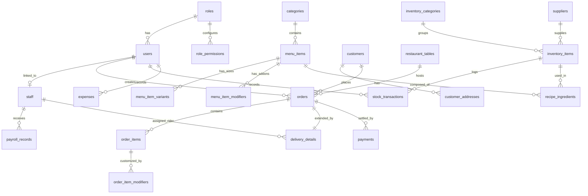

# Hungry Howie's — Clean Database Architecture

**System:** Hungry Howie's Restaurant Management & POS System  
**Target Engine:** PostgreSQL 15+ / 16+  
**Target ORM:** Prisma ORM (NestJS Backend Compatible)  
**Target Frontend:** Flutter POS (Desktop, Tablet, Web)  
**Architecture Scope:** Single-Branch Dedicated POS & Restaurant Management  
**Status:** Production-Ready • Minimal • Normalized (3NF)

---

## 1. Database Overview

This database architecture is designed specifically for **Hungry Howie’s Restaurant Management & POS System**. It is built strictly from the ground up to support the actual business features, UI screens, dialogs, and workflows implemented in the Flutter application.

### Key Architectural Principles:
1. **Single-Branch Model:** Purged of all multi-branch tenancy columns, enterprise company hierarchies, and warehouse routing overhead.
2. **Unified Order Pipeline:** A single central `orders` table handles all four service channels (`DINE_IN`, `TAKEAWAY`, `DELIVERY`, `ONLINE`) with a 1:1 `delivery_details` extension table for orders requiring rider dispatch.
3. **Streamlined Menu Catalog:** Direct hierarchical structure (`categories` → `menu_items` → `menu_item_variants` and `menu_item_modifiers`) eliminating deep modifier-group junction trees while fully supporting sizes (Regular, Large, Jumbo) and custom add-ons (Crusts, Extra Toppings, Sauces).
4. **Lean Double-Entry Inventory & Recipe Engine:** Tracks raw material balances via `inventory_items`, categorized by `inventory_categories`, supplied by `suppliers`, and logged immutably in `stock_transactions` (Stock In, Stock Out, Wastage, and Recipe Deductions). Automated recipe consumption is driven by `recipe_ingredients`.
5. **Granular RBAC:** Clean three-table access control (`roles`, `role_permissions`, `users`) supporting Owner, Manager, and Cashier tiers with toggleable module permissions matching the Manager Rights UI.
6. **Payroll & Shift Registry:** Dedicated `staff` and `payroll_records` tables tracking employee wages, allowances, deductions, disbursement history, and shift clock-in status without an over-engineered HR subsystem.
7. **Zero Duplicate Reporting Tables:** All analytical summaries (Sales by Hour, Product Sales, Category Mix, Expense vs. Revenue, P&L) are computed dynamically via optimized indexed queries on transactional tables.

---

## 2. Final Modules

The system is organized into **9 core functional modules**:

1. **Authentication & RBAC:** User accounts, password hashes, roles (Owner, Manager, Cashier), and granular module permissions.
2. **Staff & Payroll:** Employee profiles, designations (Chef, Waiter, Rider, Cashier), wage rates, shift status, and monthly salary disbursement slips.
3. **Floor & Table Management:** Dining room zones/sections, table numbers, guest capacity, and live occupancy status.
4. **Menu Catalog & Deals:** Food categories, menu items, size-specific price variants, modifier customizations (crusts/toppings), and combo bundle packages.
5. **Orders & Billing:** Central transactional order engine, line items, modifier choices, bill calculations, and multi-tender payment settlement.
6. **Kitchen & Dispatch (KOT/KDS):** Cooking timers, target prep times, rider assignments, transit durations, and delivery route tracking.
7. **Inventory & Recipes:** Raw ingredients, stock on hand, low-stock reorder thresholds, vendor directory, stock movement ledger, and recipe Bill of Materials (BOM).
8. **Expenses & Cash Flow:** Operational overhead tracking categorized by type (Utilities, Rent, Repairs, Petty Cash) and linked to recording cashiers.
9. **Customers & Settings:** Customer telephone directory, saved delivery addresses, and singleton restaurant business configuration.

---

## 3. Final Table List

| # | Table Name | Module | Primary Purpose |
| :--- | :--- | :--- | :--- |
| 1 | `roles` | Auth & Access | System authorization tiers (Owner, Manager, Cashier) |
| 2 | `role_permissions` | Auth & Access | Granular module permission flags for Manager Rights |
| 3 | `users` | Auth & Access | System login accounts and cashier/manager identities |
| 4 | `staff` | Staff & Payroll | Master employee registry and salary terms |
| 5 | `payroll_records` | Staff & Payroll | Monthly salary slips, allowances, deductions & payout status |
| 6 | `restaurant_tables` | Tables & Floor | Floor zones, table numbers, seating capacity & occupancy |
| 7 | `categories` | Menu & Catalog | Food menu category classifications |
| 8 | `menu_items` | Menu & Catalog | Master product catalog items |
| 9 | `menu_item_variants` | Menu & Catalog | Size-based price points (Regular, Large, Jumbo) |
| 10 | `menu_item_modifiers` | Menu & Catalog | Crust styles, extra toppings, dipping sauces & add-ons |
| 11 | `deals` | Menu & Catalog | Combo packages, family deals & discounted bundle definitions |
| 12 | `customers` | Customers | Registered customer profiles & phone directory |
| 13 | `customer_addresses` | Customers | Saved delivery street addresses & sector zones |
| 14 | `orders` | Orders & Billing | Central transaction header for Dine-In, Takeaway, Delivery & Online |
| 15 | `order_items` | Orders & Billing | Line items purchased with price snapshots |
| 16 | `order_item_modifiers` | Orders & Billing | Chosen customizations and add-on price snapshots |
| 17 | `delivery_details` | Delivery & Dispatch | 1:1 extension for delivery address, assigned rider & ETA tracking |
| 18 | `payments` | Orders & Billing | Payment transactions, multi-tender methods, cash & change return |
| 19 | `suppliers` | Inventory | Raw material vendor directory |
| 20 | `inventory_categories` | Inventory | Grouping classifications for raw ingredients |
| 21 | `inventory_items` | Inventory | Raw materials, measurement units, current balance & thresholds |
| 22 | `stock_transactions` | Inventory | Audit ledger for Stock In, Stock Out, Wastage & Recipe Deductions |
| 23 | `recipe_ingredients` | Inventory & Recipes | Bill of Materials (BOM) ingredient consumption formulas |
| 24 | `expenses` | Finance | Operational expenses, categories, payment methods & notes |
| 25 | `restaurant_settings` | Settings | Singleton restaurant profile, tax rate, delivery fee & receipt footer |

**Total Table Count: 25 Tables**

---

## 4. Detailed Table Definitions

### 1. `roles`
*Purpose:* Defines the base authorization tiers within the restaurant application.
| Field | Type | Nullable | Key | Default | Purpose |
| :--- | :--- | :--- | :--- | :--- | :--- |
| `id` | `VARCHAR(36)` | `NO` | `PK` | `gen_random_uuid()` | Unique role identifier |
| `name` | `VARCHAR(50)` | `NO` | `UNIQUE` | None | Role key (`owner`, `manager`, `cashier`) |
| `description` | `VARCHAR(255)` | `YES` | None | `NULL` | Human-readable role description |
| `created_at` | `TIMESTAMPTZ` | `NO` | None | `NOW()` | Timestamp of role creation |

*Explanation:* Provides the fixed authority tiers in the system. Pre-seeded with `owner`, `manager`, and `cashier`.

---

### 2. `role_permissions`
*Purpose:* Stores granular module-level permission rights (powers the Manager Rights screen).
| Field | Type | Nullable | Key | Default | Purpose |
| :--- | :--- | :--- | :--- | :--- | :--- |
| `id` | `VARCHAR(36)` | `NO` | `PK` | `gen_random_uuid()` | Permission row identifier |
| `role_id` | `VARCHAR(36)` | `NO` | `FK -> roles(id)` | None | Referenced role |
| `module_key` | `VARCHAR(50)` | `NO` | None | None | Feature identifier (`pos`, `tables`, `stock`, `reports`, etc.) |
| `can_view` | `BOOLEAN` | `NO` | None | `true` | View / access permission |
| `can_create` | `BOOLEAN` | `NO` | None | `false` | Add / insert permission |
| `can_edit` | `BOOLEAN` | `NO` | None | `false` | Edit / update permission |
| `can_delete` | `BOOLEAN` | `NO` | None | `false` | Delete / purge permission |

*Explanation:* Directly reflects the Manager Rights matrix UI in Flutter. When an Owner toggles permissions for Managers, this table persists those access boundaries.

---

### 3. `users`
*Purpose:* Stores system login credentials and terminal session accounts.
| Field | Type | Nullable | Key | Default | Purpose |
| :--- | :--- | :--- | :--- | :--- | :--- |
| `id` | `VARCHAR(36)` | `NO` | `PK` | `gen_random_uuid()` | Unique user UUID |
| `role_id` | `VARCHAR(36)` | `NO` | `FK -> roles(id)` | None | Assigned role |
| `username` | `VARCHAR(50)` | `NO` | `UNIQUE` | None | Unique login username |
| `password_hash` | `VARCHAR(255)` | `NO` | None | None | Bcrypt password hash |
| `full_name` | `VARCHAR(100)` | `NO` | None | None | Display name of the user |
| `phone` | `VARCHAR(20)` | `YES` | None | `NULL` | User phone number |
| `is_active` | `BOOLEAN` | `NO` | None | `true` | Active status toggle |
| `created_at` | `TIMESTAMPTZ` | `NO` | None | `NOW()` | Account creation timestamp |
| `updated_at` | `TIMESTAMPTZ` | `NO` | None | `NOW()` | Profile update timestamp |

*Explanation:* Central account repository for all staff members who log into the POS terminal, manager backoffice, or owner reporting portal.

---

### 4. `staff`
*Purpose:* Master employee registry, wage terms, and real-time shift clock-in status.
| Field | Type | Nullable | Key | Default | Purpose |
| :--- | :--- | :--- | :--- | :--- | :--- |
| `id` | `VARCHAR(36)` | `NO` | `PK` | `gen_random_uuid()` | Staff record UUID |
| `user_id` | `VARCHAR(36)` | `YES` | `FK -> users(id)` | `NULL` | Optional link to POS login account |
| `name` | `VARCHAR(100)` | `NO` | None | None | Full legal employee name |
| `designation` | `VARCHAR(50)` | `NO` | None | None | Job title (`Chef`, `Waiter`, `Rider`, `Cashier`) |
| `phone` | `VARCHAR(20)` | `NO` | `UNIQUE` | None | Contact mobile number |
| `email` | `VARCHAR(100)` | `YES` | None | `NULL` | Optional email address |
| `monthly_salary`| `NUMERIC(12,2)`| `NO` | None | `0.00` | Agreed base monthly salary (in Rs) |
| `hourly_rate` | `NUMERIC(10,2)`| `NO` | None | `0.00` | Hourly rate for overtime/hourly staff |
| `is_clocked_in` | `BOOLEAN` | `NO` | None | `false` | Real-time shift on-duty toggle |
| `joining_date` | `DATE` | `NO` | None | `CURRENT_DATE` | Date employee commenced employment |
| `is_active` | `BOOLEAN` | `NO` | None | `true` | Active employment status |
| `created_at` | `TIMESTAMPTZ` | `NO` | None | `NOW()` | Record creation timestamp |

*Explanation:* Manages all kitchen, floor, delivery rider, and administrative staff. Powers the Staff Management and Rider Fleet assignment screens.

---

### 5. `payroll_records`
*Purpose:* Historical records of monthly payroll disbursements, allowances, deductions, and payout statuses.
| Field | Type | Nullable | Key | Default | Purpose |
| :--- | :--- | :--- | :--- | :--- | :--- |
| `id` | `VARCHAR(36)` | `NO` | `PK` | `gen_random_uuid()` | Payroll record UUID |
| `staff_id` | `VARCHAR(36)` | `NO` | `FK -> staff(id)` | None | Employee reference |
| `payroll_month` | `VARCHAR(7)` | `NO` | None | None | Payroll cycle period (`YYYY-MM`) |
| `base_salary` | `NUMERIC(12,2)`| `NO` | None | `0.00` | Base salary amount |
| `allowances` | `NUMERIC(12,2)`| `NO` | None | `0.00` | Bonuses, overtime, incentives |
| `deductions` | `NUMERIC(12,2)`| `NO` | None | `0.00` | Penalties, advances, unpaid leaves |
| `net_salary` | `NUMERIC(12,2)`| `NO` | None | `0.00` | Calculated net payout |
| `payment_status`| `VARCHAR(20)` | `NO` | None | `'UNPAID'` | Status (`'PAID'`, `'UNPAID'`, `'PARTIAL'`) |
| `paid_at` | `TIMESTAMPTZ` | `YES` | None | `NULL` | Disbursement timestamp |
| `payment_method`| `VARCHAR(30)` | `YES` | None | `NULL` | Payment channel (`'Cash'`, `'Bank Transfer'`, `'EasyPaisa'`) |
| `notes` | `TEXT` | `YES` | None | `NULL` | Payout remarks or memo |

*Explanation:* Powers the Payroll screen, salary generation dialogs, and financial payroll reporting.

---

### 6. `restaurant_tables`
*Purpose:* Dining floor plan, seating capacity, table numbers, and live occupancy status.
| Field | Type | Nullable | Key | Default | Purpose |
| :--- | :--- | :--- | :--- | :--- | :--- |
| `id` | `VARCHAR(36)` | `NO` | `PK` | `gen_random_uuid()` | Table UUID |
| `table_number` | `VARCHAR(20)` | `NO` | `UNIQUE` | None | Display label (e.g. `T-01`, `VIP-1`) |
| `section` | `VARCHAR(50)` | `NO` | None | `'Hall'` | Floor zone (`Hall`, `Family Hall`, `VIP`, `Executive`) |
| `seating_capacity`| `INT` | `NO` | None | `4` | Guest capacity |
| `status` | `VARCHAR(20)` | `NO` | None | `'AVAILABLE'` | Status (`'AVAILABLE'`, `'OCCUPIED'`, `'RESERVED'`) |
| `active_order_id`| `VARCHAR(36)` | `YES` | None | `NULL` | Active occupied order reference |
| `created_at` | `TIMESTAMPTZ` | `NO` | None | `NOW()` | Timestamp |

*Explanation:* Direct backing table for the Dine-In Floor Plan grid, occupancy badges, table add/edit modal, and pre-bill calculations.

---

### 7. `categories`
*Purpose:* Menu food category classifications.
| Field | Type | Nullable | Key | Default | Purpose |
| :--- | :--- | :--- | :--- | :--- | :--- |
| `id` | `VARCHAR(36)` | `NO` | `PK` | `gen_random_uuid()` | Category UUID |
| `name` | `VARCHAR(100)` | `NO` | `UNIQUE` | None | Category title (e.g. `Pizzas`, `Burgers`, `Beverages`) |
| `sort_order` | `INT` | `NO` | None | `0` | UI display order |
| `is_active` | `BOOLEAN` | `NO` | None | `true` | Active status toggle |

*Explanation:* Categorizes menu items on POS ordering screens and backoffice menu management.

---

### 8. `menu_items`
*Purpose:* Master catalog of menu products.
| Field | Type | Nullable | Key | Default | Purpose |
| :--- | :--- | :--- | :--- | :--- | :--- |
| `id` | `VARCHAR(36)` | `NO` | `PK` | `gen_random_uuid()` | Menu item UUID |
| `category_id` | `VARCHAR(36)` | `NO` | `FK -> categories(id)` | None | Parent category |
| `name` | `VARCHAR(150)` | `NO` | None | None | Product title (e.g. `Cajun Stuffed Supreme`) |
| `description` | `TEXT` | `YES` | None | `NULL` | Ingredients / taste description |
| `base_price` | `NUMERIC(10,2)`| `NO` | None | `0.00` | Default price (used if no size variants exist) |
| `image_url` | `VARCHAR(255)` | `YES` | None | `NULL` | Product image URL |
| `is_available` | `BOOLEAN` | `NO` | None | `true` | In-stock / active toggle |
| `created_at` | `TIMESTAMPTZ` | `NO` | None | `NOW()` | Timestamp |

*Explanation:* Core food items displayed in the POS catalog, menu manager, and kitchen display.

---

### 9. `menu_item_variants`
*Purpose:* Size-based price points for menu items (e.g., Small, Regular, Large, Jumbo).
| Field | Type | Nullable | Key | Default | Purpose |
| :--- | :--- | :--- | :--- | :--- | :--- |
| `id` | `VARCHAR(36)` | `NO` | `PK` | `gen_random_uuid()` | Variant UUID |
| `menu_item_id` | `VARCHAR(36)` | `NO` | `FK -> menu_items(id)` | None | Parent menu item |
| `size_name` | `VARCHAR(50)` | `NO` | None | None | Portion label (`Small`, `Regular`, `Large`, `Jumbo`) |
| `price` | `NUMERIC(10,2)`| `NO` | None | None | Specific price for this portion |
| `is_default` | `BOOLEAN` | `NO` | None | `false` | Default selected variant |

*Explanation:* Allows pizzas and burgers to have distinct pricing per portion size.

---

### 10. `menu_item_modifiers`
*Purpose:* Available customizations, crust types, extra toppings, dipping sauces, and add-ons.
| Field | Type | Nullable | Key | Default | Purpose |
| :--- | :--- | :--- | :--- | :--- | :--- |
| `id` | `VARCHAR(36)` | `NO` | `PK` | `gen_random_uuid()` | Modifier UUID |
| `menu_item_id` | `VARCHAR(36)` | `YES` | `FK -> menu_items(id)` | `NULL` | Specific item link (or NULL if globally available) |
| `group_name` | `VARCHAR(50)` | `NO` | None | `'Crust'` | Modifier group (`Crust`, `Topping`, `Sauce`, `Dip`) |
| `name` | `VARCHAR(100)` | `NO` | None | None | Modifier name (e.g. `Cheese Stuffed Crust`, `Garlic Dip`) |
| `price` | `NUMERIC(10,2)`| `NO` | None | `0.00` | Additional price surcharge |
| `is_available` | `BOOLEAN` | `NO` | None | `true` | Active status toggle |

*Explanation:* Supports add-on pricing and crust selections shown in the POS Add-to-Cart dialog.

---

### 11. `deals`
*Purpose:* Combo deals, family packages, and discounted bundle offers.
| Field | Type | Nullable | Key | Default | Purpose |
| :--- | :--- | :--- | :--- | :--- | :--- |
| `id` | `VARCHAR(36)` | `NO` | `PK` | `gen_random_uuid()` | Deal UUID |
| `title` | `VARCHAR(150)` | `NO` | None | None | Deal name (e.g. `Midnight Deal 2`, `Family Feast`) |
| `description` | `TEXT` | `YES` | None | `NULL` | Bundle description |
| `deal_price` | `NUMERIC(10,2)`| `NO` | None | None | Bundle package price |
| `included_items`| `JSONB` | `NO` | None | `'[]'` | Structured JSON list of included products & sizes |
| `is_active` | `BOOLEAN` | `NO` | None | `true` | Active promotional status |
| `created_at` | `TIMESTAMPTZ` | `NO` | None | `NOW()` | Timestamp |

*Explanation:* Manages package offerings configured in the Deal Creation modal.

---

### 12. `customers`
*Purpose:* Customer contact registry and order history profiles.
| Field | Type | Nullable | Key | Default | Purpose |
| :--- | :--- | :--- | :--- | :--- | :--- |
| `id` | `VARCHAR(36)` | `NO` | `PK` | `gen_random_uuid()` | Customer UUID |
| `name` | `VARCHAR(100)` | `NO` | None | None | Customer full name |
| `phone` | `VARCHAR(20)` | `NO` | `UNIQUE` | None | Customer phone number (primary search key) |
| `email` | `VARCHAR(100)` | `YES` | None | `NULL` | Optional customer email |
| `created_at` | `TIMESTAMPTZ` | `NO` | None | `NOW()` | Registration timestamp |

*Explanation:* Stores customer identity for Takeaway, Delivery, and Online Order lookups.

---

### 13. `customer_addresses`
*Purpose:* Saved delivery addresses for repeat customers.
| Field | Type | Nullable | Key | Default | Purpose |
| :--- | :--- | :--- | :--- | :--- | :--- |
| `id` | `VARCHAR(36)` | `NO` | `PK` | `gen_random_uuid()` | Address UUID |
| `customer_id` | `VARCHAR(36)` | `NO` | `FK -> customers(id)` | None | Parent customer reference |
| `address_line` | `TEXT` | `NO` | None | None | Complete street address & landmark |
| `city_area` | `VARCHAR(100)` | `NO` | None | None | Sector / neighborhood (e.g. `F-8/3, Islamabad`) |
| `is_default` | `BOOLEAN` | `NO` | None | `false` | Default address flag |

*Explanation:* Populates the delivery destination selector in the Delivery POS order modal.

---

### 14. `orders`
*Purpose:* Central transactional entity for Dine-In, Takeaway, Delivery, and Online Orders.
| Field | Type | Nullable | Key | Default | Purpose |
| :--- | :--- | :--- | :--- | :--- | :--- |
| `id` | `VARCHAR(36)` | `NO` | `PK` | `gen_random_uuid()` | Order UUID |
| `order_number` | `VARCHAR(30)` | `NO` | `UNIQUE` | None | Human readable order # (e.g. `#ONL-1083`, `INV-402`) |
| `order_type` | `VARCHAR(20)` | `NO` | None | `'DINE_IN'` | Channel (`'DINE_IN'`, `'TAKEAWAY'`, `'DELIVERY'`, `'ONLINE'`) |
| `status` | `VARCHAR(20)` | `NO` | None | `'PENDING'` | State (`'PENDING'`, `'CONFIRMED'`, `'PREPARING'`, `'READY'`, `'COMPLETED'`, `'CANCELLED'`, `'REJECTED'`) |
| `table_id` | `VARCHAR(36)` | `YES` | `FK -> restaurant_tables(id)`| `NULL` | Table link (if Dine-In) |
| `customer_id` | `VARCHAR(36)` | `YES` | `FK -> customers(id)`| `NULL` | Customer link (if Takeaway/Delivery/Online) |
| `cashier_id` | `VARCHAR(36)` | `NO` | `FK -> users(id)` | None | Cashier who initiated/opened the order |
| `token_number` | `INT` | `YES` | None | `NULL` | Takeaway queue token # |
| `subtotal` | `NUMERIC(12,2)`| `NO` | None | `0.00` | Sum of item lines |
| `delivery_fee` | `NUMERIC(10,2)`| `NO` | None | `0.00` | Delivery charge applied |
| `discount_amount`| `NUMERIC(10,2)`| `NO` | None | `0.00` | Discount applied |
| `tax_amount` | `NUMERIC(10,2)`| `NO` | None | `0.00` | Sales tax amount |
| `grand_total` | `NUMERIC(12,2)`| `NO` | None | `0.00` | Net payable order amount |
| `cooking_time_minutes`| `INT` | `YES` | None | `25` | Target cooking duration (minutes) |
| `order_notes` | `TEXT` | `YES` | None | `NULL` | Special preparation instructions |
| `created_at` | `TIMESTAMPTZ` | `NO` | None | `NOW()` | Order creation timestamp |
| `completed_at` | `TIMESTAMPTZ` | `YES` | None | `NULL` | Settlement timestamp |

*Explanation:* Unified order header handling all sales channels. Serves as the primary parent for line items, payments, and delivery metadata.

---

### 15. `order_items`
*Purpose:* Individual menu products and deals purchased within an order.
| Field | Type | Nullable | Key | Default | Purpose |
| :--- | :--- | :--- | :--- | :--- | :--- |
| `id` | `VARCHAR(36)` | `NO` | `PK` | `gen_random_uuid()` | Line item UUID |
| `order_id` | `VARCHAR(36)` | `NO` | `FK -> orders(id)` | None | Parent order |
| `menu_item_id` | `VARCHAR(36)` | `YES` | `FK -> menu_items(id)` | `NULL` | Menu item reference |
| `deal_id` | `VARCHAR(36)` | `YES` | `FK -> deals(id)` | `NULL` | Deal reference (if combo) |
| `item_name` | `VARCHAR(150)` | `NO` | None | None | Historical item name snapshot |
| `size_name` | `VARCHAR(50)` | `YES` | None | `NULL` | Historical portion size snapshot |
| `unit_price` | `NUMERIC(10,2)`| `NO` | None | None | Historical unit price snapshot |
| `quantity` | `INT` | `NO` | None | `1` | Number of units |
| `total_price` | `NUMERIC(12,2)`| `NO` | None | None | `(unit_price * quantity) + modifier_costs` |

*Explanation:* Stores line-item transactions with historical price snapshots ensuring past receipts remain accurate even if catalog prices change.

---

### 16. `order_item_modifiers`
*Purpose:* Custom modifier options selected on a line item (e.g. Cheese Stuffed Crust, Jalapenos).
| Field | Type | Nullable | Key | Default | Purpose |
| :--- | :--- | :--- | :--- | :--- | :--- |
| `id` | `VARCHAR(36)` | `NO` | `PK` | `gen_random_uuid()` | Modifier link UUID |
| `order_item_id` | `VARCHAR(36)` | `NO` | `FK -> order_items(id)`| None | Parent line item |
| `modifier_id` | `VARCHAR(36)` | `YES` | `FK -> menu_item_modifiers(id)`| `NULL` | Master modifier reference |
| `modifier_name`| `VARCHAR(100)` | `NO` | None | None | Historical modifier name snapshot |
| `price` | `NUMERIC(10,2)`| `NO` | None | `0.00` | Historical add-on cost charged |

*Explanation:* Details exact customizations per line item for kitchen prep and billing breakdowns.

---

### 17. `delivery_details`
*Purpose:* 1:1 extension table storing delivery addresses, assigned riders, and estimated transit times.
| Field | Type | Nullable | Key | Default | Purpose |
| :--- | :--- | :--- | :--- | :--- | :--- |
| `id` | `VARCHAR(36)` | `NO` | `PK` | `gen_random_uuid()` | Delivery record UUID |
| `order_id` | `VARCHAR(36)` | `NO` | `UNIQUE, FK -> orders(id)`| None | 1:1 parent order link |
| `rider_id` | `VARCHAR(36)` | `YES` | `FK -> staff(id)` | `NULL` | Assigned delivery rider |
| `recipient_name`| `VARCHAR(100)` | `NO` | None | None | Contact name |
| `recipient_phone`| `VARCHAR(20)` | `NO` | None | None | Contact phone |
| `delivery_address`| `TEXT` | `NO` | None | None | Full delivery destination |
| `delivery_status`| `VARCHAR(20)` | `NO` | None | `'PENDING'` | Status (`'PENDING'`, `'DISPATCHED'`, `'DELIVERED'`, `'FAILED'`) |
| `estimated_time_minutes`| `INT` | `NO` | None | `30` | Estimated transit duration |
| `dispatched_at`| `TIMESTAMPTZ` | `YES` | None | `NULL` | Timestamp rider departed |
| `delivered_at` | `TIMESTAMPTZ` | `YES` | None | `NULL` | Timestamp delivery completed |

*Explanation:* Exclusively used for Delivery and Online orders. Drives the Delivery Tracking screen, Rider Dispatch Bill modals, and transit ETA timers.

---

### 18. `payments`
*Purpose:* Payment transactions, multi-tender splits, physical cash tendered, and change return computations.
| Field | Type | Nullable | Key | Default | Purpose |
| :--- | :--- | :--- | :--- | :--- | :--- |
| `id` | `VARCHAR(36)` | `NO` | `PK` | `gen_random_uuid()` | Payment UUID |
| `order_id` | `VARCHAR(36)` | `NO` | `FK -> orders(id)` | None | Parent order reference |
| `payment_method`| `VARCHAR(30)` | `NO` | None | `'CASH'` | Method (`'CASH'`, `'CARD'`, `'BANK_TRANSFER'`, `'EASYPAISA'`, `'JAZZCASH'`, `'SPLIT'`) |
| `amount_paid` | `NUMERIC(12,2)`| `NO` | None | None | Net bill amount settled |
| `cash_tendered`| `NUMERIC(12,2)`| `YES` | None | `NULL` | Customer physical cash handed |
| `change_returned`| `NUMERIC(12,2)`| `YES` | None | `0.00` | Change returned to customer |
| `transaction_ref`| `VARCHAR(100)`| `YES` | None | `NULL` | Card slip # / Digital txn code |
| `status` | `VARCHAR(20)` | `NO` | None | `'PAID'` | Status (`'PAID'`, `'REFUNDED'`, `'VOID'`) |
| `created_at` | `TIMESTAMPTZ` | `NO` | None | `NOW()` | Transaction settlement timestamp |

*Explanation:* Created when clicking `Pay Now` or `Save Tender` in the Full Bill & Cash Calculator modals across all screens.

---

### 19. `suppliers`
*Purpose:* Directory of vendors and distributors supplying raw inventory ingredients.
| Field | Type | Nullable | Key | Default | Purpose |
| :--- | :--- | :--- | :--- | :--- | :--- |
| `id` | `VARCHAR(36)` | `NO` | `PK` | `gen_random_uuid()` | Supplier UUID |
| `name` | `VARCHAR(100)` | `NO` | `UNIQUE` | None | Vendor / Company name |
| `contact_person`| `VARCHAR(100)` | `YES` | None | `NULL` | Representative name |
| `phone` | `VARCHAR(20)` | `NO` | None | None | Contact phone |
| `email` | `VARCHAR(100)` | `YES` | None | `NULL` | Contact email |
| `address` | `TEXT` | `YES` | None | `NULL` | Vendor location |
| `is_active` | `BOOLEAN` | `NO` | None | `true` | Active vendor status |

*Explanation:* Populates supplier selection dropdowns in the Stock In modal and Inventory Manager.

---

### 20. `inventory_categories`
*Purpose:* Classification groupings for raw materials (e.g. Dairy, Meat, Packaging, Sauces, Spices).
| Field | Type | Nullable | Key | Default | Purpose |
| :--- | :--- | :--- | :--- | :--- | :--- |
| `id` | `VARCHAR(36)` | `NO` | `PK` | `gen_random_uuid()` | Category UUID |
| `name` | `VARCHAR(100)` | `NO` | `UNIQUE` | None | Category title |

*Explanation:* Filters inventory items on Stock In / Stock Out screens and inventory status reports.

---

### 21. `inventory_items`
*Purpose:* Master catalog of raw ingredients, real-time stock balances, and low-stock reorder thresholds.
| Field | Type | Nullable | Key | Default | Purpose |
| :--- | :--- | :--- | :--- | :--- | :--- |
| `id` | `VARCHAR(36)` | `NO` | `PK` | `gen_random_uuid()` | Inventory item UUID |
| `category_id` | `VARCHAR(36)` | `NO` | `FK -> inventory_categories(id)` | None | Inventory category |
| `supplier_id` | `VARCHAR(36)` | `YES` | `FK -> suppliers(id)` | `NULL` | Default vendor |
| `name` | `VARCHAR(150)` | `NO` | `UNIQUE` | None | Raw item name (e.g. `Mozzarella Cheese`, `Pizza Boxes`) |
| `unit` | `VARCHAR(20)` | `NO` | None | `'kg'` | Measurement unit (`'kg'`, `'g'`, `'ltr'`, `'pcs'`, `'box'`) |
| `current_stock`| `NUMERIC(12,3)`| `NO` | None | `0.000` | Real-time stock balance on hand |
| `min_threshold`| `NUMERIC(12,3)`| `NO` | None | `5.000` | Low-stock alert threshold |
| `cost_per_unit`| `NUMERIC(10,2)`| `NO` | None | `0.00` | Default purchase cost per unit |
| `updated_at` | `TIMESTAMPTZ` | `NO` | None | `NOW()` | Last stock movement timestamp |

*Explanation:* Powers the Stock Catalog screen, low-stock warning banners, and real-time inventory valuations.

---

### 22. `stock_transactions`
*Purpose:* Immutable double-entry audit ledger for Stock In, manual Stock Out, Wastage, and Recipe Deductions.
| Field | Type | Nullable | Key | Default | Purpose |
| :--- | :--- | :--- | :--- | :--- | :--- |
| `id` | `VARCHAR(36)` | `NO` | `PK` | `gen_random_uuid()` | Transaction UUID |
| `inventory_item_id`| `VARCHAR(36)`| `NO` | `FK -> inventory_items(id)`| None | Raw material item |
| `user_id` | `VARCHAR(36)` | `NO` | `FK -> users(id)` | None | Cashier/Manager who recorded movement |
| `supplier_id` | `VARCHAR(36)` | `YES` | `FK -> suppliers(id)`| `NULL` | Supplier (for Stock In) |
| `transaction_type`| `VARCHAR(20)` | `NO` | None | None | Type (`'STOCK_IN'`, `'STOCK_OUT'`, `'WASTAGE'`, `'RECIPE_DEDUCTION'`) |
| `quantity` | `NUMERIC(12,3)`| `NO` | None | None | Quantity moved |
| `cost_per_unit`| `NUMERIC(10,2)`| `NO` | None | `0.00` | Valuation rate per unit |
| `total_cost` | `NUMERIC(12,2)`| `NO` | None | `0.00` | `quantity * cost_per_unit` |
| `reference_order_id`| `VARCHAR(36)`| `YES` | None | `NULL` | Linked order ID (for auto-deductions) |
| `notes` | `TEXT` | `YES` | None | `NULL` | Invoice # / Reason for movement |
| `created_at` | `TIMESTAMPTZ` | `NO` | None | `NOW()` | Entry timestamp |

*Explanation:* Powers the Stock In / Stock Out log tables, wastage tracking, and stock usage history.

---

### 23. `recipe_ingredients`
*Purpose:* Bill of Materials (BOM) linking prepared menu items to raw inventory consumption quantities.
| Field | Type | Nullable | Key | Default | Purpose |
| :--- | :--- | :--- | :--- | :--- | :--- |
| `id` | `VARCHAR(36)` | `NO` | `PK` | `gen_random_uuid()` | Recipe row UUID |
| `menu_item_id` | `VARCHAR(36)` | `NO` | `FK -> menu_items(id)` | None | Prepared food item |
| `inventory_item_id`| `VARCHAR(36)`| `NO` | `FK -> inventory_items(id)`| None | Raw ingredient deducted |
| `quantity_required`| `NUMERIC(10,3)`| `NO` | None | None | Quantity consumed per single sold unit |

*Explanation:* When an order is completed, the background engine queries this table to automatically deduct corresponding raw materials from `inventory_items.current_stock`.

---

### 24. `expenses`
*Purpose:* Operational restaurant overheads, utility bills, maintenance, and petty cash logs.
| Field | Type | Nullable | Key | Default | Purpose |
| :--- | :--- | :--- | :--- | :--- | :--- |
| `id` | `VARCHAR(36)` | `NO` | `PK` | `gen_random_uuid()` | Expense UUID |
| `user_id` | `VARCHAR(36)` | `NO` | `FK -> users(id)` | None | Cashier/Manager logging the expense |
| `category` | `VARCHAR(50)` | `NO` | None | `'General'` | Category (`Utilities`, `Rent`, `Repair`, `Supplies`) |
| `description` | `VARCHAR(255)` | `NO` | None | None | Expense description |
| `amount` | `NUMERIC(12,2)`| `NO` | None | None | Expense amount (in Rs) |
| `payment_method`| `VARCHAR(30)` | `NO` | None | `'Cash'` | Payment mode (`'Cash'`, `'Bank Transfer'`, `'Card'`) |
| `expense_date` | `DATE` | `NO` | None | `CURRENT_DATE` | Date expense was incurred |
| `created_at` | `TIMESTAMPTZ` | `NO` | None | `NOW()` | Record timestamp |

*Explanation:* Powers the Expenses screen, Add Expense modal, and P&L financial reports.

---

### 25. `restaurant_settings`
*Purpose:* Singleton configuration table for store profile, tax percentages, and default delivery fees.
| Field | Type | Nullable | Key | Default | Purpose |
| :--- | :--- | :--- | :--- | :--- | :--- |
| `id` | `VARCHAR(36)` | `NO` | `PK` | `'default'` | Fixed singleton key |
| `restaurant_name`| `VARCHAR(100)` | `NO` | None | `'Hungry Howie\'s Pizza'` | Restaurant brand name |
| `phone` | `VARCHAR(20)` | `NO` | None | `'+92 300 0000000'` | Primary store contact phone |
| `address` | `TEXT` | `NO` | None | `'Centaurus Mall, Islamabad'` | Primary store physical address |
| `tax_rate_percent`| `NUMERIC(5,2)`| `NO` | None | `5.00` | Default sales tax percentage |
| `default_delivery_charge`| `NUMERIC(10,2)`| `NO` | None | `150.00` | Base delivery charge (in Rs) |
| `receipt_footer_msg`| `TEXT` | `YES` | None | `'Thank you for choosing Hungry Howie\'s!'` | Receipt footer message |
| `updated_at` | `TIMESTAMPTZ` | `NO` | None | `NOW()` | Last settings update timestamp |

*Explanation:* Manages store configuration modified on the Settings screen and printed on receipts.

---

## 5. Relationships

```
roles (1) ───────────────< (N) users
roles (1) ───────────────< (N) role_permissions
users (1) ───────────────- (1) staff [optional link]
staff (1) ───────────────< (N) payroll_records
staff (1) ───────────────< (N) delivery_details [as assigned rider]

categories (1) ──────────< (N) menu_items
menu_items (1) ──────────< (N) menu_item_variants
menu_items (1) ──────────< (N) menu_item_modifiers
menu_items (1) ──────────< (N) recipe_ingredients

customers (1) ───────────< (N) customer_addresses
customers (1) ───────────< (N) orders
restaurant_tables (1) ───< (N) orders
users (1) ───────────────< (N) orders [as cashier]

orders (1) ──────────────< (N) order_items [CASCADE]
order_items (1) ─────────< (N) order_item_modifiers [CASCADE]
orders (1) ──────────────- (1) delivery_details [CASCADE]
orders (1) ──────────────< (N) payments

inventory_categories (1) < (N) inventory_items
suppliers (1) ───────────< (N) inventory_items
inventory_items (1) ─────< (N) stock_transactions
users (1) ───────────────< (N) stock_transactions
inventory_items (1) ─────< (N) recipe_ingredients

users (1) ───────────────< (N) expenses
```

### Relationship Cardinality Details:
- **`roles` → `users` (`1 : N`):** One role is assigned to multiple user accounts.
- **`roles` → `role_permissions` (`1 : N`):** One role has multiple module permission records (`ON DELETE CASCADE`).
- **`staff` → `payroll_records` (`1 : N`):** One staff member receives multiple monthly payroll slips.
- **`categories` → `menu_items` (`1 : N`):** One category groups multiple menu items.
- **`menu_items` → `menu_item_variants` (`1 : N`):** One item defines multiple size variants (`ON DELETE CASCADE`).
- **`menu_items` → `menu_item_modifiers` (`1 : N`):** One item defines custom add-on choices (`ON DELETE CASCADE`).
- **`customers` → `orders` (`1 : N`):** One customer places multiple orders over time.
- **`restaurant_tables` → `orders` (`1 : N`):** One table hosts multiple sequential orders.
- **`orders` → `order_items` (`1 : N`):** One order contains multiple product line items (`ON DELETE CASCADE`).
- **`order_items` → `order_item_modifiers` (`1 : N`):** One line item has custom selections (`ON DELETE CASCADE`).
- **`orders` → `delivery_details` (`1 : 1`):** An order requiring delivery has exactly one delivery tracking record (`ON DELETE CASCADE`).
- **`orders` → `payments` (`1 : N`):** An order is settled via one or more payment transactions.
- **`inventory_items` → `stock_transactions` (`1 : N`):** One inventory item logs multiple movement transactions.
- **`menu_items` & `inventory_items` → `recipe_ingredients` (`N : M` via junction):** Defines Bill of Materials linking prepared food to raw ingredients.

---

## 6. ER Diagram



---

## 7. Core Workflows

### 1. Login & Authentication
- User submits `username` and plain password on login screen.
- Backend queries `users` joined with `roles` where `username = :username AND is_active = true`.
- Password verified against `password_hash` via Bcrypt.
- Role and user session JWT returned to Flutter frontend.

### 2. User Creation & Deletion
- Owner opens Password Management / Staff Users screen.
- Adds user: Inserts record into `users` with selected `role_id`.
- Deletes user: Owner deletes Manager or Cashier accounts; protected Owner accounts cannot be deleted.

### 3. Permission Checking (Manager Rights)
- Owner toggles access checkboxes for a module on Manager Rights screen.
- Backend updates `role_permissions` row (`can_view`, `can_create`, `can_edit`, `can_delete`).
- When a Manager navigates in Flutter, `role_permissions` rules determine menu visibility and action permissions.

### 4. POS Order Placement (Dine-In, Takeaway, Delivery, Online)
- Cashier selects order type and items.
- Inserts header into `orders` (`order_type`, `subtotal`, `tax_amount`, `grand_total`, `status = 'PENDING'`).
- Inserts lines into `order_items` with historical snapshots of `item_name`, `size_name`, and `unit_price`.
- Inserts any add-ons into `order_item_modifiers`.
- If Dine-In: Updates `restaurant_tables` (`status = 'OCCUPIED'`, `active_order_id = orders.id`).
- If Delivery/Online: Inserts record into `delivery_details` with recipient address and estimated delivery minutes.

### 5. Kitchen & KOT (Kitchen Order Ticket)
- Kitchen ticket modal opens on POS screen.
- Cashier enters Cooking Time (minutes) in the input field.
- Order updates `orders.cooking_time_minutes`, displays estimated ready time, and prints KOT.

### 6. Delivery & Rider Dispatch
- Cashier opens Rider Dispatch Bill modal, enters Shipping Time (minutes), and assigns an on-duty rider from `staff`.
- Updates `delivery_details` (`rider_id = :riderId`, `delivery_status = 'DISPATCHED'`, `dispatched_at = NOW()`).
- Dispatch bill prints with arrival ETA.

### 7. Full Bill & Payment Settlement
- Cashier opens Full Bill & Cash Calculator modal.
- Selects quick cash chip or types cash amount into `Customer Cash Received (Rs)`.
- System calculates return change:
  - If `cash_received >= grand_total`: Displays green `RETURN CHANGE TO CUSTOMER` banner.
  - If `cash_received < grand_total`: Displays red `REMAINING BALANCE SHORT` banner.
- Cashier clicks **Pay Now** or **Mark as Tender**:
  - Inserts transaction into `payments` (`payment_method`, `amount_paid`, `cash_tendered`, `change_returned`).
  - Updates `orders` (`status = 'COMPLETED'`, `completed_at = NOW()`).
  - If Dine-In: Frees table in `restaurant_tables` (`status = 'AVAILABLE'`, `active_order_id = NULL`).
  - If Delivery: Updates `delivery_details.delivery_status = 'DELIVERED'`.
  - Opens Final Paid Receipt modal with `PRINT RECEIPT & FINISH`.

### 8. Automated Recipe Inventory Deduction
- On order completion, background worker queries `recipe_ingredients` for all items in `order_items`.
- For each ingredient, atomic query decrements `inventory_items.current_stock`:
  ```sql
  UPDATE inventory_items 
  SET current_stock = current_stock - :deductQty, updated_at = NOW() 
  WHERE id = :inventoryItemId;
  ```
- Inserts a transaction into `stock_transactions` with `transaction_type = 'RECIPE_DEDUCTION'`.

### 9. Stock In, Stock Out & Wastage
- **Stock In:** Cashier/Manager selects supplier and items in Stock In modal. Inserts rows into `stock_transactions` (`'STOCK_IN'`) and increments `inventory_items.current_stock`.
- **Stock Out / Wastage:** Selects reason and quantity in Stock Out modal. Inserts rows into `stock_transactions` (`'STOCK_OUT'` or `'WASTAGE'`) and decrements `inventory_items.current_stock`.

### 10. Staff Shift & Payroll
- **Clock In / Out:** Staff member toggles duty status on Rider Fleet or Staff screen; updates `staff.is_clocked_in`.
- **Payroll Disbursement:** Monthly salary generated in `payroll_records`. On payout, updates `payment_status = 'PAID'`, `paid_at = NOW()`, `payment_method = :method`.

### 11. Operational Expense Recording
- Cashier logs utility bill or maintenance cost in Add Expense modal.
- Inserts row into `expenses` with `category`, `amount`, `payment_method`, `user_id`.

### 12. Dynamic Reporting & Financial Intelligence
- All reports are generated on-the-fly via indexed SQL aggregations:
  - **Daily Revenue & Tax:** Aggregated from `orders` and `payments`.
  - **Top Selling Products:** Sum of `order_items.quantity` grouped by `item_name`.
  - **Net Profit & P&L:** Calculated via `SUM(orders.grand_total) - SUM(expenses.amount) - SUM(payroll_records.net_salary)`.

---

## 8. Indexes

```sql
-- Orders Indexes
CREATE INDEX idx_orders_status ON orders(status);
CREATE INDEX idx_orders_type ON orders(order_type);
CREATE INDEX idx_orders_created_at ON orders(created_at);
CREATE INDEX idx_orders_customer_id ON orders(customer_id);
CREATE INDEX idx_orders_table_id ON orders(table_id);

-- Order Items Indexes
CREATE INDEX idx_order_items_order_id ON order_items(order_id);
CREATE INDEX idx_order_items_menu_item_id ON order_items(menu_item_id);

-- Payments Indexes
CREATE INDEX idx_payments_order_id ON payments(order_id);
CREATE INDEX idx_payments_created_at ON payments(created_at);
CREATE INDEX idx_payments_method ON payments(payment_method);

-- Delivery Indexes
CREATE INDEX idx_delivery_details_rider_id ON delivery_details(rider_id);
CREATE INDEX idx_delivery_details_status ON delivery_details(delivery_status);

-- Inventory & Stock Indexes
CREATE INDEX idx_inventory_items_category_id ON inventory_items(category_id);
CREATE INDEX idx_stock_transactions_item_id ON stock_transactions(inventory_item_id);
CREATE INDEX idx_stock_transactions_created_at ON stock_transactions(created_at);
CREATE INDEX idx_recipe_ingredients_menu_item ON recipe_ingredients(menu_item_id);

-- Staff & Payroll Indexes
CREATE INDEX idx_staff_is_active ON staff(is_active);
CREATE INDEX idx_payroll_records_month ON payroll_records(payroll_month);

-- Expenses Indexes
CREATE INDEX idx_expenses_date ON expenses(expense_date);
CREATE INDEX idx_expenses_category ON expenses(category);
```

---

## 9. Constraints

### Primary Keys
- Every table utilizes a `VARCHAR(36)` UUID primary key (`id`).

### Unique Constraints
- `roles(name)`
- `role_permissions(role_id, module_key)`
- `users(username)`
- `staff(phone)`
- `restaurant_tables(table_number)`
- `categories(name)`
- `inventory_categories(name)`
- `inventory_items(name)`
- `suppliers(name)`
- `customers(phone)`
- `orders(order_number)`
- `delivery_details(order_id)`
- `recipe_ingredients(menu_item_id, inventory_item_id)`
- `payroll_records(staff_id, payroll_month)`

### Foreign Keys & Cascading Policies
- `orders` → `order_items`: `ON DELETE CASCADE`
- `order_items` → `order_item_modifiers`: `ON DELETE CASCADE`
- `orders` → `delivery_details`: `ON DELETE CASCADE`
- `orders` → `payments`: `ON DELETE RESTRICT` (Financial records protected from accidental purge)
- `menu_items` → `menu_item_variants`: `ON DELETE CASCADE`
- `menu_items` → `menu_item_modifiers`: `ON DELETE CASCADE`
- `customers` → `customer_addresses`: `ON DELETE CASCADE`
- `roles` → `role_permissions`: `ON DELETE CASCADE`

### Check Constraints
- `orders.grand_total >= 0.00`
- `orders.subtotal >= 0.00`
- `payments.amount_paid >= 0.00`
- `expenses.amount > 0.00`
- `staff.monthly_salary >= 0.00`
- `inventory_items.min_threshold >= 0.000`

---

## 10. Removed Architecture

The following tables and modules from legacy/over-engineered POS architectures were critically audited and **permanently removed**:

| Removed Table / Module | Reason for Removal |
| :--- | :--- |
| `branches` | Single-branch restaurant POS with no multi-branch requirement. |
| `companies` | Single-tenant dedicated application; company tenancy is redundant. |
| `user_sessions` | Handled statelessly via signed JWTs and client-side SharedPreferences. |
| `password_history` | Enterprise password rotation policy is not required. |
| `login_attempts` | Handled via in-memory rate limiters / API gateway security middleware. |
| `audit_logs` | Standalone POS operations do not require heavy generic log write amplification. |
| `modifier_groups` | Flattened into direct `menu_item_modifiers` for speed and simplicity. |
| `menu_item_modifier_groups` | Unneeded junction table eliminated. |
| `combo_components` | Combo items stored directly in `deals.included_items` JSON definitions. |
| `combo_component_options` | Unnecessary multi-level nesting eliminated. |
| `takeaway_orders` | Unified into single central `orders` table (`order_type = 'TAKEAWAY'`). |
| `delivery_orders` | Unified into single central `orders` table + `delivery_details`. |
| `online_orders` | Unified into single central `orders` table (`order_type = 'ONLINE'`). |
| `dine_in_orders` | Unified into single central `orders` table (`order_type = 'DINE_IN'`). |
| `order_status_history` | Current status and timestamps on `orders` and `delivery_details` fully suffice. |
| `order_holds` | Active carts managed in POS state memory without temporary table bloat. |
| `order_item_customization_links` | Simplified into direct `order_item_modifiers`. |
| `payment_splits` | Multi-tender calculations handled cleanly in `payments`. |
| `waitlist_entries` | Handled via table status `RESERVED` or in-memory queue. |
| `warehouses` | Single restaurant location with one on-site storeroom. |
| `purchase_orders` | Direct Stock In workflow logs raw material receipts without PO workflows. |
| `purchase_order_items` | Redundant with `stock_transactions`. |
| `goods_received_notes` | Redundant with `stock_transactions`. |
| `loyalty_accounts` | No customer loyalty point program in current application. |
| `loyalty_transactions` | No customer loyalty point program in current application. |
| `daily_report_snapshots` | All reports are dynamically computed from transactional tables. |

---

## 11. Prisma Schema Specification (`schema.prisma`)

```prisma
datasource db {
  provider = "postgresql"
  url      = env("DATABASE_URL")
}

generator client {
  provider = "prisma-client-js"
}

// ---------------------------------------------------------------------------
// 1. AUTHENTICATION & ACCESS CONTROL
// ---------------------------------------------------------------------------

model Role {
  id          String           @id @default(uuid()) @db.VarChar(36)
  name        String           @unique @db.VarChar(50)
  description String?          @db.VarChar(255)
  createdAt   DateTime         @default(now()) @map("created_at") @db.Timestamptz
  users       User[]
  permissions RolePermission[]

  @@map("roles")
}

model RolePermission {
  id         String   @id @default(uuid()) @db.VarChar(36)
  roleId     String   @map("role_id") @db.VarChar(36)
  moduleKey  String   @map("module_key") @db.VarChar(50)
  canView    Boolean  @default(true) @map("can_view")
  canCreate  Boolean  @default(false) @map("can_create")
  canEdit    Boolean  @default(false) @map("can_edit")
  canDelete  Boolean  @default(false) @map("can_delete")
  role       Role     @relation(fields: [roleId], references: [id], onDelete: Cascade)

  @@unique([roleId, moduleKey])
  @@map("role_permissions")
}

model User {
  id                String             @id @default(uuid()) @db.VarChar(36)
  roleId            String             @map("role_id") @db.VarChar(36)
  username          String             @unique @db.VarChar(50)
  passwordHash      String             @map("password_hash") @db.VarChar(255)
  fullName          String             @map("full_name") @db.VarChar(100)
  phone             String?            @db.VarChar(20)
  isActive          Boolean            @default(true) @map("is_active")
  createdAt         DateTime           @default(now()) @map("created_at") @db.Timestamptz
  updatedAt         DateTime           @updatedAt @map("updated_at") @db.Timestamptz
  role              Role               @relation(fields: [roleId], references: [id])
  staffProfile      Staff?
  ordersCreated     Order[]
  stockTransactions StockTransaction[]
  expensesRecorded  Expense[]

  @@map("users")
}

// ---------------------------------------------------------------------------
// 2. STAFF & PAYROLL
// ---------------------------------------------------------------------------

model Staff {
  id              String          @id @default(uuid()) @db.VarChar(36)
  userId          String?         @unique @map("user_id") @db.VarChar(36)
  name            String          @db.VarChar(100)
  designation     String          @db.VarChar(50)
  phone           String          @unique @db.VarChar(20)
  email           String?         @db.VarChar(100)
  monthlySalary   Decimal         @default(0.00) @map("monthly_salary") @db.Decimal(12, 2)
  hourlyRate      Decimal         @default(0.00) @map("hourly_rate") @db.Decimal(10, 2)
  isClockedIn     Boolean         @default(false) @map("is_clocked_in")
  joiningDate     DateTime        @default(now()) @map("joining_date") @db.Date
  isActive        Boolean         @default(true) @map("is_active")
  createdAt       DateTime        @default(now()) @map("created_at") @db.Timestamptz
  user            User?           @relation(fields: [userId], references: [id], onDelete: SetNull)
  payrolls        PayrollRecord[]
  deliveriesRider DeliveryDetail[]

  @@map("staff")
}

model PayrollRecord {
  id            String    @id @default(uuid()) @db.VarChar(36)
  staffId       String    @map("staff_id") @db.VarChar(36)
  payrollMonth  String    @map("payroll_month") @db.VarChar(7)
  baseSalary    Decimal   @default(0.00) @map("base_salary") @db.Decimal(12, 2)
  allowances    Decimal   @default(0.00) @db.Decimal(12, 2)
  deductions    Decimal   @default(0.00) @db.Decimal(12, 2)
  netSalary     Decimal   @default(0.00) @map("net_salary") @db.Decimal(12, 2)
  paymentStatus String    @default("UNPAID") @map("payment_status") @db.VarChar(20)
  paidAt        DateTime? @map("paid_at") @db.Timestamptz
  paymentMethod String?   @map("payment_method") @db.VarChar(30)
  notes         String?   @db.Text
  staff         Staff     @relation(fields: [staffId], references: [id], onDelete: Cascade)

  @@unique([staffId, payrollMonth])
  @@map("payroll_records")
}

// ---------------------------------------------------------------------------
// 3. FLOOR & TABLES
// ---------------------------------------------------------------------------

model RestaurantTable {
  id              String   @id @default(uuid()) @db.VarChar(36)
  tableNumber     String   @unique @map("table_number") @db.VarChar(20)
  section         String   @default("Hall") @db.VarChar(50)
  seatingCapacity Int      @default(4) @map("seating_capacity")
  status          String   @default("AVAILABLE") @db.VarChar(20)
  activeOrderId   String?  @map("active_order_id") @db.VarChar(36)
  createdAt       DateTime @default(now()) @map("created_at") @db.Timestamptz
  orders          Order[]

  @@map("restaurant_tables")
}

// ---------------------------------------------------------------------------
// 4. MENU, VARIANTS, MODIFIERS & DEALS
// ---------------------------------------------------------------------------

model Category {
  id        String     @id @default(uuid()) @db.VarChar(36)
  name      String     @unique @db.VarChar(100)
  sortOrder Int        @default(0) @map("sort_order")
  isActive  Boolean    @default(true) @map("is_active")
  items     MenuItem[]

  @@map("categories")
}

model MenuItem {
  id          String             @id @default(uuid()) @db.VarChar(36)
  categoryId  String             @map("category_id") @db.VarChar(36)
  name        String             @db.VarChar(150)
  description String?            @db.Text
  basePrice   Decimal            @default(0.00) @map("base_price") @db.Decimal(10, 2)
  imageUrl    String?            @map("image_url") @db.VarChar(255)
  isAvailable Boolean            @default(true) @map("is_available")
  createdAt   DateTime           @default(now()) @map("created_at") @db.Timestamptz
  category    Category           @relation(fields: [categoryId], references: [id])
  variants    MenuItemVariant[]
  modifiers   MenuItemModifier[]
  recipes     RecipeIngredient[]
  orderItems  OrderItem[]

  @@map("menu_items")
}

model MenuItemVariant {
  id         String   @id @default(uuid()) @db.VarChar(36)
  menuItemId String   @map("menu_item_id") @db.VarChar(36)
  sizeName   String   @map("size_name") @db.VarChar(50)
  price      Decimal  @db.Decimal(10, 2)
  isDefault  Boolean  @default(false) @map("is_default")
  menuItem   MenuItem @relation(fields: [menuItemId], references: [id], onDelete: Cascade)

  @@map("menu_item_variants")
}

model MenuItemModifier {
  id                 String              @id @default(uuid()) @db.VarChar(36)
  menuItemId         String?             @map("menu_item_id") @db.VarChar(36)
  groupName          String              @default("Crust") @map("group_name") @db.VarChar(50)
  name               String              @db.VarChar(100)
  price              Decimal             @default(0.00) @db.Decimal(10, 2)
  isAvailable        Boolean             @default(true) @map("is_available")
  menuItem           MenuItem?           @relation(fields: [menuItemId], references: [id], onDelete: Cascade)
  orderItemModifiers OrderItemModifier[]

  @@map("menu_item_modifiers")
}

model Deal {
  id            String      @id @default(uuid()) @db.VarChar(36)
  title         String      @db.VarChar(150)
  description   String?     @db.Text
  dealPrice     Decimal     @map("deal_price") @db.Decimal(10, 2)
  includedItems Json        @default("[]") @map("included_items")
  isActive      Boolean     @default(true) @map("is_active")
  createdAt     DateTime    @default(now()) @map("created_at") @db.Timestamptz
  orderItems    OrderItem[]

  @@map("deals")
}

// ---------------------------------------------------------------------------
// 5. CUSTOMERS & SAVED ADDRESSES
// ---------------------------------------------------------------------------

model Customer {
  id        String            @id @default(uuid()) @db.VarChar(36)
  name      String            @db.VarChar(100)
  phone     String            @unique @db.VarChar(20)
  email     String?           @db.VarChar(100)
  createdAt DateTime          @default(now()) @map("created_at") @db.Timestamptz
  addresses CustomerAddress[]
  orders    Order[]

  @@map("customers")
}

model CustomerAddress {
  id          String   @id @default(uuid()) @db.VarChar(36)
  customerId  String   @map("customer_id") @db.VarChar(36)
  addressLine String   @map("address_line") @db.Text
  cityArea    String   @map("city_area") @db.VarChar(100)
  isDefault   Boolean  @default(false) @map("is_default")
  customer    Customer @relation(fields: [customerId], references: [id], onDelete: Cascade)

  @@map("customer_addresses")
}

// ---------------------------------------------------------------------------
// 6. ORDERS, LINE ITEMS, DELIVERIES & PAYMENTS
// ---------------------------------------------------------------------------

model Order {
  id                 String           @id @default(uuid()) @db.VarChar(36)
  orderNumber        String           @unique @map("order_number") @db.VarChar(30)
  orderType          String           @default("DINE_IN") @map("order_type") @db.VarChar(20)
  status             String           @default("PENDING") @db.VarChar(20)
  tableId            String?          @map("table_id") @db.VarChar(36)
  customerId         String?          @map("customer_id") @db.VarChar(36)
  cashierId          String           @map("cashier_id") @db.VarChar(36)
  tokenNumber        Int?             @map("token_number")
  subtotal           Decimal          @default(0.00) @db.Decimal(12, 2)
  deliveryFee        Decimal          @default(0.00) @map("delivery_fee") @db.Decimal(10, 2)
  discountAmount     Decimal          @default(0.00) @map("discount_amount") @db.Decimal(10, 2)
  taxAmount          Decimal          @default(0.00) @map("tax_amount") @db.Decimal(10, 2)
  grandTotal         Decimal          @default(0.00) @map("grand_total") @db.Decimal(12, 2)
  cookingTimeMinutes Int?             @default(25) @map("cooking_time_minutes")
  orderNotes         String?          @map("order_notes") @db.Text
  createdAt          DateTime         @default(now()) @map("created_at") @db.Timestamptz
  completedAt        DateTime?        @map("completed_at") @db.Timestamptz
  table              RestaurantTable? @relation(fields: [tableId], references: [id], onDelete: SetNull)
  customer           Customer?        @relation(fields: [customerId], references: [id], onDelete: SetNull)
  cashier            User             @relation(fields: [cashierId], references: [id])
  items              OrderItem[]
  deliveryDetails    DeliveryDetail?
  payments           Payment[]

  @@map("orders")
}

model OrderItem {
  id         String              @id @default(uuid()) @db.VarChar(36)
  orderId    String              @map("order_id") @db.VarChar(36)
  menuItemId String?             @map("menu_item_id") @db.VarChar(36)
  dealId     String?             @map("deal_id") @db.VarChar(36)
  itemName   String              @map("item_name") @db.VarChar(150)
  sizeName   String?             @map("size_name") @db.VarChar(50)
  unitPrice  Decimal             @map("unit_price") @db.Decimal(10, 2)
  quantity   Int                 @default(1)
  totalPrice Decimal             @map("total_price") @db.Decimal(12, 2)
  order      Order               @relation(fields: [orderId], references: [id], onDelete: Cascade)
  menuItem   MenuItem?           @relation(fields: [menuItemId], references: [id], onDelete: SetNull)
  deal       Deal?               @relation(fields: [dealId], references: [id], onDelete: SetNull)
  modifiers  OrderItemModifier[]

  @@map("order_items")
}

model OrderItemModifier {
  id           String            @id @default(uuid()) @db.VarChar(36)
  orderItemId  String            @map("order_item_id") @db.VarChar(36)
  modifierId   String?           @map("modifier_id") @db.VarChar(36)
  modifierName String            @map("modifier_name") @db.VarChar(100)
  price        Decimal           @default(0.00) @db.Decimal(10, 2)
  orderItem    OrderItem         @relation(fields: [orderItemId], references: [id], onDelete: Cascade)
  modifier     MenuItemModifier? @relation(fields: [modifierId], references: [id], onDelete: SetNull)

  @@map("order_item_modifiers")
}

model DeliveryDetail {
  id                   String    @id @default(uuid()) @db.VarChar(36)
  orderId              String    @unique @map("order_id") @db.VarChar(36)
  riderId              String?   @map("rider_id") @db.VarChar(36)
  recipientName        String    @map("recipient_name") @db.VarChar(100)
  recipientPhone       String    @map("recipient_phone") @db.VarChar(20)
  deliveryAddress      String    @map("delivery_address") @db.Text
  deliveryStatus       String    @default("PENDING") @map("delivery_status") @db.VarChar(20)
  estimatedTimeMinutes Int       @default(30) @map("estimated_time_minutes")
  dispatchedAt         DateTime? @map("dispatched_at") @db.Timestamptz
  deliveredAt          DateTime? @map("delivered_at") @db.Timestamptz
  order                Order     @relation(fields: [orderId], references: [id], onDelete: Cascade)
  rider                Staff?    @relation(fields: [riderId], references: [id], onDelete: SetNull)

  @@map("delivery_details")
}

model Payment {
  id             String   @id @default(uuid()) @db.VarChar(36)
  orderId        String   @map("order_id") @db.VarChar(36)
  paymentMethod  String   @default("CASH") @map("payment_method") @db.VarChar(30)
  amountPaid     Decimal  @map("amount_paid") @db.Decimal(12, 2)
  cashTendered   Decimal? @map("cash_tendered") @db.Decimal(12, 2)
  changeReturned Decimal? @default(0.00) @map("change_returned") @db.Decimal(12, 2)
  transactionRef String?  @map("transaction_ref") @db.VarChar(100)
  status         String   @default("PAID") @db.VarChar(20)
  createdAt      DateTime @default(now()) @map("created_at") @db.Timestamptz
  order          Order    @relation(fields: [orderId], references: [id], onDelete: Restrict)

  @@map("payments")
}

// ---------------------------------------------------------------------------
// 7. INVENTORY, SUPPLIERS & RECIPES
// ---------------------------------------------------------------------------

model Supplier {
  id            String             @id @default(uuid()) @db.VarChar(36)
  name          String             @unique @db.VarChar(100)
  contactPerson String?            @map("contact_person") @db.VarChar(100)
  phone         String             @db.VarChar(20)
  email         String?            @db.VarChar(100)
  address       String?            @db.Text
  isActive      Boolean            @default(true) @map("is_active")
  items         InventoryItem[]
  transactions  StockTransaction[]

  @@map("suppliers")
}

model InventoryCategory {
  id    String          @id @default(uuid()) @db.VarChar(36)
  name  String          @unique @db.VarChar(100)
  items InventoryItem[]

  @@map("inventory_categories")
}

model InventoryItem {
  id           String             @id @default(uuid()) @db.VarChar(36)
  categoryId   String             @map("category_id") @db.VarChar(36)
  supplierId   String?            @map("supplier_id") @db.VarChar(36)
  name         String             @unique @db.VarChar(150)
  unit         String             @default("kg") @db.VarChar(20)
  currentStock Decimal            @default(0.000) @map("current_stock") @db.Decimal(12, 3)
  minThreshold Decimal            @default(5.000) @map("min_threshold") @db.Decimal(12, 3)
  costPerUnit  Decimal            @default(0.00) @map("cost_per_unit") @db.Decimal(10, 2)
  updatedAt    DateTime           @updatedAt @map("updated_at") @db.Timestamptz
  category     InventoryCategory  @relation(fields: [categoryId], references: [id])
  supplier     Supplier?          @relation(fields: [supplierId], references: [id], onDelete: SetNull)
  transactions StockTransaction[]
  recipes      RecipeIngredient[]

  @@map("inventory_items")
}

model StockTransaction {
  id               String        @id @default(uuid()) @db.VarChar(36)
  inventoryItemId  String        @map("inventory_item_id") @db.VarChar(36)
  userId           String        @map("user_id") @db.VarChar(36)
  supplierId       String?       @map("supplier_id") @db.VarChar(36)
  transactionType  String        @map("transaction_type") @db.VarChar(20)
  quantity         Decimal       @db.Decimal(12, 3)
  costPerUnit      Decimal       @default(0.00) @map("cost_per_unit") @db.Decimal(10, 2)
  totalCost        Decimal       @default(0.00) @map("total_cost") @db.Decimal(12, 2)
  referenceOrderId String?       @map("reference_order_id") @db.VarChar(36)
  notes            String?       @db.Text
  createdAt        DateTime      @default(now()) @map("created_at") @db.Timestamptz
  inventoryItem    InventoryItem @relation(fields: [inventoryItemId], references: [id])
  user             User          @relation(fields: [userId], references: [id])
  supplier         Supplier?     @relation(fields: [supplierId], references: [id], onDelete: SetNull)

  @@map("stock_transactions")
}

model RecipeIngredient {
  id               String        @id @default(uuid()) @db.VarChar(36)
  menuItemId       String        @map("menu_item_id") @db.VarChar(36)
  inventoryItemId  String        @map("inventory_item_id") @db.VarChar(36)
  quantityRequired Decimal       @map("quantity_required") @db.Decimal(10, 3)
  menuItem         MenuItem      @relation(fields: [menuItemId], references: [id], onDelete: Cascade)
  inventoryItem    InventoryItem @relation(fields: [inventoryItemId], references: [id])

  @@unique([menuItemId, inventoryItemId])
  @@map("recipe_ingredients")
}

// ---------------------------------------------------------------------------
// 8. EXPENSES & RESTAURANT SETTINGS
// ---------------------------------------------------------------------------

model Expense {
  id            String   @id @default(uuid()) @db.VarChar(36)
  userId        String   @map("user_id") @db.VarChar(36)
  category      String   @default("General") @db.VarChar(50)
  description   String   @db.VarChar(255)
  amount        Decimal  @db.Decimal(12, 2)
  paymentMethod String   @default("Cash") @map("payment_method") @db.VarChar(30)
  expenseDate   DateTime @default(now()) @map("expense_date") @db.Date
  createdAt     DateTime @default(now()) @map("created_at") @db.Timestamptz
  recordedBy    User     @relation(fields: [userId], references: [id])

  @@map("expenses")
}

model RestaurantSettings {
  id                    String   @id @default("default") @db.VarChar(36)
  restaurantName        String   @default("Hungry Howie's Pizza") @map("restaurant_name") @db.VarChar(100)
  phone                 String   @default("+92 300 0000000") @db.VarChar(20)
  address               String   @default("Centaurus Mall, Islamabad") @db.Text
  taxRatePercent        Decimal  @default(5.00) @map("tax_rate_percent") @db.Decimal(5, 2)
  defaultDeliveryCharge Decimal  @default(150.00) @map("default_delivery_charge") @db.Decimal(10, 2)
  receiptFooterMsg      String?  @default("Thank you for choosing Hungry Howie's!") @map("receipt_footer_msg") @db.Text
  updatedAt             DateTime @updatedAt @map("updated_at") @db.Timestamptz

  @@map("restaurant_settings")
}
```
